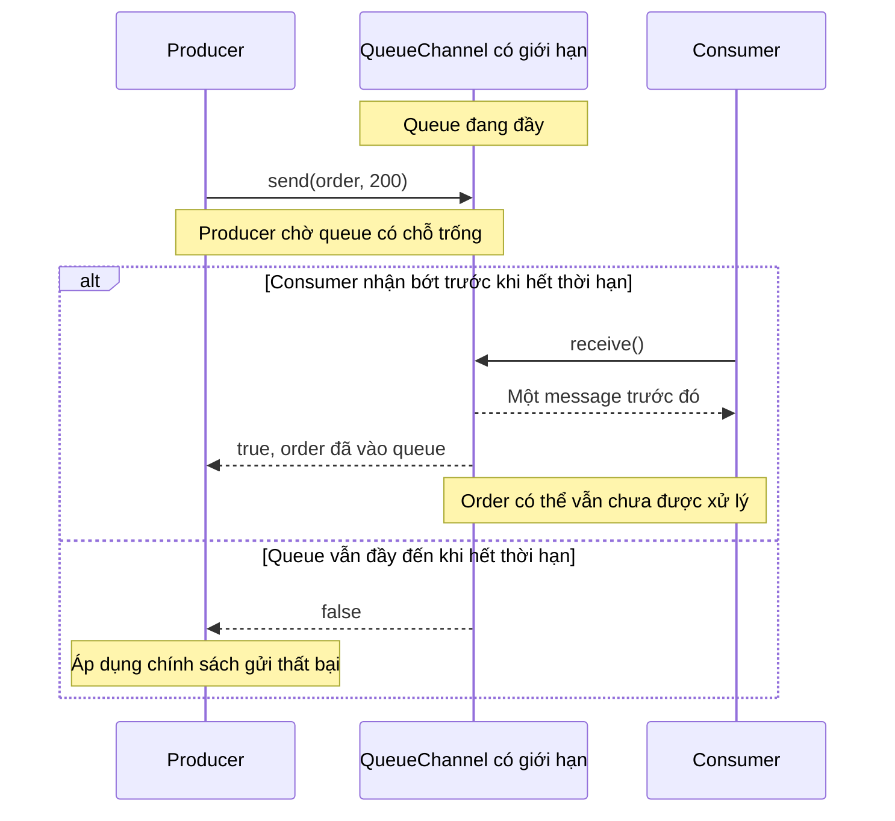

# Send timeout

Trong chương **Message channel** của module **SPRING_INTEGRATION_CORE**, send timeout trả lời câu hỏi: **producer chấp nhận chờ bao lâu để channel tiếp nhận một message?** Đây là một quyết định tại ranh giới gửi thông điệp, ảnh hưởng trực tiếp đến khả năng chịu tải và cách báo lỗi của luồng tích hợp.

Giả sử ứng dụng nhận yêu cầu nhập đơn hàng nhanh hơn worker xử lý. Một queue có giới hạn dung lượng sẽ đầy. Nếu producer tiếp tục chờ không giới hạn, các thread nhận yêu cầu có thể bị giữ lại. Send timeout cho phép ứng dụng giới hạn việc chờ rồi thực hiện chính sách xử lý khi không gửi được.

Bài học sử dụng API của Spring Integration 6.5 và Spring Messaging, với timeout được cấu hình tường minh. Các ví dụ Java độc lập cần dependency `org.springframework.integration:spring-integration-core`; phần cấu hình cần Spring application context, phần kiểm thử minh họa cần JUnit Jupiter. Hãy dùng phiên bản dependency được BOM của dự án quản lý.

## 1. Mục tiêu và kiến thức nền

Sau bài học, bạn có thể:

- Giải thích ý nghĩa của timeout tại thao tác gửi vào `MessageChannel`.
- Lựa chọn giữa không chờ, chờ có giới hạn và chờ không giới hạn.
- Dự đoán hành vi của `QueueChannel`, `RendezvousChannel`, `DirectChannel` và `ExecutorChannel`.
- Cấu hình timeout tại producer, `MessagingTemplate`, gateway và endpoint trong Java DSL.
- Phân biệt gửi thất bại với chưa nhận được phản hồi, từ đó thiết kế xử lý lỗi phù hợp.
- Viết kiểm thử cho queue đầy và việc gửi thành công khi consumer giải phóng chỗ trống.

Bạn cần biết `Message` gồm payload và headers; producer gửi vào channel; endpoint nhận message để biến đổi, định tuyến hoặc gọi nghiệp vụ. Với channel có hàng đợi, việc tiếp nhận và việc xử lý thường nằm ở hai thời điểm khác nhau.

## 2. Hợp đồng của thao tác gửi

`MessageChannel` cung cấp hai dạng gọi chính:

```java
boolean send(Message<?> message);
boolean send(Message<?> message, long timeout);
```

Tham số `timeout` có đơn vị **mili giây**. `true` biểu thị thao tác gửi thành công theo hợp đồng của channel; `false` biểu thị không gửi được. Lỗi cũng có thể được biểu diễn bằng runtime exception, vì vậy không thể xem mọi trường hợp thất bại đều là `false`. Dạng gọi không truyền timeout có thể chờ vô hạn, tùy implementation. [Javadoc MessageChannel](https://docs.spring.io/spring-framework/docs/current/javadoc-api/org/springframework/messaging/MessageChannel.html)

Với `QueueChannel` sử dụng hàng đợi chặn thông thường:

| Giá trị | Hành vi khi queue đang đầy | Tình huống sử dụng |
|---|---|---|
| `0` | Thử gửi ngay; không chờ chỗ trống | Producer cần quyết định ngay có nhận thêm tải được không |
| Số dương, chẳng hạn `200` | Chờ chỗ trống trong khoảng tối đa được yêu cầu | Cho phép hấp thụ nghẽn ngắn hạn |
| `-1`, tương ứng `MessageChannel.INDEFINITE_TIMEOUT` | Chờ đến khi có thể gửi, trừ khi bị gián đoạn | Luồng đã chủ động chấp nhận chờ không giới hạn |

Implementation sử dụng `offer`, `offer` có thời hạn hoặc `put` tương ứng. Nếu thread bị interrupt trong khi chờ, `QueueChannel` khôi phục cờ interrupt và trả `false`. Do đó, ngay trong trường hợp này, `false` cũng không tự chứng minh nguyên nhân là hết thời gian. Các chi tiết trên áp dụng cho queue chặn; khi truyền một queue tùy biến vào constructor, cần kiểm tra hợp đồng của queue đó. [Mã nguồn QueueChannel 6.5.0](https://raw.githubusercontent.com/spring-projects/spring-integration/v6.5.0/spring-integration-core/src/main/java/org/springframework/integration/channel/QueueChannel.java)

Không diễn giải `send(message, 0)` thành “toàn bộ lời gọi phải kết thúc tức thì”. Ý nghĩa là không chờ điều kiện tiếp nhận theo cơ chế timeout của channel. Lời gọi vẫn có thể thực hiện interceptor hoặc xử lý đồng bộ khác.

## 3. Send timeout nằm ở đâu trong vòng đời message?

Xét luồng nhập đơn hàng:



Nếu queue đã có chỗ trống, producer không cần đợi đủ `200 ms`. Nếu gửi thất bại vì queue đầy hết thời hạn, message mới không được thêm vào queue đó. Những message đã có sẵn vẫn nằm trong queue.

Trong mô hình đơn hàng, cần phân biệt ba dấu mốc:

| Dấu mốc | Điều ứng dụng biết | Điều chưa được xác nhận |
|---|---|---|
| Channel tiếp nhận | Message đã vượt qua lần gửi này | Consumer đã bắt đầu xử lý hay chưa |
| Consumer lấy message | Message đã được giao cho bước tiêu thụ | Nghiệp vụ đã hoàn tất hay chưa |
| Nghiệp vụ xác nhận | Kết quả được ghi nhận theo giao thức của ứng dụng | Mức bền vững còn tùy transaction, kho lưu và hệ thống đích |

Ví dụ, API trả “đã nhận xử lý” sau khi enqueue cần có nghĩa khác với “đã tạo đơn thành công”. Send timeout giúp kiểm soát dấu mốc đầu tiên; ứng dụng phải thiết kế xác nhận nghiệp vụ riêng.

## 4. Hành vi phụ thuộc loại channel

### 4.1. QueueChannel: chờ dung lượng

`QueueChannel` có capacity hữu hạn là ví dụ dễ quan sát nhất. Khi còn dung lượng, gửi thành công mà chưa cần consumer sẵn sàng. Khi đầy, thao tác gửi có thể đợi consumer nhận bớt message. Channel mặc định không truyền capacity có giới hạn rất lớn là `Integer.MAX_VALUE`, nên thường khó tạo tình huống đầy trong thử nghiệm nhỏ. [Message Channel Implementations — QueueChannel](https://docs.spring.io/spring-integration/reference/6.5/channel/implementations.html#queuechannel)

Dung lượng queue và thời gian chờ gửi là hai quyết định khác nhau. Trong ví dụ giả định, queue chứa tối đa 100 đơn nhưng producer chỉ đợi 200 ms. Queue không trở thành queue 200 phần tử, và message đã vào queue cũng không tự hết hạn sau 200 ms.

### 4.2. RendezvousChannel: chờ bên nhận

`RendezvousChannel` dùng `SynchronousQueue` và không có vùng đệm lưu message. Gửi thành công cần có thao tác nhận tương ứng để bàn giao. Vì thế send timeout có ý nghĩa ngay cả khi không có một queue chứa message đang đầy: producer đang đợi bên nhận xuất hiện. [Javadoc RendezvousChannel](https://docs.spring.io/spring-integration/docs/6.5.0/api/org/springframework/integration/channel/RendezvousChannel.html)

```java
RendezvousChannel handoff = new RendezvousChannel();
boolean sent = handoff.send(
        MessageBuilder.withPayload("ORDER-101").build(),
        100);
```

Đoạn minh họa cần import `RendezvousChannel` từ `org.springframework.integration.channel` và `MessageBuilder` từ `org.springframework.messaging.support`. Khi không có thread nào nhận, lần gửi trả `false` sau khoảng chờ. Khi bàn giao thành công, consumer vẫn cần thực hiện phần nghiệp vụ của nó.

### 4.3. DirectChannel: gọi handler trong thread gửi

`DirectChannel` gọi subscriber trong chính thread của producer. Không có bước chờ dung lượng hàng đợi để áp dụng send timeout như ví dụ queue. Nếu handler chạy lâu, lời gọi gửi cũng kéo dài. [Javadoc DirectChannel](https://docs.spring.io/spring-integration/docs/6.5.0/api/org/springframework/integration/channel/DirectChannel.html)

```text
Producer thread
  -> directChannel.send(message, 50)
     -> handler gọi một dịch vụ mất 2 giây
     <- handler kết thúc
  <- send kết thúc sau phần xử lý đồng bộ
```

Giá trị `50` không tạo một bộ hẹn giờ để ngắt handler sau 50 ms. Phương thức `doSend` của lớp channel có subscriber chuyển message tới dispatcher mà không dùng tham số timeout để bao quanh thời gian xử lý. [Mã nguồn AbstractSubscribableChannel 6.5.0](https://raw.githubusercontent.com/spring-projects/spring-integration/v6.5.0/spring-integration-core/src/main/java/org/springframework/integration/channel/AbstractSubscribableChannel.java)

Nếu handler cần gọi HTTP hoặc truy vấn cơ sở dữ liệu, hãy đặt thời hạn ở client hoặc thao tác tương ứng. Timeout gửi channel không thay thế những cấu hình đó.

### 4.4. ExecutorChannel: phụ thuộc executor

`ExecutorChannel` chuyển công việc đến executor, thường để handler chạy trên thread khác. Việc submit task và chính sách khi executor quá tải là một ranh giới riêng. Không nên suy ra rằng `send(message, 200)` cấu hình thời gian chờ trong hàng đợi nội bộ của bất kỳ executor nào. [Javadoc ExecutorChannel](https://docs.spring.io/spring-integration/docs/6.5.0/api/org/springframework/integration/channel/ExecutorChannel.html)

Đặc biệt, `CallerRunsPolicy` có thể khiến producer chạy handler khi pool và hàng đợi công việc đã đầy. Khi đó lời gọi gửi có thể kéo dài theo handler. Vì vậy, phải xét cả loại channel và rejection policy khi đánh giá độ trễ. [Message Channel Implementations — ExecutorChannel](https://docs.spring.io/spring-integration/reference/6.5/channel/implementations.html#executorchannel)

## 5. Ví dụ Java: queue đầy và gửi lại khi có chỗ

Ví dụ độc lập dưới đây không cần khởi tạo Spring application context:

```java
import org.springframework.integration.channel.QueueChannel;
import org.springframework.messaging.Message;
import org.springframework.messaging.support.MessageBuilder;

public class SendTimeoutDemo {

    public static void main(String[] args) {
        QueueChannel orders = new QueueChannel(1);

        Message<String> first = MessageBuilder
                .withPayload("ORDER-101")
                .build();
        Message<String> second = MessageBuilder
                .withPayload("ORDER-102")
                .build();

        System.out.println("first = " + orders.send(first, 0));

        long started = System.nanoTime();
        boolean secondSent = orders.send(second, 200);
        long elapsedMs = (System.nanoTime() - started) / 1_000_000;

        System.out.println("second = " + secondSent);
        System.out.println("elapsedMs = " + elapsedMs);

        Message<?> received = orders.receive(0);
        if (received != null) {
            System.out.println("received = " + received.getPayload());
        }

        System.out.println("second retry = " + orders.send(second, 0));
    }
}
```

Kết quả minh họa:

```text
first = true
second = false
elapsedMs = khoảng 200, tùy môi trường chạy
received = ORDER-101
second retry = true
```

Queue chỉ có một chỗ. Sau lần gửi đầu, không có consumer nào nhận nên lần gửi thứ hai hết thời hạn. `receive(0)` lấy `ORDER-101`, giải phóng chỗ; lần gửi cuối đưa `ORDER-102` vào queue.

Ví dụ cố tình không dùng `send(second)` khi queue đang đầy: với một thread duy nhất, thread đó sẽ không thể đi tiếp đến câu lệnh `receive(0)` để tự giải phóng chỗ. Đây cũng là lý do việc chờ không giới hạn cần được cân nhắc theo cấu trúc thread thực tế.

Thời gian đo được dùng để quan sát, không phải cam kết chính xác đến mili giây. Lịch CPU, GC và công việc khác trong đường gửi có thể làm thời gian thực tế dài hơn thời gian chờ được cấu hình.

## 6. Cấu hình tại MessagingTemplate

Nếu producer muốn dùng abstraction gửi message của Spring Integration, có thể cấu hình timeout một lần trên `MessagingTemplate`:

```java
import org.springframework.integration.channel.QueueChannel;
import org.springframework.integration.core.MessagingTemplate;
import org.springframework.messaging.MessageDeliveryException;
import org.springframework.messaging.support.MessageBuilder;

public class TemplateTimeoutDemo {

    public static void main(String[] args) {
        QueueChannel orders = new QueueChannel(1);
        orders.send(MessageBuilder.withPayload("ORDER-101").build(), 0);

        MessagingTemplate template = new MessagingTemplate();
        template.setSendTimeout(200);

        try {
            template.send(
                    orders,
                    MessageBuilder.withPayload("ORDER-102").build());
            System.out.println("Đã gửi message");
        }
        catch (MessageDeliveryException ex) {
            System.out.println("Không gửi được message vào channel");
            // Tại đây cần thực hiện chính sách của ứng dụng.
        }
    }
}
```

`MessagingTemplate` kế thừa các thao tác gửi và cấu hình timeout từ `GenericMessagingTemplate`. Phương thức `template.send(...)` trả `void`; ứng dụng không nhận một giá trị boolean như khi gọi channel trực tiếp. [Javadoc MessagingTemplate](https://docs.spring.io/spring-integration/api/org/springframework/integration/core/MessagingTemplate.html)

Template chuyển kết quả gửi `false` thành `MessageDeliveryException`. Với queue đã đầy ở ví dụ, nhánh `catch` được thực hiện. Trong ứng dụng thực, cần phân loại nguyên nhân trước khi retry: cùng lớp exception có thể xuất hiện do các lỗi gửi khác.

Đặt timeout ở bean producer hoặc template thường phù hợp hơn việc tìm một thuộc tính timeout chung trên bean `QueueChannel`: producer A có thể chấp nhận chờ 50 ms trong khi producer B chấp nhận 500 ms khi cùng gửi vào một channel.

### Timeout riêng cho một message

`GenericMessagingTemplate` hỗ trợ header dùng để ghi đè send timeout cho một message. Header mặc định có tên `sendTimeout`, và template loại bỏ header điều khiển này trước khi gửi. Đây là cơ chế của template, không phải quy tắc mọi channel tự đọc header. [Javadoc GenericMessagingTemplate](https://docs.spring.io/spring-framework/docs/current/javadoc-api/org/springframework/messaging/core/GenericMessagingTemplate.html#setSendTimeoutHeader(java.lang.String))

Ví dụ dùng các import của đoạn trước và thêm `Message` từ `org.springframework.messaging`, `GenericMessagingTemplate` từ `org.springframework.messaging.core`:

```java
Message<String> urgent = MessageBuilder
        .withPayload("ORDER-URGENT")
        .setHeader(GenericMessagingTemplate.DEFAULT_SEND_TIMEOUT_HEADER, 0L)
        .build();

template.send(orders, urgent);
```

Với queue đang đầy, cấu hình trên yêu cầu template thử gửi ngay rồi báo lỗi nếu không gửi được. Nếu đổi thành `orders.send(urgent, 200)`, timeout được truyền trực tiếp là `200`; không nên kỳ vọng channel tự áp dụng giá trị header.

## 7. Gateway: request timeout và reply timeout

Gateway chuyển lời gọi phương thức Java thành trao đổi message. Hai thời hạn cần phân biệt là:

| Thuộc tính gateway | Giai đoạn được điều khiển | Câu hỏi tương ứng |
|---|---|---|
| `defaultRequestTimeout` | Gửi request vào request channel có hỗ trợ chờ | Có đưa request vào luồng được không? |
| `defaultReplyTimeout` | Chờ reply sau giai đoạn gửi | Khi nào có phản hồi để trả cho người gọi? |

Tên thuộc tính timeout ở mức gateway có thể được ghi đè cho từng phương thức bằng `@Gateway`. [Messaging Gateways — Gateway Timeouts](https://docs.spring.io/spring-integration/reference/6.5/gateway.html#gateway-timeouts)

```java
import org.springframework.integration.annotation.MessagingGateway;

@MessagingGateway(
        defaultRequestChannel = "orders",
        defaultRequestTimeout = "200",
        defaultReplyTimeout = "1000")
public interface OrderGateway {

    String submit(String orderId);
}
```

Đây là đoạn khai báo interface. Để dùng trong application context, cần đăng ký gateway, chẳng hạn dùng `@IntegrationComponentScan` trên lớp cấu hình cùng `@EnableIntegration`, và định nghĩa bean channel `orders`. Với `QueueChannel`, cần có consumer thực sự nhận request và tạo reply; chỉ tạo bean queue sẽ chưa có xử lý nghiệp vụ. Các thuộc tính annotation nhận chuỗi biểu diễn thời gian; hai giá trị trên đều là mili giây. [Javadoc MessagingGateway 6.5.0](https://docs.spring.io/spring-integration/docs/6.5.0/api/org/springframework/integration/annotation/MessagingGateway.html)

Một tình huống giả định:

1. Queue request đầy và không có chỗ trong 200 ms: request chưa đi qua bước gửi.
2. Request được enqueue sau 40 ms, nhưng không có reply trong khoảng chờ 1000 ms tiếp theo: việc gửi đã thành công, song người gọi chưa nhận được kết quả.
3. Consumer vẫn có thể tiếp tục xử lý request của tình huống thứ hai.

Các thời hạn thuộc hai pha; chúng không tự hợp thành một deadline đầu cuối. Với đường đi hoàn toàn đồng bộ, gateway chỉ bước vào chờ reply khi luồng gửi trả quyền điều khiển. Handler đang chạy lâu trên thread gọi sẽ không bị request timeout hoặc reply timeout ngắt ngang. [Messaging Gateways — giới hạn của timeout trong luồng đồng bộ](https://docs.spring.io/spring-integration/reference/6.5/gateway.html#gateway-behavior-no-response)

Vì vậy, khi gặp “gateway timeout”, hãy xác định request chưa gửi được hay đã gửi và đang thiếu reply. Hai tình huống dẫn đến quyết định retry khác nhau.

## 8. Java DSL: timeout gửi ở đầu ra của endpoint

Trong một flow nhiều bước, producer không chỉ là ứng dụng gọi vào. Transformer cũng là producer của message đầu ra:

```text
rawOrders (DirectChannel)
  -> normalizeHandler
  -> normalizedOrders (QueueChannel, capacity = 2)
```

Ta muốn handler chỉ đợi tối đa 200 ms khi đưa kết quả chuẩn hóa vào queue đầu ra. `MessageTransformingHandler` nhận một `Transformer` và gửi kết quả tới output channel. [Javadoc MessageTransformingHandler](https://docs.spring.io/spring-integration/docs/6.5.0/api/org/springframework/integration/transformer/MessageTransformingHandler.html)

Cấu hình hoàn chỉnh cho flow minh họa:

```java
import java.util.Locale;

import org.springframework.beans.factory.annotation.Qualifier;
import org.springframework.context.annotation.Bean;
import org.springframework.context.annotation.Configuration;
import org.springframework.integration.channel.DirectChannel;
import org.springframework.integration.channel.QueueChannel;
import org.springframework.integration.config.EnableIntegration;
import org.springframework.integration.dsl.IntegrationFlow;
import org.springframework.integration.transformer.AbstractPayloadTransformer;
import org.springframework.integration.transformer.MessageTransformingHandler;

@Configuration
@EnableIntegration
public class NormalizationConfig {

    @Bean
    public DirectChannel rawOrders() {
        return new DirectChannel();
    }

    @Bean
    public QueueChannel normalizedOrders() {
        return new QueueChannel(2);
    }

    @Bean
    public MessageTransformingHandler normalizeHandler(
            @Qualifier("normalizedOrders") QueueChannel output) {

        AbstractPayloadTransformer<String, String> transformer =
                new AbstractPayloadTransformer<String, String>() {
                    @Override
                    protected String transformPayload(String payload) {
                        return payload.trim().toUpperCase(Locale.ROOT);
                    }
                };

        MessageTransformingHandler handler =
                new MessageTransformingHandler(transformer);
        handler.setOutputChannel(output);
        handler.setSendTimeout(200);
        return handler;
    }

    @Bean
    public IntegrationFlow normalizeFlow(
            @Qualifier("rawOrders") DirectChannel input,
            MessageTransformingHandler normalizeHandler) {

        return IntegrationFlow.from(input)
                .handle(normalizeHandler)
                .get();
    }
}
```

`AbstractPayloadTransformer` cho phép định nghĩa phép biến đổi payload; `MessageTransformingHandler` đảm nhiệm gửi message kết quả. [Javadoc AbstractPayloadTransformer](https://docs.spring.io/spring-integration/docs/6.5.0/api/org/springframework/integration/transformer/AbstractPayloadTransformer.html)

Java DSL nhận handler đã cấu hình qua `.handle(MessageHandler)`. [Javadoc BaseIntegrationFlowDefinition](https://docs.spring.io/spring-integration/docs/6.5.0/api/org/springframework/integration/dsl/BaseIntegrationFlowDefinition.html#handle(org.springframework.messaging.MessageHandler))

Điểm cần theo dõi là `handler.setSendTimeout(200)`: thuộc tính này được chuyển vào messaging template mà handler dùng để gửi output. Nó không giới hạn thời gian thực hiện `transformPayload`. [Mã nguồn AbstractMessageProducingHandler 6.5.0](https://raw.githubusercontent.com/spring-projects/spring-integration/v6.5.0/spring-integration-core/src/main/java/org/springframework/integration/handler/AbstractMessageProducingHandler.java)

Để quan sát thủ công sau khi context đã khởi tạo, lấy hai bean channel rồi thực hiện:

```java
rawOrders.send(MessageBuilder.withPayload(" order-101 ").build(), 0);
rawOrders.send(MessageBuilder.withPayload(" order-102 ").build(), 0);

// Chưa receive nên normalizedOrders đã đủ hai message.
rawOrders.send(MessageBuilder.withPayload(" order-103 ").build(), 0);
```

Đoạn sử dụng cần import `org.springframework.messaging.support.MessageBuilder`; `rawOrders` và `normalizedOrders` là các bean từ context. Ví dụ cố tình chưa khai báo consumer cho queue đầu ra để giữ nguyên tình huống đầy.

Hai message đầu được chuẩn hóa và đưa vào queue. Lần gọi thứ ba có thể ném lỗi sau khi handler hết thời gian chờ output. Dù producer gọi `rawOrders.send(..., 0)`, handler vẫn dùng timeout 200 ms cho **lần gửi khác** vào `normalizedOrders`.

Sau khi lấy bớt message bằng `normalizedOrders.receive(0)`, có thể gửi lại message thứ ba. Khi triển khai luồng xử lý liên tục, hãy bổ sung consumer có poller cho queue đầu ra theo nhu cầu của ứng dụng.

Ví dụ này làm rõ một điểm: timeout không tự lan truyền qua mọi bước. Mỗi producer có thể có thời hạn riêng, nên cần đọc flow theo từng lần gửi.

## 9. Phân biệt các loại thời hạn thường gặp

| Khái niệm | Điều nó giới hạn | Ví dụ trong hệ thống đơn hàng |
|---|---|---|
| Send timeout | Thời gian chờ channel nhận message tại một lần gửi có hỗ trợ chờ | Đợi queue còn chỗ |
| Receive timeout | Thời gian chờ lấy message từ channel có thể poll | Worker đợi đơn mới |
| Reply timeout | Thời gian chờ phản hồi ở bên gọi | Gateway đợi kết quả xác nhận |
| Thời hạn nghiệp vụ | Ngân sách thời gian ứng dụng áp dụng cho công việc | Phải chốt đơn trong một khoảng thời gian đã quy định |
| Message expiration/TTL | Điều kiện đánh giá message đã hết hạn | Đơn giữ chỗ không còn giá trị sau thời điểm hẹn |

Các dòng cuối là chính sách hoặc cơ chế cần cấu hình ở thành phần phù hợp. Đặt send timeout không tự tạo TTL, không tự xóa một message đã enqueue, và không tự hủy một tác vụ đang xử lý.

Ví dụ ngân sách giả định cho một yêu cầu tương tác là 1500 ms:

```text
100 ms  : công việc trước khi gửi
200 ms  : ngân sách đợi gửi vào queue
900 ms  : ngân sách đợi reply sau khi gửi
300 ms  : dự phòng và hoàn tất phản hồi
```

Đây là phép phân bổ để thiết kế, không phải lời bảo đảm về thời gian toàn hệ thống. Nếu có nhiều lần gửi hoặc retry, phải cộng các lần chờ, khoảng nghỉ và công việc đồng bộ. Nếu nghiệp vụ cần deadline tuyệt đối, ứng dụng có thể mang một thời điểm deadline riêng, tính lại phần ngân sách còn lại trước mỗi bước và từ chối công việc đã quá hạn.

## 10. Xử lý khi không gửi được

### 10.1. Chọn nơi nhận lỗi

Khi gửi trực tiếp bằng channel, producer cần kiểm tra boolean và xử lý exception có thể phát sinh. Khi gửi bằng template, cần xử lý exception. Với flow chạy trong cùng thread qua `DirectChannel`, exception thường quay lại call stack của người gọi. Header `errorChannel` không tự biến một lời gọi `channel.send(...)` thành cơ chế xử lý lỗi bất đồng bộ. Với poller hoặc executor, phải xem cơ chế phát `ErrorMessage` của thành phần chạy công việc. [Spring Integration — Error Handling](https://docs.spring.io/spring-integration/reference/6.5/error-handling.html)

Đối với ví dụ Java DSL, lỗi gửi output xảy ra khi handler còn đang được gọi đồng bộ từ `rawOrders`. Ứng dụng gọi vào cần quyết định có retry, phản hồi quá tải hay chuyển sang nơi lưu phục hồi.

### 10.2. Chính sách nghiệp vụ sau lỗi

| Chính sách | Khi có thể phù hợp | Điều ứng dụng phải làm rõ |
|---|---|---|
| Trả kết quả quá tải | Người gọi có thể gửi lại sau | Phân biệt chưa tiếp nhận với đã xử lý |
| Retry có giới hạn và khoảng nghỉ | Nghẽn dự kiến chỉ diễn ra ngắn | Số lần thử và tổng thời gian còn lại |
| Ghi vào kho chờ phục hồi | Yêu cầu cần được tiếp nhận bền vững | Chỉ xác nhận khi việc ghi đã thành công |
| Gửi sang luồng dự phòng | Có đích thay thế được thiết kế sẵn | Đích dự phòng cũng có thể quá tải |
| Bỏ qua có ghi nhận | Dữ liệu được phép mất theo yêu cầu | Có tiêu chí và số liệu theo dõi rõ ràng |

Các lựa chọn trên là quyết định thiết kế cho ví dụ, không phải tác vụ tự động do send timeout thực hiện.

### 10.3. Retry đúng phạm vi

Nếu một lần gửi vào queue bộ nhớ cụ thể trả `false` vì queue đầy hết hạn, message của lần đó chưa vào queue. Tuy nhiên, nếu retry **toàn bộ flow**, các bước đã chạy trước lần gửi lỗi có thể bị thực hiện lại.

Giả sử flow thực hiện:

```text
ghi yêu cầu vào cơ sở dữ liệu
  -> gửi message thông báo vào queue
     -> gửi thất bại vì queue đầy
```

Retry từ đầu có thể tạo thêm bản ghi. Thiết kế phù hợp có thể cần mã nghiệp vụ duy nhất, xử lý idempotent hoặc transactional outbox. Cũng không nên dùng `MessageHeaders.ID` làm khóa nghiệp vụ duy nhất cho mọi retry, vì ứng dụng có thể dựng lại message với ID mới.

Nếu request đã gửi thành công nhưng gateway hết thời gian chờ reply, nguy cơ thực hiện trùng còn rõ hơn: consumer có thể đang hoàn tất công việc. Cần tra trạng thái nghiệp vụ hoặc áp dụng khóa idempotency trước khi cho phép người gọi thử lại.

### 10.4. Tránh vòng chờ khi hết tài nguyên

Một cấu trúc dễ gặp vấn đề:

```text
Pool có N thread
  -> N producer chiếm hết thread và chờ queue có chỗ
  -> consumer cần chính pool đó để nhận message
```

Chờ không giới hạn có thể giữ hệ thống ở trạng thái không tiến triển. Timeout hữu hạn giúp các producer thoát chờ, nhưng không thay thế việc tổ chức lại executor, consumer và mức đồng thời. Tăng thời gian chờ thường chỉ trì hoãn thời điểm lỗi nếu consumer không có cơ hội chạy.

## 11. Chọn timeout theo tải và khả năng xử lý

Hãy bắt đầu từ giới hạn độ trễ được phép của người gọi và năng lực tiêu thụ thực tế. Không có một giá trị phù hợp cho mọi channel.

Ví dụ giả định:

- Producer tạo đều 120 message/giây.
- Consumer xử lý đều 100 message/giây.
- Queue có 200 chỗ trống tại thời điểm bắt đầu.

Nếu các tốc độ giữ nguyên, backlog tăng khoảng 20 message/giây và queue sẽ đầy sau khoảng `200 / 20 = 10` giây. Tăng send timeout từ 200 ms lên 5 giây không làm consumer xử lý nhanh hơn. Producer chỉ có thêm khả năng phải giữ thread trong lúc chờ.

Để lựa chọn, cần trả lời:

1. Người gọi có thể chờ bao lâu trước khi phải nhận phản hồi?
2. Độ trễ tiêu thụ ở các phân vị cao có vượt quá ngân sách đó không?
3. Queue đang hấp thụ một đợt tăng tải ngắn hay đang che giấu thiếu công suất kéo dài?
4. Khi chờ hết hạn, ứng dụng sẽ trả lỗi, retry hay ghi bền vững ở đâu?
5. Với tổng số producer đồng thời, còn đủ thread cho consumer và xử lý phản hồi không?

Queue lớn có thể trì hoãn lỗi nhưng cũng làm message chờ lâu hơn. Timeout dài có thể giảm số lần bị từ chối trong một đợt nghẽn ngắn, đồng thời tăng số lời gọi đang treo. Cần đo cả lượng công việc tồn và số producer đang chờ.

## 12. Kiểm thử các tình huống biên

Các kiểm thử JUnit 5 dưới đây là ví dụ học tập độc lập, không cần Spring context. Chúng kiểm tra kết quả và message còn lại trong queue; không khẳng định elapsed time phải bằng chính xác timeout.

```java
import java.util.concurrent.CountDownLatch;
import java.util.concurrent.ExecutorService;
import java.util.concurrent.Executors;
import java.util.concurrent.Future;
import java.util.concurrent.TimeUnit;

import org.junit.jupiter.api.Test;
import org.springframework.integration.channel.QueueChannel;
import org.springframework.integration.channel.RendezvousChannel;
import org.springframework.integration.core.MessagingTemplate;
import org.springframework.messaging.Message;
import org.springframework.messaging.MessageDeliveryException;
import org.springframework.messaging.support.MessageBuilder;

import static org.junit.jupiter.api.Assertions.*;

class SendTimeoutTest {

    private static Message<String> message(String payload) {
        return MessageBuilder.withPayload(payload).build();
    }

    @Test
    void fullQueueRejectsWithoutReplacingExistingMessage() {
        QueueChannel channel = new QueueChannel(1);
        assertTrue(channel.send(message("first"), 0));

        assertFalse(channel.send(message("second"), 20));

        Message<?> remaining = channel.receive(0);
        assertNotNull(remaining);
        assertEquals("first", remaining.getPayload());
        assertNull(channel.receive(0));
    }

    @Test
    void messageCanBeSentWhenConsumerMakesRoom() throws Exception {
        QueueChannel channel = new QueueChannel(1);
        assertTrue(channel.send(message("first"), 0));
        CountDownLatch producerStarted = new CountDownLatch(1);
        ExecutorService executor = Executors.newSingleThreadExecutor();

        try {
            Future<Boolean> sent = executor.submit(() -> {
                producerStarted.countDown();
                return channel.send(message("second"), 5000);
            });

            assertTrue(producerStarted.await(2, TimeUnit.SECONDS));
            Message<?> first = channel.receive(0);
            assertNotNull(first);
            assertEquals("first", first.getPayload());

            assertTrue(sent.get(6, TimeUnit.SECONDS));
            Message<?> second = channel.receive(0);
            assertNotNull(second);
            assertEquals("second", second.getPayload());
        }
        finally {
            executor.shutdownNow();
            executor.awaitTermination(2, TimeUnit.SECONDS);
        }
    }

    @Test
    void templateRaisesDeliveryExceptionWhenChannelReturnsFalse() {
        QueueChannel channel = new QueueChannel(1);
        assertTrue(channel.send(message("first"), 0));
        MessagingTemplate template = new MessagingTemplate();
        template.setSendTimeout(20);

        assertThrows(MessageDeliveryException.class,
                () -> template.send(channel, message("second")));
    }

    @Test
    void rendezvousCannotAcceptWithoutAReceiver() {
        RendezvousChannel channel = new RendezvousChannel();

        assertFalse(channel.send(message("order"), 20));
    }
}
```

Kiểm thử thứ hai xác nhận gửi thành công trong kịch bản có producer và consumer đồng thời. Latch chỉ xác nhận tác vụ producer đã bắt đầu; nó không chứng minh producer đã ở bên trong trạng thái chờ của `send`. Vì vậy, kiểm thử không dựa vào thứ tự thread ở mức chi tiết hoặc một khoảng `Thread.sleep` được đoán trước.

Khi cần kiểm tra riêng khoảng chờ hữu hạn, có thể đo bằng `System.nanoTime()` và dùng biên dung sai rộng, phù hợp với môi trường CI. Tránh `assertEquals(20, elapsedMs)`; phép kiểm tra đó dễ thất bại do lịch thread dù hành vi gửi là đúng.

## 13. Quan sát và chẩn đoán

Để điều tra một lỗi gửi, hãy ghi nhận channel đích, timeout áp dụng, thời gian thực tế, kết quả boolean hoặc lớp exception, cùng mã nghiệp vụ/correlation ID phù hợp. Trong ví dụ đơn hàng, các chỉ số hữu ích gồm:

| Dấu hiệu | Giả thuyết cần kiểm tra |
|---|---|
| Queue gần đầy và số lần gửi thất bại tăng | Tốc độ tiếp nhận cao hơn tốc độ xử lý |
| Queue đầy dù không còn request mới | Consumer dừng, lỗi hoặc không được cấp thread |
| `DirectChannel.send` mất nhiều giây | Handler hoặc bước gọi ngoài đang chậm |
| Executor từ chối task | Pool hoặc hàng đợi công việc đã đạt giới hạn |
| Gateway hết reply timeout nhưng request queue không đầy | Thiếu reply hoặc xử lý sau khi enqueue quá chậm |
| Producer bị interrupt khi gửi | Tác vụ bị hủy, ứng dụng dừng hoặc executor đang shutdown |

Các dấu hiệu là điểm bắt đầu điều tra, không đủ để kết luận nguyên nhân chỉ bằng một chỉ số. Độ dài queue quan sát được cũng là ảnh chụp tại một thời điểm; trong hệ thống đồng thời, queue có thể đã đổi trạng thái khi log được ghi.

Quy trình ngắn để đọc một flow có send timeout:

1. Xác định chính xác lần gửi đang lỗi và producer thực hiện lần gửi đó.
2. Kiểm tra loại channel và cơ chế chờ mà implementation hỗ trợ.
3. Tìm nguồn cấu hình timeout: lời gọi trực tiếp, template, header, gateway hay handler.
4. Xác định thread nào đang chạy consumer, có còn tài nguyên để nhận message hay không.
5. Phân biệt lỗi tiếp nhận với lỗi nghiệp vụ hoặc lỗi chờ reply trước khi retry.

## 14. Những điểm cần nhớ

- Send timeout gắn với một lần gửi và cách channel tiếp nhận message.
- Với queue có giới hạn, timeout hữu hạn giúp producer dừng chờ khi không có chỗ trống.
- Gửi vào queue thành công chưa phải xác nhận nghiệp vụ đã hoàn tất hoặc dữ liệu đã bền vững.
- `DirectChannel` và executor có chính sách riêng về thực thi; số timeout không tạo cơ chế hủy handler chung.
- Cần xử lý đúng boolean, exception và trạng thái nghiệp vụ trước khi chọn cách retry.
- Kiểm thử nên xác nhận message được nhận hay bị từ chối, trạng thái queue và đường truyền lỗi; phép đo thời gian cần có dung sai.

Khi thiết kế flow, hãy đặt ba câu hỏi tại mỗi ranh giới gửi: **đang chờ điều kiện gì, chờ bao lâu, và nếu không gửi được thì ai chịu trách nhiệm xử lý?**
