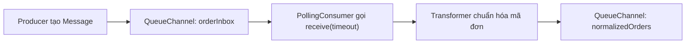

# Receive timeout trong Message channel

Receive timeout là khoảng thời gian một thao tác nhận sẵn sàng chờ khi chưa có thông điệp. Trong chương **Message channel** của **SPRING_INTEGRATION_CORE**, hiểu đúng tham số này giúp thiết kế đoạn nối giữa `MessageChannel` và endpoint: luồng phản hồi nhanh đến đâu, luồng thực thi bị giữ bao lâu và khi nào một lượt polling kết thúc.

Bài học tập trung vào `PollableChannel`, đặc biệt là `QueueChannel`, sau đó áp dụng vào Java DSL và `MessagingTemplate`. Kiến thức này cũng giúp phân biệt việc chờ thông điệp với xử lý lỗi, chờ phản hồi từ gateway và chờ gom nhóm ở aggregator.

## 1. Thời gian chờ nằm ở đâu trong luồng thông điệp?

Xét luồng xử lý mã đơn hàng:



Producer gửi `Message` vào `orderInbox`. Endpoint nối với channel này chủ động lấy thông điệp để chuyển cho transformer. Nếu hàng đợi rỗng, endpoint cần quyết định tiếp tục chờ hay kết thúc lần nhận.

Có ba khoảng thời gian riêng biệt:

| Khoảng thời gian | Bắt đầu và kết thúc | Cấu hình liên quan |
| --- | --- | --- |
| Chờ nhận thông điệp | Từ lúc gọi nhận đến khi có thông điệp hoặc hết thời gian chờ | `receive(timeout)`, `receiveTimeout` |
| Xử lý thông điệp | Từ lúc handler nhận thông điệp đến khi xử lý xong | Logic handler và timeout của tài nguyên được gọi |
| Nghỉ giữa hai lượt poll theo fixed delay | Từ lúc một lượt poll hoàn tất đến khi lượt tiếp theo được lên lịch, trong trường hợp không ủy quyền sang executor riêng | `fixedDelay` |

Receive timeout điều khiển khoảng thứ nhất. Sau khi nhận được thông điệp, handler có thể tiếp tục chạy lâu hơn giá trị timeout đó.

## 2. Hợp đồng của PollableChannel

`MessageChannel` cung cấp thao tác gửi. `PollableChannel` bổ sung thao tác nhận; dưới đây là chữ ký rút gọn, bỏ qua annotation đánh dấu kết quả có thể là `null`:

```java
public interface PollableChannel extends MessageChannel {

    Message<?> receive();

    Message<?> receive(long timeout);
}
```

`DirectChannel`, `ExecutorChannel` và `PublishSubscribeChannel` chuyển thông điệp cho subscriber, không cung cấp API `receive()` theo cách của `PollableChannel`. Vì vậy, không cấu hình poller để lấy thông điệp trực tiếp từ các channel đó. Sự phân biệt giữa hai loại channel được mô tả trong [The MessageChannel Interface](https://docs.spring.io/spring-integration/reference/channel/interfaces.html).

### 2.1. Ý nghĩa của từng giá trị timeout

Với các triển khai tiêu chuẩn kế thừa `AbstractPollableChannel`, chẳng hạn `QueueChannel`:

| Cách gọi | Khi có sẵn thông điệp | Khi chưa có thông điệp |
| --- | --- | --- |
| `receive(0)` | Trả về thông điệp có thể lấy được | Trả về `null` ngay, không chờ thông điệp đến |
| `receive(500)` | Trả về thông điệp có thể lấy được | Chờ tối đa khoảng 500 mili giây để có thông điệp; trả `null` nếu hết hạn |
| `receive(-1)` | Trả về thông điệp có thể lấy được | Chờ không giới hạn thời gian |
| `receive()` | Trả về thông điệp có thể lấy được | Chờ không giới hạn thời gian |

API dùng đơn vị **mili giây**. Giá trị âm biểu thị chờ vô hạn; `-1` là cách viết thông dụng. Hết receive timeout là kết quả không nhận được thông điệp, không mặc nhiên là ngoại lệ. Tài liệu API cũng nêu rằng ngắt luồng đang chờ có thể dẫn đến kết quả `null`. Xem [AbstractPollableChannel.receive(long)](https://docs.spring.io/spring-integration/docs/current/api/org/springframework/integration/channel/AbstractPollableChannel.html).

Các chữ “ngay” và “tối đa” mô tả hành vi chờ của thao tác nhận. Chúng không tạo cam kết thời gian thực cứng: lập lịch của hệ điều hành, GC và interceptor có thể làm tổng thời gian quan sát được dài hơn.

### 2.2. Timeout dương không bắt buộc chờ hết hạn

Nếu hàng đợi đã chứa thông điệp, `receive(5000)` có thể trả về ngay. Nếu thông điệp đến sau khoảng 120 mili giây trong lúc consumer đang chờ, lần nhận có thể hoàn tất ở thời điểm đó, thay vì đợi đủ 5 giây.

Như vậy, tăng receive timeout không tự thêm độ trễ cho thông điệp đã sẵn sàng. Chi phí đáng chú ý xuất hiện khi hàng đợi rỗng: luồng nhận có thể bị giữ lâu hơn.

### 2.3. Timeout thuộc lần gọi hoặc bên gọi

Không có một receive timeout chung bắt buộc mọi consumer của cùng `QueueChannel` phải sử dụng. Hai consumer có thể gọi:

```java
Message<?> first = channel.receive(0);
Message<?> second = channel.receive(800);
```

Mỗi lần gọi có chính sách chờ riêng. Khi poller hoặc template có thuộc tính `receiveTimeout`, thành phần đó dùng giá trị đã cấu hình cho thao tác nhận của mình.

Với `QueueChannel`, một thông điệp được một consumer lấy khỏi hàng đợi. Một consumer khác có thể nhận `null` do không còn thông điệp để lấy; điều đó không chứng minh producer chưa từng gửi thông điệp.

## 3. Thực hành nhận trực tiếp từ QueueChannel

Ví dụ dưới đây chỉ cần các lớp từ Spring Integration Core và Spring Messaging. Nó không cần khởi tạo Spring application context:

```java
import org.springframework.integration.channel.QueueChannel;
import org.springframework.messaging.Message;
import org.springframework.messaging.support.MessageBuilder;

public class ReceiveTimeoutDemo {

    public static void main(String[] args) {
        QueueChannel inbox = new QueueChannel(10);

        Message<?> immediate = inbox.receive(0);
        System.out.println("Nhận ngay khi rỗng: " + immediate);

        Message<?> waited = inbox.receive(150);
        System.out.println("Chờ hữu hạn khi rỗng: " + waited);

        Message<String> order = MessageBuilder
                .withPayload("order-42")
                .setHeader("orderId", "42")
                .build();

        boolean accepted = inbox.send(order, 100);
        if (!accepted) {
            throw new IllegalStateException("Không đưa được đơn hàng vào inbox");
        }

        Message<?> available = inbox.receive(5000);
        if (available == null) {
            throw new IllegalStateException("Không nhận được đơn hàng đã gửi");
        }

        System.out.println("Payload: " + available.getPayload());
        System.out.println("orderId: " + available.getHeaders().get("orderId"));

        System.out.println("Sau khi đã lấy: " + inbox.receive(0));
    }
}
```

Kết quả mong đợi về mặt nội dung:

```text
Nhận ngay khi rỗng: null
Chờ hữu hạn khi rỗng: null
Payload: order-42
orderId: 42
Sau khi đã lấy: null
```

Lần nhận thứ hai có thể chờ khoảng 150 mili giây. Lần nhận với `5000` không cần chờ đủ 5 giây vì thông điệp đã có sẵn. Lần cuối trả về `null` vì lần nhận trước đã lấy thông điệp khỏi hàng đợi.

`send(order, 100)` có một thời gian chờ khác: producer sẵn sàng chờ để gửi khi hàng đợi đầy. Nó không thiết lập receive timeout cho consumer. Hành vi hàng đợi và hai thao tác gửi/nhận được giải thích trong [Message Channel Implementations](https://docs.spring.io/spring-integration/reference/channel/implementations.html).

Không đưa `receive()` hoặc `receive(-1)` trên hàng đợi rỗng vào ví dụ chạy một luồng như trên: nếu không có producer ở luồng khác, chương trình có thể dừng ở đó vô thời hạn.

## 4. Cấu hình receiveTimeout bằng Java DSL

Trong ứng dụng Spring, endpoint nối với `PollableChannel` thường dùng poller để thực hiện nhận và chuyển tiếp thông điệp.

Ví dụ hoàn chỉnh dưới đây dùng API Java DSL tích hợp trong Spring Integration Core. Dự án cần quản lý phiên bản Spring tương thích, có `spring-integration-core` và Spring Context; không cần một thư viện Java DSL tách riêng.

```java
import java.util.Locale;

import org.springframework.beans.factory.annotation.Qualifier;
import org.springframework.context.annotation.AnnotationConfigApplicationContext;
import org.springframework.context.annotation.Bean;
import org.springframework.context.annotation.Configuration;
import org.springframework.integration.channel.QueueChannel;
import org.springframework.integration.config.EnableIntegration;
import org.springframework.integration.dsl.IntegrationFlow;
import org.springframework.integration.dsl.Pollers;
import org.springframework.messaging.Message;
import org.springframework.messaging.support.MessageBuilder;

@Configuration
@EnableIntegration
public class ReceiveTimeoutFlowConfiguration {

    @Bean
    public QueueChannel orderInbox() {
        return new QueueChannel(100);
    }

    @Bean
    public QueueChannel normalizedOrders() {
        return new QueueChannel(100);
    }

    @Bean
    public IntegrationFlow normalizeOrders(
            @Qualifier("orderInbox") QueueChannel orderInbox,
            @Qualifier("normalizedOrders") QueueChannel normalizedOrders) {

        return IntegrationFlow.from(orderInbox)
                .transform(
                        String.class,
                        value -> value.trim().toUpperCase(Locale.ROOT),
                        endpoint -> endpoint
                                .id("normalizeOrderEndpoint")
                                .poller(Pollers.fixedDelay(200)
                                        .receiveTimeout(800)
                                        .maxMessagesPerPoll(3)))
                .channel(normalizedOrders)
                .get();
    }

    public static void main(String[] args) {
        try (AnnotationConfigApplicationContext context =
                     new AnnotationConfigApplicationContext(
                             ReceiveTimeoutFlowConfiguration.class)) {

            QueueChannel input =
                    context.getBean("orderInbox", QueueChannel.class);
            QueueChannel output =
                    context.getBean("normalizedOrders", QueueChannel.class);

            boolean accepted = input.send(MessageBuilder
                    .withPayload(" order-42 ")
                    .setHeader("orderId", "42")
                    .build(), 100);

            if (!accepted) {
                throw new IllegalStateException("Không gửi được đơn hàng");
            }

            Message<?> result = output.receive(2000);
            if (result == null) {
                throw new IllegalStateException(
                        "Chưa có kết quả trong thời gian chờ của ví dụ");
            }

            System.out.println(result.getPayload()); // ORDER-42
            System.out.println(result.getHeaders().get("orderId")); // 42
        }
    }
}
```

Cấu hình có ba con số độc lập:

| Cấu hình | Ý nghĩa trong ví dụ |
| --- | --- |
| `fixedDelay(200)` | Đặt khoảng nghỉ giữa các lượt poll theo fixed delay |
| `receiveTimeout(800)` | Mỗi lần poller nhận từ `orderInbox` có thể chờ 800 mili giây nếu chưa có thông điệp |
| `maxMessagesPerPoll(3)` | Một lượt poll lấy và xử lý tối đa ba thông điệp, hoặc dừng sớm khi nhận `null` |

`output.receive(2000)` là chính sách chờ riêng của đoạn mã chạy thử khi nhận từ `normalizedOrders`. Nó không thay đổi poller đang đọc `orderInbox`.

Poller được cấu hình ở endpoint của transformer vì đây là thành phần tiêu thụ trực tiếp từ `orderInbox`. Nếu đổi channel đầu vào thành `DirectChannel`, cần bỏ cấu hình poller tương ứng.

Phương thức `receiveTimeout(long)` của DSL nhận mili giây. `Pollers` cung cấp các cách tạo trigger theo fixed delay, fixed rate hoặc cron. Xem [PollerSpec](https://docs.spring.io/spring-integration/docs/current/api/org/springframework/integration/dsl/PollerSpec.html) và [Pollers](https://docs.spring.io/spring-integration/docs/current/api/org/springframework/integration/dsl/Pollers.html).

## 5. Phân biệt một lần nhận với một lượt poll

Một lượt poll có thể chứa nhiều lần nhận:

```text
Trigger kích hoạt một lượt poll
    |
    +-- receive(receiveTimeout)
    |      +-- có Message -> gọi handler
    |      +-- null       -> kết thúc lượt
    |
    +-- còn trong giới hạn maxMessagesPerPoll?
           +-- có -> thực hiện lần nhận tiếp theo
           +-- hết -> kết thúc lượt
```

Sơ đồ này giả định lượt poll diễn ra bình thường, không gặp lỗi hoặc yêu cầu dừng endpoint. Các lần nhận nối tiếp trong cùng lượt không cần đợi trigger tiếp theo. Tuy nhiên, mỗi lần nhận vẫn có thể phải chờ theo receive timeout nếu hàng đợi trống.

### 5.1. Một lượt poll có thể dài hơn receiveTimeout

Giả sử:

- `receiveTimeout = 800` mili giây.
- `maxMessagesPerPoll = 3`.
- Thời gian xử lý handler rất nhỏ.
- Các thông điệp lần lượt đến tại mốc 700, 1.400 và 2.100 mili giây tính từ đầu lượt.

Lượt poll có thể diễn ra như sau:

| Lần nhận | Bắt đầu xấp xỉ | Thông điệp đến | Thời gian chờ của riêng lần nhận |
| --- | --- | --- | --- |
| 1 | 0 ms | 700 ms | 700 ms |
| 2 | 700 ms | 1.400 ms | 700 ms |
| 3 | 1.400 ms | 2.100 ms | 700 ms |

Mỗi lần chờ đều nhỏ hơn 800 mili giây, nhưng cả lượt dài khoảng 2.100 mili giây. Sau thông điệp thứ ba, lượt kết thúc vì đạt giới hạn số thông điệp.

Đây là ví dụ suy luận từ mô hình thực thi để làm rõ phạm vi timeout; các mốc thời gian không phải cam kết hiệu năng.

### 5.2. Hàng đợi hết thông điệp giữa lượt

Nếu chỉ có một thông điệp sẵn sàng và giới hạn là ba:

1. Poller nhận ngay thông điệp thứ nhất.
2. Handler xử lý thông điệp đó.
3. Poller thử nhận thông điệp thứ hai và có thể chờ đến 800 mili giây.
4. Nếu vẫn không có thông điệp, kết quả là `null` và lượt kết thúc.

Poller không buộc thực hiện đủ ba lần nhận nếu một lần đã trả về `null`. Đồng thời, receive timeout của lần nhận thứ hai có thể kéo dài lượt dù thông điệp thứ nhất đã được xử lý rất nhanh.

Giá trị âm của `maxMessagesPerPoll` biểu thị không giới hạn số thông điệp trong lượt; kết hợp nó với thời gian chờ vô hạn có thể khiến lượt không kết thúc khi hết dữ liệu. Cần phân biệt giá trị này với số âm của `receiveTimeout`, vốn điều khiển thời gian chờ. Xem [Message Endpoints](https://docs.spring.io/spring-integration/reference/endpoint.html).

## 6. Receive timeout và nhịp polling ảnh hưởng lẫn nhau

Để phân tích đơn giản, giả sử chỉ có một polling consumer, không ủy quyền sang executor riêng, dùng fixed delay và hàng đợi luôn rỗng:

- `R`: receive timeout hữu hạn.
- `D`: fixed delay.
- Bỏ qua overhead và độ trễ lập lịch.

Khi đó, khoảng cách giữa hai thời điểm bắt đầu nhận xấp xỉ:

```text
Chu kỳ khi rỗng ≈ R + D
Số lần nhận mỗi giây ≈ 1000 / (R + D)   // R và D tính bằng ms
```

Với `R = 800` và `D = 200`:

```text
0 ms            800 ms      1000 ms          1800 ms
|---- chờ nhận ----|-- nghỉ --|---- chờ nhận ----|
```

Nếu thông điệp đến trong đoạn chờ nhận, consumer có thể lấy nó ngay khi việc chờ được đánh thức. Nếu thông điệp đến trong đoạn nghỉ, nó chờ đến lần nhận tiếp theo.

Trong mô hình này, luồng bị giữ để chờ nhận khoảng `800 / (800 + 200) = 80%` thời gian khi hệ thống rỗng. Đây là tỷ lệ thời gian luồng bị chiếm dụng, không phải tỷ lệ sử dụng CPU.

### 6.1. Hai cấu hình có đặc điểm khác nhau

| Cấu hình minh họa | Hành vi khi ít thông điệp | Điều cần cân nhắc |
| --- | --- | --- |
| `receiveTimeout(0)`, `fixedDelay(1000)` | Kiểm tra nhanh rồi nghỉ; thông điệp đến ngay sau lần kiểm tra có thể phải chờ gần một giây | Ít giữ luồng để đợi dữ liệu |
| `receiveTimeout(800)`, `fixedDelay(200)` | Có nhiều khoảng thời gian consumer đang chờ sẵn để nhận | Giữ luồng lâu hơn khi rỗng |
| `receiveTimeout(0)`, `fixedDelay(10)` | Kiểm tra thường xuyên | Nhiều lần đánh thức và thực hiện tác vụ rỗng |

Các nhận xét trên giả định scheduler sẵn sàng và không có backlog. Nếu handler đang bận, executor hết luồng hoặc tác vụ chờ được lên lịch, độ trễ có thể lớn hơn nhiều.

Công thức `R + D` không dùng nguyên xi cho fixed rate, cron, executor riêng hoặc hàng đợi luôn có dữ liệu. Đặc biệt, fixed rate không bảo đảm một luồng bận có thể tự bắt đầu một lần nhận mới đúng hạn.

### 6.2. Chọn timeout theo mục tiêu vận hành

Một quy trình hợp lý:

1. Xác định thời gian chờ bắt đầu xử lý có thể chấp nhận, tách khỏi thời gian xử lý nghiệp vụ.
2. Ước lượng số endpoint cùng cần poll và số luồng scheduler/executor có sẵn.
3. Chọn receive timeout hữu hạn cùng trigger và giới hạn số thông điệp mỗi lượt.
4. Quan sát thời gian từ lúc gửi đến lúc bắt đầu xử lý, độ sâu hàng đợi và tình trạng sử dụng luồng.
5. Điều chỉnh dựa trên tải thực tế, nhất là giai đoạn ít thông điệp và lúc xuất hiện đợt tải lớn.

Giảm receive timeout hữu ích khi nhiều endpoint chia sẻ luồng và thường xuyên gặp hàng đợi rỗng. Nếu mục tiêu là phản ứng nhanh với thông điệp mới trong khi vẫn dùng channel có thể poll, có thể tăng khoảng chờ nhận kết hợp khoảng nghỉ ngắn, đồng thời bố trí đủ tài nguyên thực thi.

Không có một giá trị receive timeout tối ưu cho mọi luồng tích hợp.

## 7. Quản lý luồng thực thi và dừng ứng dụng

`PollingConsumer` có receive timeout mặc định là **1.000 mili giây**. Giá trị mặc định này thuộc polling consumer; không có nghĩa lời gọi trực tiếp `QueueChannel.receive()` tự hết hạn sau một giây. Xem [PollingConsumer.DEFAULT_RECEIVE_TIMEOUT](https://docs.spring.io/spring-integration/docs/current/api/org/springframework/integration/endpoint/PollingConsumer.html).

Khi poller không có executor riêng, công việc của nó được thực hiện trên luồng scheduler. Nhiều endpoint cùng chờ lâu trên các hàng đợi rỗng có thể giữ hết các luồng khả dụng, khiến endpoint khác được chạy muộn.

Có thể cân nhắc:

- Dùng receive timeout ngắn hơn khi việc chờ lâu ít mang lại lợi ích.
- Cấu hình executor phù hợp cho polling task khi cần tách công việc khỏi scheduler.
- Đặt giới hạn phù hợp cho số luồng và hàng đợi tác vụ của executor.
- Theo dõi tác vụ bị từ chối, tác vụ xếp hàng và độ trễ thực tế sau khi thay đổi.

Executor riêng chuyển nơi thực hiện tác vụ; nó vẫn cần tài nguyên cho những lần nhận đang chờ. Khi cho phép nhiều tác vụ poll chạy đồng thời, cũng cần xem xét thread safety của handler và thứ tự hoàn tất xử lý. Thứ tự lấy khỏi hàng đợi không bảo đảm thứ tự hoàn tất nếu xử lý song song.

Các lưu ý về poller, scheduler và executor được trình bày trong [Configuring the Task Scheduler](https://docs.spring.io/spring-integration/reference/configuration/namespace-taskscheduler.html).

Với nhận vô hạn, consumer có thể chờ khi hàng đợi không còn dữ liệu. Việc dừng endpoint và hủy tác vụ còn phụ thuộc cơ chế lifecycle, executor và phản ứng với interruption của mã đang chạy. Không giả định một lời gọi `stop()` luôn lập tức cắt mọi công việc đang thực thi.

Nếu tự viết vòng lặp nhận, cần có điều kiện kết thúc và tôn trọng trạng thái ngắt của luồng. Tránh vòng lặp gọi `receive(0)` liên tục trên hàng đợi rỗng mà không có nhịp nghỉ hoặc cơ chế điều tiết.

## 8. Receive timeout trong MessagingTemplate

Khi mã ứng dụng cần chủ động nhận từ channel, có thể dùng `MessagingTemplate`:

```java
import org.springframework.integration.channel.QueueChannel;
import org.springframework.integration.core.MessagingTemplate;
import org.springframework.messaging.Message;

public class TemplateReceiver {

    public Message<?> receiveNext(QueueChannel inbox) {
        MessagingTemplate template = new MessagingTemplate();
        template.setReceiveTimeout(250);

        return template.receive(inbox);
    }
}
```

Nếu `inbox` rỗng, lời gọi có thể chờ 250 mili giây. Bên gọi phải xử lý trường hợp trả về `null`.

Cấu hình này chỉ áp dụng cho thao tác do template đó thực hiện. Nó không đổi receive timeout của một polling consumer khác đang đọc cùng channel.

`MessagingTemplate` còn cung cấp dạng gọi nhận có timeout trực tiếp:

```java
Message<?> message = template.receive(inbox, 50);
```

Trong lời gọi này, `50` là timeout được truyền tường minh cho thao tác nhận. Các phương thức nhận cần destination có khả năng poll; truyền một `DirectChannel` không biến nó thành hàng đợi. Xem [MessagingTemplate](https://docs.spring.io/spring-integration/docs/current/api/org/springframework/integration/core/MessagingTemplate.html).

Thuộc tính receive timeout còn tham gia thao tác `sendAndReceive` của template ở giai đoạn chờ phản hồi. Cần phân tích riêng thao tác gửi và thao tác nhận; giá trị đó không tự tạo hạn chót cho toàn bộ xử lý downstream. API cấu hình được mô tả tại [GenericMessagingTemplate.setReceiveTimeout](https://docs.spring.io/spring-framework/docs/current/javadoc-api/org/springframework/messaging/core/GenericMessagingTemplate.html).

Không thay đổi timeout của một template dùng chung ở mỗi request để áp dụng các chính sách khác nhau: đó là cấu hình chia sẻ, có thể khiến các luồng ảnh hưởng lẫn nhau. Với thao tác nhận trực tiếp, ưu tiên overload truyền timeout khi mỗi lời gọi cần giá trị riêng.

## 9. Phân biệt với các loại timeout khác

| Khái niệm | Đang chờ điều gì? | Receive timeout trên channel có giải quyết được không? |
| --- | --- | --- |
| Send timeout | Chờ có thể gửi thông điệp, ví dụ chờ chỗ trống trong queue đầy | Không; phải xét thao tác gửi |
| Receive timeout | Chờ lấy được một thông điệp | Đây là phạm vi của bài học |
| Khoảng nghỉ polling | Chờ lượt poll tiếp theo được kích hoạt | Cần điều chỉnh trigger |
| Reply timeout của gateway | Chờ phản hồi cho lời gọi request–reply | Là cấu hình ở gateway, không thay thế timeout nhận của mọi endpoint |
| Timeout HTTP/JDBC | Chờ kết nối hoặc chờ tài nguyên bên ngoài phản hồi | Cần cấu hình client/driver tương ứng |
| Group timeout của aggregator | Chờ một nhóm thông điệp đủ điều kiện được xử lý hoặc hết hạn | Cần cấu hình vòng đời nhóm |
| Thời hạn hợp lệ của thông điệp | Chờ đến lúc thông điệp bị coi là quá hạn theo nghiệp vụ | Cần cơ chế kiểm tra hạn hoặc thành phần hỗ trợ tương ứng |

Ví dụ, poller nhận thông điệp sau 10 mili giây rồi handler gọi HTTP trong 8 giây. Dù poller đặt `receiveTimeout(100)`, lời gọi HTTP vẫn có thể kéo dài 8 giây nếu client và cơ chế thực thi cho phép.

Tương tự, trong luồng đồng bộ đi qua `DirectChannel`, handler chạy trên luồng bên gọi. Reply timeout của gateway không tự ngắt handler đang chạy trên chính luồng đó. Khi có ranh giới bất đồng bộ, bên gọi có thể hết thời gian chờ phản hồi trong lúc công việc downstream vẫn tiếp tục. Xem [Gateway Behavior When No Response Arrives](https://docs.spring.io/spring-integration/reference/gateway.html).

Receive timeout vì vậy cần được đặt trong toàn bộ ngân sách thời gian: chờ lịch, chờ nhận, xử lý, truy cập tài nguyên và chờ phản hồi là những phần khác nhau.

## 10. Hết thời gian chờ, lỗi xử lý và thông điệp đến muộn

### 10.1. Nhận null không tự tạo ErrorMessage

Với `QueueChannel` tiêu chuẩn, hết thời gian chờ nhận trên hàng đợi rỗng thường là một kết quả bình thường:

```java
Message<?> message = inbox.receive(300);

if (message == null) {
    // Hiện chưa nhận được thông điệp; chọn hành vi phù hợp với bên gọi.
    return;
}
```

Không có thông điệp được nhận đồng nghĩa handler của lần nhận đó không được gọi. Không có lỗi handler để tự động đưa vào `errorChannel`.

Một ngoại lệ phát sinh khi handler xử lý thông điệp trong tác vụ polling là tình huống khác; cơ chế xử lý lỗi phụ thuộc cấu hình scheduler, executor và error handler. Xem [Error Handling](https://docs.spring.io/spring-integration/reference/error-handling.html).

Nếu nghiệp vụ yêu cầu “phải có phản hồi trong 300 mili giây”, bên gọi có thể chuyển kết quả không nhận được thông điệp thành trạng thái hoặc ngoại lệ của ứng dụng. Đó là chính sách của bên gọi, không phải bằng chứng thông điệp đã bị xử lý lỗi.

### 10.2. Thông điệp đến sau timeout vẫn có thể được nhận

Xét một `QueueChannel` thông thường, không có consumer khác hoặc cơ chế hết hạn:

```text
t =   0 ms: consumer gọi receive(300)
t ≈ 300 ms: chưa có thông điệp, lần nhận trả về null
t = 350 ms: producer gửi một thông điệp vào queue
t = 500 ms: consumer gọi receive(0), lấy được thông điệp đó
```

Timeout ở lần nhận trước không xóa một thông điệp được gửi sau đó. Nó cũng không gắn một thời hạn sống 300 mili giây lên mọi thông điệp trong channel.

### 10.3. Nhận được thông điệp không đồng nghĩa xử lý thành công

Sau khi một thông điệp đã được lấy khỏi `QueueChannel` trong bộ nhớ, handler có thể ném ngoại lệ. Receive timeout không tự đưa thông điệp trở lại queue và không tự bảo đảm retry hay lưu bền.

Nếu cần khôi phục khi xử lý lỗi, phải thiết kế riêng retry, xử lý lỗi và lưu trữ phù hợp. Việc sử dụng transaction chỉ có tác dụng khôi phục theo khả năng của các tài nguyên thực sự tham gia transaction; không thể suy ra bảo đảm giao nhận chỉ từ cấu hình thời gian chờ.

## 11. Kiểm thử hành vi mà không phụ thuộc đồng hồ chính xác

Các ví dụ kiểm thử dưới đây dùng JUnit Jupiter và các lớp Spring đã giới thiệu. Mục tiêu là kiểm tra kết quả nhận, việc lấy thông điệp khỏi queue và khả năng nhận một thông điệp gửi sau khi lần chờ trước kết thúc.

```java
import org.junit.jupiter.api.Test;
import org.junit.jupiter.api.Timeout;
import org.springframework.integration.channel.QueueChannel;
import org.springframework.messaging.Message;
import org.springframework.messaging.support.MessageBuilder;

import static org.junit.jupiter.api.Assertions.assertEquals;
import static org.junit.jupiter.api.Assertions.assertNotNull;
import static org.junit.jupiter.api.Assertions.assertNull;
import static org.junit.jupiter.api.Assertions.assertTrue;

@Timeout(5)
class ReceiveTimeoutBehaviorTest {

    @Test
    void emptyQueueCanBeCheckedWithoutWaiting() {
        QueueChannel channel = new QueueChannel(2);

        assertNull(channel.receive(0));
    }

    @Test
    void availableMessageIsTakenOnce() {
        QueueChannel channel = new QueueChannel(2);

        assertTrue(channel.send(MessageBuilder
                .withPayload("order-42")
                .build(), 0));

        Message<?> received = channel.receive(1000);

        assertNotNull(received);
        assertEquals("order-42", received.getPayload());
        assertNull(channel.receive(0));
    }

    @Test
    void timedOutReceiveDoesNotDiscardAFutureMessage() {
        QueueChannel channel = new QueueChannel(2);

        assertNull(channel.receive(25));

        assertTrue(channel.send(MessageBuilder
                .withPayload("late-order")
                .build(), 0));

        Message<?> received = channel.receive(0);

        assertNotNull(received);
        assertEquals("late-order", received.getPayload());
    }
}
```

`@Timeout(5)` đặt giới hạn tổng quát năm giây cho mỗi kiểm thử để phát hiện treo, không yêu cầu thao tác nhận hoàn thành chính xác tại một mốc mili giây. Các kiểm thử này xác minh kết quả; chúng chưa chứng minh cận thời gian chính xác hoặc việc đánh thức consumer đang bị chặn.

Khi mở rộng kiểm thử cho luồng Java DSL, nên kiểm tra các tình huống sau:

| Tình huống | Kết quả cần quan sát |
| --- | --- |
| Gửi một thông điệp hợp lệ vào input | Output nhận được payload đã chuẩn hóa và header nghiệp vụ |
| Input rỗng qua một lần poll | Không có output, không tự sinh lỗi vì thiếu thông điệp |
| Gửi nhiều hơn giới hạn mỗi lượt | Tất cả được xử lý qua các lượt tiếp theo nếu endpoint tiếp tục hoạt động |
| Producer gửi khi consumer đang chờ | Consumer nhận được thông điệp mà không cần đợi hết toàn bộ receive timeout |
| Handler xử lý lâu hơn receive timeout | Handler không bị tự ngắt chỉ vì vượt thời gian đó |

Với kiểm thử nhiều luồng, dùng latch hoặc cơ chế đồng bộ để kiểm soát phối hợp giữa producer và consumer, đồng thời đặt timeout hữu hạn cho thao tác chờ kết quả. Tránh phụ thuộc vào một lần `Thread.sleep(10)` để đoán rằng luồng khác đã bắt đầu chờ.

Nếu cần đo thời lượng, dùng đồng hồ đơn điệu như `System.nanoTime()`, khoảng dung sai phù hợp và điều kiện môi trường rõ ràng. Không dùng khẳng định kiểu “phải đúng 25 mili giây” trong kiểm thử thông thường.

## 12. Chẩn đoán các hiểu nhầm thường gặp

| Hiện tượng | Điểm cần kiểm tra | Hướng xử lý |
| --- | --- | --- |
| Đặt `receiveTimeout = 100` nhưng handler vẫn chạy nhiều giây | Có đang kỳ vọng timeout chờ nhận cắt xử lý nghiệp vụ không? | Cấu hình timeout của tài nguyên và cơ chế thực thi phù hợp |
| Hàng đợi đã có dữ liệu nhưng endpoint bắt đầu xử lý muộn | Poller có đang trong fixed delay, chờ scheduler hay chờ executor không? | Quan sát thời điểm bắt đầu nhận và tài nguyên thực thi |
| Ứng dụng giữ nhiều luồng dù gần như không có thông điệp | Có nhiều poller cùng chờ với timeout lớn không? | Xem lại receive timeout, phân bổ scheduler và executor |
| Consumer nhận `null` nhưng log cho thấy đã gửi thông điệp | Có consumer khác đã lấy thông điệp hoặc thông điệp đến sau lần chờ không? | Kiểm tra consumer cạnh tranh và dòng thời gian |
| Muốn cấu hình `receiveTimeout` cho `DirectChannel` | Channel có hỗ trợ polling không? | Chọn đúng mô hình subscriber hoặc dùng một channel có thể poll |
| Nhận `null` nhưng `errorChannel` không có thông điệp | Có ngoại lệ thực sự hay chỉ hết thời gian chờ nhận? | Xử lý kết quả không có thông điệp ở bên gọi |
| Bài thử bị treo ở hàng đợi rỗng | Có gọi `receive()` hoặc truyền timeout âm không? | Dùng timeout hữu hạn và bảo đảm có điều kiện kết thúc |

Khi đọc một luồng tích hợp, hãy xác định rõ **ai gọi nhận**, **nhận trên channel nào**, **mỗi lần chờ bao lâu** và **khi nào trigger cho phép nhận tiếp**. Bốn thông tin này giúp giải thích đúng độ trễ mà không nhầm receive timeout với thời gian xử lý toàn bộ thông điệp.

