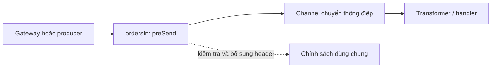

# Channel interceptors

Trong chương **Message channel** của module **SPRING_INTEGRATION_CORE**, channel interceptor giúp bổ sung hành vi dùng chung tại nơi thông điệp đi qua channel. Bài này giải thích cách can thiệp vào thao tác gửi, nhận và gọi handler; từ đó thiết kế luồng có kiểm soát header, khả năng quan sát và cách xử lý lỗi rõ ràng.

Sau bài học, bạn có thể:

- Chọn đúng callback cho thao tác gửi, nhận và hoàn tất.
- Phân biệt việc channel chấp nhận thông điệp với việc nghiệp vụ đã hoàn thành.
- Đăng ký interceptor trên một channel, trong Java DSL hoặc cho nhiều channel.
- Dự đoán kết quả khi interceptor chặn thông điệp hoặc phát sinh ngoại lệ.
- Thiết kế kiểm thử cho chuỗi interceptor và ranh giới bất đồng bộ.

Các ví dụ dùng Java 17+, API Spring Integration 6.5 và Spring Framework 6.2. Khi thực hành trong dự án Spring Boot, dùng bộ phiên bản do dự án quản lý để giữ các thư viện Spring tương thích. Cần có `spring-integration-core`; phần kiểm thử minh họa dùng JUnit Jupiter. Người học nên biết `Message`, headers, `DirectChannel`, `QueueChannel` và cấu trúc cơ bản của `IntegrationFlow`.

## 1. Interceptor nằm ở đâu trong luồng?

Giả sử hệ thống nhận yêu cầu đặt hàng từ một gateway. Mỗi yêu cầu cần mang `tenantId` và mã theo dõi do ứng dụng quản lý. Thay vì lặp lại việc kiểm tra header tại nhiều handler, có thể đặt một interceptor trên channel tiếp nhận:



`ChannelInterceptor` thuộc package `org.springframework.messaging.support`. Channel gọi interceptor khi thực hiện thao tác gửi hoặc nhận. Các phương thức có triển khai mặc định, nên một interceptor chỉ cần override những callback phục vụ mục đích của nó. [Spring Integration: Channel Interceptors](https://docs.spring.io/spring-integration/reference/6.5/channel/interceptors.html)

Đặt hành vi theo trách nhiệm giúp sơ đồ luồng vẫn dễ hiểu:

| Nhu cầu trong hệ thống đặt hàng | Thành phần phù hợp |
| --- | --- |
| Kiểm tra header hạ tầng tại cửa vào | Channel interceptor |
| Chuyển JSON thành lệnh đặt hàng | Transformer |
| Chọn luồng theo loại đơn | Router |
| Loại đơn không thỏa điều kiện nghiệp vụ và chuyển sang nhánh từ chối | Filter với discard channel |
| Gộp nhiều kết quả xử lý | Aggregator |
| Retry một lời gọi đến dịch vụ thanh toán | Advice của endpoint |
| Theo dõi thông điệp qua một nhánh phụ | Wire tap |

Đây là quyết định thiết kế cho ví dụ. Nếu kiểm tra bị ẩn trong interceptor khiến người vận hành không thấy một bước nghiệp vụ quan trọng, hãy biểu diễn bước đó bằng endpoint riêng.

## 2. Sáu callback cơ bản

Tên phương thức phản ánh hai thao tác riêng: `send()` và `receive()`.

| Callback | Vai trò | Giá trị trả về |
| --- | --- | --- |
| `preSend(message, channel)` | Chạy trước khi channel gửi thông điệp | Message tiếp tục đi; `null` chặn gửi |
| `postSend(message, channel, sent)` | Quan sát kết quả khi thao tác gửi trả về bình thường | `void` |
| `afterSendCompletion(message, channel, sent, ex)` | Hoàn tất lần gửi, hỗ trợ dọn tài nguyên khi có lỗi | `void` |
| `preReceive(channel)` | Chạy trước khi lấy thông điệp | `true` cho phép nhận; `false` chặn |
| `postReceive(message, channel)` | Chạy sau khi lấy được thông điệp | Message trả về; `null` chặn phần tiếp theo |
| `afterReceiveCompletion(message, channel, ex)` | Hoàn tất lần nhận, kể cả nhận rỗng hoặc lỗi | `void` |

Ba callback nhận chỉ liên quan đến `PollableChannel`. Gắn interceptor vào `DirectChannel` không tạo ra lời gọi `receive()`. Xem hợp đồng chính thức tại [ChannelInterceptor Javadoc](https://docs.spring.io/spring-framework/docs/6.2.x/javadoc-api/org/springframework/messaging/support/ChannelInterceptor.html).

Cần đọc thêm điều kiện của callback hoàn tất: đối với chính interceptor đó, `afterSendCompletion()` chỉ được gọi sau khi `preSend()` đã trả về một message; `afterReceiveCompletion()` chỉ được gọi sau khi `preReceive()` đã trả về `true`. Vì vậy, không đặt tài nguyên vào trạng thái cần dọn rồi trông chờ callback hoàn tất nếu chính callback `pre...` sắp từ chối hoặc ném lỗi.

## 3. Vòng đời và thứ tự thực thi

### 3.1. Đường gửi thành công

Giả sử channel có hai interceptor, theo danh sách `A, B`, và không callback nào ném lỗi:

```text
A.preSend
B.preSend
channel thực hiện gửi
A.postSend
B.postSend
B.afterSendCompletion
A.afterSendCompletion
```

Các callback `preSend` và `postSend` đi theo thứ tự danh sách; callback hoàn tất đi theo chiều ngược lại. Message do A trả về trở thành đầu vào của B. Đây là hành vi của chuỗi interceptor trong [AbstractMessageChannel của Spring Integration 6.5.0](https://raw.githubusercontent.com/spring-projects/spring-integration/v6.5.0/spring-integration-core/src/main/java/org/springframework/integration/channel/AbstractMessageChannel.java).

Ví dụ, nếu A thêm mã theo dõi và B ghi log, B sẽ thấy mã vừa thêm. Nếu đổi thứ tự hai interceptor, log ở B có thể thiếu mã. Vì vậy thứ tự là một phần cấu hình cần được thể hiện rõ.

### 3.2. Chặn gửi bằng `null`

Nếu B trả về `null` trong `preSend()`:

```text
A.preSend -> trả về message
B.preSend -> trả về null
A.afterSendCompletion(sent=false, ex=null)
send(...) -> false
```

Không có thao tác gửi thực tế và không chạy `postSend()`. B không có callback hoàn tất cho lần gọi này vì B chưa vượt qua bước `preSend()` của chính nó. Các interceptor nằm sau B cũng chưa được gọi.

Trả về `null` không tự tạo một thông điệp lỗi hay thông điệp ở discard channel. Nếu producer gọi trực tiếp `MessageChannel.send()`, nó cần xử lý kết quả `false`. Một gateway hay thành phần gửi ở cấp cao hơn có thể áp dụng chính sách timeout hoặc báo lỗi riêng; cần kiểm thử tại đúng điểm vào mà ứng dụng sử dụng.

### 3.3. Khi có ngoại lệ

Nếu B ném ngoại lệ ngay trong `preSend()`, các interceptor đã đi qua bước trước đó, như A, nhận callback hoàn tất với `ex` tương ứng. B phải tự dọn tài nguyên mà nó vừa mở trước khi ném lỗi.

Nếu thao tác gửi ném lỗi, chuỗi `postSend()` chưa bắt đầu. Nếu lỗi xuất hiện trong `postSend()`, các callback `postSend()` còn lại không tiếp tục, nhưng chuỗi hoàn tất vẫn phục vụ việc dọn tài nguyên cho những interceptor đã qua `preSend()`.

Một tình huống đáng chú ý là `sent=true` đồng thời `ex!=null`: channel đã gửi thành công nhưng một callback `postSend()` bị lỗi. Với tình huống này, gửi lại mù quáng có thể tạo tác dụng phụ lặp. Cần quan sát cả `sent` và `ex`, đồng thời thiết kế tính idempotent tại nơi thực hiện nghiệp vụ.

### 3.4. Đường nhận và trường hợp hàng đợi rỗng

Với `QueueChannel`, một lần nhận có thông điệp đi qua:

```text
A.preReceive
B.preReceive
lấy message khỏi queue
A.postReceive
B.postReceive
B.afterReceiveCompletion
A.afterReceiveCompletion
trả message cho caller
```

Nếu `receive(0)` gặp queue rỗng, không có `postReceive()`; callback hoàn tất vẫn chạy cho những interceptor đã cho phép nhận, với `message=null`, `ex=null`. Vì vậy số lần polling phải được đo ở bước khác với số message thực nhận. Nếu `preReceive()` trả về `false`, không có message nào được lấy khỏi queue. [AbstractPollableChannel của Spring Integration 6.5.0](https://raw.githubusercontent.com/spring-projects/spring-integration/v6.5.0/spring-integration-core/src/main/java/org/springframework/integration/channel/AbstractPollableChannel.java)

Nếu `postReceive()` trả về `null`, thông điệp đã được lấy ra trước đó. Trong ví dụ với queue trong bộ nhớ, nó không tự quay lại queue. Đây là lý do nên dùng filter và nhánh từ chối khi cần theo dõi rõ các thông điệp bị loại. Khả năng khôi phục khi dùng message store và transaction còn phụ thuộc cấu hình cụ thể.

## 4. Hiểu đúng `sent`, thread và ranh giới xử lý

`sent` phản ánh kết quả thao tác gửi của channel đang được chặn.

| Channel trong cấu hình thông thường | Điều gì xảy ra khi gửi? | Có thể kết luận gì từ `sent=true`? |
| --- | --- | --- |
| `DirectChannel` | Handler được gọi trên thread gửi | Lời gọi xử lý đồng bộ đã trả về bình thường tại ranh giới này |
| `QueueChannel` | Thông điệp được đưa vào hàng đợi | Queue đã chấp nhận thông điệp |
| `ExecutorChannel` với thread pool | Công việc được giao cho executor | Công việc đã được chấp nhận để dispatch; handler có thể chưa xong |

Một chuỗi bắt đầu bằng `DirectChannel` vẫn có thể chuyển sang queue hoặc executor ở phía sau. Trong trường hợp đó, thời điểm hoàn tất lần gửi ở cửa vào chỉ bao trùm phần xử lý đã chạy đồng bộ.

Với channel dùng executor, callback gửi chạy trên thread thực hiện `send()`; công việc của handler có thể chạy trên worker. Handler có thể bắt đầu trước khi `postSend()` chạy, hoặc bắt đầu sau khi `send()` đã trả về. Cấu hình executor cũng có thể cho phép chạy ngay trên caller, chẳng hạn khi dùng executor đồng bộ hoặc chính sách caller-runs. Không dùng tên loại channel để suy ra chắc chắn thread thực tế. [Spring Integration: cấu hình ExecutorChannel](https://docs.spring.io/spring-integration/reference/channel/configuration.html#executorchannel-configuration)

Với queue, send và receive là hai lời gọi độc lập. Nếu producer và consumer chạy đồng thời, không áp đặt một thứ tự tổng thể cho toàn bộ callback của cả hai bên. Chẳng hạn, consumer có thể lấy message trước khi producer kịp chạy `postSend()`. [Spring Integration: quan hệ giữa send và receive](https://docs.spring.io/spring-integration/reference/channel/interceptors.html)

Áp dụng vào thiết kế hệ thống đặt hàng:

- Đặt tên metric là `channel.send.accepted` nếu nó đếm kết quả gửi.
- Phát sự kiện “đơn đã xử lý” ở nơi biết kết quả nghiệp vụ.
- Ghi nhận transaction commit bằng cơ chế gắn với transaction khi cần độ chính xác đó.
- Đo thời gian xử lý handler tại ranh giới handler; đo thời gian toàn hành trình bằng mã theo dõi và các mốc sự kiện tương ứng.

## 5. Ví dụ: kiểm tra tenant và bổ sung mã theo dõi

### 5.1. Chính sách đầu vào

Trong ví dụ, các producer nội bộ đã xác thực được tenant trước khi tạo message. Interceptor yêu cầu `tenantId` là chuỗi không rỗng, đồng thời thêm `appTraceId` nếu chưa có.

`tenantId` ở đây chỉ là metadata đã được thành phần đáng tin cậy thiết lập. Chỉ kiểm tra một header tồn tại chưa đủ xác định quyền truy cập. Nếu client bên ngoài có thể tự đặt header, bước xác thực phải liên kết tenant với danh tính trước khi luồng sử dụng nó.

Đặt lớp sau trong package `study.integration` khi thực hành:

```java
package study.integration;

import java.util.UUID;

import org.springframework.messaging.Message;
import org.springframework.messaging.MessageChannel;
import org.springframework.messaging.MessageDeliveryException;
import org.springframework.messaging.support.ChannelInterceptor;
import org.springframework.messaging.support.MessageBuilder;

public final class IngressHeadersInterceptor implements ChannelInterceptor {

    public static final String TENANT_ID = "tenantId";
    public static final String APP_TRACE_ID = "appTraceId";

    @Override
    public Message<?> preSend(Message<?> message, MessageChannel channel) {
        Object tenant = message.getHeaders().get(TENANT_ID);

        if (!(tenant instanceof String tenantId) || tenantId.isBlank()) {
            throw new MessageDeliveryException(
                    message, "tenantId phải là chuỗi không rỗng");
        }

        Object trace = message.getHeaders().get(APP_TRACE_ID);
        if (trace != null) {
            if (!(trace instanceof String traceId) || traceId.isBlank()) {
                throw new MessageDeliveryException(
                        message, "appTraceId phải là chuỗi không rỗng");
            }
            return message;
        }

        return MessageBuilder.fromMessage(message)
                .setHeader(APP_TRACE_ID, UUID.randomUUID().toString())
                .build();
    }
}
```

`MessageBuilder.fromMessage()` khởi tạo builder từ thông điệp hiện có. Cách này giữ các header ứng dụng và header điều phối cần thiết khi bổ sung header, thay vì tự dựng một message chỉ có payload rồi quên sao chép header. [MessageBuilder Javadoc](https://docs.spring.io/spring-framework/docs/6.2.x/javadoc-api/org/springframework/messaging/support/MessageBuilder.html)

Lớp dùng `appTraceId` riêng để minh họa, không thay thế cơ chế propagation của thư viện tracing. Không dùng `MessageHeaders.ID` như một mã nghiệp vụ cần giữ cố định xuyên qua mọi lần dựng message. Việc giữ nguyên payload cũng không có nghĩa payload đã được sao chép sâu; nên ưu tiên payload bất biến khi chia sẻ giữa các nhánh.

### 5.2. Đăng ký cục bộ và xây dựng flow

Cấu hình sau có một channel đầu vào đồng bộ, một transformer và một queue kết quả:

```java
package study.integration;

import java.util.Locale;

import org.springframework.context.annotation.Bean;
import org.springframework.context.annotation.Configuration;
import org.springframework.integration.channel.DirectChannel;
import org.springframework.integration.channel.QueueChannel;
import org.springframework.integration.config.EnableIntegration;
import org.springframework.integration.dsl.IntegrationFlow;

@Configuration
@EnableIntegration
public class OrdersConfiguration {

    @Bean
    public IngressHeadersInterceptor ingressHeadersInterceptor() {
        return new IngressHeadersInterceptor();
    }

    @Bean
    public DirectChannel ordersIn(IngressHeadersInterceptor interceptor) {
        DirectChannel channel = new DirectChannel();
        channel.addInterceptor(interceptor);
        return channel;
    }

    @Bean
    public QueueChannel orderResults() {
        return new QueueChannel(10);
    }

    @Bean
    public IntegrationFlow ordersFlow(
            DirectChannel ordersIn, QueueChannel orderResults) {

        return IntegrationFlow.from(ordersIn)
                .transform(String.class,
                        payload -> payload.strip().toUpperCase(Locale.ROOT))
                .channel(orderResults)
                .get();
    }
}
```

`addInterceptor()` thêm vào cuối danh sách. API `InterceptableChannel` còn hỗ trợ chèn theo index, xem danh sách và thay toàn bộ danh sách. Cần lưu ý `setInterceptors()` xóa danh sách cũ trước khi thiết lập danh sách mới. [InterceptableChannel Javadoc](https://docs.spring.io/spring-framework/docs/6.2.x/javadoc-api/org/springframework/messaging/support/InterceptableChannel.html)

Chỉ khai báo một bean `ChannelInterceptor` chưa khiến nó tự gắn vào mọi channel. Trong cấu hình này, việc gắn diễn ra rõ ràng ở `ordersIn()`.

### 5.3. Gửi và quan sát kết quả

Lớp chạy thử dưới đây dùng hai lớp trên:

```java
package study.integration;

import org.springframework.context.annotation.AnnotationConfigApplicationContext;
import org.springframework.integration.channel.DirectChannel;
import org.springframework.integration.channel.QueueChannel;
import org.springframework.messaging.Message;
import org.springframework.messaging.support.MessageBuilder;

public final class OrdersDemo {

    public static void main(String[] args) {
        try (var context =
                new AnnotationConfigApplicationContext(OrdersConfiguration.class)) {

            DirectChannel input =
                    context.getBean("ordersIn", DirectChannel.class);
            QueueChannel results =
                    context.getBean("orderResults", QueueChannel.class);

            Message<String> request = MessageBuilder
                    .withPayload("  don-1001  ")
                    .setHeader(IngressHeadersInterceptor.TENANT_ID, "tenant-a")
                    .build();

            boolean sent = input.send(request, 1_000);
            Message<?> result = results.receive(1_000);

            System.out.println("sent=" + sent);

            if (result == null) {
                throw new IllegalStateException("Không nhận được kết quả");
            }

            System.out.println("payload=" + result.getPayload());
            System.out.println("tenantId=" + result.getHeaders().get("tenantId"));
            System.out.println("hasTrace="
                    + result.getHeaders().containsKey("appTraceId"));
        }
    }
}
```

Kết quả dự kiến:

```text
sent=true
payload=DON-1001
tenantId=tenant-a
hasTrace=true
```

Các bước diễn ra trong ví dụ:

1. `ordersIn` yêu cầu interceptor kiểm tra header.
2. Interceptor bổ sung `appTraceId` và trả message tiếp tục.
3. Transformer chuẩn hóa payload.
4. Message đầu ra được đưa vào `orderResults`.
5. Lần `send()` trả về, sau đó chương trình lấy kết quả từ queue.

Queue có dung lượng 10 để ví dụ có giới hạn bộ đệm. Tham số timeout của lần gửi vào `DirectChannel` không phải deadline áp đặt cho toàn bộ code trong transformer hay mọi lần gửi phía sau. Khi xây dựng luồng thực tế, cấu hình timeout tại đúng thành phần có thao tác chờ.

## 6. Gắn interceptor ngay trong Java DSL

Nếu muốn biểu diễn channel và interceptor tại cùng vị trí trong flow, có thể dùng `interceptor(...)` trên channel spec:

```java
@Bean
public IntegrationFlow alternativeOrdersFlow(
        IngressHeadersInterceptor interceptor,
        QueueChannel orderResults) {

    return IntegrationFlow.from("orders.raw")
            .channel(channels -> channels.direct("orders.checked")
                    .interceptor(interceptor))
            .transform(String.class,
                    payload -> payload.strip().toUpperCase(Locale.ROOT))
            .channel(orderResults)
            .get();
}
```

Đoạn này là phương án thay cho bean `ordersFlow` ở ví dụ trước, dùng cùng các import và bean hỗ trợ trong cấu hình đó. Điểm vào là `orders.raw`; interceptor gắn vào `orders.checked`. Producer cần gửi đến đúng điểm vào này khi thử phương án DSL.

Phương thức `interceptor(ChannelInterceptor...)` nằm trên `MessageChannelSpec`. Nó cấu hình channel được tạo bởi spec; vị trí gọi thể hiện ranh giới cần chặn. [MessageChannelSpec Javadoc](https://docs.spring.io/spring-integration/api/org/springframework/integration/dsl/MessageChannelSpec.html)

Giả sử có thêm một channel khác trước `orders.checked`: kết quả gửi thành công vào channel trước đó chỉ mô tả ranh giới trước đó. Thiết kế kiểm thử nên kiểm tra cả kết quả tiếp nhận tại đầu vào và kết quả cuối mà ứng dụng cần.

## 7. Global channel interceptor

### 7.1. Áp dụng theo tên channel

Khi nhiều channel dùng chung một chính sách, có thể khai báo global interceptor. Ví dụ dưới đây là một phương án đăng ký thay cho việc gọi `addInterceptor()` hoặc `interceptor(...)` với cùng instance ở các phần trước:

```java
import org.springframework.context.annotation.Bean;
import org.springframework.integration.config.GlobalChannelInterceptor;

@Bean
@GlobalChannelInterceptor(
        patterns = {"!orders.audit*", "orders.*"},
        order = -100)
public IngressHeadersInterceptor ingressHeadersInterceptor() {
    return new IngressHeadersInterceptor();
}
```

Đặt bean này trong cấu hình có hạ tầng `@EnableIntegration`. Khi dùng phương án global, bỏ đăng ký cục bộ của cùng interceptor để tránh áp dụng lặp.

| Tên channel | Khớp ví dụ? | Lý do |
| --- | --- | --- |
| `orders.in` | Có | Khớp `orders.*` |
| `orders.checked` | Có | Khớp `orders.*` |
| `orders.audit` | Không | Khớp pattern loại trừ trước |
| `orders.audit.raw` | Không | Khớp pattern loại trừ trước |
| `ordersIn` | Không | Không có dấu chấm sau `orders` |
| `payments.in` | Không | Không thuộc namespace được chọn |

Các pattern được xét theo nguyên tắc pattern khớp đầu tiên quyết định kết quả. Vì vậy đặt loại trừ trước pattern bao phủ. Đây là hành vi của [PatternMatchUtils.smartMatch](https://raw.githubusercontent.com/spring-projects/spring-integration/v6.5.0/spring-integration-core/src/main/java/org/springframework/integration/support/utils/PatternMatchUtils.java).

Tên channel trong global configuration là một phần hợp đồng vận hành. Ví dụ `orders.*` không bao gồm bean `ordersIn` của cấu hình cục bộ trước đó; cần đổi tên có chủ đích hoặc chọn pattern phù hợp khi chuyển phương án.

### 7.2. Thứ tự global và local

Global interceptor có `order` âm được đặt trước interceptor cấu hình trực tiếp trên channel; giá trị dương được đặt sau. Giữa các global interceptor, giá trị order giúp xác định thứ tự. [GlobalChannelInterceptor Javadoc](https://docs.spring.io/spring-integration/api/org/springframework/integration/config/GlobalChannelInterceptor.html)

Ví dụ thiết kế:

```text
global: kiểm tra header       order = -100
local:  wire tap của channel
global: thống kê tiếp nhận    order = 100
```

Với bố trí này, wire tap nhìn thấy header đã được kiểm tra và bổ sung. Nếu việc quan sát cần bao gồm cả thông điệp bị từ chối, phải thiết kế điểm quan sát trước bước từ chối hoặc ghi nhận riêng ngay tại bước đó.

Ưu tiên order khác nhau khi thứ tự có ý nghĩa, rồi kiểm tra danh sách `getInterceptors()` của channel trong môi trường kiểm thử.

### 7.3. Phạm vi “global”

“Global” vẫn phụ thuộc channel được hạ tầng Spring Integration quản lý và tên channel khớp pattern. Tạo một channel bằng `new DirectChannel()` rồi dùng hoàn toàn ngoài Spring không tự gắn global interceptor.

Từ Spring Integration 5.1, cơ chế global cũng hỗ trợ các channel đăng ký động thông qua hạ tầng như `IntegrationFlowContext`. Khi thêm flow động, vẫn cần kiểm tra tên channel và việc khớp pattern. [Spring Integration: global interceptor và channel động](https://docs.spring.io/spring-integration/reference/6.5/channel/interceptors.html)

Không dùng pattern quá rộng chỉ để thuận tiện: trong ví dụ, chính sách yêu cầu tenant nên bao phủ những channel có hợp đồng tenant, thay vì vô tình áp dụng lên channel lỗi hay channel dành cho tác vụ nội bộ khác.

## 8. Khi cần chặn việc gọi handler trên executor

`ExecutorChannelInterceptor` mở rộng `ChannelInterceptor` với hai callback:

| Callback | Điểm quan sát |
| --- | --- |
| `beforeHandle(message, channel, handler)` | Trước khi gọi handler đích |
| `afterMessageHandled(message, channel, handler, ex)` | Sau lời gọi handler, phục vụ hoàn tất và dọn tài nguyên |

`beforeHandle()` có thể trả message mới hoặc `null` để bỏ qua handler tương ứng. Callback hoàn tất của chính interceptor chỉ chạy khi `beforeHandle()` đã trả về message. Các callback này được hỗ trợ bởi channel/cơ chế dispatch thích hợp; không thể suy ra rằng mọi `MessageChannel` đều gọi chúng. [ExecutorChannelInterceptor Javadoc](https://docs.spring.io/spring-framework/docs/6.2.x/javadoc-api/org/springframework/messaging/support/ExecutorChannelInterceptor.html)

Ví dụ một interceptor quan sát handler, không giữ trạng thái riêng của từng message trong field:

```java
package study.integration;

import org.springframework.messaging.Message;
import org.springframework.messaging.MessageChannel;
import org.springframework.messaging.MessageHandler;
import org.springframework.messaging.support.ExecutorChannelInterceptor;

public final class HandlerLoggingInterceptor
        implements ExecutorChannelInterceptor {

    private static final System.Logger LOGGER =
            System.getLogger(HandlerLoggingInterceptor.class.getName());

    @Override
    public Message<?> beforeHandle(
            Message<?> message,
            MessageChannel channel,
            MessageHandler handler) {

        LOGGER.log(System.Logger.Level.DEBUG,
                "Bắt đầu handler, appTraceId={0}",
                message.getHeaders().get("appTraceId"));
        return message;
    }

    @Override
    public void afterMessageHandled(
            Message<?> message,
            MessageChannel channel,
            MessageHandler handler,
            Exception ex) {

        LOGGER.log(System.Logger.Level.DEBUG,
                "Kết thúc handler, appTraceId={0}, lỗi={1}",
                message.getHeaders().get("appTraceId"),
                ex == null ? "none" : ex.getClass().getSimpleName());
    }
}
```

Gắn instance này lên `ExecutorChannel` bằng `addInterceptor()` như cách đăng ký thông thường. Spring Integration triển khai việc bao quanh handler trong cơ chế executor của nó. [AbstractExecutorChannel của Spring Integration 6.5.0](https://raw.githubusercontent.com/spring-projects/spring-integration/v6.5.0/spring-integration-core/src/main/java/org/springframework/integration/channel/AbstractExecutorChannel.java)

Trong một channel phát đến nhiều subscriber, cần xác định đang đếm message hay đếm lời gọi handler. Một message có thể tương ứng nhiều lần xử lý.

Nếu muốn đặt MDC hoặc context theo thread, hãy đặt trên thread thực thi handler và khôi phục trạng thái trước đó sau khi xử lý. Với lời gọi lồng nhau, chỉ xóa context có thể làm mất context của lớp bên ngoài; cần lưu và phục hồi theo từng scope. Header mang dữ liệu theo message, còn `ThreadLocal` gắn với thread, nên chúng giải quyết hai việc khác nhau.

## 9. Ngoại lệ, error channel và retry

Một interceptor có thể phát hiện dữ liệu đầu vào không hợp lệ rồi ném `MessageDeliveryException`, như ví dụ tenant. Khi gửi trực tiếp vào channel đồng bộ, caller có thể nhận lỗi qua call stack. Trong xử lý bất đồng bộ, lỗi ở worker cần đi qua cơ chế xử lý lỗi tương ứng. Header `errorChannel` không tự biến mọi lời gọi trực tiếp `send()` thành xử lý lỗi bất đồng bộ. [Spring Integration: Error Handling](https://docs.spring.io/spring-integration/reference/error-handling.html)

Phân biệt ba tình huống để lựa chọn hành vi:

| Tình huống | Hành vi có thể chọn trong thiết kế |
| --- | --- |
| Producer vi phạm hợp đồng bắt buộc, như thiếu tenant | Ném lỗi để phía gửi biết yêu cầu không hợp lệ |
| Một bản tin được phép bỏ qua theo chính sách hạ tầng | Trả `null` có chủ đích, kèm số liệu từ chối |
| Đơn hàng bị từ chối theo quy tắc nghiệp vụ | Filter/router và nhánh kết quả từ chối rõ ràng |

Callback hoàn tất dùng để kết thúc scope, ghi nhận kết quả hoặc dọn tài nguyên. Nó không có API để thay kết quả gửi thành công thành một lần retry có kiểm soát.

Nếu cần retry một lời gọi dịch vụ, đặt retry tại endpoint phù hợp bằng advice. Retry bao phủ một vùng quá rộng có thể thực hiện lại cả những tác dụng phụ đã thành công ở phía trước. [Spring Integration: Adding Behavior to Endpoints](https://docs.spring.io/spring-integration/reference/handler-advice.html)

Trong hệ thống đặt hàng, lỗi thiếu tenant không nên được đưa vào cùng chính sách retry với lỗi mạng tạm thời. Một yêu cầu sai hợp đồng sẽ tiếp tục sai nếu chỉ gửi lại cùng dữ liệu.

## 10. Wire tap và khả năng quan sát

Wire tap là lựa chọn có sẵn để gửi thông điệp sang một channel phụ, thường dùng cho chẩn đoán hoặc theo dõi. Nhánh phụ có chạy bất đồng bộ hay không phụ thuộc channel đích; bản thân wire tap không tự tạo ra ranh giới thread. [Spring Integration: Wire Tap](https://docs.spring.io/spring-integration/reference/6.5/channel/configuration.html#wire-tap)

Ví dụ thiết kế: `orders.checked` có thể được tap sang `orders.audit`, là một `QueueChannel` có dung lượng giới hạn và consumer riêng. Cần quyết định hành vi khi nhánh audit quá tải; nếu nghiệp vụ yêu cầu audit bền vững, một nhánh quan sát trong bộ nhớ chưa đáp ứng yêu cầu đó.

Một số lựa chọn thực tế cho luồng trong bài:

- Log tên channel, mã theo dõi, loại kết quả và loại ngoại lệ.
- Đếm riêng thông điệp bị chặn, gửi thành công và gửi thất bại.
- Không gắn mỗi `appTraceId` thành một nhãn metric vì số tổ hợp tăng theo lượng message.
- Kiểm soát kích thước và nội dung header ghi ra log.
- Dùng cơ chế observation/tracing đã có trong ứng dụng nếu nó đáp ứng nhu cầu, tránh đo trùng cùng một thao tác.

Không suy diễn một log “đã qua interceptor” thành bằng chứng rằng đơn đã được ghi nhận ở mọi hệ thống đích. Bằng chứng cần đặt ở nơi tạo ra kết quả cần xác nhận.

## 11. Kiểm thử các hợp đồng dễ sai

Các kiểm thử dưới đây minh họa hành vi cần bảo vệ. Chúng dùng lớp `IngressHeadersInterceptor` ở phần 5 và có thể đặt cùng package khi thực hành; đây là mã bài học, chưa phải kết quả chạy kiểm thử của repository.

```java
package study.integration;

import java.util.ArrayList;
import java.util.List;
import java.util.concurrent.atomic.AtomicInteger;

import org.junit.jupiter.api.Test;
import org.springframework.integration.channel.DirectChannel;
import org.springframework.integration.channel.QueueChannel;
import org.springframework.messaging.Message;
import org.springframework.messaging.MessageChannel;
import org.springframework.messaging.MessageDeliveryException;
import org.springframework.messaging.support.ChannelInterceptor;
import org.springframework.messaging.support.MessageBuilder;

import static org.junit.jupiter.api.Assertions.*;

class ChannelInterceptorsTest {

    @Test
    void addsTraceAndPreservesApplicationHeaders() {
        QueueChannel channel = new QueueChannel(1);
        channel.addInterceptor(new IngressHeadersInterceptor());

        Message<String> input = MessageBuilder.withPayload("don-1001")
                .setHeader("tenantId", "tenant-a")
                .setHeader("businessKey", "order-1001")
                .build();

        assertTrue(channel.send(input, 0));

        Message<?> received = channel.receive(0);
        assertNotNull(received);
        assertEquals("tenant-a", received.getHeaders().get("tenantId"));
        assertEquals("order-1001", received.getHeaders().get("businessKey"));
        assertFalse(received.getHeaders()
                .get("appTraceId", String.class).isBlank());
        assertFalse(input.getHeaders().containsKey("appTraceId"));
    }

    @Test
    void rejectsMissingTenantBeforeEnqueue() {
        QueueChannel channel = new QueueChannel(1);
        channel.addInterceptor(new IngressHeadersInterceptor());

        assertThrows(MessageDeliveryException.class,
                () -> channel.send(
                        MessageBuilder.withPayload("don-1001").build(), 0));

        assertNull(channel.receive(0));
    }

    @Test
    void nullFromPreSendStopsSendAndCompletesOnlyEarlierInterceptors() {
        List<String> events = new ArrayList<>();
        QueueChannel channel = new QueueChannel(1);

        channel.addInterceptor(recording("A", events));
        channel.addInterceptor(new ChannelInterceptor() {
            @Override
            public Message<?> preSend(Message<?> message, MessageChannel ch) {
                events.add("B.pre");
                return null;
            }

            @Override
            public void afterSendCompletion(
                    Message<?> message, MessageChannel ch,
                    boolean sent, Exception ex) {
                events.add("B.after");
            }
        });
        channel.addInterceptor(recording("C", events));

        assertFalse(channel.send(
                MessageBuilder.withPayload("don-1001").build(), 0));
        assertEquals(List.of("A.pre", "B.pre", "A.after:false"), events);
        assertNull(channel.receive(0));
    }

    @Test
    void sendCallbacksHaveDifferentCompletionOrder() {
        List<String> events = new ArrayList<>();
        DirectChannel channel = new DirectChannel();
        channel.addInterceptor(recording("A", events));
        channel.addInterceptor(recording("B", events));
        channel.subscribe(message -> events.add("handler"));

        assertTrue(channel.send(
                MessageBuilder.withPayload("don-1001").build(), 0));

        assertEquals(List.of(
                "A.pre", "B.pre", "handler",
                "A.post:true", "B.post:true",
                "B.after:true", "A.after:true"), events);
    }

    @Test
    void fullQueueReturnsFalseWithoutAnException() {
        QueueChannel channel = new QueueChannel(1);
        Message<String> message =
                MessageBuilder.withPayload("don-1001").build();

        assertTrue(channel.send(message, 0));
        assertFalse(channel.send(message, 0));
    }

    @Test
    void emptyQueueSkipsPostReceiveButCompletesReceive() {
        AtomicInteger postReceiveCalls = new AtomicInteger();
        AtomicInteger completionCalls = new AtomicInteger();
        QueueChannel channel = new QueueChannel(1);

        channel.addInterceptor(new ChannelInterceptor() {
            @Override
            public Message<?> postReceive(Message<?> message, MessageChannel ch) {
                postReceiveCalls.incrementAndGet();
                return message;
            }

            @Override
            public void afterReceiveCompletion(
                    Message<?> message, MessageChannel ch, Exception ex) {
                if (message == null && ex == null) {
                    completionCalls.incrementAndGet();
                }
            }
        });

        assertNull(channel.receive(0));
        assertEquals(0, postReceiveCalls.get());
        assertEquals(1, completionCalls.get());
    }

    private static ChannelInterceptor recording(
            String name, List<String> events) {

        return new ChannelInterceptor() {
            @Override
            public Message<?> preSend(Message<?> message, MessageChannel ch) {
                events.add(name + ".pre");
                return message;
            }

            @Override
            public void postSend(
                    Message<?> message, MessageChannel ch, boolean sent) {
                events.add(name + ".post:" + sent);
            }

            @Override
            public void afterSendCompletion(
                    Message<?> message, MessageChannel ch,
                    boolean sent, Exception ex) {
                events.add(name + ".after:" + sent);
            }
        };
    }
}
```

Các phép kiểm tra dùng `send(..., 0)` và `receive(0)` để không chờ khi queue đầy hoặc rỗng. Danh sách `ArrayList` chỉ dùng cho các lần gọi đồng bộ trong những test này. Nếu ghi callback từ nhiều thread, dùng cấu trúc an toàn cho truy cập đồng thời.

Với cấu hình Spring đầy đủ, bổ sung các kiểm tra tích hợp phù hợp:

| Điều cần xác nhận | Cách kiểm tra |
| --- | --- |
| Giữ mã theo dõi đã có | Gửi `appTraceId` cố định rồi so sánh ở đầu ra |
| Header sai kiểu hoặc chuỗi rỗng | Gửi từng biến thể, xác nhận lỗi và không enqueue |
| Global pattern khớp đúng | Lấy channel theo tên từ context, kiểm tra danh sách interceptor |
| Không đăng ký interceptor hai lần | Kiểm tra danh sách sau khi context khởi tạo |
| Lỗi ở handler đồng bộ | Cho subscriber ném lỗi, kiểm tra completion có `ex` |
| Handler bất đồng bộ chưa xong khi gửi đã trả về | Dùng latch chặn handler và quan sát lần gửi riêng |
| Nhánh lỗi bất đồng bộ hoạt động | Chờ message lỗi trên channel đã cấu hình, kiểm tra cause |

Khi kiểm thử bất đồng bộ, dùng `CountDownLatch` hoặc công cụ chờ theo điều kiện với timeout hữu hạn. Một kịch bản hữu ích là giữ handler tại latch, chờ `send()` hoàn tất, xác nhận handler chưa xong rồi mới mở latch. Giải phóng latch và đóng executor trong `finally` để lần kiểm thử thất bại không giữ tài nguyên.

## 12. Lỗi thiết kế thường gặp

| Biểu hiện | Nguyên nhân cần kiểm tra | Hướng điều chỉnh |
| --- | --- | --- |
| Không thấy `postReceive()` | Đang dùng `DirectChannel`, hoặc queue chưa có message | Xác định có lời gọi `receive()` và có message thực nhận |
| Thiếu log hoàn tất của interceptor từ chối | Chính `preSend()` trả `null` hoặc ném lỗi | Dọn tài nguyên trong nhánh từ chối của chính callback đó |
| Thông điệp biến mất sau polling | `postReceive()` trả `null` sau khi lấy khỏi queue | Dùng nhánh loại bỏ có thể quan sát nếu đó là yêu cầu nghiệp vụ |
| Log tenant bị lẫn giữa yêu cầu | Giữ dữ liệu của từng message trong field của singleton | Dùng biến cục bộ, header và scope context phù hợp |
| Metric “xử lý thành công” cao hơn thực tế | Đếm tại `postSend()` của queue hoặc executor | Đặt phép đo tại nơi hoàn thành công việc cần xác nhận |
| Global interceptor không chạy | Channel ngoài context hoặc tên không khớp pattern | Kiểm tra tên và danh sách interceptor thực tế |
| Header được kiểm tra hoặc log hai lần | Cùng interceptor được gắn cả local lẫn global | Chọn một cách đăng ký cho mỗi phạm vi |
| Luồng chậm sau khi thêm audit | Nhánh tap đồng bộ hoặc đang chờ tài nguyên | Chọn channel, dung lượng và chính sách quá tải phù hợp |
| Gửi lại tạo đơn trùng | Lần gửi trước có tác dụng phụ trước khi báo lỗi | Thiết kế idempotency và đặt retry đúng endpoint |

Để tự thực hành, thay `DirectChannel` đầu vào bằng một channel dùng executor, rồi ghi thread tại callback gửi và callback handler. Tiếp theo, thử chặn ở `preSend()` và ở `beforeHandle()` để quan sát hai ranh giới khác nhau. Cuối cùng, chuyển phần bổ sung header sang global interceptor với namespace channel rõ ràng và xác nhận danh sách interceptor sau khi context khởi tạo.
