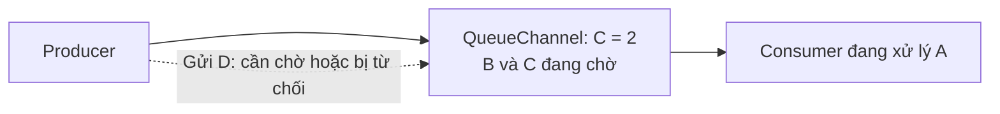

# Channel capacity — Giới hạn sức chứa của MessageChannel

Trong module **SPRING_INTEGRATION_CORE**, capacity là một quyết định thiết kế quan trọng khi dùng channel để đệm thông điệp giữa các endpoint. Một hàng đợi giúp producer và consumer hoạt động độc lập về thời điểm, nhưng phần việc chưa xử lý vẫn phải chiếm tài nguyên ở đâu đó.

Bài học thuộc chương **Message channel**, tập trung vào sức chứa của channel, hành vi khi hàng đợi đầy và cách phối hợp giới hạn này với gateway, poller, Java DSL và xử lý lỗi. Các ví dụ dùng API theo phong cách Spring Integration 6.x, Java 17 và JUnit Jupiter; cấu hình cần có thư viện `spring-integration-core` trong ứng dụng.

Sau bài học, bạn có thể:

- Chọn channel có bộ đệm phù hợp và xác định chính xác capacity đang giới hạn phần nào của luồng.
- Cấu hình hàng đợi hữu hạn, thời gian chờ gửi và phương án tiếp nhận khi quá tải.
- Ước lượng capacity từ tải tăng đột biến, ngân sách bộ nhớ và thời gian chờ cho phép.
- Kiểm chứng các trường hợp đầy, hết thời gian chờ và được giải phóng chỗ trống.

## 1. Capacity giới hạn điều gì?

**Channel capacity** là số lượng message tối đa có thể nằm chờ trong bộ đệm của một channel có giới hạn. Với `QueueChannel` lưu trong bộ nhớ, đơn vị của capacity là **message**, không phải byte, số thread hay số request mỗi giây.

Gọi:

- `C`: capacity đã cấu hình.
- `Q`: số message đang nằm trong hàng đợi.
- `I`: số message đã rời hàng đợi và đang được xử lý ở phía consumer.

Khi dùng một hàng đợi hữu hạn thông thường:

```text
0 <= Q <= C
Số chỗ trống = C - Q
Tổng công việc chưa hoàn tất có thể lớn hơn C vì còn I
```

Ví dụ, channel có `C = 2`:



Ở thời điểm này, hàng đợi chứa hai message nhưng hệ thống có ba message chưa hoàn tất. Khi consumer lấy B ra, một chỗ trống xuất hiện ngay; việc xử lý B có thể còn kéo dài.

Capacity cũng áp dụng theo từng instance channel. Nếu ba instance ứng dụng đều tạo `new QueueChannel(200)`, mỗi instance có một hàng đợi riêng chứa tối đa 200 message. Đây chưa phải một hạn mức dùng chung cho cả cụm.

Hai cách hiểu cần phân biệt:

| Sự kiện | Ý nghĩa với `QueueChannel` trong bộ nhớ |
|---|---|
| `send(...)` trả về `true` | Channel đã nhận message vào hàng đợi |
| `receive(...)` lấy được message | Message đã rời hàng đợi; một chỗ trống được trả lại |
| Handler hoàn tất | Một công việc nghiệp vụ đã xử lý xong |
| Ghi nhận kết quả bền vững | Phụ thuộc giao dịch và thiết kế lưu trữ của ứng dụng |

Vì vậy, việc gửi thành công vào hàng đợi chưa chứng minh rằng đơn hàng đã được ghi cơ sở dữ liệu hay một API bên ngoài đã nhận yêu cầu.

## 2. Capacity khác nhau giữa các loại channel

Không phải mọi `MessageChannel` đều có hàng đợi nội bộ để đặt cùng một thuộc tính capacity.

| Channel | Cách chuyển message | Nơi cần xem xét sức chứa |
|---|---|---|
| `QueueChannel` | Lưu message rồi cho consumer lấy ra | Capacity của hàng đợi |
| `PriorityChannel` | Lưu và lấy theo độ ưu tiên | Capacity của hàng đợi ưu tiên |
| `RendezvousChannel` | Bàn giao giữa sender và receiver | Không đệm; sức chứa bằng 0 |
| `DirectChannel` | Gọi handler trên thread gửi | Không có hàng đợi nội bộ |
| `ExecutorChannel` | Giao công việc cho executor | Thread pool, task queue và chính sách từ chối của executor |
| `PublishSubscribeChannel` | Phát tới các subscriber | Executor nếu có, cùng bộ đệm của từng nhánh |

Các cơ chế trên được mô tả trong [Message Channel Implementations](https://docs.spring.io/spring-integration/reference/6.5/channel/implementations.html).

Với `QueueChannel`, constructor không tham số dùng capacity `Integer.MAX_VALUE`, tương đương không giới hạn trong phần lớn tình huống thực tế. Giá trị này không làm ứng dụng có thêm RAM. Constructor nhận capacity yêu cầu số nguyên dương; muốn bàn giao không đệm thì dùng `RendezvousChannel`. Xem [QueueChannel API](https://docs.spring.io/spring-integration/api/org/springframework/integration/channel/QueueChannel.html).

```java
QueueChannel bounded = new QueueChannel(200);
QueueChannel practicallyUnbounded = new QueueChannel();
RendezvousChannel handoff = new RendezvousChannel();
```

Không dùng `new QueueChannel(0)` để mô phỏng rendezvous. Ngoài ra, việc bàn giao qua rendezvous chỉ xác nhận receiver đã nhận message; nghiệp vụ phía receiver vẫn có thể đang chạy.

## 3. Hàng đợi đầy: chờ bao lâu và trả về gì?

Với `QueueChannel` dùng hàng đợi trong bộ nhớ, overload có timeout quyết định sender chờ chỗ trống như thế nào:

| Lời gọi | Khi hàng đợi còn chỗ | Khi hàng đợi đầy |
|---|---|---|
| `send(message)` | Nhận message | Chờ không giới hạn theo mặc định |
| `send(message, -1)` | Nhận message | Chờ không giới hạn, có thể bị ngắt |
| `send(message, 0)` | Nhận message | Trả `false` ngay |
| `send(message, 200)` | Nhận message | Chờ tối đa 200 ms để có chỗ; hết thời gian trả `false` |

Nếu lời gọi bị lỗi, nó có thể ném exception. Khi nhận `false`, ứng dụng cần có nhánh xử lý tương ứng. Hợp đồng gửi và đơn vị millisecond được nêu trong [MessageChannel API](https://docs.spring.io/spring-framework/docs/current/javadoc-api/org/springframework/messaging/MessageChannel.html); hành vi chờ của hàng đợi được giải thích ở [QueueChannel](https://docs.spring.io/spring-integration/reference/channel/implementations.html#channel-implementations-queuechannel).

Ví dụ tối thiểu, giả sử chưa có consumer:

```java
import org.springframework.integration.channel.QueueChannel;
import org.springframework.messaging.support.MessageBuilder;

QueueChannel queue = new QueueChannel(2);

boolean first = queue.send(MessageBuilder.withPayload("A").build(), 0);
boolean second = queue.send(MessageBuilder.withPayload("B").build(), 0);
boolean third = queue.send(MessageBuilder.withPayload("C").build(), 0);

System.out.println(first);  // true
System.out.println(second); // true
System.out.println(third);  // false
```

Nếu thay lần gửi thứ ba bằng `send(message)` và vẫn không có consumer, thread gọi có thể chờ mãi. Đây là lý do nên chọn timeout có chủ đích tại các điểm tiếp nhận có ngân sách thời gian hữu hạn.

Phía nhận có cơ chế đối xứng: `receive(0)` trả về ngay và cho `null` nếu hàng đợi rỗng; `receive(200)` đợi tối đa 200 ms; `receive()` chờ đến khi có message hoặc bị ngắt.

**Send timeout chỉ giới hạn việc chờ channel nhận message.** Nó không tự tạo thời hạn cho toàn bộ quá trình xử lý. Đặc biệt, không dùng `send(message, 200)` trên một `DirectChannel` như cách cưỡng bức ngắt handler sau 200 ms.

## 4. Cấu hình một luồng có capacity hữu hạn bằng Java DSL

Ví dụ dưới đây mô phỏng luồng tiếp nhận đơn hàng:

```text
Caller -> orderQueue(capacity = 200)
       -> polling consumer -> xử lý đơn hàng
                            -> orderErrors nếu poller gặp lỗi
```

Khai báo channel thành bean riêng giúp producer, consumer và mã giám sát cùng dùng một instance. Trong một ứng dụng Spring thông thường, cấu hình sau có thể được nạp qua application context:

```java
package example.integration.capacity;

import java.time.Duration;

import org.springframework.beans.factory.annotation.Qualifier;
import org.springframework.context.annotation.Bean;
import org.springframework.context.annotation.Configuration;
import org.springframework.integration.channel.PublishSubscribeChannel;
import org.springframework.integration.channel.QueueChannel;
import org.springframework.integration.config.EnableIntegration;
import org.springframework.integration.dsl.IntegrationFlow;
import org.springframework.integration.dsl.Pollers;

@Configuration
@EnableIntegration
public class CapacityFlowConfiguration {

    public record Order(String id, long amountInCents) {
    }

    @Bean
    public QueueChannel orderQueue() {
        return new QueueChannel(200);
    }

    @Bean
    public PublishSubscribeChannel orderErrors() {
        return new PublishSubscribeChannel();
    }

    @Bean
    public IntegrationFlow orderFlow(
            @Qualifier("orderQueue") QueueChannel orderQueue) {

        return IntegrationFlow.from(orderQueue)
                .handle(Order.class, (order, headers) -> {
                    System.out.println("Processed order " + order.id());
                    return null;
                }, endpoint -> endpoint.poller(
                        Pollers.fixedDelay(Duration.ofMillis(100))
                                .maxMessagesPerPoll(10)
                                .receiveTimeout(0)
                                .errorChannel("orderErrors")))
                .get();
    }

    @Bean
    public IntegrationFlow orderErrorFlow() {
        return IntegrationFlow.from("orderErrors")
                .handle(message -> {
                    Throwable failure = (Throwable) message.getPayload();
                    System.err.println("Order flow failed: " + failure);
                })
                .get();
    }
}
```

Handler trả `null` vì ví dụ là luồng một chiều. Khi dùng thực tế, thay thao tác in log bằng nghiệp vụ và cách ghi nhận lỗi phù hợp.

Các cấu hình có vai trò khác nhau:

| Cấu hình | Tác dụng |
|---|---|
| `new QueueChannel(200)` | Đệm tối đa 200 message đang chờ |
| `fixedDelay(100 ms)` | Khoảng nghỉ giữa khi lượt poll trước hoàn tất và lượt tiếp theo bắt đầu |
| `maxMessagesPerPoll(10)` | Mỗi lượt poll xử lý tối đa 10 message |
| `receiveTimeout(0)` | Khi hàng đợi rỗng, lần nhận trả về ngay |
| `errorChannel("orderErrors")` | Chọn kênh nhận lỗi phát sinh từ polling task |

Java DSL cung cấp các thiết lập poller qua `Pollers` và `PollerSpec`. Xem [Pollers](https://docs.spring.io/spring-integration/reference/dsl/java-pollers.html) và [PollerSpec API](https://docs.spring.io/spring-integration/api/org/springframework/integration/dsl/PollerSpec.html).

`QueueChannel` cần một consumer thực hiện việc nhận. Khai báo channel tự nó chưa tạo thread đọc message. Khi một endpoint lấy đầu vào từ `PollableChannel`, polling consumer chịu trách nhiệm gọi nhận theo lịch. Xem [Message Endpoints](https://docs.spring.io/spring-integration/reference/6.5/endpoint.html).

### Cách khai báo channel bằng DSL factory

Có thể thay **riêng method** `orderQueue()` ở trên bằng cách sau; không đăng ký cả hai bean cùng tên:

```java
import org.springframework.context.annotation.Bean;
import org.springframework.integration.dsl.MessageChannels;
import org.springframework.integration.dsl.QueueChannelSpec;

@Bean
public QueueChannelSpec orderQueue() {
    return MessageChannels.queue(200);
}
```

`QueueChannelSpec` là phần khai báo để Spring tạo channel. Trong method `@Bean` dạng này, trả về spec để container quản lý. Khi tái sử dụng channel giữa nhiều flow, tham chiếu bean đã khai báo thay vì tạo các channel mới trùng tên. Xem [Java DSL: Message Channels](https://docs.spring.io/spring-integration/reference/6.5/dsl/java-channels.html) và [MessageChannels API](https://docs.spring.io/spring-integration/api/org/springframework/integration/dsl/MessageChannels.html).

## 5. Producer và gateway phải có chính sách tiếp nhận rõ ràng

### Gửi trực tiếp và kiểm tra kết quả

Đoạn mã trong method của producer có thể dùng lại kiểu `Order` đã khai báo:

```java
var order = new CapacityFlowConfiguration.Order("ORD-101", 125_000L);
var message = org.springframework.messaging.support.MessageBuilder
        .withPayload(order)
        .build();

boolean accepted = orderQueue.send(message, 200);

if (!accepted) {
    throw new IllegalStateException(
            "Chưa tiếp nhận đơn hàng: hàng đợi không có chỗ trong 200 ms");
}
```

Đây là ví dụ báo tiếp nhận thất bại; ứng dụng có thể chuyển nó thành một phản hồi nghiệp vụ, lịch thử lại hoặc thao tác lưu bền vững. Chỉ trả kết quả tiếp nhận thành công khi nhánh xử lý thực sự đã nhận trách nhiệm cho message.

Không đặt `getRemainingCapacity() > 0` làm điều kiện bảo đảm cho lần gửi kế tiếp. Giữa lúc đọc số chỗ trống và lúc gửi, một producer khác có thể chiếm chỗ. Chính kết quả của `send(...)` mới quyết định lần gửi đó có thành công.

### Đặt timeout tại messaging gateway

Gateway giúp caller gọi một interface thay vì thao tác trực tiếp với message API:

```java
package example.integration.capacity;

import org.springframework.integration.annotation.MessagingGateway;

@MessagingGateway(
        defaultRequestChannel = "orderQueue",
        defaultRequestTimeout = "200")
public interface OrderGateway {

    void submit(CapacityFlowConfiguration.Order order);
}
```

Trong cấu hình Spring, thêm `@IntegrationComponentScan` với import `org.springframework.integration.annotation.IntegrationComponentScan` để tìm interface gateway, hoặc dùng cơ chế đăng ký gateway tương đương của ứng dụng.

Ở gateway này, `defaultRequestTimeout` giới hạn việc chờ gửi vào `orderQueue` khi đầy. Interface trả `void` thể hiện gửi một chiều. Việc gửi không thành công được hạ tầng gateway xử lý thành lỗi theo cấu hình, vì vậy caller cần xử lý exception thích hợp.

Với gateway có kết quả trả về, phân biệt:

- **Request timeout**: thời gian chờ gửi request vào channel có khả năng chặn.
- **Reply timeout**: thời gian chờ message phản hồi sau giai đoạn gửi.
- **Timeout I/O**: giới hạn cho kết nối HTTP, JDBC hoặc dịch vụ khác bên trong handler.

Reply timeout không tự rút message đã được nhận khỏi hàng đợi. Một caller hết thời gian chờ vẫn có thể có yêu cầu đang tiếp tục được xử lý. Nếu caller thử lại, cần khóa nghiệp vụ hoặc idempotency phù hợp. Xem [Messaging Gateways — Gateway Timeouts](https://docs.spring.io/spring-integration/reference/6.5/gateway.html#gateway-timeouts).

## 6. Chọn hành vi khi đầy

Capacity chỉ có tác dụng bảo vệ tài nguyên nếu điểm gửi có phản ứng phù hợp khi chạm giới hạn.

| Chiến lược | Cách áp dụng | Điểm cần cân nhắc |
|---|---|---|
| Chờ không giới hạn | Dùng overload gửi không có timeout | Thread có thể bị giữ lâu; phải có điều kiện bảo đảm consumer tiếp tục chạy |
| Chờ hữu hạn | `send(message, timeoutMs)` với giá trị dương | Chọn timeout trong ngân sách thời gian của caller |
| Từ chối ngay | `send(message, 0)` và xử lý `false` | Caller phải biết request chưa được nhận |
| Thử lại có khoảng nghỉ | Retry giới hạn số lần và tổng thời gian | Retry tạo thêm tải; tránh nhiều producer thử lại đồng loạt |
| Chuyển sang nơi lưu bền vững | Ghi vào kho phù hợp rồi xử lý sau | Cần thiết kế xác nhận ghi, hạn mức và phục hồi riêng |
| Loại bỏ có chủ đích | Ghi nhận số lượng và quy tắc loại bỏ | Chỉ dùng khi nghiệp vụ cho phép mất loại message đó |

Ví dụ, dữ liệu trạng thái cảm biến được cập nhật liên tục có thể cho phép bỏ một số bản tin cũ. Lệnh thanh toán lại cần hợp đồng tiếp nhận và phục hồi rõ ràng hơn. Quyết định nằm ở ý nghĩa nghiệp vụ của message.

Một bounded queue làm áp lực lan về producer khi đầy, thường được gọi là **back pressure**. Cơ chế này dựa trên việc chờ hoặc từ chối tại điểm gửi. Nó không tự tạo giao thức yêu cầu số lượng message như Reactive Streams, cũng không tự làm một HTTP client ngoài ứng dụng giảm tốc.

Nếu producer nhận `false` rồi lập tức lặp gửi trong vòng `while` không có giới hạn, CPU có thể tăng mạnh trong khi consumer vẫn giữ nguyên năng lực xử lý.

## 7. Ước lượng capacity bằng ba ràng buộc

Không có một capacity mặc định phù hợp cho mọi luồng. Cần tìm khoảng giá trị đồng thời thỏa tải tăng đột biến, bộ nhớ và độ trễ.

Các công thức dưới đây là **mô hình ước lượng**, giả sử tốc độ vào và ra gần như hằng số trong khoảng đang xét. Chúng không phải cam kết thời gian thực của framework.

### 7.1. Chứa được lượng công việc tăng thêm trong một đợt tải

Gọi `lambda` là tốc độ vào, `mu` là tốc độ lấy ra bền vững, cùng đơn vị message/giây. Trong khoảng `T` giây khi `lambda > mu`:

```text
Lượng tồn tăng thêm ≈ (lambda - mu) × T
Capacity cần thiết ≈ Q_ban_đầu + lượng tồn tăng thêm + dự phòng
```

Giả sử một luồng đặt hàng có số đo thử nghiệm:

```text
Tốc độ vào khi có đợt tải:       900 message/s
Tốc độ lấy ra bền vững:         600 message/s
Thời gian đợt tải:              2 s
Hàng đợi tại lúc bắt đầu:       100 message
```

Sau hai giây, lượng tồn ước tính là:

```text
Q ≈ 100 + (900 - 600) × 2 = 700 message
```

Nếu thêm mức dự phòng 20% trên con số 700, nhu cầu thiết kế là khoảng 840 message. Phần trăm này chỉ là giả định minh họa; chọn mức dự phòng từ dữ liệu tải và mức biến động thực tế.

Nếu `lambda > mu` kéo dài, mọi capacity hữu hạn cuối cùng đều đầy. Tăng capacity chỉ lùi thời điểm bắt đầu chờ hoặc từ chối. Khi chưa chạm trần:

```text
Thời gian đến khi đầy ≈ (C - Q_hiện_tại) / (lambda - mu)
```

Với `C = 850` và `Q = 100`, thời gian ước tính là `(850 - 100) / 300 = 2,5 giây`. Muốn chịu mức tải đó lâu dài phải giảm tải vào hoặc tăng năng lực xử lý thực tế.

### 7.2. Không vượt ngân sách bộ nhớ

Một ước lượng khởi đầu:

```text
Bộ nhớ giữ bởi queue ≈ C × kích thước giữ lại trung bình mỗi message
C_memory ≈ ngân sách bộ nhớ cho queue / kích thước giữ lại mỗi message
```

Kích thước giữ lại gồm payload, headers và các object còn được tham chiếu; có thể khác đáng kể so với độ dài JSON truyền qua mạng. Các payload có kích thước rất khác nhau khiến giới hạn theo số message bảo vệ bộ nhớ kém chính xác hơn.

Giả sử ngân sách riêng cho hàng đợi là 32 MiB và mỗi message giữ lại trung bình 32 KiB:

```text
C_memory ≈ 32 MiB / 32 KiB = 1024 message
850 × 32 KiB ≈ 26,6 MiB
```

Phải dành bộ nhớ cho phần còn lại của ứng dụng, message đang được xử lý và các bộ đệm khác. Con số trung bình cần được kiểm chứng với phân bố kích thước payload, nhất là phần đuôi có message lớn.

### 7.3. Giữ thời gian chờ trong ngân sách

Với hàng đợi FIFO, consumer hoạt động đều và không có nghẽn mới, thời gian chờ của message nằm cuối một hàng đợi có thể ước lượng:

```text
Thời gian chờ ≈ số message đứng trước / tốc độ lấy ra
```

Nếu ngân sách chờ là 1,5 giây và `mu = 600 message/s`, lượng tồn tương ứng khoảng 900 message. Với capacity 850, thời gian chờ gần đầy vào khoảng `850 / 600 = 1,42 giây`.

Ước lượng này chưa cộng thời gian xử lý chính message đó, độ trễ lịch poll, retry hay gián đoạn phía downstream. Với `PriorityChannel`, message ưu tiên thấp có thể chờ khác hẳn ước lượng FIFO.

Ở trạng thái ổn định, quan hệ Little có thể dùng làm phép đối chiếu giữa các số đo trung bình cùng phạm vi:

```text
Số message chờ trung bình ≈ tốc độ message được tiếp nhận × thời gian chờ trung bình
```

Không áp dụng quan hệ trung bình này để bảo đảm độ trễ tối đa của một đợt tải ngắn hoặc p99.

### 7.4. Kết hợp các giới hạn

Với toàn bộ giả định của ví dụ:

| Ràng buộc | Kết quả minh họa |
|---|---|
| Chứa đợt tải và dự phòng | Cần khoảng 840 message |
| Bộ nhớ của queue | Tối đa khoảng 1024 message theo trung bình giả định |
| Ngân sách chờ | Khoảng 900 message, chưa tính các độ trễ khác |
| Giá trị đem thử nghiệm | 850 message |

850 là một ứng viên để kiểm tra bằng thử tải. Nếu lượng tồn cần thiết vượt cả trần bộ nhớ hoặc trần độ trễ, cần đổi thiết kế: giảm tốc độ vào, tối ưu consumer, chia tải hoặc dùng phương án lưu trữ và xử lý khác. Không thể giải quyết mâu thuẫn chỉ bằng một con số capacity lớn hơn.

## 8. Capacity và poller phải được tính cùng nhau

`maxMessagesPerPoll(10)` không tạo ra 10 worker. Trong cấu hình ở phần 4, không có executor riêng để chạy song song; một lượt poll gọi handler tuần tự cho các message mà nó lấy được.

Với giả định queue luôn có dữ liệu, một polling consumer duy nhất, handler đồng bộ, thời gian xử lý mỗi message là `s` và fixed delay là `d`, tốc độ lý tưởng có thể ước lượng:

```text
Tốc độ ≈ B / (B × s + d)
B = số message xử lý trong một lượt poll
```

Ví dụ `B = 10`, `s = 20 ms`, `d = 100 ms`:

```text
Tốc độ ≈ 10 / (10 × 0,020 + 0,100) ≈ 33,3 message/s
```

Không suy ra tốc độ 100 message/s chỉ từ phép chia `10 / 0,1`, vì thời gian handler cũng nằm trong lượt poll. Khi thêm executor, downstream bất đồng bộ hoặc đổi lịch chạy, mô hình này không còn mô tả đầy đủ; cần đo lại tốc độ và giới hạn đồng thời.

Tăng số worker chỉ hữu ích nếu tài nguyên downstream chịu được. Một connection pool có 10 kết nối không trở thành 100 kết nối khi tăng consumer lên 100. Kết quả có thể là thêm nhiều thread đang chờ.

Một kiểu tắc nghẽn đáng chú ý là producer chiếm hết một executor hữu hạn rồi chờ gửi vào queue đầy, trong khi consumer cũng cần chính executor đó để chạy. Thiết kế lịch thực thi phải bảo đảm consumer có cơ hội giải phóng hàng đợi.

## 9. Kiểm tra các bộ đệm nằm sau channel

Hãy xét luồng:

```text
Producer -> QueueChannel(200) -> Poller
         -> ExecutorChannel -> HTTP handler
```

Nếu poller chuyển rất nhanh sang một executor có task queue lớn, `QueueChannel` đầu vào có thể gần rỗng trong khi hàng nghìn tác vụ HTTP đang chờ. Khi đó, chỉ nhìn `getQueueSize()` của channel đầu tiên sẽ đánh giá thiếu lượng tồn.

`ExecutorChannel` ủy quyền thực thi cho executor; giới hạn của executor phải được cấu hình và quan sát riêng. Xem [ExecutorChannel API](https://docs.spring.io/spring-integration/api/org/springframework/integration/channel/ExecutorChannel.html).

Khi rà soát tổng lượng công việc trong hệ thống, tính cả:

- Message trong từng channel có bộ đệm.
- Tác vụ đang chờ và đang chạy trong executor.
- Request đang giữ connection hoặc đang đợi connection pool.
- Message giữ trong aggregator, các lịch retry hoặc thành phần lưu trạng thái.

Đặt capacity theo vị trí của từng buffer và mục đích nghiệp vụ. Ví dụ, splitter có thể biến một yêu cầu thành hàng trăm message; router có thể làm một nhánh đầy trong khi các nhánh khác còn trống. Aggregator giữ nhóm message theo quy tắc hoàn tất riêng, cần chính sách timeout và dọn nhóm riêng. Message store cũng được dùng bởi các thành phần giữ message như aggregator, theo [Message Store](https://docs.spring.io/spring-integration/reference/6.5/message-store.html).

## 10. Phân biệt quá tải khi gửi với lỗi xử lý

Hai tình huống thường bị nhầm:

| Tình huống | Điều đã xảy ra | Nơi cần phản ứng |
|---|---|---|
| Queue đầy, `send(..., 200)` trả `false` | Lần gửi này chưa được channel tiếp nhận | Producer kiểm tra kết quả hoặc gateway xử lý lỗi gửi |
| Gửi thành công, handler lỗi sau đó | Message đã được nhận rồi xử lý thất bại | Cơ chế lỗi của polling endpoint và luồng phục hồi |

Khi gọi trực tiếp `QueueChannel.send`, kết quả `false` do đầy không tự biến thành một `ErrorMessage` trên global `errorChannel`. Không dựa vào error channel để thay cho việc kiểm tra kết quả gửi.

Với handler chạy ở polling thread, lỗi xử lý thường được chuyển qua cơ chế error handler của poller. Có thể cấu hình kênh lỗi như trong ví dụ `orderErrors`. Một `try/catch` quanh lần enqueue ban đầu không trực tiếp bắt được exception xuất hiện về sau trên thread khác. Xem [Error Handling](https://docs.spring.io/spring-integration/reference/6.5/error-handling.html).

Với queue trong bộ nhớ thông thường, message đã bị lấy khỏi queue khi handler bắt đầu. Handler ném exception không làm message tự quay về vị trí cũ. Retry, nhánh phục hồi, hàng đợi lỗi và lưu lại thông tin thất bại là các quyết định phải cấu hình rõ.

Nhánh lỗi cũng phải có đủ năng lực hoạt động khi luồng chính gặp sự cố. Nếu dùng một queue hữu hạn cho lỗi nhưng không có consumer phù hợp, việc báo lỗi có thể tạo thêm một điểm nghẽn.

## 11. Capacity và độ bền là hai thuộc tính riêng

`new QueueChannel(200)` tạo giới hạn lưu trong bộ nhớ; nó không cung cấp khả năng khôi phục message sau khi process dừng đột ngột.

Spring Integration hỗ trợ channel dùng persistent message store. Tuy nhiên, khi cấu hình XML `<queue message-store="..."/>`, thuộc tính `capacity` không được dùng đồng thời. Không chuyển nguyên giả định giới hạn của queue trong bộ nhớ sang queue dựa trên store. Cần kiểm tra implementation, giới hạn lưu trữ và cơ chế tiếp nhận tương ứng.

Với store có hỗ trợ giao dịch và poller được cấu hình transaction phù hợp, rollback có thể bảo vệ thao tác lấy message khỏi store. Một annotation giao dịch trên nghiệp vụ không tự làm queue trong bộ nhớ có tính bền vững. Xem [Persistent QueueChannel Configuration](https://docs.spring.io/spring-integration/reference/6.5/channel/configuration.html#channel-configuration-queuechannel).

Nếu yêu cầu là nhận tải ngay cả khi nhiều instance xử lý dừng, đánh giá persistent store hoặc broker theo hợp đồng nghiệp vụ. Ngoài dung lượng, cần xem xác nhận tiếp nhận, phục hồi, thử lại và khả năng xử lý trùng.

## 12. Ví dụ kiểm thử hành vi capacity

Các kiểm thử sau dùng `QueueChannel` trong bộ nhớ và JUnit Jupiter. Chúng tập trung vào hành vi quan sát được; không cần Spring application context.

```java
package example.integration.capacity;

import java.util.concurrent.CountDownLatch;
import java.util.concurrent.ExecutorService;
import java.util.concurrent.Executors;
import java.util.concurrent.Future;
import java.util.concurrent.TimeUnit;

import org.junit.jupiter.api.Test;
import org.springframework.integration.channel.QueueChannel;
import org.springframework.messaging.Message;
import org.springframework.messaging.support.MessageBuilder;

import static org.junit.jupiter.api.Assertions.*;

class ChannelCapacityTest {

    private static Message<String> message(String value) {
        return MessageBuilder.withPayload(value).build();
    }

    @Test
    void rejectsImmediatelyWhenCapacityIsReached() {
        QueueChannel queue = new QueueChannel(2);

        assertTrue(queue.send(message("A"), 0));
        assertTrue(queue.send(message("B"), 0));
        assertFalse(queue.send(message("C"), 0));
        assertEquals(2, queue.getQueueSize());
    }

    @Test
    void finiteTimeoutDoesNotAddMessageWhenQueueStaysFull() {
        QueueChannel queue = new QueueChannel(1);
        Message<String> first = message("A");
        assertTrue(queue.send(first, 0));

        assertFalse(queue.send(message("B"), 50));

        assertEquals(first, queue.receive(0));
        assertNull(queue.receive(0));
    }

    @Test
    void slotIsReleasedBeforeConsumerFinishesProcessing() throws Exception {
        QueueChannel queue = new QueueChannel(1);
        Message<String> first = message("A");
        assertTrue(queue.send(first, 0));

        CountDownLatch received = new CountDownLatch(1);
        CountDownLatch allowCompletion = new CountDownLatch(1);
        ExecutorService worker = Executors.newSingleThreadExecutor();

        try {
            Future<Message<?>> processing = worker.submit(() -> {
                Message<?> taken = queue.receive(1000);
                assertNotNull(taken);
                received.countDown();
                assertTrue(allowCompletion.await(5, TimeUnit.SECONDS));
                return taken;
            });

            assertTrue(received.await(5, TimeUnit.SECONDS));
            assertFalse(processing.isDone());
            assertEquals(0, queue.getQueueSize());

            assertTrue(queue.send(message("B"), 0));
            assertEquals(1, queue.getQueueSize());

            allowCompletion.countDown();
            assertEquals(first, processing.get(5, TimeUnit.SECONDS));
        }
        finally {
            allowCompletion.countDown();
            worker.shutdownNow();
        }
    }
}
```

Test thứ hai kiểm tra kết quả từ chối sau một timeout hữu hạn; không yêu cầu thời gian thực thi bằng chính xác 50 ms, vì lịch thread có thể làm tổng thời gian lâu hơn. Test thứ ba dùng latch để tách thời điểm lấy message và thời điểm hoàn tất xử lý, qua đó chứng minh capacity chỉ giới hạn phần đang nằm trong queue.

Khi thử với application context thật, bổ sung tình huống consumer dừng, nhiều producer gửi đồng thời và handler bị chậm. Kiểm tra kết quả tiếp nhận, số message được xử lý và việc caller có tuân thủ ngân sách thời gian hay không.

## 13. Quan sát và chẩn đoán

Số lượng message trong queue là một tín hiệu, cần đọc cùng tốc độ vào/ra và độ trễ.

| Tín hiệu | Câu hỏi cần trả lời |
|---|---|
| Queue size và remaining capacity | Lượng tồn hiện tại có tiến gần giới hạn không? |
| Tốc độ enqueue thành công | Hệ thống thực sự nhận bao nhiêu message mỗi giây? |
| Số lần gửi bị từ chối hoặc timeout | Có bao nhiêu công việc chưa được tiếp nhận? |
| Thời gian chờ gửi | Producer đang bị giữ thread bao lâu? |
| Thời gian chờ trong queue | Message mất bao lâu trước khi consumer bắt đầu xử lý? |
| Thời gian và tỷ lệ lỗi xử lý | Consumer có chậm đi hoặc bị lỗi hàng loạt không? |
| Executor queue, active threads, connection pool | Lượng tồn có chuyển sang tài nguyên khác không? |
| Heap, kích thước payload, GC | Giới hạn theo số message có đủ bảo vệ bộ nhớ không? |

`QueueChannel` có các method quan sát `getQueueSize()` và `getRemainingCapacity()`; chúng cung cấp ảnh chụp tại thời điểm gọi. Không coi hai lần đọc liên tiếp là một snapshot nguyên tử khi có truy cập đồng thời. Xem [QueueChannel API](https://docs.spring.io/spring-integration/api/org/springframework/integration/channel/QueueChannel.html).

Nếu muốn đo thời gian nằm trong một queue cụ thể, có thể gắn header thời điểm enqueue do ứng dụng quản lý và ghi nhận lúc dequeue. Dùng cùng quy ước thời gian, đồng thời tránh nhầm timestamp tạo message với thời điểm vào một queue sau nhiều bước transform hoặc route.

Một số dấu hiệu và hướng điều tra:

| Dấu hiệu | Hướng kiểm tra |
|---|---|
| Queue tăng đều | So sánh tốc độ vào với năng lực lấy ra; xem consumer và downstream |
| Queue đầy nhưng CPU thấp | Kiểm tra chờ I/O, connection pool hoặc consumer chưa chạy |
| Queue gần rỗng nhưng latency cao | Tìm task queue và công việc đang xử lý ở phía sau |
| Tăng capacity rồi lỗi xuất hiện muộn hơn | Xem có tình trạng tốc độ vào cao hơn tốc độ xử lý kéo dài không |
| Request chờ lâu khi queue đầy | Kiểm tra overload gửi, request timeout và số thread bị giữ |
| Nghiệp vụ bị xử lý hai lần sau timeout | Kiểm tra retry và cơ chế chống xử lý trùng |

Cảnh báo nên dựa trên độ đầy kéo dài, xu hướng tăng và độ trễ nghiệp vụ. Ngưỡng 80% có thể là điểm thử ban đầu, nhưng cần điều chỉnh theo nhịp tải và thời gian phản ứng của hệ thống.

## 14. Bài thực hành: bảo vệ một luồng nhận đơn hàng

Thực hiện trong một chương trình thử nghiệm riêng:

1. Tạo `QueueChannel(3)`, chưa chạy consumer. Gửi ba message bằng timeout 0 và xác nhận cả ba được nhận.
2. Gửi message thứ tư với timeout 0. Xác nhận kết quả là `false` và queue vẫn có ba message.
3. Nhận một message bằng `receive(0)` rồi gửi lại message thứ tư. Xác nhận lần gửi này thành công.
4. Thêm polling consumer xử lý chậm, phát tải vào nhanh hơn tốc độ xử lý rồi giữ tải trong một khoảng hữu hạn. Ghi nhận lượng tồn và số lần gửi bị từ chối.
5. Lặp lại với capacity lớn hơn. So sánh thời điểm chạm trần, thời gian chờ, bộ nhớ và tốc độ xử lý hoàn tất.
6. Giữ nguyên capacity, cải thiện tốc độ consumer hoặc giảm tải vào. So sánh thời gian giải phóng lượng tồn sau đợt tải.

Kết quả cần giải thích được là: capacity lớn hơn tạo thêm chỗ chờ và thay đổi khả năng chịu đợt tải, trong khi năng lực xử lý hoàn tất vẫn phụ thuộc consumer cùng các tài nguyên phía sau. Chọn capacity chỉ hoàn tất khi đã xác định cả hành vi lúc đầy, ngân sách thời gian và cách phục hồi message khi xử lý thất bại.
