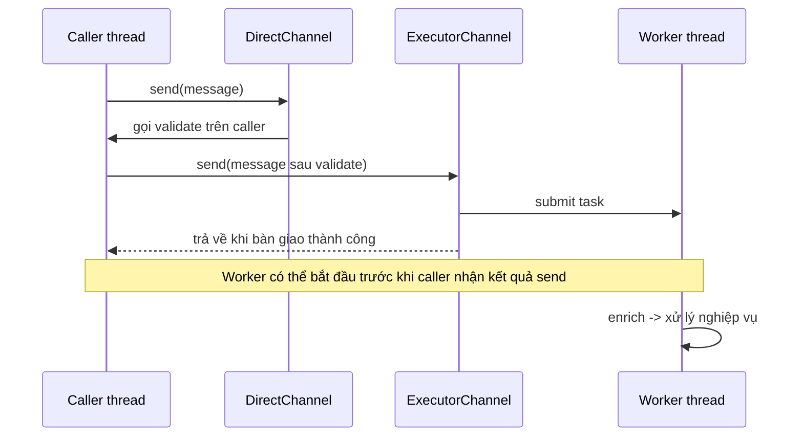

# Channel và thread boundary

Trong chương **Message channel** của module **SPRING_INTEGRATION_CORE**, lựa chọn channel là một quyết định về cách thực thi luồng thông điệp. Cùng một chuỗi endpoint kiểm tra, biến đổi, định tuyến và xử lý nghiệp vụ, thay channel ở giữa có thể làm thay đổi thread chạy handler, cách báo lỗi và phạm vi transaction.

Bài này giúp bạn đọc một integration flow và trả lời được: **đoạn nào chạy trên thread nào, bên gửi đang chờ điều gì, và ai chịu trách nhiệm khi xử lý thất bại?**

## 1. Thread boundary là gì?

**Thread boundary**, hay ranh giới thread, xuất hiện khi công việc được chuyển từ thread hiện tại sang một thread khác.

Giả sử thread nhận HTTP request gửi một `Message<Order>` vào luồng:

```text
http-thread
  -> kiểm tra đơn
  -> chuẩn hóa dữ liệu
  -> gửi thông báo
```

Ba endpoint không có nghĩa là ba thread. Nếu các channel trung gian đều là `DirectChannel`, những handler đồng bộ này nằm trên cùng call stack của thread gửi.

Khi chèn một channel sử dụng thread pool:

```text
http-thread:  kiểm tra -> chuẩn hóa -> bàn giao công việc -> tiếp tục
                                             |
                                             v
worker-thread:                         gửi thông báo -> ghi kết quả
```

Channel là một nơi có thể tạo ranh giới thread. Bản thân handler cũng có thể chuyển việc sang executor, gọi `@Async` hoặc tham gia một pipeline reactive. Vì vậy, cần xem cả channel lẫn cách handler thực thi.

Ba khái niệm cần phân biệt:

| Khái niệm | Câu hỏi cần trả lời |
| --- | --- |
| Cấu trúc luồng | Message đi qua những endpoint nào? |
| Mô hình thực thi | Thread nào gọi từng handler? |
| Hợp đồng hoàn thành | Khi lời gọi trả về, hệ thống đã tiếp nhận hay đã xử lý xong? |

Ví dụ: API trả mã tiếp nhận sau khi đưa việc vào hàng đợi cần một hợp đồng khác với API phải trả kết quả tính phí cuối cùng.

## 2. Channel nào tạo ranh giới thread?

| Channel và cấu hình | Thread chạy handler | Bên gửi chờ gì? |
| --- | --- | --- |
| `DirectChannel` | Thread đang gọi `send()` | Handler đồng bộ được dispatch và phần downstream đồng bộ của nó kết thúc hoặc ném lỗi |
| `ExecutorChannel` với thread pool | Worker do executor lựa chọn | Bàn giao task; thời gian và kết quả còn phụ thuộc executor |
| `QueueChannel` với polling consumer | Thread thực hiện poll, hoặc executor được cấu hình cho poller | Đưa message vào queue; có thể chờ nếu queue đầy |
| `PublishSubscribeChannel` không có executor | Thread gửi, lần lượt gọi subscriber | Các lời gọi subscriber đồng bộ theo cấu hình dispatch |
| `PublishSubscribeChannel` có executor bất đồng bộ | Thread do executor lựa chọn | Bàn giao các task; không phải chờ mọi subscriber hoàn thành nghiệp vụ |

`PublishSubscribeChannel` quyết định phát đến nhiều subscriber; executor quyết định cách chạy các subscriber. Hai thuộc tính này độc lập. Không có executor, channel này gọi handler trên thread gửi. [API PublishSubscribeChannel](https://docs.spring.io/spring-integration/api/org/springframework/integration/channel/PublishSubscribeChannel.html).

### Không suy ra thread chỉ từ tên interface

`SubscribableChannel` cho phép đăng ký handler; nó không có nghĩa là luôn đồng bộ. `DirectChannel` và `ExecutorChannel` đều thuộc nhóm này.

`PollableChannel` cung cấp thao tác `receive()`; nó không tự tạo thread. Với `QueueChannel`, nếu một phương thức tự gọi `send()` rồi `receive()` trên cùng thread thì hai thao tác vẫn diễn ra trên thread đó. Ranh giới thread thường xuất hiện khi có một consumer riêng đọc queue.

Các mô hình point-to-point, publish-subscribe và buffering mô tả cách chuyển giao message; chúng cần được đọc cùng cấu hình thực thi. [Các implementation của message channel](https://docs.spring.io/spring-integration/reference/channel/implementations.html).

## 3. DirectChannel: theo thread đang gửi

Một `DirectChannel` gọi subscriber trên thread gửi. Với một subscriber đồng bộ, luồng gọi có dạng:

```text
caller
  -> input.send(message)
      -> handler A
          -> next.send(message)
              -> handler B
  <- send trả về
```

Đặc điểm quan trọng là **thread đang gửi**, không nhất thiết là thread khởi tạo toàn bộ quy trình. Nếu một worker vừa nhận việc qua `ExecutorChannel`, các `DirectChannel` tiếp theo sẽ chạy handler trên worker đó.

`DirectChannel` có ngữ nghĩa point-to-point: nhiều subscriber không biến nó thành cơ chế broadcast. Dispatcher có thể chọn subscriber và có cấu hình failover; không dùng việc đăng ký nhiều subscriber để diễn đạt nhiều bước nghiệp vụ nối tiếp. [API DirectChannel](https://docs.spring.io/spring-integration/api/org/springframework/integration/channel/DirectChannel.html).

Ví dụ tính phí:

```text
request thread
  -> validateChannel: DirectChannel
  -> validate
  -> pricingChannel: DirectChannel
  -> calculatePrice
  -> trả kết quả
```

Cách tổ chức này phù hợp khi kết quả tính phí cần trả ngay cho caller. Độ trễ của handler góp trực tiếp vào thời gian xử lý request, nên cần đặt timeout cho các thao tác I/O được gọi bên trong handler.

**Đồng bộ không có nghĩa là chỉ một request được xử lý tại một thời điểm.** Nhiều thread có thể đồng thời gọi `send()` vào cùng channel. Một handler dùng chung vẫn phải bảo vệ trạng thái có thể thay đổi.

## 4. ExecutorChannel: bàn giao sang executor

`ExecutorChannel` chuyển việc dispatch cho một `Executor`. Với thread pool, worker thực hiện phần downstream:



Thứ tự tương đối giữa log sau `send()` ở caller và log đầu tiên ở worker không cố định. Worker có thể bắt đầu rất sớm, kể cả hoàn thành trước khi caller kịp ghi log.

### Cần đọc cấu hình executor

Một `Executor` có thể chạy task đồng bộ. Ví dụ, `SyncTaskExecutor` dùng thread gọi. Do đó, chỉ thấy `ExecutorChannel` trong code chưa đủ để khẳng định luôn có chuyển thread. [API ExecutorChannel](https://docs.spring.io/spring-integration/api/org/springframework/integration/channel/ExecutorChannel.html).

Với `ThreadPoolTaskExecutor`, cần xét:

- Số worker và dung lượng queue task.
- Chính sách khi không nhận thêm task.
- Cách shutdown và thời gian đợi công việc đang chạy.

`CallerRunsPolicy` có thể chạy task ngay trên thread gửi khi pool bão hòa. `AbortPolicy` từ chối task để phía gửi nhận biết tình trạng quá tải. Chọn chính sách là chọn hành vi của hệ thống khi thiếu năng lực xử lý. [Task execution và scheduling](https://docs.spring.io/spring-framework/reference/integration/scheduling.html).

Không lấy việc thỉnh thoảng chạy trên caller làm cơ sở thiết kế transaction. Hành vi cần đúng cả khi hệ thống rảnh lẫn khi quá tải.

## 5. Ví dụ Java DSL: quan sát trước và sau ranh giới

Ví dụ nhận một chuỗi, kiểm tra trên caller, rồi chuyển sang worker để biến đổi và đặt kết quả vào queue:

```text
input: DirectChannel
  -> validate
  -> workerChannel: ExecutorChannel
  -> uppercase
  -> results: QueueChannel
```

Điều kiện sử dụng:

- Project đã có `org.springframework.integration:spring-integration-core` và các dependency Spring tương thích.
- Phiên bản dependency và Java được quản lý theo cấu hình của project.
- Lưu lớp dưới đây thành `ThreadBoundaryDemo.java` trong package phù hợp khi thực hành.

Java DSL đăng ký flow qua bean `IntegrationFlow`; ví dụ dùng `@EnableIntegration` để khởi tạo hạ tầng Integration trong một application context Java thông thường. [Java DSL](https://docs.spring.io/spring-integration/reference/dsl.html).

```java
import java.util.Locale;
import java.util.concurrent.ThreadPoolExecutor;

import org.springframework.beans.factory.annotation.Qualifier;
import org.springframework.context.annotation.AnnotationConfigApplicationContext;
import org.springframework.context.annotation.Bean;
import org.springframework.context.annotation.Configuration;
import org.springframework.integration.channel.DirectChannel;
import org.springframework.integration.channel.ExecutorChannel;
import org.springframework.integration.channel.QueueChannel;
import org.springframework.integration.config.EnableIntegration;
import org.springframework.integration.dsl.IntegrationFlow;
import org.springframework.messaging.Message;
import org.springframework.messaging.support.ErrorMessage;
import org.springframework.messaging.support.MessageBuilder;
import org.springframework.scheduling.concurrent.ThreadPoolTaskExecutor;

@Configuration
@EnableIntegration
public class ThreadBoundaryDemo {

    @Bean
    public DirectChannel input() {
        return new DirectChannel();
    }

    @Bean
    public ThreadPoolTaskExecutor workerExecutor() {
        ThreadPoolTaskExecutor executor = new ThreadPoolTaskExecutor();
        executor.setCorePoolSize(2);
        executor.setMaxPoolSize(2);
        executor.setQueueCapacity(50);
        executor.setThreadNamePrefix("si-worker-");
        executor.setRejectedExecutionHandler(
                new ThreadPoolExecutor.AbortPolicy());
        executor.setWaitForTasksToCompleteOnShutdown(true);
        executor.setAwaitTerminationSeconds(5);
        return executor;
    }

    @Bean
    public ExecutorChannel workerChannel(
            @Qualifier("workerExecutor")
            ThreadPoolTaskExecutor executor) {
        return new ExecutorChannel(executor);
    }

    @Bean
    public QueueChannel results() {
        return new QueueChannel(10);
    }

    @Bean
    public QueueChannel workerErrors() {
        return new QueueChannel(10);
    }

    @Bean
    public IntegrationFlow boundaryFlow(
            @Qualifier("input") DirectChannel input,
            @Qualifier("workerChannel") ExecutorChannel workerChannel,
            @Qualifier("results") QueueChannel results) {

        return IntegrationFlow.from(input)
                .handle(String.class, (payload, headers) -> {
                    trace("validate", payload);
                    String value = payload.trim();
                    if (value.isEmpty()) {
                        throw new IllegalArgumentException("Nội dung rỗng");
                    }
                    return value;
                })
                .channel(workerChannel)
                .handle(String.class, (payload, headers) -> {
                    trace("uppercase", payload);
                    if ("FAIL".equals(payload)) {
                        throw new IllegalStateException("Lỗi worker minh họa");
                    }
                    return payload.toUpperCase(Locale.ROOT);
                })
                .channel(results)
                .get();
    }

    private static void trace(String stage, Object value) {
        System.out.printf("[%s] %s: %s%n",
                Thread.currentThread().getName(), stage, value);
    }

    public static void main(String[] args) {
        try (AnnotationConfigApplicationContext context =
                     new AnnotationConfigApplicationContext(
                             ThreadBoundaryDemo.class)) {

            DirectChannel input = context.getBean(
                    "input", DirectChannel.class);
            QueueChannel results = context.getBean(
                    "results", QueueChannel.class);
            QueueChannel errors = context.getBean(
                    "workerErrors", QueueChannel.class);

            trace("before-send", "spring");
            boolean accepted = input.send(
                    MessageBuilder.withPayload(" spring ")
                            .setHeader("correlationId", "demo-001")
                            .setErrorChannelName("workerErrors")
                            .build());

            trace("after-send", accepted);
            if (!accepted) {
                throw new IllegalStateException("Không tiếp nhận message");
            }

            Message<?> result = results.receive(2_000);
            if (result == null) {
                throw new IllegalStateException("Hết thời gian chờ kết quả");
            }
            trace("result", result.getPayload());

            input.send(MessageBuilder.withPayload("FAIL")
                    .setErrorChannelName("workerErrors")
                    .build());

            Message<?> failure = errors.receive(2_000);
            if (!(failure instanceof ErrorMessage)) {
                throw new IllegalStateException(
                        "Chưa nhận được ErrorMessage trong thời hạn");
            }
            trace("worker-error", failure.getPayload());
        }
    }
}
```

Một thứ tự log có thể quan sát:

```text
[main] before-send: spring
[main] validate:  spring
[main] after-send: true
[si-worker-1] uppercase: spring
[main] result: SPRING
[main] validate: FAIL
[si-worker-2] uppercase: FAIL
[main] worker-error: ...MessageHandlingException...
```

Tên worker và vị trí log `after-send` so với `uppercase` có thể khác. Những điều cần kiểm chứng là:

1. `validate` chạy trên thread gọi `input.send()`.
2. `uppercase` chạy trên worker trong cấu hình thread pool này.
3. `results.receive(2_000)` là bước caller chủ động chờ kết quả.
4. Lỗi `FAIL` được quan sát qua `workerErrors`, tách khỏi kết quả của `send()`.

Đây là demo hữu hạn, queue kết quả và queue lỗi có sức chứa nhỏ. Một ứng dụng chạy lâu dài cần consumer cho cả hai queue; nếu bỏ đọc, chúng có thể đầy và gây chờ ở phía ghi.

## 6. QueueChannel: tách thời điểm gửi và nhận

`QueueChannel` lưu message để consumer nhận sau. Nó không tự gọi handler, không tự tạo worker và không thay thế poller. API cho phép chỉ định capacity và xem số message đang chờ. [API QueueChannel](https://docs.spring.io/spring-integration/api/org/springframework/integration/channel/QueueChannel.html).

Trong ví dụ trên, chính `main` là consumer của `results`. Nếu queue làm đầu vào cho endpoint nghiệp vụ, cần cấu hình polling consumer.

Đoạn cấu hình độc lập sau minh họa một queue có endpoint polling. Đặt các bean vào lớp `@Configuration` có `@EnableIntegration`; các kiểu còn lại dùng import tương ứng như ví dụ trước:

```java
import java.time.Duration;

import org.springframework.integration.dsl.Pollers;

@Bean
public QueueChannel jobs() {
    return new QueueChannel(100);
}

@Bean
public IntegrationFlow queuedJobs(
        @Qualifier("jobs") QueueChannel jobs) {

    return IntegrationFlow.from(jobs)
            .handle(String.class,
                    (payload, headers) -> {
                        System.out.printf("[%s] job=%s%n",
                                Thread.currentThread().getName(), payload);
                        return null; // Endpoint kết thúc luồng ở đây.
                    },
                    endpoint -> endpoint.poller(
                            Pollers.fixedDelay(Duration.ofMillis(200))
                                    .maxMessagesPerPoll(5)))
            .get();
}
```

Ở đây, handler chạy trong tác vụ polling, không chạy do thread gửi trực tiếp gọi nó. Nếu cấu hình thêm task executor cho poller, cần tiếp tục lần theo executor đó để xác định thread.

`maxMessagesPerPoll(5)` giới hạn số message được xử lý trong một lần poll; nó không có nghĩa là có năm worker song song. Chu kỳ polling còn phải tính đến thời gian xử lý và cách scheduler/executor được cấu hình.

### Đặt giới hạn cho thời gian gửi

Với một `QueueChannel` có capacity hữu hạn:

```java
QueueChannel buffer = new QueueChannel(1);
buffer.send(MessageBuilder.withPayload("A").build(), 0);

boolean accepted = buffer.send(
        MessageBuilder.withPayload("B").build(), 100);

System.out.println(accepted); // false nếu không có consumer lấy A ra.
```

Timeout `100` ở đây giới hạn việc chờ chỗ trống trong queue. Nó không giới hạn thời gian xử lý nghiệp vụ sau khi consumer lấy message. Queue trong bộ nhớ mặc định cũng không cung cấp độ bền qua lần khởi động lại. [Đặc điểm queue và timeout của channel](https://docs.spring.io/spring-integration/reference/channel/implementations.html).

## 7. Ranh giới thread ảnh hưởng transaction như thế nào?

Phần này xét transaction imperative thông thường của Spring, nơi context gắn với thread.

### Cùng thread: có thể tham gia transaction hiện có

Giả sử một Spring bean được gọi qua transactional proxy:

```text
@Transactional method, thread T1
  -> insert order
  -> DirectChannel
  -> update inventory
  -> method kết thúc
```

Các thao tác có thể tham gia cùng transaction nếu dùng tài nguyên và transaction manager phù hợp, cùng propagation tương ứng. `DirectChannel` không tự mở transaction, và cùng thread không tự làm mọi tài nguyên trở nên transactional.

### Sang worker: không kế thừa transaction của caller

```text
T1, transaction A:
  insert order -> ExecutorChannel -> tiếp tục -> commit hoặc rollback A
                         |
                         v
T2:
  handler -> mở transaction B nếu được cấu hình riêng
```

Worker không tự tham gia transaction A. Bắt đầu transaction B ở worker cũng không làm hai transaction thành một đơn vị nguyên tử.

**Lệnh `send()` không tự commit transaction của phương thức bao ngoài.** Transaction A vẫn kết thúc theo phạm vi đã cấu hình; việc bàn giao sang thread khác chỉ làm phần downstream không còn nằm trong context transaction đó. [Transaction support và transaction boundaries](https://docs.spring.io/spring-integration/reference/transactions.html).

Từ mô hình này có thể suy ra hai lỗi thiết kế:

- Worker đọc bản ghi quá sớm khi transaction tạo bản ghi chưa commit.
- Caller rollback, nhưng công việc đã bàn giao vẫn tiếp tục và tạo tác động bên ngoài.

Ví dụ, một email có thể đã gửi dù transaction lưu đơn bị rollback. Nếu chỉ cần tránh đọc trước commit, có thể bố trí việc kích hoạt sau commit. Nếu phải bảo đảm dữ liệu đã commit luôn có công việc tương ứng ngay cả khi process dừng, cần đánh giá cơ chế bền vững như transactional outbox hoặc tài nguyên messaging có transaction phù hợp.

Transaction cho poller tạo phạm vi ở phía consumer; nó không tự khôi phục message đã lấy khỏi queue trong bộ nhớ khi nghiệp vụ rollback. Khả năng khôi phục phụ thuộc tài nguyên lưu trữ và cấu hình transaction thực tế.

## 8. Lỗi nằm ở phía nào của ranh giới?

Cần phân biệt **lỗi bàn giao** và **lỗi xử lý sau bàn giao**.

| Tình huống trong demo | Nơi cần quan sát |
| --- | --- |
| Chuỗi đầu vào rỗng, handler validate ném lỗi | Caller của `input.send()` |
| Thread pool từ chối task do đầy | Caller tại thao tác bàn giao; có thể nhận exception |
| Handler `uppercase` ném lỗi trên worker | `ErrorMessage` tại `workerErrors` |
| Quá thời gian `results.receive()` | Caller phát hiện chưa nhận kết quả trong hạn |

Khi một tác vụ Integration bất đồng bộ phát sinh lỗi, cơ chế xử lý lỗi có thể đóng gói exception trong `ErrorMessage`. Với error handler mặc định tương ứng, header `errorChannel` được ưu tiên; nếu không có thì dùng channel toàn cục tên `errorChannel`. Trong demo, executor channel là bean được Spring quản lý và message chỉ định `workerErrors`. [Error handling](https://docs.spring.io/spring-integration/reference/error-handling.html).

Không suy diễn rằng cứ thêm header `errorChannel` là mọi exception ở mọi nơi đều biến thành message lỗi. Lỗi ở đoạn `DirectChannel` vẫn truyền theo call stack nếu không có thành phần khác bắt và xử lý nó.

Một `try/catch` quanh `send()` bắt được lỗi đồng bộ và lỗi bàn giao xảy ra trong lời gọi đó. Nó không bắt được exception phát sinh sau này trên worker bằng cơ chế ném exception Java thông thường.

Timeout chờ kết quả cũng không chứng minh công việc đã dừng. Nếu caller thử lại sau timeout, hai lần xử lý có thể cùng tồn tại. Với tác động như thanh toán, cần xác định khóa idempotency và cách ghi nhận trạng thái hoàn thành.

### Gateway có thể vẫn giữ caller chờ

Gateway request-reply có thể gửi qua một đoạn bất đồng bộ rồi chờ reply trên caller. Vì vậy, có ranh giới thread không đồng nghĩa API gọi gateway lập tức trả về.

Cần đọc kiểu trả về và cấu hình timeout, reply channel, error handling của gateway để hiểu hợp đồng của lời gọi. [Messaging gateways](https://docs.spring.io/spring-integration/reference/gateway.html).

## 9. Dữ liệu và context khi chuyển thread

### Chuyển dữ liệu cần thiết trong Message

Thông tin như mã yêu cầu và mã đơn nên có trong payload hoặc header để các bước xử lý sử dụng rõ ràng:

```java
Message<String> request = MessageBuilder.withPayload("order-123")
        .setHeader("correlationId", "req-789")
        .setHeader("tenantId", "tenant-a")
        .build();
```

Đặt một header không tự thiết lập MDC hoặc context bảo mật trên worker. Cần một cơ chế rõ ràng ở nơi chuyển thread.

### Xử lý ThreadLocal theo vòng đời task

Một thread pool tái sử dụng thread. Nếu cần truyền context chẩn đoán, có thể dùng `TaskDecorator` hoặc cơ chế propagation được thư viện tương ứng hỗ trợ:

```text
Khi bàn giao: chụp context cần thiết từ bên gửi.
Khi chạy task: lưu context cũ của worker, áp dụng context đã chụp.
Khi kết thúc: khôi phục hoặc dọn context trong finally.
```

`TaskDecorator` bao quanh việc thực thi task để thiết lập execution context hoặc phục vụ theo dõi. Không dùng kỹ thuật sao chép context để chuyển tài nguyên transaction hoặc JDBC connection sang thread khác. [API TaskDecorator](https://docs.spring.io/spring-framework/docs/current/javadoc-api/org/springframework/core/task/TaskDecorator.html).

### Message không bảo đảm payload bất biến sâu

Với chuyển giao trong cùng JVM, không giả định payload đã được sao chép. Nếu sender và worker cùng giữ một `List` có thể thay đổi, sender sửa danh sách sau `send()` có thể gây race condition.

Trong thiết kế demo và ứng dụng thực tế, ưu tiên giá trị bất biến hoặc bản chụp dữ liệu tại thời điểm gửi. Tránh để handler phụ thuộc một đối tượng đang tiếp tục bị thread khác sửa.

## 10. Song song, thứ tự và sức chứa

### Song song không bảo đảm thứ tự hoàn thành

Giả sử hai message cùng mã đơn được gửi theo thứ tự:

```text
M1: cập nhật địa chỉ       -> worker 1 mất 400 ms
M2: chốt giao hàng         -> worker 2 mất  20 ms
```

Nếu không có cơ chế phối hợp, M2 có thể hoàn thành trước M1. FIFO của queue đầu vào không đủ để bảo đảm thứ tự hoàn thành khi consumer xử lý song song.

Khi nghiệp vụ cần thứ tự theo mã đơn, thiết kế việc tuần tự hóa theo khóa, điều phối trạng thái hoặc cơ chế partition phù hợp với phiên bản đang dùng. Đổi toàn bộ hệ thống thành một worker là một lựa chọn có chi phí thông lượng cần đo.

### Queue chỉ hấp thụ chênh lệch tải tạm thời

Ví dụ giả định mỗi message cần một worker trong trung bình 200 ms, có hai worker:

```text
Năng lực xử lý xấp xỉ = 2 / 0,2 = 10 message/giây
Tốc độ đến            = 30 message/giây
Mức tích tụ xấp xỉ    = 20 message/giây
```

Với queue 50 chỗ ban đầu rỗng và tải giữ nguyên, phần chờ có thể đầy sau khoảng `50 / 20 = 2,5` giây. Đây là ước lượng từ giả định ổn định, chưa tính dao động tải, thời gian I/O và chi phí lập lịch.

Tăng queue làm hệ thống chứa thêm công việc chờ; nó không tăng tốc độ hoàn thành nghiệp vụ. Cần định nghĩa cách phản ứng khi đầy: chờ có giới hạn, từ chối để caller thử lại theo chính sách, hoặc chuyển sang nơi lưu trữ phù hợp.

Phân biệt hai queue:

| Nơi chờ | Đơn vị được lưu trong cấu hình thông thường |
| --- | --- |
| `QueueChannel` | Message chờ consumer nhận |
| Queue của executor | Task chờ worker thực thi |

Nếu một flow dùng cả hai, độ trễ có thể tích tụ ở cả hai nơi. Vì vậy, nên theo dõi thời gian từ tiếp nhận đến hoàn thành, số việc chờ, số task bị từ chối và số lỗi nghiệp vụ.

## 11. Quan sát và kiểm thử ranh giới thread

### Ghi log ở cả hai phía

Đặt log tại:

1. Trước khi gửi.
2. Bên trong handler trước ranh giới.
3. Bên trong handler sau ranh giới.
4. Khi caller nhận kết quả hoặc hệ thống ghi nhận hoàn thành.

Mỗi log nên có tên thread, `correlationId` và tên bước. Đo riêng thời gian `send()` và thời gian hoàn thành nghiệp vụ để hiểu số đo đang phản ánh điều gì.

`ChannelInterceptor.preSend()` quan sát phía gửi. Nó không chứng minh thread của handler downstream. Với queue, các callback receive quan sát phía nhận; thứ tự tương đối giữa callback send và receive phụ thuộc thời điểm thực thi. [Channel interceptors](https://docs.spring.io/spring-integration/reference/channel/interceptors.html).

### Dùng đồng bộ hóa có timeout trong kiểm thử

Kiểm thử thread cần đợi một sự kiện cụ thể. `CountDownLatch` cung cấp cách để một thread chờ đến khi thread khác đánh dấu đã đến điểm mong muốn. [API CountDownLatch](https://docs.oracle.com/en/java/javase/21/docs/api/java.base/java/util/concurrent/CountDownLatch.html).

Ví dụ JUnit 5 độc lập sau kiểm chứng handler chạy trên worker với một executor một thread:

```java
import java.util.concurrent.CountDownLatch;
import java.util.concurrent.ExecutorService;
import java.util.concurrent.Executors;
import java.util.concurrent.TimeUnit;
import java.util.concurrent.atomic.AtomicReference;

import org.junit.jupiter.api.Test;
import org.springframework.integration.channel.ExecutorChannel;
import org.springframework.messaging.support.MessageBuilder;

import static org.junit.jupiter.api.Assertions.assertNotSame;
import static org.junit.jupiter.api.Assertions.assertTrue;

class ChannelThreadTest {

    @Test
    void handlerRunsOnWorkerThread() throws Exception {
        ExecutorService executor = Executors.newSingleThreadExecutor();
        CountDownLatch handled = new CountDownLatch(1);
        AtomicReference<Thread> observed = new AtomicReference<>();
        Thread sender = Thread.currentThread();

        try {
            ExecutorChannel channel = new ExecutorChannel(executor);
            channel.afterPropertiesSet();
            channel.subscribe(message -> {
                observed.set(Thread.currentThread());
                handled.countDown();
            });

            assertTrue(channel.send(
                    MessageBuilder.withPayload("hello").build()));
            assertTrue(handled.await(2, TimeUnit.SECONDS));
            assertNotSame(sender, observed.get());
        } finally {
            executor.shutdownNow();
            assertTrue(executor.awaitTermination(2, TimeUnit.SECONDS));
        }
    }
}
```

Test này kiểm chứng danh tính thread; nó không chứng minh caller luôn trả về trước khi worker bắt đầu. Muốn kiểm chứng caller có thể tiếp tục trong khi nghiệp vụ chưa xong, cần thêm latch giữ worker ở một điểm kiểm soát và luôn giải phóng latch trong `finally`.

Với một test cho `DirectChannel`, có thể lưu thread ngay trong handler rồi dùng `assertSame(sender, observed.get())` sau `send()`; không cần chờ bằng latch vì handler đã chạy trên call stack đó.

Các tình huống nên xác minh khi áp dụng vào một flow thực tế:

| Tình huống | Dấu hiệu mong đợi |
| --- | --- |
| Cấu hình hoàn toàn đồng bộ | Handler được kiểm tra chạy trên thread gửi |
| Chèn executor có thread pool | Handler sau ranh giới chạy trên worker |
| Worker ném lỗi | Consumer lỗi nhận đúng thất bại và thông tin liên quan |
| Queue đầy, không có consumer | Gửi có timeout kết thúc trong hạn và báo không tiếp nhận |
| Quá thời gian chờ kết quả | Caller phân biệt timeout với thất bại nghiệp vụ đã xác nhận |
| Nhiều worker xử lý cùng khóa nghiệp vụ | Quy tắc thứ tự hoặc idempotency vẫn được giữ |

Các đoạn kiểm thử trên là hướng dẫn để chạy trong project có dependency tương ứng, không phải bằng chứng rằng demo đã được thực thi trong môi trường của người học.

## 12. Áp dụng vào luồng xử lý đơn hàng

Giả sử API nhận đơn phải kiểm tra dữ liệu ngay; việc dựng báo cáo có thể chạy sau:

```text
Gateway nhận đơn
  -> DirectChannel
  -> kiểm tra dữ liệu
  -> lưu trạng thái theo transaction nghiệp vụ
  -> cơ chế bàn giao công việc phù hợp yêu cầu độ bền

Consumer xử lý báo cáo
  -> worker
  -> dựng báo cáo
  -> cập nhật trạng thái hoàn thành hoặc thất bại
```

Quyết định channel cần gắn với hợp đồng của API:

- Nếu caller cần báo cáo ngay, phải có reply và giới hạn chờ phù hợp.
- Nếu caller chỉ cần xác nhận đã tiếp nhận, trả mã công việc và có nơi đọc trạng thái.
- Nếu công việc phải còn sau khi process dừng, chọn nơi lưu công việc có độ bền phù hợp.
- Nếu báo cáo được tạo song song, xác định cách tránh tạo trùng và ghi nhận lỗi theo mã công việc.

Khi đọc một flow, hãy đánh dấu thread tại từng bước từ điểm vào đến điểm hoàn thành. Tại mỗi lần bàn giao, ghi rõ điều kiện tiếp nhận, phạm vi transaction, đường đi của lỗi và cách xác nhận kết quả. Những quyết định này giúp việc thêm transformer, router, filter hoặc aggregator về sau giữ được một hợp đồng thực thi rõ ràng.
