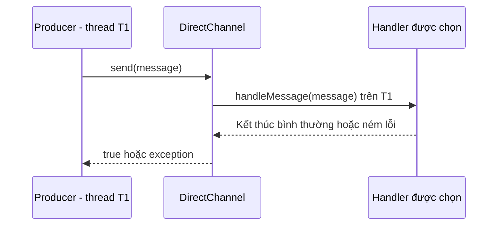
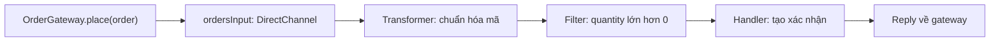

# DirectChannel

Trong chương **Kiểu channel** của Spring Integration Core, `DirectChannel` giúp nối các endpoint thành một luồng xử lý đồng bộ. Producer gửi một `Message` vào channel; một handler được chọn xử lý ngay trên thread đang gửi. Cách tổ chức này phù hợp với các bước như chuẩn hóa yêu cầu, kiểm tra điều kiện và gọi nghiệp vụ trước khi trả kết quả cho caller.

Bài học tập trung vào hợp đồng gửi thông điệp, cách chọn subscriber, failover, transaction và kiểm thử. Transformer và filter xuất hiện trong ví dụ để minh họa cách channel kết nối endpoint trong Java DSL.

## 1. Mục tiêu và điều kiện thực hành

Sau bài này, bạn có thể:

- Giải thích vì sao `DirectChannel` vừa có ngữ nghĩa point-to-point vừa có thể có nhiều subscriber.
- Dự đoán thread thực thi và thời điểm `send()` trả về.
- Cấu hình round-robin, thứ tự thử handler và failover.
- Thiết kế một luồng gateway–transformer–filter–handler bằng Java DSL.
- Phân biệt lỗi đồng bộ, kết quả gửi và kết quả nghiệp vụ.
- Viết kiểm thử cho các đặc tính quan trọng mà không cần chờ thread nền.

Các ví dụ dùng cú pháp Java 17 và API Spring Integration 6.x trở lên. Dự án cần `org.springframework.integration:spring-integration-core`; các kiểm thử dùng JUnit Jupiter. Phiên bản thư viện cần theo cấu hình quản lý dependency của dự án. Không thêm artifact Java DSL riêng cho các phiên bản này.

Phần Java thuần và JUnit thao tác trực tiếp với channel. Phần Java DSL chạy trong Spring application context để framework tạo và khởi động endpoint.

## 2. Hợp đồng của DirectChannel

`DirectChannel` là một `SubscribableChannel`: handler đăng ký nhận thông điệp qua `subscribe(MessageHandler)`. Đây không phải `PollableChannel` và không có thao tác `receive()` để consumer chủ động lấy thông điệp. Việc chuyển giao bắt đầu khi producer gọi `send()`. [AbstractSubscribableChannel API](https://docs.spring.io/spring-integration/api/org/springframework/integration/channel/AbstractSubscribableChannel.html)

Ba đặc điểm cần nhớ:

| Đặc điểm | Ý nghĩa khi thiết kế luồng |
|---|---|
| Point-to-point | Một handler xử lý thành công cho mỗi lần dispatch; channel không broadcast đến mọi subscriber |
| Đồng bộ trên thread gửi | Caller chỉ đi tiếp khi phần xử lý trực tiếp trong call stack đã kết thúc hoặc ném lỗi |
| Không có hàng đợi nội bộ | Channel không giữ thông điệp để một consumer nhận vào lúc khác |

Cơ chế chuyển giao đồng bộ được mô tả trong [tài liệu triển khai message channel](https://docs.spring.io/spring-integration/reference/channel/implementations.html).

Cần phân biệt **subscriber** với một phương thức nghiệp vụ. Trong ứng dụng Spring Integration, subscriber thường là `MessageHandler` do framework tạo cho một endpoint. Handler đó có thể gọi phương thức service, thực hiện transformation hoặc điều khiển bước tiếp theo.

Ví dụ, producer chỉ biết channel `ordersInput`. Transformer phía sau channel có thể thay đổi mà producer vẫn gửi cùng kiểu yêu cầu. Channel tạo ra điểm nối về cấu hình và trách nhiệm, dù các bước vẫn dùng chung call stack.

### 2.1. Một thông điệp đi qua như thế nào?



Sơ đồ giả định không có interceptor chặn gửi và handler không tự tạo công việc bất đồng bộ. Các nhánh failover được trình bày ở phần sau.

Nếu handler chuyển tiếp thông điệp qua nhiều `DirectChannel`, phần xử lý đồng bộ có thể đi sâu qua nhiều endpoint trước khi lời gọi `send()` ban đầu trả về. Nếu một bước giao việc cho executor, đưa vào queue hoặc chủ động lên lịch xử lý sau, ranh giới chờ của caller thay đổi tại bước đó.

### 2.2. Giá trị trả về không phải payload trả lời

Hợp đồng `MessageChannel.send()` trả về `boolean` về việc gửi; một số lỗi được biểu diễn bằng exception. Vì vậy, đừng viết code với giả định “mọi lỗi đều làm `send()` trả về `false`”. [MessageChannel API](https://docs.spring.io/spring-framework/docs/current/javadoc-api/org/springframework/messaging/MessageChannel.html)

Với `DirectChannel` thông thường:

- Handler xử lý bình thường: `send()` trả về `true`.
- Không có subscriber: gửi thất bại bằng exception.
- Handler ném lỗi và không có đường xử lý thành công: exception truyền về caller.
- Interceptor có thể ngăn việc gửi trước khi dispatcher được gọi, khiến kết quả khác với trường hợp thông thường.

`true` không có nghĩa “đơn hàng đã được commit”, “tất cả tác vụ nền đã hoàn tất” hoặc “caller nhận được đối tượng kết quả”. Những kết luận đó phụ thuộc nghiệp vụ, transaction và cách endpoint trả lời.

## 3. Ví dụ Java thuần: thấy rõ thread và thứ tự thực thi

Ví dụ sau là một lớp chạy độc lập khi đã có Spring Integration trên classpath:

```java
import org.springframework.integration.channel.DirectChannel;
import org.springframework.messaging.support.GenericMessage;

public class DirectChannelDemo {

    public static void main(String[] args) {
        DirectChannel channel = new DirectChannel();

        channel.subscribe(message -> {
            System.out.println("handler.thread="
                    + Thread.currentThread().getName());
            System.out.println("payload=" + message.getPayload());
        });

        System.out.println("before.thread="
                + Thread.currentThread().getName());

        boolean sent = channel.send(new GenericMessage<>("order-42"));

        System.out.println("after.sent=" + sent);
    }
}
```

Khi chạy từ `main` thông thường, kết quả có dạng:

```text
before.thread=main
handler.thread=main
payload=order-42
after.sent=true
```

Hai quan sát có thể kiểm chứng ngay:

1. `handler.thread` trùng với `before.thread`.
2. Dòng `after.sent` xuất hiện sau khi handler đã in payload.

Không có poller trong ví dụ. Handler đã đăng ký nhận thông điệp nên được gọi trực tiếp trong quá trình gửi.

Trong ứng dụng thực tế, endpoint quản lý việc subscribe và unsubscribe theo vòng đời của nó. Chỉ tạo bean channel mà chưa tạo hoặc chưa khởi động consumer thì chưa có luồng xử lý hoàn chỉnh. `getSubscriberCount()` giúp quan sát số handler đang đăng ký, nhưng không thay thế việc kiểm tra endpoint và nghiệp vụ.

## 4. Java DSL: tiếp nhận đơn hàng qua gateway

Ta xây dựng một luồng nhận đơn hàng có các bước:



Đây là ví dụ minh họa xử lý yêu cầu trong bộ nhớ; chuỗi xác nhận chưa đại diện cho một giao dịch lưu đơn hàng.

Đặt bốn tệp Java dưới đây trong cùng package `example.direct`. Đây là các tệp minh họa để người học tạo trong dự án thực hành.

### 4.1. Payload nghiệp vụ

```java
package example.direct;

public record Order(String id, int quantity) {
}
```

### 4.2. Gateway cho caller

```java
package example.direct;

import org.springframework.integration.annotation.MessagingGateway;

@MessagingGateway(defaultRequestChannel = "ordersInput")
public interface OrderGateway {

    String place(Order order);
}
```

Gateway cung cấp API phương thức cho caller và đưa yêu cầu vào `ordersInput`. Với lời gọi request–reply này, gateway tạo thông tin reply channel để endpoint cuối chuyển kết quả trở lại. [Messaging Gateways](https://docs.spring.io/spring-integration/reference/gateway.html)

### 4.3. Cấu hình channel và flow

```java
package example.direct;

import java.util.Locale;

import org.springframework.beans.factory.annotation.Qualifier;
import org.springframework.context.annotation.Bean;
import org.springframework.context.annotation.Configuration;
import org.springframework.integration.channel.DirectChannel;
import org.springframework.integration.config.EnableIntegration;
import org.springframework.integration.annotation.IntegrationComponentScan;
import org.springframework.integration.dsl.IntegrationFlow;

@Configuration
@EnableIntegration
@IntegrationComponentScan(basePackageClasses = OrderGateway.class)
public class OrdersConfig {

    @Bean
    public DirectChannel ordersInput() {
        return new DirectChannel();
    }

    @Bean
    public IntegrationFlow ordersFlow(
            @Qualifier("ordersInput") DirectChannel input) {

        return IntegrationFlow.from(input)
                .transform(Order.class, order -> new Order(
                        order.id().trim().toUpperCase(Locale.ROOT),
                        order.quantity()))
                .filter(Order.class,
                        order -> order.quantity() > 0,
                        filter -> filter.throwExceptionOnRejection(true))
                .handle(Order.class, (order, headers) ->
                        "ACCEPTED:" + order.id() + ":" + order.quantity())
                .get();
    }
}
```

`@EnableIntegration` kích hoạt hạ tầng; `@IntegrationComponentScan` tìm interface gateway trong package tương ứng. Đây là vai trò riêng của việc quét integration component. [Annotation Support](https://docs.spring.io/spring-integration/reference/configuration/annotations.html)

`IntegrationFlow` được khai báo thành bean để framework đăng ký các channel và endpoint. Các kết nối ngầm giữa những endpoint trong flow thông thường dùng `DirectChannel` khi không cấu hình kiểu channel khác. Vì vậy, flow trên không tạo một worker thread ở mỗi dấu chấm của DSL. [Java DSL](https://docs.spring.io/spring-integration/reference/dsl.html)

Filter được đặt `throwExceptionOnRejection(true)` để yêu cầu không hợp lệ gây lỗi rõ ràng. Với gateway đang chờ reply, việc bỏ thông điệp mà không tạo reply hoặc lỗi có thể dẫn tới chờ đến timeout.

### 4.4. Gọi luồng

```java
package example.direct;

import org.springframework.context.annotation.AnnotationConfigApplicationContext;

public class OrdersApp {

    public static void main(String[] args) {
        try (var context =
                new AnnotationConfigApplicationContext(OrdersConfig.class)) {

            OrderGateway gateway = context.getBean(OrderGateway.class);

            String result = gateway.place(new Order(" ord-42 ", 2));

            System.out.println(result);
        }
    }
}
```

Kết quả:

```text
ACCEPTED:ORD-42:2
```

Có thể thay đầu vào bằng `new Order(" ord-42 ", 0)` để quan sát trường hợp filter từ chối.

Trong ví dụ này, `ordersInput` có subscriber đầu tiên là handler của transformer. Filter và handler tạo xác nhận thuộc các bước tiếp theo của pipeline. Chúng không phải ba subscriber cạnh tranh trên cùng `ordersInput`.

Nếu tự gửi bằng `ordersInput.send(message)`, giá trị trả về vẫn là `boolean`. Muốn nhận chuỗi xác nhận theo API phương thức như trên, caller gọi gateway.

## 5. Nhiều subscriber: phân phối công việc, không tự thêm thread

`DirectChannel` cho phép nhiều handler đăng ký. Khi tạo bằng `new DirectChannel()`, chiến lược mặc định là round-robin và failover được bật. [DirectChannel API](https://docs.spring.io/spring-integration/api/org/springframework/integration/channel/DirectChannel.html)

### 5.1. Quan sát round-robin

Đoạn sau có thể đặt trong một phương thức `main`:

```java
import java.util.ArrayList;
import java.util.List;

import org.springframework.integration.channel.DirectChannel;
import org.springframework.messaging.support.GenericMessage;

// Trong main():
DirectChannel channel = new DirectChannel();
List<String> deliveries = new ArrayList<>();

channel.subscribe(message ->
        deliveries.add("A:" + message.getPayload()));
channel.subscribe(message ->
        deliveries.add("B:" + message.getPayload()));

for (int i = 1; i <= 4; i++) {
    channel.send(new GenericMessage<>(i));
}

System.out.println(deliveries);
```

Với channel mới, hai subscriber ổn định và không có lỗi, các thông điệp được chia luân phiên cho A và B. Mỗi handler nhận hai thông điệp. Khi quan sát thứ tự cụ thể, cần giữ nguyên tập subscriber và cách gửi như trong ví dụ.

`ArrayList` ở đây dùng cho minh họa gửi tuần tự trên một thread. Nếu nhiều thread cùng gửi, dữ liệu dùng chung trong handler phải được thiết kế phù hợp.

Thêm subscriber vào channel không tạo một thread pool. Bốn lần `send()` từ cùng một vòng lặp vẫn diễn ra tuần tự. Khi nhiều thread của ứng dụng cùng gửi, các handler có thể chạy đồng thời do chính những thread gửi đó.

### 5.2. Pipeline và competing consumers

Hai cấu hình sau mang ý nghĩa khác nhau:

```text
Pipeline:
input -> transformer -> normalized -> service

Competing consumers:
                    -> service A
input DirectChannel
                    -> service B
```

Trong pipeline, một thông điệp đi qua nhiều bước. Với competing consumers, A và B thường thực hiện cùng một vai trò nghiệp vụ; dispatcher chọn một handler để tiếp nhận.

Ví dụ, gắn cả handler “ghi sổ kế toán” và handler “gửi email” lên cùng `DirectChannel` không bảo đảm một đơn hàng đi qua cả hai. Để thực hiện tuần tự, nối chúng thành pipeline. Để phát thông điệp cho nhiều consumer, cân nhắc `PublishSubscribeChannel`.

Cũng không nên dùng round-robin để định tuyến “đơn nội địa” và “đơn quốc tế”. Tiêu chí nghiệp vụ như quốc gia cần router và các channel đích tương ứng.

## 6. Failover: thử subscriber khác khi xử lý lỗi

Dispatcher của `DirectChannel` là `UnicastingDispatcher`. Khi failover cho phép, dispatcher có thể thử handler tiếp theo sau một exception; khi một handler xử lý bình thường, dispatcher dừng. Vì vậy, một lần gửi có thể đã gọi nhiều handler nếu các handler trước đó thất bại. [UnicastingDispatcher API](https://docs.spring.io/spring-integration/api/org/springframework/integration/dispatcher/UnicastingDispatcher.html)

### 6.1. Cấu hình rõ mục đích

```java
import org.springframework.integration.channel.DirectChannel;

// Round-robin, không thử subscriber khác sau lỗi.
DirectChannel failFast = new DirectChannel();
failFast.setFailover(false);

// Không cân bằng tải: bắt đầu theo thứ tự handler.
// Failover mặc định vẫn bật.
DirectChannel primaryBackup = new DirectChannel(null);

// Chỉ cho phép một subscriber.
DirectChannel singleConsumer = new DirectChannel();
singleConsumer.setMaxSubscribers(1);
```

Constructor nhận `null` tắt load balancing, không tắt failover. Với cách subscribe thủ công và các handler cùng mức ưu tiên, thứ tự đăng ký quyết định thứ tự thử. Khi endpoint có thiết lập `order`, cần tính cả thứ tự đó. Các cấu hình được mô tả tại [Configuring Message Channels](https://docs.spring.io/spring-integration/reference/channel/configuration.html).

Bảng lựa chọn:

| Nhu cầu | Cấu hình phù hợp |
|---|---|
| Chia yêu cầu cho các handler tương đương | Round-robin; quyết định riêng có cần failover |
| Gặp lỗi thì trả ngay cho caller | `setFailover(false)` |
| Ưu tiên handler chính, chỉ thử dự phòng sau lỗi | Không load balancing; xác định thứ tự và bật failover |
| Phát hiện đăng ký nhầm thêm consumer | `setMaxSubscribers(1)` |
| Mỗi yêu cầu phải thực hiện nhiều bước nghiệp vụ | Thiết kế pipeline thay vì thêm các subscriber cạnh tranh |

### 6.2. Tác dụng phụ có thể đã xảy ra trước exception

Xét tình huống giả định:

1. Handler A gửi yêu cầu thu tiền tới nhà cung cấp.
2. Nhà cung cấp thu tiền nhưng phản hồi về ứng dụng bị mất.
3. A ném exception vì timeout.
4. Dispatcher thử handler B.
5. B gửi thêm một yêu cầu thu tiền.

Một lần `send()` có thể dẫn tới hai lần thu tiền nếu không có cơ chế chống trùng. Exception không chứng minh rằng tác dụng phụ ở hệ thống ngoài chưa xảy ra.

Từ tình huống này, có thể suy ra một số quyết định thiết kế:

- Các handler dự phòng cần cùng hợp đồng và hiểu cùng khóa idempotency.
- Dùng mã yêu cầu nghiệp vụ ổn định để nhận diện lần xử lý lặp.
- Chọn fail-fast khi thử một subscriber khác có thể gây tác dụng phụ không chấp nhận được.
- Đặt retry có chủ đích tại bước cần retry và xác định loại lỗi được thử lại.

Failover của channel không cung cấp lịch retry, khoảng chờ hay lưu bền yêu cầu thất bại. Các nhu cầu đó cần cơ chế riêng.

## 7. Transaction và ngữ cảnh thread

Một lợi ích thiết kế quan trọng là giữ được transaction đang gắn với thread trong một đoạn xử lý đồng bộ. Tuy nhiên, `DirectChannel` không tự mở transaction. [Transaction Support](https://docs.spring.io/spring-integration/reference/transactions.html)

Giả sử một phương thức được gọi qua Spring proxy có `@Transactional` và thực hiện:

```text
Bắt đầu transaction DB
  -> ghi bản ghi đơn hàng
  -> gửi qua DirectChannel
       -> cập nhật tồn kho bằng cùng tài nguyên transaction
  -> kết thúc phương thức
Commit hoặc rollback theo kết quả và quy tắc transaction
```

Để hai cập nhật thực sự tham gia cùng transaction, cần kiểm tra:

- Transaction đã được kích hoạt trước khi gửi, chẳng hạn qua proxy hoặc `TransactionTemplate`.
- Handler sử dụng tài nguyên được transaction manager tương ứng quản lý.
- Luồng không chuyển sang thread khác trước bước cập nhật.
- Thiết lập propagation của nghiệp vụ không tạo ranh giới khác.
- Exception hoặc trạng thái rollback được xử lý phù hợp.

Chỉ “cùng thread” chưa đủ để kết luận “cùng transaction”. Một handler dùng `REQUIRES_NEW` có thể mở transaction riêng. Một HTTP call trong handler cũng không tự tham gia transaction cơ sở dữ liệu cục bộ.

Tương tự, `send()` trả về `true` có thể xảy ra trước khi transaction bên ngoài commit. Nếu một bước tiếp theo trong phương thức giao dịch thất bại, các thay đổi thuộc transaction đó vẫn có thể bị rollback.

Ngữ cảnh dựa trên thread, như MDC, thường vẫn hiện diện trong đoạn gọi trực tiếp nếu không có thành phần thay đổi nó. Khi thêm ranh giới bất đồng bộ, cần xem lại cách truyền ngữ cảnh và kiểm tra lại giả định của transaction.

## 8. Lỗi đồng bộ và errorChannel

Khi caller gửi trực tiếp vào `DirectChannel` và handler thất bại, exception có thể truyền ngược về caller. Chỉ đặt header `errorChannel` hoặc tạo bean toàn cục cùng tên không tự chuyển mọi lỗi đồng bộ thành `ErrorMessage`. Một component có trách nhiệm xử lý lỗi mới quyết định việc phát error message. [Error Handling](https://docs.spring.io/spring-integration/reference/error-handling.html)

Ví dụ:

```java
import org.springframework.integration.channel.DirectChannel;
import org.springframework.messaging.MessageHandlingException;
import org.springframework.messaging.MessagingException;
import org.springframework.messaging.support.GenericMessage;

// Trong một phương thức:
DirectChannel channel = new DirectChannel();
channel.setFailover(false);

channel.subscribe(message -> {
    throw new MessageHandlingException(
            message, "Không thể xử lý đơn hàng");
});

try {
    channel.send(new GenericMessage<>("order-42"));
} catch (MessagingException ex) {
    System.out.println("Caller nhận lỗi: " + ex.getMessage());
}
```

Dùng `MessagingException` trong ví dụ để không phụ thuộc vào một lớp wrapper cụ thể. Khi chẩn đoán, cần xem cả cause và thông điệp thất bại nếu exception cung cấp chúng.

Với gateway, có thể cấu hình đường xử lý lỗi ở gateway. Khi một error flow biến lỗi thành reply thành công, caller có thể không còn nhận exception. Nếu caller đang quản lý transaction, cần xác định rõ điều đó có làm transaction tiếp tục commit hay không.

Failover cũng ảnh hưởng khả năng quan sát lỗi: nếu một handler thất bại nhưng handler dự phòng thành công, caller có thể thấy `send()` thành công. Hệ thống vẫn cần ghi nhận lần thất bại để theo dõi chất lượng của handler chính.

## 9. Blocking, timeout và khả năng chịu tải

### 9.1. Handler chậm làm caller chậm

Với một luồng hoàn toàn đồng bộ, có thể ước lượng:

```text
Thời gian caller bị giữ
  ≈ chi phí dispatch
  + thời gian các endpoint được gọi đồng bộ
  + thời gian I/O mà các endpoint chờ
```

Đây là mô hình suy luận để thiết kế, không phải công thức đo hiệu năng của framework.

Giả sử một bước gọi dịch vụ ngoài thường mất 300 ms. Dù channel chuyển giao rất nhanh, thread gửi vẫn phải chờ bước đó. Với web request, thời gian này góp vào độ trễ phản hồi và thời gian chiếm thread xử lý request.

Channel không có queue nội bộ nên không cung cấp vùng đệm hấp thụ một đợt tăng tải. Muốn giới hạn mức đồng thời, cần thiết kế tại nơi tiếp nhận hoặc tài nguyên thực thi phù hợp. Không coi việc caller bị chặn là cơ chế backpressure theo giao thức Reactive Streams.

### 9.2. send(message, timeout) không đặt deadline cho handler

Không nên suy ra rằng:

```java
channel.send(message, 100);
```

sẽ ngắt handler sau 100 ms. Hợp đồng timeout của channel liên quan đến chờ gửi/chuyển giao theo từng triển khai; nó không phải cơ chế hủy phương thức Java đang chạy. Với `DirectChannel`, handler được gọi trực tiếp trong thread gửi.

Nếu handler chờ HTTP hoặc database, timeout cần được đặt tại client hoặc tài nguyên thực hiện thao tác đó. Với request–reply qua gateway, reply timeout cũng không tự dừng một handler đồng bộ đang giữ call stack trước khi caller đi tới giai đoạn chờ reply.

### 9.3. Đồng bộ không đồng nghĩa xử lý toàn cục từng thông điệp

Nếu thread T1 và T2 cùng gửi vào một channel, hai lời gọi có thể chạy handler đồng thời. Do đó:

- Handler không được dựa vào giả định “chỉ một thread truy cập”.
- Round-robin không bảo đảm thứ tự hoàn tất toàn cục.
- Trạng thái dùng chung cần được bảo vệ hoặc thay bằng thiết kế không chia sẻ trạng thái.
- Một message không nên bị tái sử dụng để chia sẻ payload mutable giữa các thao tác đồng thời.

Nếu nghiệp vụ yêu cầu xử lý có thứ tự theo khách hàng, cần thiết kế cơ chế tuần tự hóa hoặc phân vùng theo khóa tương ứng; chỉ chọn `DirectChannel` chưa tạo ra bảo đảm đó.

## 10. Quan sát tại channel bằng interceptor

`ChannelInterceptor` cho phép quan sát hoặc điều chỉnh việc gửi. `preSend()` trả về `null` sẽ chặn gửi. `afterSendCompletion()` được gọi cho interceptor đã hoàn thành `preSend()` thành công và trả về message, kể cả khi quá trình gửi sau đó gặp lỗi. [ChannelInterceptor API](https://docs.spring.io/spring-framework/docs/current/javadoc-api/org/springframework/messaging/support/ChannelInterceptor.html)

Có thể gắn interceptor sau vào một channel đã tạo:

```java
import org.springframework.messaging.Message;
import org.springframework.messaging.MessageChannel;
import org.springframework.messaging.support.ChannelInterceptor;

// channel là DirectChannel đã cấu hình.
channel.addInterceptor(new ChannelInterceptor() {

    @Override
    public Message<?> preSend(
            Message<?> message, MessageChannel target) {

        System.out.println("sending.orderId="
                + message.getHeaders().get("orderId"));

        return message;
    }

    @Override
    public void afterSendCompletion(
            Message<?> message,
            MessageChannel target,
            boolean sent,
            Exception ex) {

        System.out.println("sent=" + sent
                + ", failed=" + (ex != null));
    }
});
```

Để log trên có ý nghĩa, producer cần đưa `orderId` vào header của message. Đây là ví dụ quan sát tối giản; trong ứng dụng, dùng logger và dữ liệu theo dõi phù hợp với nghiệp vụ.

Vì `DirectChannel` không có `receive()`, các callback `preReceive()` và `postReceive()` không dùng để quan sát handler nhận trên channel này. [Channel Interceptors](https://docs.spring.io/spring-integration/reference/channel/interceptors.html)

Một phép đo bao quanh `send()` có thể bao gồm thời gian xử lý downstream đồng bộ. Khi flow chuyển sang bất đồng bộ, ý nghĩa phép đo thay đổi. Cần đặt tên metric theo phạm vi thực sự đo được.

## 11. Kiểm thử hành vi của channel

Lớp sau dùng JUnit Jupiter và không cần Spring context. Các kiểm thử tập trung vào hợp đồng dispatch, không kiểm tra nội bộ framework.

```java
import java.util.ArrayList;
import java.util.List;
import java.util.concurrent.atomic.AtomicInteger;
import java.util.concurrent.atomic.AtomicReference;

import org.junit.jupiter.api.Test;
import org.springframework.integration.channel.DirectChannel;
import org.springframework.messaging.MessageHandlingException;
import org.springframework.messaging.MessagingException;
import org.springframework.messaging.support.GenericMessage;

import static org.junit.jupiter.api.Assertions.assertEquals;
import static org.junit.jupiter.api.Assertions.assertSame;
import static org.junit.jupiter.api.Assertions.assertThrows;
import static org.junit.jupiter.api.Assertions.assertTrue;

class DirectChannelTest {

    @Test
    void completesHandlerOnSendingThreadBeforeReturning() {
        DirectChannel channel = new DirectChannel();
        Thread sender = Thread.currentThread();

        AtomicReference<Thread> observedThread = new AtomicReference<>();
        AtomicReference<Object> observedPayload = new AtomicReference<>();

        channel.subscribe(message -> {
            observedThread.set(Thread.currentThread());
            observedPayload.set(message.getPayload());
        });

        boolean sent = channel.send(new GenericMessage<>("order-42"));

        assertTrue(sent);
        assertSame(sender, observedThread.get());
        assertEquals("order-42", observedPayload.get());
    }

    @Test
    void distributesMessagesAcrossEquivalentSubscribers() {
        DirectChannel channel = new DirectChannel();
        AtomicInteger handledByA = new AtomicInteger();
        AtomicInteger handledByB = new AtomicInteger();

        channel.subscribe(message -> handledByA.incrementAndGet());
        channel.subscribe(message -> handledByB.incrementAndGet());

        for (int i = 0; i < 4; i++) {
            assertTrue(channel.send(new GenericMessage<>(i)));
        }

        assertEquals(2, handledByA.get());
        assertEquals(2, handledByB.get());
        assertEquals(4, handledByA.get() + handledByB.get());
    }

    @Test
    void failoverCanFollowAnAlreadyPerformedSideEffect() {
        DirectChannel channel = new DirectChannel(null);
        List<String> effects = new ArrayList<>();

        channel.subscribe(message -> {
            effects.add("primary-side-effect");
            throw new MessageHandlingException(
                    message, "Primary failed after its side effect");
        });

        channel.subscribe(message -> effects.add("backup-side-effect"));

        assertTrue(channel.send(new GenericMessage<>("order-42")));

        assertEquals(
                List.of("primary-side-effect", "backup-side-effect"),
                effects);
    }

    @Test
    void disablingFailoverPreventsCallingBackup() {
        DirectChannel channel = new DirectChannel(null);
        channel.setFailover(false);
        AtomicInteger backupCalls = new AtomicInteger();

        channel.subscribe(message -> {
            throw new MessageHandlingException(message, "Primary failed");
        });

        channel.subscribe(message -> backupCalls.incrementAndGet());

        assertThrows(MessagingException.class,
                () -> channel.send(new GenericMessage<>("order-42")));

        assertEquals(0, backupCalls.get());
    }

    @Test
    void failsWhenNoSubscriberExists() {
        DirectChannel channel = new DirectChannel();

        assertThrows(MessagingException.class,
                () -> channel.send(new GenericMessage<>("order-42")));
    }
}
```

Kiểm thử đầu tiên xác nhận kết quả ngay sau `send()`; không cần `Thread.sleep()` hoặc polling vì handler chạy đồng bộ. Kiểm thử phân phối dùng số lần xử lý để tránh gắn kỳ vọng vào tên handler được chọn đầu tiên.

Hai kiểm thử failover thể hiện lựa chọn thiết kế: bật failover cho phép handler dự phòng chạy sau tác dụng phụ của handler trước; tắt failover giữ nguyên lỗi để caller quyết định.

Khi kiểm thử ví dụ Java DSL, cần thêm kiểm thử với application context để kiểm tra gateway được tạo, endpoint đã subscribe và cả trường hợp quantity bị từ chối. Nếu kiểm chứng rollback, cần tài nguyên transaction thực tế hoặc cấu hình kiểm thử có thể quan sát commit/rollback; danh sách trong bộ nhớ không mô phỏng được đặc tính đó.

## 12. Chọn channel theo nhu cầu

| Nhu cầu | Lựa chọn ban đầu | Điểm cần đánh giá |
|---|---|---|
| Nối các bước xử lý nhanh trong cùng luồng gọi | `DirectChannel` | Độ trễ downstream được cộng vào thời gian caller chờ |
| Chia việc cho nhiều handler tương đương trong cùng tiến trình | `DirectChannel` với nhiều subscriber | Không tự có thread pool; xác định rõ failover |
| Giao việc qua executor | `ExecutorChannel` | Ranh giới thread, transaction, dung lượng executor và xử lý lỗi |
| Giữ thông điệp chờ consumer nhận | `QueueChannel` | Poller, dung lượng và nhu cầu lưu bền |
| Phát một thông điệp cho nhiều subscriber | `PublishSubscribeChannel` | Cách thực thi subscriber và cách xử lý lỗi từng nhánh |
| Chuyển thông điệp giữa các tiến trình, cần lưu bền | Broker và adapter phù hợp | Xác nhận nhận, retry, chống trùng và vận hành broker |

Các khác biệt cơ bản giữa channel được trình bày trong [Message Channel Implementations](https://docs.spring.io/spring-integration/reference/channel/implementations.html).

Không chọn `DirectChannel` chỉ vì tên có chữ “direct” và kỳ vọng mọi luồng sẽ nhanh. Hãy xác định caller cần chờ điều gì, thông điệp có cần được giữ lại hay không và tác dụng phụ nào phải được quản lý.

## 13. Chẩn đoán những tình huống thường gặp

| Hiện tượng | Giả thuyết cần kiểm tra | Hướng xử lý |
|---|---|---|
| Lỗi “no subscribers” khi gửi | Chưa có consumer, endpoint chưa start hoặc tham chiếu nhầm channel | Kiểm tra bean, vòng đời endpoint và `getSubscriberCount()` |
| Hai nghiệp vụ nhận thông điệp luân phiên | Cả hai là subscriber cạnh tranh trên cùng channel | Thiết kế pipeline hoặc broadcast theo yêu cầu |
| Tăng số subscriber nhưng throughput không tăng | Chỉ có một thread gửi tuần tự hoặc nghẽn tại tài nguyên chung | Đo điểm nghẽn và xác định nơi cần mức đồng thời |
| Caller không nhận lỗi của handler chính | Failover đã thành công hoặc gateway đã chuyển lỗi thành reply | Xem cấu hình dispatch và error flow |
| Gửi với timeout nhỏ vẫn chờ lâu | Handler đang chờ thao tác đồng bộ | Cấu hình timeout tại thao tác I/O và xem lại yêu cầu chờ |
| Dữ liệu vẫn rollback sau khi `send()` trả về `true` | Transaction bao ngoài chưa kết thúc lúc gửi thành công | Theo dõi ranh giới transaction và lỗi ở các bước còn lại |
| Tác dụng phụ xuất hiện nhiều lần | Failover, retry hoặc nguồn gửi lại yêu cầu | Theo dõi mã yêu cầu và thiết kế idempotency |

Trong ví dụ tiếp nhận đơn hàng, hãy bắt đầu bằng một pipeline đơn giản: gateway gọi `ordersInput`, transformer chuẩn hóa, filter xác nhận đầu vào và service xử lý. Chỉ thêm consumer cạnh tranh, failover hoặc ranh giới bất đồng bộ sau khi đã xác định rõ mục đích và kiểm thử các tình huống lỗi.
