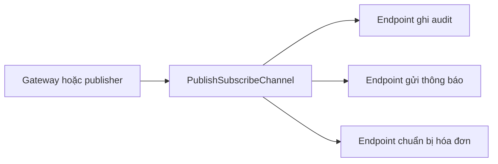
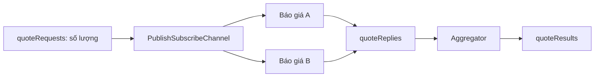

# PublishSubscribeChannel

Trong module Spring Integration Core (`SPRING_INTEGRATION_CORE`), `PublishSubscribeChannel` là thành phần dùng để phát một thông điệp đến nhiều nhánh xử lý. Bài thuộc chương **Kiểu channel**, tập trung vào cách phối hợp `Message`, channel, endpoint, gateway và Java DSL khi nhiều chức năng cùng quan tâm đến một sự kiện.

Ví dụ xuyên suốt là sự kiện đặt hàng: hệ thống cần ghi audit, thông báo đơn giá trị cao và chuẩn bị dữ liệu hóa đơn. Mỗi chức năng xử lý sự kiện theo nhu cầu riêng.

Các ví dụ cấu hình dùng Java 17 trở lên và API Spring Integration 6.x, đối chiếu với tài liệu nhánh 6.5. Cần có `spring-integration-core`; phần kiểm thử dùng JUnit Jupiter. Nếu ứng dụng dùng Spring Boot, có thể lấy phần tích hợp qua `spring-boot-starter-integration` và để cơ chế quản lý dependency của ứng dụng chọn phiên bản tương thích. Các lớp Java trong bài là nội dung minh họa để đưa vào dự án học tập.

## 1. Mô hình publish–subscribe

Một publisher tạo thông điệp; channel phân phối thông điệp cho các subscriber đang đăng ký. Subscriber trực tiếp của channel là `MessageHandler`; trong ứng dụng thông thường, endpoint do Spring quản lý thực hiện việc đăng ký handler.



Khi có ba subscriber, một lần gửi sẽ hướng thông điệp đến cả ba. Các subscriber xử lý cùng một sự kiện; kết quả biến đổi của một nhánh không tự trở thành đầu vào của nhánh khác.

`PublishSubscribeChannel` hỗ trợ mô hình `SubscribableChannel`. Nó không cung cấp `receive()` như `PollableChannel`, vì vậy không cần poller chỉ để tiêu thụ trực tiếp từ channel này. Xem [mô tả các implementation của message channel](https://docs.spring.io/spring-integration/reference/6.5/channel/implementations.html).

Có thể chọn channel theo hai quyết định riêng: **ai nhận thông điệp** và **luồng nào thực hiện xử lý**.

| Channel | Phân phối một thông điệp | Cách xử lý thường dùng |
|---|---|---|
| `DirectChannel` | Một subscriber xử lý thông điệp theo cơ chế point-to-point | Trên luồng gửi |
| `ExecutorChannel` | Point-to-point | Ủy quyền cho executor |
| `QueueChannel` | Một consumer lấy một thông điệp trong hàng đợi | Consumer gọi `receive()` hoặc endpoint dùng poller |
| `PublishSubscribeChannel` | Phát cho các subscriber | Trên luồng gửi, hoặc ủy quyền cho executor nếu cấu hình |

Trong trường hợp một đơn hàng cần được **một worker** xử lý, hãy cân nhắc point-to-point. Trong trường hợp audit và hóa đơn đều phải biết đơn hàng đã được đặt, publish–subscribe phù hợp hơn. Chi tiết API của channel được mô tả tại [PublishSubscribeChannel Javadoc](https://docs.spring.io/spring-integration/docs/6.3.9/api/org/springframework/integration/channel/PublishSubscribeChannel.html); các API dùng trong bài cũng hiện diện trong nhánh 6.5.

## 2. Ví dụ tối thiểu: một lần gửi, hai lần xử lý

Ví dụ sau tạo channel và đăng ký handler trực tiếp để quan sát cơ chế phân phối:

```java
import java.util.ArrayList;
import java.util.List;

import org.springframework.integration.channel.PublishSubscribeChannel;
import org.springframework.messaging.Message;
import org.springframework.messaging.support.MessageBuilder;

public class PubSubDemo {

    public static void main(String[] args) {
        List<String> traces = new ArrayList<>();
        PublishSubscribeChannel events = new PublishSubscribeChannel(true);

        events.subscribe(message ->
                traces.add("audit:" + message.getPayload()));

        events.subscribe(message ->
                traces.add("billing:" + message.getPayload()));

        Message<String> message = MessageBuilder
                .withPayload("ORD-1001")
                .setHeader("eventType", "OrderPlaced")
                .build();

        boolean accepted = events.send(message);

        System.out.println(accepted);
        System.out.println(traces);
    }
}
```

Với hai handler được đăng ký theo thứ tự trong ví dụ, kết quả là:

```text
true
[audit:ORD-1001, billing:ORD-1001]
```

Constructor `new PublishSubscribeChannel(true)` bật yêu cầu phải có subscriber. Nó vẫn chạy đồng bộ vì chưa có executor. Khi `send()` trả về bình thường, hai handler của ví dụ đã chạy xong.

Đây là ví dụ Java thuần để thấy rõ `subscribe()` và `send()`. Khi tích hợp vào ứng dụng, nên khai báo channel và endpoint thành Spring bean để framework quản lý vòng đời.

## 3. Đồng bộ, bất đồng bộ và thứ tự

### 3.1. Mặc định chạy trên luồng gửi

Khi không có executor, channel gọi từng handler trên cùng call stack với publisher:

```text
Luồng publisher:
send(message)
  -> audit.handleMessage(message)
  -> notification.handleMessage(message)
  -> billing.handleMessage(message)
  -> return
```

Một handler chậm làm chậm thời điểm `send()` kết thúc. Nếu thời gian ba handler lần lượt khoảng 10 ms, 80 ms và 20 ms, tổng thời gian chờ gần 110 ms cộng chi phí phân phối, với giả thiết mọi bước đều đồng bộ và không lỗi.

Thứ tự gọi phụ thuộc vào thứ tự handler do dispatcher quản lý. Khi cần thứ tự rõ ràng, cấu hình thứ tự endpoint; với handler cùng mức ưu tiên, thứ tự đăng ký có ý nghĩa. Tuy nhiên, nếu nghiệp vụ yêu cầu “tạo hóa đơn xong mới gửi email hóa đơn”, hãy biểu diễn bằng một chuỗi endpoint:

```text
order -> createInvoice -> sendInvoiceEmail
```

Nếu một nhánh tự tạo tác vụ nền, việc handler của nhánh đó trả về không có nghĩa tác vụ nền đã hoàn tất.

### 3.2. Có executor thì hành vi phụ thuộc executor

Khi truyền executor, channel giao công việc xử lý cho executor. Một thread pool có thể cho các nhánh chạy đồng thời; mức đồng thời phụ thuộc số worker, hàng đợi và tải.

| Điều cần hiểu | Không có executor | Dùng thread pool thực thi bất đồng bộ |
|---|---|---|
| Luồng chạy handler | Luồng gửi | Worker của executor trong điều kiện thực thi thông thường |
| Thời điểm `send()` trở về | Sau xử lý đồng bộ hoặc khi gặp lỗi | Sau khi giao tác vụ, có thể trước khi handler hoàn tất |
| Thứ tự hoàn thành | Theo chuỗi gọi đồng bộ nếu các nhánh cũng đồng bộ | Có thể khác thứ tự giao tác vụ |
| Lỗi nghiệp vụ ở handler | Có thể truyền ngược lên publisher | Cần cơ chế xử lý lỗi cho tác vụ nền |
| Context gắn với thread | Có thể tiếp tục trên cùng thread | Cần thiết kế việc truyền context qua ranh giới thread |

Một `Executor` không nhất thiết tạo thread mới: `SyncTaskExecutor` thực thi ngay trên thread gọi. Chính sách `CallerRunsPolicy` cũng có thể khiến caller thực hiện tác vụ khi pool đầy. Vì vậy, hãy đọc cấu hình executor trước khi kết luận một luồng luôn chạy bất đồng bộ. Xem [Task Execution and Scheduling](https://docs.spring.io/spring-framework/reference/integration/scheduling.html).

Bản thân channel không cung cấp thứ tự hoàn tất giữa các nhánh hoặc thứ tự toàn cục giữa nhiều thông điệp được gửi đồng thời. Với yêu cầu xử lý theo thứ tự từng đơn hàng, cần thiết kế phân vùng và tuần tự hóa theo khóa nghiệp vụ.

## 4. Luồng sự kiện đặt hàng bằng Java DSL

### 4.1. Payload bất biến và gateway

Định nghĩa payload trong `OrderPlaced.java`:

```java
package example.integration;

import java.math.BigDecimal;

public record OrderPlaced(
        String eventId,
        String orderId,
        BigDecimal amount) {
}
```

Định nghĩa gateway trong `OrderEventGateway.java`:

```java
package example.integration;

import org.springframework.integration.annotation.MessagingGateway;

@MessagingGateway(defaultRequestChannel = "orderEvents")
public interface OrderEventGateway {

    void publish(OrderPlaced event);
}
```

Gateway giúp mã nghiệp vụ gọi `publish(event)` mà không phải tự tạo `Message`. Phương thức `void` biểu diễn lời gọi không chờ một giá trị trả lời; thời gian xử lý vẫn phụ thuộc các channel downstream.

Interface gateway cần được đăng ký bằng cơ chế quét gateway của Spring Integration. `@IntegrationComponentScan` phục vụ mục đích đó. Xem [Messaging Gateways](https://docs.spring.io/spring-integration/reference/6.5/gateway.html).

### 4.2. Cấu hình ba subscriber

Định nghĩa `OrderEventConfig.java` trong cùng package:

```java
package example.integration;

import java.math.BigDecimal;

import org.springframework.context.annotation.Bean;
import org.springframework.context.annotation.Configuration;
import org.springframework.integration.annotation.IntegrationComponentScan;
import org.springframework.integration.channel.DirectChannel;
import org.springframework.integration.config.EnableIntegration;
import org.springframework.integration.dsl.IntegrationFlow;

@Configuration
@EnableIntegration
@IntegrationComponentScan(basePackageClasses = OrderEventGateway.class)
public class OrderEventConfig {

    @Bean
    public DirectChannel orderEvents() {
        return new DirectChannel();
    }

    @Bean
    public IntegrationFlow orderEventFlow() {
        return IntegrationFlow.from("orderEvents")
                .publishSubscribeChannel(pubsub -> pubsub
                        .id("orderEventFanOut")
                        .minSubscribers(3)

                        .subscribe(audit -> audit
                                .handle(OrderPlaced.class, (event, headers) -> {
                                    System.out.println(
                                            "AUDIT " + event.eventId());
                                    return null;
                                }))

                        .subscribe(notification -> notification
                                .<OrderPlaced>filter(event ->
                                        event.amount().compareTo(
                                                new BigDecimal("1000000")) >= 0)
                                .handle(OrderPlaced.class, (event, headers) -> {
                                    System.out.println(
                                            "NOTIFY " + event.orderId());
                                    return null;
                                }))

                        .subscribe(billing -> billing
                                .<OrderPlaced, String>transform(event ->
                                        "INVOICE:" + event.orderId())
                                .handle(String.class, (invoice, headers) -> {
                                    System.out.println(invoice);
                                    return null;
                                })))
                .get();
    }
}
```

Có hai channel ở hai vai trò khác nhau:

- `orderEvents` là `DirectChannel`, nhận từ gateway và đưa thông điệp vào flow.
- `orderEventFanOut` là `PublishSubscribeChannel` được DSL tạo tại vị trí `.publishSubscribeChannel(...)`.

Ba `.subscribe(...)` tạo ba subflow. Không có executor trong ví dụ nên các subscriber chạy trên luồng gửi. Các handler cuối trả `null` để kết thúc nhánh không sinh reply.

Filter chỉ quyết định nhánh thông báo có tiếp tục xử lý hay không. Đơn dưới một triệu vẫn đi qua audit và billing. `minSubscribers(3)` đếm subscriber ở điểm fan-out; nó không kiểm tra số email đã gửi hoặc số handler cuối thực sự chạy.

Mã nghiệp vụ có thể gọi gateway đã được Spring inject:

```java
gateway.publish(new OrderPlaced(
        java.util.UUID.randomUUID().toString(),
        "ORD-1001",
        new java.math.BigDecimal("1500000")));
```

Ví dụ dùng `System.out` để quan sát; khi làm ứng dụng, thay thân handler bằng service tương ứng.

### 4.3. Phần viết sau publish–subscribe là một nhánh tiếp tục

Trong DSL, đoạn tiếp tục sau `.publishSubscribeChannel(...)` nhận thông điệp từ điểm fan-out như một subscriber bổ sung. Nó không chờ kết quả của toàn bộ subflow:

```java
@Bean
public IntegrationFlow observationFlow() {
    return IntegrationFlow.from("observationInput")
            .publishSubscribeChannel(pubsub -> pubsub
                    .subscribe(branch -> branch
                            .handle(message ->
                                    System.out.println("AUDIT: "
                                            + message.getPayload()))))
            .handle(message ->
                    System.out.println("MAIN: " + message.getPayload()))
            .get();
}
```

Trong ví dụ này có nhánh audit và nhánh tiếp tục ghi `MAIN`. Nếu audit biến đổi payload trong nội bộ subflow, sự biến đổi ấy không tự chuyển thành payload của nhánh `MAIN`. Khi cần chờ nhiều kết quả, hãy nối các kết quả vào aggregator. Cách DSL nối subflow được minh họa trong [Sub-flows support](https://docs.spring.io/spring-integration/reference/6.5/dsl/java-subflows.html).

## 5. Bổ sung luồng bất đồng bộ

Có thể thêm các bean sau vào lớp cấu hình của mục trước. Các tên `parallelOrderEvents` và `parallelOrderFlow` tạo một đường vào riêng để thử nghiệm; gateway hiện tại vẫn gửi vào `orderEvents`.

Các import bổ sung:

```java
import java.util.concurrent.ThreadPoolExecutor;

import org.springframework.beans.factory.annotation.Qualifier;
import org.springframework.scheduling.concurrent.ThreadPoolTaskExecutor;
```

Cấu hình executor có hàng đợi giới hạn:

```java
@Bean
public ThreadPoolTaskExecutor orderEventExecutor() {
    ThreadPoolTaskExecutor executor = new ThreadPoolTaskExecutor();
    executor.setCorePoolSize(4);
    executor.setMaxPoolSize(8);
    executor.setQueueCapacity(128);
    executor.setThreadNamePrefix("order-event-");
    executor.setRejectedExecutionHandler(
            new ThreadPoolExecutor.AbortPolicy());
    return executor;
}

@Bean
public DirectChannel parallelOrderEvents() {
    return new DirectChannel();
}

@Bean
public IntegrationFlow parallelOrderFlow(
        @Qualifier("orderEventExecutor")
        ThreadPoolTaskExecutor executor) {

    return IntegrationFlow.from("parallelOrderEvents")
            .publishSubscribeChannel(executor, pubsub -> pubsub
                    .id("parallelOrderFanOut")
                    .minSubscribers(2)
                    .subscribe(audit -> audit
                            .handle(OrderPlaced.class, (event, headers) -> {
                                System.out.println("ASYNC AUDIT "
                                        + event.eventId());
                                return null;
                            }))
                    .subscribe(notification -> notification
                            .handle(OrderPlaced.class, (event, headers) -> {
                                System.out.println("ASYNC NOTIFY "
                                        + event.orderId());
                                return null;
                            })))
            .get();
}
```

Spring quản lý việc khởi tạo và hủy executor bean. Trong trường hợp này không cần gọi `initialize()` thủ công trong phương thức `@Bean`. Overload DSL nhận `Executor` được mô tả tại [BaseIntegrationFlowDefinition](https://docs.spring.io/spring-integration/docs/6.5.0/api/org/springframework/integration/dsl/BaseIntegrationFlowDefinition.html).

Một sự kiện tạo công việc cho từng subscriber. Vì vậy, với hai subscriber, tốc độ 100 sự kiện/giây có thể tạo khoảng 200 tác vụ/giây ở điểm fan-out. Đây là phép ước lượng để tính tải, chưa tính retry hoặc các tác vụ do nhánh tự tạo.

Các giới hạn cần tính đến:

- Một pool dùng chung khiến các nhánh tranh tài nguyên. Nhánh gọi dịch vụ chậm có thể chiếm worker.
- Hàng đợi executor lưu công việc đang chờ trong bộ nhớ; nó không cung cấp độ bền như một broker.
- Khi pool và hàng đợi đều đầy, `AbortPolicy` có thể khiến publisher nhận lỗi giao tác vụ.
- Nếu việc giao một tác vụ bị từ chối, các tác vụ đã giao trước đó có thể vẫn chạy. Fan-out không có thao tác hoàn tác toàn bộ các nhánh.

Muốn một nhánh có giới hạn tải độc lập, có thể cho nhánh ấy đi tiếp qua một channel/executor riêng. Cần theo dõi queue depth, tác vụ bị từ chối, thời gian xử lý và lỗi theo từng nhánh.

## 6. Subscriber, giá trị trả về và bảo đảm xử lý

Các tùy chọn sau giải quyết những khía cạnh khác nhau:

| Tùy chọn | Mặc định | Ý nghĩa |
|---|---|---|
| Không truyền executor | Xử lý trực tiếp | Handler được gọi trên luồng gửi |
| `requireSubscribers` | `false` | Bật để báo lỗi khi không có subscriber |
| `minSubscribers` | `0` | Ngưỡng dùng khi đánh giá kết quả gửi |
| `ignoreFailures` | `false` | Lỗi handler có thể làm gián đoạn dispatch đồng bộ |
| `applySequence` | `false` | Bật để gắn thông tin tương quan và thứ tự cho các nhánh |

Các setter và constructor được mô tả trong [API PublishSubscribeChannel](https://docs.spring.io/spring-integration/api/org/springframework/integration/channel/PublishSubscribeChannel.html); DSL có các tùy chọn tương ứng trong [PublishSubscribeChannelSpec](https://docs.spring.io/spring-integration/docs/6.5.0/api/org/springframework/integration/dsl/PublishSubscribeChannelSpec.html).

### 6.1. Không có subscriber vẫn có thể trả true

Với cấu hình mặc định, channel không có subscriber vẫn có thể coi lần gửi là thành công vì `minSubscribers = 0`:

```java
PublishSubscribeChannel optionalEvents = new PublishSubscribeChannel();
boolean accepted = optionalEvents.send(
        MessageBuilder.withPayload("event").build());
// accepted là true dù không có subscriber.
```

Trong các flow bắt buộc phải có consumer, có thể khai báo:

```java
@Bean
public PublishSubscribeChannel requiredEvents() {
    return new PublishSubscribeChannel(true);
}
```

Khi không có subscriber, cấu hình này báo lỗi phân phối. `minSubscribers` không lưu thông điệp để đợi đủ consumer và không đợi subscriber xuất hiện. Nếu đặt ngưỡng cao hơn số subscriber hiện có, các handler hiện có vẫn có thể đã được gọi trước khi kết quả gửi được đánh giá.

### 6.2. Cần tách kết quả gửi khỏi kết quả nghiệp vụ

Với executor bất đồng bộ, kết quả của `send()` liên quan đến việc phân phối/giao tác vụ và điều kiện subscriber. Nó không đợi mọi tác vụ hoàn tất để kiểm tra kết quả nghiệp vụ.

Ví dụ, `send()` đã trả `true` nhưng nhánh email sau đó có thể thất bại do timeout. Nếu caller cần câu trả lời “audit và hóa đơn đều thành công”, cần tạo thông điệp phản hồi cho từng nhánh và một cơ chế phối hợp kết quả.

`minSubscribers(2)` cũng không xác nhận hai subscriber ấy là đúng hai chức năng mà nghiệp vụ yêu cầu. Việc đăng ký đúng endpoint cần được kiểm tra qua cấu hình và kiểm thử.

## 7. Xử lý lỗi

### 7.1. Lỗi trên luồng gửi

Ở chế độ đồng bộ và `ignoreFailures = false`, một handler ném exception có thể ngăn các handler phía sau nhận thông điệp. Những nhánh đã thực hiện tác dụng phụ trước đó không tự động được hoàn tác.

```text
audit thành công
  -> notification ném exception
  -> billing chưa được gọi
  -> publisher nhận exception
```

Có thể bật `setIgnoreFailures(true)` để dispatcher cố tiếp tục các handler còn lại khi gặp lỗi handler. Lựa chọn này bỏ qua lỗi ở tầng dispatch; nó không cung cấp retry, không khôi phục thao tác thất bại và không chứng minh mọi nhánh đã thành công. Cần có cơ chế quan sát phù hợp nếu chọn cách này. Hành vi fail-fast và best-effort được mô tả trong [BroadcastingDispatcher](https://raw.githubusercontent.com/spring-projects/spring-integration/6.5.x/spring-integration-core/src/main/java/org/springframework/integration/dispatcher/BroadcastingDispatcher.java).

Khi channel không có executor, `ErrorHandler` gắn trên chính `PublishSubscribeChannel` không thay thế cơ chế truyền exception ngược lên caller. Gateway có thể có cấu hình xử lý lỗi riêng; cần phân biệt tầng gateway với tầng channel.

### 7.2. Lỗi trong tác vụ bất đồng bộ

Với channel do Spring quản lý và dùng executor, cơ chế mặc định đưa exception của tác vụ xử lý thành `ErrorMessage`. Đích nhận được chọn từ header `errorChannel`, hoặc bean toàn cục `errorChannel` khi không có header đó.

Đường lỗi ví dụ có thể được thêm vào lớp cấu hình:

```java
// Import bổ sung:
// import org.springframework.messaging.MessagingException;

@Bean
public DirectChannel orderEventErrors() {
    return new DirectChannel();
}

@Bean
public IntegrationFlow orderEventErrorFlow() {
    return IntegrationFlow.from("orderEventErrors")
            .handle(message -> {
                Throwable failure = (Throwable) message.getPayload();

                System.err.println("ORDER EVENT FAILED: "
                        + failure.getMessage());

                if (failure instanceof
                        org.springframework.messaging.MessagingException ex
                        && ex.getFailedMessage() != null) {

                    System.err.println("FAILED PAYLOAD: "
                            + ex.getFailedMessage().getPayload());
                }
            })
            .get();
}
```

Để gửi thử từ một `ApplicationContext` đang hoạt động, dùng channel đầu vào của flow bất đồng bộ:

```java
OrderPlaced event = new OrderPlaced(
        java.util.UUID.randomUUID().toString(),
        "ORD-1002",
        new java.math.BigDecimal("2000000"));

org.springframework.messaging.Message<OrderPlaced> message =
        org.springframework.messaging.support.MessageBuilder
                .withPayload(event)
                .setErrorChannelName("orderEventErrors")
                .build();

context.getBean(
        "parallelOrderEvents",
        org.springframework.messaging.MessageChannel.class
).send(message);
```

Header được giữ qua điểm fan-out của ví dụ. Nếu một handler bất đồng bộ ném exception, đường lỗi có thể nhận `ErrorMessage`. Hai handler đang minh họa chỉ in dữ liệu; để quan sát đường lỗi trong bài thực hành, có thể thay thân một handler bằng thao tác ném `IllegalStateException`.

Error flow cần quyết định cách ghi nhận, cảnh báo hoặc chuyển sang cơ chế xử lý lại. Việc lỗi đã được gửi vào error channel không đồng nghĩa nghiệp vụ đã được khôi phục. Xem [Error Handling](https://docs.spring.io/spring-integration/reference/6.5/error-handling.html).

Lỗi từ chối giao tác vụ có thể phát sinh ngay trên luồng gửi; hãy xử lý nó tại ranh giới publisher thay vì mặc định mọi loại lỗi đều tới error channel.

### 7.3. Retry và tác dụng phụ trùng lặp

Giả sử audit đã lưu xong nhưng notification thất bại. Nếu retry toàn bộ sự kiện từ đầu flow, audit có thể chạy lần nữa.

Nên gắn `eventId` ổn định cho một sự kiện và thiết kế các thao tác quan trọng có tính idempotent. Khi retry từng nhánh, có thể dùng khóa `eventId + tên chức năng` để nhận biết thao tác đã thực hiện. Đây là một hướng thiết kế cho ví dụ đặt hàng; cách lưu khóa và phạm vi giao dịch cần được chọn theo hệ thống cụ thể.

## 8. Message được chia sẻ và payload không được tự sao chép sâu

Ở cách dùng thông thường, khi không bật `applySequence`, các subscriber có thể nhận cùng một đối tượng `Message`. Khi bật `applySequence`, channel tạo message có header khác nhau cho từng nhánh nhưng vẫn dùng chung tham chiếu payload.

Hệ quả là tính bất biến của cấu trúc message không làm một `ArrayList` hoặc một entity mutable bên trong payload trở nên bất biến. Ví dụ sau có nguy cơ làm nhánh khác nhìn thấy dữ liệu đã thay đổi:

```java
events.subscribe(message -> {
    @SuppressWarnings("unchecked")
    java.util.List<String> items =
            (java.util.List<String>) message.getPayload();

    items.clear();
});
```

Với nhiều worker, việc sửa chung còn có thể tạo data race.

Payload `OrderPlaced` trong ví dụ dùng `record` chứa `String` và `BigDecimal`, phù hợp cho việc chia sẻ. Nếu record chứa collection mutable, cần sao chép phòng vệ, chẳng hạn `List.copyOf(items)` trong constructor. Transformer ở một nhánh nên tạo giá trị đầu ra mới thay vì sửa dữ liệu đang được các nhánh khác sử dụng.

Quy tắc về `applySequence` và việc giữ chung tham chiếu payload được nêu trong [cấu hình PublishSubscribeChannel](https://docs.spring.io/spring-integration/reference/6.5/channel/configuration.html).

## 9. Fan-out rồi gom kết quả bằng aggregator

Publish–subscribe tự nó không gom kết quả. Để hỏi hai bên cung cấp báo giá rồi tập hợp câu trả lời, có thể nối đầu ra hai nhánh vào một aggregator:



Bật `applySequence(true)` để các message đi vào các nhánh có các header:

| Hằng số | Vai trò |
|---|---|
| `IntegrationMessageHeaderAccessor.CORRELATION_ID` | Nhận diện cùng nhóm kết quả của lần fan-out |
| `IntegrationMessageHeaderAccessor.SEQUENCE_NUMBER` | Vị trí của một nhánh trong sequence |
| `IntegrationMessageHeaderAccessor.SEQUENCE_SIZE` | Số subscriber tại điểm phát |

Cấu hình sau có thể thêm vào lớp cấu hình; bổ sung import `org.springframework.integration.channel.QueueChannel`:

```java
@Bean
public DirectChannel quoteRequests() {
    return new DirectChannel();
}

@Bean
public DirectChannel quoteReplies() {
    return new DirectChannel();
}

@Bean
public org.springframework.integration.channel.QueueChannel quoteResults() {
    return new org.springframework.integration.channel.QueueChannel(10);
}

@Bean
public IntegrationFlow quoteFanOutFlow() {
    return IntegrationFlow.from("quoteRequests")
            .publishSubscribeChannel(pubsub -> pubsub
                    .applySequence(true)
                    .subscribe(providerA -> providerA
                            .<Integer, String>transform(quantity ->
                                    "A:" + quantity * 100)
                            .channel("quoteReplies"))
                    .subscribe(providerB -> providerB
                            .<Integer, String>transform(quantity ->
                                    "B:" + quantity * 120)
                            .channel("quoteReplies")))
            .get();
}

@Bean
public IntegrationFlow quoteAggregationFlow() {
    return IntegrationFlow.from("quoteReplies")
            .aggregate()
            .channel("quoteResults")
            .get();
}
```

Gửi payload `Integer` bằng `2` vào `quoteRequests`, rồi nhận một message từ `quoteResults`; payload tổng hợp chứa kết quả `A:200` và `B:240`. Có thể quan sát bằng:

```java
context.getBean(
        "quoteRequests",
        org.springframework.messaging.MessageChannel.class
).send(org.springframework.messaging.support.MessageBuilder
        .withPayload(2)
        .build());

org.springframework.messaging.Message<?> result =
        context.getBean(
                "quoteResults",
                org.springframework.integration.channel.QueueChannel.class
        ).receive(1000);

System.out.println(result == null ? "TIMEOUT" : result.getPayload());
```

Các transformer tiêu chuẩn giữ thông tin header cần thiết. Aggregator mặc định dùng correlation header để nhóm và sequence size để biết nhóm đủ thành viên. Không nên suy ra thứ tự kết quả khi chuyển ví dụ sang nhiều worker. Xem [Aggregator](https://docs.spring.io/spring-integration/reference/6.5/aggregator.html).

Ví dụ này giả định mỗi subscriber tạo đúng một kết quả. Nếu một nhánh bị filter loại bỏ, ném lỗi hoặc không gửi reply, nhóm có thể thiếu thành viên và tiếp tục chờ. Khi triển khai cần quy định timeout, xử lý nhóm thiếu kết quả, dọn trạng thái và lựa chọn message store. Nếu số reply không tương ứng số subscriber, cần correlation/release strategy phù hợp với nghiệp vụ.

`quoteResults` là hàng đợi trong bộ nhớ có capacity 10 để quan sát đầu ra; cần tiêu thụ kết quả để tránh làm đầy hàng đợi khi gửi nhiều lần.

## 10. Ranh giới transaction và độ bền

Nếu publisher đang nằm trong một transaction gắn với thread, các handler đồng bộ có thể tiếp tục tham gia transaction đó theo cấu hình propagation và tài nguyên liên quan. Khi chuyển sang worker thread, transaction của publisher không tự đi theo.

Điều này không tạo một transaction chung cho database, email và HTTP:

- Thao tác database có thể rollback nếu nó thuộc transaction tương ứng.
- Email đã gửi không thể thu hồi chỉ bằng rollback database.
- HTTP request đã thành công ở hệ thống ngoài không tự được đảo ngược.
- Transaction bắt đầu trong một worker không tự bao trùm các worker khác.

Xem [Transaction Boundaries](https://docs.spring.io/spring-integration/reference/6.5/transactions.html) để hiểu ảnh hưởng của ranh giới thread.

`PublishSubscribeChannel` là thành phần phân phối trong ứng dụng. Tên bean giống nhau trên hai instance không tạo một topic dùng chung giữa hai instance. Subscriber đăng ký sau khi một thông điệp đã được phát cũng không được channel tự phát lại lịch sử.

Nếu yêu cầu là “mọi sự kiện đã commit phải được xử lý lại được sau khi tiến trình khởi động lại”, cần thêm cơ chế lưu bền và phục hồi. Với ví dụ đặt hàng, có thể cân nhắc lưu sự kiện cùng transaction dữ liệu rồi có tiến trình phát tiếp, kết hợp hệ thống messaging phù hợp. Việc bảo đảm giao nhận phụ thuộc toàn bộ thiết kế lưu trữ, phát, xác nhận và xử lý trùng; `send() = true` không đủ để suy ra bảo đảm đó.

## 11. Kiểm thử hành vi phân phối

Không cần dựng cả ứng dụng để kiểm tra các quy tắc cơ bản của channel. Các test sau kiểm tra kết quả quan sát được: fan-out, trường hợp thiếu subscriber, fail-fast và hoàn tất bất đồng bộ.

```java
import java.util.ArrayList;
import java.util.List;
import java.util.Set;
import java.util.concurrent.ConcurrentLinkedQueue;
import java.util.concurrent.CountDownLatch;
import java.util.concurrent.ExecutorService;
import java.util.concurrent.Executors;
import java.util.concurrent.TimeUnit;
import java.util.concurrent.atomic.AtomicReference;

import org.junit.jupiter.api.Test;
import org.springframework.beans.factory.support.DefaultListableBeanFactory;
import org.springframework.integration.channel.PublishSubscribeChannel;
import org.springframework.messaging.MessagingException;
import org.springframework.messaging.support.MessageBuilder;

import static org.junit.jupiter.api.Assertions.*;

class PublishSubscribeChannelTest {

    @Test
    void broadcastsToBothSubscribers() {
        PublishSubscribeChannel channel = new PublishSubscribeChannel(true);
        List<String> received = new ArrayList<>();

        channel.subscribe(message ->
                received.add("audit:" + message.getPayload()));
        channel.subscribe(message ->
                received.add("billing:" + message.getPayload()));

        assertTrue(channel.send(
                MessageBuilder.withPayload("ORD-1").build()));

        assertEquals(
                List.of("audit:ORD-1", "billing:ORD-1"),
                received);
    }

    @Test
    void distinguishesOptionalAndRequiredSubscribers() {
        var message = MessageBuilder.withPayload("ORD-1").build();

        PublishSubscribeChannel optional = new PublishSubscribeChannel();
        assertTrue(optional.send(message));

        PublishSubscribeChannel required = new PublishSubscribeChannel(true);
        assertThrows(MessagingException.class, () -> required.send(message));
    }

    @Test
    void synchronousFailurePreventsLaterHandlerFromRunning() {
        PublishSubscribeChannel channel = new PublishSubscribeChannel(true);
        List<String> calls = new ArrayList<>();

        channel.subscribe(message -> calls.add("audit"));

        channel.subscribe(message -> {
            calls.add("notification");
            throw new IllegalStateException("notification unavailable");
        });

        channel.subscribe(message -> calls.add("billing"));

        assertThrows(MessagingException.class, () ->
                channel.send(MessageBuilder.withPayload("ORD-1").build()));

        assertEquals(List.of("audit", "notification"), calls);
    }

    @Test
    void awaitsBothAsynchronousResults() throws Exception {
        ExecutorService executor = Executors.newFixedThreadPool(2);

        try {
            PublishSubscribeChannel channel =
                    new PublishSubscribeChannel(executor, true);

            AtomicReference<Throwable> failure = new AtomicReference<>();
            channel.setErrorHandler(failure::set);
            channel.setBeanFactory(new DefaultListableBeanFactory());

            // Khởi tạo trước khi subscribe với channel dùng executor.
            channel.afterPropertiesSet();

            CountDownLatch completed = new CountDownLatch(2);
            ConcurrentLinkedQueue<String> results =
                    new ConcurrentLinkedQueue<>();

            ConcurrentLinkedQueue<Thread> handlerThreads =
                    new ConcurrentLinkedQueue<>();
            Thread publisherThread = Thread.currentThread();

            channel.subscribe(message -> {
                handlerThreads.add(Thread.currentThread());
                results.add("audit:" + message.getPayload());
                completed.countDown();
            });

            channel.subscribe(message -> {
                handlerThreads.add(Thread.currentThread());
                results.add("billing:" + message.getPayload());
                completed.countDown();
            });

            assertTrue(channel.send(
                    MessageBuilder.withPayload("ORD-1").build()));

            assertTrue(completed.await(2, TimeUnit.SECONDS));
            assertNull(failure.get());
            assertEquals(
                    Set.of("audit:ORD-1", "billing:ORD-1"),
                    Set.copyOf(results));
            assertTrue(handlerThreads.stream()
                    .allMatch(thread -> thread != publisherThread));
        }
        finally {
            executor.shutdownNow();
        }
    }
}
```

Các test đồng bộ tự đăng ký handler theo thứ tự tại cùng mức ưu tiên. Test bất đồng bộ so sánh tập kết quả, vì thứ tự hoàn thành không phải điều kiện cần kiểm tra.

`CountDownLatch` đợi một điều kiện có ý nghĩa và timeout giới hạn thời gian test. Cách này tránh giả định rằng đợi cố định bằng `Thread.sleep()` là đủ cho mọi máy.

Trong test bất đồng bộ, channel được khởi tạo trước khi đăng ký handler để lifecycle có thể thiết lập dispatcher và error handling. Trong ứng dụng, Spring thực hiện phần lifecycle này. Điều kiện khởi tạo được thể hiện trong [mã nguồn PublishSubscribeChannel](https://raw.githubusercontent.com/spring-projects/spring-integration/6.5.x/spring-integration-core/src/main/java/org/springframework/integration/channel/PublishSubscribeChannel.java).

Khi kiểm thử flow đầy đủ, nên bổ sung các tình huống gắn với nghiệp vụ đặt hàng:

| Tình huống | Kết quả cần quan sát |
|---|---|
| Đơn dưới ngưỡng thông báo | Audit và billing chạy; nhánh thông báo bị filter |
| Nhánh notification lỗi bất đồng bộ | Error flow nhận lỗi cùng thông tin message liên quan |
| Hai provider đều trả báo giá | Aggregator phát một kết quả tổng hợp |
| Một provider không trả kết quả | Chính sách timeout/nhóm thiếu được thực hiện |
| Retry sự kiện đã được audit | Không tạo tác dụng phụ trùng ngoài dự kiến |
| Executor quá tải | Publisher hoặc cơ chế điều tiết nhận biết việc giao tác vụ thất bại |

## 12. Chọn thiết kế theo yêu cầu

| Yêu cầu | Hướng triển khai |
|---|---|
| Nhiều chức năng cùng nhận một sự kiện trong ứng dụng | `PublishSubscribeChannel` |
| Một công việc được giao cho một worker | Channel point-to-point |
| Publisher chờ xử lý ngay và nhận lỗi đồng bộ | Giữ đường xử lý trên cùng thread |
| Các nhánh cần xử lý đồng thời | Dùng executor, thiết kế lỗi và giới hạn tải |
| Caller cần kết quả từ nhiều nhánh | Fan-out, correlation và aggregator |
| Mỗi nhánh cần tài nguyên độc lập | Thêm ranh giới channel/executor phù hợp ở từng nhánh |
| Cần chia sẻ sự kiện giữa nhiều tiến trình hoặc phục hồi sau restart | Bổ sung hạ tầng messaging và lưu bền thích hợp |

Khi đọc một flow có `PublishSubscribeChannel`, hãy lần theo các subscriber thực tế, executor, đường lỗi và nơi các kết quả kết thúc. Những điểm đó quyết định thời gian chờ của publisher, khả năng chạy đồng thời và cách ứng dụng nhận biết từng nhánh đã xử lý thành công.
