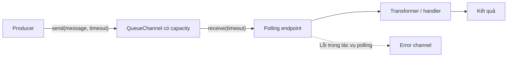

# QueueChannel

## 1. Mục tiêu và tình huống sử dụng

Trong module `SPRING_INTEGRATION_CORE`, chương **Kiểu channel** giúp lựa chọn cách chuyển `Message` giữa các endpoint. Bài này tập trung vào `QueueChannel`: channel có hàng đợi để bên gửi đưa thông điệp vào trước, bên nhận lấy ra sau.

Sau bài học, bạn có thể:

- Giải thích quan hệ giữa `MessageChannel`, `PollableChannel`, `QueueChannel` và polling endpoint.
- Chọn capacity, timeout và cấu hình poller phù hợp với tải xử lý.
- Xây dựng luồng Java DSL gồm hàng đợi, transformer và nhánh nhận lỗi.
- Phân biệt nhận vào hàng đợi, xử lý thành công, lưu bền và khả năng giao lại thông điệp.
- Kiểm thử hành vi FIFO, từ chối khi đầy, xử lý bất đồng bộ và lỗi ở consumer.

Giả sử hệ thống tiếp nhận yêu cầu chuẩn hóa đơn hàng. Lượng yêu cầu có thể tăng đột biến trong vài giây, còn bước xử lý cần diễn ra theo khả năng của hệ thống phía sau. Một hàng đợi cục bộ cho phép hấp thụ phần chênh lệch ngắn hạn. Khi hàng đợi đầy, phía tiếp nhận cần áp dụng chính sách chờ hoặc từ chối rõ ràng.

Các ví dụ nghiệp vụ trong bài là minh họa. Capacity và khoảng thời gian được chọn để dễ quan sát, cần đo lại trước khi áp dụng cho ứng dụng thực tế.

## 2. Cơ chế hoạt động

`QueueChannel` triển khai `PollableChannel`, nên hỗ trợ cả `send(...)` lẫn `receive(...)`. Với cách khởi tạo thông thường, thông điệp được giữ trong hàng đợi ở bộ nhớ của tiến trình. Channel có ngữ nghĩa **point-to-point**: một lần lấy thành công chuyển một thông điệp cho một consumer, kể cả khi có nhiều consumer cùng đọc. [Tham chiếu Message Channel Implementations](https://docs.spring.io/spring-integration/reference/channel/implementations.html).



Chuỗi hoạt động cần phân biệt:

1. Producer tạo `Message` gồm payload và các header nghiệp vụ.
2. `send(...)` đưa thông điệp vào hàng đợi nếu còn chỗ.
3. Một bên nhận chủ động gọi `receive(...)`.
4. Thông điệp được lấy khỏi hàng đợi và chuyển đến handler.
5. Handler thực hiện xử lý, có thể tạo thông điệp đầu ra hoặc phát sinh lỗi.

Hàng đợi mặc định lấy thông điệp theo FIFO. Tuy nhiên, FIFO tại channel chỉ nói về thứ tự lấy ra; nếu xử lý song song, thông điệp được lấy trước vẫn có thể hoàn tất sau.

Ví dụ hai worker cùng đọc các yêu cầu `A`, `B`: worker thứ nhất lấy `A` nhưng xử lý mất 800 ms; worker thứ hai lấy `B` và hoàn tất sau 50 ms. Người quan sát kết quả có thể thấy `B` trước `A`.

### Channel không tự chạy nghiệp vụ

Việc tạo `new QueueChannel(100)` không tạo worker hoặc tự khởi chạy handler. Channel chỉ cung cấp cơ chế trao đổi thông điệp.

Trong ứng dụng Spring Integration, endpoint nối handler với một `PollableChannel` thường là `PollingConsumer`. Poller cung cấp lịch thực hiện thao tác nhận. Khi một handler tiêu thụ trực tiếp từ channel dạng subscribable, endpoint tương ứng dùng cơ chế nhận theo sự kiện. [Tham chiếu Polling Consumer](https://docs.spring.io/spring-integration/reference/polling-consumer.html).

Có thể gọi `send()` và `receive()` tuần tự trong cùng thread để thử API. Trong một luồng có poller, producer và tác vụ polling thường chạy ở các thread khác nhau.

## 3. Khởi tạo và chọn kiểu khai báo

```java
import org.springframework.integration.channel.QueueChannel;
import org.springframework.messaging.MessageChannel;
import org.springframework.messaging.PollableChannel;

QueueChannel concreteChannel = new QueueChannel(100);

MessageChannel producerView = concreteChannel;
PollableChannel consumerView = concreteChannel;
```

Ba biến trỏ đến cùng một channel, nhưng thể hiện ba nhu cầu:

| Kiểu tham chiếu | Mục đích |
| --- | --- |
| `MessageChannel` | Gửi thông điệp, không phụ thuộc khả năng đọc |
| `PollableChannel` | Gửi và chủ động nhận thông điệp |
| `QueueChannel` | Dùng thêm API đặc thù như xem số lượng đang chờ |

Các constructor thường gặp:

```java
QueueChannel bounded = new QueueChannel(100);
QueueChannel veryLargeDefault = new QueueChannel();
```

Constructor không tham số có giới hạn thực tế rất lớn, tương ứng `Integer.MAX_VALUE`; nó không dành sẵn từng ấy ô nhớ nhưng vẫn cho phép backlog tăng đến mức gây áp lực heap. Với constructor nhận capacity, giá trị phải lớn hơn `0`. Nếu cần bàn giao trực tiếp mà không có vùng đệm, tìm hiểu `RendezvousChannel`. [Javadoc QueueChannel](https://docs.spring.io/spring-integration/api/org/springframework/integration/channel/QueueChannel.html).

Ngoài ra, `QueueChannel` có constructor nhận một `Queue<Message<?>>`. Khi cung cấp queue tùy biến, cần kiểm tra đặc tính sắp thứ tự, giới hạn và an toàn đồng thời của queue đó; không áp nguyên mọi giả định của hàng đợi mặc định cho mọi cách triển khai.

## 4. Ngữ nghĩa của send, receive và timeout

### 4.1. Bên gửi

```java
boolean accepted = channel.send(message, 200);
```

Tham số timeout của API trên có đơn vị **mili giây**. Nó giới hạn thời gian chờ đưa thông điệp vào channel trong trường hợp thao tác này bị chặn. Kết quả `true` cho biết thao tác gửi thành công; `false` là tình huống không gửi được, chẳng hạn hết thời gian đợi chỗ trống. API cũng có thể ném ngoại lệ đối với lỗi khác. [Javadoc MessageChannel](https://docs.spring.io/spring-framework/docs/current/javadoc-api/org/springframework/messaging/MessageChannel.html).

Trong trường hợp cơ bản, không có interceptor tùy biến:

| Lời gọi | Khi queue còn chỗ | Khi queue đầy |
| --- | --- | --- |
| `send(message, 0)` | Đưa vào queue, trả `true` | Trả `false` ngay |
| `send(message, 200)` | Đưa vào queue, trả `true` | Chờ tối đa 200 ms để có chỗ |
| `send(message)` hoặc timeout âm | Đưa vào queue | Có thể chờ vô hạn |

Đối với `QueueChannel`, **đưa vào hàng đợi thành công chưa chứng minh nghiệp vụ đã hoàn tất**. Sau khi producer nhận `true`, consumer có thể chưa lấy thông điệp, đang xử lý hoặc sẽ xử lý thất bại.

Không bỏ qua giá trị trả về:

```java
if (!channel.send(message, 200)) {
    throw new IllegalStateException("Hàng đợi đang đầy, chưa tiếp nhận yêu cầu");
}
```

Ở lớp tiếp nhận của ứng dụng, có thể ánh xạ tình huống này sang phản hồi bận, đưa yêu cầu về nguồn có khả năng thử lại, hoặc dùng một cơ chế lưu đệm bền phù hợp với hợp đồng nghiệp vụ.

### 4.2. Bên nhận

```java
Message<?> received = channel.receive(500);
if (received != null) {
    // Xử lý received.getPayload().
}
```

`receive(long)` trả về thông điệp tiếp theo, hoặc `null` khi hết thời gian chờ hay thao tác nhận bị ngắt. `receive()` không tham số có thể chờ vô hạn. [Javadoc PollableChannel](https://docs.spring.io/spring-framework/docs/current/javadoc-api/org/springframework/messaging/PollableChannel.html).

| Lời gọi | Khi queue có thông điệp | Khi queue rỗng |
| --- | --- | --- |
| `receive(0)` | Lấy một thông điệp | Trả `null` ngay |
| `receive(500)` | Lấy một thông điệp | Chờ tối đa 500 ms |
| `receive()` hoặc timeout âm | Lấy một thông điệp | Có thể chờ vô hạn |

Thông điệp đã nhận được lấy khỏi hàng đợi. Trong queue ở bộ nhớ thông thường, không có bước `ack` của ứng dụng để trì hoãn việc lấy này đến sau khi xử lý thành công.

### 4.3. Những thời gian chờ cần tách biệt

- **Send timeout**: chờ đưa thông điệp vào channel.
- **Receive timeout**: chờ lấy được thông điệp từ channel.
- **Poll interval**: lịch kích hoạt tác vụ polling.
- **Processing timeout**: giới hạn thời gian của thao tác nghiệp vụ hoặc lời gọi bên ngoài.

Ví dụ, `send(message, 200)` không có nghĩa consumer phải xử lý xong trong 200 ms. Tương tự, `receive(500)` không giới hạn một lời gọi HTTP phát sinh sau khi đã nhận được thông điệp.

## 5. Quan sát FIFO và capacity bằng ví dụ nhỏ

Ví dụ sau chạy được trong một phương thức `main` khi classpath đã có `spring-integration-core` và các phụ thuộc cần thiết:

```java
import org.springframework.integration.channel.QueueChannel;
import org.springframework.messaging.Message;
import org.springframework.messaging.support.MessageBuilder;

public class QueueBasicsDemo {

    public static void main(String[] args) {
        QueueChannel channel = new QueueChannel(2);

        Message<String> first = MessageBuilder.withPayload("ORDER-1").build();
        Message<String> second = MessageBuilder.withPayload("ORDER-2").build();
        Message<String> third = MessageBuilder.withPayload("ORDER-3").build();

        System.out.println(channel.send(first, 0));
        System.out.println(channel.send(second, 0));
        System.out.println(channel.send(third, 0));

        printPayload(channel.receive(0));
        System.out.println(channel.send(third, 0));

        printPayload(channel.receive(0));
        printPayload(channel.receive(0));
        printPayload(channel.receive(0));
    }

    private static void printPayload(Message<?> message) {
        System.out.println(message == null ? "<empty>" : message.getPayload());
    }
}
```

Kết quả dự kiến:

```text
true
true
false
ORDER-1
true
ORDER-2
ORDER-3
<empty>
```

Yêu cầu thứ ba không bị tự động loại yêu cầu thứ nhất để lấy chỗ. Lần gửi đầu của nó thất bại vì queue đầy; sau một lần nhận, ứng dụng chủ động gửi lại và thành công.

Không dùng mô hình sau trong cùng một thread:

```java
QueueChannel channel = new QueueChannel(1);
channel.send(first);

// Có thể chờ vô hạn vì chưa có bên nào lấy first ra.
channel.send(second);

// Dòng này không tới được nếu second vẫn đang chờ.
channel.receive();
```

Ở tình huống này, lời gọi cần giải phóng chỗ trống nằm sau lời gọi đang đợi chỗ trống. Dùng timeout hữu hạn hoặc một consumer hoạt động độc lập để giải quyết cấu trúc chờ này.

## 6. Kết nối QueueChannel với endpoint và poller

Khi transformer, filter, router hoặc service activator đọc trực tiếp từ `QueueChannel`, endpoint cần cấu hình poller riêng hoặc có poller mặc định trong application context. Thiếu cả hai có thể làm cấu hình endpoint không khởi tạo được.

Poller gắn với **endpoint đọc channel**, không phải một tác vụ nghiệp vụ nằm sẵn trong channel. [Tham chiếu Message Endpoints](https://docs.spring.io/spring-integration/reference/endpoint.html).

Ví dụ cấu hình các thông số polling bằng Java DSL:

```java
Pollers.fixedDelay(Duration.ofMillis(100))
        .maxMessagesPerPoll(10)
        .receiveTimeout(0)
        .errorChannel("orderErrors");
```

Ý nghĩa từng cấu hình:

| Cấu hình | Ý nghĩa |
| --- | --- |
| `fixedDelay(100 ms)` | Với tác vụ polling chạy trực tiếp, đợi 100 ms sau khi lần chạy trước kết thúc |
| `maxMessagesPerPoll(10)` | Mỗi lần chạy nhận và xử lý tối đa 10 thông điệp |
| `receiveTimeout(0)` | Mỗi lần nhận trả ngay khi queue rỗng |
| `errorChannel("orderErrors")` | Chỉ định channel mặc định nhận lỗi của tác vụ polling |

`maxMessagesPerPoll` không phải số worker. Mười thông điệp trong một lần poll có thể được xử lý tuần tự trên cùng thread. Các tùy chọn như `taskExecutor`, `transactional` và `receiveTimeout` thuộc cấu hình poller. [Javadoc PollerSpec](https://docs.spring.io/spring-integration/api/org/springframework/integration/dsl/PollerSpec.html).

`fixedDelay` và `fixedRate` cũng không đồng nghĩa. Fixed rate đặt lịch theo các mốc bắt đầu; fixed delay xét thời điểm hoàn tất tác vụ được lên lịch. Khi giao việc sang executor, thời điểm hoàn tất tác vụ lên lịch có thể khác thời điểm xử lý hết nghiệp vụ. [Javadoc Pollers](https://docs.spring.io/spring-integration/api/org/springframework/integration/dsl/Pollers.html).

Một poller mặc định là phương án dùng chung khi nhiều endpoint thực sự có cùng chính sách:

```java
import java.time.Duration;

import org.springframework.context.annotation.Bean;
import org.springframework.integration.dsl.PollerSpec;
import org.springframework.integration.dsl.Pollers;
import org.springframework.integration.scheduling.PollerMetadata;

@Bean(name = PollerMetadata.DEFAULT_POLLER)
public PollerSpec defaultPoller() {
    return Pollers.fixedDelay(Duration.ofMillis(100))
            .maxMessagesPerPoll(10)
            .receiveTimeout(0);
}
```

Đặt phương thức này trong lớp cấu hình Spring. `PollerSpec` là `FactoryBean`; trả nó trực tiếp từ phương thức `@Bean`, không tự gọi `getObject()` để tạo bean. [Tham chiếu Java DSL Pollers](https://docs.spring.io/spring-integration/reference/dsl/java-pollers.html).

## 7. Luồng Java DSL: chuẩn hóa đơn hàng và nhận lỗi

### 7.1. Chuẩn bị môi trường

Ví dụ dùng `record` của Java và API `transformWith` có từ Spring Integration 6.2. Chọn JDK tương thích với dòng Spring/Spring Boot mà ứng dụng đang dùng. Nếu dùng Spring Boot, để dependency management của Boot quản lý các phiên bản liên quan.

Trong một dự án Maven đã có Spring Boot parent hoặc BOM, thêm các dependency sau vào phần `dependencies`:

```xml
<dependency>
    <groupId>org.springframework.boot</groupId>
    <artifactId>spring-boot-starter-integration</artifactId>
</dependency>

<dependency>
    <groupId>org.springframework.boot</groupId>
    <artifactId>spring-boot-starter-test</artifactId>
    <scope>test</scope>
</dependency>
```

Phần cấu hình bên dưới dùng application context Spring thông thường, nên không phụ thuộc việc khởi chạy toàn bộ ứng dụng Boot. Java DSL tạo các channel và endpoint được đăng ký trong context thông qua bean `IntegrationFlow`. [Tham chiếu Java DSL](https://docs.spring.io/spring-integration/reference/dsl.html).

### 7.2. Cấu hình hoàn chỉnh

```java
import java.math.BigDecimal;
import java.time.Duration;
import java.util.Locale;

import org.springframework.context.annotation.Bean;
import org.springframework.context.annotation.Configuration;
import org.springframework.integration.channel.QueueChannel;
import org.springframework.integration.config.EnableIntegration;
import org.springframework.integration.dsl.IntegrationFlow;
import org.springframework.integration.dsl.Pollers;

@Configuration
@EnableIntegration
public class OrderQueueConfiguration {

    public record OrderRequest(String orderId, BigDecimal amount) {
    }

    public record OrderResult(
            String orderId,
            BigDecimal amount,
            String status) {
    }

    @Bean
    public QueueChannel orderRequests() {
        return new QueueChannel(100);
    }

    @Bean
    public QueueChannel processedOrders() {
        return new QueueChannel(100);
    }

    @Bean
    public QueueChannel orderErrors() {
        return new QueueChannel(20);
    }

    @Bean
    public IntegrationFlow normalizeOrders() {
        return IntegrationFlow.from("orderRequests")
                .transformWith(transformer -> transformer
                        .transformer((OrderRequest request) -> normalize(request))
                        .expectedType(OrderRequest.class)
                        .poller(Pollers.fixedDelay(Duration.ofMillis(100))
                                .maxMessagesPerPoll(10)
                                .receiveTimeout(0)
                                .errorChannel("orderErrors"))
                        .sendTimeout(250))
                .channel("processedOrders")
                .get();
    }

    private static OrderResult normalize(OrderRequest request) {
        if (request.orderId() == null || request.orderId().isBlank()) {
            throw new IllegalArgumentException("orderId phải có giá trị");
        }

        if (request.amount() == null || request.amount().signum() <= 0) {
            throw new IllegalArgumentException("amount phải lớn hơn 0");
        }

        return new OrderResult(
                request.orderId().trim().toUpperCase(Locale.ROOT),
                request.amount(),
                "VALIDATED");
    }
}
```

`TransformerEndpointSpec` cho phép đặt hàm biến đổi, kiểu payload kỳ vọng và các cấu hình endpoint trong `transformWith(...)`. [Javadoc TransformerEndpointSpec](https://docs.spring.io/spring-integration/api/org/springframework/integration/dsl/TransformerEndpointSpec.html).

Trong cấu hình này:

1. Producer gửi `OrderRequest` vào `orderRequests`.
2. Polling endpoint nhận thông điệp và gọi transformer.
3. Dữ liệu hợp lệ được chuyển thành `OrderResult`.
4. Kết quả được gửi vào `processedOrders`.
5. Lỗi phát sinh trong tác vụ polling được chuyển đến `orderErrors`, nếu thông điệp không có header chỉ định error channel khác.

`sendTimeout(250)` của endpoint giới hạn thời gian chờ gửi **kết quả** sang `processedOrders`. Nó độc lập với timeout mà producer dùng khi gửi vào `orderRequests`. Cấu hình timeout gửi đầu ra thuộc handler tạo thông điệp. [Javadoc ConsumerEndpointSpec](https://docs.spring.io/spring-integration/api/org/springframework/integration/dsl/ConsumerEndpointSpec.html).

Hai queue `processedOrders` và `orderErrors` giúp chương trình học có thể chủ động quan sát đầu ra. Ứng dụng chạy lâu cần consumer cho cả hai; nếu để đầy, kết quả có thể gửi thất bại và việc phát lỗi cũng có thể bị chặn. Không dùng hai hàng đợi này làm nơi lưu trữ vô thời hạn.

### 7.3. Gửi và quan sát kết quả

Đặt đoạn sau trong một phương thức `main` hoặc phương thức thử nghiệm; các kiểu domain là record lồng trong lớp cấu hình bên trên:

```java
import java.math.BigDecimal;

import org.springframework.context.annotation.AnnotationConfigApplicationContext;
import org.springframework.integration.channel.QueueChannel;
import org.springframework.messaging.Message;
import org.springframework.messaging.support.MessageBuilder;

// Bên trong phương thức:
try (var context =
        new AnnotationConfigApplicationContext(OrderQueueConfiguration.class)) {

    QueueChannel input = context.getBean("orderRequests", QueueChannel.class);
    QueueChannel output = context.getBean("processedOrders", QueueChannel.class);

    Message<?> request = MessageBuilder
            .withPayload(new OrderQueueConfiguration.OrderRequest(
                    " ord-101 ", new BigDecimal("120000")))
            .setHeader("orderId", "ORD-101")
            .build();

    boolean accepted = input.send(request, 200);
    if (!accepted) {
        throw new IllegalStateException("Chưa đưa được yêu cầu vào queue");
    }

    Message<?> result = output.receive(2000);
    if (result == null) {
        throw new IllegalStateException("Chưa nhận được kết quả trong thời gian chờ");
    }

    System.out.println(result.getPayload());
}
```

Payload kết quả dự kiến có `orderId = ORD-101`, `amount = 120000` và `status = VALIDATED`.

Thời gian chờ 2 giây là giới hạn quan sát trong ví dụ, không phải cam kết về độ trễ của hệ thống. Nếu bên chờ hết thời gian, công việc đã vào queue vẫn có thể tiếp tục.

## 8. Chọn capacity và xử lý áp lực ngược

Capacity giới hạn số thông điệp đang nằm trong hàng đợi. Nó không giới hạn toàn bộ công việc đang xử lý, hàng đợi của executor hay dữ liệu tạm do handler tạo ra.

Một cách ước lượng ban đầu cho đợt tăng tải ngắn:

```text
Số thông điệp tăng thêm ≈ max(0, tốc độ vào - tốc độ ra) × thời gian tăng tải
```

Đây là mô hình đơn giản do người thiết kế dùng để ước lượng, giả sử tốc độ tương đối ổn định trong khoảng đang xét.

Ví dụ:

- Tốc độ vào: 600 thông điệp/giây.
- Tốc độ ra: 400 thông điệp/giây.
- Đợt tăng tải kéo dài: 3 giây.
- Queue đang có sẵn: 200 thông điệp.

Phần tồn đọng tăng khoảng `200 × 3 = 600` thông điệp. Sau 3 giây, queue có thể đạt `200 + 600 = 800` thông điệp. Nếu capacity là 800, cần dự kiến phản ứng khi đợt tăng tải kéo dài hơn.

Nếu trung bình mỗi thông điệp giữ khoảng 8 KiB dữ liệu sống trong heap, 800 thông điệp tương ứng khoảng 6,25 MiB dữ liệu. Bộ nhớ thực tế còn gồm header, đối tượng bao, cấu trúc queue và các đối tượng được tham chiếu. Cần đo heap thay vì coi phép nhân này là giới hạn chính xác.

Các lựa chọn khi đầy nên thể hiện thành hợp đồng:

| Chính sách | Cách áp dụng | Hệ quả cần tính |
| --- | --- | --- |
| Chờ ngắn rồi từ chối | `send(message, timeoutHuuHan)` | Producer có thể bị chậm trong giới hạn đã chọn |
| Từ chối ngay | `send(message, 0)` và kiểm tra kết quả | Phía gọi cần biết yêu cầu chưa được tiếp nhận |
| Lưu vào nguồn bền để xử lý sau | Dùng cơ chế lưu hoặc broker phù hợp | Có thêm chi phí lưu, khôi phục và quản lý trùng lặp |

Không tự động gửi lại vô hạn trong vòng lặp tức thời. Khi consumer đang quá tải, cách này tăng CPU và cạnh tranh nhưng không tạo thêm năng lực xử lý.

Tăng capacity chỉ kéo dài thời gian hấp thụ tải. Nếu tốc độ vào liên tục lớn hơn tốc độ xử lý, cần điều chỉnh tải đầu vào hoặc năng lực xử lý.

## 9. Nhiều consumer và yêu cầu thứ tự

Nhiều polling endpoint có thể cùng lấy từ một `QueueChannel`. Chúng cạnh tranh nhận thông điệp; mô hình này phù hợp khi các yêu cầu có thể được xử lý độc lập.

Cần tách ba mức thứ tự:

| Mức quan sát | Điều cần hiểu |
| --- | --- |
| Đưa vào queue | Với nhiều producer đồng thời, thứ tự gọi ở các thread chưa đủ xác định thứ tự enqueue |
| Lấy khỏi queue | Queue FIFO mặc định trả theo thứ tự đã được enqueue |
| Hoàn tất nghiệp vụ | Có thể khác thứ tự lấy nếu các consumer xử lý đồng thời |

Nếu đơn hàng yêu cầu các bước `CREATED → PAID → SHIPPED` theo đúng thứ tự, một queue chung với nhiều worker chưa đủ bảo đảm quy tắc theo từng đơn hàng.

Các lựa chọn thiết kế có thể gồm một consumer tuần tự, phân nhóm công việc theo khóa nghiệp vụ rồi xử lý tuần tự từng nhóm, hoặc kiểm tra phiên bản trạng thái tại nơi cập nhật dữ liệu. Đây là quyết định của luồng và mô hình dữ liệu; `QueueChannel` không tự hiểu khóa đơn hàng.

Việc tăng số worker cũng cần xét giới hạn tài nguyên phía sau. Thêm worker cho một dịch vụ đã hết connection không bảo đảm tăng thông lượng.

## 10. Xử lý lỗi sau ranh giới hàng đợi

### 10.1. Lỗi gửi khác lỗi xử lý

Đặt `try/catch` quanh `input.send(...)` giúp xử lý lỗi xảy ra ngay khi gửi. Nó không bắt được ngoại lệ phát sinh về sau trên thread của poller bằng cơ chế stack gọi Java thông thường.

Trong luồng bất đồng bộ do framework quản lý, lỗi có thể được đóng gói thành `ErrorMessage` và phát sang error channel. Nếu thông điệp có header `errorChannel`, cơ chế mặc định ưu tiên đích đó; nếu không, dùng error channel mặc định đã cấu hình hoặc channel toàn cục `errorChannel`. [Tham chiếu Error Handling](https://docs.spring.io/spring-integration/reference/error-handling.html).

Ví dụ ở mục 7 cấu hình `orderErrors` làm đích mặc định cho poller. `MessagePublishingErrorHandler` là thành phần thực hiện việc phát thông điệp lỗi trong cơ chế này. [Javadoc MessagePublishingErrorHandler](https://docs.spring.io/spring-integration/api/org/springframework/integration/channel/MessagePublishingErrorHandler.html).

### 10.2. Đọc thông tin lỗi có ngữ cảnh

Payload của `ErrorMessage` là `Throwable`, thường là một `MessagingException` có `failedMessage`. Không mặc định rằng mọi lỗi đều có thông điệp gốc hoặc đều bọc theo cùng số tầng exception. [Javadoc ErrorMessage](https://docs.spring.io/spring-framework/docs/current/javadoc-api/org/springframework/messaging/support/ErrorMessage.html).

```java
import org.springframework.messaging.Message;
import org.springframework.messaging.MessagingException;
import org.springframework.messaging.support.ErrorMessage;

// errors là QueueChannel orderErrors lấy từ application context.
Message<?> candidate = errors.receive(2000);

if (candidate instanceof ErrorMessage errorMessage) {
    Throwable failure = errorMessage.getPayload();

    System.err.println("Lỗi: " + failure);

    if (failure instanceof MessagingException messagingException) {
        Message<?> failed = messagingException.getFailedMessage();

        if (failed != null) {
            System.err.println("orderId: " + failed.getHeaders().get("orderId"));
        }
    }
}
```

Thông tin nên lưu khi điều tra gồm khóa nghiệp vụ, bước đang xử lý, thời điểm, loại lỗi và số lần thử. Chỉ ghi các trường payload thực sự cần thiết cho việc chẩn đoán.

### 10.3. Lấy ra rồi thất bại không tự đưa lại vào queue

Xét hàng đợi trong bộ nhớ với chuỗi sau:

```text
send thành công
    → receive lấy thông điệp khỏi queue
    → handler gọi dịch vụ
    → handler ném exception
```

Sau lỗi, thông điệp không tự quay về queue chỉ vì handler thất bại. Việc gửi `ErrorMessage` cho biết có lỗi, không tương đương với retry, rollback của queue hay dead-letter queue.

Nếu tự viết consumer bằng `receive(...)` rồi gọi một hàm Java, bạn phải tự xử lý ngoại lệ của hàm đó. Không suy ra rằng một đoạn Java bất kỳ sẽ được framework tự phát lỗi sang `errorChannel`.

### 10.4. Thiết kế thử lại và khôi phục

Có thể gắn `RequestHandlerRetryAdvice` cho handler cần thử lại và cấu hình hành động phục hồi khi hết lượt. Retry tại handler và cơ chế nguồn bên ngoài giao lại thông điệp là hai cách vận hành khác nhau. [Tham chiếu Retry Advice](https://docs.spring.io/spring-integration/reference/handler-advice/classes.html).

Một chính sách minh họa cho dịch vụ xác thực đơn hàng:

| Loại sự cố | Hành động phù hợp với ví dụ |
| --- | --- |
| Số tiền không hợp lệ | Ghi nhận yêu cầu lỗi và kết thúc, vì gửi lại không sửa được dữ liệu |
| Timeout tạm thời khi gọi dịch vụ | Thử lại có giới hạn và khoảng nghỉ |
| Hết số lần thử | Lưu thông tin đủ để xử lý lại có kiểm soát |

Nếu thao tác tạo tác dụng phụ, như trừ tiền, cần khóa idempotency ổn định theo yêu cầu nghiệp vụ. Việc gọi lại sau timeout có thể gặp trường hợp bên ngoài đã thực hiện xong nhưng ứng dụng chưa nhận được phản hồi.

Không dùng `MessageHeaders.ID` mới sinh ở mỗi lần tạo message làm khóa duy nhất cho cùng một nghiệp vụ được gửi lại từ đầu.

## 11. Lưu bền và transaction

### 11.1. Giới hạn của queue mặc định

`QueueChannel` trong bộ nhớ phù hợp cho vùng đệm nội bộ có khả năng mất khi tiến trình dừng. Mỗi instance ứng dụng thường có queue riêng, nên tăng số replica không tự tạo thành một hàng đợi chung.

Các tình huống cần cân nhắc:

- Tiến trình dừng khi thông điệp còn trong queue.
- Consumer đã lấy thông điệp nhưng chưa hoàn tất xử lý.
- Tác dụng phụ đã xảy ra nhưng chưa ghi được trạng thái hoàn tất.
- Producer thông báo đã tiếp nhận trước khi có nơi lưu bền.

Nếu hợp đồng tiếp nhận yêu cầu khôi phục sau sự cố, cần bổ sung cơ chế lưu và phối hợp phù hợp.

### 11.2. QueueChannel có message store

Spring Integration hỗ trợ backing store bền cho queue. Ví dụ cấu hình XML dưới đây chỉ minh họa việc nối channel với một store đã được khai báo:

```xml
<int:channel id="durableOrders">
    <int:queue message-store="channelStore"/>
</int:channel>
```

Tiền tố `int` cần namespace Spring Integration; `channelStore` cần bean store tương thích. Khi dùng thuộc tính XML `message-store`, không khai báo đồng thời `capacity` trên phần tử queue theo cách cấu hình trên. [Tham chiếu Persistent QueueChannel Configuration](https://docs.spring.io/spring-integration/reference/channel/configuration.html).

Với JDBC, `JdbcChannelMessageStore` được tối ưu cho message channel. Cần chuẩn bị schema, query provider phù hợp cơ sở dữ liệu, cách biểu diễn payload/header và chính sách lưu trữ. Chỉ thêm tham chiếu bean store chưa tạo ra toàn bộ cấu hình JDBC có thể vận hành. [Tham chiếu JDBC Message Store](https://docs.spring.io/spring-integration/reference/jdbc/message-store.html).

### 11.3. Ranh giới transaction cần được thiết kế

Transaction gắn với thread hiện tại không tự truyền từ producer sang thread của poller. Có thể bắt đầu transaction tại poller để bao việc nhận từ tài nguyên có hỗ trợ transaction và xử lý đồng bộ phía sau. [Tham chiếu Transaction Support](https://docs.spring.io/spring-integration/reference/transactions.html).

Cần kiểm tra cụ thể:

- Store có tham gia transaction và hỗ trợ khôi phục thao tác nhận khi rollback không?
- Bước cập nhật nghiệp vụ có dùng cùng tài nguyên hoặc cơ chế phối hợp phù hợp không?
- Luồng có đổi thread thêm một lần nữa trước khi xử lý xong không?
- Lời gọi tới hệ thống bên ngoài có thể được thực hiện lặp không?

Gắn transaction cho poller không làm hàng đợi trong bộ nhớ thông thường trở thành tài nguyên có rollback. Message store bền cũng chưa tự bảo đảm “exactly once” cho tác dụng phụ bên ngoài.

## 12. So sánh với các lựa chọn channel gần nhau

| Channel | Cách nhận chính | Lựa chọn điển hình |
| --- | --- | --- |
| `DirectChannel` | Gọi handler theo cơ chế subscribe, thường trên thread gửi | Xử lý nối tiếp cùng stack gọi |
| `QueueChannel` | Chủ động `receive`, thường qua poller | Vùng đệm nội bộ và điều khiển lịch lấy |
| `ExecutorChannel` | Phân phối cho handler qua executor | Giao việc sang executor |
| `PublishSubscribeChannel` | Phát cho các subscriber | Gửi sự kiện đến nhiều nhánh |
| `RendezvousChannel` | Bàn giao khi bên nhận sẵn sàng | Đồng bộ hóa gửi và nhận không có vùng đệm |

Tham khảo đặc tính channel trong [Message Channel Implementations](https://docs.spring.io/spring-integration/reference/channel/implementations.html) và [Javadoc ExecutorChannel](https://docs.spring.io/spring-integration/api/org/springframework/integration/channel/ExecutorChannel.html).

Queue của một executor có thể giữ các task chờ thực thi. Nó vẫn khác với việc cung cấp API `PollableChannel.receive(...)` cho luồng tích hợp.

Khi cần trao đổi giữa nhiều tiến trình, một broker qua adapter là lựa chọn ở phạm vi kiến trúc khác. Cần quyết định dựa trên nhu cầu lưu bền, giao lại, mở rộng và vận hành của hệ thống.

### QueueChannel phía sau gateway

Một gateway trả về giá trị vẫn có thể chờ phản hồi, dù request đi qua `QueueChannel`. Request timeout giới hạn chờ gửi; reply timeout giới hạn chờ phản hồi. Bên gọi hết thời gian đợi không tự hủy công việc đã đưa vào queue. [Tham chiếu Messaging Gateways](https://docs.spring.io/spring-integration/reference/gateway.html).

Luồng ở mục 7 gửi kết quả vào `processedOrders` để chương trình chủ động đọc. Nếu đổi sang gateway request/reply, cần thiết kế đường trả lời tương ứng, thường sử dụng header `replyChannel` do gateway cung cấp. Không chỉ thêm phương thức gateway có kiểu trả về rồi giả định queue đầu ra hiện tại sẽ tự chuyển kết quả về đúng caller.

## 13. Kiểm thử hành vi của queue và luồng

Ví dụ dùng JUnit Jupiter, cùng các record và lớp cấu hình đã có ở mục 7. Đặt lớp kiểm thử cùng package với lớp cấu hình hoặc thêm import tương ứng.

Hai nhóm cần được kiểm chứng riêng:

- Hành vi trực tiếp của channel: capacity, FIFO, hết thông điệp.
- Hành vi trong context: endpoint thực sự poll, transformer tạo kết quả và lỗi đến đúng đích.

```java
import java.math.BigDecimal;

import org.junit.jupiter.api.Test;
import org.springframework.context.annotation.AnnotationConfigApplicationContext;
import org.springframework.integration.channel.QueueChannel;
import org.springframework.messaging.Message;
import org.springframework.messaging.MessagingException;
import org.springframework.messaging.support.ErrorMessage;
import org.springframework.messaging.support.MessageBuilder;

import static org.junit.jupiter.api.Assertions.*;

class QueueChannelTest {

    @Test
    void shouldRespectCapacityAndFifo() {
        QueueChannel channel = new QueueChannel(2);

        assertTrue(channel.send(
                MessageBuilder.withPayload("A").build(), 0));
        assertTrue(channel.send(
                MessageBuilder.withPayload("B").build(), 0));
        assertFalse(channel.send(
                MessageBuilder.withPayload("C").build(), 0));

        Message<?> first = channel.receive(0);
        Message<?> second = channel.receive(0);

        assertNotNull(first);
        assertNotNull(second);
        assertEquals("A", first.getPayload());
        assertEquals("B", second.getPayload());
        assertNull(channel.receive(0));

        assertTrue(channel.send(
                MessageBuilder.withPayload("C").build(), 0));
    }

    @Test
    void eachReceiveShouldRemoveOneMessage() {
        QueueChannel channel = new QueueChannel(1);
        assertTrue(channel.send(
                MessageBuilder.withPayload("ONLY-ONE").build(), 0));

        Message<?> consumerOne = channel.receive(0);
        Message<?> consumerTwo = channel.receive(0);

        assertNotNull(consumerOne);
        assertNull(consumerTwo);
    }

    @Test
    void shouldNormalizeAnOrderThroughPollingEndpoint() {
        try (var context =
                new AnnotationConfigApplicationContext(
                        OrderQueueConfiguration.class)) {

            QueueChannel input =
                    context.getBean("orderRequests", QueueChannel.class);
            QueueChannel output =
                    context.getBean("processedOrders", QueueChannel.class);

            assertTrue(input.send(MessageBuilder
                    .withPayload(new OrderQueueConfiguration.OrderRequest(
                            " ord-101 ", new BigDecimal("120000")))
                    .setHeader("orderId", "ORD-101")
                    .build(), 200));

            Message<?> reply = output.receive(2000);
            assertNotNull(reply);

            var result = assertInstanceOf(
                    OrderQueueConfiguration.OrderResult.class,
                    reply.getPayload());

            assertEquals("ORD-101", result.orderId());
            assertEquals(new BigDecimal("120000"), result.amount());
            assertEquals("VALIDATED", result.status());
        }
    }

    @Test
    void acceptedOrderCanStillFailLater() {
        try (var context =
                new AnnotationConfigApplicationContext(
                        OrderQueueConfiguration.class)) {

            QueueChannel input =
                    context.getBean("orderRequests", QueueChannel.class);
            QueueChannel output =
                    context.getBean("processedOrders", QueueChannel.class);
            QueueChannel errors =
                    context.getBean("orderErrors", QueueChannel.class);

            assertTrue(input.send(MessageBuilder
                    .withPayload(new OrderQueueConfiguration.OrderRequest(
                            "BAD-1", new BigDecimal("-1")))
                    .setHeader("orderId", "BAD-1")
                    .build(), 200));

            ErrorMessage error = assertInstanceOf(
                    ErrorMessage.class, errors.receive(2000));

            MessagingException failure = assertInstanceOf(
                    MessagingException.class, error.getPayload());

            Message<?> failedMessage = failure.getFailedMessage();
            assertNotNull(failedMessage);
            assertEquals(
                    "BAD-1", failedMessage.getHeaders().get("orderId"));
            assertNull(output.receive(0));
        }
    }
}
```

Bài kiểm thử thứ hai minh họa hai lần nhận tuần tự không thể cùng lấy lại một thông điệp. Nó không phải kiểm thử tải hoặc bằng chứng về tính công bằng giữa các worker đồng thời.

Các kiểm thử có poller dùng `receive(timeout)` để chờ kết quả có giới hạn, thay vì đoán một khoảng `Thread.sleep(...)`. Trên môi trường chạy chậm, chọn timeout đủ phù hợp; không biến thời gian chờ của kiểm thử thành yêu cầu độ trễ nghiệp vụ nếu chưa có hợp đồng đó.

Các kiểm thử trên không chứng minh khả năng phục hồi sau khi tiến trình chết, tính đúng đắn của transaction JDBC hay chống trùng tác dụng phụ. Những yêu cầu đó cần kịch bản tích hợp tương ứng với tài nguyên thật được sử dụng.

## 14. Quan sát và chẩn đoán

Có thể quan sát số lượng đang chờ và dung lượng còn lại:

```java
int pending = channel.getQueueSize();
int remaining = channel.getRemainingCapacity();
```

Đây là ảnh chụp tại thời điểm đọc. Không thực hiện “kiểm tra còn chỗ rồi gửi” như một thao tác nguyên tử:

```java
// Kết quả quan sát có thể hết hiệu lực trước khi send được gọi.
if (channel.getRemainingCapacity() > 0) {
    channel.send(message, 0);
}
```

Ngay cả trong trường hợp này, vẫn phải xử lý giá trị trả về của `send`. Một producer khác có thể sử dụng chỗ trống trước.

Các chỉ số ứng dụng nên quan sát cùng nhau:

- Số thông điệp đang chờ và xu hướng tăng giảm.
- Số yêu cầu gửi không được vì đầy hoặc timeout.
- Tốc độ tiếp nhận, tốc độ hoàn tất và tỷ lệ lỗi nghiệp vụ.
- Thời gian chờ trong queue và thời gian xử lý sau khi lấy.
- Tình trạng consumer của nhánh kết quả và nhánh lỗi.

Queue giảm không luôn có nghĩa nghiệp vụ khỏe: consumer có thể lấy nhanh rồi lỗi nhanh. Queue bằng 0 cũng không bao gồm công việc đang xử lý hoặc đang đợi ở hàng đợi khác.

Có thể dùng `ChannelInterceptor` để quan sát thao tác gửi/nhận. Các callback nhận chỉ có ý nghĩa với `PollableChannel`; `postSend` cho biết kết quả gửi, không phải trạng thái hoàn thành nghiệp vụ. [Tham chiếu Channel Interceptors](https://docs.spring.io/spring-integration/reference/channel/interceptors.html).

| Hiện tượng | Điểm cần kiểm tra trước |
| --- | --- |
| Queue tăng nhưng handler không chạy | Endpoint đã khởi động chưa, có poller phù hợp chưa |
| Producer đứng chờ lâu | Queue đầy và đang dùng lời gọi không có timeout hữu hạn |
| `send` trả `true` nhưng không thấy kết quả | Handler còn đang chạy, đầu ra đầy hoặc lỗi đã đi sang nhánh khác |
| Kết quả đảo thứ tự | Có nhiều consumer, executor hoặc bước xử lý song song không |
| Tăng `maxMessagesPerPoll` nhưng không tăng worker | Tham số này giới hạn số message mỗi lượt poll, không tạo thread |
| Có lỗi nhưng phía gọi không bắt được | Lỗi có xảy ra sau khi đã đổi sang thread poller không |
| Thông điệp biến mất khi ứng dụng dừng | Queue đang nằm trong bộ nhớ, chưa có lưu bền phù hợp |
| Toàn luồng chậm dù queue vào chưa đầy | Kiểm tra đầu ra, error channel và các nguồn tài nguyên phía sau |

Khi chọn `QueueChannel`, hãy xác định rõ ba hợp đồng: điều gì được coi là tiếp nhận thành công, xử lý thế nào khi hết chỗ, và khôi phục ra sao nếu xử lý dở dang. Sau đó cấu hình poller, đường kết quả, đường lỗi và các kiểm thử theo những hợp đồng này.

