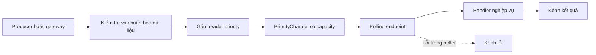

# PriorityChannel

## 1. Mục tiêu và tình huống sử dụng

Trong chương **Kiểu channel** của module **SPRING_INTEGRATION_CORE**, bài này giải thích cách dùng `PriorityChannel` để chọn thông điệp cần được xử lý trước. Nội dung nối các thành phần `Message`, `MessageChannel`, endpoint, gateway và Java DSL thành một luồng có chính sách ưu tiên rõ ràng.

Giả sử hệ thống nhận yêu cầu xử lý đơn hàng với hai nhóm:

- Đơn thông thường có thể chờ trong hàng đợi.
- Đơn giao nhanh cần được lấy ra sớm hơn khi worker còn việc tồn đọng.

Nếu tất cả yêu cầu đi qua một hàng đợi FIFO, đơn giao nhanh phải chờ mọi yêu cầu đã vào trước. `PriorityChannel` cho phép thay đổi thứ tự lấy thông điệp theo mức ưu tiên.

Sau bài học, bạn có thể cấu hình channel có giới hạn dung lượng, gắn priority trước khi enqueue, nối poller vào Java DSL, viết comparator riêng và kiểm thử những cam kết thực tế của channel.

Các ví dụ dùng Java 17 và API Spring Integration 6.5 làm mốc. Dự án Spring Boot có thể dùng `spring-boot-starter-integration` và phiên bản do Boot quản lý; dự án Spring thuần cần `spring-integration-core`. Ví dụ kiểm thử dùng JUnit Jupiter và AssertJ. Không cần message broker để chạy các ví dụ trong bộ nhớ.

## 2. PriorityChannel nằm ở đâu trong luồng thông điệp?

`PriorityChannel` kế thừa `QueueChannel` và là một `PollableChannel`. Producer đưa `Message<?>` vào hàng đợi; consumer chủ động lấy bằng `receive()` hoặc thông qua polling endpoint. Khi có nhiều consumer, mỗi thông điệp được lấy bởi một consumer. Channel này phù hợp với mô hình hàng đợi công việc.

Spring cho phép dùng comparator mặc định dựa trên header `priority`, hoặc truyền `Comparator<Message<?>>` khi tạo channel. Xem [API PriorityChannel](https://docs.spring.io/spring-integration/docs/6.5.0/api/org/springframework/integration/channel/PriorityChannel.html).



Hãy tách ba thời điểm trong sơ đồ:

1. **Gửi thành công:** channel đã nhận thông điệp.
2. **Lấy khỏi hàng đợi:** consumer đã nhận một thông điệp.
3. **Hoàn thành nghiệp vụ:** handler và các bước liên quan đã kết thúc.

Priority tác động vào thời điểm thứ hai. Việc producer gửi thành công chưa chứng minh rằng đơn hàng đã được xử lý xong.

## 3. Quy tắc priority mặc định

### 3.1. Priority lớn hơn được lấy trước

Với comparator mặc định, giá trị priority được so sánh theo thứ tự giảm dần. Trong triển khai bộ nhớ ở mốc 6.5:

- Thiếu header priority được xem như mức `0`.
- Priority âm vẫn tham gia so sánh, ví dụ `0` đứng trước `-1`.
- Khi so sánh cho kết quả bằng nhau, channel dùng số thứ tự nội bộ để phân xử.

Cơ chế phân xử này giữ thứ tự gửi tuần tự giữa các thông điệp đồng mức; không cần thêm timestamp vào comparator để đạt điều đó. Với producer đồng thời, không dùng thứ tự bắt đầu gọi phương thức làm thứ tự nghiệp vụ. Xem [mã nguồn PriorityChannel 6.5.0](https://github.com/spring-projects/spring-integration/blob/v6.5.0/spring-integration-core/src/main/java/org/springframework/integration/channel/PriorityChannel.java).

Giả sử producer gửi tuần tự và chưa có consumer lấy dữ liệu:

| Thứ tự gửi | Payload | Header priority |
| --- | --- | --- |
| 1 | `STANDARD-A` | `1` |
| 2 | `EXPRESS-A` | `9` |
| 3 | `STANDARD-B` | `1` |
| 4 | `EXPRESS-B` | `9` |
| 5 | `UNCLASSIFIED` | Không có |

Thứ tự nhận dự kiến:

```text
EXPRESS-A → EXPRESS-B → STANDARD-A → STANDARD-B → UNCLASSIFIED
```

Giá trị `1` và `9` là chính sách của ví dụ. Ứng dụng nên đặt tên hằng số hoặc bảng ánh xạ nghiệp vụ thay vì rải các số này khắp hệ thống.

### 3.2. Gắn đúng header, đúng kiểu dữ liệu

Tên hằng số chuẩn là `IntegrationMessageHeaderAccessor.PRIORITY`, có giá trị `"priority"`.

```java
import org.springframework.integration.IntegrationMessageHeaderAccessor;
import org.springframework.messaging.Message;
import org.springframework.messaging.support.MessageBuilder;

Message<String> urgent = MessageBuilder
        .withPayload("ORDER-208")
        .setHeader(IntegrationMessageHeaderAccessor.PRIORITY, 9)
        .build();
```

Ví dụ dùng `MessageBuilder` thuộc package `org.springframework.messaging.support` và gắn header trực tiếp. Spring Integration cũng có builder trong package riêng; cần kiểm tra import khi sao chép ví dụ.

Nên chuẩn hóa priority thành `Integer`. Accessor của Spring Integration đọc header dưới dạng `Number` rồi lấy `intValue()`; chuỗi `"9"` không được tự chuyển đổi tại đây. Tránh dùng số thực hoặc `Long` vượt miền `int`. Xem [StaticMessageHeaderAccessor.getPriority](https://github.com/spring-projects/spring-integration/blob/v6.5.0/spring-integration-core/src/main/java/org/springframework/integration/StaticMessageHeaderAccessor.java).

Với đầu vào HTTP, JSON hoặc dữ liệu từ đối tác, nên chuyển hạng dịch vụ như `EXPRESS` thành priority nội bộ. Điều đó giúp áp dụng chính sách thống nhất trước khi thông điệp đi vào channel.

## 4. Ví dụ tối thiểu: quan sát thứ tự nhận

Chương trình sau chỉ dùng channel trong bộ nhớ, không cần khởi tạo Spring context. Nó gửi hết dữ liệu trước rồi mới nhận để kết quả không phụ thuộc lịch chạy của poller.

```java
import java.util.Objects;

import org.springframework.integration.IntegrationMessageHeaderAccessor;
import org.springframework.integration.channel.PriorityChannel;
import org.springframework.messaging.Message;
import org.springframework.messaging.support.MessageBuilder;

public class PriorityChannelDemo {

    public static void main(String[] args) {
        PriorityChannel channel = new PriorityChannel(10);

        enqueue(channel, message("STANDARD-A", 1));
        enqueue(channel, message("EXPRESS-A", 9));
        enqueue(channel, message("STANDARD-B", 1));
        enqueue(channel, message("EXPRESS-B", 9));

        enqueue(channel, MessageBuilder
                .withPayload("UNCLASSIFIED")
                .build());

        for (int i = 0; i < 5; i++) {
            Message<?> received = Objects.requireNonNull(channel.receive(0));
            System.out.println(received.getPayload());
        }

        System.out.println("empty = " + (channel.receive(0) == null));
    }

    private static Message<String> message(String id, int priority) {
        return MessageBuilder.withPayload(id)
                .setHeader(IntegrationMessageHeaderAccessor.PRIORITY, priority)
                .build();
    }

    private static void enqueue(PriorityChannel channel, Message<?> message) {
        if (!channel.send(message, 0)) {
            throw new IllegalStateException("Không còn chỗ trong channel");
        }
    }
}
```

Kết quả:

```text
EXPRESS-A
EXPRESS-B
STANDARD-A
STANDARD-B
UNCLASSIFIED
empty = true
```

`receive(0)` phù hợp cho ví dụ này vì dữ liệu đã được enqueue. Trong ứng dụng, nhận với timeout bằng `0` có thể trả về `null` ngay cả khi một producer sắp gửi thông điệp.

## 5. Capacity và timeout: ưu tiên lấy ra khác ưu tiên được nhận vào

### 5.1. Khởi tạo có giới hạn

```java
PriorityChannel bounded = new PriorityChannel(100);
PriorityChannel unbounded = new PriorityChannel();
```

Constructor không tham số tạo hàng đợi không có giới hạn dung lượng cấu hình. Với constructor có capacity, dùng số dương để đặt giới hạn; capacity không dương tương ứng cấu hình không giới hạn. Xem [các constructor của PriorityChannel](https://docs.spring.io/spring-integration/docs/6.5.0/api/org/springframework/integration/channel/PriorityChannel.html).

Hãy chọn capacity từ lượng công việc tồn đọng có thể chấp nhận và bộ nhớ khả dụng. Một trăm thông điệp chỉ chứa mã đơn hàng khác rất nhiều so với một trăm payload chứa tệp lớn.

### 5.2. Ý nghĩa các phương thức gửi và nhận

| Lời gọi với channel trong bộ nhớ | Hành vi cần xử lý |
| --- | --- |
| `send(message, 0)` | Thử gửi ngay; trả `false` nếu không còn chỗ |
| `send(message, 200)` | Chờ tối đa khoảng 200 ms để có chỗ |
| `send(message)` | Có thể chờ vô hạn khi channel đầy |
| `receive(0)` | Lấy ngay nếu có; trả `null` khi rỗng |
| `receive(200)` | Chờ tối đa khoảng 200 ms để có thông điệp |
| `receive()` | Chờ đến khi nhận được, trừ trường hợp bị ngắt |

Timeout là thời gian chờ thao tác channel; nó không phải thời hạn hoàn thành nghiệp vụ. Lỗi không thể phục hồi vẫn có thể phát sinh exception. Xem hợp đồng [MessageChannel](https://docs.spring.io/spring-framework/docs/current/javadoc-api/org/springframework/messaging/MessageChannel.html) và [PollableChannel](https://docs.spring.io/spring-framework/docs/current/javadoc-api/org/springframework/messaging/PollableChannel.html).

Nếu gọi trực tiếp `send`, luôn xét kết quả boolean:

```java
boolean accepted = channel.send(urgent, 200);

if (!accepted) {
    // Tùy chính sách: báo quá tải, lưu yêu cầu để gửi lại,
    // hoặc chuyển sang một hàng đợi tiếp nhận khác.
}
```

### 5.3. Channel đầy không tự nhường chỗ cho thông điệp khẩn

Xét capacity bằng `2`:

```text
Trong queue: [STANDARD-A, STANDARD-B]
Thông điệp mới: EXPRESS-A, priority=9
```

`EXPRESS-A` vẫn phải chờ có chỗ hoặc bị từ chối khi hết timeout. Nó không tự loại `STANDARD-A` hay `STANDARD-B`.

Đây là hệ quả thiết kế cần tính đến khi lập SLA: ưu tiên chỉ giúp chọn trong số thông điệp đã vào được queue. Nếu cần giữ chỗ tiếp nhận cho đơn khẩn, có thể tách queue và đặt ngân sách dung lượng riêng cho từng nhóm.

Dung lượng trống tăng khi một thông điệp được lấy khỏi queue. Những thông điệp đang chạy trong worker không còn nằm trong con số queue depth, nên capacity cũng không phải giới hạn tổng số công việc đang thực thi.

## 6. Tích hợp bằng Java DSL

### 6.1. Cấu hình hoàn chỉnh trong Spring context

Ví dụ sau nhận đơn hàng, loại đầu vào không hợp lệ, chuẩn hóa mã đơn, gắn priority rồi đưa vào channel. Một polling endpoint xử lý đơn và gửi kết quả sang queue khác.

```java
import org.springframework.context.annotation.Bean;
import org.springframework.context.annotation.Configuration;
import org.springframework.integration.IntegrationMessageHeaderAccessor;
import org.springframework.integration.channel.PriorityChannel;
import org.springframework.integration.channel.QueueChannel;
import org.springframework.integration.config.EnableIntegration;
import org.springframework.integration.dsl.IntegrationFlow;
import org.springframework.integration.dsl.Pollers;

@Configuration
@EnableIntegration
public class PriorityOrderConfiguration {

    public record Order(String id, boolean express) {
    }

    public record OrderResult(String orderId, String status) {
    }

    @Bean
    public PriorityChannel orderPriorityChannel() {
        return new PriorityChannel(100);
    }

    @Bean
    public QueueChannel completedOrders() {
        return new QueueChannel(100);
    }

    @Bean
    public QueueChannel orderErrors() {
        return new QueueChannel(100);
    }

    @Bean
    public IntegrationFlow orderIngress(PriorityChannel orderPriorityChannel) {
        return IntegrationFlow.from("orderInput")
                .filter(Order.class,
                        order -> order.id() != null && !order.id().isBlank(),
                        filter -> filter.throwExceptionOnRejection(true))
                .transform(Order.class,
                        order -> new Order(order.id().trim(), order.express()))
                .enrichHeaders(headers -> headers.headerFunction(
                        IntegrationMessageHeaderAccessor.PRIORITY,
                        message -> ((Order) message.getPayload()).express() ? 9 : 1))
                .channel(orderPriorityChannel)
                .get();
    }

    @Bean
    public IntegrationFlow orderWorker(
            PriorityChannel orderPriorityChannel,
            QueueChannel completedOrders,
            QueueChannel orderErrors) {

        return IntegrationFlow.from(orderPriorityChannel)
                .handle(Order.class,
                        (order, headers) -> new OrderResult(order.id(), "DONE"),
                        endpoint -> endpoint.poller(
                                Pollers.fixedDelay(100)
                                        .maxMessagesPerPoll(1)
                                        .receiveTimeout(0)
                                        .errorChannel(orderErrors)))
                .channel(completedOrders)
                .get();
    }
}
```

`IntegrationFlow.from("orderInput")` tạo đầu vào theo tên, mặc định là `DirectChannel` khi chưa có bean channel tương ứng. Filter, transformer và header enricher chạy trước điểm enqueue. Phần handler sau `orderPriorityChannel` được kích hoạt bởi poller.

Các queue kết quả và lỗi được giữ lại để dễ quan sát trong ví dụ. Khi triển khai thực tế, phải có consumer cho cả hai. Nếu một queue đầu ra đầy mà downstream gửi không giới hạn thời gian chờ, worker có thể bị giữ lại tại bước xuất kết quả.

### 6.2. Chạy thử cấu hình

Đặt lớp sau cùng package với `PriorityOrderConfiguration`:

```java
import java.util.Objects;

import org.springframework.context.annotation.AnnotationConfigApplicationContext;
import org.springframework.messaging.Message;
import org.springframework.messaging.MessageChannel;
import org.springframework.messaging.PollableChannel;
import org.springframework.messaging.support.MessageBuilder;

public class PriorityOrderApplication {

    public static void main(String[] args) {
        try (var context = new AnnotationConfigApplicationContext(
                PriorityOrderConfiguration.class)) {

            MessageChannel input =
                    context.getBean("orderInput", MessageChannel.class);

            PollableChannel results =
                    context.getBean("completedOrders", PollableChannel.class);

            send(input, new PriorityOrderConfiguration.Order(" STANDARD-1 ", false));
            send(input, new PriorityOrderConfiguration.Order(" EXPRESS-1 ", true));

            for (int i = 0; i < 2; i++) {
                Message<?> result = Objects.requireNonNull(
                        results.receive(2_000),
                        "Không có kết quả trong thời gian quan sát");
                System.out.println(result.getPayload());
            }
        }
    }

    private static void send(
            MessageChannel input,
            PriorityOrderConfiguration.Order order) {

        boolean accepted = input.send(MessageBuilder.withPayload(order).build(), 0);

        if (!accepted) {
            throw new IllegalStateException("Không gửi được đơn hàng");
        }
    }
}
```

Poller đã chạy khi context khởi động, nên chương trình này dùng để quan sát luồng xử lý và payload kết quả. Nó không đảm bảo `EXPRESS-1` xuất hiện trước: poller có thể lấy `STANDARD-1` trước khi đơn giao nhanh được gửi vào.

Ngoài ra, timeout truyền cho `send` ở `orderInput` không tự trở thành timeout cho mọi lần gửi downstream. Trong cấu hình này, đầu vào là `DirectChannel`, còn thao tác enqueue xảy ra ở endpoint tiếp theo. Muốn giới hạn thời gian chờ tại ranh giới đó, cần cấu hình thời gian gửi của endpoint hoặc chọn gateway gửi thẳng đến queue như phần sau.

### 6.3. Khai báo priority channel trực tiếp trong DSL

Một lựa chọn khác cho đoạn khai báo channel là:

```java
.channel(channels -> channels
        .priority("orderPriorityChannel")
        .capacity(100))
```

Đây là đoạn thay thế trong một flow, không phải cấu hình để thêm cùng lúc với bean `orderPriorityChannel` ở trên. Giữ một cách khai báo cho mỗi channel để tránh trùng tên bean. Các factory liên quan nằm trong [MessageChannels API](https://docs.spring.io/spring-integration/docs/6.5.0/api/org/springframework/integration/dsl/MessageChannels.html).

## 7. Poller quyết định lúc nào lấy việc

Cấu hình ví dụ dùng:

```java
Pollers.fixedDelay(100)
        .maxMessagesPerPoll(1)
        .receiveTimeout(0)
        .errorChannel(orderErrors)
```

Ý nghĩa:

- `fixedDelay(100)`: đặt khoảng nghỉ sau một lần thực thi polling kết thúc trước lần tiếp theo.
- `maxMessagesPerPoll(1)`: mỗi lần polling lấy tối đa một thông điệp.
- `receiveTimeout(0)`: kết thúc thao tác nhận ngay nếu queue đang rỗng.
- `errorChannel(orderErrors)`: đặt đích xử lý lỗi mặc định cho poller này.

Các tùy chọn được cung cấp qua [PollerSpec](https://docs.spring.io/spring-integration/docs/6.5.0/api/org/springframework/integration/dsl/PollerSpec.html).

Với một worker tuần tự và handler mất trung bình 20 ms, thêm khoảng nghỉ 100 ms tạo chu kỳ gần 120 ms cho mỗi thông điệp. Ước lượng minh họa là khoảng `1 / 0,12 ≈ 8,3` thông điệp/giây, chưa tính chi phí khác. Đây là lý do một queue ưu tiên vẫn có thể xử lý chậm nếu poller được đặt quá thưa.

Tăng `maxMessagesPerPoll` có thể giảm số lần chờ giữa các thông điệp. Nó không tạo xử lý theo lô nguyên tử: channel vẫn chọn một thông điệp ở mỗi lần `receive`. Thông điệp ưu tiên cao đến giữa hai lần nhận có thể được chọn ở lần kế tiếp.

Nếu bổ sung executor hoặc nhiều consumer để tăng song song, cần đánh giá lại giới hạn số tác vụ đang chờ và thứ tự kết quả.

## 8. Gateway: hợp đồng gửi yêu cầu phải khớp với luồng

Gateway giúp lớp nghiệp vụ gọi một interface Java thay vì tự tạo message. Với flow `orderIngress` ở phần trước, có thể đặt gateway trước `orderInput` để tái sử dụng bước kiểm tra, chuẩn hóa và phân loại. Xem [Messaging Gateways](https://docs.spring.io/spring-integration/reference/gateway.html).

Nếu cần minh họa rõ timeout ngay tại priority queue, dùng một biến thể gửi trực tiếp đến `orderPriorityChannel`:

```java
import org.springframework.integration.IntegrationMessageHeaderAccessor;
import org.springframework.integration.annotation.Gateway;
import org.springframework.integration.annotation.MessagingGateway;
import org.springframework.messaging.handler.annotation.Header;

@MessagingGateway(defaultRequestChannel = "orderPriorityChannel")
public interface PriorityOrderGateway {

    @Gateway(requestTimeout = "200")
    void submit(
            PriorityOrderConfiguration.Order order,
            @Header(IntegrationMessageHeaderAccessor.PRIORITY) int priority);
}
```

Đăng ký interface qua `@IntegrationComponentScan` trên package chứa gateway, hoặc cơ chế đăng ký gateway tương ứng của ứng dụng.

Trong biến thể này:

- `requestTimeout` giới hạn thời gian chờ gửi vào queue.
- Phương thức `void` không chờ một kết quả nghiệp vụ.
- Khi không gửi được, caller cần xử lý lỗi gửi theo hợp đồng gateway; interface này không trả boolean để báo queue đầy.

Biến thể gửi thẳng bỏ qua `orderIngress`. Vì vậy, lớp gọi phải kiểm tra và chuẩn hóa `Order`, đồng thời ánh xạ priority từ chính sách tin cậy trước khi gọi. Với hệ thống thực tế, nên chọn một ranh giới tiếp nhận duy nhất để các quy tắc này không bị bỏ sót.

Nếu cần trả kết quả đồng bộ, phải thiết kế request/reply: kiểu trả về, reply channel, reply timeout và cách xử lý kết quả đến muộn. Chỉ chuyển interface từ `void` sang một kiểu dữ liệu chưa đủ khi flow vẫn gửi kết quả cố định sang `completedOrders`.

## 9. Comparator tùy chỉnh: chọn yêu cầu có deadline gần nhất

Priority bằng số phù hợp khi nghiệp vụ có các hạng cố định. Với công việc có deadline, có thể chọn thông điệp có hạn xử lý gần nhất.

Quy tắc của comparator là: kết quả âm nghĩa là đối số thứ nhất đứng trước. Comparator mặc định của channel đã đảo chiều để số priority lớn đứng trước; comparator tự viết phải thể hiện đúng chiều nghiệp vụ.

Ví dụ dùng header `dueAtEpochMillis` kiểu `Long` và đưa thông điệp không có deadline xuống cuối:

```java
import java.util.Comparator;

import org.springframework.integration.channel.PriorityChannel;
import org.springframework.messaging.Message;

public final class DeadlineChannels {

    private DeadlineChannels() {
    }

    public static PriorityChannel create() {
        Comparator<Message<?>> nearestDeadlineFirst =
                Comparator.comparingLong(DeadlineChannels::deadline);

        return new PriorityChannel(100, nearestDeadlineFirst);
    }

    private static long deadline(Message<?> message) {
        Long value = message.getHeaders().get("dueAtEpochMillis", Long.class);
        return value == null ? Long.MAX_VALUE : value;
    }
}
```

Tạo thông điệp:

```java
long now = System.currentTimeMillis();

Message<String> dueSoon = MessageBuilder
        .withPayload("TASK-SOON")
        .setHeader("dueAtEpochMillis", now + 60_000L)
        .build();

Message<String> dueLater = MessageBuilder
        .withPayload("TASK-LATER")
        .setHeader("dueAtEpochMillis", now + 600_000L)
        .build();
```

Khi cả hai đã nằm trong channel, `TASK-SOON` được lấy trước. Custom comparator thay thế tiêu chí priority mặc định. Muốn so sánh priority trước rồi deadline sau, phải diễn đạt cả hai trong cùng comparator.

Comparator nên:

- Dựa trên dữ liệu ổn định của message.
- Trả kết quả nhất quán, có tính bắc cầu.
- Tránh I/O, gọi database hoặc dịch vụ từ xa.
- Dùng `Integer.compare`, `Long.compare` hay `Comparator.comparing...` để tránh tràn số do phép trừ.

Giữ deadline cố định trong header; không thay đổi nó khi message đang nằm trong queue. Khi tiêu chí so sánh thay đổi mà phần tử không được lấy ra rồi đưa vào lại, hàng đợi không có cơ sở tự tổ chức lại đúng thứ tự.

Deadline trong comparator chỉ quyết định thứ tự. Nó không làm message đợi đến giờ chạy, tự hết hạn hay tự bị loại khi quá hạn. Để lên lịch hoặc loại yêu cầu hết hạn, cần bước xử lý riêng.

## 10. Giới hạn của thứ tự ưu tiên

### 10.1. Ưu tiên chỉ áp dụng cho phần tử đang chờ

Xét trình tự:

```text
t0: STANDARD-A vào queue
t1: Worker lấy STANDARD-A và bắt đầu xử lý
t2: EXPRESS-A vào queue
t3: STANDARD-A kết thúc
t4: Worker lấy EXPRESS-A
```

Channel không thu hồi công việc đã giao cho worker. Vì vậy, đơn khẩn vẫn có thể phải chờ một tác vụ thường đang chạy lâu.

Nếu tác vụ thường kéo dài hàng phút, cần cân nhắc chia nhỏ công việc hoặc dành worker riêng cho nhóm khẩn. Việc tăng priority đơn thuần không giải quyết thời gian chạy của tác vụ đã bắt đầu.

### 10.2. Thứ tự lấy khác thứ tự hoàn thành

Giả sử hai worker nhận việc:

| Thông điệp | Priority | Thời gian xử lý minh họa |
| --- | --- | --- |
| `EXPRESS-A` | `9` | 2 giây |
| `STANDARD-A` | `1` | 20 ms |

Dù worker thứ nhất lấy `EXPRESS-A` trước, worker thứ hai vẫn có thể hoàn thành `STANDARD-A` sớm hơn.

Một tầng executor có hàng đợi riêng cũng có thể nhận nhiều việc thường trước khi đơn khẩn xuất hiện. Khi đó, priority queue phía trước đã mất quyền chọn lại các tác vụ chuyển sang executor. Cần xem toàn bộ chuỗi hàng đợi khi đánh giá độ trễ.

### 10.3. Nhiều instance không tự có một hàng đợi chung

Mỗi instance tạo `new PriorityChannel(100)` sở hữu một queue riêng trong bộ nhớ. Một instance có thể đang xử lý đơn thường trong khi instance khác còn nhiều đơn khẩn.

Muốn ưu tiên trên tập công việc dùng chung, cần thiết kế storage hoặc broker dùng chung và hiểu quy tắc cạnh tranh consumer của cơ chế đó. Cân bằng tải HTTP trước ứng dụng không tự tạo thứ tự ưu tiên toàn cục.

## 11. Starvation và tính công bằng

Khi đơn khẩn đến liên tục nhanh hơn khả năng xử lý, đơn thường có thể chờ rất lâu. Đây là starvation: một nhóm công việc bị trì hoãn do chính sách chọn việc.

Ví dụ, mỗi phút có khả năng xử lý 600 đơn nhưng nhận 650 đơn khẩn và 100 đơn thường. Tăng capacity chỉ giúp chứa thêm backlog; nó không tạo thêm năng lực để phục vụ nhóm thường.

Một số lựa chọn thiết kế:

| Chính sách | Cách thực hiện | Đánh đổi |
| --- | --- | --- |
| Giữ năng lực cho mỗi nhóm | Tách queue và worker theo nhóm | Năng lực dự phòng có thể nhàn rỗi |
| Phục vụ theo tỷ lệ | Bộ điều phối chọn tối đa N đơn khẩn rồi một đơn thường | Cần tự cài đặt chính sách điều phối |
| Tăng hạng công việc chờ lâu | Dịch vụ điều phối lấy ra và enqueue lại theo chu kỳ | Phải quản lý chuyển trạng thái và chống trùng |
| Giới hạn đầu vào | Áp quota theo khách hàng hoặc hạng dịch vụ | Có yêu cầu bị từ chối hoặc hẹn lại |

`PriorityChannel` không có sẵn quota hay weighted scheduling. Các chính sách trên là phần bổ sung của kiến trúc.

Không triển khai aging bằng comparator thay đổi tùy ý theo đồng hồ trong khi phần tử nằm yên trong queue. Khi thứ tự tương đối có thể thay đổi, cần cơ chế đánh giá và sắp xếp lại rõ ràng.

## 12. Xử lý lỗi tại ranh giới bất đồng bộ

### 12.1. Lỗi tiếp nhận và lỗi xử lý có đường đi khác nhau

Với cấu hình ở phần 6:

| Giai đoạn | Ví dụ lỗi | Nơi quan sát |
| --- | --- | --- |
| Trước enqueue | Mã đơn rỗng bị filter từ chối | Caller đang chạy qua `orderInput` |
| Gửi vào queue | Không còn chỗ khi hết thời gian chờ | Kết quả `send` hoặc lỗi của endpoint/gateway |
| Poller chạy handler | Dịch vụ nghiệp vụ phát sinh exception | Luồng xử lý lỗi của poller |
| Gửi kết quả | Downstream lỗi trong cùng tác vụ polling | Luồng xử lý lỗi của poller |

Lỗi xảy ra ở thread polling không thể ném ngược vào một lời gọi producer đã kết thúc. Spring Integration biểu diễn lỗi bất đồng bộ bằng `ErrorMessage`. Với error handler chuẩn, header `errorChannel` của message có thể chọn đích lỗi; nếu không có, dùng đích mặc định được cấu hình. Xem [Error Handling](https://docs.spring.io/spring-integration/reference/error-handling.html).

Khi code tự gọi `receive()` rồi tự thực thi nghiệp vụ, code đó cũng phải tự quản lý exception. Chỉ dùng `PriorityChannel` không khiến mọi exception tự chuyển thành error message.

### 12.2. Quan sát queue lỗi trong ví dụ

Sau khi chủ động tạo lỗi ở handler, có thể đọc kênh lỗi:

```java
Message<?> error = orderErrors.receive(2_000);

if (error instanceof org.springframework.messaging.support.ErrorMessage errorMessage) {
    Throwable cause = errorMessage.getPayload();
    System.err.println("Xử lý thất bại: " + cause.getMessage());
}
```

Đoạn này dùng biến `orderErrors` là bean `QueueChannel` trong cấu hình. Trong ứng dụng, nên có một flow riêng tiêu thụ kênh lỗi và ghi nhận mã đơn, nguyên nhân, lần thử và quyết định tiếp theo.

### 12.3. Retry cần có giới hạn

Với queue trong bộ nhớ, một thông điệp đã được lấy ra không tự quay lại chỉ vì handler thất bại. Retry có thể thực hiện bằng advice cho handler hoặc một luồng phục hồi được thiết kế riêng.

Chính sách nên nêu rõ:

- Lỗi nào tạm thời để thử lại, lỗi nào phải kết thúc ngay.
- Số lần thử tối đa và khoảng nghỉ.
- Mức ưu tiên khi đưa lại vào queue.
- Đích lưu công việc không thể xử lý tiếp.
- Cách chống thực hiện lặp tác dụng phụ theo mã đơn.

Đưa lại vô hạn một thông điệp lỗi với priority cao có thể làm các đơn khác liên tục phải chờ. Retry ngay tại một worker tuần tự cũng giữ worker bận cho đến khi lần thử kết thúc; cần tính thời gian này vào năng lực phục vụ.

## 13. Lưu trữ bền vững và message store

Queue trong bộ nhớ mất dữ liệu khi tiến trình dừng. Nếu đơn đã được xác nhận tiếp nhận cần tồn tại qua restart, phải chọn cơ chế lưu trữ phù hợp.

Spring Integration hỗ trợ priority channel dựa trên `PriorityCapableChannelMessageStore`. Khi cấu hình qua XML với message store, không kết hợp các thuộc tính `capacity` và `comparator` của queue trong bộ nhớ; store quyết định khả năng ưu tiên. Xem [PriorityChannel Configuration](https://docs.spring.io/spring-integration/reference/channel/configuration.html).

Với JDBC, `JdbcChannelMessageStore` là triển khai dành cho message channel. Cần chuẩn bị schema, query provider theo database, bật chế độ priority và kiểm tra index tương ứng. Tài liệu trình bày cấu hình tại [JDBC Message Store](https://docs.spring.io/spring-integration/reference/jdbc/message-store.html).

Khi chọn store, hãy xác minh bằng tình huống nghiệp vụ cụ thể: enqueue rồi restart, hai consumer cạnh tranh cùng một queue, lỗi sau khi dequeue và rollback giao dịch. Lưu bền thông điệp không tự bảo đảm rằng tác dụng phụ ở hệ thống bên ngoài chỉ xảy ra một lần.

Không suy rộng cơ chế FIFO nội bộ của phiên bản trong bộ nhớ thành mọi cam kết của một store phân tán. Thứ tự và khả năng phục hồi phải được xét theo triển khai, giao dịch và cách consumer hoạt động.

## 14. Kiểm thử các cam kết quan trọng

### 14.1. Kiểm thử channel trực tiếp

Khi kiểm thử thứ tự, enqueue hết tập dữ liệu trước rồi mới dequeue. Nhờ vậy, kết quả không phụ thuộc thời điểm poller lấy việc.

```java
import org.junit.jupiter.api.Test;

import org.springframework.integration.IntegrationMessageHeaderAccessor;
import org.springframework.integration.channel.PriorityChannel;
import org.springframework.messaging.Message;
import org.springframework.messaging.support.MessageBuilder;

import static org.assertj.core.api.Assertions.assertThat;

class PriorityChannelBehaviorTest {

    @Test
    void receivesHigherPriorityBeforeLowerPriority() {
        PriorityChannel channel = new PriorityChannel(10);

        assertThat(channel.send(message("standard", 1), 0)).isTrue();
        assertThat(channel.send(message("express", 9), 0)).isTrue();
        assertThat(channel.send(message("background", -1), 0)).isTrue();

        assertThat(channel.receive(0))
                .isNotNull()
                .extracting(Message::getPayload)
                .isEqualTo("express");

        assertThat(channel.receive(0))
                .isNotNull()
                .extracting(Message::getPayload)
                .isEqualTo("standard");

        assertThat(channel.receive(0))
                .isNotNull()
                .extracting(Message::getPayload)
                .isEqualTo("background");

        assertThat(channel.receive(0)).isNull();
    }

    @Test
    void preservesSequentialArrivalWhenPriorityIsEqual() {
        PriorityChannel channel = new PriorityChannel(10);

        assertThat(channel.send(message("first", 5), 0)).isTrue();
        assertThat(channel.send(message("second", 5), 0)).isTrue();

        assertThat(channel.receive(0))
                .isNotNull()
                .extracting(Message::getPayload)
                .isEqualTo("first");

        assertThat(channel.receive(0))
                .isNotNull()
                .extracting(Message::getPayload)
                .isEqualTo("second");
    }

    @Test
    void treatsMissingPriorityAsZero() {
        PriorityChannel channel = new PriorityChannel(10);

        assertThat(channel.send(message("negative", -1), 0)).isTrue();
        assertThat(channel.send(MessageBuilder.withPayload("missing").build(), 0))
                .isTrue();
        assertThat(channel.send(message("explicit-zero", 0), 0)).isTrue();

        assertThat(channel.receive(0))
                .isNotNull()
                .extracting(Message::getPayload)
                .isEqualTo("missing");

        assertThat(channel.receive(0))
                .isNotNull()
                .extracting(Message::getPayload)
                .isEqualTo("explicit-zero");

        assertThat(channel.receive(0))
                .isNotNull()
                .extracting(Message::getPayload)
                .isEqualTo("negative");
    }

    @Test
    void rejectsUrgentMessageWhenQueueIsFullAndTimeoutIsZero() {
        PriorityChannel channel = new PriorityChannel(1);

        assertThat(channel.send(message("standard", 1), 0)).isTrue();
        assertThat(channel.send(message("express", 9), 0)).isFalse();

        assertThat(channel.receive(0))
                .isNotNull()
                .extracting(Message::getPayload)
                .isEqualTo("standard");

        assertThat(channel.send(message("express", 9), 0)).isTrue();
    }

    private static Message<String> message(String payload, int priority) {
        return MessageBuilder.withPayload(payload)
                .setHeader(IntegrationMessageHeaderAccessor.PRIORITY, priority)
                .build();
    }
}
```

Các kiểm thử này kiểm tra hợp đồng quan sát được: ưu tiên, đồng mức, thiếu header và tiếp nhận khi đầy. Bộ kiểm thử chính thức cũng có tình huống kiểm tra comparator, capacity và thứ tự đồng mức tại [PriorityChannelTests](https://github.com/spring-projects/spring-integration/blob/v6.5.0/spring-integration-core/src/test/java/org/springframework/integration/channel/PriorityChannelTests.java).

### 14.2. Kiểm thử flow có poller

Để kiểm tra thứ tự ở mức tích hợp:

1. Cấu hình polling endpoint chưa tự khởi động, chẳng hạn đặt `.autoStartup(false)` và `.id("orderWorkerEndpoint")` trong endpoint spec.
2. Gửi các đơn thường và đơn khẩn qua `orderInput`.
3. Khởi động endpoint có ID đó.
4. Nhận đủ kết quả qua `completedOrders` với timeout hữu hạn.
5. Đối chiếu thứ tự với kỳ vọng khi chỉ có một worker tuần tự.

Có thể bổ sung một tình huống lỗi riêng: handler phát sinh exception, rồi xác minh `orderErrors` nhận được `ErrorMessage` chứa thông tin thất bại.

Tránh dùng `Thread.sleep` để đoán lúc xử lý xong. Một timeout hữu hạn trên kênh kết quả giúp kiểm thử chờ đúng sự kiện cần quan sát. Không gộp thử nghiệm thứ tự dequeue với thử nghiệm thứ tự hoàn thành dưới xử lý song song.

## 15. Kết hợp với transformer, filter, router và aggregator

Các endpoint khác cần giữ vai trò rõ ràng trong luồng:

| Thành phần | Vai trò liên quan đến priority |
| --- | --- |
| Transformer | Chuẩn hóa dữ liệu trước khi phân loại |
| Header enricher | Gắn priority theo chính sách nghiệp vụ |
| Filter | Loại hoặc từ chối yêu cầu không hợp lệ trước khi chiếm queue |
| Router | Chọn queue đích, ví dụ tách nhóm khẩn và nhóm thường |
| Aggregator | Gom các thông điệp liên quan thành một kết quả |

Router chọn nơi gửi; `PriorityChannel` chọn thông điệp tiếp theo tại một nơi nhận. Nếu tách thành nhiều queue, chính sách ưu tiên giữa các queue thuộc về bộ điều phối hoặc cách cấp worker.

Với chuỗi splitter–aggregator, thứ tự các phần được xử lý có thể thay đổi do priority. Cần giữ correlation và sequence metadata phục vụ việc gom, đồng thời xác định priority của kết quả tổng hợp khi nó đi tiếp vào một queue ưu tiên khác.

## 16. Theo dõi vận hành và nhận biết cấu hình sai

Queue depth là tín hiệu hữu ích nhưng chưa đủ để đánh giá chất lượng phục vụ. Một hàng đợi chỉ có vài đơn thường chờ quá lâu vẫn có thể đang vi phạm mục tiêu xử lý.

Nên quan sát:

| Chỉ số | Câu hỏi được giải đáp |
| --- | --- |
| Số thông điệp đang chờ | Backlog đang tăng hay giảm? |
| Tuổi lớn nhất theo từng mức priority | Nhóm nào đang chờ quá lâu? |
| Thời gian từ tiếp nhận đến bắt đầu xử lý | Chính sách chọn việc có đáp ứng mục tiêu không? |
| Thời gian xử lý và số tác vụ đang chạy | Worker có bị giữ bởi tác vụ chậm không? |
| Số lần gửi không thành công hoặc hết timeout | Ranh giới tiếp nhận có bị quá tải không? |
| Số lỗi và lần thử lại theo mã đơn | Retry có đang lặp trên cùng một công việc không? |

Gắn thời điểm tiếp nhận riêng nếu cần đo thời gian chờ qua nhiều bước; timestamp của message có thể không trùng với thời điểm nó đi vào priority queue.

Một số dấu hiệu cần kiểm tra:

- **Gắn priority nhưng thứ tự không đổi:** header được thêm sau queue, consumer đã lấy hết việc trước khi đơn khẩn đến, hoặc flow đang đi qua channel khác.
- **Đơn khẩn bị từ chối:** queue đầy; priority cao không dành sẵn capacity.
- **Kết quả ra lộn thứ tự:** kiểm tra số consumer và executor phía sau queue.
- **Đơn thường không được xử lý:** kiểm tra lưu lượng nhóm khẩn và nguy cơ starvation.
- **Caller không bắt được lỗi handler:** lỗi xảy ra sau ranh giới bất đồng bộ; quan sát error flow.
- **Khởi động lại mất đơn:** đang dùng queue trong bộ nhớ hoặc ranh giới xác nhận chưa gắn với lưu bền.

## 17. Bài thực hành

Xây dựng luồng tiếp nhận yêu cầu chăm sóc khách hàng:

```text
Đầu vào
  → kiểm tra mã yêu cầu
  → chuẩn hóa hạng dịch vụ
  → gắn priority
  → PriorityChannel(capacity=3)
  → polling handler
  → kênh kết quả hoặc kênh lỗi
```

Dùng chính sách tự đặt: khách hàng doanh nghiệp `9`, khách hàng tiêu chuẩn `1`, tác vụ nền `-1`.

Thực hiện lần lượt:

1. Khi worker chưa chạy, gửi một yêu cầu nền, một yêu cầu tiêu chuẩn và một yêu cầu doanh nghiệp; xác minh thứ tự lấy.
2. Gửi hai yêu cầu cùng mức và xác minh thứ tự gửi tuần tự được giữ.
3. Làm đầy queue rồi thử thêm yêu cầu doanh nghiệp với timeout bằng `0`; xử lý trường hợp không tiếp nhận được.
4. Cho handler của một yêu cầu phát sinh lỗi và quan sát kênh lỗi.
5. Bổ sung thời điểm tiếp nhận để đo thời gian chờ riêng cho từng nhóm.
6. Thử biến thể deadline comparator và xác minh yêu cầu gần hạn được lấy trước.
7. Đề xuất chính sách bảo đảm nhóm tiêu chuẩn vẫn được phục vụ khi nhóm doanh nghiệp đến liên tục.

Khi giải thích kết quả, phân biệt rõ thứ tự enqueue, dequeue và hoàn thành nghiệp vụ. Đây là ba mốc giúp đánh giá đúng điều mà chính sách ưu tiên đã thực hiện.
