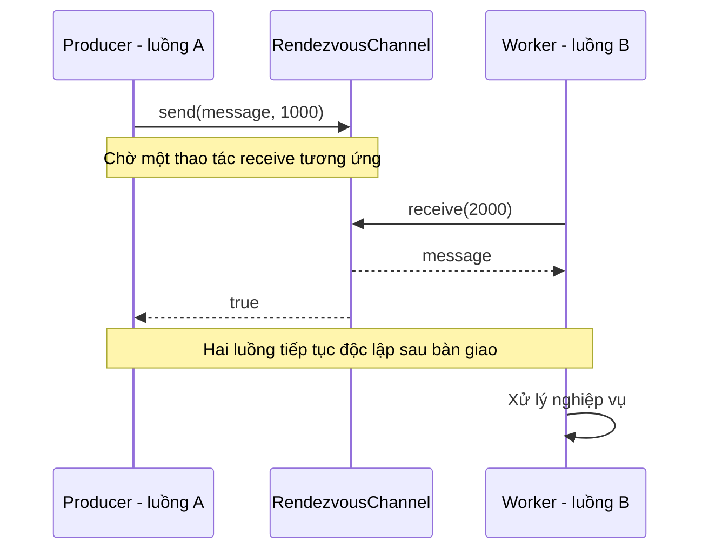

# RendezvousChannel

## 1. Mục tiêu và tình huống sử dụng

Trong chương **Kiểu channel** của module **SPRING_INTEGRATION_CORE**, bài này tập trung vào việc bàn giao một `Message` giữa hai luồng bằng `RendezvousChannel`. Sau khi học, bạn có thể lựa chọn channel này, cấu hình endpoint nhận bằng Java DSL, phân biệt timeout bàn giao với timeout phản hồi và kiểm thử hành vi chờ mà không dựa vào `Thread.sleep()`.

Giả sử một ứng dụng tiếp nhận yêu cầu kiểm tra đơn hàng. Bộ phận tiếp nhận chỉ muốn báo “đã bàn giao” khi thực sự có worker nhận yêu cầu. Nếu chưa có worker, ứng dụng được phép chờ trong một khoảng ngắn rồi từ chối tiếp nhận. Việc đặt yêu cầu vào bộ đệm và trả về ngay không thể hiện đúng điều kiện đó.

`RendezvousChannel` phù hợp với điểm bàn giao này: bên gửi và bên nhận phải gặp nhau để chuyển thông điệp. Tuy nhiên, “worker đã nhận” và “đơn hàng đã được kiểm tra xong” vẫn là hai mốc riêng biệt. Nghiệp vụ cần kết quả cuối cùng phải bổ sung phản hồi hoặc một cơ chế theo dõi trạng thái.

## 2. Mô hình hoạt động

### 2.1. Channel có sức chứa bằng không

`RendezvousChannel` kế thừa `QueueChannel`, triển khai hợp đồng `PollableChannel` và sử dụng `SynchronousQueue` bên trong. Channel không có bộ đệm để giữ thông điệp chờ người nhận. Đặc điểm cấu trúc này được mô tả trong [Javadoc của RendezvousChannel](https://docs.spring.io/spring-integration/api/org/springframework/integration/channel/RendezvousChannel.html).

Các thao tác quan trọng là:

```java
boolean send(Message<?> message);
boolean send(Message<?> message, long timeout);
Message<?> receive();
Message<?> receive(long timeout);
```

Một lần bàn giao ghép một thao tác gửi với một thao tác nhận. Nếu có nhiều consumer cùng nhận, một thông điệp chỉ được trao cho một consumer; channel không phát bản sao tới mọi consumer.

Không tạo channel này bằng `new QueueChannel(0)`: constructor nhận capacity của `QueueChannel` yêu cầu số dương. Hãy dùng `new RendezvousChannel()`. [Mã nguồn QueueChannel](https://raw.githubusercontent.com/spring-projects/spring-integration/main/spring-integration-core/src/main/java/org/springframework/integration/channel/QueueChannel.java) thể hiện điều kiện này.

### 2.2. Hai thứ tự gặp nhau đều hợp lệ

Khi bên gửi đến trước, `send()` chờ đến khi một luồng khác nhận. Khi bên nhận đến trước, `receive()` chờ đến khi một luồng khác gửi. Bên đến sau hoàn tất cuộc gặp nếu thời hạn chờ của bên đến trước chưa hết.



Sơ đồ diễn tả quan hệ bàn giao; thứ tự chạy thực tế của hai luồng sau cuộc gặp phụ thuộc bộ lập lịch. Không suy ra rằng câu lệnh ngay sau `receive()` luôn chạy trước câu lệnh ngay sau `send()`.

### 2.3. Đồng bộ bàn giao và thực thi nghiệp vụ

Trong thiết kế này, hai luồng phối hợp tại thời điểm chuyển thông điệp. Channel không tự tạo worker, không tự gọi hàm nghiệp vụ và không đợi worker xử lý xong.

Có thể đặt tên các mốc trong ví dụ đơn hàng như sau:

| Mốc | Bằng chứng trong ứng dụng | Ý nghĩa với nghiệp vụ |
| --- | --- | --- |
| Gửi yêu cầu | Producer bắt đầu gọi `send()` | Đang thử bàn giao |
| Bàn giao | `send()` trả `true`, consumer nhận được message | Đã có bên nhận |
| Hoàn tất xử lý | Worker lưu kết quả hoặc tạo reply | Đã có kết quả nghiệp vụ |
| Hoàn tất bền vững | Giao dịch cần thiết đã commit | Kết quả đã được lưu theo thiết kế |

Đây là cách phân tích trách nhiệm của ứng dụng từ cơ chế handoff, không phải bốn trạng thái mà channel tự quản lý. Chẳng hạn worker có thể nhận yêu cầu rồi gặp lỗi khi ghi cơ sở dữ liệu; lần bàn giao trước đó vẫn đã xảy ra.

## 3. Timeout và giá trị trả về

### 3.1. Hợp đồng gọi trực tiếp

Timeout trong các phương thức bên dưới được tính bằng **mili giây**.

| Lời gọi | Khi chưa có thao tác đối ứng | Kết quả thông thường |
| --- | --- | --- |
| `send(message)` | Chờ không giới hạn | `true` khi bàn giao được |
| `send(message, 1000)` | Chờ tối đa khoảng 1.000 ms cho bàn giao | `true` nếu thành công, `false` nếu hết hạn |
| `send(message, 0)` | Thử ngay, không chờ | `false` nếu không ghép được với bên nhận |
| `receive()` | Chờ không giới hạn | Message được bàn giao |
| `receive(1000)` | Chờ tối đa khoảng 1.000 ms cho thông điệp | Message hoặc `null` nếu hết hạn |
| `receive(0)` | Thử ngay, không chờ | Message nếu ghép được với bên gửi, nếu không là `null` |

Giá trị âm biểu thị chờ không giới hạn trong cơ chế thực thi này. Không dùng timeout âm như một cách từ chối chờ. Hành vi chờ của các channel được trình bày trong [Message Channel Implementations](https://docs.spring.io/spring-integration/reference/channel/implementations.html).

Các kết quả trên giả định channel không có interceptor làm thay đổi luồng gửi/nhận và không có lỗi hạ tầng khác. `false` hoặc `null` cũng có thể liên quan đến interrupt, không riêng timeout. [Hợp đồng MessageChannel và PollableChannel](https://docs.spring.io/spring-integration/reference/channel/interfaces.html) giải thích hai trường hợp này.

Ở tầng hàng đợi của `RendezvousChannel`, khi thao tác chờ bị interrupt, implementation khôi phục cờ interrupt và trả `false` cho gửi hoặc `null` cho nhận. Vì vậy, vòng lặp worker phải kiểm tra `Thread.currentThread().isInterrupted()` và dừng phù hợp; không được tự động gửi lại vô hạn mỗi khi thấy `false`.

### 3.2. Ba thời hạn cần tách riêng

Trong một luồng request–reply, có ít nhất ba câu hỏi khác nhau:

1. **Send timeout:** producer chấp nhận đợi bao lâu để worker nhận request?
2. **Reply timeout:** caller chấp nhận đợi bao lâu để có phản hồi?
3. **Timeout thao tác nghiệp vụ:** worker được phép gọi HTTP, truy vấn cơ sở dữ liệu hoặc làm công việc khác trong bao lâu?

Ví dụ, producer có thể dành 500 ms để bàn giao và 2.000 ms để nhận reply. Hai lần chờ này diễn ra nối tiếp; chúng không tự tạo một deadline tổng cộng 2.000 ms. Một lời gọi HTTP của worker cũng không bị hủy chỉ vì caller đã ngừng chờ reply.

Nếu ứng dụng có deadline tổng, có thể truyền thời điểm hết hạn qua header nghiệp vụ, tính phần thời gian còn lại trước từng bước, rồi cấu hình timeout tương ứng. Đây là lựa chọn thiết kế của ứng dụng; channel không tự áp đặt deadline cho toàn luồng.

## 4. Ví dụ Java: bàn giao giữa hai luồng

Ví dụ độc lập dưới đây cần `spring-integration-core` trong classpath. Khi dùng Spring Boot, có thể đưa `spring-boot-starter-integration` vào dự án và để BOM của dự án quản lý phiên bản. Các ví dụ dùng cú pháp Java 17 trở lên; phiên bản Spring Integration thực tế vẫn phải tương thích với JDK của dự án.

```java
import java.util.concurrent.ExecutorService;
import java.util.concurrent.Executors;
import java.util.concurrent.Future;
import java.util.concurrent.TimeUnit;

import org.springframework.integration.channel.RendezvousChannel;
import org.springframework.messaging.Message;
import org.springframework.messaging.support.MessageBuilder;

public class RendezvousHandoffDemo {

    public static void main(String[] args) throws Exception {
        RendezvousChannel channel = new RendezvousChannel();
        ExecutorService workers = Executors.newSingleThreadExecutor();

        try {
            Future<Message<?>> received = workers.submit(
                    () -> channel.receive(2000));

            Message<String> request = MessageBuilder
                    .withPayload("Kiểm tra đơn ORD-42")
                    .setHeader("orderId", "ORD-42")
                    .build();

            boolean handedOff = channel.send(request, 1000);
            if (!handedOff) {
                throw new IllegalStateException("Không bàn giao được yêu cầu");
            }

            Message<?> actual = received.get(3, TimeUnit.SECONDS);
            if (actual == null) {
                throw new IllegalStateException("Worker không nhận được yêu cầu");
            }

            System.out.println(actual.getPayload());
            System.out.println(actual.getHeaders().get("orderId"));
        }
        finally {
            workers.shutdownNow();
        }
    }
}
```

Luồng chính là producer; luồng trong executor gọi `receive()`. Nếu worker chưa bắt đầu nhận khi producer gửi, producer chờ trong giới hạn đã đặt. Nếu worker nhận trước, worker chờ producer. Ví dụ không cần đoán luồng nào sẽ chạy trước.

`Future.get()` ở đây giúp chương trình minh họa thu kết quả của tác vụ worker. Nó không phải tính năng chờ xử lý mà `send()` cung cấp. Khi thay tác vụ nhận bằng một hàm xử lý đơn hàng thực sự, cần quyết định rõ caller có chờ kết quả hàm đó hay chỉ chờ bàn giao.

## 5. Đối chiếu với các channel thường gặp

| Channel | Bộ đệm trong channel | Cách tiếp nhận | Ý nghĩa thường gặp của gửi thành công |
| --- | --- | --- | --- |
| `DirectChannel` | Không | Dispatch trực tiếp tới một subscriber trên luồng gửi | Handler được gọi trong call stack của producer và trả về bình thường |
| `QueueChannel` | Có, tùy capacity | Consumer gọi `receive()` | Message đã được đưa vào queue |
| `RendezvousChannel` | Không | Consumer gọi `receive()` để ghép với gửi | Message đã được bàn giao cho bên nhận |
| `ExecutorChannel` | Không có bộ đệm thông điệp riêng như `QueueChannel`; executor có thể có queue tác vụ | Dispatch qua executor | Thường là tác vụ đã được executor chấp nhận; còn phụ thuộc chính sách executor |

Ngay cả khi `DirectChannel` gọi handler trên luồng gửi, không nên suy ra mọi tác vụ bất đồng bộ mà handler tự khởi tạo đều đã hoàn tất. Bảng so sánh chỉ mô tả điểm chuyển giao của từng cơ chế. Các triển khai được giới thiệu trong [tài liệu các loại MessageChannel](https://docs.spring.io/spring-integration/reference/7.0/channel/implementations.html).

Một cách chọn cho bài toán đơn hàng:

- Dùng `DirectChannel` nếu chuỗi xử lý cần tiếp tục trên luồng gọi và không cần điểm hẹn giữa hai luồng.
- Dùng queue có capacity phù hợp nếu muốn hấp thụ một đợt tăng tải ngắn.
- Dùng `RendezvousChannel` nếu điều kiện chấp nhận là có consumer nhận request trong thời hạn cho phép.
- Dùng broker và cơ chế lưu bền vững khi yêu cầu phải tồn tại qua việc tiến trình dừng hoặc cần phân phối qua nhiều dịch vụ.

Các lựa chọn này dựa trên yêu cầu cụ thể của ví dụ. Một hệ thống có thể kết hợp chúng ở các đoạn khác nhau của cùng luồng tích hợp.

## 6. Cấu hình Java DSL với polling endpoint

### 6.1. Channel và endpoint là hai thành phần riêng

Khai báo bean `RendezvousChannel` không tạo ra consumer. Trong Spring Integration, endpoint tiêu thụ một `PollableChannel` cần poller, hoặc ứng dụng phải tự có luồng gọi `receive()`.

Cấu hình sau nhận chuỗi từ `workRequests`, xử lý bằng handler, rồi đưa kết quả vào `workResults` để chương trình minh họa lấy ra. Nó chỉ cần Spring Integration Core và cấu hình Spring Java thông thường.

```java
import java.time.Duration;

import org.springframework.context.annotation.Bean;
import org.springframework.context.annotation.Configuration;
import org.springframework.integration.channel.QueueChannel;
import org.springframework.integration.channel.RendezvousChannel;
import org.springframework.integration.config.EnableIntegration;
import org.springframework.integration.dsl.IntegrationFlow;
import org.springframework.integration.dsl.Pollers;

@Configuration
@EnableIntegration
public class RendezvousFlowConfig {

    @Bean
    public RendezvousChannel workRequests() {
        return new RendezvousChannel();
    }

    @Bean
    public QueueChannel workResults() {
        return new QueueChannel(10);
    }

    @Bean
    public IntegrationFlow workFlow(
            RendezvousChannel workRequests,
            QueueChannel workResults) {

        return IntegrationFlow.from(workRequests)
                .handle(String.class,
                        (payload, headers) -> "Đã kiểm tra: " + payload,
                        endpoint -> endpoint.poller(
                                Pollers.fixedDelay(Duration.ofMillis(50))
                                        .receiveTimeout(200)
                                        .maxMessagesPerPoll(1)))
                .channel(workResults)
                .get();
    }
}
```

Sau khi application context khởi động, có thể gọi minh họa như sau. Đoạn này đặt trong một hàm có hai channel đã được inject:

```java
Message<String> message = MessageBuilder
        .withPayload("ORD-42")
        .build();

if (!workRequests.send(message, 1000)) {
    throw new IllegalStateException("Chưa có worker nhận yêu cầu");
}

Message<?> result = workResults.receive(2000);
if (result == null) {
    throw new IllegalStateException("Chưa có kết quả trong thời hạn");
}
System.out.println(result.getPayload());
```

Đoạn gọi cần import `Message` và `MessageBuilder` như ví dụ trước. Queue kết quả chỉ phục vụ quan sát trong ví dụ đơn lẻ; phải có bên lấy kết quả để tránh đầy queue. Khi nhiều caller chạy đồng thời, một queue kết quả dùng chung và một lần `receive()` tùy ý chưa đủ để bảo đảm mỗi caller nhận đúng kết quả của mình. Khi đó cần correlation hoặc gateway với reply channel theo từng lời gọi.

### 6.2. Ý nghĩa cấu hình poller

`fixedDelay(50 ms)` đặt khoảng nghỉ sau khi một lượt poll hoàn tất. `receiveTimeout(200)` cho phép lượt nhận chờ message trong 200 ms; con số này không giới hạn thời gian xử lý handler. `maxMessagesPerPoll(1)` giới hạn mỗi lượt lấy tối đa một message.

Thời gian thực tế giữa hai cơ hội bàn giao còn chịu ảnh hưởng của thời gian xử lý handler và tải scheduler. Không xem chu kỳ 50 ms là cam kết rằng request luôn được nhận trong 50 ms. API cấu hình được mô tả trong [Pollers](https://docs.spring.io/spring-integration/reference/dsl/java-pollers.html) và [Javadoc PollerSpec](https://docs.spring.io/spring-integration/api/org/springframework/integration/dsl/PollerSpec.html).

Nếu tất cả thread của scheduler đều bận chờ hoặc xử lý công việc dài, endpoint không thể nhận kịp. Với thiết kế cần nhận liên tục, hãy dành tài nguyên thực thi phù hợp và giới hạn số tác vụ thay vì chỉ tăng timeout.

### 6.3. Builder của Java DSL

Java DSL cũng cung cấp `MessageChannels.rendezvous()` và `MessageChannels.rendezvous("handoff")`. Có thể dùng builder tại vị trí `.channel(...)` trong một flow; endpoint đứng sau channel đó vẫn cần poller nếu nó tiêu thụ thông điệp từ channel này. Xem [Javadoc MessageChannels](https://docs.spring.io/spring-integration/api/org/springframework/integration/dsl/MessageChannels.html).

```java
// Một đoạn ghép vào IntegrationFlowBuilder, không phải cấu hình độc lập.
.channel(MessageChannels.rendezvous("handoff"))
.handle(String.class,
        (payload, headers) -> payload.trim(),
        endpoint -> endpoint.poller(
                Pollers.fixedDelay(Duration.ofMillis(50))
                        .receiveTimeout(200)
                        .maxMessagesPerPoll(1)))
```

Đoạn này cần import `org.springframework.integration.dsl.MessageChannels`. Không khai báo thêm một bean khác cùng tên `handoff` khi đã để flow đăng ký channel bằng builder đó.

## 7. Request–reply bằng reply channel tạm

Một ứng dụng có thể tạo một `RendezvousChannel` riêng cho từng request, đặt nó vào header `replyChannel`, gửi request rồi chờ phản hồi. Tài liệu chính thức trình bày đây là một ứng dụng của rendezvous trong [phần RendezvousChannel](https://www.springframework.org/spring-integration/reference/6.3/channel/implementations.html#rendezvouschannel).

Ví dụ dưới đây thể hiện đủ cả caller và worker. Channel request cũng là rendezvous nên worker phải chạy trên luồng riêng.

```java
import java.util.concurrent.ExecutorService;
import java.util.concurrent.Executors;
import java.util.concurrent.Future;
import java.util.concurrent.TimeUnit;

import org.springframework.integration.channel.RendezvousChannel;
import org.springframework.messaging.Message;
import org.springframework.messaging.MessageChannel;
import org.springframework.messaging.support.MessageBuilder;

public class RendezvousRequestReplyDemo {

    public static void main(String[] args) throws Exception {
        RendezvousChannel requests = new RendezvousChannel();
        RendezvousChannel replies = new RendezvousChannel();
        ExecutorService workers = Executors.newSingleThreadExecutor();

        try {
            Future<?> worker = workers.submit(() -> {
                Message<?> request = requests.receive(3000);
                if (request == null) {
                    throw new IllegalStateException("Không nhận được request");
                }

                Object target = request.getHeaders().getReplyChannel();
                if (!(target instanceof MessageChannel replyChannel)) {
                    throw new IllegalArgumentException("Thiếu replyChannel");
                }

                Message<String> reply = MessageBuilder
                        .withPayload("ACCEPTED: " + request.getPayload())
                        .setHeader("orderId", request.getHeaders().get("orderId"))
                        .build();

                if (!replyChannel.send(reply, 2000)) {
                    throw new IllegalStateException("Không bàn giao được reply");
                }
            });

            Message<String> request = MessageBuilder
                    .withPayload("ORD-42")
                    .setHeader("orderId", "ORD-42")
                    .setReplyChannel(replies)
                    .build();

            if (!requests.send(request, 1000)) {
                throw new IllegalStateException("Không bàn giao được request");
            }

            Message<?> reply = replies.receive(2000);
            if (reply == null) {
                throw new IllegalStateException("Hết thời gian chờ reply");
            }

            System.out.println(reply.getPayload());
            worker.get(3, TimeUnit.SECONDS);
        }
        finally {
            workers.shutdownNow();
        }
    }
}
```

Trong ví dụ này, header giữ tham chiếu tới channel ngay trong JVM. Đây không phải một địa chỉ mạng hoặc cấu hình có thể tự mang sang tiến trình khác. Mỗi lời gọi đồng thời cần reply channel riêng hoặc chiến lược tương quan tương đương.

Nếu caller đã hết thời gian nhận reply, worker vẫn có thể tiếp tục xử lý. Lệnh gửi reply cũng cần timeout để worker không chờ mãi một caller đã rời đi. Ứng dụng phải quyết định cách ghi nhận kết quả muộn và cách chống thực hiện lặp khi caller thử lại.

### Dùng gateway trong ứng dụng

`@MessagingGateway` hoặc `MessagingTemplate` giúp đóng gói giao thức gửi và nhận, giảm việc tự quản lý reply channel. Gateway thông thường tự tạo reply channel tạm khi không cấu hình reply channel cố định; không nên đồng nhất implementation nội bộ đó với bean `RendezvousChannel` trong mọi trường hợp. Xem [Messaging Gateways](https://docs.spring.io/spring-integration/reference/gateway.html).

Khi chuyển flow ở mục 6 sang trả kết quả cho gateway, cần bỏ `.channel(workResults)` để handler có thể trả theo header `replyChannel`, đồng thời cấu hình phát hiện gateway và các timeout phù hợp. Nếu vẫn chuyển kết quả vào queue `workResults`, caller đang chờ trên reply channel tạm có thể hết hạn dù handler đã tạo kết quả.

## 8. Backpressure, tài nguyên và giới hạn

### 8.1. Không có bộ đệm không có nghĩa không tốn bộ nhớ

Producer không thể gửi vượt qua điểm hẹn khi không có bên nhận. Đó là một cơ chế tạo áp lực ngược: producer phải chờ hoặc xử lý kết quả không bàn giao được.

Tuy nhiên, mỗi producer đang chờ vẫn có thể giữ message, stack, connection hoặc dữ liệu trong phạm vi lời gọi của nó. Nếu tầng HTTP cho phép hàng nghìn request cùng chờ, việc channel không có bộ đệm chưa giải quyết được vấn đề tài nguyên.

Trong ví dụ đơn hàng, có thể kết hợp một timeout bàn giao ngắn với giới hạn số request đang xử lý. Khi không bàn giao được, tầng tiếp nhận trả kết quả bận theo giao thức của ứng dụng. Không nên tự động tạo thêm thread không giới hạn để né việc chờ.

### 8.2. Không áp đặt thứ tự FIFO cho nhiều producer

`SynchronousQueue` mặc định không bảo đảm thứ tự công bằng giữa các thread đang chờ. `RendezvousChannel` sử dụng constructor mặc định đó, theo [mã nguồn RendezvousChannel](https://raw.githubusercontent.com/spring-projects/spring-integration/main/spring-integration-core/src/main/java/org/springframework/integration/channel/RendezvousChannel.java). Không hứa rằng producer đến trước chắc chắn được phục vụ trước.

Sức chứa, quy tắc công bằng và cách quan sát một `SynchronousQueue` được mô tả trong [Javadoc Java SE](https://docs.oracle.com/en/java/javase/21/docs/api/java.base/java/util/concurrent/SynchronousQueue.html). Nếu nghiệp vụ cần thứ tự theo khách hàng hoặc theo đơn hàng, hãy thiết kế thứ tự đó một cách rõ ràng.

### 8.3. Số liệu hàng đợi chưa thể hiện tải

`SynchronousQueue` không tích trữ phần tử như queue thông thường; nhìn kích thước bằng 0 không cho biết hệ thống có bao nhiêu producer đang chờ. Với bài toán này, nên theo dõi các tín hiệu ứng dụng:

- Thời gian chờ và tỷ lệ bàn giao thành công của `send()`.
- Số lời gọi đang chờ bàn giao và mức sử dụng executor/scheduler.
- Số lần không nhận được reply trong thời hạn.
- Thời gian xử lý của worker và số lỗi nghiệp vụ.

Những phép đo này giúp phân biệt “không có tải”, “không có consumer” và “consumer xử lý quá chậm”, dù cả ba tình trạng có thể cùng cho thấy queue size bằng 0.

## 9. Deadlock và thread starvation

### 9.1. Gửi rồi nhận trên cùng một luồng

Đoạn sau không tạo được cuộc gặp nếu không có consumer nào khác:

```java
RendezvousChannel channel = new RendezvousChannel();

channel.send(MessageBuilder.withPayload("ORD-42").build());
Message<?> next = channel.receive();
```

Luồng bị chặn ở `send()` nên không đến được `receive()`. Thêm timeout chỉ biến tình trạng chờ vô hạn thành một lần gửi thất bại; nó không tạo ra consumer còn thiếu. Cần có luồng nhận độc lập hoặc đổi cách tổ chức luồng xử lý.

### 9.2. Producer và consumer cùng phụ thuộc executor một thread

Giả sử một executor có duy nhất một thread chạy tác vụ producer trước. Producer gọi `send()` và chờ. Tác vụ consumer nằm trong queue của chính executor đó nên chưa thể chạy. Hai tác vụ cần tài nguyên mà bên còn lại đang giữ hoặc chờ được cấp.

Cách khắc phục phụ thuộc kiến trúc: dành luồng cho consumer, tách tài nguyên của producer và consumer hoặc giới hạn công việc sao cho consumer luôn có cơ hội chạy. Tăng số thread có thể giảm nguy cơ nhưng không thay thế việc phân tích các quan hệ chờ.

### 9.3. Reply rendezvous trong call stack đồng bộ

Một trường hợp tinh vi hơn là gửi request qua `DirectChannel`, handler chạy ngay trên luồng caller rồi gọi `replyChannel.send(reply)` vào một rendezvous channel. Caller dự định gọi `replyChannel.receive()` sau khi gửi request xong, nhưng lời gọi gửi request chưa thể trả về vì handler đang chờ chính caller nhận reply.

Do đó, không thể tùy tiện thay một reply channel của luồng đồng bộ bằng `RendezvousChannel`. Ví dụ request–reply ở mục 7 tránh vòng chờ này bằng việc để worker nhận request và gửi reply trên một luồng riêng. Với ứng dụng dùng gateway, nên dùng cơ chế reply mà gateway cung cấp và kiểm tra toàn bộ đường thực thi trước khi tùy biến.

## 10. Xử lý lỗi và ranh giới giao dịch

### 10.1. Phân loại lỗi theo vị trí

| Tình huống | Producer thường quan sát gì? | Trách nhiệm cần thiết kế |
| --- | --- | --- |
| Không có worker nhận kịp | `send(message, timeout)` trả `false` | Từ chối, thử lại có giới hạn hoặc chuyển hướng |
| Worker nhận rồi xử lý lỗi | Lần gửi có thể đã trả `true` | Báo lỗi qua cơ chế riêng, lưu trạng thái hoặc xử lý lỗi ở endpoint |
| Caller không nhận được reply kịp | `receive(timeout)` trả `null` | Xác định trạng thái chưa rõ, xử lý kết quả muộn và retry phù hợp |
| Lỗi interceptor hoặc hạ tầng ở thao tác gửi | Có thể có exception ngay trên luồng gọi | Bắt và phân loại theo API đang dùng |

Trong endpoint do Spring Integration quản lý, lỗi tác vụ poller có thể được chuyển thành `ErrorMessage` và gửi đến error channel theo cơ chế xử lý lỗi đã cấu hình. Ngược lại, luồng tự tạo bằng `ExecutorService` ở các ví dụ không tự có cơ chế đó: chương trình phải bắt exception, xử lý `Future` hoặc chủ động phát thông báo lỗi. [Tài liệu Error Handling](https://docs.spring.io/spring-integration/reference/error-handling.html) giải thích sự khác nhau giữa lỗi trên call stack của sender và lỗi trên luồng khác.

Không mặc định `send()` trả `false` sẽ tự phát một `ErrorMessage`. Đây là kết quả cần caller kiểm tra. Tương tự, `try/catch` quanh lần gửi không thể tự bắt một exception nghiệp vụ xảy ra về sau trên worker khác.

### 10.2. Bàn giao không kéo theo giao dịch xuyên luồng

Một transaction Spring gắn với luồng producer không tự đi theo message sang luồng consumer. Tính chất chờ của rendezvous không thay đổi ranh giới này. Nếu worker cần transaction cho việc lưu đơn hàng, hãy cấu hình transaction tại phần xử lý của worker. Xem [Transaction Boundaries](https://docs.spring.io/spring-integration/reference/transactions.html#transaction-boundaries).

`RendezvousChannel` cũng không cung cấp lưu bền vững, xác nhận xử lý sau commit hoặc tự phát lại thông điệp khi worker lỗi. Trong ví dụ đơn hàng, nếu tiến trình dừng sau bàn giao nhưng trước khi lưu kết quả, channel không có bản ghi dự phòng để khôi phục công việc.

Từ đó, nếu yêu cầu là không mất công việc đã chấp nhận, cần thiết kế lưu bền vững, idempotency và ranh giới commit phù hợp. Không suy ra bảo đảm “exactly once” từ việc `send()` đã trả `true`.

## 11. Kiểm thử hành vi

### 11.1. Những điều cần chứng minh

Đối với channel này, kiểm thử có ích khi làm rõ ba hợp đồng: không giữ message nếu chưa bàn giao được, có thể bàn giao giữa hai luồng và producer không đợi toàn bộ xử lý nghiệp vụ hoàn tất.

Các ví dụ JUnit Jupiter dưới đây kiểm tra trực tiếp channel thật, không khởi động Spring context. Khi kiểm thử endpoint, routing hoặc flow lớn hơn, có thể bổ sung các tiện ích được mô tả trong [Spring Integration Testing Support](https://docs.spring.io/spring-integration/reference/testing.html).

```java
import java.util.concurrent.CountDownLatch;
import java.util.concurrent.ExecutorService;
import java.util.concurrent.Executors;
import java.util.concurrent.Future;
import java.util.concurrent.TimeUnit;
import java.util.concurrent.atomic.AtomicBoolean;

import org.junit.jupiter.api.Test;
import org.springframework.integration.channel.RendezvousChannel;
import org.springframework.messaging.Message;
import org.springframework.messaging.support.MessageBuilder;

import static org.junit.jupiter.api.Assertions.assertEquals;
import static org.junit.jupiter.api.Assertions.assertFalse;
import static org.junit.jupiter.api.Assertions.assertNotNull;
import static org.junit.jupiter.api.Assertions.assertNull;
import static org.junit.jupiter.api.Assertions.assertTrue;

class RendezvousChannelTest {

    @Test
    void failedImmediateSendDoesNotLeaveMessageBehind() {
        RendezvousChannel channel = new RendezvousChannel();
        Message<String> message = MessageBuilder.withPayload("ORD-42").build();

        assertFalse(channel.send(message, 0));
        assertNull(channel.receive(0));
    }

    @Test
    void handsMessageToAnotherThread() throws Exception {
        RendezvousChannel channel = new RendezvousChannel();
        ExecutorService workers = Executors.newSingleThreadExecutor();

        try {
            Future<Message<?>> incoming = workers.submit(
                    () -> channel.receive(5000));

            assertTrue(channel.send(
                    MessageBuilder.withPayload("ORD-42").build(), 5000));

            Message<?> received = incoming.get(2, TimeUnit.SECONDS);
            assertNotNull(received);
            assertEquals("ORD-42", received.getPayload());
        }
        finally {
            workers.shutdownNow();
        }
    }

    @Test
    void successfulSendDoesNotRequireBusinessCompletion() throws Exception {
        RendezvousChannel channel = new RendezvousChannel();
        ExecutorService workers = Executors.newSingleThreadExecutor();
        CountDownLatch received = new CountDownLatch(1);
        CountDownLatch allowCompletion = new CountDownLatch(1);
        AtomicBoolean businessCompleted = new AtomicBoolean(false);

        try {
            Future<?> worker = workers.submit(() -> {
                Message<?> message = channel.receive(5000);
                if (message == null) {
                    throw new IllegalStateException("Không nhận được message");
                }
                received.countDown();

                try {
                    if (!allowCompletion.await(5, TimeUnit.SECONDS)) {
                        throw new IllegalStateException("Không được mở chốt xử lý");
                    }
                    businessCompleted.set(true);
                }
                catch (InterruptedException ex) {
                    Thread.currentThread().interrupt();
                    throw new IllegalStateException("Worker bị interrupt", ex);
                }
            });

            assertTrue(channel.send(
                    MessageBuilder.withPayload("ORD-42").build(), 5000));
            assertTrue(received.await(2, TimeUnit.SECONDS));
            assertFalse(businessCompleted.get());

            allowCompletion.countDown();
            worker.get(2, TimeUnit.SECONDS);
            assertTrue(businessCompleted.get());
        }
        finally {
            allowCompletion.countDown();
            workers.shutdownNow();
        }
    }
}
```

Latch tạo ra quan hệ phối hợp rõ ràng: worker đã nhận nhưng bị giữ trước khi đánh dấu hoàn tất. Assertion vì thế kiểm tra đúng sự khác nhau giữa bàn giao và hoàn tất, thay vì dựa trên giả định “ngủ một lúc chắc worker chưa xong”.

Các thời hạn vài giây bảo vệ ví dụ khỏi treo vô hạn; chúng không phải mục tiêu hiệu năng. Khi bổ sung kiểm thử timeout, không nên khẳng định thời gian trôi qua chính xác từng mili giây vì còn phụ thuộc scheduler. Cũng cần luôn giải phóng latch và dừng executor trong `finally` khi assertion thất bại.

### 11.2. Mở rộng kiểm thử cho flow thực tế

Với flow của mục 6, các tình huống bổ sung có ý nghĩa là: endpoint chưa khởi động thì gửi có thời hạn thất bại; endpoint hoạt động thì tạo đúng kết quả; handler lỗi thì error flow nhận đúng lỗi; worker xử lý chậm thì producer kế tiếp chờ hoặc hết hạn theo thiết kế.

Nếu thêm filter, router hoặc aggregator vào phía sau điểm bàn giao, cần kiểm thử cả kết quả của các thành phần đó. Một message có thể đã được nhận thành công nhưng sau đó bị filter loại bỏ, chuyển sang nhánh khác hoặc còn chờ đủ nhóm trong aggregator. `send() == true` tại rendezvous không xác nhận các điều kiện phía sau đã thỏa mãn.

## 12. Thực hành với yêu cầu kiểm tra đơn hàng

Hãy mở rộng ví dụ Java DSL thành một luồng nhận yêu cầu có `orderId`, kiểm tra dữ liệu và trả kết quả. Đặt thời hạn bàn giao, thời hạn chờ kết quả và chính sách khi worker báo lỗi thành ba quyết định riêng.

1. Khởi tạo rendezvous channel ở đầu vào và một endpoint có poller giới hạn thời gian nhận.
2. Bổ sung bước kiểm tra đầu vào; nếu loại request bằng filter, xác định cách caller biết yêu cầu đã bị loại.
3. Cho hai producer gửi đồng thời, rồi quan sát việc bàn giao khi chỉ có một worker xử lý tuần tự.
4. Làm worker phát sinh lỗi sau khi nhận; xác minh producer đã gửi thành công nhưng hệ thống vẫn ghi nhận lỗi nghiệp vụ.
5. Cho caller hết hạn trước khi có kết quả; xác định cách lưu kết quả muộn và cách dùng `orderId` để tránh thực hiện trùng khi retry.

Tiêu chí hoàn thành là giải thích được trạng thái của từng yêu cầu ở cả ba thời điểm: trước bàn giao, sau bàn giao và sau xử lý. Với mỗi lần không có kết quả, phải phân biệt được chưa có worker nhận hay đã có worker nhận nhưng công việc chưa hoàn tất.

## 13. Các điểm cần ghi nhớ

- `RendezvousChannel` là điểm gặp gửi–nhận có sức chứa bằng không, dựa trên `SynchronousQueue`.
- Endpoint hoặc luồng ứng dụng phải thực sự gọi `receive()`; khai báo channel chưa tạo ra consumer.
- Gửi thành công cho biết đã bàn giao; phản hồi, kết quả nghiệp vụ và commit là trách nhiệm khác.
- Timeout bàn giao, timeout nhận reply và timeout nghiệp vụ cần được thiết kế riêng.
- Quan hệ chờ và tài nguyên thực thi quyết định nguy cơ deadlock, kể cả khi không có bộ đệm.
- Lưu bền vững, retry, xử lý lỗi và chống trùng cần cơ chế bổ sung phù hợp với yêu cầu hệ thống.
