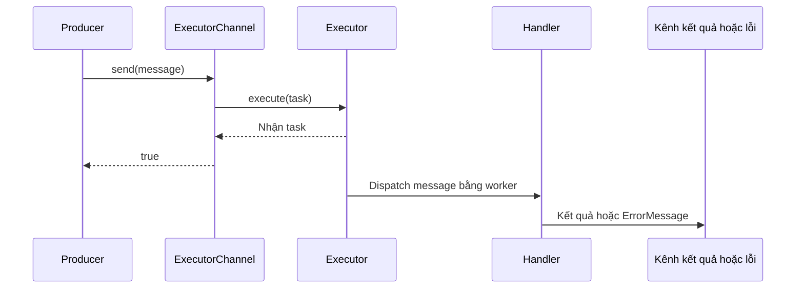

# ExecutorChannel

Trong chương **Kiểu channel** của module `SPRING_INTEGRATION_CORE`, `ExecutorChannel` giúp đặt ranh giới thực thi giữa bên gửi thông điệp và endpoint xử lý. Bài này kết nối `Message`, `MessageChannel`, endpoint và Java DSL bằng một luồng tạo báo cáo; từ đó giải thích xử lý lỗi, giới hạn tài nguyên, giao dịch và kiểm thử.

## 1. Mục tiêu và tình huống sử dụng

Sau bài học, bạn có thể:

- Giải thích cách `ExecutorChannel` giao công việc cho `Executor` và ý nghĩa của kết quả `send()`.
- Phân biệt số subscriber với số thread xử lý đồng thời.
- Cấu hình thread pool có giới hạn và lựa chọn hành vi khi quá tải.
- Nhận lỗi từ worker bằng `ErrorMessage`, thay vì chỉ bắt exception quanh lời gọi gửi.
- Nhận diện những yêu cầu về thứ tự, giao dịch và độ bền cần cơ chế bổ sung.

Giả sử một API nhận yêu cầu tạo báo cáo. Việc kiểm tra mã yêu cầu rất nhanh, nhưng truy vấn dữ liệu và kết xuất báo cáo tốn thời gian. Ta muốn kiểm tra đầu vào trên luồng gọi, sau đó giao phần kết xuất cho nhóm worker. Mỗi yêu cầu chỉ cần một worker xử lý thành công.

Đó là một ứng dụng phù hợp của `ExecutorChannel`. Tuy nhiên, việc giao công việc vào bộ nhớ của tiến trình chưa đủ để khẳng định báo cáo sẽ tồn tại sau khi ứng dụng bị dừng đột ngột. Hợp đồng API cần diễn đạt đúng mức bảo đảm của hệ thống.

## 2. Bản chất của ExecutorChannel

`org.springframework.integration.channel.ExecutorChannel` là channel kiểu **point-to-point**, triển khai `SubscribableChannel`. Endpoint đăng ký một `MessageHandler`; channel dùng dispatcher để chọn handler và giao thao tác dispatch cho một `java.util.concurrent.Executor`. Constructor yêu cầu truyền executor. [API ExecutorChannel](https://docs.spring.io/spring-integration/api/org/springframework/integration/channel/ExecutorChannel.html).

Hai hệ quả trực tiếp:

- Consumer nhận thông điệp bằng đăng ký handler; `ExecutorChannel` không có phương thức `receive()`.
- Không cần poller để tiêu thụ trực tiếp từ channel này. Thread thực thi được executor cung cấp.

Các callback `receive` chỉ dành cho `PollableChannel`, như `QueueChannel`. Điều này khác với việc executor có một work queue nội bộ để chờ chạy các `Runnable`. [Channel Interceptors](https://docs.spring.io/spring-integration/reference/channel/interceptors.html).

Cần phân biệt hai quyết định:

| Quyết định | Thành phần phụ trách | Câu hỏi được trả lời |
| --- | --- | --- |
| Chọn subscriber | Dispatcher của channel | Handler nào sẽ thử xử lý thông điệp? |
| Chọn nơi thực thi | Executor | Công việc chạy bằng thread nào và khi nào? |

Có tám thread trong executor không có nghĩa channel có tám subscriber. Một endpoint duy nhất vẫn có thể được nhiều worker gọi đồng thời cho những thông điệp khác nhau. Vì vậy, service được endpoint gọi cần hỗ trợ truy cập đồng thời.

Tên class cũng cần chính xác: bài này nói về `ExecutorChannel` của Spring Integration. Khi IDE tự thêm import cho một class tên gần giống, hãy kiểm tra package thay vì suy đoán ngữ nghĩa từ tên.

## 3. Luồng thực thi và ý nghĩa của send()

Một lần gửi thường có diễn tiến như sau:

1. Producer tạo `Message` và gọi `send()`.
2. Các interceptor của thao tác gửi chạy.
3. Channel giao task cho executor.
4. Nếu task được chấp nhận, lời gọi gửi có thể hoàn tất.
5. Executor chạy task; dispatcher chọn subscriber và gọi handler.
6. Handler tạo kết quả hoặc phát sinh lỗi.

Sơ đồ minh họa trường hợp worker xử lý sau khi producer đã nhận kết quả gửi:



Đây là một diễn tiến có thể xảy ra. Worker cũng có thể bắt đầu, thậm chí hoàn thành, trước lúc producer quan sát thấy `send()` trả về. Thiết kế phải dựa vào tín hiệu hoàn thành rõ ràng, thay vì thứ tự các dòng log giữa hai thread.

### 3.1. Gửi thành công khác với xử lý thành công

API `MessageChannel` cho phép trả `true`, trả `false` trong tình huống không gửi được do nguyên nhân không nghiêm trọng, hoặc ném runtime exception. Ý nghĩa cụ thể phụ thuộc implementation. Với đường thực thi bất đồng bộ đang xét, kết quả gửi không phải kết quả nghiệp vụ của worker. [API MessageChannel](https://docs.spring.io/spring-framework/docs/current/javadoc-api/org/springframework/messaging/MessageChannel.html).

Ví dụ, `send()` đã trả về, nhưng sau đó service kết xuất phát hiện không truy cập được kho dữ liệu. Producer cần quan sát kênh kết quả, kênh lỗi hoặc trạng thái công việc để biết kết cục.

Một rejection policy có thể âm thầm bỏ task. Khi đó lời gọi `execute()` không ném lỗi, nên kết quả gửi càng không thể dùng làm bằng chứng rằng công việc chắc chắn sẽ được chạy.

### 3.2. Có executor không đồng nghĩa luôn chạy bằng thread khác

`Executor` là một abstraction; implementation có thể chạy công việc ngay trong thread gọi. Chẳng hạn, `SyncTaskExecutor` thực thi đồng bộ. Nếu cần ngữ nghĩa đồng bộ thông thường, nên dùng `DirectChannel` để biểu đạt ý định rõ ràng. [Task Execution and Scheduling](https://docs.spring.io/spring-framework/reference/integration/scheduling.html), [API ExecutorChannel](https://docs.spring.io/spring-integration/api/org/springframework/integration/channel/ExecutorChannel.html).

Ngay cả thread pool cũng có thể chạy công việc trên thread gửi khi sử dụng `CallerRunsPolicy` và bị bão hòa. Không xây dựng logic nghiệp vụ dựa trên giả định mọi lần gửi đều tạo ra một lần chuyển thread.

## 4. So sánh với các channel thường gặp

| Channel | Cách consumer nhận | Phạm vi phân phối | Cách thực thi thường gặp |
| --- | --- | --- | --- |
| `DirectChannel` | Đăng ký handler | Một handler xử lý thành công | Trên thread gửi |
| `ExecutorChannel` | Đăng ký handler | Một handler xử lý thành công | Qua executor |
| `QueueChannel` | Gọi `receive()` | Một consumer lấy mỗi message | Do consumer hoặc poller quyết định |
| `PublishSubscribeChannel` | Đăng ký handler | Phát đến các subscriber | Đồng bộ hoặc qua executor tùy cấu hình |

`QueueChannel` là nơi đệm các message có API nhận; `PublishSubscribeChannel` diễn đạt nhu cầu broadcast. Thread pool phía sau `ExecutorChannel` phục vụ lịch thực thi task. Những lựa chọn này trả lời các nhu cầu khác nhau. [Message Channel Implementations](https://docs.spring.io/spring-integration/reference/channel/implementations.html).

Một ví dụ lựa chọn theo yêu cầu:

- Tính tổng tiền rồi trả kết quả ngay trong cùng lời gọi: cân nhắc `DirectChannel`.
- Kết xuất báo cáo bằng nhóm worker trong cùng ứng dụng: cân nhắc `ExecutorChannel`.
- Đệm yêu cầu để consumer chủ động lấy theo nhịp: cân nhắc `QueueChannel`.
- Gửi sự kiện hoàn tất đến cả thông báo và thống kê: cân nhắc `PublishSubscribeChannel`.

Việc cần xử lý nền và việc cần broadcast là hai yêu cầu độc lập. Có thể kết hợp chúng tại những vị trí khác nhau trong một flow.

## 5. Ví dụ hoàn chỉnh bằng Java configuration và Java DSL

### 5.1. Phạm vi ví dụ

Ví dụ dùng Java 17 trở lên với API của Spring Integration 6.x. Cần `spring-integration-core` cùng các dependency Spring tương thích; nên để BOM của dự án quản lý phiên bản. Mã kiểm thử bên dưới dùng JUnit Jupiter.

Luồng gồm:

```text
reportRequests [DirectChannel]
  -> filter kiểm tra requestId
  -> đặt header errorChannel
  -> reportWorkers [ExecutorChannel]
  -> transformer mô phỏng kết xuất
  -> reportResults [QueueChannel]

Lỗi phát sinh khi worker xử lý
  -> reportFailures [QueueChannel]
```

Hai `QueueChannel` cuối là nơi thu kết quả để quan sát trong bài thực hành. Ví dụ không tạo file CSV thật, không truy cập cơ sở dữ liệu và không triển khai HTTP API.

### 5.2. Cấu hình

Đặt class sau trong package `example.integration`:

```java
package example.integration;

import java.util.concurrent.ThreadPoolExecutor;

import org.springframework.beans.factory.annotation.Qualifier;
import org.springframework.context.annotation.Bean;
import org.springframework.context.annotation.Configuration;
import org.springframework.integration.channel.DirectChannel;
import org.springframework.integration.channel.ExecutorChannel;
import org.springframework.integration.channel.QueueChannel;
import org.springframework.integration.config.EnableIntegration;
import org.springframework.integration.dsl.IntegrationFlow;
import org.springframework.messaging.MessageHeaders;
import org.springframework.scheduling.concurrent.ThreadPoolTaskExecutor;

@Configuration(proxyBeanMethods = false)
@EnableIntegration
public class ReportFlowConfig {

    public record ReportRequest(String requestId, String customerId) {
    }

    public record ReportReady(
            String requestId,
            String outputPath,
            String workerThread) {
    }

    @Bean
    public DirectChannel reportRequests() {
        return new DirectChannel();
    }

    @Bean
    public ThreadPoolTaskExecutor reportExecutor() {
        ThreadPoolTaskExecutor executor = new ThreadPoolTaskExecutor();
        executor.setCorePoolSize(4);
        executor.setMaxPoolSize(8);
        executor.setQueueCapacity(100);
        executor.setThreadNamePrefix("report-worker-");
        executor.setRejectedExecutionHandler(
                new ThreadPoolExecutor.AbortPolicy());
        executor.setWaitForTasksToCompleteOnShutdown(true);
        executor.setAwaitTerminationSeconds(15);
        return executor;
    }

    @Bean
    public ExecutorChannel reportWorkers(
            @Qualifier("reportExecutor")
            ThreadPoolTaskExecutor executor) {

        ExecutorChannel channel = new ExecutorChannel(executor);
        channel.setFailover(false);
        return channel;
    }

    @Bean
    public QueueChannel reportResults() {
        return new QueueChannel();
    }

    @Bean
    public QueueChannel reportFailures() {
        return new QueueChannel();
    }

    @Bean
    public IntegrationFlow reportIngressFlow() {
        return IntegrationFlow.from("reportRequests")
                .filter(
                        ReportRequest.class,
                        request -> request.requestId() != null
                                && !request.requestId().isBlank(),
                        filter -> filter.throwExceptionOnRejection(true))
                .enrichHeaders(headers -> headers.header(
                        MessageHeaders.ERROR_CHANNEL,
                        "reportFailures"))
                .channel("reportWorkers")
                .get();
    }

    @Bean
    public IntegrationFlow reportWorkerFlow() {
        return IntegrationFlow.from("reportWorkers")
                .transform(ReportRequest.class, request -> {
                    if ("FAIL".equals(request.requestId())) {
                        throw new IllegalStateException(
                                "Không thể kết xuất báo cáo");
                    }

                    return new ReportReady(
                            request.requestId(),
                            "reports/" + request.requestId() + ".csv",
                            Thread.currentThread().getName());
                })
                .channel("reportResults")
                .get();
    }
}
```

Spring quản lý vòng đời executor bean và khởi tạo nó. Không cần gọi `initialize()` thủ công trong phương thức `@Bean` này. Các thuộc tính `corePoolSize`, `maxPoolSize`, `queueCapacity`, tên thread và số thread hoạt động là những điểm cấu hình hoặc quan sát của `ThreadPoolTaskExecutor`. [API ThreadPoolTaskExecutor](https://docs.spring.io/spring-framework/docs/current/javadoc-api/org/springframework/scheduling/concurrent/ThreadPoolTaskExecutor.html).

Các channel được khai báo thành bean để chia sẻ bằng tên giữa các flow. Java DSL nối endpoint với channel và mặc định dùng `DirectChannel` ở những chỗ cần tạo liên kết thông thường. Vì vậy, filter và header enricher trước `reportWorkers` vẫn chạy trên thread gửi. [Java DSL: Message Channels](https://docs.spring.io/spring-integration/reference/dsl/java-channels.html).

Hai queue thu kết quả dùng constructor mặc định để thuận tiện cho một lượng nhỏ dữ liệu thực hành. Nếu biến chúng thành điểm đệm vận hành lâu dài, cần thiết kế capacity, consumer, timeout và chính sách khi đầy; việc không drain queue sẽ giữ message trong bộ nhớ.

### 5.3. Chạy một yêu cầu và chờ kết quả

Đặt class sau cùng package với cấu hình:

```java
package example.integration;

import example.integration.ReportFlowConfig.ReportRequest;

import org.springframework.context.annotation.AnnotationConfigApplicationContext;
import org.springframework.integration.channel.QueueChannel;
import org.springframework.messaging.Message;
import org.springframework.messaging.MessageChannel;
import org.springframework.messaging.support.MessageBuilder;

public class ReportDemo {

    public static void main(String[] args) {
        try (var context =
                new AnnotationConfigApplicationContext(
                        ReportFlowConfig.class)) {

            MessageChannel requests = context.getBean(
                    "reportRequests", MessageChannel.class);
            QueueChannel results = context.getBean(
                    "reportResults", QueueChannel.class);

            boolean sent = requests.send(
                    MessageBuilder.withPayload(
                            new ReportRequest("R-1001", "C-42"))
                            .build());

            System.out.println("Đã gửi: " + sent);
            System.out.println("Thread gọi: "
                    + Thread.currentThread().getName());

            Message<?> result = results.receive(3000);
            if (result == null) {
                throw new IllegalStateException(
                        "Chưa nhận được kết quả trong 3 giây");
            }

            System.out.println(result.getPayload());
        }
    }
}
```

Thuộc tính `workerThread` trong kết quả có tiền tố `report-worker-`. Đây là bằng chứng về nơi chạy transformer trong ví dụ. Timeout của `results.receive(3000)` chỉ giới hạn thời gian chờ của đoạn demo; nó không tự hủy công việc đang chạy.

Thay mã yêu cầu thành `FAIL` để quan sát nhánh lỗi. Khi đó cần nhận từ `reportFailures`, vì ví dụ không sinh `ReportReady` cho yêu cầu thất bại.

### 5.4. Cách khai báo channel ngay trong DSL

Trong một flow độc lập, có thể dùng builder thay cho bean channel riêng:

```java
// Đoạn thay thế minh họa, cần import
// org.springframework.integration.dsl.MessageChannels
return IntegrationFlow.from("standaloneReportRequests")
        .channel(MessageChannels.executor(
                "standaloneReportWorkers", executor)
                .failover(false))
        .handle(message -> {
            System.out.println(
                    Thread.currentThread().getName()
                            + ": " + message.getPayload());
        })
        .get();
```

`executor` ở đây là tham số executor bean được inject vào phương thức tạo flow. `MessageChannels.executor(...)` trả về một `ExecutorChannelSpec`; spec hỗ trợ đặt hành vi failover. [API MessageChannels](https://docs.spring.io/spring-integration/api/org/springframework/integration/dsl/MessageChannels.html), [API ExecutorChannelSpec](https://docs.spring.io/spring-integration/api/org/springframework/integration/dsl/ExecutorChannelSpec.html).

Nếu nhiều flow cần cùng một channel, khai báo bean riêng như ví dụ chính giúp nhận diện đối tượng được chia sẻ. Không tạo các channel độc lập có cùng tên và kỳ vọng chúng tự hợp nhất.

## 6. Thread pool, work queue và quá tải

### 6.1. Pool tăng thread theo điều kiện nào?

Với `ThreadPoolExecutor`, mô hình thông thường là:

1. Khi số worker nhỏ hơn `corePoolSize`, tạo worker để nhận task.
2. Khi đã đủ core worker, ưu tiên đưa task vào queue.
3. Khi queue không nhận thêm và chưa đạt `maxPoolSize`, tạo thêm worker.
4. Khi cả queue và giới hạn worker đều hết khả năng nhận, áp dụng rejection policy.

Do đó, tăng `maxPoolSize` không làm pool lập tức tăng concurrency khi queue vẫn còn chỗ. [API ThreadPoolExecutor](https://docs.oracle.com/en/java/javase/17/docs/api/java.base/java/util/concurrent/ThreadPoolExecutor.html).

Với cấu hình `core=4, max=8, queue=100`, giả sử mọi task đều đang bị giữ lại và chưa task nào hoàn thành:

| Nhóm task gửi vào | Diễn biến dự kiến |
| --- | --- |
| 1–4 | Chạy bằng bốn core worker |
| 5–104 | Chờ trong work queue |
| 105–108 | Tạo thêm worker, tổng cộng tối đa tám |
| 109 | Bị từ chối với cấu hình `AbortPolicy` |

Đây là suy luận từ cấu hình trong điều kiện giả định trên. Khi worker hoàn thành xen kẽ với thao tác gửi, số thứ tự task bị từ chối sẽ thay đổi.

### 6.2. Rejection policy là một phần của hợp đồng giao nhận

| Chính sách | Hành vi khi không nhận được task | Hệ quả cần thiết kế |
| --- | --- | --- |
| `AbortPolicy` | Ném `RejectedExecutionException` | Bên gửi cần xử lý lỗi tiếp nhận |
| `CallerRunsPolicy` | Chạy task bằng thread gọi nếu executor chưa shutdown | Bên gửi có thể phải xử lý lâu |
| `DiscardPolicy` | Bỏ task mới một cách im lặng | Có thể mất công việc mà bên gửi không thấy lỗi |
| `DiscardOldestPolicy` | Bỏ task chờ đầu queue rồi thử gửi lại nếu chưa shutdown | Công việc cũ có thể bị mất |

Các hành vi trên được mô tả trong API JDK cho [AbortPolicy](https://docs.oracle.com/en/java/javase/17/docs/api/java.base/java/util/concurrent/ThreadPoolExecutor.AbortPolicy.html), [CallerRunsPolicy](https://docs.oracle.com/en/java/javase/17/docs/api/java.base/java/util/concurrent/ThreadPoolExecutor.CallerRunsPolicy.html), [DiscardPolicy](https://docs.oracle.com/en/java/javase/17/docs/api/java.base/java/util/concurrent/ThreadPoolExecutor.DiscardPolicy.html) và [DiscardOldestPolicy](https://docs.oracle.com/en/java/javase/17/docs/api/java.base/java/util/concurrent/ThreadPoolExecutor.DiscardOldestPolicy.html).

`CallerRunsPolicy` có thể làm chậm tốc độ gửi, nhưng khi executor đã shutdown thì policy này bỏ task. Nó không phải một cam kết giao nhận không mất dữ liệu. Ngoài ra, việc handler đôi khi chạy trên thread gọi không tạo ra một mô hình giao dịch ổn định.

Với ví dụ báo cáo, `AbortPolicy` giúp việc không nhận thêm công việc trở thành tín hiệu lỗi rõ ràng. Hệ thống bao quanh có thể từ chối tiếp nhận, ghi nhận nhu cầu thử lại hoặc chuyển sang một cơ chế lưu bền. Lựa chọn cụ thể phụ thuộc hợp đồng nghiệp vụ.

### 6.3. Timeout gửi không phải timeout xử lý

`send(message, 1000)` không đặt hạn một giây cho transformer. Việc có chờ được để tiếp nhận task hay không còn phụ thuộc channel và executor; không suy ra cơ chế timed enqueue của `QueueChannel` cho `ExecutorChannel`.

Tương tự, timeout chờ kết quả không đồng nghĩa task đã bị hủy. Nếu công việc gọi dịch vụ ngoài, cần cấu hình timeout tại client; nếu cần hủy, phải có cơ chế hợp tác với công việc và xử lý trạng thái sau hủy.

### 6.4. Ước lượng cấu hình từ nhu cầu thực tế

Giả sử một tác vụ chiếm một worker trung bình 200 ms. Bốn worker có công suất lý tưởng khoảng:

```text
4 / 0,2 giây = 20 tác vụ/giây
```

Đây là ước lượng của mô hình giả định, chưa bao gồm tranh chấp tài nguyên và phân bố độ trễ. Nếu tốc độ vào duy trì 50 tác vụ/giây, queue chỉ giúp hấp thụ một khoảng tăng tải; nó không làm công suất xử lý tự tăng đến 50.

Khi chọn cấu hình, cần xét thêm số connection của cơ sở dữ liệu, giới hạn dịch vụ ngoài, kích thước payload và thời gian chờ chấp nhận được. Tăng worker vượt quá tài nguyên downstream có thể khiến tác vụ chậm hơn.

## 7. Xử lý lỗi qua ErrorMessage

### 7.1. Lỗi xảy ra trước hay sau ranh giới executor?

Trong ví dụ chính có hai trường hợp khác nhau:

| Tình huống | Nơi phát sinh | Cách quan sát |
| --- | --- | --- |
| `requestId` rỗng | Filter trước `reportWorkers` | Exception trên thread gửi |
| `requestId = "FAIL"` | Transformer chạy bằng worker | `ErrorMessage` tại `reportFailures` |

Với xử lý bất đồng bộ do task của Spring Integration thực thi, exception được chuyển thành payload của `ErrorMessage`. Error handler ưu tiên header `errorChannel` của message thất bại; nếu không có thì dùng channel bean tên `errorChannel`. Mặc định global channel là `PublishSubscribeChannel` có subscriber ghi log. [Error Handling](https://docs.spring.io/spring-integration/reference/error-handling.html).

Trong ví dụ, header mang tên bean `reportFailures` được đặt trước khi giao sang worker. Cơ chế này dựa trên channel được Spring quản lý và khởi tạo. Mã nguồn `ExecutorChannel` cho thấy bước khởi tạo bọc executor bằng cơ chế xử lý lỗi khi cần. [Mã nguồn ExecutorChannel](https://raw.githubusercontent.com/spring-projects/spring-integration/main/spring-integration-core/src/main/java/org/springframework/integration/channel/ExecutorChannel.java).

Không mở rộng kết luận đó thành “mọi exception trong mọi task của ứng dụng đều tự đến errorChannel”. Một task tự gửi vào executor ở nơi khác có thể không đi qua cơ chế này.

### 7.2. Đọc lỗi và tìm message thất bại

Đoạn sau chạy trong context của ví dụ chính:

```java
QueueChannel failures = context.getBean(
        "reportFailures", QueueChannel.class);

requests.send(MessageBuilder.withPayload(
        new ReportFlowConfig.ReportRequest("FAIL", "C-42"))
        .build());

Message<?> received = failures.receive(3000);
if (received == null) {
    throw new IllegalStateException("Chưa nhận được thông điệp lỗi");
}

if (received instanceof org.springframework.messaging.support.ErrorMessage error) {
    Throwable failure = error.getPayload();

    if (failure instanceof org.springframework.messaging.MessagingException ex
            && ex.getFailedMessage() != null) {
        System.out.println("Message thất bại: "
                + ex.getFailedMessage().getPayload());
    }

    Throwable root = failure;
    while (root.getCause() != null) {
        root = root.getCause();
    }

    System.out.println("Nguyên nhân: " + root.getMessage());
}
```

Error flow nên đưa lỗi đến một kết cục có thể theo dõi: trạng thái thất bại, nơi lưu để xử lý lại hoặc một quy trình bù phù hợp. Việc ghi log chỉ giải quyết nhu cầu quan sát.

Lỗi từ chối task tại thời điểm submit cần được xử lý trên đường gọi gửi; không giả định nó sẽ xuất hiện giống một exception do transformer đang chạy trên worker.

## 8. Nhiều subscriber, load balancing và failover

Theo cấu hình mặc định, `ExecutorChannel` dùng round-robin để chọn thứ tự handler và bật failover. Có thể tắt failover bằng `setFailover(false)`. [Configuring Message Channels](https://docs.spring.io/spring-integration/reference/channel/configuration.html).

Giả sử hai endpoint A và B cùng đăng ký vào channel:

```text
                    +-> Handler A
ExecutorChannel ----|
                    +-> Handler B
```

Dispatcher thử handler theo chiến lược đã chọn. Khi một handler xử lý thành công, nó không phát tiếp message cho những handler còn lại. Nếu handler ném exception và failover cho phép, dispatcher có thể thử handler tiếp theo. Không có subscriber hoặc không handler nào xử lý được là lỗi dispatch. [API UnicastingDispatcher](https://docs.spring.io/spring-integration/api/org/springframework/integration/dispatcher/UnicastingDispatcher.html).

Điểm cần chú ý về nghiệp vụ: A có thể đã ghi một phần dữ liệu trước khi ném exception, rồi B tiếp tục xử lý cùng thông điệp. Vì thế, point-to-point không phải bảo đảm “mọi tác động chỉ xảy ra đúng một lần”.

Trong ví dụ tạo báo cáo, chỉ có một endpoint worker và failover được tắt để biểu đạt chủ ý cấu hình. Khi có nhiều endpoint, hãy chỉ dùng load balancing nếu chúng có thể thay thế nhau cho cùng loại công việc. Nếu A gửi email còn B ghi thống kê, hãy mô hình hóa thành các nhánh riêng hoặc broadcast.

Failover chọn handler khác trong một lần dispatch. Retry thử lại thao tác theo chính sách như số lần, khoảng chờ và loại lỗi. Chúng không thay thế cho nhau và đều cần được xem xét cùng tính idempotent của nghiệp vụ.

## 9. Thứ tự thông điệp và an toàn dữ liệu

### 9.1. Thứ tự gửi không quyết định thứ tự hoàn thành

Giả sử gửi liên tiếp:

```text
M1: tạo báo cáo lớn
M2: tạo báo cáo nhỏ

worker-1: M1 ----------------------> hoàn tất
worker-2: M2 ------> hoàn tất
```

Kết quả M2 có thể đến trước M1. Một work queue FIFO, nếu được dùng, cũng không đủ để bảo đảm thứ tự hoàn thành khi nhiều worker chạy đồng thời.

Nếu cần giữ thứ tự cho từng khách hàng, có thể phân luồng theo khóa để mỗi khóa đi qua một đường xử lý tuần tự. `PartitionedChannel` là lựa chọn có sẵn từ Spring Integration 6.1: phân phối theo partition key đến thread chuyên trách cho từng partition. [API PartitionedChannel](https://docs.spring.io/spring-integration/api/org/springframework/integration/channel/PartitionedChannel.html).

Cần xác định rõ “thứ tự” là thứ tự tiếp nhận ở đâu, cho khóa nào, và có bao gồm những tác động bất đồng bộ mà handler tự khởi chạy hay không. Không có một cờ trong pool tổng quát giải quyết toàn bộ các yêu cầu đó.

### 9.2. Message không làm payload tự trở thành immutable

Message là container chứa payload và headers. Việc container không cho thay payload bằng setter không biến một object mutable bên trong thành bản sao độc lập. [Message](https://docs.spring.io/spring-integration/reference/message.html).

Ví dụ dễ tạo race condition:

```java
var rows = new java.util.ArrayList<String>();
rows.add("dòng ban đầu");

requests.send(MessageBuilder.withPayload(rows).build());
rows.add("dòng được thêm sau khi gửi");
```

Đoạn này chỉ minh họa lỗi chia sẻ tham chiếu, không gửi vào flow `ReportRequest` ở trên. Consumer có thể đọc cùng danh sách trong lúc producer sửa nó.

Một cách sửa tại nơi tạo message:

```java
var snapshot = java.util.List.copyOf(rows);
requests.send(MessageBuilder.withPayload(snapshot).build());
```

Với phần tử cũng mutable, cần tiếp tục tạo snapshot phù hợp cho từng phần tử. Trong ví dụ chính, record chỉ chứa `String`, giúp hợp đồng dữ liệu đơn giản hơn.

Service của worker cũng cần tránh giữ trạng thái tạm theo từng message trong field của singleton bean. Hãy dùng biến cục bộ hoặc cấu trúc đồng bộ phù hợp cho trạng thái thực sự dùng chung.

## 10. Giao dịch và context khi chuyển thread

### 10.1. Transaction của producer không tự đi theo task

Với giao dịch imperative dùng `PlatformTransactionManager`, context thường gắn với thread. Một thread mới không tự tham gia transaction hiện tại của thread gọi. [Declarative Transaction Implementation](https://docs.spring.io/spring-framework/reference/data-access/transaction/declarative/tx-decl-explained.html).

Xét tình huống producer:

1. Ghi yêu cầu báo cáo trong transaction hiện tại.
2. Gửi message vào `ExecutorChannel`.
3. Phát sinh lỗi và rollback.

Trong một thiết kế không có cơ chế phối hợp bổ sung, worker có thể đã bắt đầu trước bước rollback. Ngược lại, producer commit thành công cũng không đồng nghĩa worker sẽ kết xuất thành công.

Nếu phần xử lý ở worker cần transaction, hãy gọi một service bean qua transactional proxy để mở transaction tại đó. Transaction của worker có phạm vi riêng. Không truyền `EntityManager`, JDBC connection hoặc entity lazy-loading như một cách mang transaction từ producer sang worker.

Nếu yêu cầu là lưu dữ liệu nghiệp vụ và công việc phải phát đi một cách đáng tin cậy, cần thiết kế cơ chế như transactional outbox hoặc hạ tầng messaging phù hợp. Đây là quyết định kiến trúc bổ sung, không phải tính năng tự có của `ExecutorChannel`.

### 10.2. MDC, bảo mật và dữ liệu theo request

MDC, security context và biến `ThreadLocal` không nên được coi là dữ liệu sẽ tự xuất hiện đúng trên worker. Có thể mang các thông tin nghiệp vụ cần thiết bằng header hoặc payload, với quy tắc kiểm tra tại nơi sử dụng.

`TaskDecorator` cung cấp điểm bọc quanh task để thiết lập context thực thi hoặc quan sát task. Khi dùng cho context theo thread, cần lưu và khôi phục trạng thái cũ trong `finally`, tránh để dữ liệu của tác vụ này lọt sang tác vụ tiếp theo trong pool. [API TaskDecorator](https://docs.spring.io/spring-framework/docs/current/javadoc-api/org/springframework/core/task/TaskDecorator.html).

Decorator không phải cơ chế sao chép transaction đang hoạt động. Với dữ liệu bảo mật, cần lựa chọn cơ chế propagation thích hợp với cấu hình bảo mật của ứng dụng.

## 11. Quan hệ với gateway, router và aggregator

### 11.1. Gateway request-reply vẫn có thể chờ

Một gateway có phương thức trả về kết quả thường, chẳng hạn `ReportReady create(ReportRequest request)`, vẫn có thể chờ reply dù flow chuyển công việc sang `ExecutorChannel`. Thread xử lý và cách caller chờ kết quả là hai khía cạnh riêng.

Nếu cần caller nhận một handle bất đồng bộ, gateway có thể sử dụng hợp đồng `CompletableFuture<ReportReady>` với cấu hình executor tương ứng. Cần thiết kế reply timeout và đường lỗi theo hợp đồng gateway. [Messaging Gateways](https://docs.spring.io/spring-integration/reference/gateway.html).

Ví dụ chính cố ý đưa kết quả vào `reportResults`. Không nối nguyên flow đó vào một gateway request-reply rồi kỳ vọng queue kết quả tự trả reply cho gateway. Flow request-reply phải đưa kết quả về đúng đường reply, đồng thời xử lý lỗi để caller nhận được kết cục phù hợp.

### 11.2. Vị trí channel trong các mẫu tích hợp

Router quyết định đích đến dựa trên dữ liệu; executor quyết định nơi chạy công việc sau ranh giới channel. Chẳng hạn, router có thể chia báo cáo thường và báo cáo nặng sang hai `ExecutorChannel` dùng hai pool riêng.

Trong luồng splitter–worker–aggregator, các phần có thể hoàn thành khác thứ tự gửi. Cần giữ thông tin correlation và sequence thích hợp, đồng thời xác định cách kết thúc một nhóm khi một phần bị lỗi. Nếu phần lỗi chỉ bị ghi log, nhóm có thể chờ đến timeout thay vì có kết quả hoàn chỉnh.

Các ví dụ này là gợi ý thiết kế để phối hợp các thành phần trong module, không làm thay đổi ngữ nghĩa giao nhận của `ExecutorChannel`.

## 12. Kiểm thử hành vi bất đồng bộ

Mã dưới đây là bài thực hành JUnit Jupiter cho cấu hình ở mục 5. Mỗi test dùng context riêng, nên kết quả và lỗi không bị trộn giữa các test.

```java
package example.integration;

import example.integration.ReportFlowConfig.ReportReady;
import example.integration.ReportFlowConfig.ReportRequest;

import org.junit.jupiter.api.Test;
import org.springframework.context.annotation.AnnotationConfigApplicationContext;
import org.springframework.integration.channel.QueueChannel;
import org.springframework.messaging.Message;
import org.springframework.messaging.MessageChannel;
import org.springframework.messaging.MessagingException;
import org.springframework.messaging.support.ErrorMessage;
import org.springframework.messaging.support.MessageBuilder;

import static org.junit.jupiter.api.Assertions.*;

class ReportFlowTest {

    @Test
    void producesResultOnWorkerThread() {
        try (var context =
                new AnnotationConfigApplicationContext(
                        ReportFlowConfig.class)) {

            MessageChannel requests = context.getBean(
                    "reportRequests", MessageChannel.class);
            QueueChannel results = context.getBean(
                    "reportResults", QueueChannel.class);
            String callerThread = Thread.currentThread().getName();

            assertTrue(requests.send(
                    MessageBuilder.withPayload(
                            new ReportRequest("R-1001", "C-42"))
                            .build()));

            Message<?> reply = results.receive(3000);
            assertNotNull(reply, "Phải nhận được kết quả");

            ReportReady ready = assertInstanceOf(
                    ReportReady.class, reply.getPayload());

            assertEquals("R-1001", ready.requestId());
            assertEquals(
                    "reports/R-1001.csv", ready.outputPath());
            assertTrue(
                    ready.workerThread().startsWith("report-worker-"));
            assertNotEquals(
                    callerThread, ready.workerThread());
        }
    }

    @Test
    void publishesWorkerFailureToConfiguredErrorChannel() {
        try (var context =
                new AnnotationConfigApplicationContext(
                        ReportFlowConfig.class)) {

            MessageChannel requests = context.getBean(
                    "reportRequests", MessageChannel.class);
            QueueChannel failures = context.getBean(
                    "reportFailures", QueueChannel.class);

            assertTrue(requests.send(
                    MessageBuilder.withPayload(
                            new ReportRequest("FAIL", "C-42"))
                            .build()));

            Message<?> received = failures.receive(3000);
            assertNotNull(received, "Phải nhận được lỗi");

            ErrorMessage error = assertInstanceOf(
                    ErrorMessage.class, received);
            MessagingException failure = assertInstanceOf(
                    MessagingException.class, error.getPayload());

            Message<?> failedMessage = failure.getFailedMessage();
            assertNotNull(failedMessage);

            ReportRequest failedRequest = assertInstanceOf(
                    ReportRequest.class, failedMessage.getPayload());
            assertEquals("FAIL", failedRequest.requestId());

            Throwable root = failure;
            while (root.getCause() != null) {
                root = root.getCause();
            }
            assertInstanceOf(IllegalStateException.class, root);
        }
    }
}
```

Test đầu xác minh kết quả và thread xử lý. Nó không chứng minh `send()` luôn trả về trước lúc handler hoàn thành. Test thứ hai xác minh lỗi worker đi qua đúng channel đã cấu hình; không bắt exception quanh `send()` để suy ra worker thành công.

Khi cần kiểm thử quá tải một cách xác định, có thể dùng kịch bản:

1. Tạo cấu hình test với một worker, queue capacity một và `AbortPolicy`.
2. Cho handler thứ nhất báo đã bắt đầu bằng latch, rồi chờ một latch giải phóng.
3. Sau tín hiệu bắt đầu, gửi message thứ hai để chiếm queue.
4. Gửi message thứ ba và xác minh đường gửi báo lỗi từ chối.
5. Giải phóng latch trong `finally` và đóng context.

Kịch bản này kiểm soát trạng thái bão hòa, không phụ thuộc vào một khoảng `Thread.sleep()` đoán trước. Tương tự, hãy dùng timeout khi chờ kết quả để test thất bại hữu hạn nếu flow không hoàn tất.

## 13. Quan sát và vận hành

Nên tách ba loại thời gian khi theo dõi flow báo cáo:

| Chỉ số | Ý nghĩa |
| --- | --- |
| Thời gian gửi | Chi phí để đi qua đường gửi và tiếp nhận task |
| Thời gian chờ trong executor | Task chờ trước lúc handler bắt đầu |
| Thời gian xử lý | Handler thực hiện nghiệp vụ |
| Thời gian toàn trình | Từ lúc yêu cầu được tiếp nhận đến kết cục nghiệp vụ |

`ChannelInterceptor.preSend/postSend/afterSendCompletion` theo dõi thao tác gửi. Để quan sát ở thread thực thi handler, có thể dùng `ExecutorChannelInterceptor.beforeHandle/afterMessageHandled`. Các callback xử lý handler chạy trong task gửi cho executor. [API ExecutorChannelInterceptor](https://docs.spring.io/spring-framework/docs/current/javadoc-api/org/springframework/messaging/support/ExecutorChannelInterceptor.html).

Một cấu hình quan sát có ích cho ví dụ là giữ `requestId` từ đầu đến kết quả hoặc lỗi, đồng thời theo dõi active worker, queue depth, số task bị từ chối và số báo cáo hoàn thành. Log cần thể hiện trạng thái nghiệp vụ; một dòng “đã gửi” không thay cho “đã tạo xong”.

Cũng cần lưu ý các điểm sau:

- Nếu handler nhận kết quả chậm và output channel chặn, worker vẫn bị chiếm ở đoạn gửi kết quả.
- Nếu nhiều flow dùng chung một executor, tác vụ chậm của flow này có thể làm flow khác chờ lâu.
- Chính sách chờ task khi shutdown giúp kết thúc có trật tự trong thời hạn cấu hình; không bảo vệ trước mọi kiểu dừng tiến trình.
- Thông điệp và task đang nằm trong bộ nhớ cần cơ chế lưu bền bổ sung nếu yêu cầu nghiệp vụ không cho phép mất chúng.

## 14. Những hiểu nhầm cần tránh

| Nhận định | Cách hiểu chính xác |
| --- | --- |
| “Pool có tám thread nên có tám subscriber.” | Pool quản lý thực thi; subscriber là handler đăng ký vào channel. |
| “Nhiều subscriber sẽ cùng nhận một message.” | Dispatcher unicast dừng sau một handler xử lý thành công; failover có thể thử handler khác khi lỗi. |
| “`send() == true` nghĩa là đã tạo báo cáo.” | Cần quan sát kết quả hoặc trạng thái nghiệp vụ riêng. |
| “`try/catch` quanh send bắt được lỗi worker.” | Lỗi xử lý trên worker đi theo cơ chế lỗi bất đồng bộ của flow. |
| “Header errorChannel cũng bắt lỗi filter trước executor.” | Lỗi đồng bộ trước ranh giới vẫn có thể truyền về caller. |
| “Queue capacity lớn giúp hệ thống xử lý nhanh hơn.” | Queue tăng khả năng chờ; công suất còn phụ thuộc worker và downstream. |
| “Tăng max pool làm thread tăng ngay.” | Với mô hình pool đã nêu, queue được ưu tiên sau khi đủ core worker. |
| “Timeout gửi tự hủy tác vụ.” | Cần phân biệt thời gian tiếp nhận, thời gian chờ reply và hủy thực thi. |
| “Transaction đi theo message sang worker.” | Transaction imperative gắn với thread không tự truyền theo task. |
| “Channel trong bộ nhớ tương đương hàng đợi bền.” | Cần thiết kế lưu trữ và giao nhận bền nếu nghiệp vụ yêu cầu. |

## 15. Bài thực hành mở rộng

Tiếp tục trên flow báo cáo với ba thay đổi độc lập:

1. Thêm endpoint thay thế cho cùng loại công việc và quan sát load balancing. Sau đó tạo tình huống endpoint đầu ném exception để xem khác biệt khi bật hoặc tắt failover.
2. Dùng pool một worker và queue nhỏ; giữ worker bằng latch để chủ động tạo quá tải. Ghi nhận kết quả gửi, số lỗi tiếp nhận và kết quả thực tế của từng `requestId`.
3. Cho hai yêu cầu có thời gian xử lý khác nhau, gửi theo thứ tự cố định và nhận cả hai kết quả. Dùng `requestId` để đối chiếu, không dựa vào vị trí kết quả trong queue.

Khi hoàn thành, hãy giải thích được cho từng thông điệp: ai nhận nó, thread nào xử lý, nó chờ ở đâu, ai quan sát lỗi, và tín hiệu nào xác nhận nghiệp vụ đã hoàn tất.
