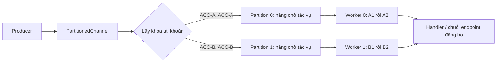

# PartitionedChannel

Trong module **SPRING_INTEGRATION_CORE**, thuộc chương **Kiểu channel**, bài này trình bày cách dùng `PartitionedChannel` để xử lý đồng thời các nhóm thông điệp mà vẫn giữ thứ tự trong từng nhóm. Nội dung nối `Message`, `MessageChannel`, endpoint, gateway và Java DSL với một tình huống tích hợp cụ thể: xử lý chuỗi sự kiện của từng tài khoản.

Sau bài học, bạn có thể chọn khóa phân vùng, cấu hình channel, nhận biết phạm vi bảo đảm thứ tự, thiết kế đường đi của lỗi và viết kiểm thử cho luồng bất đồng bộ.

## 1. Bài toán: tuần tự theo tài khoản, đồng thời giữa các tài khoản

Giả sử hệ thống tiếp nhận các sự kiện sau theo thứ tự gửi:

| Vị trí gửi | Tài khoản | Số thứ tự nghiệp vụ | Thay đổi giá trị |
| --- | --- | --- | --- |
| 1 | ACC-A | 1 | +100 |
| 2 | ACC-B | 1 | +50 |
| 3 | ACC-A | 2 | -20 |
| 4 | ACC-B | 2 | +30 |

Yêu cầu của ví dụ:

- Sự kiện `ACC-A/1` phải được xử lý xong trước `ACC-A/2`.
- Sự kiện `ACC-B/1` phải được xử lý xong trước `ACC-B/2`.
- Hai tài khoản có thể được xử lý đồng thời khi chúng thuộc các partition khác nhau.
- Một tài khoản chậm chỉ nên ảnh hưởng đến phạm vi phân vùng của nó.

Nếu đưa tất cả sự kiện vào một luồng xử lý duy nhất, hệ thống dễ giữ thứ tự nhưng không tận dụng được tính độc lập giữa các tài khoản. Nếu phân phối tự do vào một pool nhiều worker, hai sự kiện cùng tài khoản có thể chạy chồng lấn.

`PartitionedChannel` kết hợp việc chọn worker theo khóa với xử lý tuần tự trên worker của từng partition. Thành phần này có từ **Spring Integration 6.1**. Các ví dụ dưới đây dùng API được đối chiếu với **Spring Integration 6.5.0**, trên **Java 17 trở lên**; phần virtual thread yêu cầu Java 21 trở lên. Đây là mốc tham chiếu cho bài học, không phải yêu cầu nâng cấp dự án lên một phiên bản cụ thể. [Javadoc PartitionedChannel 6.5.0](https://docs.spring.io/spring-integration/docs/6.5.0/api/org/springframework/integration/channel/PartitionedChannel.html)

## 2. Mô hình hoạt động

`PartitionedChannel` là một `SubscribableChannel` kế thừa `AbstractExecutorChannel`. Endpoint đăng ký `MessageHandler` vào channel; ứng dụng gửi bằng `send(...)`. Channel có ngữ nghĩa point-to-point: mỗi lượt phân phối chọn một subscriber để xử lý, thay vì phát bản sao cho tất cả subscriber.

Channel không yêu cầu truyền một `TaskExecutor` bên ngoài. Bạn cấu hình số partition và hàm lấy khóa; mỗi partition sử dụng một executor có một worker. Có thể cung cấp `ThreadFactory` để kiểm soát cách tạo thread. [Tài liệu các loại channel](https://docs.spring.io/spring-integration/reference/6.5/channel/implementations.html#channel-implementations-partitionedchannel)

Có thể đọc đường đi của một message theo bốn bước:

1. Lấy khóa từ header hoặc payload.
2. Ánh xạ khóa vào một trong các partition đã cấu hình.
3. Giao tác vụ xử lý cho executor của partition đó.
4. Worker gọi handler; các bước đồng bộ tiếp theo tiếp tục chạy trên worker này.

Sơ đồ dưới đây minh họa hai khóa được ánh xạ vào hai partition khác nhau. Nó không quy định partition thực tế của các chuỗi `ACC-A` và `ACC-B`.



Một partition có thể chứa **nhiều khóa**. Hai khóa khác nhau có thể cùng ánh xạ vào một partition và phải chờ nhau. Số partition giới hạn mức đồng thời ở ranh giới channel; số lượng khóa không quyết định số lượng thread.

Trong bản 6.5.0 được tham chiếu, dispatcher sử dụng `hashCode()` của khóa để chọn partition. Vì vậy khóa cần có giá trị và cách tính hash ổn định. Chi tiết ánh xạ là chi tiết triển khai; ứng dụng nên dựa vào yêu cầu “cùng khóa vào cùng partition”, không dùng chỉ số partition như định danh nghiệp vụ. [Mã nguồn PartitionedDispatcher 6.5.0](https://raw.githubusercontent.com/spring-projects/spring-integration/v6.5.0/spring-integration-core/src/main/java/org/springframework/integration/dispatcher/PartitionedDispatcher.java)

## 3. Hiểu chính xác bảo đảm về thứ tự

Trong điều kiện worker hoạt động bình thường, các message cùng khóa được xử lý trên worker của cùng partition. Nếu một producer gửi tuần tự và mỗi bước xử lý hoàn tất đồng bộ trước khi trả về, thứ tự đó được duy trì qua đoạn luồng này. [Mô tả PartitionedChannel](https://docs.spring.io/spring-integration/docs/6.1.x/reference/html/channel.html#channel-implementations-partitionedchannel)

Cần phân biệt ba loại thứ tự:

| Loại thứ tự | Ý nghĩa trong ví dụ |
| --- | --- |
| Thứ tự nghiệp vụ | `sequence=1` phải đứng trước `sequence=2` theo quy tắc của hệ thống nguồn |
| Thứ tự nộp tác vụ | Thứ tự tác vụ thực sự đi vào executor của một partition |
| Thứ tự hoàn thành tác động | Thời điểm cập nhật dữ liệu hoặc lời gọi bên ngoài hoàn tất |

Thiết kế chỉ đạt yêu cầu khi các thứ tự cần thiết khớp với nhau. Từ mô hình một worker cho mỗi partition, có thể suy ra các giới hạn sau:

| Tình huống | Kết luận thiết kế |
| --- | --- |
| Một producer gửi `A1`, rồi `A2`; handler hoàn tất công việc trước khi trả về | Có thể duy trì `A1 → A2` trong đoạn xử lý đó |
| Hai producer cùng gửi cho A | Cần xác định thứ tự tại nguồn hoặc theo phiên bản; thời điểm bắt đầu gọi `send` không tự tạo thứ tự toàn cục |
| Message đến với `sequence=2` trước `sequence=1` | Channel không tự sắp xếp lại theo trường `sequence` |
| Handler khởi chạy `CompletableFuture` rồi trả về ngay | Tác vụ sau có thể bắt đầu khi tác động của tác vụ trước chưa hoàn tất |
| A và B thuộc hai partition khác nhau | Có thể đồng thời; thứ tự kết quả giữa A và B không được cố định |
| Hai instance ứng dụng cùng nhận sự kiện của A | Mỗi instance có dispatcher riêng; cần phân phối khóa nhất quán ở bên ngoài |
| A1 lỗi và bị đưa sang đường xử lý lỗi | Cần chính sách riêng nếu A2 phải chờ A1 thành công |

Nếu sự kiện đến sai thứ tự và đã có metadata chuỗi phù hợp, hãy xem xét **resequencer**. Thành phần này phát message theo `SEQUENCE_NUMBER`; `PartitionedChannel` chịu trách nhiệm phân phối công việc theo khóa. [Tài liệu Resequencer](https://docs.spring.io/spring-integration/reference/6.5/resequencer.html)

## 4. Chọn partition key

### 4.1. Khóa mặc định là correlationId

Constructor một tham số sử dụng header `IntegrationMessageHeaderAccessor.CORRELATION_ID` làm khóa:

```java
import org.springframework.context.annotation.Bean;
import org.springframework.integration.channel.PartitionedChannel;

@Bean
PartitionedChannel correlatedEvents() {
    return new PartitionedChannel(4);
}
```

Producer phải cung cấp correlation ID phù hợp trước khi gửi:

```java
import org.springframework.integration.IntegrationMessageHeaderAccessor;
import org.springframework.messaging.Message;
import org.springframework.messaging.support.MessageBuilder;

Message<String> message = MessageBuilder.withPayload("event-A-1")
        .setHeader(IntegrationMessageHeaderAccessor.CORRELATION_ID, "ACC-A")
        .build();
```

Correlation ID không được suy ra tự động từ `MessageHeaders.ID` chỉ vì message có một ID. Nếu hàm lấy khóa trả về `null`, dispatcher 6.5.0 không có khóa để gọi `hashCode()`. Cách cấu hình mặc định và cách lấy khóa được thể hiện trong [mã nguồn PartitionedChannel](https://raw.githubusercontent.com/spring-projects/spring-integration/v6.5.0/spring-integration-core/src/main/java/org/springframework/integration/channel/PartitionedChannel.java) và [PartitionedDispatcher](https://raw.githubusercontent.com/spring-projects/spring-integration/v6.5.0/spring-integration-core/src/main/java/org/springframework/integration/dispatcher/PartitionedDispatcher.java).

### 4.2. Khóa phải biểu diễn đơn vị cần giữ thứ tự

Đối với chuỗi thay đổi trạng thái tài khoản, `accountId` thường diễn đạt ý định rõ hơn một correlation ID đang phục vụ mục đích khác.

| Khóa đề xuất | Phạm vi được tuần tự hóa | Điểm cần cân nhắc |
| --- | --- | --- |
| `accountId` | Các sự kiện của một tài khoản | Phù hợp với ví dụ xuyên suốt bài |
| `orderId` | Các thay đổi của một đơn hàng | Các đơn hàng khác nhau có thể độc lập |
| `tenantId` | Toàn bộ message của một tenant | Tenant lớn có thể tạo điểm nghẽn |
| `tenantId + accountId` dưới dạng khóa ghép rõ ràng | Tài khoản trong từng tenant | Tránh trùng account ID giữa các tenant |
| UUID mới cho từng message | Gần như từng message riêng lẻ | Không nhóm được các sự kiện liên quan |
| Giá trị cố định | Toàn bộ luồng | Dồn công việc vào một partition |

Đây là các lựa chọn thiết kế cho tình huống minh họa. Hãy bắt đầu từ trạng thái mà nhiều message có thể cùng sửa: trạng thái đó thường gợi ý đơn vị cần tuần tự hóa.

Khóa nên bất biến, có `equals/hashCode` nhất quán và không phụ thuộc vào dữ liệu thay đổi trong lúc xử lý. Nếu cần khóa ghép, một `record` gồm `tenantId` và `accountId` giúp tránh nhập nhằng khi nối chuỗi.

Nếu luồng có splitter hoặc aggregator, hãy tách ý nghĩa “nhóm để tổng hợp” khỏi “đơn vị cần xử lý tuần tự”. Aggregator mặc định nhóm theo correlation ID và còn cần chính sách release; việc dùng cùng correlation ID làm partition key chỉ phù hợp khi hai mục đích này thực sự trùng nhau. [Tài liệu Aggregator](https://docs.spring.io/spring-integration/reference/6.5/aggregator.html)

### 4.3. Kiểm tra khóa trước khi giao việc

Trong ví dụ bên dưới, khóa nằm ở header `accountId`. Hàm lấy khóa kiểm tra:

- Header là chuỗi không rỗng.
- Payload đúng loại sự kiện mà luồng tiếp nhận.
- Header trùng với account ID trong payload.

Kiểm tra cuối tránh trường hợp sự kiện của A bị tuần tự hóa theo khóa B vì producer gán nhầm header. Trong hệ thống thực tế, bạn cũng có thể lấy khóa trực tiếp từ payload đã chuẩn hóa để giảm số nơi phải giữ dữ liệu đồng bộ.

## 5. Ví dụ hoàn chỉnh: sự kiện tài khoản qua Java DSL

### 5.1. Chuẩn bị môi trường

Ví dụ dùng Spring thuần với dependency `spring-integration-core`. Nếu đang dùng Spring Boot, có thể dùng `spring-boot-starter-integration` và để dependency management của Boot chọn bộ phiên bản tương thích.

Dependency minh họa cho dự án Maven độc lập:

```xml
<dependency>
    <groupId>org.springframework.integration</groupId>
    <artifactId>spring-integration-core</artifactId>
    <version>6.5.0</version>
</dependency>
```

Đặt mức biên dịch Java 17 hoặc cao hơn. Đoạn mã không cần broker, cơ sở dữ liệu hay poller. Hai `QueueChannel` ở đầu ra được đọc trực tiếp bằng `receive(timeout)`.

### 5.2. Cấu hình và chương trình minh họa

Lớp sau chứa dữ liệu đầu vào, cấu hình channel, endpoint transformer và một `main` gửi bốn sự kiện. Trường `delta` chỉ phục vụ minh họa thông điệp; chương trình tạo kết quả xác nhận xử lý, chưa lưu trạng thái tài khoản.

```java
package demo;

import java.util.List;

import org.springframework.context.annotation.Bean;
import org.springframework.context.annotation.Configuration;
import org.springframework.context.annotation.AnnotationConfigApplicationContext;
import org.springframework.integration.channel.PartitionedChannel;
import org.springframework.integration.channel.QueueChannel;
import org.springframework.integration.config.EnableIntegration;
import org.springframework.integration.dsl.IntegrationFlow;
import org.springframework.messaging.Message;
import org.springframework.messaging.support.MessageBuilder;
import org.springframework.scheduling.concurrent.CustomizableThreadFactory;

@Configuration
@EnableIntegration
public class PartitionedFlowConfig {

    public record AccountEvent(
            String accountId, int sequence, long delta) {
    }

    public record AppliedEvent(
            String accountId, int sequence, long delta,
            String workerName) {
    }

    public static Object accountKey(Message<?> message) {
        String key = message.getHeaders().get("accountId", String.class);
        if (key == null || key.isBlank()) {
            throw new IllegalArgumentException("accountId header is required");
        }
        if (!(message.getPayload() instanceof AccountEvent event)) {
            throw new IllegalArgumentException("AccountEvent payload is required");
        }
        if (!key.equals(event.accountId())) {
            throw new IllegalArgumentException("Header and payload accountId differ");
        }
        return key;
    }

    @Bean
    public PartitionedChannel accountEvents() {
        PartitionedChannel channel =
                new PartitionedChannel(4, PartitionedFlowConfig::accountKey);
        channel.setThreadFactory(new CustomizableThreadFactory("account-worker-"));
        channel.setFailover(false);
        return channel;
    }

    @Bean
    public QueueChannel appliedEvents() {
        return new QueueChannel(100);
    }

    @Bean
    public QueueChannel accountErrors() {
        return new QueueChannel(100);
    }

    @Bean
    public IntegrationFlow accountFlow() {
        return IntegrationFlow.from("accountEvents")
                .<AccountEvent, AppliedEvent>transform(event -> {
                    if (event.sequence() <= 0) {
                        throw new IllegalArgumentException("sequence must be positive");
                    }
                    return new AppliedEvent(
                            event.accountId(),
                            event.sequence(),
                            event.delta(),
                            Thread.currentThread().getName());
                })
                .channel("appliedEvents")
                .get();
    }

    public static void main(String[] args) {
        try (AnnotationConfigApplicationContext context =
                     new AnnotationConfigApplicationContext(PartitionedFlowConfig.class)) {
            PartitionedChannel input =
                    context.getBean("accountEvents", PartitionedChannel.class);
            QueueChannel output =
                    context.getBean("appliedEvents", QueueChannel.class);
            QueueChannel errors =
                    context.getBean("accountErrors", QueueChannel.class);

            List<AccountEvent> events = List.of(
                    new AccountEvent("ACC-A", 1, 100),
                    new AccountEvent("ACC-B", 1, 50),
                    new AccountEvent("ACC-A", 2, -20),
                    new AccountEvent("ACC-B", 2, 30));

            for (AccountEvent event : events) {
                boolean accepted = input.send(
                        MessageBuilder.withPayload(event)
                                .setHeader("accountId", event.accountId())
                                .setErrorChannelName("accountErrors")
                                .build());
                if (!accepted) {
                    throw new IllegalStateException("Message was not accepted");
                }
            }

            for (int i = 0; i < events.size(); i++) {
                Message<?> result = output.receive(5_000);
                if (result == null) {
                    throw new IllegalStateException("Timed out waiting for a result");
                }
                System.out.println(result.getPayload());
            }

            System.out.println("Error observed: " + errors.receive(0));
        }
    }
}
```

Các bước `transform(...)` và `channel(...)` tạo chuỗi endpoint trong Java DSL. Transformer trả về `AppliedEvent`, sau đó kết quả được gửi tới `appliedEvents`. Chữ ký transformer được mô tả trong [Javadoc BaseIntegrationFlowDefinition](https://docs.spring.io/spring-integration/docs/6.5.0/api/org/springframework/integration/dsl/BaseIntegrationFlowDefinition.html).

### 5.3. Cách đọc kết quả

Với một lần chạy, bạn có thể thấy thứ tự kết quả dạng:

```text
ACC-A/1 trên account-worker-1
ACC-B/1 trên account-worker-2
ACC-B/2 trên account-worker-2
ACC-A/2 trên account-worker-1
```

Đây là cách rút gọn để đọc output; `record.toString()` thực tế còn in tên record và các trường còn lại. Tên worker và thứ tự xen kẽ giữa hai tài khoản có thể khác.

Điều cần kiểm tra là chuỗi riêng của A có `1, 2`, chuỗi riêng của B có `1, 2`, và các sự kiện cùng tài khoản có cùng worker trong lần chạy bình thường đó. Không dùng thứ tự xen kẽ A/B làm tiêu chí đúng sai.

Trong cấu hình này:

- Channel đầu vào là ranh giới chuyển từ thread gửi sang worker.
- Có một subscriber là endpoint transformer, nhưng nhiều partition có thể gọi endpoint đó đồng thời với các message khác nhau.
- Lambda không giữ trạng thái dùng chung, nên phù hợp với việc được gọi đồng thời.
- Hai queue dung lượng 100 phục vụ quan sát kết quả và lỗi của một tập dữ liệu nhỏ.
- Đóng application context gọi vòng đời hủy của channel và yêu cầu shutdown các executor. [Vòng đời PartitionedChannel](https://raw.githubusercontent.com/spring-projects/spring-integration/v6.5.0/spring-integration-core/src/main/java/org/springframework/integration/channel/PartitionedChannel.java)

Khi thay transformer bằng service activator cập nhật trạng thái, service phải an toàn với nhiều partition gọi đồng thời. Tuần tự theo khóa không làm cho một `HashMap` dùng chung trở nên an toàn trước các thao tác ghi của những khóa khác nhau.

## 6. Cách khai báo bằng Channel DSL

Nếu muốn dùng builder DSL cho channel, có thể thay bean `accountEvents()` trong ví dụ bằng:

```java
import org.springframework.context.annotation.Bean;
import org.springframework.integration.dsl.MessageChannels;
import org.springframework.integration.dsl.PartitionedChannelSpec;
import org.springframework.scheduling.concurrent.CustomizableThreadFactory;

@Bean
public PartitionedChannelSpec accountEvents() {
    return MessageChannels.partitioned(4)
            .partitionKey(PartitionedFlowConfig::accountKey)
            .threadFactory(new CustomizableThreadFactory("account-worker-"))
            .failover(false);
}
```

Chỉ giữ một định nghĩa bean `accountEvents`. `MessageChannels.partitioned(...)` tạo `PartitionedChannelSpec`; `partitionKey(...)` và `threadFactory(...)` cung cấp cấu hình cho channel. Trong bean DSL này, Spring quản lý spec và đối tượng channel mà nó tạo. [Javadoc MessageChannels](https://docs.spring.io/spring-integration/docs/6.5.0/api/org/springframework/integration/dsl/MessageChannels.html), [mã nguồn PartitionedChannelSpec](https://raw.githubusercontent.com/spring-projects/spring-integration/v6.5.0/spring-integration-core/src/main/java/org/springframework/integration/dsl/PartitionedChannelSpec.java)

Đừng nhầm `.get()` kết thúc `IntegrationFlow` trong ví dụ trước với việc tự lấy đối tượng từ một channel spec trong quá trình khai báo bean.

## 7. send thành công, gateway và transaction

### 7.1. Phân biệt nhận tác vụ với hoàn tất nghiệp vụ

Đối với đoạn xử lý bất đồng bộ, kết quả `send(...)` phản ánh việc gửi/giao tác vụ tại ranh giới channel. Để biết nghiệp vụ đã hoàn tất, ví dụ sử dụng message trên `appliedEvents`.

Worker có thể bắt đầu chạy rất nhanh, thậm chí trước khi producer quan sát được kết quả trả về của `send`; điều đó vẫn không tạo quan hệ “send thành công thì nghiệp vụ thành công”.

Tương tự, tham số `send(message, timeout)` không nên được hiểu là thời hạn hoàn tất toàn bộ nghiệp vụ. Nếu cần giới hạn thời gian gọi dịch vụ ngoài, hãy đặt timeout ở chính thao tác đó và thiết kế cách xử lý khi hết hạn.

### 7.2. Gateway che API gửi message, còn hợp đồng phản hồi do bạn chọn

Một messaging gateway có thể cung cấp phương thức `void submit(AccountEvent event)` cho tầng nghiệp vụ. Luồng phía gateway cần tạo header khóa hoặc channel cần lấy khóa trực tiếp từ payload.

Với hợp đồng một chiều và channel bất đồng bộ, phương thức trả về không xác nhận rằng worker đã áp dụng sự kiện thành công. Nếu caller cần kết quả, phải thiết kế request-reply, giữ đường trả lời và chọn reply timeout phù hợp. Ví dụ ở mục 5 chủ động gửi kết quả vào queue, nên chưa phải luồng request-reply tới gateway. [Tài liệu Messaging Gateways](https://docs.spring.io/spring-integration/reference/6.5/gateway.html)

### 7.3. Ranh giới thread là ranh giới transaction cần xem xét

Transaction Spring theo mô hình imperative thường gắn với thread đang chạy. Transaction ở producer không tự đi theo message sang worker của `PartitionedChannel`. Worker cần bắt đầu transaction phù hợp tại service hoặc endpoint thực hiện thay đổi dữ liệu. [Tài liệu transaction trong message flow](https://docs.spring.io/spring-integration/reference/6.5/transactions.html#transaction-boundaries)

Từ ranh giới này, hãy kiểm tra hai tình huống trong thiết kế thực tế:

- Producer ghi dữ liệu rồi gửi message trước khi transaction commit: worker có thể đọc khi dữ liệu chưa sẵn sàng.
- Producer gửi message thành công rồi transaction của producer rollback: việc gửi vào executor không tự bị hoàn tác.

Nếu yêu cầu dữ liệu và sự kiện phải được phục hồi nhất quán sau sự cố, hãy thiết kế cơ chế lưu bền và phát sự kiện phù hợp, chẳng hạn outbox cùng bộ phát lại. Tính tuần tự trong bộ nhớ chỉ giải quyết một phần của bài toán đó.

Tương tự, dữ liệu đặt trong MDC hoặc `ThreadLocal` của producer cần chiến lược truyền và dọn context rõ ràng. Worker được tái sử dụng giữa nhiều message; hãy bảo đảm context của lần xử lý trước được xóa.

## 8. Xử lý lỗi và retry theo khóa

### 8.1. Lỗi trước khi giao tác vụ và lỗi trên worker

Có hai vị trí lỗi cần quan sát riêng:

| Vị trí | Ví dụ trong bài | Cách quan sát |
| --- | --- | --- |
| Trên đường gửi, trước khi worker chạy | Thiếu header `accountId`; header và payload không khớp | Producer xử lý exception trên đường gọi `send` |
| Trong endpoint chạy trên worker | `sequence <= 0` làm transformer ném exception | Nhận `ErrorMessage` qua đường xử lý lỗi |

Spring Integration gửi lỗi của tác vụ bất đồng bộ đến channel chỉ định bởi header `errorChannel`; nếu không có header này thì sử dụng bean toàn cục tên `errorChannel`. Trong ví dụ, `setErrorChannelName("accountErrors")` chọn queue lỗi riêng. Payload của `ErrorMessage` là exception; với lỗi handler được bọc trong `MessagingException`, có thể lấy `failedMessage` để nhận diện sự kiện gây lỗi. [Tài liệu Error Handling](https://docs.spring.io/spring-integration/reference/error-handling.html)

Không dùng `try/catch` quanh `send` để chờ bắt exception được ném về sau trên worker. Kiểm thử ở mục 10 kiểm tra riêng đường lỗi này.

Queue `accountErrors` trong bài được đọc trực tiếp. Khi vận hành liên tục, cần có thành phần tiêu thụ, lưu thông tin cần thiết và quyết định khôi phục; queue lỗi nằm trong bộ nhớ không tự trở thành kho lưu bền.

### 8.2. Một lỗi không tự đóng băng các message kế tiếp

Giả sử `A1` lỗi và cơ chế báo lỗi đã hoàn tất. Worker có thể tiếp tục chạy `A2`. Nếu quy tắc nghiệp vụ yêu cầu A1 thành công trước A2, cần bổ sung chính sách ở cấp tài khoản.

Có thể cân nhắc các chính sách sau cho ứng dụng của bạn:

| Chính sách | Tác dụng mong muốn | Chi phí cần chấp nhận |
| --- | --- | --- |
| Retry ngay trong lời gọi handler | Giữ tác vụ hiện tại trước các tác vụ đang chờ | Chiếm worker trong suốt quá trình retry |
| Đánh dấu tài khoản đang lỗi và giữ lại sự kiện tiếp theo | Ngăn cập nhật trạng thái vượt qua lỗi | Cần lưu trạng thái, hàng chờ và cơ chế mở lại |
| Đưa lỗi vào hàng xử lý riêng, cho luồng chính tiếp tục | Giữ thông lượng khi nghiệp vụ cho phép bỏ qua | Cần quy tắc bù trừ và đối soát |
| Lưu lỗi rồi phát lại vào channel | Cho phép xử lý lại sau | Message phát lại có thể đứng sau những message mới |

`RequestHandlerRetryAdvice` hỗ trợ retry ở handler. Với stateless retry có backoff ngay trên worker, thời gian chờ nằm trong tác vụ hiện tại; những khóa khác cùng partition cũng phải đợi. [Tài liệu Retry Advice](https://docs.spring.io/spring-integration/reference/6.5/handler-advice/classes.html#retry-advice)

Hãy dùng định danh sự kiện ổn định để chống áp dụng lặp khi retry hoặc phát lại. Chẳng hạn, nếu A1 đã ghi dữ liệu thành công nhưng lỗi khi gửi xác nhận, lần xử lý lại không được cộng `delta` thêm lần nữa. Đây là yêu cầu thiết kế của ví dụ, không được suy ra từ việc message có cùng partition key.

### 8.3. Failover subscriber khác với khôi phục nghiệp vụ

Channel hỗ trợ chọn subscriber và failover khi một subscriber xử lý thất bại. Cấu hình `setFailover(false)` trong ví dụ giúp hợp đồng minh họa rõ ràng khi chỉ có một endpoint nhận sự kiện. Nếu đăng ký nhiều subscriber, hãy quyết định cụ thể chiến lược chọn subscriber và điều kiện chuyển sang subscriber tiếp theo. [Javadoc các tùy chọn failover](https://docs.spring.io/spring-integration/docs/6.5.0/api/org/springframework/integration/channel/PartitionedChannel.html)

Chuyển message sang handler khác không tự hoàn tác tác động đã xảy ra ở handler đầu tiên. Nếu nhiều handler giữ trạng thái riêng, “cùng partition” cũng không đủ để chứng minh rằng mọi lần cập nhật một tài khoản đều đi qua cùng một đối tượng lưu trạng thái.

## 9. Số partition, tải lệch và dung lượng chờ

### 9.1. Chọn số partition từ nút thắt thực tế

Trong ví dụ tự đặt sau, giả sử mỗi sự kiện cần trung bình 20 ms và phần xử lý hoàn tất đồng bộ. Năng lực lý thuyết của một worker xấp xỉ:

```text
1 / 0,020 = 50 sự kiện/giây
4 partition: khoảng 200 sự kiện/giây nếu tải phân bố đều
```

Đây là phép ước lượng để suy luận, chưa phải số đo benchmark. Năng lực thực tế còn chịu ảnh hưởng của thời gian chờ, connection pool, giới hạn dịch vụ ngoài và phân bố khóa.

Nếu riêng một tài khoản tạo 80 sự kiện/giây, trong khi worker cần 20 ms cho mỗi sự kiện, hàng chờ của tài khoản đó có thể tăng dù thêm partition cho các khóa khác. Muốn chia nhỏ một tài khoản, trước hết phải chứng minh các phần việc mới có thể độc lập mà vẫn giữ đúng bất biến nghiệp vụ.

### 9.2. Hàng chờ trong phiên bản tham chiếu

Trong 6.5.0, dispatcher tạo executor bằng `Executors.newSingleThreadExecutor(...)`. JDK mô tả executor này dùng hàng chờ không có giới hạn dung lượng cấu hình theo cách đó. Tải vào vượt năng lực xử lý kéo dài có thể làm bộ nhớ sử dụng tăng. [Mã nguồn dispatcher](https://raw.githubusercontent.com/spring-projects/spring-integration/v6.5.0/spring-integration-core/src/main/java/org/springframework/integration/dispatcher/PartitionedDispatcher.java), [Javadoc Executors của Java 17](https://docs.oracle.com/en/java/javase/17/docs/api/java.base/java/util/concurrent/Executors.html#newSingleThreadExecutor(java.util.concurrent.ThreadFactory))

Thay `ThreadFactory` chỉ đổi cách tạo thread; thao tác này không thay chính sách dung lượng hàng chờ. Khi đọc ví dụ của phiên bản Spring Integration khác, hãy đối chiếu API đúng phiên bản trước khi dùng các tùy chọn cấu hình queue.

Đối với ví dụ này, các số liệu hữu ích gồm:

- Số sự kiện được tiếp nhận, hoàn tất và thất bại.
- Thời gian từ khi tiếp nhận đến khi bắt đầu xử lý.
- Thời gian thực thi nghiệp vụ trên worker.
- Lượng công việc đang chờ và tốc độ tăng của nó.
- Tỷ lệ tải của những nhóm khóa lớn.
- Số retry và các tài khoản đang bị giữ do lỗi.

Một queue đầu ra đầy cũng có thể giữ worker ở thao tác gửi kết quả. Hai queue dung lượng 100 trong bài cần được tiêu thụ nếu tăng số message hoặc chạy liên tục.

### 9.3. Shutdown và chạy nhiều instance

Khi dừng hệ thống, hãy dừng nguồn phát trước, chờ các công việc cần thiết hoàn tất, rồi đóng các tài nguyên đầu ra. Yêu cầu shutdown executor không thay thế cho quy trình xác nhận nghiệp vụ đã hoàn tất.

Nếu tăng số instance, cần phân phối sự kiện sao cho cùng khóa đến đúng instance chịu trách nhiệm trong khoảng thời gian cần giữ thứ tự. Thêm `PartitionedChannel` riêng vào mỗi instance không tự tạo ra cơ chế đồng bộ giữa các JVM. Cơ chế broker, phân quyền xử lý theo khóa hoặc kiểm soát phiên bản tại nơi lưu dữ liệu cần được thiết kế theo yêu cầu của hệ thống.

## 10. Kiểm thử thứ tự và đường xử lý lỗi

Kiểm thử bất đồng bộ nên chờ một điều kiện có thời hạn thay vì ngủ một khoảng cố định rồi đoán rằng xử lý đã xong. Với cấu hình ở mục 5, `QueueChannel.receive(timeout)` cung cấp điểm quan sát phù hợp.

Lớp JUnit Jupiter dưới đây dùng chính `PartitionedFlowConfig`; dự án cần dependency JUnit Jupiter cho phạm vi test. Mỗi test tạo application context riêng để cô lập các queue.

```java
package demo;

import java.util.ArrayList;
import java.util.HashMap;
import java.util.HashSet;
import java.util.List;
import java.util.Map;
import java.util.Set;
import java.util.stream.IntStream;

import org.junit.jupiter.api.Test;
import org.springframework.context.annotation.AnnotationConfigApplicationContext;
import org.springframework.integration.channel.PartitionedChannel;
import org.springframework.integration.channel.QueueChannel;
import org.springframework.messaging.Message;
import org.springframework.messaging.MessagingException;
import org.springframework.messaging.support.ErrorMessage;
import org.springframework.messaging.support.MessageBuilder;

import demo.PartitionedFlowConfig.AccountEvent;
import demo.PartitionedFlowConfig.AppliedEvent;

import static org.junit.jupiter.api.Assertions.*;

class PartitionedFlowTest {

    @Test
    void preservesOrderForEachAccount() {
        try (AnnotationConfigApplicationContext context =
                     new AnnotationConfigApplicationContext(PartitionedFlowConfig.class)) {
            PartitionedChannel input =
                    context.getBean("accountEvents", PartitionedChannel.class);
            QueueChannel output =
                    context.getBean("appliedEvents", QueueChannel.class);
            QueueChannel errors =
                    context.getBean("accountErrors", QueueChannel.class);

            String caller = Thread.currentThread().getName();
            for (int sequence = 1; sequence <= 20; sequence++) {
                send(input, new AccountEvent("ACC-A", sequence, 1));
                send(input, new AccountEvent("ACC-B", sequence, 1));
            }

            Map<String, List<Integer>> sequences = new HashMap<>();
            Map<String, Set<String>> workers = new HashMap<>();

            for (int i = 0; i < 40; i++) {
                Message<?> message = output.receive(5_000);
                assertNotNull(message, "Missing result " + i);
                AppliedEvent event =
                        assertInstanceOf(AppliedEvent.class, message.getPayload());

                sequences.computeIfAbsent(
                        event.accountId(), key -> new ArrayList<>())
                        .add(event.sequence());
                workers.computeIfAbsent(
                        event.accountId(), key -> new HashSet<>())
                        .add(event.workerName());

                assertNotEquals(caller, event.workerName());
            }

            List<Integer> expected =
                    IntStream.rangeClosed(1, 20).boxed().toList();
            assertEquals(expected, sequences.get("ACC-A"));
            assertEquals(expected, sequences.get("ACC-B"));
            assertEquals(1, workers.get("ACC-A").size());
            assertEquals(1, workers.get("ACC-B").size());
            assertNull(errors.receive(0));
        }
    }

    @Test
    void sendsWorkerFailureToTheRequestedErrorChannel() {
        try (AnnotationConfigApplicationContext context =
                     new AnnotationConfigApplicationContext(PartitionedFlowConfig.class)) {
            PartitionedChannel input =
                    context.getBean("accountEvents", PartitionedChannel.class);
            QueueChannel output =
                    context.getBean("appliedEvents", QueueChannel.class);
            QueueChannel errors =
                    context.getBean("accountErrors", QueueChannel.class);

            send(input, new AccountEvent("ACC-A", 0, 100));

            Message<?> message = errors.receive(5_000);
            assertNotNull(message);
            ErrorMessage error = assertInstanceOf(ErrorMessage.class, message);
            MessagingException failure =
                    assertInstanceOf(MessagingException.class, error.getPayload());

            Message<?> failedMessage = failure.getFailedMessage();
            assertNotNull(failedMessage);
            AccountEvent failedEvent =
                    assertInstanceOf(AccountEvent.class, failedMessage.getPayload());

            assertEquals("ACC-A", failedEvent.accountId());
            assertEquals(0, failedEvent.sequence());
            assertNull(output.receive(0));
        }
    }

    private static void send(
            PartitionedChannel input, AccountEvent event) {
        boolean accepted = input.send(
                MessageBuilder.withPayload(event)
                        .setHeader("accountId", event.accountId())
                        .setErrorChannelName("accountErrors")
                        .build());
        assertTrue(accepted);
    }
}
```

Test đầu xác minh thứ tự kết quả **trong từng tài khoản**, việc sử dụng worker khác caller và sự ổn định của worker cho cùng khóa trong lần chạy. Nó không giả định hai khóa bất kỳ luôn vào hai worker khác nhau.

Test thứ hai dùng dữ liệu có khóa hợp lệ nhưng `sequence=0` để gây lỗi bên trong transformer. Nhờ vậy nó kiểm tra lỗi trên worker, tách biệt với lỗi thiếu khóa trên đường gửi.

Khi cần chứng minh hai partition thực sự có thể tiến triển độc lập, có thể bổ sung kiểm thử dùng hai khóa đã xác định thuộc hai partition khác nhau ở phiên bản đang dùng. Dùng `CountDownLatch` giữ handler của khóa thứ nhất và chờ kết quả của khóa thứ hai, với thời hạn rõ ràng và giải phóng latch trong `finally`. Cách kiểm thử này quan sát hành vi đồng thời, không dựa vào thứ tự log.

Các tình huống khác nên được xác minh khi áp dụng vào một hệ thống có trạng thái: khóa sai, tải lệch, lỗi ở sự kiện trước, retry gây trùng lặp và dừng ứng dụng khi còn công việc.

## 11. Virtual thread

Trên Java 21 trở lên, có thể thay factory trong bean channel bằng:

```java
channel.setThreadFactory(
        Thread.ofVirtual().name("account-partition-", 0).factory());
```

Cấu hình này thay loại thread được tạo cho worker. Vẫn có số partition đã khai báo và mỗi partition vẫn xử lý tuần tự; nó không biến mô hình thành một virtual thread mới cho mỗi message. [Tài liệu PartitionedChannel và ThreadFactory](https://docs.spring.io/spring-integration/docs/6.1.x/reference/html/channel.html#channel-implementations-partitionedchannel)

Virtual thread phù hợp với nhiều dạng công việc chờ I/O. Nó không tự tăng năng lực CPU hoặc loại bỏ giới hạn của dịch vụ ngoài, connection pool hay một khóa có tải quá lớn. [Javadoc Thread trên Java 21](https://docs.oracle.com/en/java/javase/21/docs/api/java.base/java/lang/Thread.html)

## 12. Phối hợp với các endpoint khác

Đặt ranh giới partition ngay trước đoạn cần tuần tự hóa. Với luồng xử lý tài khoản, một thiết kế có thể là:

```text
Gateway / inbound adapter
    → chuẩn hóa payload và xác định accountId
    → kiểm tra dữ liệu đầu vào
    → PartitionedChannel theo accountId
    → service áp dụng sự kiện trong transaction của worker
    → phát kết quả hoặc sự kiện tiếp theo

Lỗi trên worker → errorChannel → chính sách retry / lưu lỗi / giữ khóa
```

Một transformer trước channel nên tạo xong dữ liệu dùng để chọn khóa. Filter có thể loại dữ liệu không hợp lệ trước khi chúng chiếm worker. Nếu tính đúng đắn phụ thuộc vào việc không bỏ sót sự kiện, cần định nghĩa rõ đường discard và cách đối soát.

Router sau channel có thể chuyển message tới các nhánh nghiệp vụ. Hãy xem lại bảo đảm thứ tự tại mỗi chỗ nhánh tạo thread mới hoặc dùng channel bất đồng bộ; cùng khóa ở đầu vào không tự bảo đảm các nhánh hoàn thành cùng thứ tự.

Aggregator vẫn cần correlation strategy, message store và release strategy của riêng nó. Partitioning giúp chọn nơi chạy handler; điều kiện “đã đủ message để tổng hợp” thuộc trách nhiệm của aggregator. [Tài liệu Aggregator](https://docs.spring.io/spring-integration/reference/6.5/aggregator.html)

## 13. So sánh với những lựa chọn gần nhau

| Thành phần | Mô hình tiêu thụ | Phù hợp khi |
| --- | --- | --- |
| `DirectChannel` | Gọi một subscriber trên thread gửi | Muốn luồng đồng bộ, dễ truyền lỗi về caller và dùng cùng transaction |
| `ExecutorChannel` | Giao xử lý cho executor được cung cấp | Muốn cấu hình pool, hàng chờ và chính sách executor theo nhu cầu |
| `PartitionedChannel` | Chọn partition theo khóa, một worker cho mỗi partition | Muốn đồng thời giữa nhóm và tuần tự trong nhóm |
| `QueueChannel` | Lưu message để consumer nhận hoặc poll | Muốn tách thời điểm gửi khỏi thời điểm nhận và kiểm soát hàng chờ |
| `PublishSubscribeChannel` | Gửi đến các subscriber | Muốn nhiều nhánh cùng nhận thông điệp |

Bảng mô tả ngữ nghĩa cơ bản. Với `ExecutorChannel`, thứ tự còn phụ thuộc executor; cấu hình một worker có thể tuần tự hóa toàn bộ luồng nhưng không cung cấp sẵn cách phân vùng theo khóa. Với `QueueChannel`, thứ tự lấy khỏi queue và thứ tự hoàn tất của nhiều consumer là hai vấn đề khác nhau. [Tài liệu các triển khai MessageChannel](https://docs.spring.io/spring-integration/reference/6.5/channel/implementations.html)

## 14. Chẩn đoán những lỗi thường gặp

| Dấu hiệu | Nguyên nhân cần kiểm tra | Hướng xử lý |
| --- | --- | --- |
| Gửi message lỗi ngay | Thiếu khóa, sai loại header hoặc payload, khóa không khớp dữ liệu | Kiểm tra đầu vào và hàm lấy khóa |
| Sự kiện cùng tài khoản chạy chồng lấn | Khóa thay đổi, có bước bất đồng bộ phía sau hoặc nhiều instance cùng xử lý | Theo dõi khóa thực tế và toàn bộ đường đi |
| Thấy nhiều tài khoản cùng worker | Các khóa cùng ánh xạ một partition | Đây có thể là hành vi bình thường; xem phân bố và tải |
| Chỉ một phần luồng bị chậm | Khóa nóng, handler chậm, retry hoặc đầu ra bị nghẽn | Đo thời gian chờ và tác vụ đang chiếm worker |
| `send` thành công nhưng thiếu kết quả | Handler lỗi hoặc kết quả đang chờ ở đầu ra | Đọc cả đường kết quả và đường lỗi |
| Bộ nhớ tăng khi tải cao | Công việc vào nhanh hơn tốc độ hoàn tất | Kiểm soát tốc độ tiếp nhận, dung lượng và tải downstream |
| A2 được xử lý dù A1 lỗi | Chưa có cơ chế chặn hoặc khôi phục theo khóa | Bổ sung chính sách lỗi phù hợp với nghiệp vụ |
| Dừng ứng dụng khi còn việc | Chưa phối hợp dừng nguồn vào và hoàn tất tác vụ | Thiết kế trình tự shutdown có điểm xác nhận |
| Số liệu “xử lý thành công” tăng quá sớm | Đếm sự kiện gửi thay vì nghiệp vụ hoàn tất | Ghi nhận ở endpoint hoàn thành hoặc kết quả đã xác nhận |

Để quan sát vòng đời handler trên worker, có thể dùng `ExecutorChannelInterceptor`. Các hook như `postSend` của `ChannelInterceptor` phản ánh vòng đời gửi, nên không thay thế cho đo thời gian xử lý nghiệp vụ bất đồng bộ. [Tài liệu Channel Interceptors](https://docs.spring.io/spring-integration/reference/6.5/channel/interceptors.html)

## 15. Quyết định thiết kế cho ví dụ

Đối với chuỗi sự kiện tài khoản trong bài, lựa chọn xuất phát là khóa `accountId`, bốn partition, một endpoint xử lý không giữ trạng thái cục bộ và một đường lỗi riêng. Khi thay phần minh họa bằng cập nhật dữ liệu thật, cần bổ sung transaction tại worker, chống áp dụng lặp và chính sách cho sự kiện tiếp theo khi tài khoản đang lỗi.

Tiêu chí đánh giá thiết kế là quan sát được thứ tự riêng của mỗi tài khoản, năng lực tiến triển của các nhóm độc lập và cách khôi phục một chuỗi bị lỗi. Số lượng thread hoặc hình thức khai báo DSL chỉ có ý nghĩa khi phục vụ được các yêu cầu đó.
