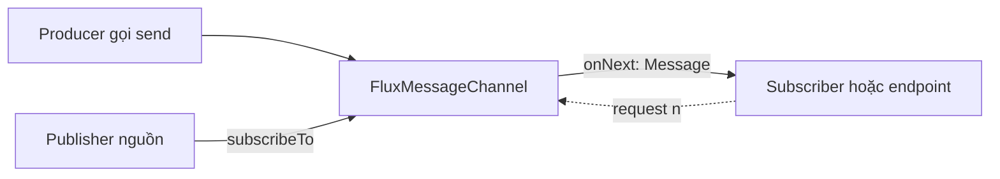
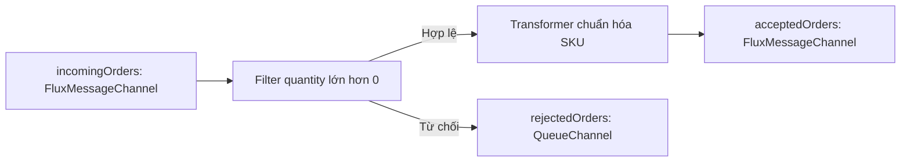

# FluxMessageChannel

## 1. Vị trí trong Spring Integration Core

Trong chương **Kiểu channel** của module **SPRING_INTEGRATION_CORE**, `FluxMessageChannel` nối mô hình thông điệp của Spring Integration với Reactive Streams. Producer có thể gửi một `Message<?>` vào channel; consumer quan sát channel dưới dạng `Publisher<Message<?>>` và yêu cầu dữ liệu theo khả năng tiếp nhận.

Bài học dùng luồng xử lý đơn hàng để thực hành channel, endpoint, filter, transformer và Java DSL. Phần kiểm thử phân biệt việc gửi thành công với kết quả nghiệp vụ, đồng thời quan sát header, nhánh từ chối và nhánh lỗi. Các phần cuối liên hệ gateway, router và aggregator để đặt channel vào thiết kế tích hợp tổng thể.

Sau bài học, bạn cần giải thích được:

- `subscribe()` và `subscribeTo()` khác nhau theo hướng dữ liệu như thế nào.
- Demand, buffering và thời gian chờ của `send()` liên quan ra sao.
- Tại sao một channel reactive chưa chứng minh cả ứng dụng non-blocking.
- Cách đăng ký consumer trước khi gửi và giải phóng subscription sau kiểm thử.
- Khi nào cần channel khác hoặc một thành phần lưu trữ bền vững.

Các ví dụ dùng Java 17 trở lên và API Spring Integration 6.5.x. Chi tiết phụ thuộc triển khai được đối chiếu với mã nguồn **6.5.4**; đây là mốc tham chiếu của bài, không phải khẳng định về phiên bản mới nhất. Khi thay phiên bản, cần kiểm tra lại hành vi gửi và vòng đời.

## 2. Hợp đồng của channel

### 2.1. Hai phía của một điểm nối

`FluxMessageChannel` thuộc package `org.springframework.integration.channel`. Những hợp đồng chính của nó gồm `MessageChannel`, `Publisher<Message<?>>`, `ReactiveStreamsSubscribableChannel` và `Lifecycle`.

| API | Hướng tương tác | Vai trò |
| --- | --- | --- |
| `send(message)` | Producer → channel | Đưa một message vào qua API imperative |
| `subscribe(subscriber)` | Channel → consumer | Đăng ký bên nhận theo Reactive Streams |
| `subscribeTo(publisher)` | Publisher nguồn → channel | Gắn nguồn message vào channel |
| `start()` / `stop()` | Quản lý vòng đời | Điều khiển hoạt động và subscription nguồn |

`subscribe()` đăng ký **người nhận của channel**, còn `subscribeTo()` gắn **nguồn cấp cho channel**. Chữ ký và các hợp đồng được mô tả trong [Javadoc FluxMessageChannel](https://docs.spring.io/spring-integration/api/org/springframework/integration/channel/FluxMessageChannel.html).



Sơ đồ thể hiện hai cách cấp dữ liệu. Một message không cần đi qua cả producer imperative lẫn publisher nguồn.

### 2.2. Một message chứa stream khác một stream chứa message

```java
Message<Flux<String>> messageWithStreamPayload;
Flux<Message<String>> streamOfMessages;
```

Cấu trúc đầu là một phong bì có payload là luồng. Cấu trúc sau gồm nhiều phong bì, mỗi phong bì có payload và header riêng. Ba đơn hàng cần ba mã đơn và ba kết quả xử lý độc lập thường được biểu diễn rõ hơn bằng ba message.

Không suy rằng mọi lời gọi `send()` với payload `Flux` đều tự tách thành nhiều message. Spring Integration có cơ chế riêng để xử lý **kết quả reactive do endpoint trả về** khi output channel hỗ trợ Reactive Streams. Cần phân biệt khả năng đó với việc gửi trực tiếp một phong bì chứa `Flux`. Xem [Reactive Reply Payload](https://docs.spring.io/spring-integration/reference/6.5/reactive-streams.html#reactive-reply-payload).

## 3. Demand, backpressure và thời gian chờ

### 3.1. Consumer yêu cầu dữ liệu

Subscriber nhận `Subscription` khi đăng ký. Nó gọi `request(n)` để yêu cầu thêm phần tử và `cancel()` để hủy. Demand được cộng dồn; `request(2)` không có nghĩa hai tác vụ chạy song song hoặc hai message mỗi giây. [Hợp đồng Subscription](https://www.reactive-streams.org/reactive-streams-1.0.4-javadoc/org/reactivestreams/Subscription.html) quy định giao thức yêu cầu và hủy này.

Ví dụ tự xây dựng: consumer còn khả năng nhận hai việc có thể yêu cầu hai message. Khi hoàn tất một việc, nó yêu cầu thêm một message.

```text
Consumer: request(2)
Channel : onNext(order-A)
Channel : onNext(order-B)
Consumer: hoàn tất một công việc, request(1)
Channel : onNext(order-C)
```

Đây là mô tả giao thức tại một subscription. Trong ứng dụng, cần xác định endpoint nào đang đại diện cho consumer cuối và các operator trung gian đang yêu cầu trước bao nhiêu dữ liệu. Không dùng demand của một subscriber làm bằng chứng rằng toàn hệ thống chỉ có từng ấy công việc đang chạy.

### 3.2. Đường gửi imperative có thể chờ

Trong triển khai 6.5.4, channel yêu cầu đang hoạt động và có subscriber. Khi sink chưa nhận được phần tử do quá tải hoặc tranh chấp phát, `send()` có thể thử lại theo timeout:

- `send(message, 0)`: không chờ thử lại khi sink chưa nhận được.
- `send(message, timeoutMillis)` với timeout dương: giới hạn khoảng chờ thử nhận vào sink.
- `send(message)`: dùng timeout âm và có thể chờ kéo dài.

Không có subscriber là lỗi, không phải cơ chế đợi subscriber tương lai. Xem [mã nguồn FluxMessageChannel 6.5.4](https://raw.githubusercontent.com/spring-projects/spring-integration/v6.5.4/spring-integration-core/src/main/java/org/springframework/integration/channel/FluxMessageChannel.java).

Lớp cha còn thực hiện interceptor và bọc lỗi gửi thông thường trong `MessageDeliveryException`. Kết quả `false` cũng có thể do interceptor từ chối, không chỉ do timeout. Xem [AbstractMessageChannel 6.5.4](https://raw.githubusercontent.com/spring-projects/spring-integration/v6.5.4/spring-integration-core/src/main/java/org/springframework/integration/channel/AbstractMessageChannel.java).

```java
// Đặt trong phương thức đã có biến channel và message phù hợp.
try {
    boolean accepted = channel.send(message, 200);
    if (!accepted) {
        // Áp dụng chính sách từ chối hoặc thử lại của ứng dụng.
    }
}
catch (org.springframework.messaging.MessagingException ex) {
    // Ghi nhận lỗi gửi và nguyên nhân.
}
```

Timeout nhận vào sink không tự ngắt một callback downstream đang chạy lâu ngay trên luồng gửi. Với API tiếp nhận đơn hàng, cần xác định riêng thời hạn nhận việc và thời hạn trả kết quả.

### 3.3. Multicast và subscriber chậm

Channel tham chiếu dùng sink multicast có buffering. Nhiều subscriber đang hoạt động có thể nhận cùng message; đây không phải cơ chế chia mỗi message cho đúng một worker. Một subscriber chậm có thể gây áp lực lên đường phát chung. [Tài liệu Reactor về Sinks](https://projectreactor.io/docs/core/release/reference/coreFeatures/sinks.html) giải thích các mô hình multicast, unicast và replay.

Hệ quả cho bài toán đơn hàng: nếu đăng ký thêm subscriber để ghi log, subscriber đó cũng tham gia đường phát. Cần đánh giá tốc độ và vòng đời của nó. Việc quan sát qua một consumer thực sự có thể ảnh hưởng luồng đang được quan sát.

Không dùng buffer làm kho đơn hàng chờ khôi phục. Khi cần tiếp tục công việc sau khi tiến trình dừng, hãy chọn thành phần có hợp đồng lưu trữ và phát lại phù hợp.

## 4. So sánh với các kiểu channel khác

`FluxMessageChannel` không triển khai `PollableChannel` hoặc `SubscribableChannel` thông thường. Consumer dùng Reactive Streams, không gọi `receive()` như queue hoặc đăng ký handler qua hợp đồng `SubscribableChannel`. Xem [các triển khai MessageChannel](https://docs.spring.io/spring-integration/reference/6.5/channel/implementations.html#flux-message-channel).

| Channel | Cách tiêu thụ | Đặc điểm phân phối | Ví dụ lựa chọn |
| --- | --- | --- | --- |
| `DirectChannel` | Gọi handler trong luồng gửi | Chọn một handler cho mỗi message | Chuỗi xử lý ngắn, đồng bộ |
| `ExecutorChannel` | Dispatcher dùng executor | Phân phối tới một handler | Tách xử lý sang executor |
| `QueueChannel` | Consumer polling | Mỗi message được một consumer lấy | Danh sách việc chờ |
| `PublishSubscribeChannel` | Gọi các handler đăng ký | Phát tới các subscriber | Thông báo nhiều thành phần |
| `FluxMessageChannel` | Reactive Streams subscriber | Luồng có demand | Nối nguồn và consumer reactive |

Trước khi chọn cú pháp khai báo, hãy xác định một đơn chỉ được một worker thực hiện hay nhiều bên cần cùng nhận sự kiện. Sau đó xác định yêu cầu về consumer chậm, lưu bền và phát lại. Những yêu cầu này quyết định mô hình channel cần dùng.

## 5. Java DSL: lọc và chuẩn hóa đơn hàng

### 5.1. Dependency và giả định

Trong ứng dụng Spring Boot đã quản lý phiên bản bằng parent hoặc BOM tương thích với Spring Integration 6.5.x, bổ sung:

```xml
<dependency>
    <groupId>org.springframework.boot</groupId>
    <artifactId>spring-boot-starter-integration</artifactId>
</dependency>
<dependency>
    <groupId>org.springframework.boot</groupId>
    <artifactId>spring-boot-starter-test</artifactId>
    <scope>test</scope>
</dependency>
<dependency>
    <groupId>io.projectreactor</groupId>
    <artifactId>reactor-test</artifactId>
    <scope>test</scope>
</dependency>
```

Đây là phần dependency bổ sung, không phải toàn bộ `pom.xml`. Dự án không dùng Boot phải tự quản lý phiên bản tương thích của Spring Integration, Spring Framework, Reactor và JUnit. `reactor-test` cần đồng bộ với Reactor Core của ứng dụng.

### 5.2. Đường đi của đơn hàng

Mỗi đơn gồm `id`, `sku` và `quantity`. Quy tắc minh họa:

1. Đơn có `quantity <= 0` chuyển sang nhánh từ chối.
2. Đơn hợp lệ được loại khoảng trắng đầu cuối của SKU và đổi sang chữ hoa.



Nhánh từ chối chứa dữ liệu nghiệp vụ cần xem lại, không đại diện cho exception hạ tầng. `discardChannel` là cơ chế filter dùng để chuyển message bị loại tới một nhánh cụ thể. Xem [Filter](https://docs.spring.io/spring-integration/reference/6.5/filter.html).

### 5.3. Cấu hình hoàn chỉnh

```java
package example.integration;

import java.util.Locale;

import org.springframework.beans.factory.annotation.Qualifier;
import org.springframework.context.annotation.Bean;
import org.springframework.context.annotation.Configuration;
import org.springframework.integration.channel.FluxMessageChannel;
import org.springframework.integration.channel.QueueChannel;
import org.springframework.integration.config.EnableIntegration;
import org.springframework.integration.dsl.IntegrationFlow;

@Configuration
@EnableIntegration
public class OrderFlowConfig {

    public record Order(String id, String sku, int quantity) {
    }

    @Bean
    public FluxMessageChannel incomingOrders() {
        return new FluxMessageChannel();
    }

    @Bean
    public FluxMessageChannel acceptedOrders() {
        return new FluxMessageChannel();
    }

    @Bean
    public QueueChannel rejectedOrders() {
        return new QueueChannel(10);
    }

    @Bean
    public IntegrationFlow orderFlow(
            @Qualifier("incomingOrders") FluxMessageChannel input,
            @Qualifier("acceptedOrders") FluxMessageChannel output,
            @Qualifier("rejectedOrders") QueueChannel rejected) {

        return IntegrationFlow.from(input)
                .filter(Order.class,
                        order -> order.quantity() > 0,
                        endpoint -> endpoint.discardChannel(rejected))
                .transform(Order.class, order -> new Order(
                        order.id(),
                        order.sku().strip().toUpperCase(Locale.ROOT),
                        order.quantity()))
                .channel(output)
                .get();
    }
}
```

`@Qualifier` phân biệt hai bean cùng kiểu. `Locale.ROOT` giúp quy tắc SKU không phụ thuộc locale mặc định của máy chạy.

Đây là luồng kết hợp: hai biên là channel reactive, còn đoạn nối mặc định giữa filter và transformer dùng channel do DSL tạo. Cấu hình không tuyên bố mọi ranh giới đều reactive. Khi cần kiểm soát từng ranh giới, phải khai báo channel tương ứng và đánh giá cả nguồn lẫn handler.

`acceptedOrders` cần subscriber trước khi gửi đơn hợp lệ. Trong phần kiểm thử, `StepVerifier` đảm nhận vai trò đó. Trong ứng dụng, hãy nối endpoint tiếp theo.

`rejectedOrders` có dung lượng 10 để ví dụ dễ quan sát. Nếu không có consumer thu gom và queue đầy, nhánh này có thể tạo điểm chờ. Thiết kế thực tế cần chính sách xử lý và timeout gửi riêng cho nhánh từ chối.

## 6. Kiểm thử dữ liệu và kết quả xử lý

### 6.1. Payload, header, từ chối và lỗi

Lớp dưới tạo `AnnotationConfigApplicationContext` riêng cho từng test. Không cần khởi động toàn bộ ứng dụng Boot; context riêng cũng tránh dữ liệu và subscription còn sót giữa các kịch bản.

```java
package example.integration;

import java.time.Duration;

import org.junit.jupiter.api.Test;
import org.springframework.context.annotation.AnnotationConfigApplicationContext;
import org.springframework.integration.channel.FluxMessageChannel;
import org.springframework.integration.channel.QueueChannel;
import org.springframework.messaging.Message;
import org.springframework.messaging.MessageHeaders;
import org.springframework.messaging.MessagingException;
import org.springframework.messaging.support.ErrorMessage;
import org.springframework.messaging.support.MessageBuilder;

import reactor.core.publisher.Flux;
import reactor.test.StepVerifier;

import example.integration.OrderFlowConfig.Order;

import static org.junit.jupiter.api.Assertions.*;

class OrderFlowTest {

    @Test
    void normalizesSkuAndPreservesBusinessHeader() {
        try (var context =
                new AnnotationConfigApplicationContext(OrderFlowConfig.class)) {
            var input = context.getBean(
                    "incomingOrders", FluxMessageChannel.class);
            var output = context.getBean(
                    "acceptedOrders", FluxMessageChannel.class);

            Message<Order> request = MessageBuilder
                    .withPayload(new Order("O-101", "  sku-a  ", 2))
                    .setHeader("traceId", "trace-101")
                    .build();

            StepVerifier.create(Flux.from(output))
                    .then(() -> assertTrue(input.send(request, 1_000)))
                    .assertNext(message -> {
                        Order order = assertInstanceOf(
                                Order.class, message.getPayload());
                        assertEquals("O-101", order.id());
                        assertEquals("SKU-A", order.sku());
                        assertEquals(2, order.quantity());
                        assertEquals("trace-101",
                                message.getHeaders().get("traceId"));
                    })
                    .thenCancel()
                    .verify(Duration.ofSeconds(3));
        }
    }

    @Test
    void routesInvalidQuantityToDiscardChannel() {
        try (var context =
                new AnnotationConfigApplicationContext(OrderFlowConfig.class)) {
            var input = context.getBean(
                    "incomingOrders", FluxMessageChannel.class);
            var rejected = context.getBean(
                    "rejectedOrders", QueueChannel.class);

            Message<Order> request = MessageBuilder
                    .withPayload(new Order("O-102", "sku-b", 0))
                    .setHeader("traceId", "trace-102")
                    .build();

            assertTrue(input.send(request, 1_000));

            Message<?> discarded = rejected.receive(1_000);
            assertNotNull(discarded);
            assertEquals(request.getPayload(), discarded.getPayload());
            assertEquals("trace-102",
                    discarded.getHeaders().get("traceId"));
        }
    }

    @Test
    void sendsTransformationFailureToRequestedErrorChannel() {
        try (var context =
                new AnnotationConfigApplicationContext(OrderFlowConfig.class)) {
            var input = context.getBean(
                    "incomingOrders", FluxMessageChannel.class);
            var errors = new QueueChannel(10);

            // quantity hợp lệ nhưng sku null làm transformer thất bại.
            Message<Order> request = MessageBuilder
                    .withPayload(new Order("O-103", null, 1))
                    .setHeader(MessageHeaders.ERROR_CHANNEL, errors)
                    .build();

            assertTrue(input.send(request, 1_000));

            ErrorMessage error = assertInstanceOf(
                    ErrorMessage.class, errors.receive(1_000));
            MessagingException failure = assertInstanceOf(
                    MessagingException.class, error.getPayload());
            assertNotNull(failure.getFailedMessage());
            assertEquals(request.getPayload(),
                    failure.getFailedMessage().getPayload());
        }
    }
}
```

`StepVerifier` đăng ký output khi chạy `verify()`, rồi thực hiện hành động trong `then(...)`. Do đó consumer đầu ra có mặt trước producer. `thenCancel()` phù hợp với channel còn tiếp tục nhận message; một đơn hoàn tất không đồng nghĩa toàn channel hoàn tất. `verify(Duration)` đặt thời hạn cho kịch bản. Xem [Reactor Testing](https://projectreactor.io/docs/core/release/reference/testing.html).

Test từ chối minh họa `send()` thành công nhưng nghiệp vụ không chấp nhận đơn. Test lỗi quan sát thất bại trên đường lỗi. Nếu người gọi cần biết đơn đã hoàn tất, hãy thiết kế reply hoặc sự kiện kết quả gắn với `orderId`, thay vì dùng boolean của `send()` làm kết quả nghiệp vụ.

Mã kiểm thử là ví dụ để chạy trong dự án có dependency tương thích; việc có mã trong tài liệu không có nghĩa các test đã được thực thi.

### 6.2. Kiểm thử demand trên channel độc lập

Kịch bản bắt đầu với demand bằng 0, sau đó yêu cầu từng phần tử. Nó kiểm tra phía subscriber, không đo dung lượng buffer nội bộ hoặc mức song song của hệ thống.

```java
package example.integration;

import java.time.Duration;

import org.junit.jupiter.api.Test;
import org.springframework.integration.channel.FluxMessageChannel;
import org.springframework.messaging.support.GenericMessage;

import reactor.core.publisher.Flux;
import reactor.test.StepVerifier;

import static org.junit.jupiter.api.Assertions.assertTrue;

class FluxChannelDemandTest {

    @Test
    void deliversMessagesAfterDemandIsRequested() {
        var channel = new FluxMessageChannel();
        try {
            StepVerifier.create(
                            Flux.from(channel).map(message -> message.getPayload()),
                            0)
                    .thenRequest(1)
                    .then(() -> assertTrue(channel.send(
                            new GenericMessage<>("order-A"), 0)))
                    .expectNext("order-A")
                    .thenRequest(1)
                    .then(() -> assertTrue(channel.send(
                            new GenericMessage<>("order-B"), 0)))
                    .expectNext("order-B")
                    .thenCancel()
                    .verify(Duration.ofSeconds(3));
        }
        finally {
            channel.destroy();
        }
    }
}
```

Tránh gửi hàng nghìn message bằng `send()` chờ vô hạn trong `then(...)` rồi mới đặt `thenRequest(...)`. Nếu đường gửi đầy trước khi test chuyển sang yêu cầu dữ liệu, test có thể tự giữ luồng thực thi và không tiến tới bước giải phóng áp lực.

## 7. Nối Publisher nguồn bằng subscribeTo

Khi nguồn đã là `Publisher<Message<?>>`, có thể giao nguồn cho channel thay vì tự subscribe rồi gửi thủ công từng phần tử. Test độc lập sau dùng hai message nguồn:

```java
package example.integration;

import java.time.Duration;

import org.junit.jupiter.api.Test;
import org.springframework.integration.channel.FluxMessageChannel;
import org.springframework.messaging.Message;
import org.springframework.messaging.support.GenericMessage;

import reactor.core.publisher.Flux;
import reactor.test.StepVerifier;

class FluxChannelSourceTest {

    @Test
    void consumesMessagesFromAnAttachedPublisher() {
        var channel = new FluxMessageChannel();
        Flux<Message<?>> source = Flux.<Message<?>>just(
                new GenericMessage<>("source-A"),
                new GenericMessage<>("source-B"));

        try {
            StepVerifier.create(
                            Flux.from(channel).map(message -> message.getPayload()))
                    .then(() -> channel.subscribeTo(source))
                    .expectNext("source-A", "source-B")
                    .thenCancel()
                    .verify(Duration.ofSeconds(5));
        }
        finally {
            channel.destroy();
        }
    }
}
```

Spring Integration hỗ trợ nối nguồn và chờ sự sẵn sàng của downstream trước khi tiêu thụ nguồn. Có thể bắt đầu DSL bằng `IntegrationFlow.from(publisher)` để framework xây dựng phần kết nối. Xem [Reactive Streams Support](https://docs.spring.io/spring-integration/reference/6.5/reactive-streams.html#fluxmessagechannel-and-reactivestreamsconsumer).

Với nguồn đơn hàng, cần xác định ai sở hữu subscription và dữ liệu có thể đọc lại từ đâu. Nguồn cold có thể thực hiện lại thao tác khi đăng ký lại; nguồn hot có thể đã phát sự kiện trước khi consumer sẵn sàng. Hai loại nguồn cần chính sách khởi động và phục hồi tương ứng.

Channel khai báo thành bean nên để Spring quản lý. Channel tự tạo trong test cần được test giải phóng. Ở triển khai tham chiếu, `stop()` hủy subscription nguồn, `start()` có thể đăng ký lại nguồn còn được quản lý; `destroy()` kết thúc sink. Một nguồn hoàn tất không tự đóng channel dùng chung theo nó.

## 8. Endpoint reactive và luồng thực thi

### 8.1. Channel và endpoint có vai trò riêng

Channel truyền message; `ReactiveStreamsConsumer` tiêu thụ đầu vào theo Reactive Streams rồi chuyển cho handler. Java DSL quản lý phần nối này để filter hoặc transformer vẫn biểu diễn nghiệp vụ bằng hàm thông thường.

Tùy chọn endpoint `reactive()` cho phép tạo consumer reactive từ kiểu input channel khác và tùy chỉnh `Flux` đầu vào. Đây là cấu hình độc lập minh họa chuyển bước xử lý chuỗi sang scheduler:

```java
package example.integration;

import org.springframework.context.annotation.Bean;
import org.springframework.context.annotation.Configuration;
import org.springframework.integration.config.EnableIntegration;
import org.springframework.integration.dsl.IntegrationFlow;

import reactor.core.scheduler.Schedulers;

@Configuration
@EnableIntegration
public class TextFlowConfig {

    @Bean
    public IntegrationFlow textFlow() {
        return IntegrationFlow.from("textInput")
                .transform(String.class,
                        text -> text.strip(),
                        endpoint -> endpoint.reactive(
                                flux -> flux.publishOn(Schedulers.parallel())))
                .channel("textOutput")
                .get();
    }
}
```

Cần nối consumer cho `textOutput` trước khi dùng cấu hình này. Customizer tác động lên publisher đầu vào endpoint, không đổi mọi endpoint trong ứng dụng. Xem [The reactive() Endpoint](https://docs.spring.io/spring-integration/reference/6.5/dsl/java-reactive.html).

### 8.2. Reactive không tự tạo thread riêng

Reactor không bắt buộc mỗi `Flux` chạy trong thread riêng. `publishOn()` chuyển các bước downstream sang scheduler đã chọn; `subscribeOn()` tác động tới quá trình subscription và phía nguồn. Xem [Threading and Schedulers](https://projectreactor.io/docs/core/release/reference/coreFeatures/schedulers.html).

Nếu cần cô lập API blocking, có thể bọc lời gọi như sau:

```java
import java.util.concurrent.Callable;

import reactor.core.publisher.Mono;
import reactor.core.scheduler.Schedulers;

static <T> Mono<T> isolateBlockingCall(Callable<T> task) {
    return Mono.fromCallable(task)
            .subscribeOn(Schedulers.boundedElastic());
}
```

Đây là mẫu phương thức để đặt trong lớp thích hợp. Nó tách nơi thực hiện lời gọi; driver blocking vẫn chiếm thread trong lúc chờ. Với dịch vụ đích xử lý đơn hàng, cần chọn thêm giới hạn số thao tác đang chạy và dung lượng kết nối.

Suy luận thiết kế: nếu yêu cầu “ghi cơ sở dữ liệu xong mới xác nhận”, kết quả phải bám theo lần ghi hoàn tất. Đẩy việc sang scheduler rồi xác nhận ngay ở producer làm sai ý nghĩa đó. Transaction và thứ tự theo mã đơn cũng cần được thiết kế, kiểm thử tại đoạn xử lý thực tế; đổi channel chưa đủ để chứng minh các thuộc tính ấy.

## 9. Lỗi message và lỗi kết thúc stream

### 9.1. Đường lỗi của Spring Integration

`ErrorMessage` mang exception trong payload. Cơ chế xuất bản lỗi có thể ưu tiên channel trong header `errorChannel` rồi dùng channel lỗi chung khi phù hợp. Cần có thành phần chịu trách nhiệm bắt và xuất bản lỗi; không phải mọi exception Java tự chuyển thành message lỗi. Xem [Error Handling](https://docs.spring.io/spring-integration/reference/6.5/error-handling.html).

Trong test đơn hàng, `ReactiveStreamsConsumer` dùng error handler và bắt exception khi chuyển message cho handler. Do đó test quan sát `ErrorMessage` ở queue được chỉ định trong header. Không khái quát hành vi này cho mọi subscriber tự viết. Xem [ReactiveStreamsConsumer 6.5.4](https://raw.githubusercontent.com/spring-projects/spring-integration/v6.5.4/spring-integration-core/src/main/java/org/springframework/integration/endpoint/ReactiveStreamsConsumer.java).

Về vận hành, bản ghi lỗi cần gắn với mã đơn hoặc mã truy vết, nguyên nhân và hành động tiếp theo. Nếu gửi thành công nhưng transformer thất bại, việc ghi chung “gửi thất bại” sẽ khiến người vận hành tìm sai điểm lỗi.

### 9.2. Phạm vi khôi phục trong Reactor

`onError` là tín hiệu kết thúc của chuỗi Reactor. `onErrorResume` chuyển sang publisher thay thế; nó không tiếp tục nguyên trạng nguồn đã kết thúc. Vị trí đặt operator vì vậy quyết định phạm vi khôi phục. Xem [Handling Errors của Reactor](https://projectreactor.io/docs/core/release/reference/coreFeatures/error-handling.html).

Mẫu tự xây dựng dưới đây xử lý thất bại bên trong từng đơn và tạo kết quả rõ ràng:

```java
import java.util.function.Function;

import org.springframework.messaging.Message;
import org.springframework.messaging.support.MessageBuilder;

import reactor.core.publisher.Flux;
import reactor.core.publisher.Mono;

// Đặt record và phương thức trong lớp thích hợp.
record OrderResult(String orderId, boolean successful) {
}

static Flux<Message<?>> processEachOrder(
        Flux<Message<?>> requests,
        Function<OrderFlowConfig.Order, Mono<OrderResult>> operation) {

    return requests.concatMap(request -> {
        var order = (OrderFlowConfig.Order) request.getPayload();
        return Mono.defer(() -> operation.apply(order))
                .onErrorResume(error -> Mono.just(
                        new OrderResult(order.id(), false)))
                .map(result -> (Message<?>) MessageBuilder
                        .withPayload(result)
                        .copyHeaders(request.getHeaders())
                        .build());
    });
}
```

Chính sách minh họa là trả kết quả thất bại rồi tiếp tục đơn sau. Ứng dụng có thể cần lưu thêm nguyên nhân. Nếu lỗi nằm ở nguồn trước `concatMap`, operator trong từng đơn không khôi phục được lỗi nguồn đó.

Khi bổ sung retry, xác định thao tác sẽ lặp lại. Nếu hệ thống đích đã ghi đơn nhưng phản hồi bị mất, thử lại có thể tạo bản ghi trùng. Cần khóa nghiệp vụ hoặc idempotency theo mã đơn, cùng số lần thử và khoảng chờ phù hợp.

## 10. Liên hệ gateway, router và aggregator

Gateway trả `Mono<T>` giúp người gọi dùng API reactive cho request–reply. Spring Integration trì hoãn kích hoạt luồng đến khi `Mono` được subscribe. Điều đó không bắt buộc request channel là `FluxMessageChannel` và không tự biến handler blocking thành non-blocking. Xem [Messaging Gateways: Reactor Mono](https://docs.spring.io/spring-integration/reference/6.5/gateway.html#reactor-mono).

Nếu mở rộng ví dụ thành gateway, cần nối reply theo hợp đồng gateway. Một subscriber kiểm thử trên `acceptedOrders` không tự trở thành đường trả lời cho mọi request. Đơn bị từ chối cũng cần kết quả phù hợp để người gọi không chờ một phản hồi không được tạo.

| Thành phần | Câu hỏi thiết kế cho đơn hàng |
| --- | --- |
| Transformer | Dạng dữ liệu chuẩn sau tiếp nhận là gì? |
| Filter | Đơn nào được chấp nhận, đơn bị loại đi đâu? |
| Router | Đơn được chuyển tới hệ thống xử lý nào? |
| Aggregator | Khi nào đã đủ kết quả thành phần của một đơn? |
| Gateway | Người gọi nhận kết quả và thất bại bằng hợp đồng nào? |

Với aggregator, cần xác định tương quan, điều kiện giải phóng và cách xử lý nhóm thiếu kết quả. Backpressure của channel không thay các quy tắc hoàn tất nhóm này. Những câu hỏi trong bảng giúp tách trách nhiệm nghiệp vụ khỏi cách truyền message.

## 11. Vận hành và chẩn đoán

Các hướng kiểm tra sau là suy luận từ ví dụ và hợp đồng đã trình bày. Cần xác nhận từng giả thuyết trong cấu hình đang chạy.

| Hiện tượng | Giả thuyết cần kiểm tra | Dữ liệu nên quan sát |
| --- | --- | --- |
| Không có subscriber | Endpoint chưa start, đã stop hoặc subscription đã hủy | Trạng thái endpoint, thời điểm đăng ký |
| Producer chờ lâu | Consumer chậm, đường phát đầy hoặc callback blocking | Thời gian gửi, stack thread, độ trễ xử lý |
| Gửi thành công nhưng thiếu kết quả | Filter từ chối hoặc bước sau thất bại | Discard, error channel và mã đơn |
| Đơn được xử lý nhiều lần | Có nhiều subscriber hoặc retry | Danh sách consumer, số lần thử, khóa nghiệp vụ |
| Mất việc chờ sau restart | Dữ liệu chỉ ở bộ nhớ hoặc nguồn không phát lại | Hợp đồng lưu trữ, khả năng đọc lại |
| Có publisher nhưng chưa xử lý | Chưa có subscription tại biên thực thi | Chủ sở hữu subscription và vòng đời |

Với luồng đơn hàng, có thể bắt đầu bằng các số đo tự chọn sau:

1. Số đơn nhận vào, được chấp nhận và bị từ chối.
2. Số kết quả thành công, thất bại và số lần thử lại.
3. Thời gian từ nhận đơn đến kết quả cuối.
4. Mức sử dụng tài nguyên dịch vụ đích và các điểm chờ.

Thời gian `send()` không đại diện toàn bộ thời gian nghiệp vụ nếu lần ghi đơn diễn ra sau đó. Mã đơn phù hợp để tra cứu log hoặc trace theo từng sự kiện; tránh dùng mọi mã đơn làm nhãn metric có số lượng giá trị rất lớn.

## 12. Bài thực hành mở rộng

Thực hiện trên dự án có dependency đồng bộ:

1. Chạy ba test của `OrderFlowTest` và giải thích kết quả của từng đơn.
2. Thêm header `sourceSystem`, kiểm tra ở đầu ra và nhánh từ chối.
3. Thêm consumer cho `rejectedOrders`; giải thích hành vi khi consumer dừng và queue đầy.
4. Thay nguồn hai message bằng nguồn thử nghiệm có thể đăng ký lại; ghi nhận số lần subscription.
5. Thêm dịch vụ trả `Mono<OrderResult>`; xác định thứ tự, hạn mức công việc và phạm vi khôi phục lỗi trước khi nối luồng.
6. Thiết kế kết quả từ chối cho gateway request–reply.

Tiêu chí hoàn thành là theo dõi được mỗi đơn hợp lệ, bị loại và gặp lỗi. Với mỗi trường hợp, cần chỉ ra consumer ở đâu, ai sở hữu subscription và dữ liệu nào chứng minh kết quả nghiệp vụ cuối.
