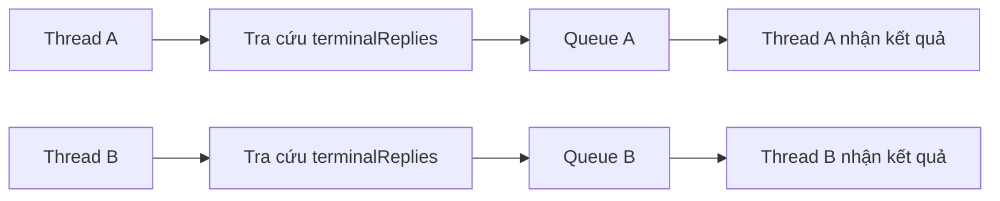
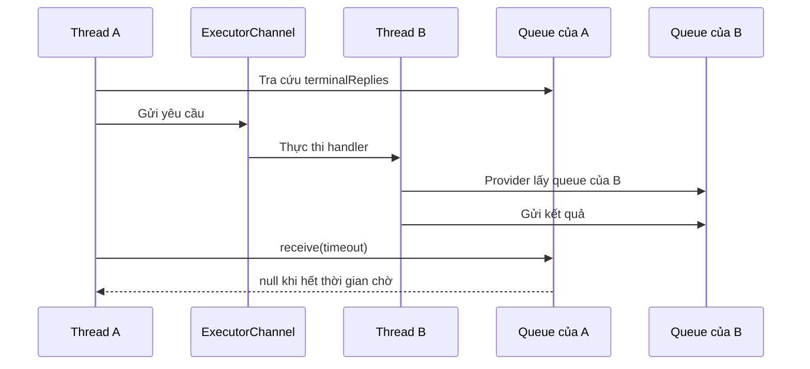

# Scoped channel

## 1. Bài toán: channel nào thuộc về lượt xử lý nào?

Trong Spring Integration Core, `MessageChannel` nối các endpoint của luồng thông điệp. Khi một ứng dụng có nhiều lượt xử lý đồng thời, bên cạnh cách chuyển message, ta còn phải quyết định những lượt xử lý đó dùng chung một channel hay mỗi ngữ cảnh có một instance riêng.

Ví dụ, một tác vụ chuẩn hóa dữ liệu chạy hoàn toàn trên thread gọi vào. Các kết quả trung gian được đưa vào một channel cuối luồng để chính tác vụ đó thu lại. Nếu mọi tác vụ cùng đọc một queue chung mà không có cơ chế ghép kết quả với yêu cầu, tác vụ A có thể lấy kết quả của tác vụ B.

**Scoped channel là một bean channel được quản lý theo một Spring bean scope.** Scope quyết định instance được chọn khi tra cứu bean. Kiểu channel vẫn quyết định cách gửi và nhận message. Spring Integration hỗ trợ gắn scope cho channel; `ThreadLocalChannel` của phiên bản 1.0 đã bị loại bỏ từ 2.0, nên không dùng lớp cũ này trong ví dụ mới. [Tài liệu Scoped Channel](https://docs.spring.io/spring-integration/reference/channel/implementations.html#scoped-channel).

Sau bài này, bạn có thể:

- Phân biệt scope của channel với cơ chế truyền message.
- Đăng ký scope `thread` và khai báo channel bằng Java hoặc XML.
- Dùng channel theo đúng ngữ cảnh khi cấu hình endpoint bằng Java DSL.
- Phân tích tác động của thread pool, poller, gateway và lỗi đến thiết kế.
- Thiết kế ví dụ kiểm thử chứng minh sự tách biệt giữa các instance.

## 2. Hai quyết định độc lập: kiểu channel và scope

Có thể mô tả một thiết kế bằng cặp thông tin `(kiểu channel, scope)`:

| Cấu hình | Cách truyền message | Cách chọn instance |
| --- | --- | --- |
| `DirectChannel`, singleton | Gọi subscriber trên thread gửi trong cấu hình thông thường | Dùng chung một bean trong container |
| `QueueChannel`, singleton | Đệm message để bên nhận gọi `receive()` | Dùng chung một queue |
| `QueueChannel`, thread | Vẫn dùng `send()` và `receive()` | Mỗi thread tra cứu bean nhận queue tương ứng |
| `QueueChannel`, request | Vẫn là queue | Mỗi HTTP request có instance theo scope đang hoạt động |

Spring định nghĩa `singleton`, `prototype` và các scope dành cho môi trường web như `request`, `session`. Scope `thread` có implementation sẵn nhưng không được đăng ký mặc định. [Bean Scopes](https://docs.spring.io/spring-framework/reference/core/beans/factory-scopes.html).

Từ cách tách hai quyết định này, ta suy ra ba điều khi thiết kế:

1. Gắn `scope="thread"` cho `QueueChannel` không tự tạo consumer hay thread xử lý.
2. Gắn scope cho `DirectChannel` không tự tạo các subscriber tương ứng cho từng instance mới.
3. Một `correlationId` trong header không tự chọn bean theo scope; muốn chọn theo khóa nghiệp vụ phải có thiết kế riêng.

`prototype` cũng cần được hiểu chính xác: mỗi lần container tạo hoặc cung cấp bean có thể là một instance mới. Nếu producer và consumer tra cứu độc lập hai queue prototype, họ có thể đang thao tác trên hai queue khác nhau. Với queue làm điểm trao đổi, phải xác định rõ hai bên lấy được cùng instance như thế nào.

## 3. Mô hình của thread-scoped channel

Giả sử bean có tên `terminalReplies` được khai báo theo scope `thread`:



Hãy coi scope là nơi tra cứu instance theo ngữ cảnh. Hợp đồng `Scope.get(name, objectFactory)` trả bean đã tồn tại trong ngữ cảnh, hoặc tạo bean qua factory nếu chưa có. `Scope` còn có các thao tác loại bỏ bean, đăng ký callback hủy và truy cập thông tin ngữ cảnh. [Javadoc Scope](https://docs.spring.io/spring-framework/docs/current/javadoc-api/org/springframework/beans/factory/config/Scope.html).

Ở ví dụ trên, cùng tên bean nhưng hai thread tra cứu được hai đối tượng khác nhau. Cùng một thread tra cứu nhiều lần sẽ nhận lại đối tượng đã có, cho đến khi đối tượng bị loại khỏi scope.

Đây là sự tách biệt khi **tra cứu qua container hoặc scoped proxy**. Nếu lấy queue thật của A rồi truyền trực tiếp tham chiếu đó sang B, B vẫn có thể gọi phương thức của queue đó. Vì vậy, scoped channel không phải cơ chế phân quyền truy cập đối tượng Java.

Với thread pool, quan hệ đáng chú ý là:

```text
task A ─┐
        ├─ chạy lần lượt trên worker-1 ─> cùng thread scope nếu chưa dọn
 task B ┘
```

Từ đó có thể thấy thread scope không đồng nghĩa với task scope. Một thread sống lâu có thể phục vụ nhiều tác vụ nghiệp vụ không liên quan.

## 4. Đăng ký scope và khai báo channel bằng Java

Ví dụ sau dùng Spring Context và `spring-integration-core`, với các phiên bản được quản lý đồng bộ theo BOM của dự án. Java DSL nằm trong core; không cần thêm thư viện Java DSL đời cũ. Nếu dùng Spring Boot, có thể dùng starter Spring Integration tương ứng.

```java
import org.springframework.beans.factory.config.CustomScopeConfigurer;
import org.springframework.context.annotation.Bean;
import org.springframework.context.annotation.Configuration;
import org.springframework.context.annotation.Scope;
import org.springframework.context.support.SimpleThreadScope;
import org.springframework.integration.channel.DirectChannel;
import org.springframework.integration.channel.QueueChannel;
import org.springframework.integration.config.EnableIntegration;

@Configuration(proxyBeanMethods = false)
@EnableIntegration
public class ScopedChannelConfig {

    @Bean
    public static CustomScopeConfigurer threadScopeConfigurer() {
        CustomScopeConfigurer configurer = new CustomScopeConfigurer();
        configurer.addScope("thread", new SimpleThreadScope());
        return configurer;
    }

    @Bean
    @Scope("thread")
    public QueueChannel terminalReplies() {
        return new QueueChannel(16);
    }

    @Bean
    public DirectChannel normalizeRequests() {
        return new DirectChannel();
    }
}
```

`CustomScopeConfigurer` đăng ký tên `thread` trước khi các bean thông thường được dùng. Factory method được khai báo `static` vì bean này tham gia xử lý cấu hình container sớm. `SimpleThreadScope` yêu cầu đăng ký tường minh, qua configurer hoặc `registerScope`. [Javadoc SimpleThreadScope](https://docs.spring.io/spring-framework/docs/current/javadoc-api/org/springframework/context/support/SimpleThreadScope.html).

Các lựa chọn trong cấu hình có chủ đích:

- `normalizeRequests` là singleton để endpoint có một điểm vào dùng chung.
- `terminalReplies` là queue giới hạn 16 message cho mỗi thread đang giữ instance.
- `@Scope("thread")` chưa tạo scoped proxy; phần tiếp theo sẽ dùng provider.
- `proxyBeanMethods = false` nghĩa là không dựa vào lời gọi trực tiếp giữa các method `@Bean` để lấy bean đã quản lý.

Dung lượng 16 là tham số minh họa. Nếu có 40 worker và mỗi worker giữ queue đầy, riêng số message đang đệm có thể lên tới `40 × 16 = 640`. Kích thước payload và tuổi thọ của worker quyết định lượng bộ nhớ thực tế.

## 5. Lấy đúng instance khi endpoint là singleton

### 5.1. Vì sao inject trực tiếp có thể làm sai ý định?

Xét cấu hình sau khi bean `terminalReplies` không có proxy:

```java
@Bean
public SomeService someService(QueueChannel terminalReplies) {
    return new SomeService(terminalReplies);
}
```

Container giải quyết tham số lúc tạo `SomeService`. Nếu service là singleton và giữ tham chiếu đó, các lần gọi sau vẫn dùng queue đã được inject. Việc thread gọi service thay đổi không khiến tham chiếu tự đổi.

Một cách khác cũng dễ gây lỗi là gọi `provider.getObject()` ngay khi xây `IntegrationFlow`, rồi giữ kết quả trong lambda. Dù có provider, thời điểm tra cứu vẫn quá sớm.

### 5.2. Dùng `ObjectProvider` tại thời điểm xử lý

`ObjectProvider` giải quyết lại đối tượng đích mỗi lần gọi `getObject()`. Scope của bean quyết định lần tra cứu đó trả instance nào; provider không mặc nhiên tạo bean mới. [Javadoc ObjectProvider](https://docs.spring.io/spring-framework/docs/current/javadoc-api/org/springframework/beans/factory/ObjectProvider.html).

Thêm các import và method sau vào `ScopedChannelConfig`:

```java
import java.util.Locale;

import org.springframework.beans.factory.ObjectProvider;
import org.springframework.beans.factory.annotation.Qualifier;
import org.springframework.integration.dsl.IntegrationFlow;
import org.springframework.messaging.MessageDeliveryException;
import org.springframework.messaging.MessageHandler;

@Bean
public IntegrationFlow normalizeFlow(
        @Qualifier("terminalReplies")
        ObjectProvider<QueueChannel> terminalReplies) {

    MessageHandler collectReply = message -> {
        QueueChannel current = terminalReplies.getObject();
        if (!current.send(message, 0)) {
            throw new MessageDeliveryException(
                    message, "terminalReplies đã đầy trong thread hiện tại");
        }
    };

    return IntegrationFlow.from("normalizeRequests")
            .<String, String>transform(
                    text -> text.trim().toUpperCase(Locale.ROOT))
            .handle(collectReply)
            .get();
}
```

Trong DSL, `transform` xây endpoint chuyển đổi, còn `handle` xây endpoint xử lý message. Các endpoint được nối bằng direct channel mặc định khi không khai báo ranh giới channel khác. [DSL Basics](https://docs.spring.io/spring-integration/reference/7.0/dsl/java-basics.html).

Điểm quan trọng của ví dụ là lambda gọi `getObject()` **khi message tới endpoint**, trên thread đang xử lý message. `@Qualifier` chỉ rõ bean cần lấy, tránh phụ thuộc việc context có thêm bao nhiêu queue khác.

Handler cuối dùng chính message sau transformer để gửi vào queue, thay vì dựng lại payload và vô tình bỏ các header ứng dụng. Handler này có hợp đồng một chiều: nó lưu kết quả vào queue đã chọn, không tạo thêm reply cho gateway.

Không thay đoạn handler bằng `.channel(terminalReplies.getObject())` tại thời điểm cấu hình. Cách đó đưa một instance cụ thể vào flow quá sớm. Nếu muốn nối bằng tên channel, có thể dùng scoped proxy thích hợp như phần 7.

### 5.3. Gửi yêu cầu, lấy kết quả và dọn instance

Ví dụ gọi dưới đây giả định tác vụ sở hữu độc quyền `terminalReplies` trên thread hiện tại, không lồng một tác vụ cùng dùng bean này vào giữa:

```java
import org.springframework.context.annotation.AnnotationConfigApplicationContext;
import org.springframework.integration.channel.QueueChannel;
import org.springframework.messaging.Message;
import org.springframework.messaging.MessageChannel;
import org.springframework.messaging.MessageDeliveryException;
import org.springframework.messaging.support.MessageBuilder;

public class ScopedChannelDemo {

    public static String execute(
            AnnotationConfigApplicationContext context, String text) {

        MessageChannel input = context.getBean(
                "normalizeRequests", MessageChannel.class);

        try {
            QueueChannel replies = context.getBean(
                    "terminalReplies", QueueChannel.class);

            Message<String> request = MessageBuilder.withPayload(text)
                    .setHeader("operationId", "normalize-demo")
                    .build();

            if (!input.send(request, 1000)) {
                throw new MessageDeliveryException(
                        request, "Không gửi được yêu cầu chuẩn hóa");
            }

            Message<?> reply = replies.receive(0);
            if (reply == null) {
                throw new IllegalStateException("Luồng chưa tạo kết quả");
            }
            return (String) reply.getPayload();
        }
        finally {
            context.getBeanFactory().destroyScopedBean("terminalReplies");
        }
    }

    public static void main(String[] args) {
        try (AnnotationConfigApplicationContext context =
                     new AnnotationConfigApplicationContext(
                             ScopedChannelConfig.class)) {
            System.out.println(execute(context, "  spring integration  "));
            System.out.println(execute(context, "  message channel  "));
        }
    }
}
```

Kết quả mong đợi:

```text
SPRING INTEGRATION
MESSAGE CHANNEL
```

Trace của một lần gọi:

1. Caller tra cứu queue của thread hiện tại.
2. Caller gửi vào `normalizeRequests`.
3. Transformer chạy và handler cuối tra cứu lại cùng queue.
4. Handler gửi kết quả vào queue trước khi `input.send()` kết thúc.
5. Caller đọc ngay kết quả, rồi hủy bean scoped trong `finally`.

Ở đây, `receive(0)` phù hợp vì toàn bộ chuỗi đến handler cuối chạy đồng bộ. Nếu thiết kế thay đổi để kết quả đến muộn, phải thiết kế lại hợp đồng chờ và nơi nhận kết quả.

Tham số timeout của `send(request, 1000)` không áp đặt hạn một giây cho toàn bộ nghiệp vụ chạy qua `DirectChannel`. Muốn giới hạn thời gian của lời gọi dịch vụ bên ngoài phải cấu hình timeout tại thành phần thực hiện lời gọi đó.

Với queue, `send(message, 0)` không chờ chỗ trống và `receive(0)` không chờ message; cần kiểm tra lần lượt `false` và `null`. Dung lượng hữu hạn và timeout tránh việc ví dụ bị chặn vô hạn. [Javadoc QueueChannel](https://docs.spring.io/spring-integration/api/org/springframework/integration/channel/QueueChannel.html).

## 6. Vòng đời và cleanup trên thread pool

`SimpleThreadScope` không tự dọn các đối tượng đã gắn với nó và không cung cấp vòng đời hủy đầy đủ như request scope. Vì thế, kết thúc một method nghiệp vụ không tự kết thúc scope `thread`. [SimpleThreadScope và cleanup](https://docs.spring.io/spring-framework/docs/current/javadoc-api/org/springframework/context/support/SimpleThreadScope.html).

Trong ví dụ, tầng sở hữu lượt xử lý gọi `destroyScopedBean("terminalReplies")` trên chính thread đã sử dụng bean. API này loại và hủy scoped bean trong ngữ cảnh hiện tại. [Javadoc ConfigurableBeanFactory](https://docs.spring.io/spring-framework/docs/current/javadoc-api/org/springframework/beans/factory/config/ConfigurableBeanFactory.html#destroyScopedBean(java.lang.String)).

Từ mô hình đó, các yêu cầu vận hành là:

- Dọn trong `finally`, kể cả transformer hoặc endpoint ném exception.
- Dọn trên worker sở hữu queue; dọn từ thread điều phối không chạm queue của worker khác.
- Thu kết quả cần giữ trước khi dọn. Không xem cleanup như cơ chế lưu trữ message chưa xử lý.
- Không giữ tham chiếu queue đã bị hủy để dùng cho lần gọi sau.
- Nếu có nhiều bean trong cùng scope, xác định vòng đời cho từng bean; dọn một bean không đóng toàn bộ thread scope.

`clear()` queue chỉ xử lý các message đang đệm, không loại bean khỏi scope. Ngược lại, gọi trực tiếp `Scope.remove()` trả về bean bị loại nhưng không tự thực thi destruction callback; người gọi phải đảm nhiệm việc hủy khi cần. [Hợp đồng Scope.remove](https://docs.spring.io/spring-framework/docs/current/javadoc-api/org/springframework/beans/factory/config/Scope.html#remove(java.lang.String)).

Với tác vụ lồng nhau trên một thread, `finally` của tác vụ con có thể hủy queue mà tác vụ cha đang dùng. Nếu cần cấu trúc này, hãy dùng instance cục bộ được truyền rõ ràng, hoặc thiết kế scope có phân biệt các lượt xử lý lồng nhau.

## 7. Scoped proxy và cấu hình XML

### 7.1. Chọn scoped proxy thay cho provider

Một lựa chọn khác là để singleton giữ proxy ổn định; proxy tra cứu bean đích theo scope mỗi khi gọi phương thức:

```java
import org.springframework.context.annotation.ScopedProxyMode;
import org.springframework.messaging.PollableChannel;

@Bean
@Scope(value = "thread", proxyMode = ScopedProxyMode.INTERFACES)
public PollableChannel terminalReplies() {
    return new QueueChannel(16);
}
```

Đây là cấu hình **thay thế** method `terminalReplies()` trước đó, không đăng ký thêm bean cùng tên. Khi dùng proxy interface, inject bằng `PollableChannel` hoặc `MessageChannel` tùy thao tác cần dùng; không đòi proxy phải là `QueueChannel` cụ thể. Scoped proxy là một cách Spring hỗ trợ dependency có scope ngắn hơn bean đang giữ nó. [Scoped Beans as Dependencies](https://docs.spring.io/spring-framework/reference/core/beans/factory-scopes.html#beans-factory-scopes-other-injection).

Với proxy này, có thể nối cuối flow bằng:

```java
return IntegrationFlow.from("normalizeRequests")
        .<String, String>transform(String::trim)
        .channel("terminalReplies")
        .get();
```

Cần sửa caller sang lấy `PollableChannel`. Nếu tự dọn bằng bean factory, target của scoped proxy theo quy ước Spring có tên `scopedTarget.terminalReplies`; không dùng nguyên tên proxy như ví dụ không proxy ở phần 5. Hãy chọn một cách tra cứu và giữ nhất quán cả khai báo, kiểu inject lẫn cleanup.

Proxy chỉ thay đổi cách lấy đối tượng đích. Nó không mang ngữ cảnh của thread A theo message sang thread B.

### 7.2. XML tương đương về ý tưởng

```xml
<?xml version="1.0" encoding="UTF-8"?>
<beans xmlns="http://www.springframework.org/schema/beans"
       xmlns:xsi="http://www.w3.org/2001/XMLSchema-instance"
       xmlns:int="http://www.springframework.org/schema/integration"
       xsi:schemaLocation="
           http://www.springframework.org/schema/beans
           https://www.springframework.org/schema/beans/spring-beans.xsd
           http://www.springframework.org/schema/integration
           https://www.springframework.org/schema/integration/spring-integration.xsd">

    <bean class="org.springframework.beans.factory.config.CustomScopeConfigurer">
        <property name="scopes">
            <map>
                <entry key="thread">
                    <bean class="org.springframework.context.support.SimpleThreadScope"/>
                </entry>
            </map>
        </property>
    </bean>

    <int:channel id="normalizeRequests"/>

    <int:channel id="terminalReplies" scope="thread">
        <int:queue capacity="16"/>
    </int:channel>

    <int:transformer input-channel="normalizeRequests"
                     output-channel="terminalReplies"
                     expression="payload.trim()"/>
</beans>
```

Trong parser XML của Spring Integration, channel mang custom scope được đăng ký thông qua scoped proxy dùng interface. Vì vậy, `<int:channel scope="thread">` không hoàn toàn tương đương với một method `@Bean` chỉ có `@Scope("thread")` mà không cấu hình proxy. Đây là chi tiết đã đối chiếu trực tiếp trong `AbstractChannelParser.registerBeanDefinition`. [Mã nguồn AbstractChannelParser](https://raw.githubusercontent.com/spring-projects/spring-integration/main/spring-integration-core/src/main/java/org/springframework/integration/config/xml/AbstractChannelParser.java).

Khi lấy channel XML để nhận kết quả, dùng `PollableChannel`. XML này cũng chỉ là khai báo scope theo thread; ứng dụng vẫn cần quản lý vòng đời sử dụng khi chạy trên thread pool.

## 8. Điều gì xảy ra khi đổi thread?

Giả sử sửa luồng để chạy một phần qua executor:



Đây là hệ quả của hai quy tắc: executor có thể chuyển việc sang thread khác, còn thread scope chọn bean theo thread tra cứu. Với poller, thread chạy tác vụ polling cũng không nhất thiết là thread đã gửi message vào queue.

Một consumer singleton giữ scoped proxy có thể poll queue thuộc thread scheduler, trong khi producer gửi vào queue thuộc thread request. Khi đó, việc producer gửi thành công không chứng minh consumer đang quan sát đúng queue.

| Ranh giới trong flow | Điều cần kiểm tra |
| --- | --- |
| Chuỗi `DirectChannel` | Endpoint có tự tạo công việc bất đồng bộ bên trong không? |
| `ExecutorChannel` | Thread xử lý thực tế có khác caller không? Không dựa vào trường hợp ngẫu nhiên cùng thread |
| `QueueChannel` với poller | Poller đang tra cứu hoặc giữ instance nào? |
| Aggregator có timeout | Đường giải phóng nhóm có thể chạy trên scheduler nào? |
| Reactive pipeline | Có scheduler hoặc cơ chế chuyển thread nào trong chuỗi không? |

Để đưa kết quả từ worker về đúng caller, có thể chọn một thiết kế khác:

- Dùng gateway request/reply và giữ đường trả lời trong message.
- Dùng channel chung cùng correlation key và thành phần ghép kết quả.
- Tạo đối tượng nhận kết quả riêng cho từng lời gọi rồi truyền tham chiếu có chủ đích trong phạm vi tiến trình.

Nếu message đi qua broker hoặc ranh giới tiến trình, tham chiếu đối tượng Java không phải địa chỉ trả lời có thể dùng trực tiếp. Khi đó cần thiết kế địa chỉ reply và correlation phù hợp với transport.

## 9. Quan hệ với gateway, router, filter và aggregator

### Gateway

Gateway thường tạo reply channel tạm thời và đưa đường trả lời vào header `replyChannel`. Vì vậy, bài toán một yêu cầu nhận một phản hồi thường có sẵn cơ chế của gateway; không cần thêm một thread-scoped queue chỉ để giữ phản hồi. [Messaging Gateways](https://docs.spring.io/spring-integration/reference/gateway.html#gateway-default-reply-channel).

Flow phần 5 chủ động kết thúc bằng handler gửi vào queue. Nếu đặt một gateway chờ kết quả trước flow này, gateway không tự đọc `terminalReplies`; phải thay đổi flow để trả theo hợp đồng gateway hoặc cấu hình cầu nối trả lời rõ ràng.

### Transformer và router

Transformer đổi nội dung, còn router chọn nhánh. Từ mô hình scope, ta suy ra việc route bằng tên `terminalReplies` vẫn cần xem đối tượng được phân giải là proxy hay target đã bị giữ từ trước. Router không tự biến thread scope thành scope theo mã đơn hàng.

### Filter

Nếu thêm filter có thể loại message trước điểm cuối, caller có thể không nhận được kết quả. Cần xác định hợp đồng: loại message là kết quả bình thường, gửi sang discard channel, hay phát sinh lỗi. Trong ví dụ đồng bộ, `receive(0)` giúp lộ ngay tình huống thiếu kết quả thay vì đợi vô hạn.

### Aggregator

Aggregator nhóm các message có liên quan, lưu trạng thái nhóm và dùng điều kiện release để quyết định lúc tổng hợp. Correlation và release thuộc trách nhiệm của aggregator. [Aggregator](https://docs.spring.io/spring-integration/reference/aggregator.html).

Một queue riêng cho từng thread không thay thế logic đó. Nếu cùng thread xử lý nhiều đơn hàng, chúng vẫn có thể đi qua cùng queue. Nếu nhiều worker tạo kết quả cho cùng đơn hàng, thread scope lại chia chúng ra nhiều queue. Với yêu cầu nhóm theo `orderId`, hãy thiết kế correlation theo `orderId` và vòng đời message group.

## 10. Xử lý lỗi và ngữ cảnh đang hoạt động

Trong chuỗi đồng bộ dùng `DirectChannel`, exception có thể truyền về caller. Khi việc xử lý chạy trong task bất đồng bộ do Spring Integration quản lý, lỗi có thể được gửi dưới dạng `ErrorMessage`, dựa trên `errorChannel` trong header hoặc error channel chung theo cấu hình. [Error Handling](https://docs.spring.io/spring-integration/reference/error-handling.html).

Hệ quả đối với ví dụ scoped channel:

- Transformer ném lỗi: caller không tiếp tục đọc kết quả; `finally` vẫn phải dọn queue.
- Queue đầy: handler minh họa chuyển kết quả `false` thành `MessageDeliveryException` để lỗi không bị bỏ qua.
- Worker gửi lỗi vào channel thread-scoped: channel được chọn theo thread worker, không tự về caller.
- Request scope hết hiệu lực: một lần gọi proxy hoặc provider về sau có thể thất bại vì ngữ cảnh không còn hoạt động.

Lỗi về scope và lỗi giao message nên được chẩn đoán riêng:

| Hiện tượng | Nguyên nhân cần kiểm tra |
| --- | --- |
| Không đăng ký scope `thread` | Thiếu hoặc chưa áp dụng `CustomScopeConfigurer` |
| Scope không hoạt động | Truy cập request/session scope ngoài ngữ cảnh hợp lệ |
| Gửi thành công nhưng không nhận được | Producer và consumer dùng hai instance khác nhau |
| Nhận message của tác vụ trước | Thread tái sử dụng và dữ liệu chưa được thu hoặc dọn |
| Lỗi ép proxy về `QueueChannel` | Đang dùng interface proxy nhưng tra cứu bằng lớp cụ thể |
| Direct channel mới không có subscriber | Scope tạo instance mới nhưng endpoint chưa subscribe vào instance đó |

Khi log, nên ghi `operationId`, tên thread và tên channel. Nếu đang dùng proxy, mã định danh đối tượng proxy không chứng minh target là cùng một queue; cần quan sát target ở nơi tra cứu hoặc hành vi gửi/nhận thực tế. Tránh đưa dữ liệu nhạy cảm trong payload vào log chỉ để nhận diện lượt xử lý.

## 11. Thực hành kiểm chứng sự tách biệt giữa hai thread

Ví dụ JUnit 5 sau dùng `ScopedChannelConfig` ở phần 4 và method flow ở phần 5. Nó cố ý giữ một message trong queue của thread kiểm thử trước khi worker tra cứu cùng tên bean. Test không dựa vào `Thread.sleep()`.

```java
import java.util.concurrent.ExecutorService;
import java.util.concurrent.Executors;
import java.util.concurrent.Future;
import java.util.concurrent.TimeUnit;

import org.junit.jupiter.api.Test;
import org.springframework.context.annotation.AnnotationConfigApplicationContext;
import org.springframework.integration.channel.QueueChannel;
import org.springframework.messaging.Message;
import org.springframework.messaging.support.GenericMessage;

import static org.junit.jupiter.api.Assertions.*;

class ScopedChannelTest {

    @Test
    void eachThreadResolvesItsOwnQueue() throws Exception {
        try (AnnotationConfigApplicationContext context =
                     new AnnotationConfigApplicationContext(
                             ScopedChannelConfig.class)) {

            QueueChannel mainQueue = context.getBean(
                    "terminalReplies", QueueChannel.class);
            assertTrue(mainQueue.send(new GenericMessage<>("main"), 0));

            ExecutorService worker = Executors.newSingleThreadExecutor();
            try {
                Future<QueueChannel> result = worker.submit(() -> {
                    QueueChannel workerQueue = context.getBean(
                            "terminalReplies", QueueChannel.class);
                    try {
                        assertSame(workerQueue, context.getBean(
                                "terminalReplies", QueueChannel.class));
                        assertNull(workerQueue.receive(0));
                        assertTrue(workerQueue.send(
                                new GenericMessage<>("worker"), 0));
                        Message<?> message = workerQueue.receive(0);
                        assertNotNull(message);
                        assertEquals("worker", message.getPayload());
                        return workerQueue;
                    }
                    finally {
                        context.getBeanFactory()
                                .destroyScopedBean("terminalReplies");
                    }
                });

                assertNotSame(mainQueue, result.get(5, TimeUnit.SECONDS));
                Message<?> message = mainQueue.receive(0);
                assertNotNull(message);
                assertEquals("main", message.getPayload());
                assertNull(mainQueue.receive(0));
            }
            finally {
                worker.shutdownNow();
                assertTrue(worker.awaitTermination(5, TimeUnit.SECONDS));
                context.getBeanFactory()
                        .destroyScopedBean("terminalReplies");
            }
        }
    }
}
```

Test kiểm tra cả identity lẫn dữ liệu: hai lần tra cứu trên worker trả cùng instance; worker không nhìn thấy message đã gửi ở thread kiểm thử; hai queue trả kết quả riêng. Tham chiếu worker queue được trả về chỉ để so sánh identity sau cleanup, không dùng tiếp để gửi hoặc nhận.

Các tình huống bổ sung nên thực hành khi mở rộng ví dụ:

| Tình huống | Điều cần quan sát |
| --- | --- |
| Chạy `execute()` lần lượt hai lần trên cùng worker | Mỗi lần trả kết quả của chính lời gọi; cleanup tạo ranh giới sử dụng |
| Không dọn rồi để lại message trên worker cố định | Tác vụ sau thấy dữ liệu còn lại, chứng minh thread scope không phải task scope |
| Transformer phát sinh exception | Exception tới caller và lần gọi sau bắt đầu với queue mới |
| Gửi message thứ 17 vào queue đầy | `send(message, 0)` trả `false` |
| Chuyển handler cuối sang executor | Queue được tra cứu theo worker; phải thiết kế lại đường phản hồi |
| Thêm filter hoặc nhánh router không sinh kết quả | Caller xử lý được trường hợp không có reply theo hợp đồng đã định |

Đây là mã thực hành cho người học. Khi đưa vào dự án, dùng hệ dependency và bộ chạy kiểm thử của dự án để thực thi các tình huống tương ứng.

## 12. Chọn scope theo yêu cầu thực tế

Scoped channel hữu ích khi cần instance channel gắn với một ngữ cảnh có vòng đời xác định. Trước khi áp dụng, hãy xác định khóa ngữ cảnh, nơi tra cứu target, các ranh giới thread và thành phần chịu trách nhiệm cleanup.

| Nhu cầu | Hướng thiết kế |
| --- | --- |
| Pipeline đồng bộ, một caller thu kết quả trên cùng thread | Thread-scoped terminal queue nếu cần lưu đệm cục bộ |
| Một lời gọi cần một phản hồi | Gateway request/reply |
| Nhiều worker xử lý cùng nghiệp vụ | Channel chung, correlation và cơ chế ghép kết quả |
| Dữ liệu theo HTTP request | Request scope trong web context phù hợp, có vòng đời rõ ràng |
| Kết quả cần tồn tại sau khi task hoặc tiến trình kết thúc | Message store hoặc transport phù hợp với yêu cầu bền vững |
| Một ngữ cảnh nghiệp vụ chạy qua nhiều thread | Thiết kế context propagation và vòng đời tường minh; cân nhắc custom scope |

Nếu tự xây custom scope, phải thiết kế đồng thời cách xác định ngữ cảnh, chia sẻ instance khi có cạnh tranh, cleanup và xử lý truy cập ngoài vòng đời. Chỉ đặt tên scope theo `tenantId` hay `operationId` chưa giải quyết các yêu cầu này.

Với bài thực hành hiện tại, điều kiện sử dụng rất cụ thể: caller và endpoint cuối chạy cùng thread; endpoint lấy queue tại thời điểm xử lý; caller thu kết quả trước khi dọn; mỗi lượt xử lý sở hữu queue trong khoảng thời gian đó. Khi một điều kiện thay đổi, cần xem lại thiết kế đường phản hồi và vòng đời channel.