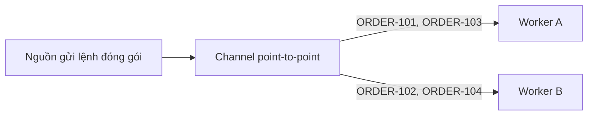
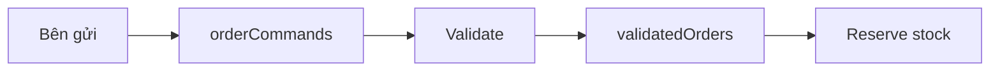

# Point-to-point semantics

Trong module **SPRING_INTEGRATION_CORE**, chương **Kiểu channel**, point-to-point semantics mô tả cách một channel phân phối mỗi thông điệp cho một bên tiêu thụ. Hiểu hợp đồng này giúp kết nối đúng `Message`, `MessageChannel`, endpoint và gateway, đồng thời tránh cấu hình một luồng thông điệp chạy thiếu bước hoặc xử lý trùng nghiệp vụ.

Bài học tập trung vào ngữ nghĩa phân phối, cách hiện thực bằng `DirectChannel`, `QueueChannel`, `ExecutorChannel`, cách nối endpoint bằng Java DSL và những giới hạn cần xét khi xử lý lỗi.

## 1. Mục tiêu học tập

Sau bài học, bạn có thể:

- Giải thích vì sao một channel point-to-point vẫn có thể có nhiều consumer.
- Phân biệt số bên nhận với số luồng thực thi, bộ đệm và độ bền dữ liệu.
- Cấu hình các worker cùng tiêu thụ một channel mà không nhầm với chuỗi xử lý.
- Phân tích load balancing, failover, kết quả `send()` và ảnh hưởng của transaction.
- Thiết kế kiểm thử xác nhận việc phân phối mà không phụ thuộc vào thứ tự chạy ngẫu nhiên.

Các ví dụ sử dụng Java 17 trở lên và API Spring Integration 6.5.x. Project cần dependency `org.springframework.integration:spring-integration-core`; các lớp cấu hình dùng Spring Context. Phần kiểm thử dùng JUnit Jupiter 5. Quản lý các dependency Spring theo cùng một bộ phiên bản tương thích.

## 2. Point-to-point có nghĩa gì?

Một channel point-to-point chuyển một thông điệp cho một consumer trong nhóm consumer của channel đó. Nhiều consumer có thể cùng chờ công việc; channel điều phối để các công việc được chia cho nhóm. Đây là mô hình phù hợp khi mỗi lệnh chỉ cần một worker thực hiện. Định nghĩa mẫu nằm trong [Enterprise Integration Patterns: Point-to-Point Channel](https://www.enterpriseintegrationpatterns.com/patterns/messaging/PointToPointChannel.html).

Ví dụ: mỗi yêu cầu đóng gói đơn hàng được giao cho một worker. Hai worker đều có khả năng đóng gói, nhưng không cần cùng đóng gói một đơn.



Các nhãn trên sơ đồ là một cách phân phối minh họa. Chúng không khẳng định mọi channel point-to-point đều dùng round-robin.

Cần tách ba ý:

1. **Một channel có thể có nhiều consumer.** Chữ “point-to-point” không giới hạn channel chỉ có một subscriber.
2. **Một lần phân phối bình thường chọn một consumer.** Các consumer còn lại không tự nhận bản sao của thông điệp đó.
3. **Hợp đồng phân phối không đồng nghĩa hoàn tất nghiệp vụ đúng một lần.** Consumer có thể lỗi, bên gửi có thể thử lại và failover có thể tạo thêm lần gọi handler.

Với dispatcher hỗ trợ failover, một thông điệp có thể được thử trên nhiều handler theo thứ tự cho đến khi một handler xử lý không ném lỗi. Vì vậy, phát biểu “mỗi message chỉ được gọi đúng một handler trong mọi tình huống” quá mạnh. Cơ chế dừng sau handler chấp nhận thông điệp được mô tả trong [Javadoc của UnicastingDispatcher](https://docs.spring.io/spring-integration/api/org/springframework/integration/dispatcher/UnicastingDispatcher.html).

### Consumer đang được nói tới là ai?

Trong một luồng Spring Integration, consumer ở ranh giới channel thường là endpoint nhận thông điệp từ channel, chẳng hạn service activator, transformer hoặc router. Endpoint có thể tiếp tục chuyển thông điệp sang channel khác.

Do đó, một thông điệp có thể đi qua nhiều endpoint trong toàn bộ luồng, nhưng chỉ được giao cho một nhánh tiêu thụ tại mỗi ranh giới point-to-point.

## 3. Bốn câu hỏi độc lập khi chọn channel

Không thể suy ra toàn bộ hành vi của channel chỉ từ nhãn point-to-point.

| Câu hỏi | Ý nghĩa | Ví dụ |
| --- | --- | --- |
| Ai nhận thông điệp? | Phân phối cho một consumer hay phát cho nhiều subscriber? | Point-to-point và publish-subscribe |
| Handler chạy ở đâu? | Luồng của bên gửi hay một luồng thực thi khác? | `DirectChannel` và `ExecutorChannel` |
| Thông điệp chờ ở đâu? | Gọi trực tiếp, chờ trong hàng đợi hay chờ được nhận? | `DirectChannel`, `QueueChannel`, `RendezvousChannel` |
| Điều gì xảy ra khi lỗi hoặc tiến trình dừng? | Có lưu bền, rollback, thử lại hoặc khôi phục hay không? | Queue trong bộ nhớ khác queue dùng persistent store |

Một số hiện thực thường gặp:

| Channel | Phân phối | Cách nhận | Đặc điểm thực thi |
| --- | --- | --- | --- |
| `DirectChannel` | Point-to-point | Đẩy đến subscriber | Handler chạy trên luồng gửi |
| `ExecutorChannel` | Point-to-point | Đẩy đến subscriber qua executor | Phụ thuộc executor; thường tách luồng gửi |
| `QueueChannel` | Point-to-point | Consumer gọi `receive()` | Channel chứa queue; consumer quyết định lúc lấy và thực thi |
| `PublishSubscribeChannel` | Phát đến các subscriber | Đẩy đến subscriber | Mặc định gọi trên luồng gửi; có thể cấu hình executor |

Bảng cho thấy point-to-point không buộc phải có queue và cũng không buộc phải bất đồng bộ. Các cơ chế này được trình bày trong [tài liệu các hiện thực Message Channel](https://docs.spring.io/spring-integration/reference/6.5/channel/implementations.html).

### Subscribable và pollable

`SubscribableChannel` cung cấp `subscribe(MessageHandler)` và `unsubscribe(MessageHandler)`. Consumer đăng ký để channel gọi handler khi có thông điệp.

`PollableChannel` cung cấp `receive()` và `receive(long timeout)`. Consumer chủ động lấy thông điệp ra khỏi channel.

Đây là khác biệt về giao diện nhận. `SubscribableChannel` không đồng nghĩa publish-subscribe: `DirectChannel` cũng triển khai giao diện này nhưng có semantics point-to-point. Xem [các giao diện MessageChannel](https://docs.spring.io/spring-integration/reference/channel/interfaces.html).

## 4. DirectChannel: chia công việc trên luồng của bên gửi

Khi bên gửi gọi `DirectChannel.send(message)`:

1. Channel chuyển thông điệp cho dispatcher.
2. Dispatcher chọn một handler trong các subscriber.
3. Handler được gọi trực tiếp trên luồng đang gọi `send()`.
4. Nếu việc dispatch thành công, `send()` trả về sau khi lời gọi handler kết thúc.

Constructor mặc định dùng round-robin. Có thể truyền `null` vào constructor để không dùng load balancing, và dùng `setFailover(false)` để tắt chuyển sang handler khác khi lỗi. Hai tùy chọn này độc lập với nhau. Xem [Javadoc của DirectChannel](https://docs.spring.io/spring-integration/api/org/springframework/integration/channel/DirectChannel.html).

### Load balancing không tự tạo song song

Giả sử một luồng gửi lần lượt sáu thông điệp vào channel có hai subscriber:

```text
send(M1) -> worker được chọn xử lý xong -> return
send(M2) -> worker được chọn xử lý xong -> return
send(M3) -> ...
```

Có hai worker không làm ba lời gọi trên tự chạy đồng thời. Nếu mỗi công việc mất 100 ms, một luồng gửi tuần tự vẫn chỉ hoàn thành xấp xỉ 10 công việc mỗi giây, bỏ qua chi phí khác.

Ngược lại, nếu nhiều luồng cùng gọi `send()`, các handler có thể được gọi đồng thời. Point-to-point không khóa toàn bộ channel thành một luồng duy nhất. Đối tượng nghiệp vụ dùng chung phải đáp ứng yêu cầu an toàn luồng.

Round-robin phân phối lượt gọi giữa các subscriber đang có. Nó không đo độ bận của worker, không bảo đảm thời gian xử lý bằng nhau và không phân phối giữa các JVM độc lập.

### Không có subscriber

`DirectChannel` không có hàng đợi để giữ thông điệp chờ endpoint xuất hiện. Nếu gửi khi chưa có subscriber, đường dispatch phát sinh lỗi. Trong thực tế, cần kiểm tra vòng đời endpoint, tên channel và cấu hình ứng dụng khi gặp lỗi dạng `Dispatcher has no subscribers`.

Không áp dụng quy tắc này cho `QueueChannel`: queue còn chỗ vẫn có thể nhận thông điệp trước khi có consumer.

## 5. Ví dụ Java DSL: hai worker cùng nhận lệnh đóng gói

Đây là ví dụ chạy độc lập bằng Spring Context. Mỗi worker thực hiện cùng một nhiệm vụ và ghi kết quả vào bộ thu trong bộ nhớ để quan sát việc phân phối.

```java
import java.util.List;
import java.util.concurrent.CopyOnWriteArrayList;

import org.springframework.beans.factory.annotation.Qualifier;
import org.springframework.context.annotation.AnnotationConfigApplicationContext;
import org.springframework.context.annotation.Bean;
import org.springframework.context.annotation.Configuration;
import org.springframework.integration.channel.DirectChannel;
import org.springframework.integration.config.EnableIntegration;
import org.springframework.integration.dsl.IntegrationFlow;
import org.springframework.messaging.support.GenericMessage;

@Configuration
@EnableIntegration
public class PointToPointConfig {

    @Bean
    public DirectChannel orderCommands() {
        DirectChannel channel = new DirectChannel();
        channel.setFailover(false);
        return channel;
    }

    @Bean
    public HandledOrders handledOrders() {
        return new HandledOrders();
    }

    @Bean
    public IntegrationFlow workerA(
            @Qualifier("orderCommands") DirectChannel input,
            HandledOrders results) {

        return IntegrationFlow.from(input)
                .handle(String.class, (orderId, headers) -> {
                    results.record("A", orderId);
                    return null;
                })
                .get();
    }

    @Bean
    public IntegrationFlow workerB(
            @Qualifier("orderCommands") DirectChannel input,
            HandledOrders results) {

        return IntegrationFlow.from(input)
                .handle(String.class, (orderId, headers) -> {
                    results.record("B", orderId);
                    return null;
                })
                .get();
    }

    public static final class HandledOrders {
        private final List<String> entries = new CopyOnWriteArrayList<>();

        public void record(String worker, String orderId) {
            entries.add(worker + ":" + orderId);
        }

        public List<String> snapshot() {
            return List.copyOf(entries);
        }
    }

    public static void main(String[] args) {
        try (AnnotationConfigApplicationContext context =
                     new AnnotationConfigApplicationContext(
                             PointToPointConfig.class)) {

            DirectChannel input =
                    context.getBean("orderCommands", DirectChannel.class);

            for (int i = 1; i <= 6; i++) {
                boolean sent =
                        input.send(new GenericMessage<>("ORDER-" + i));
                if (!sent) {
                    throw new IllegalStateException("Không gửi được lệnh");
                }
            }

            System.out.println(
                    context.getBean(HandledOrders.class).snapshot());
        }
    }
}
```

Lưu lớp thành `PointToPointConfig.java` trong project có các dependency đã nêu. Khi context khởi động, hai flow đăng ký endpoint vào cùng bean `orderCommands`. Java DSL tạo và đăng ký các thành phần này trong application context; xem [Java DSL của Spring Integration](https://docs.spring.io/spring-integration/reference/6.5/dsl.html).

Trong điều kiện của ví dụ:

- Có sáu bản ghi kết quả cho sáu thông điệp gửi thành công.
- Với hai subscriber giữ nguyên và round-robin mặc định, mỗi worker nhận ba thông điệp.
- Cả hai worker chạy trên luồng đang gửi trong `main`.
- Không cần poller vì đầu vào là `DirectChannel`.
- `return null` kết thúc nhánh xử lý, không sinh reply. Điều này không có nghĩa worker từ chối thông điệp.
- `setFailover(false)` được đặt rõ để khi một worker lỗi, lỗi được trả về bên gửi thay vì thử worker còn lại.

Không lấy tên worker nhận thông điệp đầu tiên làm hợp đồng nghiệp vụ. Thứ tự đăng ký endpoint và cấu hình dispatcher có thể thay đổi khi cấu hình ứng dụng thay đổi.

### Hai subscriber không phải hai bước liên tiếp

Nếu thay hai worker bằng:

```text
validateOrder nhận từ orderCommands
reserveStock nhận từ orderCommands
```

thì một thông điệp sẽ được giao cho một trong hai endpoint. Đơn hàng có thể được kiểm tra nhưng không giữ hàng, hoặc giữ hàng nhưng chưa kiểm tra.

Nếu cả hai bước đều bắt buộc, hãy nối chúng thành pipeline:



Một flow DSL có thể biểu diễn pipeline bằng `.transform(...)` rồi `.handle(...)`. Transformer phải tạo đầu ra cho bước sau; một handler kết thúc bằng `null` sẽ không tự tiếp tục chuỗi xử lý.

Đây là kết luận trực tiếp từ topology: các endpoint cùng dùng một đầu vào point-to-point là các lựa chọn tiêu thụ; các bước bắt buộc phải có đường truyền đầu ra tới bước kế tiếp.

## 6. QueueChannel: cạnh tranh lấy công việc từ queue

`QueueChannel` giữ thông điệp trong queue. Consumer lấy được một phần tử bằng `receive()` sẽ loại phần tử đó khỏi queue; consumer khác không lấy lại chính phần tử vừa bị lấy ra trong lần nhận thông thường đó.

Đoạn mã sau đặt bên trong một phương thức; các lớp sử dụng là `org.springframework.integration.channel.QueueChannel`, `org.springframework.messaging.Message` và `org.springframework.messaging.support.GenericMessage`:

```java
QueueChannel jobs = new QueueChannel(2);

boolean accepted = jobs.send(new GenericMessage<>("ORDER-101"), 0);

Message<?> receivedByA = jobs.receive(0);
Message<?> receivedByB = jobs.receive(0);

System.out.println(accepted);                     // true
System.out.println(receivedByA.getPayload());     // ORDER-101
System.out.println(receivedByB);                  // null
```

Ở đây không có producer hoặc consumer khác. Worker A lấy trước nên nhận thông điệp; worker B nhận `null` vì queue đã rỗng. Trong hệ thống có nhiều consumer đồng thời, worker nào lấy trước phụ thuộc lịch thực thi.

### Timeout và dung lượng

Với `QueueChannel` trong bộ nhớ:

- `send(message, 0)` thử đưa vào ngay; queue đầy thì trả `false`.
- `send(message, 500)` có thể chờ tối đa 500 ms để có chỗ.
- `receive(0)` thử lấy ngay; queue rỗng thì trả `null`.
- Biến thể không truyền timeout có thể chờ vô thời hạn khi queue đầy hoặc rỗng tương ứng.

Constructor `new QueueChannel(100)` đặt sức chứa cho queue. Constructor không tham số có giới hạn thực tế là `Integer.MAX_VALUE`, nên không phù hợp để coi như cơ chế bảo vệ bộ nhớ trước lượng thông điệp tăng liên tục. Các constructor và timeout được mô tả trong [Javadoc của QueueChannel](https://docs.spring.io/spring-integration/api/org/springframework/integration/channel/QueueChannel.html).

Timeout của `send()` là thời gian chờ channel nhận thông điệp theo cơ chế của channel. Đặc biệt, `direct.send(message, 500)` không đặt giới hạn 500 ms cho toàn bộ xử lý nghiệp vụ của handler đồng bộ.

### Polling endpoint trong Java DSL

Nếu dùng endpoint Spring Integration để tiêu thụ `QueueChannel`, endpoint cần poller tường minh hoặc poller mặc định của context. Hai phương thức bean dưới đây đặt trong một lớp có `@Configuration` và `@EnableIntegration`:

```java
import java.time.Duration;

import org.springframework.context.annotation.Bean;
import org.springframework.integration.channel.QueueChannel;
import org.springframework.integration.dsl.IntegrationFlow;
import org.springframework.integration.dsl.Pollers;

@Bean
public QueueChannel bufferedOrders() {
    return new QueueChannel(100);
}

@Bean
public IntegrationFlow bufferedWorker(QueueChannel bufferedOrders) {
    return IntegrationFlow.from(bufferedOrders)
            .handle(String.class, (orderId, headers) -> {
                System.out.println("Đóng gói: " + orderId);
                return null;
            }, endpoint -> endpoint.poller(
                    Pollers.fixedDelay(Duration.ofMillis(100))
                            .receiveTimeout(0)
                            .maxMessagesPerPoll(10)))
            .get();
}
```

Đây là phần khai báo bean, không phải một compilation unit Java độc lập. `receiveTimeout(0)` tránh việc mỗi lần poll phải chờ khi queue rỗng. `maxMessagesPerPoll(10)` giới hạn số thông điệp lấy trong một lượt poll; nó không tạo mười worker.

Có thể định nghĩa thêm endpoint tiêu thụ cùng bean `bufferedOrders`. Tuy nhiên, muốn xử lý đồng thời phải bố trí scheduler hoặc executor có khả năng chạy các tác vụ đồng thời. Có nhiều polling endpoint không tự bảo đảm có nhiều luồng thực thi. Việc biến đầu vào pollable thành `PollingConsumer` và vai trò poller được trình bày trong [Message Endpoints](https://docs.spring.io/spring-integration/reference/endpoint.html).

Khác với `DirectChannel`, việc chia công việc của queue đến từ các lần lấy phần tử cạnh tranh nhau. Không có round-robin mặc định giữa các polling consumer để bảo đảm mỗi worker nhận đúng một nửa.

### Lấy khỏi queue chưa phải hoàn tất nghiệp vụ

Với queue trong bộ nhớ mặc định:

```text
receive() lấy thông điệp khỏi queue
    -> handler bắt đầu xử lý
    -> handler ném lỗi
```

Channel không tự đưa thông điệp trở lại queue chỉ vì handler lỗi. Cần thiết kế retry, nhánh phục hồi hoặc cơ chế giao nhận phù hợp.

Nếu cần lưu bền, có thể dùng persistent message store hoặc một hệ thống thông điệp bên ngoài qua adapter thích hợp. Với store hỗ trợ transaction và poller cấu hình transaction đúng, việc lấy khỏi store có thể rollback khi xử lý thất bại. Đây là khả năng của cấu hình lưu trữ và transaction cụ thể, không phải thuộc tính tự có của mọi channel point-to-point. Xem [cấu hình persistent QueueChannel](https://docs.spring.io/spring-integration/reference/channel/configuration.html#channel-configuration-queuechannel).

## 7. ExecutorChannel: tách thực thi nhưng vẫn chọn một consumer

`ExecutorChannel` nhận một executor và dùng dispatcher point-to-point. Tạo thêm thread không biến nó thành channel phát thông điệp cho mọi subscriber.

Ví dụ biểu thức cấu hình khi đã có một `TaskExecutor` thích hợp:

```java
ExecutorChannel channel = new ExecutorChannel(taskExecutor);
```

Lớp channel nằm trong package `org.springframework.integration.channel`. Executor phải được cấu hình và quản lý vòng đời riêng trong ứng dụng.

Điểm khác biệt cần đánh giá là thời điểm `send()` trả về: với executor thực sự bất đồng bộ, task có thể mới được chấp nhận để chạy trong khi handler chưa hoàn thành. Hàng đợi tác vụ của executor cũng không phải queue lưu bền thông điệp. Xem [Javadoc của ExecutorChannel](https://docs.spring.io/spring-integration/api/org/springframework/integration/channel/ExecutorChannel.html).

Hành vi tách luồng phụ thuộc executor. Executor đồng bộ có thể chạy ngay trên luồng gọi; chính sách như `CallerRunsPolicy` cũng có thể đẩy việc thực thi về luồng gửi khi quá tải. Vì vậy, không dựa vào `ExecutorChannel` để duy trì transaction gắn với luồng gửi.

Khi chọn executor, cần xác định số luồng, sức chứa hàng đợi tác vụ và hành vi khi bị từ chối. Chỉ tăng số subscriber mà không tăng năng lực thực thi chưa chắc tăng thông lượng.

## 8. Load balancing và failover giải quyết hai vấn đề khác nhau

**Load balancing** quyết định thứ tự chọn handler cho các thông điệp.

**Failover** quyết định có thử handler tiếp theo khi handler hiện tại ném lỗi hay không.

Với `DirectChannel`, cấu hình mặc định bật round-robin và failover. Để ưu tiên một handler rồi mới dùng các handler dự phòng theo thứ tự cố định, có thể dùng `new DirectChannel(null)` và giữ failover bật. Để dừng ngay ở lỗi đầu tiên, gọi `setFailover(false)`. Tham khảo [cấu hình DirectChannel](https://docs.spring.io/spring-integration/reference/channel/configuration.html#channel-configuration-directchannel).

Ví dụ bên trong một phương thức, với các lớp `DirectChannel`, `MessageHandlingException` và `GenericMessage` từ Spring:

```java
DirectChannel primaryBackup = new DirectChannel(null);

primaryBackup.subscribe(message -> {
    throw new MessageHandlingException(
            message, "Worker chính không xử lý được");
});

primaryBackup.subscribe(message ->
        System.out.println("Worker dự phòng nhận: " + message.getPayload()));

primaryBackup.send(new GenericMessage<>("ORDER-101"));
```

Hai handler không cấu hình mức ưu tiên riêng; thứ tự đăng ký trong ví dụ đặt handler chính trước handler dự phòng. Handler đầu lỗi, dispatcher thử handler tiếp theo. Sau khi handler dự phòng trả về bình thường, dispatcher không tiếp tục gọi các handler còn lại.

### Tác động nghiệp vụ có thể bị lặp

Xét một handler thực hiện:

```text
A: tạo vận đơn thành công ở dịch vụ bên ngoài
A: ghi nhật ký nội bộ thất bại, ném exception
dispatcher: failover sang B
B: tạo vận đơn lần nữa
```

Việc A ném exception không chứng minh A chưa làm gì. Cả hai lần gọi có thể tạo tác động, dù chỉ B là handler kết thúc bình thường.

Lỗi cũng có thể xuất hiện ở downstream của nhánh A sau khi A đã cập nhật dữ liệu. Với một chuỗi đồng bộ, lỗi đó có thể đi ngược về dispatcher ban đầu và kích hoạt failover cho cả nhánh.

Từ đó, khi các worker có thao tác không thể lặp tùy ý, thiết kế cần:

- Xác định lỗi nào phù hợp để thử lại hoặc chuyển worker.
- Dùng khóa nghiệp vụ ổn định, chẳng hạn `requestId`, để nhận biết lệnh đã thực hiện.
- Đặt quy tắc chống trùng tại ranh giới tạo tác động, thay vì chỉ đếm số lần nhận message.
- Phối hợp lưu trạng thái chống trùng với transaction khi tài nguyên cho phép.

Spring Integration cung cấp `IdempotentReceiverInterceptor` để hỗ trợ đánh dấu hoặc lọc thông điệp trùng, nhưng tính idempotent của nghiệp vụ vẫn cần ứng dụng thiết kế. Xem [Idempotent Receiver](https://docs.spring.io/spring-integration/reference/6.5/handler-advice/idempotent-receiver.html).

Tắt failover giảm một nguồn thử lại trong dispatcher; bên gửi hoặc hạ tầng khác vẫn có thể gửi lại lệnh.

### Filter từ chối không mặc nhiên chuyển sang worker khác

Nếu một filter loại thông điệp mà không ném lỗi, dispatcher có thể coi lời gọi endpoint đã hoàn tất. Thông điệp không tự được chuyển sang subscriber kế tiếp để “tìm một người chịu nhận”.

Tương tự, handler trả `null` thường thể hiện không tạo reply, không phải tín hiệu yêu cầu dispatcher chọn consumer khác. Khi cần quyết định dựa trên nội dung, dùng router hoặc thiết kế discard channel rõ ràng. Hành vi loại thông điệp của filter được mô tả tại [Filter](https://docs.spring.io/spring-integration/reference/6.5/filter.html).

## 9. send(), xử lý lỗi và transaction

### Kết quả send() phải được hiểu theo channel

| Tình huống | Điều quan sát được | Điều chưa được chứng minh |
| --- | --- | --- |
| `DirectChannel.send()` trả `true` | Lời gọi handler được chọn đã trả về bình thường | Nghiệp vụ đã commit hoặc mọi tác vụ mà handler tự tạo đã hoàn tất |
| `QueueChannel.send()` trả `true` | Thông điệp đã được đưa vào queue | Có consumer nhận hoặc xử lý thành công |
| `QueueChannel.send(message, 0)` trả `false` do đầy | Lần gửi này không thêm được thông điệp | Một lần gửi lại sau đó cũng sẽ thất bại |
| `ExecutorChannel.send()` trả `true` với executor bất đồng bộ | Công việc dispatch được chấp nhận theo cơ chế executor | Handler đã chạy xong hoặc transaction của nó đã commit |

Handler có thể bắt lỗi rồi trả về bình thường; filter có thể bỏ thông điệp; handler có thể tự tạo task khác. Vì vậy, cần dùng reply hoặc trạng thái nghiệp vụ khi bên gọi cần biết kết quả thực sự.

Ngoài `true` và `false`, `send()` có thể ném exception. Mã gọi cần xử lý đường lỗi phù hợp với channel và endpoint.

### Lỗi đồng bộ và lỗi bất đồng bộ

Với `DirectChannel`, lỗi không được xử lý thành công qua failover sẽ đi ngược call stack về bên gọi. Chỉ đặt header `errorChannel` không làm lời gọi trực tiếp tự đổi sang cơ chế bắt lỗi bất đồng bộ.

Với các tác vụ do Spring Integration quản lý trên executor hoặc poller, cơ chế xử lý lỗi có thể tạo `ErrorMessage` rồi gửi tới channel lỗi được xác định từ cấu hình, header hoặc channel lỗi chung. Một chương trình tự gọi `QueueChannel.receive()` rồi tự chạy handler phải tự tổ chức xử lý exception.

Một messaging gateway có thể cấu hình cách xử lý lỗi riêng. Nó không thay đổi bản chất point-to-point của request channel. Những khác biệt này được mô tả trong [Error Handling](https://docs.spring.io/spring-integration/reference/error-handling.html).

### Transaction theo ranh giới thực thi và tài nguyên

`DirectChannel` chạy trên luồng gửi nên downstream có thể tham gia transaction đang tồn tại, nếu propagation và tài nguyên được cấu hình phù hợp. Channel không tự bắt đầu transaction chỉ vì nó là channel đồng bộ.

Khi qua queue hoặc executor thực sự tách luồng, không giả định transaction gắn với luồng gửi được truyền sang worker. Worker có thể cần transaction riêng.

Cũng không giả định rollback cơ sở dữ liệu có thể thu hồi một email đã gửi hoặc một lời gọi HTTP đã tạo vận đơn. Tính nguyên tử phải được đánh giá theo từng tài nguyên và từng ranh giới nghiệp vụ. Tham khảo [Transaction Support](https://docs.spring.io/spring-integration/reference/6.5/transactions.html).

## 10. Kết hợp với các endpoint cốt lõi

Point-to-point quy định việc giao thông điệp tại một channel. Vai trò nghiệp vụ thuộc về endpoint và topology của luồng.

| Thành phần | Cách kết hợp phù hợp |
| --- | --- |
| Transformer | Chuẩn hóa payload rồi chuyển đầu ra sang channel của bước tiếp theo |
| Router | Chọn channel đích theo dữ liệu, ví dụ đơn nội địa và đơn quốc tế |
| Filter | Quyết định cho đi tiếp hay loại bỏ, có thể chuyển sang discard channel |
| Service activator | Gọi dịch vụ nghiệp vụ của worker được chọn |
| Gateway | Cung cấp giao diện Java để gửi yêu cầu; request channel vẫn quyết định cách phân phối |
| Aggregator | Gom các thông điệp có liên hệ sau khi chúng được xử lý hoặc phân tách |

Hai worker xử lý hai loại đơn khác nhau không nên chỉ đăng ký vào một `DirectChannel` rồi kỳ vọng round-robin chọn đúng chuyên môn. Dùng router để chọn nhóm đúng; mỗi nhóm có thể dùng channel point-to-point riêng để chia việc giữa các worker tương đương.

Với aggregator, việc các kết quả cùng đi qua một channel point-to-point không tự bảo đảm chúng được gom đúng nhóm. Cần correlation key, release strategy và quản lý state phù hợp. Nếu chia kết quả cho nhiều aggregator dùng state độc lập, mỗi bên có thể chỉ thấy một phần nhóm. Tham khảo [Aggregator](https://docs.spring.io/spring-integration/reference/6.5/aggregator.html).

Nếu hai hệ thống đều phải nhận cùng một sự kiện, chẳng hạn thông báo và thống kê sau khi đơn được đóng gói, cần một bước phát tới các nhánh bằng topology phù hợp. Mỗi nhánh sau đó vẫn có thể dùng point-to-point để phân phối công việc nội bộ.

## 11. Thứ tự, thông lượng và phạm vi triển khai

### Thứ tự lấy không đồng nghĩa thứ tự hoàn tất

Giả sử queue nhận `M1` trước `M2`. Worker A lấy `M1` và xử lý trong hai giây; worker B lấy `M2` và xử lý trong 100 ms. Kết quả của `M2` xuất hiện trước, dù queue cấp thông điệp theo FIFO.

Nếu nghiệp vụ cần xử lý tuần tự theo `orderId`, cần thiết kế serialization hoặc partition theo khóa, đồng thời kiểm soát retry. Round-robin trên nhiều handler không đáp ứng yêu cầu đó.

### Queue chỉ hấp thụ chênh lệch tốc độ trong một khoảng thời gian

Ví dụ ước lượng, bỏ qua thời gian khởi động và dao động tải:

- Nguồn gửi 100 thông điệp mỗi giây.
- Hai worker thực sự chạy đồng thời, mỗi worker xử lý 40 thông điệp mỗi giây.
- Backlog tăng xấp xỉ 20 thông điệp mỗi giây.
- Queue còn 200 chỗ sẽ đầy sau khoảng 10 giây nếu tốc độ không đổi.

Tăng dung lượng queue kéo dài thời gian chịu tải vượt mức; nó không làm tổng năng lực xử lý tăng từ 80 lên 100 thông điệp mỗi giây.

Khi vận hành, theo dõi độ sâu queue, tuổi thông điệp đang chờ, thời gian xử lý, số lần thử lại, lỗi gửi và số lệnh nghiệp vụ đã hoàn tất. Chỉ nhìn số lần `send()` thành công có thể bỏ sót backlog hoặc lỗi downstream.

### Channel cục bộ không phải hàng đợi dùng chung giữa các instance

Hai instance ứng dụng đều khai báo bean tên `orderCommands` không tạo ra một channel chung. Mỗi instance có đối tượng channel riêng.

Nếu cần các instance cạnh tranh cùng một tập công việc, phải có cơ chế chia sẻ hoặc phân phối ở tầng ngoài, chẳng hạn broker được kết nối qua adapter. Cần đánh giá riêng acknowledgment, redelivery và lưu bền của hạ tầng đó; tên point-to-point không đủ để suy ra các bảo đảm này.

## 12. Kiểm thử hành vi phân phối

Các kiểm thử sau minh họa những đặc tính có thể kiểm tra độc lập với nghiệp vụ. Chúng tạo channel trực tiếp, không cần khởi động context Spring. Lưu lớp kiểm thử trong project đã có JUnit Jupiter.

```java
import java.util.concurrent.Callable;
import java.util.concurrent.CountDownLatch;
import java.util.concurrent.ExecutorService;
import java.util.concurrent.Executors;
import java.util.concurrent.Future;
import java.util.concurrent.TimeUnit;
import java.util.concurrent.atomic.AtomicInteger;
import java.util.concurrent.atomic.AtomicReference;

import org.junit.jupiter.api.Test;
import org.springframework.integration.channel.DirectChannel;
import org.springframework.integration.channel.QueueChannel;
import org.springframework.messaging.Message;
import org.springframework.messaging.MessageHandlingException;
import org.springframework.messaging.MessagingException;
import org.springframework.messaging.support.GenericMessage;

import static org.junit.jupiter.api.Assertions.*;

class PointToPointSemanticsTest {

    @Test
    void roundRobinSplitsMessagesWithoutBroadcasting() {
        DirectChannel channel = new DirectChannel();
        channel.setFailover(false);

        AtomicInteger a = new AtomicInteger();
        AtomicInteger b = new AtomicInteger();

        channel.subscribe(message -> a.incrementAndGet());
        channel.subscribe(message -> b.incrementAndGet());

        for (int i = 0; i < 4; i++) {
            assertTrue(channel.send(new GenericMessage<>("M" + i)));
        }

        assertEquals(4, a.get() + b.get());
        assertEquals(2, a.get());
        assertEquals(2, b.get());
    }

    @Test
    void directHandlerRunsOnTheSendingThread() {
        DirectChannel channel = new DirectChannel();
        AtomicReference<Thread> handlerThread = new AtomicReference<>();

        channel.subscribe(message ->
                handlerThread.set(Thread.currentThread()));

        assertTrue(channel.send(new GenericMessage<>("M1")));
        assertSame(Thread.currentThread(), handlerThread.get());
    }

    @Test
    void failoverCanRepeatASideEffect() {
        DirectChannel channel = new DirectChannel(null);
        AtomicInteger effects = new AtomicInteger();

        channel.subscribe(message -> {
            effects.incrementAndGet();
            throw new MessageHandlingException(
                    message, "Lỗi sau khi đã tạo tác động");
        });

        channel.subscribe(message -> effects.incrementAndGet());

        assertTrue(channel.send(new GenericMessage<>("M1")));
        assertEquals(2, effects.get());
    }

    @Test
    void disablingFailoverDoesNotInvokeTheBackup() {
        DirectChannel channel = new DirectChannel(null);
        channel.setFailover(false);
        AtomicInteger backupCalls = new AtomicInteger();

        channel.subscribe(message -> {
            throw new MessageHandlingException(message, "Worker lỗi");
        });
        channel.subscribe(message -> backupCalls.incrementAndGet());

        assertThrows(MessagingException.class,
                () -> channel.send(new GenericMessage<>("M1")));
        assertEquals(0, backupCalls.get());
    }

    @Test
    void onlyOneCompetingReceiverGetsTheQueuedMessage() throws Exception {
        QueueChannel channel = new QueueChannel(1);
        assertTrue(channel.send(new GenericMessage<>("M1"), 0));

        ExecutorService consumers = Executors.newFixedThreadPool(2);
        CountDownLatch start = new CountDownLatch(1);

        Callable<Message<?>> receive = () -> {
            start.await();
            return channel.receive(300);
        };

        try {
            Future<Message<?>> first = consumers.submit(receive);
            Future<Message<?>> second = consumers.submit(receive);
            start.countDown();

            Message<?> receivedA = first.get(5, TimeUnit.SECONDS);
            Message<?> receivedB = second.get(5, TimeUnit.SECONDS);

            int receiverCount = (receivedA == null ? 0 : 1)
                    + (receivedB == null ? 0 : 1);

            assertEquals(1, receiverCount);

            Message<?> winner =
                    receivedA != null ? receivedA : receivedB;
            assertNotNull(winner);
            assertEquals("M1", winner.getPayload());
            assertNull(channel.receive(0));
        } finally {
            consumers.shutdownNow();
        }
    }

    @Test
    void aFullBoundedQueueRejectsAnImmediateSend() {
        QueueChannel channel = new QueueChannel(1);

        assertTrue(channel.send(new GenericMessage<>("M1"), 0));
        assertFalse(channel.send(new GenericMessage<>("M2"), 0));

        Message<?> first = channel.receive(0);
        assertNotNull(first);
        assertEquals("M1", first.getPayload());

        assertTrue(channel.send(new GenericMessage<>("M2"), 0));
    }
}
```

Cách đọc kết quả:

- Test round-robin kiểm tra tổng số lượt xử lý bằng số thông điệp và việc chia đều trong điều kiện cố định; nó không giả định worker nào nhận đầu tiên.
- Test cùng luồng xác nhận handler đã chạy trước khi lời gọi `send()` trả về.
- Hai test failover phân biệt số lần kết thúc thành công với số lần tạo tác động.
- Test queue chỉ yêu cầu có đúng một bên lấy được thông điệp; không yêu cầu A thắng B.
- Test queue đầy kiểm tra hành vi trả về ngay bằng timeout bằng 0.

Trong kiểm thử bất đồng bộ, dùng `Future`, latch hoặc công cụ chờ có giới hạn thời gian để đồng bộ với điều kiện cần quan sát. Một khoảng `Thread.sleep()` tùy ý không xác nhận handler đã thực sự hoàn tất.

Các test này không chứng minh exactly-once của nghiệp vụ. Muốn kiểm tra chống trùng, cần thêm kịch bản gửi lại cùng khóa nghiệp vụ và quan sát trạng thái tại hệ thống tạo tác động.

## 13. Những lỗi thiết kế thường gặp

| Biểu hiện | Nguyên nhân có thể có | Hướng xử lý |
| --- | --- | --- |
| Mỗi đơn chỉ chạy một trong hai bước bắt buộc | Hai endpoint dùng chung đầu vào point-to-point | Nối các bước thành pipeline |
| Thêm subscriber nhưng một luồng gửi vẫn chậm | `DirectChannel` vẫn gọi handler đồng bộ | Đánh giá ranh giới thực thi và nhu cầu song song |
| Một số thông điệp vào nhầm worker chuyên biệt | Dùng load balancing thay cho routing theo dữ liệu | Router chọn nhóm trước khi chia việc |
| Gửi thành công nhưng đơn chưa được xử lý | Thành công ở bước enqueue hoặc submit task | Quan sát reply hoặc trạng thái nghiệp vụ |
| Có vận đơn hoặc thanh toán trùng khi lỗi | Tác động xảy ra trước retry hoặc failover | Thiết kế idempotency tại ranh giới tác động |
| Queue đã nhận nhưng mất dữ liệu sau khi tiến trình dừng | Queue mặc định chỉ ở bộ nhớ | Chọn cơ chế lưu bền và phục hồi phù hợp |
| Không thấy lỗi ở bên gọi sau khi tách luồng | Lỗi xảy ra trong tác vụ bất đồng bộ | Cấu hình và tiêu thụ luồng lỗi |
| Một nhóm aggregator chờ mãi | Kết quả bị chia giữa các nơi giữ state riêng | Thiết kế correlation và vị trí lưu state nhất quán |

Khi thiết kế một ranh giới point-to-point, hãy xác định rõ consumer nào có thể thay thế nhau, thời điểm bên gửi coi công việc đã hoàn tất, nơi thông điệp chờ và cách phục hồi khi worker lỗi. Những quyết định đó biến việc chọn channel thành một hợp đồng luồng thông điệp có thể kiểm tra.
