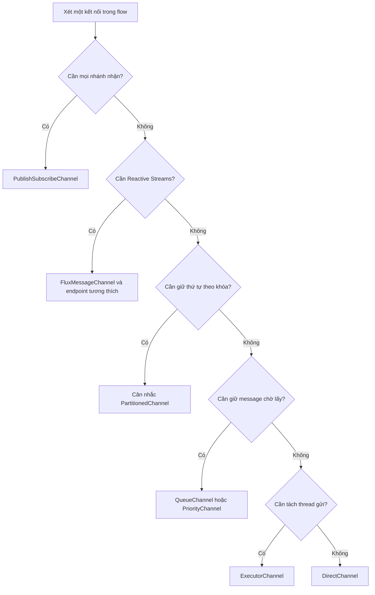
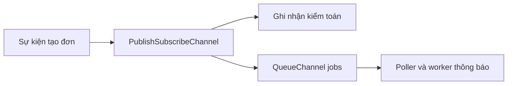

# Chọn channel theo message flow

Trong Spring Integration Core, chọn channel là quyết định cách một bước trong luồng giao message cho bước kế tiếp: giao cho một hay nhiều nơi, gọi ngay trong thread hiện tại hay giao việc cho thread khác, giữ message chờ xử lý hay yêu cầu bên nhận có mặt ngay. Cùng một transformer hoặc service activator có thể mang đặc tính vận hành khác khi channel đầu vào thay đổi.

Bài học thuộc chương **Kiểu channel** của module **SPRING_INTEGRATION_CORE**, tập trung vào cách chọn channel từ yêu cầu của message flow. Sau bài này, bạn có thể giải thích lựa chọn của mình bằng topology, thread, bộ đệm, thứ tự, thời hạn và đường đi của lỗi; đồng thời thể hiện lựa chọn đó bằng cấu hình Java DSL.

## 1. Đọc yêu cầu của flow trước khi chọn lớp channel

Xét luồng xử lý đơn hàng:

```text
Tiếp nhận → chuẩn hóa → kiểm tra → lưu đơn → thông báo
```

Mỗi mũi tên có thể có một yêu cầu khác:

- Chuẩn hóa dữ liệu cần nhanh, và người gọi cần thấy ngay lỗi dữ liệu.
- Xuất báo cáo có thể chờ, nhưng lượng công việc được nhận phải có giới hạn.
- Khi đơn đã được tạo, cả bộ phận kiểm toán lẫn bộ phận thông báo đều cần nhận sự kiện.
- Các thay đổi của cùng một đơn phải được xử lý theo thứ tự.
- Công việc đã được xác nhận tiếp nhận phải có cơ chế khôi phục sau sự cố nếu nghiệp vụ yêu cầu.

Vì vậy, không cần chọn một loại channel duy nhất cho toàn hệ thống. Hãy ghi hợp đồng của từng kết nối:

| Câu hỏi thiết kế | Ví dụ câu trả lời |
| --- | --- |
| Ai phải nhận message? | Một worker bất kỳ hoặc tất cả các nhánh |
| Người gửi cần chờ điều gì? | Giao việc, nhận kết quả hoặc hoàn tất nghiệp vụ |
| Công việc được đợi ở đâu? | Trong channel, trong executor hoặc trong hệ thống lưu trữ |
| Khi hết khả năng tiếp nhận thì sao? | Chờ có giới hạn, từ chối hoặc lưu sang nơi bền vững |
| Có yêu cầu thứ tự nào? | Toàn luồng, theo mã đơn hoặc không yêu cầu |
| Ai quan sát và xử lý lỗi? | Người gọi đồng bộ hoặc một flow nhận lỗi |
| Message phải tồn tại qua sự cố nào? | Chỉ trong vòng đời JVM hoặc cả sau khi khởi động lại |

Đây là các câu hỏi thiết kế cho ví dụ trong bài, không phải một thuật toán tự động ánh xạ mọi nghiệp vụ sang một lớp Java.

## 2. Ba khái niệm cần tách biệt

### 2.1. Message, channel và endpoint

`Message<?>` mang payload và headers. Channel chuyển message. Endpoint kết nối channel với chức năng như transformer, filter, router hoặc service activator.

Đổi `DirectChannel` sang `QueueChannel` không biến chức năng xử lý thành một loại nghiệp vụ khác. Tuy nhiên, endpoint nhận từ queue phải có cách lấy message, và thời điểm thực thi đã thay đổi. Khi thiết kế bằng Java DSL, cần nhìn cả channel lẫn endpoint ngay sau nó.

### 2.2. Cách nhận message không đồng nhất với số nơi nhận

`MessageChannel` cung cấp `send(...)`. Hai hợp đồng thường gặp là:

- `SubscribableChannel`: đăng ký `MessageHandler`; channel phân phối tới handler.
- `PollableChannel`: bên nhận gọi `receive(...)` để lấy message.

`DirectChannel` và `PublishSubscribeChannel` đều có subscriber, nhưng cách phân phối khác nhau. Có nhiều subscriber không tự động có nghĩa là mọi subscriber đều nhận mỗi message. Xem [The MessageChannel Interface](https://docs.spring.io/spring-integration/reference/channel/interfaces.html).

### 2.3. Gửi thành công không đồng nhất với nghiệp vụ thành công

Khi đọc `send(...)`, luôn xác định nó đã hoàn tất đến ranh giới nào:

| Ranh giới | Điều có thể xác nhận |
| --- | --- |
| Gọi handler đồng bộ | Handler được gọi trên call stack đó đã trả về bình thường |
| Đưa vào queue | Message đã được queue chấp nhận |
| Giao cho executor bất đồng bộ | Tác vụ phân phối đã được executor chấp nhận |
| Nhận reply của gateway | Có kết quả trả về theo hợp đồng request–reply |
| Commit dữ liệu nghiệp vụ | Transaction tương ứng đã commit |

Ví dụ, handler trả về bình thường vẫn chưa chứng minh một transaction bên ngoài đã commit. Tương tự, gateway có reply không chứng minh mọi thông báo phát sinh sau đó đã được gửi.

## 3. Bản đồ lựa chọn channel

| Channel | Phân phối và cơ chế chính | Tình huống nên cân nhắc |
| --- | --- | --- |
| `DirectChannel` | Point-to-point; gọi handler trong thread gửi | Các bước nhanh và cần kết quả hoặc lỗi ngay |
| `ExecutorChannel` | Point-to-point; giao phân phối cho executor | Tách việc xử lý khỏi thread tiếp nhận |
| `QueueChannel` | Point-to-point; đệm message để bên nhận lấy | Hấp thụ đợt tăng tải, chủ động điều khiển polling |
| `PublishSubscribeChannel` | Broadcast tới các subscriber | Một sự kiện cần đi tới nhiều nhánh |
| `PriorityChannel` | Pollable; chọn message theo độ ưu tiên | Công việc có mức khẩn cấp khác nhau |
| `RendezvousChannel` | Pollable; bàn giao trực tiếp, không có chỗ đệm | Cần đợi bên nhận tiếp nhận message |
| `PartitionedChannel` | Point-to-point; phân vùng theo khóa | Giữ thứ tự xử lý theo thực thể trong phạm vi channel |
| `FluxMessageChannel` | Kết nối `Publisher`/`Subscriber` của Reactive Streams | Flow có các thành phần reactive và cần quản lý demand |

Các đặc tính triển khai được mô tả trong [Message Channel Implementations](https://docs.spring.io/spring-integration/reference/channel/implementations.html). `PartitionedChannel` có từ Spring Integration 6.1; cần đối chiếu phiên bản đang dùng trước khi đưa vào dự án.

Một cách đọc nhanh yêu cầu:



Sơ đồ là gợi ý thiết kế. Một nhánh broadcast vẫn có thể đi vào queue riêng; một flow reactive vẫn phải giải quyết các lệnh gọi blocking; yêu cầu lưu bền vững cần một quyết định bổ sung.

## 4. DirectChannel cho đoạn xử lý đồng bộ

Giả sử người gọi cần gửi mã sản phẩm và nhận chuỗi kết quả sau khi chuẩn hóa. Đoạn xử lý này chưa có lý do để tạo thêm hàng đợi hoặc thread pool.

Ví dụ dùng `spring-integration-core` trên classpath và đăng ký cấu hình sau trong Spring ApplicationContext:

```java
import java.util.Locale;

import org.springframework.context.annotation.Bean;
import org.springframework.context.annotation.Configuration;
import org.springframework.integration.channel.DirectChannel;
import org.springframework.integration.config.EnableIntegration;
import org.springframework.integration.dsl.IntegrationFlow;

@Configuration
@EnableIntegration
public class ProductFlowConfig {

    @Bean
    public DirectChannel productRequests() {
        return new DirectChannel();
    }

    @Bean
    public IntegrationFlow productFlow() {
        return IntegrationFlow.from(productRequests())
                .<String, String>transform(
                        value -> value.trim().toUpperCase(Locale.ROOT))
                .<String, String>transform(value -> "PRODUCT:" + value)
                .get();
    }
}
```

Hai transformer tạo chuỗi kết quả; reply cuối được gửi theo `replyChannel` mà cơ chế request–reply cung cấp. Với bean `productRequests` đã lấy từ context, phía gọi có thể dùng:

```java
import org.springframework.integration.core.MessagingTemplate;
import org.springframework.messaging.Message;
import org.springframework.messaging.support.GenericMessage;

// productRequests là bean DirectChannel trong ApplicationContext.
MessagingTemplate template = new MessagingTemplate();
template.setReceiveTimeout(2_000);

Message<?> reply = template.sendAndReceive(
        productRequests,
        new GenericMessage<>(" sku-42 "));

if (reply == null) {
    throw new IllegalStateException("Không nhận được kết quả");
}

System.out.println(reply.getPayload()); // PRODUCT:SKU-42
```

`DirectChannel` gọi một handler được chọn trong thread người gửi. Do đó, một chuỗi đồng bộ có thể tham gia transaction đang gắn với thread, nếu cấu hình transaction và tài nguyên thực sự tương thích. Channel không tự mở transaction. Xem [DirectChannel API](https://docs.spring.io/spring-integration/api/org/springframework/integration/channel/DirectChannel.html).

Có hai giới hạn thực tế:

- Một handler gọi dịch vụ ngoài mất ba giây sẽ giữ thread gửi trong khoảng thời gian đó.
- Hai người gửi đồng thời vẫn có thể khiến cùng handler chạy đồng thời. Đồng bộ theo mỗi lần gọi không tạo một worker duy nhất cho toàn ứng dụng.

Nếu đăng ký nhiều handler trên `DirectChannel`, chúng thường phải là các bên xử lý thay thế cho nhau. Dispatcher có thể cân bằng tải và failover; không dùng cơ chế này để triển khai chuỗi “kiểm tra rồi lưu rồi thông báo”. Với side effect, cần xét nguy cơ handler trước đã thực hiện một phần công việc trước khi failover. Các tùy chọn nằm trong [Configuring Message Channels](https://docs.spring.io/spring-integration/reference/channel/configuration.html).

## 5. QueueChannel khi cần đệm và điều khiển bên lấy việc

Một chức năng xuất báo cáo thường có thể chấp nhận công việc trước và xử lý sau. Thiết kế ban đầu:

```text
Bên gửi → jobs, tối đa 100 message → poller → handler
                                           └→ jobErrors nếu lỗi
```

Cấu hình dưới đây minh họa một worker terminal: xử lý xong không tạo reply. `System.out` và `System.err` chỉ giúp nhìn đường đi của message trong bài thực hành.

```java
import org.springframework.context.annotation.Bean;
import org.springframework.context.annotation.Configuration;
import org.springframework.integration.channel.DirectChannel;
import org.springframework.integration.channel.QueueChannel;
import org.springframework.integration.config.EnableIntegration;
import org.springframework.integration.dsl.IntegrationFlow;
import org.springframework.integration.dsl.Pollers;

@Configuration
@EnableIntegration
public class JobFlowConfig {

    @Bean
    public QueueChannel jobs() {
        return new QueueChannel(100);
    }

    @Bean
    public DirectChannel jobErrors() {
        return new DirectChannel();
    }

    @Bean
    public IntegrationFlow jobWorker() {
        return IntegrationFlow.from(jobs())
                .handle(String.class, (payload, headers) -> {
                    if (payload.isBlank()) {
                        throw new IllegalArgumentException(
                                "Tên công việc không được rỗng");
                    }
                    System.out.println("Đang xử lý: " + payload);
                    return null;
                }, endpoint -> endpoint.poller(
                        Pollers.fixedDelay(100)
                                .maxMessagesPerPoll(10)
                                .receiveTimeout(0)
                                .errorChannel("jobErrors")))
                .get();
    }

    @Bean
    public IntegrationFlow jobErrorFlow() {
        return IntegrationFlow.from(jobErrors())
                .handle(message -> {
                    Throwable failure = (Throwable) message.getPayload();
                    System.err.println(
                            "Công việc thất bại: " + failure.getMessage());
                })
                .get();
    }
}
```

Bean `jobs` là channel dùng chung. Nếu có flow khác cùng dùng queue, hãy tham chiếu bean đó; tránh tạo hai queue khác nhau rồi đặt cùng một tên. Java DSL có hướng dẫn cụ thể về việc chia sẻ channel tại [Message Channels](https://docs.spring.io/spring-integration/reference/dsl/java-channels.html).

Một lệnh gửi có giới hạn chờ:

```java
import org.springframework.messaging.support.GenericMessage;

// jobs là bean QueueChannel trong ApplicationContext.
boolean accepted = jobs.send(
        new GenericMessage<>("export:orders:2026-11"),
        50);

if (!accepted) {
    throw new IllegalStateException(
            "Hàng đợi chưa nhận được công việc trong thời hạn");
}
```

Ở đây `50` là thời gian chờ có chỗ để gửi, tính bằng mili giây. Nó không giới hạn thời gian xuất báo cáo.

Với queue đầy, `send(message, 0)` thử gửi ngay; một timeout dương cho phép chờ có giới hạn. `receive(timeout)` có thể trả về `null` khi không lấy được message trong thời hạn. Cần xử lý cả kết quả gửi thất bại lẫn exception nếu phát sinh trong đường gửi.

`QueueChannel` giữ message, không tự tạo worker. Polling endpoint mới chịu trách nhiệm lấy message và gọi handler. Trong cấu hình trên:

- `fixedDelay(100)` điều khiển lịch chạy poller.
- `maxMessagesPerPoll(10)` giới hạn số message mỗi lượt polling, không tạo mười worker.
- `receiveTimeout(0)` giúp kết thúc lần lấy khi queue đang rỗng.
- `errorChannel("jobErrors")` cấu hình đích lỗi cho poller.

Các API này được mô tả tại [Pollers](https://docs.spring.io/spring-integration/reference/dsl/java-pollers.html) và [PollerSpec API](https://docs.spring.io/spring-integration/api/org/springframework/integration/dsl/PollerSpec.html).

Capacity là số message trong queue, chưa tính công việc đã lấy ra đang chạy. `new QueueChannel()` mặc định có dung lượng thực tế rất lớn; nên đặt giới hạn phù hợp thay vì coi bộ nhớ là vô hạn. Xem [QueueChannel API](https://docs.spring.io/spring-integration/api/org/springframework/integration/channel/QueueChannel.html).

## 6. ExecutorChannel khi cần giao việc cho thread pool

Nếu yêu cầu chính là giải phóng thread tiếp nhận để xử lý công việc khác, có thể dùng `ExecutorChannel`.

Các bean sau đặt trong một cấu hình Spring đã bật `@EnableIntegration`; đây là phương án khác với queue và poller của phần trước:

```java
import org.springframework.beans.factory.annotation.Qualifier;
import org.springframework.context.annotation.Bean;
import org.springframework.integration.channel.ExecutorChannel;
import org.springframework.scheduling.concurrent.ThreadPoolTaskExecutor;

@Bean
public ThreadPoolTaskExecutor enrichmentExecutor() {
    ThreadPoolTaskExecutor executor = new ThreadPoolTaskExecutor();
    executor.setCorePoolSize(4);
    executor.setMaxPoolSize(4);
    executor.setQueueCapacity(64);
    executor.setThreadNamePrefix("enrichment-");
    return executor;
}

@Bean
public ExecutorChannel enrichmentTasks(
        @Qualifier("enrichmentExecutor")
        ThreadPoolTaskExecutor executor) {
    return new ExecutorChannel(executor);
}
```

Spring quản lý khởi tạo và hủy executor bean. Endpoint phía sau `enrichmentTasks` là subscriber; không cần poller chỉ để lấy việc từ channel này.

Điểm khác biệt quan trọng: `64` là sức chứa hàng đợi **tác vụ của executor**. Bạn không gọi `enrichmentTasks.receive()` để lấy các message đang đợi. Với `QueueChannel`, queue là một phần hợp đồng nhận message và bên nhận chủ động polling.

`ExecutorChannel` vẫn phân phối point-to-point. Việc chuyển thread thường làm mất phạm vi transaction gắn với thread người gửi; worker cần ranh giới transaction của riêng nó nếu có yêu cầu. Xem [ExecutorChannel API](https://docs.spring.io/spring-integration/api/org/springframework/integration/channel/ExecutorChannel.html).

Thiết kế executor phải trả lời thêm:

- Khi cả pool và queue tác vụ đầy, chính sách từ chối nào được áp dụng?
- Lỗi từ chối lúc giao việc có được trả về rõ cho bên gửi?
- Nếu worker xử lý thất bại sau khi bên gửi đã trở về, flow nào nhận lỗi?
- Khi ứng dụng dừng, công việc đang chạy và đang chờ được xử lý ra sao?

Không nên khẳng định `ExecutorChannel` luôn chạy ở thread khác hoặc luôn trả về ngay. Executor thực thi đồng bộ hoặc chính sách như `CallerRunsPolicy` có thể làm tác vụ chạy trên thread gọi. Hãy xem thread pool là một phần của hợp đồng thiết kế, không chỉ là thông số tối ưu.

## 7. PublishSubscribeChannel khi một sự kiện cần nhiều nhánh

Giả sử sự kiện tạo đơn cần đi tới kiểm toán và thông báo:



Nếu nối hai handler vào một `DirectChannel`, bạn có thể tạo các consumer cạnh tranh. Broadcast cần `PublishSubscribeChannel`.

Đoạn Java DSL sau có thể thêm vào `JobFlowConfig`. Đầu vào `orderEvents` được DSL tạo theo tên; `publishSubscribeChannel` tạo điểm phát tới hai subflow. Trong bài minh họa, payload sự kiện là chuỗi và worker `jobs` chỉ in ra nội dung.

```java
import org.springframework.messaging.MessageDeliveryException;

@Bean
public IntegrationFlow orderEventFlow() {
    return IntegrationFlow.from("orderEvents")
            .publishSubscribeChannel(broadcast -> broadcast
                    .subscribe(branch -> branch.handle(message -> {
                        System.out.println(
                                "Kiểm toán: " + message.getPayload());
                    }))
                    .subscribe(branch -> branch.handle(message -> {
                        if (!jobs().send(message, 50)) {
                            throw new MessageDeliveryException(
                                    message,
                                    "Hàng đợi thông báo không còn chỗ");
                        }
                    })))
            .get();
}
```

Không cung cấp executor thì các handler broadcast chạy trong thread gửi. “Publish–subscribe” mô tả số nơi nhận, chưa quyết định xử lý song song. Khi có executor, cần thiết kế riêng đường lỗi và giới hạn tải. Xem [PublishSubscribeChannel API](https://docs.spring.io/spring-integration/api/org/springframework/integration/channel/PublishSubscribeChannel.html).

Trong ví dụ, một nhánh đưa message vào queue với timeout hữu hạn. Điều đó tách thời điểm xử lý thông báo khỏi luồng phát sự kiện, nhưng thao tác đưa vào queue vẫn có thể đợi tối đa thời hạn đã cho.

Một sự kiện broadcast cũng không mặc nhiên là một transaction chung cho mọi nhánh. Nếu kiểm toán đã ghi thành công rồi nhánh thông báo thất bại, retry toàn bộ sự kiện có thể lặp side effect kiểm toán. Cần thiết kế idempotency và chính sách retry đúng ranh giới nghiệp vụ.

Payload nên được xem là bất biến khi đi qua các nhánh. Tạo nhiều `Message` không đồng nghĩa deep copy các đối tượng bên trong payload; một nhánh sửa đối tượng dùng chung có thể ảnh hưởng nhánh khác.

## 8. Các yêu cầu đặc biệt: ưu tiên, bàn giao, thứ tự và reactive

### 8.1. PriorityChannel: ưu tiên khi lấy việc

Nếu yêu cầu là xử lý việc khẩn trước việc thường đang đợi, cân nhắc `PriorityChannel`. Độ ưu tiên mặc định dựa vào header `priority`; cũng có thể cung cấp comparator.

Điều này thay đổi thứ tự chọn trong hàng đợi, không ngắt một tác vụ đang chạy. Nếu công việc ưu tiên cao liên tục xuất hiện, cần xét nguy cơ công việc thường bị chờ quá lâu.

### 8.2. RendezvousChannel: đợi bên nhận tiếp nhận

`RendezvousChannel` không giữ backlog. Người gửi và người nhận phải gặp nhau để bàn giao message. Khi thành công, điều được xác nhận là bên nhận đã tiếp nhận, chưa phải nghiệp vụ đã hoàn tất.

Nếu cùng một thread gọi `send()` rồi mới định gọi `receive()`, bàn giao không thể diễn ra trong lúc thread còn đang chờ gửi. Cần bố trí bên nhận thích hợp và timeout hữu hạn.

Các đặc tính của hai channel này được mô tả trong [Message Channel Implementations](https://docs.spring.io/spring-integration/reference/channel/implementations.html).

### 8.3. FIFO chưa đủ để đảm bảo thứ tự hoàn tất

Giả sử queue trả ra A rồi B:

```text
Worker 1 lấy A → xử lý mất 500 ms
Worker 2 lấy B → xử lý mất  20 ms
```

B có thể hoàn tất trước A dù queue lấy ra theo FIFO. Nếu thứ tự hoàn tất quan trọng, cần giới hạn concurrency hoặc phân vùng công việc theo khóa nghiệp vụ.

Với Spring Integration 6.1 trở lên, có thể khai báo bean:

```java
import java.util.Objects;

import org.springframework.integration.channel.PartitionedChannel;

@Bean
public PartitionedChannel orderUpdates() {
    return new PartitionedChannel(
            4,
            message -> Objects.requireNonNull(
                    message.getHeaders().get("orderId"),
                    "Thiếu header orderId"));
}
```

Khóa `orderId` giúp các cập nhật của cùng đơn đi vào cùng partition có thread xử lý riêng. Các khóa khác vẫn có thể va vào cùng partition. Đây là thứ tự trong phạm vi dispatch của channel; nếu handler tiếp tục tách việc bất đồng bộ thì cần xét lại thứ tự hoàn tất. Xem [PartitionedChannel API](https://docs.spring.io/spring-integration/api/org/springframework/integration/channel/PartitionedChannel.html).

Khi chạy nhiều instance ứng dụng, việc mỗi instance có một `PartitionedChannel` không tự tạo thứ tự chung giữa chúng. Cần thiết kế thêm nơi phân phối khóa hoặc cơ chế phối hợp phù hợp.

### 8.4. FluxMessageChannel: xem cả chuỗi reactive

`FluxMessageChannel` dành cho tương tác Reactive Streams. Nó không cung cấp cơ chế polling của `QueueChannel` và không đăng ký `MessageHandler` bằng hợp đồng `SubscribableChannel` thông thường.

Lựa chọn này có ý nghĩa khi nguồn, endpoint và phía nhận phối hợp theo demand. Thay một channel đơn lẻ không tự làm lệnh gọi JDBC hoặc HTTP blocking trở thành non-blocking; cần kiểm tra thư viện giao tiếp và ranh giới thực thi của cả chuỗi. Xem [Reactive Streams Support](https://docs.spring.io/spring-integration/reference/reactive-streams.html).

## 9. Ranh giới bất đồng bộ thay đổi đường lỗi và request–reply

Với chuỗi đồng bộ, exception có thể truyền về thread gọi. Với worker chạy sau queue hoặc executor, bên gửi có thể đã kết thúc trước khi lỗi xuất hiện. Spring Integration có cơ chế phát `ErrorMessage` cho các tác vụ được framework quản lý; đích thường được giải quyết từ header `errorChannel` hoặc kênh lỗi mặc định. Poller có thể cấu hình error channel như ví dụ `jobErrors`. Xem [Error Handling](https://docs.spring.io/spring-integration/reference/error-handling.html).

Cần phân biệt:

| Tình huống | Nơi phải kiểm tra |
| --- | --- |
| Queue đầy và hết send timeout | Kết quả `send(...)` ở phía gửi |
| Executor từ chối tác vụ ngay lúc giao | Exception hoặc hợp đồng lỗi tại điểm gửi |
| Handler trong chuỗi đồng bộ ném lỗi | Người gọi hoặc cấu hình gateway |
| Handler bất đồng bộ ném lỗi | Error handler và flow nhận `ErrorMessage` |
| Flow đã nhận request nhưng không tạo reply | Hợp đồng gateway và reply timeout |

Gắn header `errorChannel` không tự chuyển mọi exception của một lệnh gọi đồng bộ thành message lỗi. Tương tự, dùng một executor tùy ý ngoài sự quản lý của Spring Integration không tự tạo cơ chế xử lý lỗi của framework.

Một messaging gateway giúp mã nghiệp vụ gọi một interface thay vì thao tác trực tiếp với message. Nếu interface trả về kết quả đồng bộ, người gọi vẫn có thể phải chờ reply ngay cả khi flow phía sau có queue hoặc executor. Xem [Messaging Gateways](https://docs.spring.io/spring-integration/reference/gateway.html).

Ba thời hạn cần được đặt theo từng ranh giới:

1. **Send timeout**: được đợi bao lâu để giao request.
2. **Receive timeout của poller**: mỗi lần lấy được đợi bao lâu để có message.
3. **Reply timeout**: người gọi request–reply chờ kết quả trong bao lâu.

Chúng không thay thế timeout của lệnh gọi mạng hoặc truy vấn cơ sở dữ liệu. Đặc biệt, reply timeout không tự ngắt handler đồng bộ đang chạy trên call stack và không tự hủy nghiệp vụ phía worker.

Nếu gateway chờ kết quả từ một flow có filter loại message hoặc service activator terminal trả `null`, hãy xác định rõ kết quả cho trường hợp không có reply. Đừng đổi channel rồi giữ nguyên một hợp đồng trả kết quả mà flow không còn đáp ứng.

## 10. Kết hợp channel với transformer, router, filter và aggregator

Channel giải quyết cách chuyển giao; các endpoint giải quyết cách biến đổi hoặc ra quyết định:

| Thành phần | Vai trò khi thiết kế flow |
| --- | --- |
| Transformer | Chuẩn hóa payload trước khi giao cho worker hoặc trước khi phân nhánh |
| Filter | Cho qua hoặc loại message theo điều kiện; cần quy định đích discard hoặc kết quả từ chối |
| Router | Chọn đích theo nội dung hoặc header |
| Service activator | Thực hiện nghiệp vụ, có thể tạo reply hoặc kết thúc nhánh |
| Aggregator | Tập hợp các message liên quan rồi tạo kết quả theo điều kiện release |

Ví dụ thiết kế cho nhập đơn:

```text
DirectChannel
    → transformer chuẩn hóa
    → filter kiểm tra dữ liệu
    → router theo loại đơn
        → QueueChannel cho xử lý theo lô
        → DirectChannel cho tra cứu cần phản hồi ngay
```

Router chọn đường đi; việc đặt hai subscriber trên một point-to-point channel không thay thế quyết định dựa vào nội dung. Với flow trên, cũng cần quy định riêng hợp đồng phản hồi của nhánh xử lý theo lô.

Khi phân nhánh rồi gom kết quả bằng aggregator, cần correlation key và tiêu chí đủ kết quả. Nếu dùng các header sequence do `PublishSubscribeChannel` tạo, phải cấu hình `applySequence`; giá trị mặc định không tự bật cho mọi broadcast. Hướng dẫn nằm tại [PublishSubscribeChannel Configuration](https://docs.spring.io/spring-integration/reference/channel/configuration.html#channel-configuration-publishsubscribechannel).

Trước khi chốt thiết kế, hãy kiểm tra tình huống một nhánh bị filter loại, một nhánh ném lỗi hoặc không trả kết quả. Nếu aggregator vẫn đợi đủ số lượng ban đầu, nhóm có thể không được release; thiết kế timeout và kết quả thiếu cần nhất quán với nghiệp vụ.

## 11. Tính giới hạn tải từ tốc độ và thời hạn

Giả sử một đợt tăng tải kéo dài năm giây:

- Đầu vào: 300 message/giây.
- Năng lực xử lý thực tế: 200 message/giây.
- Ban đầu queue rỗng.

Ước lượng phần backlog tăng thêm:

```text
Backlog ≈ (300 − 200) × 5 = 500 message
```

Chọn capacity 600 có thể chứa đợt tăng tải theo các giả định trên. Tuy nhiên, một message đang đứng sau 500 công việc phải đợi xấp xỉ:

```text
Thời gian đợi ≈ 500 / 200 = 2,5 giây
```

Nếu người gọi chỉ chấp nhận hai giây, tăng capacity không giải quyết yêu cầu thời gian. Có thể cần giảm lượng việc tiếp nhận, tăng năng lực xử lý hoặc đổi hợp đồng sang nhận mã công việc rồi tra cứu trạng thái.

Nếu payload trung bình 8 KiB, riêng 600 payload đã xấp xỉ 4,69 MiB. Bộ nhớ thực còn gồm headers, đối tượng Java, queue, dữ liệu trung gian và tác vụ đang chạy.

Đây là mô hình ước lượng cho ví dụ, không phải cam kết hiệu năng. Cần đo với tải và phân bố thời gian xử lý thực tế. Các chỉ số nên theo dõi gồm:

- Độ dài queue và tuổi của message đang chờ.
- Tốc độ tiếp nhận so với tốc độ hoàn tất.
- Thời gian chờ và thời gian xử lý, nhất là các phân vị cao.
- Số lần gửi hết hạn, bị từ chối và lỗi nghiệp vụ.
- Với executor: số thread bận, độ dài queue tác vụ và số lần rejection.

Nếu poller lấy rất nhanh rồi đẩy toàn bộ việc vào một executor chậm, queue channel có thể trông gần rỗng trong khi backlog nằm ở executor. Cần quan sát đúng nơi công việc thực sự đang chờ.

## 12. Đệm trong bộ nhớ và lưu bền vững là hai quyết định

Queue mặc định trong các ví dụ là dữ liệu trong bộ nhớ JVM. Một lần gửi thành công vào queue đó không đủ để xác nhận công việc sẽ còn sau khi tiến trình bị dừng đột ngột.

Spring Integration hỗ trợ message store cho các thành phần có đệm, bao gồm queue và aggregator. Với lưu bền vững, cần xét cách lưu payload, headers, phạm vi transaction và khả năng khôi phục. Xem [Message Store](https://docs.spring.io/spring-integration/reference/message-store.html).

Một thiết kế “không được mất công việc đã nhận” phải làm rõ ít nhất:

1. Xác nhận tiếp nhận xảy ra trước hay sau khi lưu công việc bền vững.
2. Khi worker chết giữa chừng, công việc được phát lại bằng cơ chế nào.
3. Side effect được bảo vệ trước xử lý lặp bằng khóa idempotency hoặc transaction ra sao.
4. Kết quả và trạng thái công việc được tìm lại bằng mã nào.

Với persistent queue và poller có transaction thích hợp, việc lấy message và rollback có thể được phối hợp với store. Chỉ gắn store mà thiếu ranh giới transaction phù hợp chưa đủ để đảm bảo toàn bộ nghiệp vụ. Xem [Persistent QueueChannel Configuration](https://docs.spring.io/spring-integration/reference/channel/configuration.html#channel-configuration-queuechannel).

Nếu cần đi qua nhiều tiến trình hoặc giữ công việc lâu dài, có thể cân nhắc broker hoặc một cơ chế lưu công việc chuyên dụng. Channel nội bộ vẫn hữu ích cho các bước bên trong từng ứng dụng.

## 13. Kiểm thử lựa chọn channel bằng hành vi quan sát được

Đừng chỉ kiểm tra bean có đúng lớp hay không. Hãy kiểm tra điều mà thiết kế dựa vào: thread gọi, khả năng đệm, số nơi nhận, đường lỗi và thời hạn.

Các test JUnit Jupiter dưới đây minh họa ba hợp đồng ở mức channel. Chúng không cần khởi động toàn bộ ApplicationContext.

```java
import java.util.concurrent.atomic.AtomicInteger;
import java.util.concurrent.atomic.AtomicReference;

import org.junit.jupiter.api.Test;
import org.springframework.integration.channel.DirectChannel;
import org.springframework.integration.channel.PublishSubscribeChannel;
import org.springframework.integration.channel.QueueChannel;
import org.springframework.messaging.Message;
import org.springframework.messaging.support.GenericMessage;

import static org.junit.jupiter.api.Assertions.*;

class ChannelContractTest {

    @Test
    void directChannelInvokesHandlerInSenderThread() {
        DirectChannel channel = new DirectChannel();
        AtomicReference<Thread> handlerThread = new AtomicReference<>();
        AtomicReference<String> handled = new AtomicReference<>();

        channel.subscribe(message -> {
            handlerThread.set(Thread.currentThread());
            handled.set((String) message.getPayload());
        });

        Thread senderThread = Thread.currentThread();

        assertTrue(channel.send(new GenericMessage<>("order-42")));
        assertSame(senderThread, handlerThread.get());
        assertEquals("order-42", handled.get());
    }

    @Test
    void queueBuffersBeforeAnyConsumerReceives() {
        QueueChannel channel = new QueueChannel(1);

        assertTrue(channel.send(new GenericMessage<>("first"), 0));
        assertFalse(channel.send(new GenericMessage<>("second"), 0));

        Message<?> received = channel.receive(0);
        assertNotNull(received);
        assertEquals("first", received.getPayload());
        assertNull(channel.receive(0));

        assertTrue(channel.send(new GenericMessage<>("second"), 0));
    }

    @Test
    void publishSubscribeDeliversToBothSubscribers() {
        PublishSubscribeChannel channel = new PublishSubscribeChannel();
        AtomicInteger first = new AtomicInteger();
        AtomicInteger second = new AtomicInteger();

        channel.subscribe(message -> first.incrementAndGet());
        channel.subscribe(message -> second.incrementAndGet());

        assertTrue(channel.send(new GenericMessage<>("order-created")));
        assertEquals(1, first.get());
        assertEquals(1, second.get());
    }
}
```

Khi kiểm thử toàn flow bất đồng bộ, nên dùng latch hoặc cơ chế đợi theo điều kiện với thời hạn hữu hạn. Một lần `Thread.sleep(...)` rồi đoán worker đã xong thường gây test chập chờn.

Với `JobFlowConfig`, những kiểm thử tích hợp đáng làm tiếp là gửi payload rỗng để quan sát `ErrorMessage`, dừng consumer để kiểm tra queue đầy và xác minh worker thực sự hoàn tất trước khi kết luận thành công. Spring Integration cung cấp công cụ hỗ trợ tại [Testing support](https://docs.spring.io/spring-integration/reference/testing.html).

## 14. Áp dụng vào một quyết định thiết kế cụ thể

Giả sử cần xây flow nhận yêu cầu tạo đơn, xử lý cập nhật theo mã đơn và phát thông báo:

| Kết nối | Lựa chọn ban đầu | Lý do và điều kiện cần xác minh |
| --- | --- | --- |
| Gateway → chuẩn hóa dữ liệu | `DirectChannel` | Xử lý nhanh; người gọi cần biết lỗi đầu vào |
| Chuẩn hóa → định tuyến | `DirectChannel` | Chưa cần đệm hoặc chuyển thread |
| Các cập nhật cùng đơn → xử lý | `PartitionedChannel` | Tuần tự theo `orderId` trong phạm vi thiết kế |
| Sự kiện đã tạo đơn → các nhánh | `PublishSubscribeChannel` | Kiểm toán và thông báo đều cần sự kiện |
| Nhánh thông báo → worker | `QueueChannel` có giới hạn | Cho phép chờ xử lý; cần chính sách khi queue đầy |
| Tác vụ gọi ngoài độc lập → xử lý | `ExecutorChannel` có pool giới hạn | Tách thread; cần timeout mạng và đường lỗi riêng |

Bảng là một phương án khởi đầu cho các yêu cầu đã nêu. Trước khi triển khai, hãy xác định rõ điểm nào trả lời gateway, điểm nào xác nhận công việc bền vững và điểm nào chỉ chuyển message trong bộ nhớ. Việc chọn channel hoàn tất khi mỗi kết nối có một hợp đồng có thể giải thích và kiểm thử được.
