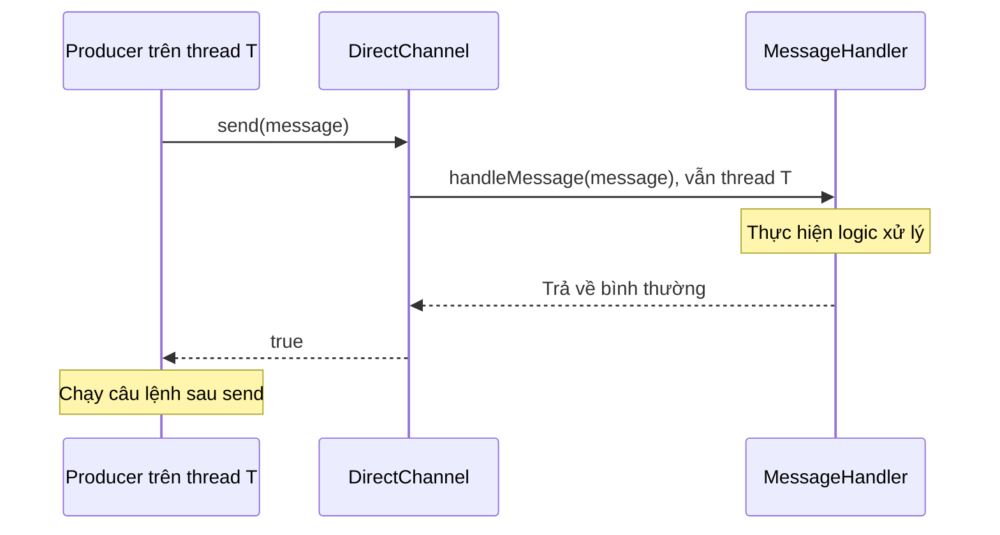

# Handler được gọi trên sender thread

## 1. Mục tiêu và phạm vi

Trong module **SPRING_INTEGRATION_CORE**, `DirectChannel` giúp nối các thành phần của luồng thông điệp mà vẫn giữ cách thực thi đồng bộ. Bài học thuộc chương **DirectChannel**, tập trung vào câu hỏi: khi producer gọi `send(message)`, thread nào thực sự chạy handler và khi nào producer được tiếp tục?

Sau bài này, bạn có thể:

- Mô tả đường đi từ `Message` qua `MessageChannel` tới handler của endpoint.
- Chứng minh handler chạy trên chính thread gửi bằng ví dụ Java.
- Đọc một luồng Java DSL và nhận diện đoạn xử lý vẫn còn đồng bộ.
- Giải thích tác động tới độ trễ, truyền exception, transaction và truy cập đồng thời.

Các ví dụ cần thư viện `org.springframework.integration:spring-integration-core` trên classpath. Nếu dự án dùng Spring Boot, sử dụng bộ dependency tương thích do dự án quản lý; phần kiểm thử cuối bài cần thêm JUnit Jupiter. Không cần broker hoặc kết nối mạng để quan sát cơ chế này.

## 2. Quy tắc cốt lõi của DirectChannel

`DirectChannel` gọi handler ngay trên **thread đang thực hiện lời gọi `send(...)`**. Channel không tự tạo thread và không chuyển message vào hàng đợi nội bộ để chờ xử lý sau. API chính thức xác định đây là channel gọi một subscriber cho mỗi message, với lời gọi diễn ra trên sender thread. [DirectChannel API](https://docs.spring.io/spring-integration/api/org/springframework/integration/channel/DirectChannel.html)

Ví dụ một thread HTTP gửi message:

```text
http-thread-7:
  controller.submit()
    -> inputChannel.send(message)
      -> dispatcher.dispatch(message)
        -> handler.handleMessage(message)
      <- handler trả về
    <- send trả về
  controller tiếp tục
```

Đây là mô hình đường gọi khái niệm; framework còn có interceptor và các lớp quản lý khác. Điều cần nhìn thấy là handler nằm trong call stack của `send`.

“Sender thread” là vai trò tại điểm gửi, không phải tên một thread cố định:

| Nơi gọi `send` | Sender thread tại channel |
| --- | --- |
| Controller xử lý yêu cầu HTTP | Thread đang chạy controller |
| Tác vụ được scheduler kích hoạt | Thread đang chạy tác vụ đó |
| Một poller gửi dữ liệu vừa đọc | Thread đang thực hiện lần poll đó |
| Công việc đang chạy trong executor | Thread đang chạy công việc |
| Chương trình ví dụ gọi từ `main` | Thread `main` |

Nếu poller đã đọc message từ một channel khác rồi gửi vào `DirectChannel`, handler vẫn chạy đồng bộ với poller. Điều đó không làm cho handler chạy trở lại trên thread đã gửi message vào channel trước đó.

### Các thành phần tham gia

- **`Message<?>`** mang payload và headers.
- **`MessageChannel`** là điểm gửi để producer không cần gọi trực tiếp thành phần nghiệp vụ.
- **Dispatcher** bên trong channel chọn subscriber.
- **`MessageHandler`** nhận lời gọi `handleMessage(...)`.
- **Endpoint** kết nối một vai trò xử lý, chẳng hạn transformer hoặc service activator, với channel.

`DirectChannel` là `SubscribableChannel`: handler đăng ký bằng `subscribe(...)`. Nó không phải `PollableChannel`, nên không có `receive()` để consumer lấy message và không cần poller ở đầu vào này. [AbstractSubscribableChannel API](https://docs.spring.io/spring-integration/api/org/springframework/integration/channel/AbstractSubscribableChannel.html)

## 3. Trình tự thực thi một lần gửi

Giả sử channel có một handler, không có interceptor chặn message và handler không tạo công việc bất đồng bộ:



Nếu handler ném lỗi và lỗi không được xử lý bên trong, đường trả về bình thường được thay bằng đường truyền exception. Producer chưa thể chạy câu lệnh ngay sau `send` như thể lời gọi đã thành công.

Cần tách hai ý:

1. Channel tách producer khỏi tên lớp và cách triển khai consumer.
2. Việc tách bằng message không tự tạo cách thực thi bất đồng bộ.

Bạn có thể thay một handler hoặc thêm endpoint mà không sửa producer, nhưng thời gian thực thi của các handler đồng bộ vẫn nằm trong thời gian gọi của producer.

## 4. Ví dụ Java: kiểm tra đúng đối tượng Thread

Ví dụ sau chỉ cần `spring-integration-core` và các dependency đi kèm. Handler được đăng ký thủ công để thấy cơ chế mà không cần khởi tạo Spring application context.

```java
import java.util.ArrayList;
import java.util.List;
import java.util.concurrent.atomic.AtomicReference;

import org.springframework.integration.channel.DirectChannel;
import org.springframework.messaging.Message;
import org.springframework.messaging.support.MessageBuilder;

public class DirectChannelThreadDemo {

    public static void main(String[] args) {
        DirectChannel input = new DirectChannel();

        Thread senderThread = Thread.currentThread();
        AtomicReference<Thread> handlerThread = new AtomicReference<>();
        List<String> events = new ArrayList<>();

        input.subscribe(message -> {
            handlerThread.set(Thread.currentThread());
            events.add("handler");

            System.out.printf(
                    "handler: payload=%s, thread=%s%n",
                    message.getPayload(),
                    Thread.currentThread().getName());
        });

        Message<String> message = MessageBuilder
                .withPayload("order-1001")
                .setHeader("source", "thread-demo")
                .build();

        events.add("before-send");
        System.out.printf("sender: thread=%s%n", senderThread.getName());

        boolean sent = input.send(message);

        events.add("after-send");

        if (!sent) {
            throw new IllegalStateException("Message không được gửi");
        }
        if (handlerThread.get() != senderThread) {
            throw new IllegalStateException("Handler chạy trên thread khác");
        }
        if (!events.equals(
                List.of("before-send", "handler", "after-send"))) {
            throw new IllegalStateException("Sai thứ tự: " + events);
        }

        System.out.println("sent=" + sent);
        System.out.println("sameThread=" + (handlerThread.get() == senderThread));
        System.out.println("events=" + events);
    }
}
```

Kết quả dự kiến khi chạy trực tiếp từ `main`:

```text
sender: thread=main
handler: payload=order-1001, thread=main
sent=true
sameThread=true
events=[before-send, handler, after-send]
```

Tên thread có thể khác nếu môi trường chạy dùng thread khác. Phép so sánh `handlerThread.get() == senderThread` mới là bằng chứng về cùng một đối tượng `Thread`; hai thread khác nhau vẫn có thể được đặt cùng tên.

`AtomicReference` ở đây dùng để lấy giá trị ghi trong lambda ra ngoài. `ArrayList` cũng phù hợp cho ví dụ vì chỉ có một thread thao tác trên danh sách. Không thể dựa vào ví dụ này để kết luận `ArrayList` an toàn khi có nhiều sender đồng thời.

Không cần `Thread.sleep(...)` để đợi handler: khi `send` đã trả về trong ví dụ, handler đã chạy xong.

## 5. Java DSL vẫn giữ cùng cách thực thi

Java DSL mô tả luồng bằng các builder; khi Spring khởi tạo context, các channel và endpoint được đăng ký. Cách viết nối tiếp bằng DSL không tự bổ sung executor. [Java DSL](https://docs.spring.io/spring-integration/reference/dsl.html)

Ví dụ sau khai báo rõ hai `DirectChannel` để dễ đọc điểm nối giữa transformer và handler cuối.

```java
import java.util.Locale;

import org.springframework.context.annotation.AnnotationConfigApplicationContext;
import org.springframework.context.annotation.Bean;
import org.springframework.context.annotation.Configuration;
import org.springframework.integration.config.EnableIntegration;
import org.springframework.integration.channel.DirectChannel;
import org.springframework.integration.dsl.IntegrationFlow;
import org.springframework.messaging.support.MessageBuilder;

@Configuration
@EnableIntegration
public class OrderFlowDemo {

    @Bean
    public DirectChannel orderInput() {
        return new DirectChannel();
    }

    @Bean
    public DirectChannel normalizedOrders() {
        return new DirectChannel();
    }

    @Bean
    public IntegrationFlow orderFlow() {
        return IntegrationFlow.from("orderInput")
                .<String, String>transform(raw -> {
                    System.out.printf(
                            "transform: thread=%s%n",
                            Thread.currentThread().getName());
                    return raw.trim().toUpperCase(Locale.ROOT);
                })
                .channel("normalizedOrders")
                .handle(String.class, (orderId, headers) -> {
                    System.out.printf(
                            "handle: orderId=%s, thread=%s%n",
                            orderId,
                            Thread.currentThread().getName());
                    return null;
                })
                .get();
    }

    public static void main(String[] args) {
        try (AnnotationConfigApplicationContext context =
                     new AnnotationConfigApplicationContext(OrderFlowDemo.class)) {

            DirectChannel input =
                    context.getBean("orderInput", DirectChannel.class);

            System.out.printf(
                    "before-send: thread=%s%n",
                    Thread.currentThread().getName());

            boolean sent = input.send(
                    MessageBuilder.withPayload("  order-1001  ").build());

            System.out.printf(
                    "after-send: sent=%s, thread=%s%n",
                    sent,
                    Thread.currentThread().getName());
        }
    }
}
```

Đầu ra liên quan tới ví dụ, bỏ qua log khởi động của Spring:

```text
before-send: thread=main
transform: thread=main
handle: orderId=ORDER-1001, thread=main
after-send: sent=true, thread=main
```

Luồng thực thi là:

```text
sender
  -> orderInput (DirectChannel)
    -> transformer
      -> normalizedOrders (DirectChannel)
        -> handler cuối
  <- send trả về
```

Transformer tạo payload đã chuẩn hóa rồi chuyển tiếp. Lambda của `handle` trả về `null` để kết thúc nhánh xử lý mà không phát reply.

Nếu thay đầu vào bằng một messaging gateway, gateway có thể cung cấp giao diện phương thức thay cho thao tác xây dựng message thủ công. Cần đọc thêm hợp đồng trả lời của gateway; kiểu trả về của phương thức gateway là vấn đề khác với thread mà `DirectChannel` sử dụng.

## 6. Thời gian gọi send bao gồm những gì?

Trong luồng trên, producer chịu thời gian của cả transformer lẫn handler cuối. Với một đường xử lý đồng bộ nối tiếp, có thể ước lượng:

```text
T_send ≈ T_transformer + T_handler + T_các_bước_đồng_bộ_khác + T_overhead
```

Ví dụ giả định:

| Công việc | Thời gian |
| --- | ---: |
| Chuẩn hóa mã đơn | 2 ms |
| Kiểm tra dữ liệu trong bộ nhớ | 3 ms |
| Gọi dịch vụ bên ngoài từ handler | 400 ms |
| Tổng tối thiểu gần đúng | 405 ms |

Đây là số minh họa, không phải kết quả benchmark. Nếu controller gọi luồng này, thread xử lý yêu cầu cũng bận khoảng thời gian đó. Tên gọi `DirectChannel` không làm cho cuộc gọi mạng 400 ms trở thành tác vụ chạy nền.

Có thể xuất hiện hiệu ứng chậm lan ngược: handler chậm khiến sender gửi nối tiếp chậm lại. Tuy nhiên, channel không cung cấp bộ đệm hay giới hạn số sender đang gọi đồng thời. Nhiều request vẫn có thể cùng đi vào handler và làm quá tải tài nguyên phía sau.

### send trả về không luôn đồng nghĩa toàn bộ nghiệp vụ đã hoàn tất

Trong ví dụ chỉ có các bước đồng bộ và handler cuối thực hiện toàn bộ việc cần làm, `send` trả về sau các bước đó. Khi thiết kế thay đổi, phải kiểm tra lại ý nghĩa:

- Handler tự gửi công việc sang executor: lời gọi handler có thể kết thúc trước công việc nền.
- Luồng gặp `QueueChannel`: phần còn lại có thể được consumer xử lý về sau.
- Filter loại message theo cấu hình: lời gọi có thể kết thúc bình thường dù bước nghiệp vụ sau filter không chạy.
- Aggregator mới lưu message vào nhóm chưa đủ điều kiện: lần nhận hiện tại có thể kết thúc trước khi nhóm được phát ra.

Vì vậy, không dùng giá trị `true` của `send` làm bằng chứng chung rằng “đơn đã thanh toán”, “email đã gửi” hoặc “mọi nhánh đã xử lý xong”. Đó là giá trị xác nhận việc gửi theo hợp đồng của channel. [MessageChannel API](https://docs.spring.io/spring-framework/docs/current/javadoc-api/org/springframework/messaging/MessageChannel.html)

## 7. Timeout của send không phải deadline của handler

Lời gọi:

```java
boolean sent = input.send(message, 100);
```

không có nghĩa handler chắc chắn dừng sau 100 ms.

`DirectChannel` không có bước đợi dung lượng hàng đợi để timeout này kiểm soát. Sau khi dispatcher gọi handler, đó là lời gọi Java đồng bộ; tham số timeout của `send` không tạo bộ hẹn giờ ngắt handler. Hợp đồng timeout thuộc thao tác gửi, không tự trở thành cơ chế hủy logic nghiệp vụ. [MessageChannel API](https://docs.spring.io/spring-framework/docs/current/javadoc-api/org/springframework/messaging/MessageChannel.html)

Nếu handler gọi HTTP hoặc truy vấn cơ sở dữ liệu, cần cấu hình timeout phù hợp tại client hay tài nguyên đó. Nếu dùng giới hạn thời gian ở một lớp điều phối, cũng phải xem công việc đang chạy có thực sự được hủy hay chỉ có phía chờ ngừng đợi.

Tương tự, một reply timeout ở gateway không bảo đảm cắt ngang một handler đồng bộ đang chạy bên trong lời gọi gửi.

## 8. Exception truyền về sender theo call stack

Trong trường hợp gửi trực tiếp vào `DirectChannel`, lỗi từ đoạn xử lý đồng bộ có thể được caller bắt tại lời gọi `send`. Framework có thể bao gói lỗi nghiệp vụ trong một `MessagingException`; cần kiểm tra chuỗi nguyên nhân thay vì luôn giả định bắt được đúng lớp exception ban đầu. Việc đặt header `errorChannel` không khiến channel tự chuyển mọi lỗi đồng bộ thành `ErrorMessage`. [Error Handling](https://docs.spring.io/spring-integration/reference/error-handling.html)

Ví dụ này dùng một handler và chủ động ném `MessageHandlingException`:

```java
import org.springframework.integration.channel.DirectChannel;
import org.springframework.messaging.MessageHandlingException;
import org.springframework.messaging.MessagingException;
import org.springframework.messaging.support.MessageBuilder;

public class DirectChannelErrorDemo {

    public static void main(String[] args) {
        DirectChannel input = new DirectChannel();

        input.subscribe(message -> {
            throw new MessageHandlingException(
                    message, "Đơn hàng không hợp lệ");
        });

        try {
            input.send(
                    MessageBuilder.withPayload("invalid-order").build());

            throw new IllegalStateException(
                    "Không được đi tới đây khi handler đang ném lỗi");
        }
        catch (MessagingException ex) {
            System.out.println("Sender nhận lỗi: " + ex.getMessage());
        }
    }
}
```

Trong ví dụ, handler thất bại nên `send` không trả về một giá trị `true` hoặc `false` để caller phân nhánh. Luồng điều khiển đi vào `catch`.

Một số tình huống cần phân biệt:

| Tình huống | Hành vi cần hiểu |
| --- | --- |
| Channel chưa có subscriber | Gửi thất bại; không tự cất message để chờ subscriber xuất hiện |
| Handler bắt lỗi rồi trả về bình thường | Caller không thể biết lỗi bị giữ lại chỉ bằng việc chờ `send` |
| Gateway có cấu hình kênh xử lý lỗi | Gateway có thể đổi cách báo lỗi theo cấu hình của gateway |

Cơ chế báo lỗi qua message thường được dùng ở ranh giới bất đồng bộ hoặc thông qua thành phần được cấu hình xử lý lỗi. `DirectChannel` tự nó không thay thế một chính sách xử lý lỗi.

## 9. Cùng thread hỗ trợ giữ transaction context

Với transaction Spring thông thường gắn vào thread, các bước đồng bộ có thể tiếp tục sử dụng transaction đang có. `DirectChannel` không tự mở transaction; ứng dụng vẫn phải xác định nơi bắt đầu transaction và các tài nguyên tham gia. [Transaction Support](https://docs.spring.io/spring-integration/reference/transactions.html)

Xét một tình huống thiết kế:

```text
Spring proxy mở transaction
  -> phương thức dịch vụ gửi message
    -> DirectChannel
      -> handler cập nhật dữ liệu bằng tài nguyên tham gia transaction
  -> phương thức dịch vụ kết thúc
Spring proxy quyết định commit hoặc rollback
```

Để cùng tham gia transaction, cần bảo đảm lời gọi đi qua cơ chế transaction của Spring, tài nguyên dùng transaction manager phù hợp và cấu hình propagation cho phép tham gia transaction hiện tại.

Nếu lỗi truyền ra tới ranh giới transaction, quyết định rollback còn phụ thuộc quy tắc rollback đã cấu hình. Nếu handler giữ lỗi lại, bên ngoài có thể không còn exception để áp dụng quy tắc đó.

Đổi sang một bước thực thi trên thread khác làm mất khả năng mặc nhiên dùng transaction context của thread gửi. Điều này không có nghĩa transaction của sender lập tức kết thúc ngay tại câu lệnh chuyển giao; thời điểm kết thúc vẫn do ranh giới transaction của sender quyết định. Cũng không thể rollback một tác dụng phụ bên ngoài, như email đã gửi, chỉ vì các bước chạy cùng thread.

## 10. Nhiều subscriber và nhiều sender là hai chuyện khác nhau

### Nhiều subscriber: phân phối point-to-point

Một message được phân phối theo mô hình point-to-point, không phải phát cho mọi subscriber. Mặc định channel dùng round-robin để chọn handler. Khi handler được chọn ném lỗi, failover mặc định có thể thử subscriber tiếp theo; do đó một message thất bại có thể được thử ở nhiều handler. [Message Channel Implementations](https://docs.spring.io/spring-integration/reference/channel/implementations.html)

Các lần thử này vẫn diễn ra trên sender thread. Failover không tự tạo xử lý song song và cũng không tương đương với retry nhiều lần trên cùng một handler.

Ví dụ cấu hình khi không muốn dispatcher thử handler khác sau lỗi:

```java
DirectChannel input = new DirectChannel();
input.setFailover(false);
```

Điều này chỉ tắt failover của dispatcher, không vô hiệu hóa retry advice hoặc retry do thành phần khác cấu hình.

Một rủi ro thiết kế: handler A đã tạo tác dụng phụ rồi ném lỗi; dispatcher chuyển cùng message sang handler B. Nếu B thực hiện lại tác dụng phụ, dữ liệu có thể trùng. Chính sách idempotency phải xuất phát từ nghiệp vụ và điểm ghi dữ liệu, không thể suy ra từ đặc tính cùng thread.

### Nhiều sender: handler vẫn có thể chạy đồng thời

Giả sử hai request cùng gọi vào một channel:

```text
thread-A -> input.send(message-A) -> handler(message-A) trên thread-A
thread-B -> input.send(message-B) -> handler(message-B) trên thread-B
```

“Chạy trên sender thread” được giữ đúng cho cả hai lần gửi, trong khi hai lời gọi handler có thể chồng lên nhau.

Ví dụ trạng thái dùng chung dễ gặp lỗi:

```java
// Ví dụ minh họa trạng thái KHÔNG an toàn khi bị cập nhật đồng thời.
private int processedCount;

public void countOne() {
    processedCount++;
}
```

Phép tăng gồm nhiều thao tác, nên cùng một handler được gọi bởi hai sender có thể làm mất lượt tăng. Nếu cần bộ đếm dùng chung, có thể dùng `AtomicInteger`; nếu cập nhật nghiệp vụ, cần cơ chế đồng bộ hoặc transaction phù hợp với dữ liệu.

`DirectChannel` không tạo cam kết tuần tự toàn hệ thống. Với nhiều sender, cũng không suy ra rằng message đến trước theo thời gian thực sẽ luôn hoàn tất trước.

## 11. Nhận diện ranh giới đổi thread trong luồng

Bảng sau giúp đọc cấu hình, không thay thế việc kiểm tra executor và consumer thực tế:

| Channel | Cách chuyển giao | Thread xử lý |
| --- | --- | --- |
| `DirectChannel` | Gọi subscriber trực tiếp | Thread thực hiện `send` |
| `ExecutorChannel` | Giao việc cho executor | Do executor quyết định; thường là worker của pool |
| `QueueChannel` | Lưu message vào queue để consumer lấy | Thread thực hiện việc nhận và xử lý |

`ExecutorChannel` không bảo đảm luôn đổi thread: executor đồng bộ hoặc chính sách chạy trên caller khi bị quá tải có thể khiến công việc chạy ngay trên thread gửi. `QueueChannel` mặc định dùng bộ nhớ; yêu cầu lưu bền cần cấu hình thêm. [Message Channel Implementations](https://docs.spring.io/spring-integration/reference/channel/implementations.html)

Ví dụ một đường xử lý có điểm chuyển giao:

```text
Thread gửi:
  input DirectChannel -> validate -> ExecutorChannel -> send trả về

Thread do executor chọn, nếu executor thực sự chuyển thread:
  enrich -> result DirectChannel -> save
```

`result DirectChannel` gọi `save` trên thread đang gửi vào nó, tức thread chạy `enrich` trong nhánh này. Nó không tìm và khôi phục thread ban đầu của `input`.

Khi cân nhắc đổi một channel sang bất đồng bộ, cần xác định lại nơi chờ kết quả, nơi nhận lỗi và ranh giới transaction. Đây là thay đổi hành vi của luồng, không chỉ là cách giảm thời gian đo quanh `send`.

## 12. Kiểm chứng cùng thread bằng JUnit Jupiter

Một phép kiểm chứng cơ chế này không cần đợi theo thời gian, không cần broker và không cần khởi động toàn bộ ứng dụng Spring Boot.

```java
import java.util.ArrayList;
import java.util.List;
import java.util.concurrent.atomic.AtomicReference;

import org.junit.jupiter.api.Test;
import org.springframework.integration.channel.DirectChannel;
import org.springframework.messaging.support.MessageBuilder;

import static org.junit.jupiter.api.Assertions.assertEquals;
import static org.junit.jupiter.api.Assertions.assertSame;
import static org.junit.jupiter.api.Assertions.assertTrue;

class DirectChannelThreadTest {

    @Test
    void invokesHandlerOnSenderThreadBeforeSendReturns() {
        DirectChannel input = new DirectChannel();

        Thread sender = Thread.currentThread();
        AtomicReference<Thread> actual = new AtomicReference<>();
        List<String> steps = new ArrayList<>();

        input.subscribe(message -> {
            actual.set(Thread.currentThread());
            steps.add("handler");
        });

        steps.add("before");
        boolean sent = input.send(
                MessageBuilder.withPayload("order-1001").build());
        steps.add("after");

        assertTrue(sent);
        assertSame(sender, actual.get());
        assertEquals(List.of("before", "handler", "after"), steps);
    }
}
```

`assertSame` kiểm tra đúng đối tượng thread. Thứ tự của `steps` kiểm tra rằng handler đã chạy trước câu lệnh sau `send`. Chỉ kiểm tra `sent == true` sẽ bỏ sót điều cần chứng minh về thread.

Đây là ví dụ kiểm thử để người học áp dụng trong dự án; kết quả console ở các phần trước là đầu ra dự kiến của ví dụ.

## 13. Cách đọc một luồng dùng DirectChannel

Khi gặp một cấu hình có `DirectChannel`, hãy lần theo năm điểm:

1. **Ai đang gửi?** Xác định thread tại đúng lời gọi `send` đó.
2. **Handler nào đăng ký?** Phân biệt một endpoint với nhiều subscriber cạnh tranh.
3. **Đoạn đồng bộ dừng ở đâu?** Tìm queue, executor hoặc công việc nền do handler tạo.
4. **Lỗi quay về đâu?** Kiểm tra caller trực tiếp, gateway và cấu hình xử lý lỗi.
5. **Tài nguyên nào gắn với thread?** Đánh giá transaction, trạng thái dùng chung và thời gian giữ thread.

Trong luồng Java DSL ở bài này, cả transformer và handler cuối chạy trên thread gọi `orderInput.send(...)`. Từ quy tắc đó có thể xác định chính xác thứ tự thực thi và trách nhiệm của sender, trước khi bổ sung các mẫu tích hợp phức tạp hơn.
