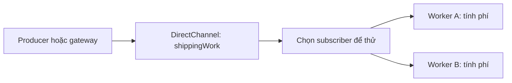

# Load balancing giữa subscribers

## 1. Bài toán: nhiều consumer cùng thực hiện một công việc

Trong Spring Integration Core, một `Message` mang dữ liệu cần xử lý, `MessageChannel` nối các thành phần, còn endpoint gắn logic nghiệp vụ với kênh đầu vào. Khi nhiều endpoint cùng có khả năng xử lý một loại công việc, ta có thể cho chúng đăng ký vào cùng một `DirectChannel` để phân phối công việc.

Giả sử ứng dụng có hai bộ xử lý yêu cầu tính phí vận chuyển, A và B. Cả hai nhận cùng cấu trúc dữ liệu, tuân thủ cùng hợp đồng và có thể thay thế cho nhau. Mỗi yêu cầu chỉ cần một bộ xử lý hoàn tất.



Hai nhánh biểu diễn các ứng viên. Đó không phải sơ đồ phát mỗi thông điệp cho cả A và B.

Sau bài này, bạn cần giải thích được:

- Subscriber nào được thử đầu tiên khi dùng round-robin.
- Vì sao thêm subscriber chưa tạo thêm luồng thực thi.
- Khi nào failover chuyển một thông điệp sang subscriber khác.
- Cách khai báo nhiều consumer bằng Java DSL và kiểm chứng hành vi bằng JUnit.

Một thiết kế phù hợp có dạng: chuẩn hóa dữ liệu bằng transformer, kiểm tra điều kiện đầu vào, rồi đưa những công việc hợp lệ đến nhóm worker có cùng năng lực. Nếu cần chọn theo vùng giao hàng hoặc loại dịch vụ, hãy định tuyến trước khi phân phối trong từng nhóm.

## 2. Subscriber là ai trong một luồng tích hợp?

`DirectChannel` triển khai `SubscribableChannel`. Đối tượng được đăng ký trực tiếp là `MessageHandler`. Trong ứng dụng cấu hình bằng Java DSL, endpoint tạo bởi `.handle(...)` kết nối handler với kênh đầu vào; việc đăng ký diễn ra theo vòng đời của endpoint.

Ví dụ:

```text
shippingWork
    ├── endpointA → serviceA.calculate(...)
    └── endpointB → serviceB.calculate(...)
```

`endpointA` và `endpointB` là hai consumer cạnh tranh để nhận công việc. Ngược lại, cấu hình sau mô tả các bước liên tiếp:

```java
IntegrationFlow.from("input")
        .handle(serviceA, "calculate")
        .handle(serviceB, "persist")
        .get();
```

Ở cấu hình nối tiếp, kết quả từ bước trước đi đến bước sau theo hợp đồng của flow. Không thể suy ra có hai subscriber cạnh tranh trên `input` chỉ vì có hai lời gọi `.handle(...)`.

Java DSL tạo các thành phần tích hợp từ bean `IntegrationFlow`; `.handle(...)` biểu diễn service activator. Xem [Java DSL](https://docs.spring.io/spring-integration/reference/dsl.html) và [Service Activator](https://docs.spring.io/spring-integration/reference/service-activator.html).

Một lỗi thiết kế thường gặp là gắn “ghi đơn hàng” và “gửi email” vào cùng `DirectChannel` với mong muốn cả hai luôn chạy. Hai tác vụ đó không thay thế cho nhau. Hãy nối chúng thành các bước phù hợp hoặc dùng cấu trúc phát thông điệp tới nhiều nhánh nếu nghiệp vụ yêu cầu.

## 3. Cơ chế phân phối và round-robin

### 3.1. Phân biệt chọn ứng viên với xử lý thành công

`DirectChannel` dùng `UnicastingDispatcher` để gọi handler. Có thể hình dung thuật toán như sau:

```text
lấy danh sách handler theo thứ tự chiến lược quy định

nếu không có handler:
    báo lỗi giao thông điệp

với từng handler trong danh sách:
    thử gọi handler với thông điệp
    nếu lời gọi kết thúc bình thường:
        kết thúc dispatch thành công
    nếu handler ném exception:
        nếu chính sách không cho failover:
            ném lỗi về phía gửi
        nếu còn ứng viên:
            tiếp tục thử ứng viên kế tiếp

nếu các lần thử đều thất bại:
    báo lỗi giao thông điệp
```

Đây là mô hình giải thích, không phải mã nguồn sao chép. Trong mô hình này, “thành công” chỉ có nghĩa lời gọi handler không ném exception ra ngoài. Dispatcher không đọc một cờ nghiệp vụ trong payload để quyết định thử worker khác. Xem hợp đồng của [UnicastingDispatcher](https://docs.spring.io/spring-integration/api/org/springframework/integration/dispatcher/UnicastingDispatcher.html).

Từ cơ chế dừng này có thể suy ra:

- Nếu A bắt lỗi rồi trả về bình thường, dispatcher không có tín hiệu lỗi để thử B.
- Nếu một filter tiêu thụ thông điệp bằng cách discard bình thường, việc đó không yêu cầu dispatcher chọn worker tiếp theo.
- Một worker đã ghi dữ liệu rồi mới ném exception vẫn có thể để lại tác động trước khi worker khác được thử.

Vì thế, hãy xác định hợp đồng thành công và thất bại của worker ngay từ thiết kế.

### 3.2. Round-robin thay đổi điểm bắt đầu của mỗi lần dispatch

Constructor `new DirectChannel()` mặc định dùng `RoundRobinLoadBalancingStrategy`. Với một channel mới, danh sách ổn định gồm A, B, C, gửi tuần tự và không có lỗi, ta có thể quan sát:

| Thông điệp | Subscriber được thử đầu tiên | Subscriber xử lý thành công |
|---|---|---|
| M1 | A | A |
| M2 | B | B |
| M3 | C | C |
| M4 | A | A |
| M5 | B | B |
| M6 | C | C |

Điều quan trọng là điểm bắt đầu quay vòng. Khi cần failover, danh sách ứng viên vẫn tiếp tục từ điểm đó và có thể vòng lại các phần tử phía trước. Ví dụ, bắt đầu từ B cho danh sách A, B, C thì thứ tự thử là B, C, A. Xem [RoundRobinLoadBalancingStrategy](https://docs.spring.io/spring-integration/api/org/springframework/integration/dispatcher/RoundRobinLoadBalancingStrategy.html).

Bảng trên giả định tất cả subscriber đã đăng ký trước M1 và không thay đổi trong quá trình gửi. Với nhiều producer đồng thời, không nên gán một quy luật cứng như “mọi mã đơn lẻ đều vào A”. Mã đơn hàng không tham gia thuật toán round-robin mặc định.

### 3.3. Cân bằng số lượt chưa phản ánh độ nặng của công việc

Xét sáu đơn có thời gian xử lý dự kiến như sau:

| Đơn | Worker theo lượt quay vòng | Thời gian giả định |
|---|---|---|
| 1 | A | 10 ms |
| 2 | B | 500 ms |
| 3 | A | 10 ms |
| 4 | B | 500 ms |
| 5 | A | 10 ms |
| 6 | B | 500 ms |

Mỗi worker nhận ba lượt, nhưng tổng thời gian công việc của B lớn hơn nhiều. Đây là ví dụ suy luận từ cách quay vòng: việc chia đều số lượt không tự động chia đều thời gian xử lý.

Nếu một worker đang gọi dịch vụ ngoài chậm, không nên giả định round-robin sẽ tự chuyển sang worker đang rảnh. Muốn giải bài toán đó cần thêm mô hình đo tải, điều phối hoặc hàng đợi thích hợp.

## 4. Load balancing và failover là hai quyết định riêng

Load balancing xác định thứ tự thử subscriber. Failover xác định có tiếp tục thử khi subscriber vừa được gọi ném exception hay không.

`DirectChannel` mặc định bật failover. Cấu hình thường gặp:

| Load balancing | Failover | Hành vi |
|---|---|---|
| Round-robin | `true` | Quay vòng ứng viên đầu tiên; nếu lỗi thì có thể thử ứng viên khác |
| Round-robin | `false` | Quay vòng ứng viên đầu tiên; lỗi ở lần thử đó được đưa về phía gửi |
| Không dùng chiến lược | `true` | Luôn bắt đầu theo thứ tự cố định; dùng các ứng viên sau để dự phòng |
| Không dùng chiến lược | `false` | Luôn thử subscriber đầu tiên trong thứ tự cố định |

Có thể truyền `null` vào constructor để tắt load balancing:

```java
DirectChannel primaryThenBackup = new DirectChannel(null);
primaryThenBackup.setFailover(true);
```

Thứ tự cố định phụ thuộc thứ tự của handler: giá trị order nếu có, hoặc thứ tự đăng ký khi không có giá trị order phân biệt. Đừng dựa vào thứ tự khai báo bean để diễn đạt ưu tiên nghiệp vụ. Xem [DirectChannel API](https://docs.spring.io/spring-integration/api/org/springframework/integration/channel/DirectChannel.html).

### Ví dụ: subscriber A thường xuyên lỗi

Giả sử có hai worker, A luôn ném exception và B luôn kết thúc bình thường:

| Thông điệp | Ứng viên đầu tiên | Các lần gọi thực tế | Worker thành công |
|---|---|---|---|
| M1 | A | A lỗi → B thành công | B |
| M2 | B | B thành công | B |
| M3 | A | A lỗi → B thành công | B |
| M4 | B | B thành công | B |

Round-robin vẫn phân phối điểm bắt đầu. Số công việc hoàn tất lại dồn về B. Với bốn thông điệp, A được gọi hai lần, B được gọi bốn lần.

Từ ví dụ này, khi quan sát hệ thống cần tách ba số đo: số lần được chọn đầu tiên, số lần handler được gọi và số lần xử lý thành công. Chỉ đếm kết quả cuối có thể che khuất một worker liên tục gặp lỗi.

Failover cũng không tự cách ly A khỏi các thông điệp tiếp theo. Nếu muốn tạm ngừng dùng một dịch vụ đang hỏng, cần chính sách vòng đời, định tuyến hoặc circuit breaker riêng.

### Chọn failover theo loại exception

Từ Spring Integration 6.3, `DirectChannel` có `setFailoverStrategy(Predicate<Exception>)`. API này cho phép quyết định dựa trên exception. Nó và `setFailover(boolean)` thay thế cấu hình của nhau; nên chọn một cách trong mỗi cấu hình, tránh gọi cả hai rồi phụ thuộc vào thứ tự setter. Xem [setFailoverStrategy](https://docs.spring.io/spring-integration/api/org/springframework/integration/channel/DirectChannel.html#setFailoverStrategy(java.util.function.Predicate)).

Về nghiệp vụ, lỗi “dịch vụ tính phí tạm thời không truy cập được” có thể phù hợp để thử nhà cung cấp dự phòng. Lỗi “địa chỉ giao hàng thiếu tỉnh thành” thường cần trả về để sửa dữ liệu. Khi viết predicate, kiểm tra cả khả năng exception nghiệp vụ được bọc trong exception của endpoint.

## 5. DirectChannel giữ nguyên luồng gửi

Thêm ba subscriber vào `DirectChannel` không tạo ra ba worker thread. Channel gọi handler ngay trên thread đang gọi `send(...)`. Sender phải chờ lời gọi handler đồng bộ kết thúc trước khi `send(...)` trả về. Đây là đặc điểm được mô tả trong [Message Channel Implementations](https://docs.spring.io/spring-integration/reference/channel/implementations.html#channel-implementations-directchannel).

Với một producer gửi trong vòng lặp:

```text
thread T:
send(M1) → A xử lý xong → trả về
send(M2) → B xử lý xong → trả về
send(M3) → A xử lý xong → trả về
```

Với hai producer đang hoạt động đồng thời:

```text
thread T1: send(M1) → A
thread T2: send(M2) → B
```

Hai lời gọi có thể chạy đồng thời vì đã có hai thread gửi. Mô hình thứ hai không có một pool riêng do `DirectChannel` tạo ra.

Hệ quả khi thiết kế:

- Dùng cấu trúc dữ liệu an toàn với truy cập đồng thời trong handler nếu có nhiều producer.
- Một handler có thể nhận nhiều lời gọi đồng thời; số subscriber không phải giới hạn concurrency.
- `setMaxSubscribers(2)` chỉ giới hạn số đăng ký, không phải “chỉ cho chạy hai tác vụ”.
- Không có hàng đợi trong channel để giữ lại công việc khi downstream chậm.

Nếu mỗi thông điệp đều mất 100 ms và một producer chỉ gửi thông điệp tiếp theo sau khi lần trước hoàn tất, thêm subscriber không tự biến vòng lặp đó thành ba tác vụ chạy song song. Đây là hệ quả của cách gọi đồng bộ.

### Timeout gửi không phải giới hạn thời gian xử lý

Không dùng `channel.send(message, timeout)` như cách ngắt một handler chạy quá lâu. Trong `AbstractSubscribableChannel`, đường dispatch đồng bộ không dùng timeout để cắt ngang lời gọi handler. Cần cấu hình timeout tại HTTP client, JDBC hoặc tài nguyên thực sự có thể bị chậm. Xem [mã nguồn AbstractSubscribableChannel 6.5.0](https://github.com/spring-projects/spring-integration/blob/v6.5.0/spring-integration-core/src/main/java/org/springframework/integration/channel/AbstractSubscribableChannel.java).

## 6. Ví dụ Java DSL: hai flow cùng nhận từ một channel

Ví dụ sau dùng các API có trong Spring Integration 6.5. Cần có `org.springframework.integration:spring-integration-core` cùng bộ thư viện Spring tương thích. Phần kiểm thử bên dưới dùng JUnit Jupiter.

Đây là ví dụ gửi một chiều. Mỗi handler in công việc đã nhận và trả về `null` để không tạo reply. Trong bài toán request–reply, hai worker phải tuân thủ cùng hợp đồng trả lời và cấu hình output/reply channel phù hợp.

Lưu ví dụ vào `OrderLoadBalancingConfig.java` trong một ứng dụng thử nghiệm:

```java
import org.springframework.context.annotation.AnnotationConfigApplicationContext;
import org.springframework.context.annotation.Bean;
import org.springframework.context.annotation.Configuration;
import org.springframework.integration.channel.DirectChannel;
import org.springframework.integration.config.EnableIntegration;
import org.springframework.integration.dsl.IntegrationFlow;
import org.springframework.messaging.support.MessageBuilder;

@Configuration
@EnableIntegration
public class OrderLoadBalancingConfig {

    @Bean
    public DirectChannel shippingWork() {
        DirectChannel channel = new DirectChannel();
        channel.setFailover(false);
        return channel;
    }

    @Bean
    public IntegrationFlow workerA(DirectChannel shippingWork) {
        return IntegrationFlow.from(shippingWork)
                .handle(String.class, (orderId, headers) -> {
                    System.out.println("A: " + orderId + " @ "
                            + Thread.currentThread().getName());
                    return null;
                }, endpoint -> endpoint.id("workerAEndpoint").order(10))
                .get();
    }

    @Bean
    public IntegrationFlow workerB(DirectChannel shippingWork) {
        return IntegrationFlow.from(shippingWork)
                .handle(String.class, (orderId, headers) -> {
                    System.out.println("B: " + orderId + " @ "
                            + Thread.currentThread().getName());
                    return null;
                }, endpoint -> endpoint.id("workerBEndpoint").order(20))
                .get();
    }

    public static void main(String[] args) {
        try (AnnotationConfigApplicationContext context =
                new AnnotationConfigApplicationContext(
                        OrderLoadBalancingConfig.class)) {

            DirectChannel channel =
                    context.getBean("shippingWork", DirectChannel.class);

            System.out.println("Subscribers: " + channel.getSubscriberCount());

            for (int i = 1; i <= 4; i++) {
                channel.send(MessageBuilder
                        .withPayload("ORDER-" + i)
                        .build());
            }
        }
    }
}
```

Hai bean `IntegrationFlow` cùng bắt đầu từ chính đối tượng `shippingWork`. Đây là điểm tạo nhóm consumer cạnh tranh. API `IntegrationFlow.from(MessageChannel)` cho phép dùng một channel đã khai báo làm đầu vào của flow; xem [IntegrationFlow API](https://docs.spring.io/spring-integration/api/org/springframework/integration/dsl/IntegrationFlow.html).

Với context mới và không có thành phần khác gửi vào channel, phần kết quả minh họa là:

```text
Subscribers: 2
A: ORDER-1 @ main
B: ORDER-2 @ main
A: ORDER-3 @ main
B: ORDER-4 @ main
```

`order(10)` đặt A trước B trong thứ tự nền; nó không khiến A nhận tất cả thông điệp khi round-robin vẫn bật. Ví dụ chủ động tắt failover để dễ quan sát một lần chọn cho mỗi thông điệp. Đổi sang `setFailover(true)` khi muốn khảo sát hành vi dự phòng.

Nếu chuyển constructor thành `new DirectChannel(null)`, giữ A có order nhỏ hơn B và không có lỗi, A sẽ nhận cả bốn thông điệp.

### Đối chiếu với pipeline xử lý

Giả sử quy trình cần “chuẩn hóa địa chỉ → tính phí → lưu báo giá”. Chỉ bước tính phí có hai implementation thay thế được nhau. Thiết kế nên tách:

```text
chuẩn hóa địa chỉ
        ↓
shippingWork → một trong các worker tính phí
        ↓
lưu báo giá từ kết quả worker
```

Trong flow thực tế, hai nhánh worker cần đưa kết quả đến đầu vào lưu báo giá. Ví dụ gửi một chiều ở trên dừng sau khi in, nên chưa hiện thực bước đó.

Nếu producer là messaging gateway, gateway chỉ là điểm gọi vào luồng. Chiến lược chọn worker vẫn thuộc channel; dùng gateway không tự đổi `DirectChannel` thành thực thi bất đồng bộ.

## 7. Kiểm thử hành vi bằng JUnit

Các kiểm thử dưới đây dùng channel độc lập để tập trung vào hợp đồng dispatch. Chúng không yêu cầu khởi động Spring context, poller hay dùng `Thread.sleep(...)`. Sau `send(...)`, có thể kiểm tra ngay các tác động đồng bộ của handler.

Lưu đoạn sau vào `DirectChannelLoadBalancingTest.java` của ứng dụng thử nghiệm. Tên file này chỉ là hướng dẫn thực hành cho người học.

```java
import java.util.ArrayList;
import java.util.List;
import java.util.concurrent.atomic.AtomicInteger;
import java.util.concurrent.atomic.AtomicReference;

import org.junit.jupiter.api.Test;
import org.springframework.integration.channel.DirectChannel;
import org.springframework.messaging.MessageDeliveryException;
import org.springframework.messaging.MessageHandlingException;
import org.springframework.messaging.MessagingException;
import org.springframework.messaging.support.GenericMessage;

import static org.junit.jupiter.api.Assertions.assertEquals;
import static org.junit.jupiter.api.Assertions.assertSame;
import static org.junit.jupiter.api.Assertions.assertThrows;
import static org.junit.jupiter.api.Assertions.assertTrue;

class DirectChannelLoadBalancingTest {

    @Test
    void roundRobinDistributesMessagesWithoutBroadcasting() {
        DirectChannel channel = new DirectChannel();
        channel.setFailover(false);
        List<String> received = new ArrayList<>();

        channel.subscribe(message ->
                received.add("A:" + message.getPayload()));
        channel.subscribe(message ->
                received.add("B:" + message.getPayload()));

        for (int i = 1; i <= 4; i++) {
            assertTrue(channel.send(new GenericMessage<>(i)));
        }

        assertEquals(List.of("A:1", "B:2", "A:3", "B:4"), received);
    }

    @Test
    void handlerRunsOnTheSendingThread() {
        DirectChannel channel = new DirectChannel();
        AtomicReference<Thread> actualThread = new AtomicReference<>();
        Thread sender = Thread.currentThread();

        channel.subscribe(message ->
                actualThread.set(Thread.currentThread()));

        assertTrue(channel.send(new GenericMessage<>("ORDER-1")));
        assertSame(sender, actualThread.get());
    }

    @Test
    void failoverTriesBackupAfterPrimaryThrows() {
        DirectChannel channel = new DirectChannel(null);
        channel.setFailover(true);
        List<String> attempts = new ArrayList<>();

        channel.subscribe(message -> {
            attempts.add("A");
            throw new MessageHandlingException(
                    message, "A temporarily unavailable");
        });
        channel.subscribe(message -> attempts.add("B"));

        assertTrue(channel.send(new GenericMessage<>("ORDER-1")));
        assertEquals(List.of("A", "B"), attempts);
    }

    @Test
    void disabledFailoverDoesNotInvokeBackup() {
        DirectChannel channel = new DirectChannel(null);
        channel.setFailover(false);
        AtomicInteger backupCalls = new AtomicInteger();

        channel.subscribe(message -> {
            throw new MessageHandlingException(message, "Primary failed");
        });
        channel.subscribe(message -> backupCalls.incrementAndGet());

        assertThrows(MessagingException.class,
                () -> channel.send(new GenericMessage<>("ORDER-1")));
        assertEquals(0, backupCalls.get());
    }

    @Test
    void noLoadBalancingKeepsStartingWithPrimary() {
        DirectChannel channel = new DirectChannel(null);
        AtomicInteger primaryCalls = new AtomicInteger();
        AtomicInteger backupCalls = new AtomicInteger();

        channel.subscribe(message -> primaryCalls.incrementAndGet());
        channel.subscribe(message -> backupCalls.incrementAndGet());

        for (int i = 1; i <= 4; i++) {
            assertTrue(channel.send(new GenericMessage<>(i)));
        }

        assertEquals(4, primaryCalls.get());
        assertEquals(0, backupCalls.get());
    }

    @Test
    void noSubscribersProducesDeliveryFailure() {
        DirectChannel channel = new DirectChannel();

        assertThrows(MessageDeliveryException.class,
                () -> channel.send(new GenericMessage<>("ORDER-1")));
    }
}
```

Kiểm thử đầu dùng một channel mới, hai handler thường được đăng ký A rồi B, không có gửi đồng thời và không thay đổi subscriber. Các điều kiện đó làm kỳ vọng về chuỗi A, B có ý nghĩa. Khi kiểm thử tải đồng thời, nên kiểm tra số lần xử lý, lỗi và tính đúng của dữ liệu, tránh ép thứ tự log thành một chuỗi cố định.

Các kiểm thử channel độc lập chưa xác minh vòng đời endpoint của ví dụ Java DSL. Với ứng dụng dùng context, cần kiểm tra thêm rằng hai endpoint đã khởi động và `shippingWork.getSubscriberCount()` thực sự bằng 2.

Để mở rộng thực hành, hãy thêm tình huống cả hai worker đều lỗi và kiểm tra các nguyên nhân được giữ lại. Trong triển khai 6.5.0, một lỗi được ném ra riêng; nhiều lỗi đã thu thập có thể được gộp trong `AggregateMessageDeliveryException`. Xem [mã nguồn UnicastingDispatcher 6.5.0](https://github.com/spring-projects/spring-integration/blob/v6.5.0/spring-integration-core/src/main/java/org/springframework/integration/dispatcher/UnicastingDispatcher.java).

## 8. Lỗi, transaction và tác động nghiệp vụ lặp lại

### 8.1. Lỗi đồng bộ quay về phía gọi

Khi gửi trực tiếp vào `DirectChannel` và lỗi không được xử lý thành công qua failover, exception đi ngược call stack về sender. Việc chỉ gắn header `errorChannel` vào message không khiến một lời gọi `send(...)` trực tiếp tự động chuyển lỗi thành `ErrorMessage`.

Gateway hoặc error-handling advice có thể cấu hình cách xử lý khác. Cần phân biệt cơ chế của chúng với hành vi dispatch của channel. Xem [Error Handling](https://docs.spring.io/spring-integration/reference/error-handling.html).

Nếu không có subscriber, dispatcher báo không có đích nhận; ở API channel, lỗi này được bọc thành `MessageDeliveryException`. Vì channel không lưu hàng đợi, gửi khi endpoint chưa hoạt động không tạo công việc chờ để endpoint xử lý sau.

### 8.2. Failover không đảm bảo chỉ có một tác động nghiệp vụ

Xét một worker thanh toán:

```text
1. A gửi yêu cầu trừ tiền đến cổng thanh toán.
2. Cổng thanh toán đã trừ tiền.
3. A timeout khi chờ phản hồi và ném exception.
4. Dispatcher failover sang B.
5. B gửi lại yêu cầu trừ tiền.
```

Dispatcher chỉ nhìn thấy exception ở bước 3. Nó không biết bước 2 đã thành công tại hệ thống ngoài. Do đó, cùng một yêu cầu có thể tạo tác động lặp lại.

Với nghiệp vụ như vậy, cần một khóa idempotency ổn định theo yêu cầu thanh toán và cơ chế ghi nhận hoặc từ chối xử lý trùng tại nơi thực hiện tác động. Không dùng round-robin như một bảo đảm exactly-once.

Tương tự, tránh sửa trực tiếp payload mutable ở A rồi để B nhận trạng thái đã thay đổi khi failover. Ưu tiên dữ liệu bất biến, hoặc quy định rõ cách tạo dữ liệu mới giữa các bước.

### 8.3. Cùng thread hỗ trợ giữ ngữ cảnh transaction

Nếu sender đã mở một transaction Spring phù hợp và handler sử dụng tài nguyên tham gia transaction đó, đoạn xử lý qua `DirectChannel` có thể nằm trong cùng ngữ cảnh transaction. Channel không tự mở transaction chỉ vì nó chạy đồng bộ. Xem [Transaction Support](https://docs.spring.io/spring-integration/reference/transactions.html).

Đừng xem lần thử B như một transaction sạch mặc định. Nếu lời gọi A đi qua một transaction interceptor và đánh dấu transaction chung là rollback-only, việc B kết thúc bình thường không tự khôi phục khả năng commit. Cũng không thể suy ra một HTTP request đã hoàn tất ở hệ thống ngoài sẽ được hoàn tác nhờ transaction JDBC cục bộ.

Thiết kế transaction boundary và chính sách failover phải cùng phản ánh tác động nghiệp vụ thực tế.

## 9. Khi nào cần giải pháp khác?

| Nhu cầu cụ thể | Hướng thiết kế |
|---|---|
| Một công việc được xử lý bởi một trong các consumer đồng bộ cùng JVM | `DirectChannel` với các subscriber thay thế được nhau |
| Mỗi thông điệp phải đi đến nhiều nhánh nghiệp vụ | `PublishSubscribeChannel` hoặc cấu trúc phân nhánh phù hợp |
| Cần tách thread gửi và xử lý | `ExecutorChannel` cùng executor được cấu hình phù hợp |
| Cần giữ công việc để consumer lấy sau | `QueueChannel` và consumer có poller |
| Cần chọn theo loại payload, vùng hoặc header nghiệp vụ | Router đến channel thích hợp |
| Cần phân phối công việc giữa nhiều tiến trình hoặc máy | Thiết kế qua broker hoặc hạ tầng phân tán |

Các khác biệt nền tảng giữa channel được trình bày trong [Message Channel Implementations](https://docs.spring.io/spring-integration/reference/channel/implementations.html).

Bảng là gợi ý thiết kế từ những yêu cầu giả định, không thay thế việc xác định độ bền dữ liệu, thứ tự và cách khôi phục lỗi của ứng dụng. Chẳng hạn, chọn `QueueChannel` không tự có lưu trữ bền vững; chọn `ExecutorChannel` cũng đòi hỏi xác định dung lượng executor và cách xử lý khi quá tải.

Một `DirectChannel` là đối tượng trong ứng dụng đang chạy. Tạo thêm một bản sao ứng dụng với channel cùng tên không tự gộp subscriber của hai tiến trình vào một vòng round-robin chung.

### Mở rộng chiến lược phân phối

Hợp đồng mở rộng là:

```java
Iterator<MessageHandler> getHandlerIterator(
        Message<?> message,
        Collection<MessageHandler> handlers);
```

`LoadBalancingStrategy` cung cấp thứ tự duyệt ứng viên; nó không thay đổi channel thành bộ lập lịch tác vụ. Có thể truyền một implementation của interface này vào constructor `DirectChannel`. Xem [LoadBalancingStrategy API](https://docs.spring.io/spring-integration/api/org/springframework/integration/dispatcher/LoadBalancingStrategy.html).

Nếu tự viết chiến lược, hãy thiết kế rõ:

- Cách ứng xử khi danh sách rỗng hoặc chỉ có một handler.
- Thứ tự thử các ứng viên dự phòng.
- Tính an toàn khi nhiều thread gọi đồng thời.
- Cách cập nhật trạng thái khi subscriber được thêm hoặc gỡ.
- Ý nghĩa của trọng số hoặc tín hiệu tải mà chiến lược sử dụng.

Với yêu cầu “đơn nội địa vào A, đơn quốc tế vào B”, router biểu đạt hợp đồng nghiệp vụ trực tiếp hơn việc ẩn quy tắc trong một chiến lược phân phối.

## 10. Chẩn đoán các hiện tượng thường gặp

| Hiện tượng | Điều cần kiểm tra |
|---|---|
| Chỉ A nhận thông điệp | Channel có tắt load balancing không; B đã thực sự subscribe chưa |
| B xử lý nhiều kết quả hơn A | A có ném exception khiến failover sang B không |
| Có hai flow nhưng subscriber count là 1 | Hai flow có dùng cùng đối tượng channel; endpoint có đang chạy không |
| Có nhiều worker nhưng một vòng lặp gửi vẫn chậm | Producer đang chờ xử lý đồng bộ sau từng `send(...)` |
| Một mã đơn được xử lý ở nhiều nơi | Các lần thử failover, retry bên ngoài và khóa idempotency |
| Có header `errorChannel` nhưng caller vẫn nhận exception | Cách gọi trực tiếp vào channel và cấu hình gateway/advice |
| Lỗi “Dispatcher has no subscribers” | Vòng đời endpoint, tên kênh và thời điểm gửi đầu tiên |

Khi log để khảo sát, ghi ít nhất mã công việc, tên worker, thread, thời điểm bắt đầu, thời lượng và kết quả. Với ví dụ A lỗi rồi B thành công, hai dòng bắt đầu xử lý cho cùng mã công việc là bằng chứng về hai lần thử; chưa đủ để kết luận có hai kết quả nghiệp vụ thành công.

Thông tin `getSubscriberCount()` và `setMaxSubscribers(...)` giúp quan sát hoặc giới hạn đăng ký. Chúng không thay thế số liệu về số lời gọi đang chạy. Việc quản lý tập handler được thể hiện trong [mã nguồn AbstractDispatcher 6.5.0](https://github.com/spring-projects/spring-integration/blob/v6.5.0/spring-integration-core/src/main/java/org/springframework/integration/dispatcher/AbstractDispatcher.java).

## 11. Bài tập vận dụng

1. Chạy ví dụ DSL với sáu thông điệp và hai worker không lỗi. Ghi lại worker và thread của từng lần xử lý.
2. Đổi thành `new DirectChannel(null)`. Giữ nguyên order và so sánh số việc A, B nhận được.
3. Cho A ném exception trước khi thực hiện tác động. Bật failover và phân biệt số lần gọi với số việc hoàn tất.
4. Tắt failover. Xác định exception mà sender nhận và xác nhận B không được gọi cho lần gửi lỗi đó.
5. Đưa bước kiểm tra địa chỉ trước nhóm worker. Giải thích vì sao thử nhiều worker không sửa được một dữ liệu đầu vào không hợp lệ.
6. Thiết kế thêm worker C mà không giả định thông điệp theo một mã khách hàng luôn đến cùng worker.

Tiêu chí hoàn thành là giải thích được trace thực thi từ cấu hình channel, thứ tự subscriber và chính sách lỗi. Một thiết kế đúng còn phải nêu rõ phần nào thực hiện đồng bộ, nơi nào có tác động ngoài hệ thống và cách nhận diện yêu cầu trùng.
