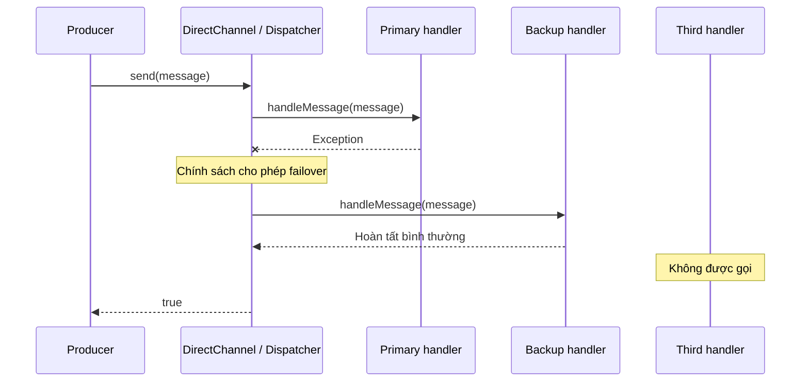

# Failover giữa handlers

## 1. Bài toán: chuyển sang bộ xử lý dự phòng khi bộ xử lý đầu tiên lỗi

Trong chương **DirectChannel** của module **SPRING_INTEGRATION_CORE**, bài này tập trung vào cách một channel chuyển thông điệp sang handler khác khi lần xử lý hiện tại thất bại. Đây là một cơ chế hữu ích khi thiết kế luồng tích hợp có nhiều bộ xử lý thay thế được cho nhau.

Giả sử hệ thống tra cứu giá có hai nguồn:

- Nguồn chính cung cấp giá cập nhật.
- Nguồn dự phòng cung cấp giá đủ đáp ứng hợp đồng nghiệp vụ khi nguồn chính tạm thời không sẵn sàng.

Producer chỉ gửi một `Message` tới channel tra cứu giá. Nó không cần tự gọi nguồn chính, bắt lỗi, rồi gọi nguồn dự phòng. Việc lựa chọn handler nằm ở tầng phân phối thông điệp.

Sau bài học, bạn cần làm được bốn việc: giải thích điều kiện kích hoạt failover; cấu hình primary/backup có thứ tự; giới hạn loại lỗi được chuyển sang backup; và xác định những trường hợp cơ chế này có thể làm lặp tác động nghiệp vụ.

Các ví dụ dùng API trong `spring-integration-core`. Phần `setFailoverStrategy(...)` yêu cầu **Spring Integration 6.3 trở lên**. Ví dụ Java DSL dùng Java 17 trở lên và giả định các dependency Spring cần thiết đã có trên classpath; bài không ấn định phiên bản dependency của dự án.

## 2. Failover thực sự diễn ra ở đâu?

`DirectChannel` là channel point-to-point. Các handler đăng ký với channel là các ứng viên để nhận thông điệp; chúng không tạo thành danh sách các bước bắt buộc phải chạy hết.

Channel sử dụng `UnicastingDispatcher` để phân phối. Khi failover được phép, một lần gửi có thể thử nhiều handler theo thứ tự. Dispatcher dừng ngay khi có một handler hoàn tất lời gọi `handleMessage(...)` mà không ném exception. Những handler phía sau không được gọi nữa. Cơ chế mặc định hoạt động đồng bộ trên thread của bên gửi. [Tài liệu DirectChannel](https://docs.spring.io/spring-integration/reference/channel/implementations.html#directchannel).



Một lần phân phối có thể có **nhiều lần thử nhưng chỉ dừng ở lần xử lý đầu tiên không phát sinh exception**. Điều đó không bảo đảm các lần thử trước chưa tạo ra tác động nào.

Hãy phân biệt ba trường hợp:

| Kết quả từ handler đang được gọi | Dispatcher quan sát được | Hành vi tiếp theo |
| --- | --- | --- |
| Hoàn tất bình thường | Lời gọi xử lý thành công | Dừng phân phối |
| Ném exception và chính sách cho phép failover | Lần thử thất bại, được chuyển tiếp | Thử handler kế tiếp nếu còn |
| Ném exception và chính sách không cho phép failover | Lỗi cần truyền ra ngoài | Dừng, ném lỗi về phía gửi |

Ở đây, “thành công” là quan sát tại biên lời gọi handler. Muốn bảo đảm kết quả nghiệp vụ, bạn còn phải thiết kế hợp đồng trả lời, giao dịch và cơ chế chống xử lý trùng.

## 3. Load balancing và failover là hai quyết định riêng

Load balancing chọn **handler nào được thử trước** cho mỗi thông điệp. Failover quyết định **có thử handler khác khi lần thử hiện tại ném exception hay không**.

`new DirectChannel()` mặc định dùng round-robin và bật failover. Nếu cần luôn thử primary trước, hãy dùng `new DirectChannel(null)` để bỏ chiến lược cân bằng tải. Việc bỏ load balancing không tự tắt failover. [API DirectChannel](https://docs.spring.io/spring-integration/docs/6.3.2/api/org/springframework/integration/channel/DirectChannel.html).

| Cấu hình | Handler được thử đầu tiên | Nếu lần thử đầu lỗi |
| --- | --- | --- |
| Round-robin, failover bật | Luân phiên theo chiến lược | Có thể thử ứng viên tiếp theo |
| Round-robin, failover tắt | Luân phiên theo chiến lược | Dừng và truyền lỗi |
| Không load balancing, failover bật | Handler đầu trong thứ tự đã xác lập | Thử tiếp theo thứ tự đó |
| Không load balancing, failover tắt | Handler đầu trong thứ tự đã xác lập | Dừng và truyền lỗi |

Ví dụ có ba handler A, B, C và không có gửi đồng thời:

```text
Mục tiêu phân chia tải:
  message-1 bắt đầu ở A
  message-2 bắt đầu ở B
  message-3 bắt đầu ở C

Mục tiêu primary/backup cố định:
  mọi message đều bắt đầu ở A
  A lỗi và được phép failover -> thử B
  B cũng lỗi và được phép failover -> thử C
```

Vì vậy, chỉ đặt `order` cho các handler mà vẫn để round-robin chưa đủ để xây dựng primary/backup cố định.

## 4. Ví dụ tối thiểu với hai subscriber trực tiếp

Ví dụ sau chỉ dùng channel và `MessageHandler`, giúp quan sát cơ chế mà chưa cần Spring ApplicationContext hay Java DSL.

```java
import java.util.ArrayList;
import java.util.List;

import org.springframework.integration.channel.DirectChannel;
import org.springframework.messaging.Message;
import org.springframework.messaging.support.MessageBuilder;

public class DirectChannelFailoverDemo {

    public static void main(String[] args) {
        DirectChannel channel = new DirectChannel(null);
        channel.setFailover(true);

        List<String> attempts = new ArrayList<>();

        // Hai lambda không có order riêng: đăng ký primary trước.
        channel.subscribe(message -> {
            attempts.add("primary");
            throw new IllegalStateException("Nguồn giá chính tạm lỗi");
        });

        channel.subscribe(message -> {
            attempts.add("backup");
            System.out.println("Backup nhận: " + message.getPayload());
        });

        Message<String> request = MessageBuilder
                .withPayload("SKU-42")
                .setHeader("requestId", "price-request-42")
                .build();

        boolean sent = channel.send(request);

        System.out.println("sent=" + sent);
        System.out.println("attempts=" + attempts);
    }
}
```

Đầu ra do chương trình in, ngoài log của framework:

```text
Backup nhận: SKU-42
sent=true
attempts=[primary, backup]
```

Lời gọi `send(...)` chờ cả lần thử primary và backup. `true` ở đây biểu thị việc phân phối đã hoàn tất qua backup; nó không phải dữ liệu báo giá. Muốn nhận dữ liệu từ handler, cần dùng mô hình request-reply.

Danh sách `ArrayList` trong ví dụ chỉ dùng để quan sát một lần gửi trên một thread. Trong ứng dụng thực có nhiều producer gọi `send(...)` đồng thời, handler vẫn có thể bị gọi đồng thời bởi nhiều thread khác nhau.

Thử đổi cấu hình thành:

```java
channel.setFailover(false);
```

Khi chạy lại toàn bộ ví dụ, chỉ primary được gọi; `send(...)` ném exception nên các dòng in sau nó không được thực hiện. Nếu muốn quan sát `attempts`, hãy bắt lỗi bên ngoài lời gọi gửi và in danh sách trong khối `finally`.

## 5. Chọn loại lỗi được phép failover

Không phải lỗi nào cũng nên được giải quyết bằng cách chuyển sang handler khác. Dữ liệu đầu vào sai thường cần bị từ chối ngay. Một nguồn tra cứu tạm thời không sẵn sàng có thể là lý do hợp lệ để dùng nguồn thay thế.

Từ Spring Integration 6.3, `DirectChannel` cung cấp `setFailoverStrategy(Predicate<Exception>)`. Predicate trả `true` để cho phép thử ứng viên tiếp theo, hoặc `false` để dừng. `setFailover(boolean)` và `setFailoverStrategy(...)` ghi đè cấu hình của nhau; nên chọn một cách cấu hình rõ ràng. [Tài liệu cấu hình channel](https://www.springframework.org/spring-integration/reference/6.3/channel/configuration.html).

Ví dụ chính sách ở cấp nghiệp vụ:

| Tình huống | Quyết định gợi ý | Điều kiện cần xem xét |
| --- | --- | --- |
| Nguồn đọc dữ liệu được xác nhận tạm không sẵn sàng | Cho phép backup | Backup đáp ứng cùng hợp đồng kết quả |
| Mã sản phẩm trống hoặc sai định dạng | Dừng | Đổi nhà cung cấp không sửa được dữ liệu |
| Không có quyền thực hiện thao tác | Dừng | Luồng phải tuân thủ quyết định phân quyền |
| Timeout sau khi gửi lệnh ghi | Cần xử lý trạng thái chưa rõ | Phải xác minh kết quả hoặc có chống trùng xuyên nhà cung cấp |

Các quyết định trong bảng là gợi ý thiết kế, không phải phân loại được framework áp dụng sẵn.

Endpoint hoặc advice có thể bọc lỗi gốc trong một exception khác. Do đó, chính sách thường cần xem cả chuỗi `cause`. Chỉ kiểm tra `exception instanceof ProviderUnavailableException` có thể bỏ sót lỗi đã được bọc.

Ví dụ Java DSL ở phần tiếp theo định nghĩa một exception chuyên biệt và hàm duyệt `cause`. Đây là cách làm rõ hợp đồng: tầng tích hợp chỉ đánh dấu lỗi đủ điều kiện chuyển nguồn khi đã hiểu ý nghĩa của lỗi đó.

Không dùng `Throwable` như một danh mục lỗi được tự động chuyển tiếp. Vòng failover của dispatcher xử lý `Exception`; các lỗi thuộc nhóm `Error` không phải tình huống dự phòng nghiệp vụ nên mô phỏng bằng cách ném `Error` sẽ không kiểm tra cùng cơ chế này. [Mã nguồn UnicastingDispatcher 6.3.2](https://github.com/spring-projects/spring-integration/blob/v6.3.2/spring-integration-core/src/main/java/org/springframework/integration/dispatcher/UnicastingDispatcher.java).

## 6. Primary/backup bằng Java DSL và request-reply

Ví dụ này dựng hai endpoint cùng nhận từ `priceRequests`. Handler primary được ưu tiên bằng `order(10)` và backup có `order(20)`. Channel không có load balancing.

Để dễ quan sát, primary mô phỏng tình trạng không sẵn sàng với mọi mã sản phẩm hợp lệ. Mã trống bị xem là lỗi dữ liệu và không được chuyển sang backup.

```java
import java.util.Collections;
import java.util.IdentityHashMap;
import java.util.Set;

import org.springframework.beans.factory.annotation.Qualifier;
import org.springframework.context.annotation.AnnotationConfigApplicationContext;
import org.springframework.context.annotation.Bean;
import org.springframework.context.annotation.Configuration;
import org.springframework.integration.annotation.EnableIntegration;
import org.springframework.integration.channel.DirectChannel;
import org.springframework.integration.core.MessagingTemplate;
import org.springframework.integration.dsl.IntegrationFlow;
import org.springframework.messaging.Message;
import org.springframework.messaging.support.MessageBuilder;

@Configuration
@EnableIntegration
public class PriceFailoverConfiguration {

    @Bean
    public DirectChannel priceRequests() {
        DirectChannel channel = new DirectChannel(null);
        channel.setFailoverStrategy(PriceFailoverConfiguration::canFailover);
        return channel;
    }

    @Bean
    public IntegrationFlow primaryPriceFlow(
            @Qualifier("priceRequests") DirectChannel input) {
        return IntegrationFlow.from(input)
                .handle(String.class, (sku, headers) -> {
                    if (sku.isBlank()) {
                        throw new IllegalArgumentException("SKU không được trống");
                    }
                    // Mô phỏng lỗi hạ tầng của một thao tác chỉ đọc.
                    throw new ProviderUnavailableException(
                            "Nguồn giá chính không sẵn sàng");
                }, endpoint -> endpoint
                        .id("primaryPriceEndpoint")
                        .order(10)
                        .requiresReply(true))
                .get();
    }

    @Bean
    public IntegrationFlow backupPriceFlow(
            @Qualifier("priceRequests") DirectChannel input) {
        return IntegrationFlow.from(input)
                .handle(String.class, (sku, headers) -> "BACKUP_PRICE:" + sku,
                        endpoint -> endpoint
                                .id("backupPriceEndpoint")
                                .order(20)
                                .requiresReply(true))
                .get();
    }

    private static boolean canFailover(Exception exception) {
        Set<Throwable> visited = Collections.newSetFromMap(
                new IdentityHashMap<Throwable, Boolean>());
        for (Throwable current = exception;
                current != null && visited.add(current);
                current = current.getCause()) {
            if (current instanceof ProviderUnavailableException) {
                return true;
            }
        }
        return false;
    }

    public static final class ProviderUnavailableException
            extends RuntimeException {

        public ProviderUnavailableException(String message) {
            super(message);
        }
    }

    public static void main(String[] args) {
        try (AnnotationConfigApplicationContext context =
                new AnnotationConfigApplicationContext(
                        PriceFailoverConfiguration.class)) {
            MessagingTemplate template = new MessagingTemplate();
            DirectChannel input = context.getBean(
                    "priceRequests", DirectChannel.class);

            Message<?> reply = template.sendAndReceive(input,
                    MessageBuilder.withPayload("SKU-42").build());

            if (reply == null) {
                throw new IllegalStateException("Không nhận được phản hồi");
            }
            System.out.println(reply.getPayload());
        }
    }
}
```

Kết quả mong đợi:

```text
BACKUP_PRICE:SKU-42
```

`MessagingTemplate.sendAndReceive(...)` thiết lập cơ chế nhận reply cho yêu cầu. Hai flow không cấu hình output channel riêng, nên reply từ handler thành công được gửi về kênh phản hồi của yêu cầu.

Thay payload bằng một chuỗi toàn khoảng trắng sẽ khiến primary ném lỗi kiểm tra dữ liệu. Chính sách trả `false`, backup không chạy và bên gọi nhận exception. Trong ứng dụng thực, bạn có thể kiểm tra đầu vào trước cả channel này để hai nguồn dùng chung một quy tắc xác thực.

`order` nhỏ hơn có ưu tiên cao hơn. Với DSL, đặt thứ tự tại cấu hình endpoint như trên; API tương ứng là `ConsumerEndpointSpec.order(int)`. Không dựa vào thứ tự khai báo các phương thức `@Bean` để xác định primary. [API ConsumerEndpointSpec](https://docs.spring.io/spring-integration/docs/6.3.2/api/org/springframework/integration/dsl/ConsumerEndpointSpec.html).

Đây là **hai endpoint thay thế cùng subscribe một channel**, không phải một flow gọi primary rồi luôn gọi backup. Nếu dùng messaging gateway làm API Java ở phía producer, gateway vẫn gửi yêu cầu vào `priceRequests`; chính sách phân phối tiếp tục nằm tại channel.

Trong triển khai thực, primary trả về dữ liệu khi nguồn chính hoạt động bình thường. Khi đó backup không được gọi. Kiểu dữ liệu và ý nghĩa kết quả của hai nguồn phải tương thích; nếu nguồn dự phòng dùng dữ liệu cũ, kết quả nên thể hiện độ mới dữ liệu khi điều này ảnh hưởng quyết định của bên gọi.

## 7. Khi nào lỗi không dẫn đến chuyển handler?

### 7.1. Handler bắt lỗi rồi kết thúc bình thường

```java
channel.subscribe(message -> {
    try {
        callPrimary(message);
    }
    catch (RuntimeException ex) {
        logFailure(ex);
        // Không ném lại lỗi.
    }
});
```

Đoạn trên là mã minh họa; `callPrimary` và `logFailure` đại diện cho hàm ứng dụng. Dispatcher chỉ quan sát handler hoàn tất bình thường. Ghi log một lỗi không tạo ra tín hiệu failover.

Tương tự, nếu advice chuyển lỗi thành một giá trị mặc định hoặc recovery xử lý xong rồi trả về bình thường, channel có thể kết thúc phân phối tại endpoint đó. Hãy quyết định rõ lỗi nào cần được recovery tại chỗ và lỗi nào cần truyền ra để chuyển nguồn.

### 7.2. Kết quả nghiệp vụ báo thất bại nhưng không có exception

Một response như `accepted=false` vẫn có thể là kết quả hợp lệ của lời gọi handler. Dispatcher không tự đọc field trong payload để quyết định gọi backup.

Nếu “không tìm thấy ở nguồn A” phải dẫn đến tìm ở nguồn B, hãy xác định rõ đó là một nhánh nghiệp vụ. Có thể dùng router hoặc một service điều phối chuyên biệt thay vì dùng exception cho mọi kết quả không tìm thấy.

### 7.3. Filter loại thông điệp hoặc endpoint không tạo reply

Một filter có thể loại thông điệp theo cấu hình mà không ném lỗi. Một handler request-reply có thể trả `null` khi không bắt buộc có reply. Các hành vi hoàn tất bình thường này không tự yêu cầu dispatcher chuyển sang subscriber kế tiếp.

Ví dụ DSL ở trên dùng `requiresReply(true)` để thiếu reply trở thành lỗi rõ ràng. Tuy nhiên, predicate vẫn chỉ cho phép `ProviderUnavailableException`, nên không có nghĩa mọi lỗi thiếu reply đều được chuyển sang backup. Chính sách cần phù hợp với hợp đồng cụ thể của endpoint.

### 7.4. Lỗi xuất hiện sau một ranh giới bất đồng bộ

```text
DirectChannel -> primary handler -> QueueChannel -> worker lỗi sau đó
```

Nếu primary đã đưa thông điệp vào queue và kết thúc bình thường, lỗi của worker xảy ra sau đó không quay ngược thời gian để kích hoạt backup trên `DirectChannel` ban đầu. Cần xử lý lỗi và khả năng gửi lại ở ranh giới bất đồng bộ đó.

Ngược lại, nếu primary tiếp tục qua một chuỗi channel đồng bộ và downstream ném lỗi ngược trở lại, dispatcher đầu vào có thể coi toàn bộ lời gọi primary là thất bại. Backup khi đó có thể thực hiện lại một nhánh nghiệp vụ đã chạy được một phần. Đây là suy luận từ ranh giới lời gọi đồng bộ, cần đưa vào thiết kế chống trùng.

## 8. Nếu tất cả handler đều lỗi thì sao?

Với nhiều ứng viên, dispatcher giữ thông tin các lần thử thất bại. Khi nhiều handler đã được thử và đều ném exception, lỗi có thể được tổng hợp thành `AggregateMessageDeliveryException`. Nếu mới có một lần thử thất bại, chẳng hạn chính sách từ chối failover ngay ở primary, lỗi được truyền ra theo trường hợp một lỗi; không nên giả định mọi thất bại đều có lớp vỏ aggregate. [API UnicastingDispatcher](https://docs.spring.io/spring-integration/docs/6.3.2/api/org/springframework/integration/dispatcher/UnicastingDispatcher.html).

Ba tình huống cần phân biệt khi chẩn đoán:

| Tình huống | Hướng kiểm tra |
| --- | --- |
| Channel không có subscriber | Endpoint đã khởi động chưa, input channel có đúng không |
| Có subscriber nhưng chính sách dừng ở lỗi đầu tiên | Loại exception và chuỗi cause có khớp chính sách không |
| Nhiều lần thử đều thất bại | Xem các exception thành phần, không chỉ thông báo tổng hợp |

Không có subscriber là lỗi cấu hình hoặc vòng đời endpoint, không phải một cơ hội failover tới một handler chưa đăng ký. Chỉ có một subscriber thì cũng không có ứng viên khác để chuyển sang; bật failover không tự sinh thêm consumer. [Mã nguồn quản lý subscriber và phân phối một handler](https://github.com/spring-projects/spring-integration/blob/v6.3.2/spring-integration-core/src/main/java/org/springframework/integration/dispatcher/AbstractDispatcher.java).

Với lời gọi trực tiếp `channel.send(...)` hoặc `MessagingTemplate` trên luồng đồng bộ, lỗi cuối cùng truyền về bên gọi. Chỉ thêm header `errorChannel` không khiến `DirectChannel` tự bắt mọi lỗi và xuất bản `ErrorMessage`. Gateway hoặc thành phần có cấu hình xử lý lỗi riêng có thể thay đổi hành vi tại biên của nó. [Tài liệu xử lý lỗi](https://docs.spring.io/spring-integration/reference/error-handling.html).

Ví dụ bắt lỗi ở biên ứng dụng, với `input` và `request` đã được tạo:

```java
try {
    input.send(request);
}
catch (org.springframework.messaging.MessagingException ex) {
    // Gắn requestId vào log và chuyển lỗi sang hợp đồng API của ứng dụng.
    // Nếu là lỗi tổng hợp, kiểm tra thêm từng exception của các lần thử.
    throw ex;
}
```

Không cần bọc try/catch chỉ để ném lại như trên trong mọi hàm thực tế; mục đích của đoạn minh họa là chỉ ra vị trí quan sát lỗi sau khi chính sách phân phối đã kết thúc.

## 9. Phân biệt failover, retry, circuit breaker và router

| Cơ chế | Câu hỏi chính | Tác động trong bài toán nguồn dữ liệu |
| --- | --- | --- |
| Failover giữa subscriber | Có thử một handler thay thế sau exception không? | Chuyển từ nguồn chính sang nguồn dự phòng |
| Retry tại endpoint | Có gọi lại thao tác hiện tại không? | Thử lại nguồn chính trong giới hạn đã đặt |
| Circuit breaker | Có tạm ngừng gọi một phụ thuộc đang lỗi không? | Tránh tiếp tục chờ nguồn chính đang hỏng |
| Router | Payload/header phải đi theo nhánh nào? | Chọn nguồn theo vùng, loại khách hàng hoặc loại yêu cầu |
| Error flow | Lỗi được chuyển thành thông điệp để xử lý ra sao? | Ghi nhận, phân loại, cảnh báo hoặc bù trừ sau thất bại |

Failover của `DirectChannel` không tự đặt backoff hay lưu trạng thái sức khỏe primary. Với thứ tự cố định, message kế tiếp vẫn bắt đầu ở primary, kể cả primary vừa lỗi ở message trước.

Nếu mỗi handler được bọc bởi retry tối đa ba lần tính cả lần đầu, và có hai handler, một request có thể tạo tới sáu lần gọi nghiệp vụ khi cả hai đều tiếp tục ném lỗi. Đó là phép tính cho cấu hình minh họa này; số lần thật phụ thuộc vị trí advice, điều kiện retry và recovery.

Hãy đặt ngân sách thời gian cho toàn yêu cầu, không chỉ cho từng endpoint. Khi thử A rồi B đồng bộ, thời gian chờ có thể gồm timeout của A, các lần retry, backoff, rồi thời gian gọi B. Tham số timeout của `send(message, timeout)` không phải công cụ cưỡng bức ngắt một handler đồng bộ đang treo; timeout của thao tác I/O cần được cấu hình ở client hoặc thành phần thực hiện thao tác đó.

## 10. Tác động nghiệp vụ, payload và giao dịch

### 10.1. Lần thử thất bại có thể đã tạo tác động

Xét một handler gửi yêu cầu thu tiền:

```text
1. Primary gửi lệnh thu tiền tới nhà cung cấp A.
2. A đã thu tiền nhưng phản hồi bị thất lạc.
3. Primary ném timeout.
4. Backup gửi lệnh thu tiền tới nhà cung cấp B.
```

Tại bước 4, khách hàng có thể bị thu tiền hai lần. Việc dispatcher dừng sau một handler hoàn tất bình thường không cung cấp bảo đảm exactly-once cho hệ thống bên ngoài.

Với các thao tác ghi, thiết kế cần trả lời được: khóa idempotency được kiểm tra ở đâu; khóa có được chia sẻ giữa các nguồn hay không; có tra cứu được kết quả yêu cầu cũ không; và ai chịu trách nhiệm đối soát hoặc bù trừ khi kết quả chưa rõ. Một khóa chỉ có tác dụng trong nhà cung cấp A chưa chắc ngăn được thao tác trùng tại nhà cung cấp B.

### 10.2. Không giả định mỗi lần thử nhận một bản sao độc lập

Dispatcher truyền thông điệp cho các ứng viên; nó không tự deep-copy payload cho từng lần thử. Vì vậy, thiết kế nên ưu tiên payload bất biến và handler không sửa trực tiếp dữ liệu dùng chung.

Ví dụ, nếu primary thay đổi một `List` trong payload rồi ném lỗi, backup có thể quan sát trạng thái đã bị thay đổi. Hãy tạo dữ liệu trung gian mới trong từng handler, hoặc biến đổi thông điệp bằng transformer ở vị trí có hợp đồng rõ ràng.

Tương tự, thay đổi cục bộ trong một object hoặc ghi ra một dịch vụ ngoài không tự được hoàn tác vì dispatcher vừa bắt một exception.

### 10.3. Cùng thread chưa đủ để kết luận giao dịch thành công

`DirectChannel` cho phép lời gọi handler chạy trong transaction đang có trên thread gửi. Tuy nhiên, cấu hình transaction manager, tài nguyên tham gia và ranh giới proxy/advice mới quyết định commit hoặc rollback.

Một tình huống cần lưu ý: primary gọi một service tham gia transaction chung; service ném lỗi và transaction bị đánh dấu rollback-only; dispatcher tiếp tục gọi backup và backup trả về bình thường. Transaction ngoài vẫn có thể rollback khi kết thúc. Việc `send(...)` hoặc handler dự phòng hoàn tất bình thường không tự xóa cờ rollback-only.

Đây là hệ quả cần phân tích theo cấu hình giao dịch cụ thể. Đừng tự chuyển sang transaction độc lập chỉ để làm backup “chạy được” khi chưa xác định yêu cầu nhất quán dữ liệu.

## 11. Quan sát và kiểm thử hành vi cần bảo đảm

Khi xây dựng kiểm thử cho một luồng như ví dụ, hãy dùng bộ đếm hoặc danh sách ghi nhận lần gọi. Nếu kiểm tra thread hay dữ liệu dùng chung, hãy ghi lại ngay trong từng handler. Cách này xác minh đường đi thực tế của thông điệp thay vì chỉ nhìn vào kết quả cuối cùng.

| Kịch bản | Kỳ vọng quan trọng |
| --- | --- |
| Primary trả kết quả bình thường | Chỉ primary chạy; reply đến từ primary |
| Primary ném lỗi đủ điều kiện, backup thành công | Thứ tự là primary rồi backup; chỉ có một reply cuối |
| Primary ném lỗi dữ liệu, predicate từ chối | Backup không chạy; bên gọi nhận lỗi |
| Primary và backup đều lỗi | Bên gọi nhận lỗi; thông tin của các lần thử được giữ để chẩn đoán |
| Tắt failover | Backup không chạy dù primary lỗi |
| Gửi liên tiếp khi primary luôn lỗi, thứ tự cố định | Mỗi message đều thử primary trước; không có cơ chế nhớ để bỏ qua primary |
| Primary bắt lỗi và kết thúc bình thường | Backup không chạy; kiểm tra nguy cơ thiếu reply |
| Handler chuyển việc sang queue rồi worker lỗi | Không có failover ngược ở channel đầu vào |
| Nhiều producer gửi đồng thời | Handler và tài nguyên dùng chung vẫn an toàn khi truy cập đồng thời |

Để chứng minh cơ chế đồng bộ, có thể kiểm tra thread bên trong primary và backup trùng thread gửi cho một lời gọi trực tiếp. Để chứng minh tính an toàn nghiệp vụ, cần kiểm tra thêm số lần tác động lên tài nguyên thật hoặc đối tượng giả lập của tài nguyên đó.

Khi vận hành, kết quả cuối “thành công” có thể che khuất việc primary liên tục hỏng. Nên quan sát số lần thử theo handler, số lần chuyển sang backup, nguyên nhân lỗi và thời gian xử lý toàn yêu cầu. Gắn `requestId` hoặc khóa nghiệp vụ vào log để ghép các lần thử của cùng một yêu cầu.

Nếu log của framework đã cung cấp thông điệp failover, dùng nó làm dấu vết kỹ thuật; metric nghiệp vụ vẫn nên được đặt ở ranh giới handler hoặc thành phần quan sát phù hợp. Một bộ đếm send thành công của channel không đủ để biết bao nhiêu request đã phải dùng backup. Hạn chế ghi nguyên payload khi nó chứa dữ liệu nhạy cảm.

## 12. Bài tập thực hành

1. Chạy ví dụ tối thiểu trong một môi trường đã có dependency, rồi thêm handler thứ ba. Cho primary và backup cùng ném exception để quan sát ứng viên cuối.
2. Tắt failover và ghi lại danh sách handler được gọi khi primary lỗi. Đối chiếu với trường hợp bật failover.
3. Trong ví dụ DSL, thay primary mô phỏng bằng một hàm trả giá bình thường. Xác nhận backup không chạy và reply đến từ primary.
4. Gửi SKU trống. Giữ nguyên predicate và xác nhận lỗi dữ liệu không bị che bằng kết quả từ backup.
5. Đổi sang `new DirectChannel()` trong một bản thực hành, cho cả hai handler thành công và gửi nhiều thông điệp tuần tự. Quan sát ảnh hưởng của round-robin tới handler được thử đầu tiên.
6. Mô phỏng primary tạo một tác động rồi ném lỗi. Thêm khóa yêu cầu và xác định nơi phải kiểm tra chống trùng trước khi dùng failover cho thao tác ghi.

Khi tự giải thích thiết kế, hãy mô tả đủ bốn điểm: các handler có thay thế được nhau không; thứ tự thử được xác lập ở đâu; loại exception nào được phép chuyển nguồn; và tác động nào có thể đã xảy ra trước lúc chuyển sang backup.
