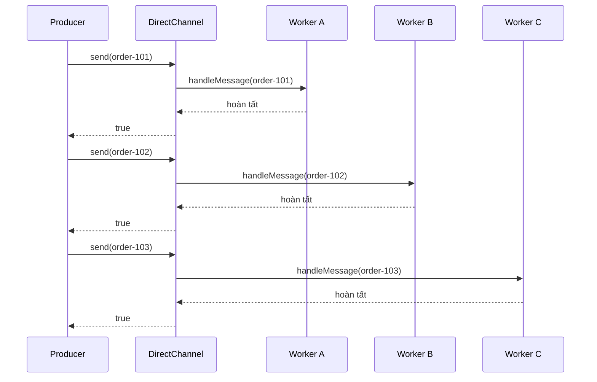

# RoundRobinLoadBalancingStrategy

Trong module **SPRING_INTEGRATION_CORE**, bài này trình bày cách `DirectChannel` phân phối thông điệp giữa nhiều endpoint có cùng vai trò bằng `RoundRobinLoadBalancingStrategy`. Ví dụ xuyên suốt là ba worker tiếp nhận yêu cầu xử lý đơn hàng. Mỗi yêu cầu cần một worker xử lý thành công; các worker cung cấp cùng một nghiệp vụ.

Sau bài học, bạn có thể giải thích thứ tự chọn worker, cấu hình round-robin bằng Java, nối nhiều nhánh Java DSL vào cùng channel và dự đoán điều gì xảy ra khi một worker ném exception.

Các ví dụ sử dụng API của Spring Integration 6.x, lấy 6.5 làm mốc tham chiếu, cùng Java 17 và JUnit Jupiter cho phần kiểm thử minh họa. Dự án cần dependency `org.springframework.integration:spring-integration-core`; phiên bản nên do BOM của dự án quản lý. Ví dụ Java thuần không cần khởi động Spring Boot.

## 1. Strategy đứng ở đâu trong luồng thông điệp?

Một `Message<?>` chứa payload và header. Khi gọi `send(message)` trên `DirectChannel`, channel chuyển công việc dispatch cho `UnicastingDispatcher`. Dispatcher lấy thứ tự các `MessageHandler` từ strategy, gọi handler và quyết định dừng hoặc chuyển sang handler khác khi có lỗi.

| Thành phần | Trách nhiệm trong ví dụ đơn hàng |
| --- | --- |
| Producer hoặc messaging gateway | Tạo yêu cầu và gửi vào channel |
| `DirectChannel` | Kết nối producer với các subscriber trong tiến trình |
| `UnicastingDispatcher` | Thực thi việc giao message theo thứ tự ứng viên |
| `RoundRobinLoadBalancingStrategy` | Luân phiên vị trí bắt đầu của danh sách ứng viên |
| Endpoint / `MessageHandler` | Thực hiện nghiệp vụ xử lý đơn hàng |

Contract của `LoadBalancingStrategy` trả về một `Iterator<MessageHandler>` qua phương thức `getHandlerIterator(Message<?> message, Collection<MessageHandler> handlers)`. Vì thế, strategy mô tả **thứ tự có thể thử các handler**, còn dispatcher mới gọi handler. Xem [API LoadBalancingStrategy](https://docs.spring.io/spring-integration/docs/6.5.0/api/org/springframework/integration/dispatcher/LoadBalancingStrategy.html).

Khi không có lỗi, luồng gửi ba message có thể diễn ra như sau:



Sơ đồ giả định ba subscriber đã được đăng ký theo thứ tự A, B, C, chưa có message trước đó, cùng tồn tại trong suốt quá trình gửi và đều xử lý thành công.

## 2. Cơ chế luân phiên điểm bắt đầu

Giả sử tập subscriber ổn định là `[A, B, C]`. Strategy tạo ra các thứ tự ứng viên sau:

| Lượt dispatch | Thứ tự ứng viên | Handler được gọi nếu ứng viên đầu thành công |
| --- | --- | --- |
| 1 | A → B → C | A |
| 2 | B → C → A | B |
| 3 | C → A → B | C |
| 4 | A → B → C | A |
| 5 | B → C → A | B |
| 6 | C → A → B | C |

Nếu có `n >= 2` subscriber, đánh số lượt từ `k = 0`, có thể mô hình hóa vị trí đầu tiên là `k mod n`. Đây là mô hình để học trong điều kiện tập subscriber cố định; không dùng nó để lưu trạng thái nghiệp vụ.

Điểm bắt đầu tiến thêm một vị trí cho mỗi lần strategy được yêu cầu tạo thứ tự mới. Một lần failover từ A sang B vẫn nằm trong iterator của message hiện tại. Nó không biến thành một lượt dispatch mới.

Ví dụ message đầu thử A rồi thành công ở B, message tiếp theo vẫn bắt đầu tại B theo vòng đã định. Vì vậy, số lần handler thực sự được gọi có thể lệch dù số lượt được chọn đầu tiên gần bằng nhau. Cơ chế xoay iterator được thể hiện trong [mã nguồn RoundRobinLoadBalancingStrategy 6.5.0](https://raw.githubusercontent.com/spring-projects/spring-integration/v6.5.0/spring-integration-core/src/main/java/org/springframework/integration/dispatcher/RoundRobinLoadBalancingStrategy.java).

### 2.1. Hiểu đúng chữ “cân bằng”

Với sáu yêu cầu đều thành công ngay, mỗi worker trong ví dụ nhận hai yêu cầu. Nếu chỉ gửi tám yêu cầu, phân bố có thể là A nhận ba, B nhận ba, C nhận hai. Đây là phân phối theo lượt lựa chọn.

Nếu thời gian xử lý trung bình của A là 10 ms còn B là 500 ms, cùng số yêu cầu vẫn tạo ra lượng công việc và độ trễ khác nhau. Suy ra từ mô hình chọn theo lượt: round-robin không đủ để giải quyết chênh lệch năng lực giữa các worker. Cần đánh giá thời gian xử lý, giới hạn tài nguyên và cơ chế thực thi của toàn luồng.

Một yêu cầu nghiệp vụ khác là “mọi message có cùng `orderId` phải về cùng worker”. Mô hình xoay vị trí không đáp ứng điều đó. Khi có yêu cầu này, hãy thiết kế routing hoặc partition theo khóa nghiệp vụ và xác định rõ yêu cầu thứ tự.

### 2.2. Số subscriber và vòng đời

| Trạng thái channel | Cách diễn giải |
| --- | --- |
| Chưa có subscriber | Không có worker nhận; việc gửi phát sinh lỗi dispatch |
| Có một subscriber | Mọi message được giao cho subscriber đó; chưa có tác dụng phân phối giữa nhiều worker |
| Có nhiều subscriber | Mới quan sát được việc luân phiên lựa chọn |
| Thêm hoặc gỡ subscriber | Không tiếp tục dự đoán theo vòng A, B, C cũ |
| Tạo lại channel và strategy | Không xem vị trí của vòng trước là trạng thái được khôi phục |

Trong mã nguồn tham chiếu, dispatcher có đường xử lý tối ưu khi chỉ có một handler. Vì vậy, không suy đoán vị trí nội bộ sau quá trình chuyển từ một sang nhiều subscriber chỉ bằng cách đếm mọi lời gọi `send()`. Ví dụ cần thứ tự xác định nên đăng ký đầy đủ subscriber trước khi bắt đầu gửi. Xem [UnicastingDispatcher 6.5.0](https://raw.githubusercontent.com/spring-projects/spring-integration/v6.5.0/spring-integration-core/src/main/java/org/springframework/integration/dispatcher/UnicastingDispatcher.java).

## 3. Cấu hình Java và ví dụ chạy độc lập

`new DirectChannel()` đã sử dụng `RoundRobinLoadBalancingStrategy` mặc định. Có thể truyền strategy qua constructor khi muốn thể hiện lựa chọn một cách tường minh. Mỗi channel nên có instance strategy riêng để các vòng phân phối độc lập. Xem [API DirectChannel](https://docs.spring.io/spring-integration/docs/current/api/org/springframework/integration/channel/DirectChannel.html).

Ví dụ sau đăng ký trực tiếp ba `MessageHandler`. Tắt failover giúp quan sát riêng việc luân phiên trong lần thực hành đầu tiên.

```java
import org.springframework.integration.channel.DirectChannel;
import org.springframework.integration.dispatcher.RoundRobinLoadBalancingStrategy;
import org.springframework.messaging.MessageHandler;
import org.springframework.messaging.support.GenericMessage;

public final class OrderRoundRobinDemo {

    public static void main(String[] args) {
        DirectChannel orders = new DirectChannel(
                new RoundRobinLoadBalancingStrategy());
        orders.setFailover(false);

        orders.subscribe(worker("A"));
        orders.subscribe(worker("B"));
        orders.subscribe(worker("C"));

        for (int number = 101; number <= 106; number++) {
            boolean delivered = orders.send(
                    new GenericMessage<>("order-" + number));
            if (!delivered) {
                throw new IllegalStateException("Message chưa được giao");
            }
        }
    }

    private static MessageHandler worker(String workerId) {
        return message -> System.out.printf(
                "%s xử lý %s trên thread %s%n",
                workerId,
                message.getPayload(),
                Thread.currentThread().getName());
    }
}
```

Kết quả dự kiến khi chạy trực tiếp từ phương thức `main`:

```text
A xử lý order-101 trên thread main
B xử lý order-102 trên thread main
C xử lý order-103 trên thread main
A xử lý order-104 trên thread main
B xử lý order-105 trên thread main
C xử lý order-106 trên thread main
```

Thay constructor bằng `new DirectChannel()` vẫn quan sát được vòng phân phối trong ví dụ không có lỗi. Lệnh `setFailover(false)` là cấu hình chủ động của bài thực hành; mặc định channel cho phép failover. Xem [cấu hình DirectChannel](https://docs.spring.io/spring-integration/reference/channel/configuration.html#channel-configuration-directchannel).

Giá trị `true` từ `send()` trong ví dụ cho biết việc dispatch đã thành công. Nó không chứa kết quả tính toán nghiệp vụ. Nếu cần trả về kết quả xử lý đơn hàng, hãy thiết kế request-reply và dùng gateway có kiểu trả về phù hợp.

## 4. Round-robin không tự tạo xử lý song song

`DirectChannel` gọi handler ngay trên thread đang gửi và chỉ trả khỏi `send()` khi phần xử lý đồng bộ kết thúc hoặc có exception. Trong ví dụ một producer gửi bằng vòng lặp, order-102 chỉ được gửi sau khi việc gửi order-101 đã trả về. Xem [ngữ nghĩa DirectChannel](https://docs.spring.io/spring-integration/reference/6.5/channel/implementations.html#channel-implementations-directchannel).

Có thể kiểm chứng sự khác biệt bằng hai tình huống:

| Tình huống | Hệ quả với ví dụ |
| --- | --- |
| Một producer gửi tuần tự, worker B mất nhiều thời gian | Vòng lặp gửi phải chờ B; message kế tiếp chưa bắt đầu |
| Nhiều producer gửi từ nhiều thread | Các lời gọi handler có thể chồng lấp giữa những lần gửi khác nhau |

Từ đó có hai yêu cầu thiết kế:

1. Đừng tăng số subscriber rồi mặc định rằng một producer tuần tự sẽ xử lý nhanh hơn. Đo cả thời gian gửi vì nghiệp vụ đang chạy trong lời gọi đó.
2. Nếu có nhiều producer đồng thời, hãy bảo đảm worker và tài nguyên dùng chung chịu được việc gọi đồng thời. Ba subscriber không đồng nghĩa hệ thống chỉ có tối đa ba lời gọi đang xử lý.

Mã nguồn strategy tham chiếu dùng bộ đếm nguyên tử cho vị trí luân phiên. Điều đó bảo vệ thao tác chọn vị trí; nó không khóa toàn bộ handler, không tạo thứ tự hoàn tất nghiệp vụ và không làm một biến `ArrayList` dùng chung trở thành thread-safe. Đây là hệ quả khi kết hợp cách chọn vị trí với cách gọi đồng bộ của channel.

Ví dụ hai thread chọn lần lượt A và B, nhưng A cần 800 ms còn B cần 20 ms. Log hoàn tất có thể hiện B trước A. Khi kiểm thử đồng thời, chỉ đọc log hoàn tất để kết luận strategy chọn sai là chưa đủ.

Nếu bài toán cần chuyển việc xử lý sang executor, có thể xem xét `ExecutorChannel`; nếu cần đệm, xem xét channel có hàng đợi. Việc thay channel cần đi kèm thiết kế lại luồng lỗi, thứ tự xử lý và transaction. Đặc biệt, giữ cùng thread qua `DirectChannel` cho phép tham gia transaction đã tồn tại; channel không tự mở transaction cho nghiệp vụ.

## 5. Kết hợp round-robin với failover

Round-robin xác định ứng viên đầu và thứ tự tiếp theo. Failover xác định có tiếp tục thử ứng viên còn lại sau exception hay không. Dispatcher dừng khi một handler trả về bình thường. Đây là cơ chế unicast: một handler thành công kết thúc lần dispatch, dù trước đó có thể đã gọi các handler khác bị lỗi. Xem [UnicastingDispatcher](https://raw.githubusercontent.com/spring-projects/spring-integration/v6.5.0/spring-integration-core/src/main/java/org/springframework/integration/dispatcher/UnicastingDispatcher.java).

### 5.1. Một ví dụ có lỗi

```java
import java.util.ArrayList;
import java.util.List;

import org.springframework.integration.channel.DirectChannel;
import org.springframework.messaging.support.GenericMessage;

public final class OrderFailoverDemo {

    public static void main(String[] args) {
        DirectChannel orders = new DirectChannel();
        orders.setFailover(true);
        List<String> attempts = new ArrayList<>();

        orders.subscribe(message -> {
            attempts.add("A:" + message.getPayload());
            throw new IllegalStateException("Worker A đang lỗi");
        });
        orders.subscribe(message ->
                attempts.add("B:" + message.getPayload()));
        orders.subscribe(message ->
                attempts.add("C:" + message.getPayload()));

        orders.send(new GenericMessage<>("order-201"));
        orders.send(new GenericMessage<>("order-202"));
        orders.send(new GenericMessage<>("order-203"));

        attempts.forEach(System.out::println);
    }
}
```

Bỏ qua log lỗi do framework ghi, danh sách `attempts` dự kiến là:

```text
A:order-201
B:order-201
B:order-202
C:order-203
```

Giải thích theo mô hình ở mục 2:

- order-201 bắt đầu tại A, A ném exception, dispatcher thử B và dừng khi B thành công.
- order-202 bắt đầu tại B theo vòng luân phiên, dù B vừa xử lý order-201.
- order-203 bắt đầu tại C.

`ArrayList` ở đây chỉ dùng trong ví dụ gửi tuần tự trên một thread. Nếu chuyển sang nhiều producer, phải thay cách ghi nhận bằng cấu trúc phù hợp với truy cập đồng thời.

Nếu thay bằng `orders.setFailover(false)`, order-201 thất bại tại A và exception truyền về caller. Vòng chương trình như đang viết sẽ dừng ở lần gửi đầu tiên nếu không có `try/catch`.

### 5.2. Các cấu hình thường gặp

| Cấu hình | Điểm bắt đầu | Khi handler ném exception |
| --- | --- | --- |
| `new DirectChannel()` | Luân phiên | Có thể thử ứng viên còn lại |
| Round-robin và `setFailover(false)` | Luân phiên | Dừng lần dispatch đó và báo lỗi |
| `new DirectChannel(null)` với failover mặc định | Luôn bắt đầu theo thứ tự subscriber | Có thể chuyển sang ứng viên kế tiếp |
| Không có load balancing và tắt failover | Luôn bắt đầu theo thứ tự subscriber | Báo lỗi ngay từ handler đầu |

Trường hợp muốn worker chính luôn được ưu tiên rồi mới tới worker dự phòng phù hợp với cấu hình không load balancing, cùng thứ tự endpoint được xác định rõ. Nếu vẫn dùng round-robin, worker dự phòng cũng sẽ nhận các lượt đầu tiên ngay khi worker chính khỏe.

Từ Spring Integration 6.3 có thể dùng `setFailoverStrategy(Predicate<Exception>)` để quyết định theo exception. Cấu hình predicate và `setFailover(boolean)` ghi đè lựa chọn của nhau; chỉ chọn một cách theo chủ đích. Predicate cần xét cả exception được bọc và nguyên nhân gốc nếu endpoint của bạn có bọc lỗi. Xem [API cấu hình failover của DirectChannel](https://docs.spring.io/spring-integration/docs/current/api/org/springframework/integration/channel/DirectChannel.html#setFailoverStrategy(java.util.function.Predicate)).

### 5.3. Rủi ro tác dụng phụ và việc nuốt lỗi

Giả sử worker A đã gọi dịch vụ tạo vận đơn thành công, sau đó bị lỗi khi ghi log nghiệp vụ. Khi exception tới dispatcher và failover được phép, worker B có thể gọi lại dịch vụ tạo vận đơn cho cùng đơn hàng. Vì thế, một lần dispatch thành công không chứng minh mọi tác dụng phụ chỉ xảy ra một lần.

Với tình huống này, hãy dùng khóa idempotency theo yêu cầu nghiệp vụ, xác định thao tác nào có thể lặp lại và quyết định có cho phép failover sau thao tác đó hay không. Tắt failover cũng không thay thế thiết kế idempotency nếu caller hoặc hệ thống nguồn còn có thể gửi lại message.

Một trường hợp khác: A bắt exception, ghi log rồi trả về bình thường. Dispatcher quan sát thấy handler đã kết thúc bình thường nên không có tín hiệu để thử B. Điều tương tự cần lưu ý khi endpoint gửi việc đi bất đồng bộ rồi trả về trước khi lỗi xảy ra: lỗi đến sau không còn thuộc lời gọi handler ban đầu để kích hoạt failover ở đây.

Failover chỉ chuyển sang subscriber khác trong lần dispatch. Nếu cần gọi lại cùng handler sau một khoảng chờ, đó là yêu cầu retry riêng, cần thiết kế chính sách và giới hạn phù hợp.

## 6. Nhiều nhánh Java DSL cùng nhận từ một DirectChannel

Trong ứng dụng Spring, worker thường là các endpoint được tạo từ `IntegrationFlow`. Để chúng cạnh tranh nhận message, các flow phải bắt đầu từ **cùng một instance channel**. Java DSL đăng ký channel và endpoint vào application context; xem [Java DSL](https://docs.spring.io/spring-integration/reference/dsl.html).

```java
import org.springframework.context.annotation.Bean;
import org.springframework.context.annotation.Configuration;
import org.springframework.integration.channel.DirectChannel;
import org.springframework.integration.config.EnableIntegration;
import org.springframework.integration.dsl.IntegrationFlow;
import org.springframework.messaging.MessageHandler;

@Configuration
@EnableIntegration
public class OrderWorkersConfiguration {

    @Bean
    public DirectChannel orderWork() {
        DirectChannel channel = new DirectChannel();
        channel.setFailover(false);
        return channel;
    }

    @Bean
    public IntegrationFlow workerAFlow(DirectChannel orderWork) {
        return IntegrationFlow.from(orderWork)
                .handle((MessageHandler) message ->
                        process("A", (String) message.getPayload()))
                .get();
    }

    @Bean
    public IntegrationFlow workerBFlow(DirectChannel orderWork) {
        return IntegrationFlow.from(orderWork)
                .handle((MessageHandler) message ->
                        process("B", (String) message.getPayload()))
                .get();
    }

    @Bean
    public IntegrationFlow workerCFlow(DirectChannel orderWork) {
        return IntegrationFlow.from(orderWork)
                .handle((MessageHandler) message ->
                        process("C", (String) message.getPayload()))
                .get();
    }

    private static void process(String workerId, String orderId) {
        System.out.printf("Worker %s nhận %s%n", workerId, orderId);
    }
}
```

Sau khi context khởi động và các endpoint đã subscribe, có thể lấy bean `orderWork` và gửi các `GenericMessage<String>` như ví dụ trước. Trong một vòng không có lỗi với tập endpoint ổn định, các worker sẽ nhận luân phiên. Để kiểm thử thứ tự chính xác A → B → C, cần kiểm soát thứ tự subscriber; không coi thứ tự viết các phương thức `@Bean` là một contract sắp xếp nghiệp vụ.

Các phương thức `process` mô phỏng cùng một nghiệp vụ ở ba worker. Khi triển khai thật, thay chúng bằng service xử lý và bảo đảm mọi worker đều chấp nhận cùng loại payload. Các handler trong ví dụ là consumer một chiều; chưa tạo reply message.

Có thể đặt một messaging gateway ở phía producer:

```java
import org.springframework.integration.annotation.MessagingGateway;

@MessagingGateway(defaultRequestChannel = "orderWork")
public interface OrderSubmissionGateway {
    void submit(String orderId);
}
```

Đăng ký interface này bằng `@IntegrationComponentScan` trong package phù hợp hoặc cơ chế đăng ký gateway của ứng dụng. Gateway gửi vào `orderWork`; cơ chế chọn worker vẫn thuộc channel và dispatcher. Kiểu trả về `void` phù hợp với các consumer một chiều ở trên. Nếu đổi gateway sang kiểu trả về khác, phải thiết kế đường trả lời tương ứng.

### 6.1. Phân biệt cạnh tranh và pipeline

Hai cấu trúc sau có ý nghĩa khác nhau:

```text
Cạnh tranh xử lý:
orderWork ── chọn một ──> workerAFlow
                      ├> workerBFlow
                      └> workerCFlow

Pipeline nghiệp vụ:
input -> transform -> filter -> service activator -> output
```

Trong pipeline, mỗi bước làm một công đoạn cho cùng message theo đường đi đã thiết kế. Với nhiều subscriber của `orderWork`, round-robin chọn một worker trong các ứng viên. Nếu A là bước kiểm tra đơn còn B là bước trừ kho, đặt A và B cạnh tranh trên cùng `DirectChannel` sẽ khiến mỗi yêu cầu chỉ đi qua một công đoạn khi không có lỗi.

Một filter được chọn và loại message mà không ném exception cũng không yêu cầu dispatcher chuyển message sang worker kế tiếp. Việc kết thúc bình thường của handler đã đủ để dispatcher dừng lần giao đó. Nếu cần chọn nhánh dựa trên payload hoặc header, hãy dùng router; nếu cần mọi nhánh đều nhận sự kiện, hãy thiết kế publish-subscribe.

## 7. Lỗi truyền về đâu?

Với lời gọi trực tiếp `orderWork.send(message)`, lỗi đồng bộ chưa được xử lý sẽ truyền về caller. Chỉ đặt header `errorChannel` không tự khiến `DirectChannel` bắt mọi exception rồi xuất bản `ErrorMessage`. Gateway hoặc các cơ chế xử lý lỗi khác có thể bổ sung hành vi riêng; cần phân biệt chúng với channel. Xem [Error Handling](https://docs.spring.io/spring-integration/reference/error-handling.html).

Một cách quan sát lỗi tại producer:

```java
import org.springframework.messaging.MessagingException;
import org.springframework.messaging.support.GenericMessage;

// orderWork là bean DirectChannel đã được tiêm vào producer.
try {
    orderWork.send(new GenericMessage<>("order-301"));
}
catch (MessagingException exception) {
    System.err.println("Chưa giao được order-301: " + exception.getMessage());
    // Quyết định nghiệp vụ: báo caller, lưu lỗi hoặc gửi vào luồng phục hồi.
}
```

Cần phân biệt ít nhất ba tình huống khi chẩn đoán: chưa có subscriber, handler đầu lỗi và failover bị tắt, hoặc tất cả ứng viên được thử đều lỗi. Kiểu exception bên ngoài còn phụ thuộc việc framework bọc lỗi và tổng hợp các lần thử; hãy xem nguyên nhân gốc thay vì dựa vào một thông báo cố định.

Nếu flow phía sau worker còn xử lý đồng bộ và phát sinh exception quay về lời gọi handler, failover có thể thử worker khác dù một phần công việc trước đó đã chạy. Khi xác định ranh giới phục hồi, cần xét toàn bộ đoạn đồng bộ nằm sau subscriber.

## 8. Kiểm thử hành vi bằng ví dụ nhỏ

Các kiểm thử dưới đây là mã thực hành cho dự án đã có JUnit Jupiter. Chúng tạo channel riêng trong từng test, gửi tuần tự, giữ nguyên subscriber và quan sát hành vi bên ngoài. Không cần khởi động application context để kiểm tra thuật toán phân phối cơ bản.

```java
import java.util.ArrayList;
import java.util.List;

import org.junit.jupiter.api.Test;
import org.springframework.integration.channel.DirectChannel;
import org.springframework.messaging.MessagingException;
import org.springframework.messaging.support.GenericMessage;

import static org.junit.jupiter.api.Assertions.assertEquals;
import static org.junit.jupiter.api.Assertions.assertThrows;
import static org.junit.jupiter.api.Assertions.assertTrue;

class OrderRoundRobinTest {

    @Test
    void rotatesAcrossThreeStableSubscribers() {
        DirectChannel channel = new DirectChannel();
        channel.setFailover(false);
        List<String> accepted = new ArrayList<>();

        channel.subscribe(message -> accepted.add("A:" + message.getPayload()));
        channel.subscribe(message -> accepted.add("B:" + message.getPayload()));
        channel.subscribe(message -> accepted.add("C:" + message.getPayload()));

        for (int number = 1; number <= 6; number++) {
            assertTrue(channel.send(new GenericMessage<>(number)));
        }

        assertEquals(List.of("A:1", "B:2", "C:3", "A:4", "B:5", "C:6"),
                accepted);
    }

    @Test
    void failoverDoesNotMoveTheNextMessagesStartingPoint() {
        DirectChannel channel = new DirectChannel();
        channel.setFailover(true);
        List<String> attempts = new ArrayList<>();

        channel.subscribe(message -> {
            attempts.add("A:" + message.getPayload());
            throw new IllegalStateException("A unavailable");
        });
        channel.subscribe(message -> attempts.add("B:" + message.getPayload()));
        channel.subscribe(message -> attempts.add("C:" + message.getPayload()));

        assertTrue(channel.send(new GenericMessage<>(1)));
        assertTrue(channel.send(new GenericMessage<>(2)));
        assertTrue(channel.send(new GenericMessage<>(3)));

        assertEquals(List.of("A:1", "B:1", "B:2", "C:3"), attempts);
    }

    @Test
    void disabledFailoverDoesNotInvokeAnotherSubscriber() {
        DirectChannel channel = new DirectChannel();
        channel.setFailover(false);
        List<String> attempts = new ArrayList<>();

        channel.subscribe(message -> {
            attempts.add("A");
            throw new IllegalStateException("A unavailable");
        });
        channel.subscribe(message -> attempts.add("B"));

        assertThrows(MessagingException.class,
                () -> channel.send(new GenericMessage<>("order-401")));
        assertEquals(List.of("A"), attempts);
    }
}
```

Test đầu kiểm tra vòng phân phối trong điều kiện có thứ tự subscriber rõ ràng. Test thứ hai phân biệt việc luân phiên điểm bắt đầu với việc chọn ứng viên dự phòng. Test cuối kiểm tra rằng tắt failover làm thay đổi hành vi khi lỗi, đồng thời không ràng buộc vào câu chữ của exception.

Để mở rộng thực hành, có thể kiểm tra gửi khi chưa có subscriber, tất cả worker đều lỗi và thay đổi số subscriber giữa hai đợt gửi. Với kiểm thử đồng thời, hãy thu thập kết quả bằng cấu trúc thread-safe và chờ tác vụ hoàn tất bằng cơ chế đồng bộ phù hợp; đừng dùng thứ tự log hoàn tất làm bằng chứng cho thứ tự chọn worker.

## 9. Chọn round-robin khi nào?

Round-robin phù hợp với tình huống các worker cung cấp cùng một dịch vụ, cùng nhận được kiểu message hợp lệ và không có yêu cầu gắn message vào một worker cố định theo khóa. Hãy xác định thêm cách xử lý lỗi trước khi bật failover cho các thao tác có tác dụng phụ.

| Nhu cầu nghiệp vụ | Hướng thiết kế |
| --- | --- |
| Chia lượt giữa các worker cùng vai trò trong một tiến trình | `DirectChannel` với round-robin |
| Luôn ưu tiên worker chính trước worker dự phòng | Tắt load balancing, xác định thứ tự và cấu hình failover |
| Chọn luồng theo trạng thái hoặc loại đơn hàng | Router theo payload/header |
| Cho mọi subscriber nhận cùng một sự kiện | `PublishSubscribeChannel` |
| Chuyển xử lý sang thread pool | Cân nhắc `ExecutorChannel` và chính sách executor |
| Hấp thụ lượng yêu cầu tăng đột biến | Thiết kế hàng đợi, sức chứa và chính sách khi đầy |
| Giữ quan hệ theo khóa nghiệp vụ | Thiết kế partition/routing theo khóa |
| Phân phối giữa nhiều instance ứng dụng | Dùng hạ tầng messaging hoặc cơ chế phân phối giữa các tiến trình |

Bảng là gợi ý thiết kế rút ra từ những khác biệt đã phân tích; mỗi lựa chọn còn cần đáp ứng độ bền dữ liệu, độ trễ và yêu cầu thứ tự của ứng dụng.

`RoundRobinLoadBalancingStrategy` xử lý danh sách handler cục bộ của channel. Nếu chạy ba instance ứng dụng, mỗi instance có channel và vòng phân phối riêng. Muốn cân bằng yêu cầu giữa ba instance phải thiết kế ở ranh giới liên tiến trình; vòng lựa chọn trong một JVM không cung cấp điều đó.

## 10. Các điểm cần ghi nhớ

- Strategy luân phiên handler được thử đầu tiên và cung cấp thứ tự ứng viên cho dispatcher.
- `DirectChannel` mặc định có round-robin và failover; có thể cấu hình hai hành vi này độc lập.
- Một message có thể được thử ở nhiều handler khi có lỗi, nhưng dispatcher dừng ở handler thành công đầu tiên.
- Phân phối theo lượt không bảo đảm cùng thời gian xử lý, thứ tự hoàn tất hoặc worker cố định theo khóa.
- Cùng một channel phải được chia sẻ giữa các endpoint cạnh tranh; các bước nghiệp vụ nối tiếp cần một pipeline rõ ràng.
- Tác dụng phụ, retry và idempotency phải được thiết kế theo nghiệp vụ; việc dispatch thành công không tự bảo đảm xử lý đúng một lần.
