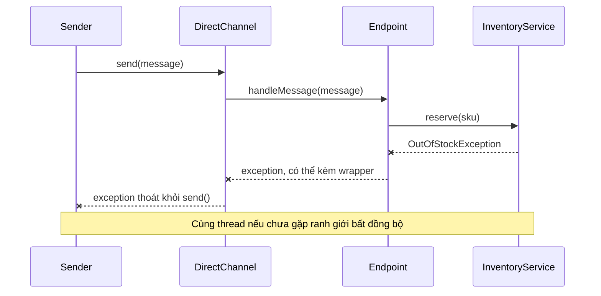

# Exception truyền về sender

## Mục tiêu và phạm vi

Trong chương **DirectChannel** của module **SPRING_INTEGRATION_CORE**, bài này giải thích vì sao lỗi trong consumer có thể xuất hiện ngay tại lời gọi gửi message. Bạn sẽ thực hành với Message, MessageChannel, endpoint và Java DSL, đồng thời xác định trách nhiệm xử lý lỗi của sender và gateway.

Sau bài học, bạn có thể:

- Vẽ đường đi của exception trong một luồng đồng bộ.
- Bắt lỗi tại `send()`, giữ nguyên nguyên nhân và tìm message gây lỗi.
- Phân biệt exception được ném với `ErrorMessage` được gửi qua channel.
- Nhận biết ảnh hưởng của failover, retry, transaction và ranh giới bất đồng bộ.
- Viết kiểm thử thể hiện hợp đồng lỗi mà người gọi thực sự quan sát được.

Các ví dụ Spring dùng API của Spring Integration 6.5.x và Java 17 trở lên. Ví dụ JUnit dùng JUnit Jupiter. Khi áp dụng vào dự án, dùng bộ dependency Spring tương thích do dự án quản lý.

## 1. Cơ chế: send() đang nằm trên call stack của consumer

`DirectChannel` gọi subscriber trên chính thread gửi message; `send()` chờ lời gọi handler kết thúc. Vì vậy, exception chưa được xử lý có đường quay ngược về sender qua call stack Java. [DirectChannel API](https://docs.spring.io/spring-integration/docs/6.5.1/api/org/springframework/integration/channel/DirectChannel.html)

Xét nghiệp vụ giữ hàng:

```text
OrderService.submit()
  └─ orders.send(message)
       └─ dispatcher
            └─ endpoint.handleMessage(message)
                 └─ InventoryService.reserve(sku)
                      └─ throw OutOfStockException
```

Nếu các lớp trung gian không phục hồi hoặc giữ lại lỗi, `submit()` quan sát được thất bại trong lúc gọi `send()`. Không cần một thread khác chuyển exception ngược về.



Trong sơ đồ, mũi tên lỗi thể hiện việc tháo call stack, không phải message chạy qua một channel riêng.

Điều kiện cần xem xét khi suy luận “lỗi truyền về sender” là:

1. Handler đang thực thi đồng bộ trong chuỗi gọi hiện tại.
2. Lỗi xảy ra trước khi chuỗi gọi đó kết thúc.
3. Không có thành phần nào bắt lỗi rồi phục hồi thành công.
4. Không có subscriber khác xử lý thành công nhờ failover.

Ở các ví dụ đầu, chỉ có một subscriber và tắt failover để quan sát đường lỗi trực tiếp.

## 2. Ví dụ tối thiểu: bắt lỗi ngay tại send()

Ví dụ sau tạo `MessageHandlingException` một cách tường minh để tách cơ chế truyền lỗi khỏi cơ chế bọc lỗi của endpoint.

```java
import org.springframework.integration.channel.DirectChannel;
import org.springframework.messaging.Message;
import org.springframework.messaging.MessageHandlingException;
import org.springframework.messaging.MessagingException;
import org.springframework.messaging.support.MessageBuilder;

public class DirectExceptionDemo {

    public static void main(String[] args) {
        DirectChannel orders = new DirectChannel();
        orders.setFailover(false);

        Thread senderThread = Thread.currentThread();

        orders.subscribe(message -> {
            System.out.println(
                    "Cùng thread: "
                            + (Thread.currentThread() == senderThread));

            throw new MessageHandlingException(
                    message,
                    "Giữ hàng thất bại",
                    new IllegalStateException("SKU-404 đã hết hàng"));
        });

        Message<String> request = MessageBuilder
                .withPayload("SKU-404")
                .setHeader("orderId", "ORD-1001")
                .build();

        try {
            orders.send(request);
            System.out.println("Dòng này không chạy khi handler ném lỗi");
        }
        catch (MessagingException ex) {
            Message<?> failed = ex.getFailedMessage();

            System.out.println(
                    "Loại lỗi: " + ex.getClass().getSimpleName());
            System.out.println(
                    "Nguyên nhân: " + ex.getCause().getMessage());
            System.out.println(
                    "Order: " + failed.getHeaders().get("orderId"));
        }
    }
}
```

Kết quả chính mong đợi:

```text
Cùng thread: true
Loại lỗi: MessageHandlingException
Nguyên nhân: SKU-404 đã hết hàng
Order: ORD-1001
```

Những dòng log nội bộ của framework, nếu được bật, có thể xuất hiện thêm.

Có hai điểm cần phân biệt:

- Trong ví dụ này, chính lambda tạo `MessageHandlingException`.
- Trong ứng dụng dùng service activator, service thường ném exception nghiệp vụ; endpoint có thể bọc nó trước khi sender nhận được.

Vì vậy, ví dụ không có ý rằng mọi `RuntimeException` trong mọi loại handler đều đi ra với cùng một lớp wrapper.

### send() trả boolean có thay thế try/catch không?

Không. Phân biệt giá trị trả về và kết thúc bằng exception:

```java
try {
    boolean sent = orders.send(request);

    if (!sent) {
        // Chỉ chạy nếu send() kết thúc bình thường và trả false.
    }
}
catch (MessagingException ex) {
    // Khi exception thoát ra, không có giá trị trả về để kiểm tra.
    throw ex;
}
```

Đừng viết hợp đồng xử lý lỗi dựa riêng vào `if (!sent)`. Với channel và interceptor khác nhau, `false` có thể thể hiện việc không gửi được hoặc việc gửi bị chặn; nó không thay cho exception.

Tương tự, tham số thời gian trong `send(message, timeout)` không phải cơ chế cưỡng bức dừng một handler đồng bộ sau khoảng thời gian đó. Nếu handler gọi dịch vụ mạng, cần cấu hình timeout ở client mạng tương ứng.

## 3. Phân biệt lỗi nghiệp vụ và lỗi messaging

`MessagingException` là một `RuntimeException`. Nó có thể mang `failedMessage` và chuỗi nguyên nhân qua `getCause()`. `getFailedMessage()` có thể trả `null`, nên mã tổng quát cần kiểm tra trước khi sử dụng. [MessagingException API](https://docs.spring.io/spring-framework/docs/current/javadoc-api/org/springframework/messaging/MessagingException.html)

Ví dụ các lớp lỗi thường gặp:

| Lớp lỗi | Ý nghĩa cần điều tra |
| --- | --- |
| `OutOfStockException` do ứng dụng định nghĩa | Quy tắc nghiệp vụ từ chối giữ hàng |
| `MessageHandlingException` | Thất bại khi endpoint xử lý message |
| `MessageDeliveryException` | Thất bại liên quan đến việc chuyển message |
| `MessageDispatchingException` | Dispatcher không phân phối được message |
| `AggregateMessageDeliveryException` | Có nhiều thất bại từ các lần thử subscriber |

Bảng giúp định hướng chẩn đoán, không cam kết lớp exception ngoài cùng trong mọi cấu hình. Chẳng hạn, dispatcher có thể ném lỗi rồi lớp channel bọc tiếp.

### Không giả định cause chỉ có một tầng

Một cách tìm lỗi nghiệp vụ trong chuỗi nguyên nhân:

```java
static <T extends Throwable> T findCause(
        Throwable failure, Class<T> expectedType) {

    Throwable current = failure;

    while (current != null) {
        if (expectedType.isInstance(current)) {
            return expectedType.cast(current);
        }

        Throwable next = current.getCause();
        if (next == current) {
            break;
        }
        current = next;
    }

    return null;
}
```

Helper phù hợp với chuỗi cause thông thường; nó không duyệt danh sách lỗi thành phần của exception tổng hợp. Khi dùng failover với nhiều consumer, cần xem thêm những lỗi mà exception tổng hợp cung cấp.

Không phân loại nghiệp vụ bằng cách so sánh `ex.getMessage()` với một chuỗi cố định. Nội dung đó phục vụ chẩn đoán và có thể thay đổi do wrapper.

### failedMessage có phải message ban đầu không?

Không nhất thiết. Trong luồng:

```text
Message<OrderRequest>
  → transformer
  → Message<ReservationCommand>
  → service activator ném lỗi
```

Message gắn với lỗi ở endpoint cuối có thể chứa `ReservationCommand`. Khi cần truy dấu, hãy đưa `orderId` hoặc `correlationId` vào header và giữ chúng qua các bước chuyển đổi.

Khi ghi log, thường chỉ cần mã nghiệp vụ, tên endpoint và cause. Đừng mặc định đưa toàn bộ payload hoặc header chứa thông tin xác thực vào log.

## 4. Thực hành với endpoint và Java DSL

Trong Java DSL, `.handle(service, "method")` biểu diễn service activator. Service có thể là POJO, nhận payload và ném lỗi nghiệp vụ khi yêu cầu không hợp lệ. [Service Activator](https://docs.spring.io/spring-integration/reference/6.5/service-activator.html)

### Cấu hình luồng giữ hàng

Đặt lớp cấu hình sau trong `DirectErrorConfig.java`:

```java
import org.springframework.beans.factory.annotation.Qualifier;
import org.springframework.context.annotation.Bean;
import org.springframework.context.annotation.Configuration;
import org.springframework.integration.channel.DirectChannel;
import org.springframework.integration.config.EnableIntegration;
import org.springframework.integration.dsl.IntegrationFlow;

@Configuration
@EnableIntegration
public class DirectErrorConfig {

    @Bean
    public DirectChannel orders() {
        DirectChannel channel = new DirectChannel();
        channel.setFailover(false);
        return channel;
    }

    @Bean
    public InventoryService inventoryService() {
        return new InventoryService();
    }

    @Bean
    public IntegrationFlow reserveFlow(
            @Qualifier("orders") DirectChannel orders,
            InventoryService inventoryService) {

        return IntegrationFlow
                .from(orders)
                .handle(inventoryService, "reserve")
                .get();
    }

    public static class InventoryService {

        public void reserve(String sku) {
            if ("SKU-404".equals(sku)) {
                throw new OutOfStockException(
                        "Không còn hàng cho " + sku);
            }

            System.out.println("Đã giữ hàng: " + sku);
        }
    }

    public static class OutOfStockException extends RuntimeException {

        public OutOfStockException(String message) {
            super(message);
        }
    }
}
```

Trong mô phỏng, `SKU-404` luôn hết hàng; các mã khác được chấp nhận. Đây là quy tắc tạo dữ liệu để quan sát lỗi, chưa phải triển khai kho hàng thực.

Phương thức `reserve()` trả `void`, vì luồng này chỉ thực hiện lệnh giữ hàng. Nó không tạo reply và không cần một `replyChannel` để kết thúc bình thường.

### Gọi luồng từ một sender

Lớp sau dùng cấu hình ở trên và helper `findCause()` từ mục 3:

```java
import org.springframework.context.annotation.AnnotationConfigApplicationContext;
import org.springframework.messaging.Message;
import org.springframework.messaging.MessageChannel;
import org.springframework.messaging.MessagingException;
import org.springframework.messaging.support.MessageBuilder;

public class ReserveSender {

    public static void main(String[] args) {
        try (var context =
                     new AnnotationConfigApplicationContext(
                             DirectErrorConfig.class)) {

            MessageChannel orders =
                    context.getBean("orders", MessageChannel.class);

            Message<String> request = MessageBuilder
                    .withPayload("SKU-404")
                    .setHeader("orderId", "ORD-1002")
                    .build();

            try {
                orders.send(request);
            }
            catch (MessagingException ex) {
                DirectErrorConfig.OutOfStockException businessFailure =
                        findCause(
                                ex,
                                DirectErrorConfig.OutOfStockException.class);

                if (businessFailure == null) {
                    throw ex;
                }

                System.out.println(
                        "Từ chối đơn: " + businessFailure.getMessage());
            }
        }
    }

    // Đặt helper findCause() từ mục 3 tại đây.
}
```

Ví dụ bắt lỗi hết hàng và coi đó là một kết quả từ chối đã được sender xử lý. Với lỗi không nhận diện được, sender ném tiếp wrapper để giữ ngữ cảnh.

Nếu yêu cầu là “bất kỳ lỗi giữ hàng nào cũng phải làm thao tác bên ngoài thất bại”, sender cần ném tiếp ngay cả lỗi hết hàng. Chính sách tại `catch` là một phần của hợp đồng nghiệp vụ.

### Java DSL không tự tạo thread riêng

`IntegrationFlow` mô tả việc nối endpoint và channel. Việc có dùng DSL không quyết định luồng đồng bộ hay bất đồng bộ; cần xem những channel và component thực tế trong flow. [DSL Basics](https://docs.spring.io/spring-integration/reference/dsl/java-basics.html)

Hai sơ đồ dẫn đến hai cách quan sát lỗi khác nhau:

```text
Sender → DirectChannel → transform → DirectChannel → handle
         └──────── chuỗi gọi đồng bộ tiếp tục ────────────┘

Sender → DirectChannel → handle → QueueChannel → poller → handle
         └── chuỗi gọi ban đầu ──┘             └─ lần gọi khác
```

Ở sơ đồ thứ hai, lỗi tại handler sau poller không thể tháo ngược một call stack của sender đã kết thúc. Lỗi trước bước enqueue vẫn có thể truyền về lời gọi gửi hiện tại.

## 5. errorChannel không tự bắt lỗi của mọi DirectChannel

Gửi trực tiếp qua `MessageChannel` hoặc `MessagingTemplate` vẫn trả lỗi cho caller khi consumer đồng bộ ném lỗi. Cơ chế xuất bản `ErrorMessage` cần một thành phần xử lý lỗi tham gia; riêng header `errorChannel` không cài đặt thành phần đó. [Error Handling](https://docs.spring.io/spring-integration/reference/error-handling.html)

Ví dụ, gắn một channel nhận lỗi vào message:

```java
import org.springframework.integration.channel.QueueChannel;
import org.springframework.messaging.Message;
import org.springframework.messaging.support.MessageBuilder;

QueueChannel errors = new QueueChannel();

Message<String> request = MessageBuilder
        .withPayload("SKU-404")
        .setErrorChannel(errors)
        .build();

// orders là DirectChannel của DirectErrorConfig.
// Lời gọi này vẫn ném MessagingException.
orders.send(request);
```

Trong cấu hình đang xét, không có gateway hay advice bắt lỗi để gửi sang `errors`. Vì vậy sender phải dùng `try/catch`; không thể chỉ đợi một `ErrorMessage` xuất hiện.

`ErrorMessage` là một message có payload kiểu `Throwable`. Nó là dữ liệu được một thành phần gửi đi, khác với thao tác Java `throw`.

### Có thể vừa gửi ErrorMessage vừa ném tiếp

Khi chủ động chọn chính sách “báo lỗi riêng, nhưng lời gọi hiện tại vẫn thất bại”, sender có thể viết:

```java
import org.springframework.messaging.MessagingException;
import org.springframework.messaging.support.ErrorMessage;

try {
    orders.send(request);
}
catch (MessagingException processingFailure) {
    try {
        boolean published =
                errors.send(new ErrorMessage(processingFailure));

        if (!published) {
            processingFailure.addSuppressed(
                    new IllegalStateException(
                            "Không gửi được thông báo lỗi"));
        }
    }
    catch (RuntimeException reportingFailure) {
        if (reportingFailure != processingFailure) {
            processingFailure.addSuppressed(reportingFailure);
        }
    }

    throw processingFailure;
}
```

Đây là chính sách do ứng dụng viết rõ ràng. Nó cũng giữ lỗi xử lý ban đầu nếu bước thông báo gặp lỗi. Nếu lỗi thông báo cần được ưu tiên khác, hãy định nghĩa hợp đồng đó trước khi đổi mã.

Để `errors` hữu ích trong ứng dụng thật, cần có consumer hoặc quy trình đọc nó. Việc enqueue thành công chỉ xác nhận thông báo đã được nhận vào queue, chưa chứng minh ai đó đã xử lý.

## 6. Đi qua gateway: cùng đường xử lý, có thêm chính sách lỗi

Một messaging gateway tạo giao diện gọi nghiệp vụ. Ví dụ:

```java
import org.springframework.integration.annotation.MessagingGateway;

@MessagingGateway(defaultRequestChannel = "orders")
public interface OrderGateway {

    void reserve(String sku);
}
```

Khi dùng annotation trong ứng dụng, cần cấu hình quét gateway, chẳng hạn `@IntegrationComponentScan` trên cấu hình của package chứa interface. Interface riêng lẻ chưa đủ tạo proxy.

Với gateway đồng bộ, phương thức `void` không có nghĩa là chạy nền. Lời gọi vẫn có thể thất bại trước khi trả về.

Gateway mặc định có thể tháo các wrapper để ném lỗi nghiệp vụ cho caller. Khai báo `throws` tham gia quyết định exception được đưa ra. Gateway cũng hỗ trợ `errorChannel` để chuyển lỗi thành phản hồi phù hợp hoặc xử lý theo chính sách riêng. [Messaging Gateways — Error Handling](https://docs.spring.io/spring-integration/reference/gateway.html#error-handling)

Với gateway ở trên và cấu hình giữ hàng đã nêu, mã gọi có thể bắt lỗi nghiệp vụ:

```java
try {
    gateway.reserve("SKU-404");
}
catch (DirectErrorConfig.OutOfStockException ex) {
    // Quyết định từ chối yêu cầu tại biên ứng dụng.
}
```

Đừng sao chép nguyên kiểu exception mong đợi của kiểm thử `orders.send()` sang kiểm thử `gateway.reserve()`. Hai điểm vào có thể bộc lộ lỗi khác nhau.

Nếu gateway chuyển lỗi thành một phản hồi nghiệp vụ, hãy kiểm thử cả dữ liệu trả về. Nếu error flow chỉ ghi log rồi kết thúc, cần xác định điều gì xảy ra với lời gọi đang chờ reply. Một flow giữ hàng trả `void` cũng không phù hợp với gateway yêu cầu trả một biên nhận nếu chưa bổ sung bước tạo reply.

## 7. Failover: một consumer lỗi chưa có nghĩa sender thất bại

`DirectChannel` mặc định dùng round-robin và bật failover. Có thể tắt failover bằng `setFailover(false)`. Tắt load balancing bằng constructor `new DirectChannel(null)` là một thao tác riêng. [DirectChannel Configuration](https://docs.spring.io/spring-integration/reference/channel/configuration.html)

Khi có nhiều subscriber, dispatcher có thể thử consumer khác nếu consumer trước lỗi. Một consumer chấp nhận message sẽ kết thúc việc phân phối thành công. [UnicastingDispatcher API](https://docs.spring.io/spring-integration/docs/6.5.1/api/org/springframework/integration/dispatcher/UnicastingDispatcher.html)

Ví dụ chủ động cố định thứ tự thử:

```java
DirectChannel processing = new DirectChannel(null);
processing.setFailover(true);

processing.subscribe(message -> {
    System.out.println("Consumer A thất bại");
    throw new MessageHandlingException(
            message, "A không xử lý được");
});

processing.subscribe(message -> {
    System.out.println("Consumer B xử lý thành công");
});

boolean sent = processing.send(
        MessageBuilder.withPayload("ORD-1003").build());

// sent == true; sender không nhận lỗi của A qua lời gọi này.
```

Điểm quan sát ở sender:

| Tình huống | Điều sender có thể thấy |
| --- | --- |
| Một subscriber, lỗi thoát khỏi handler | Exception tại `send()` |
| Nhiều subscriber, failover tắt, subscriber được chọn lỗi | Exception; không thử subscriber kế tiếp |
| Failover bật, subscriber kế tiếp thành công | `send()` trả thành công |
| Failover bật, tất cả subscriber được thử đều lỗi | Exception, có thể mang nhiều thất bại |
| Handler bắt lỗi và kết thúc bình thường | Channel không biết nghiệp vụ vừa thất bại |

Failover không phải retry cùng một thao tác. Nó chọn một subscriber khác cho cùng message. Nếu các subscriber thực hiện nghiệp vụ khác nhau, dùng chúng làm phương án thay thế sẽ làm sai thiết kế.

Ví dụ A đã ghi nhận một lần giữ hàng rồi mới lỗi, B có thể thực hiện lại việc giữ hàng. Từ đó suy ra cần xem xét tính idempotent và tác dụng phụ từng phần trước khi bật failover cho thao tác ghi dữ liệu.

## 8. Transaction và retry thay đổi cách diễn giải lỗi

### DirectChannel giữ đường gọi, không tự mở transaction

Một transaction đã được mở ở sender có thể bao phủ consumer đồng bộ. Cần cấu hình transaction manager, tài nguyên và quy tắc propagation phù hợp; riêng việc dùng `DirectChannel` không tạo transaction. [Transaction Support](https://docs.spring.io/spring-integration/reference/transactions.html)

Xét hai cách viết dưới đây, trong một service đã được gọi thông qua Spring transaction proxy:

```java
@Transactional
public void submit(Order order) {
    orderRepository.insert(order);
    orders.send(toMessage(order));
}
```

```java
@Transactional
public void submit(Order order) {
    orderRepository.insert(order);

    try {
        orders.send(toMessage(order));
    }
    catch (MessagingException ex) {
        log.warn("Giữ hàng thất bại", ex);
    }
}
```

Đây là mã minh họa; `Order`, repository và `toMessage()` thuộc ứng dụng giả định.

Ở cách đầu, lỗi có thể đi qua transaction interceptor để nó xét rollback. Ở cách sau, interceptor bên ngoài thấy phương thức kết thúc bình thường. Không nên suy luận rằng ghi log đã bảo đảm rollback.

Quy tắc mặc định của Spring rollback với `RuntimeException` và `Error`; checked exception cần quy tắc phù hợp. Cần xét exception thực sự đi qua biên transaction: một lỗi checked đã được bọc trong `MessagingException` vẫn đi qua biên dưới dạng runtime exception. [Rolling Back a Declarative Transaction](https://docs.spring.io/spring-framework/reference/data-access/transaction/declarative/rolling-back.html)

Nếu một thành phần bên trong đã đánh dấu transaction là rollback-only, bắt lỗi ở sender không xóa dấu đó. Khi kết thúc, thao tác commit vẫn có thể thất bại. Vì vậy phải kiểm thử dữ liệu sau transaction, không chỉ kiểm tra lời gọi có ném lỗi hay không.

Transaction cơ sở dữ liệu cũng không tự hoàn tác email đã gửi hay HTTP request mà hệ thống khác đã thực hiện. Với những tác dụng phụ đó, thiết kế cần thêm cơ chế như lệnh idempotent, outbox hoặc nghiệp vụ bù trừ.

### Retry có thể trì hoãn hoặc thay đổi kết quả thấy ở sender

`RequestHandlerRetryAdvice` có thể thử lại handler. Với stateless retry đồng bộ, sender chờ các lần thử; nếu hết lượt mà không có recovery xử lý thành công, lỗi đi ra caller. Recovery có thể gửi `ErrorMessage` hoặc tạo kết quả khác theo cấu hình. [Provided Advice Classes — 6.5](https://docs.spring.io/spring-integration/reference/6.5/handler-advice/classes.html)

Ví dụ suy luận về độ trễ, giả sử ứng dụng cấu hình:

```text
Lần 1: timeout sau 200 ms
Chờ: 100 ms
Lần 2: timeout sau 200 ms
Chờ: 200 ms
Lần 3: timeout sau 200 ms
```

Sender có thể chờ khoảng 900 ms cộng chi phí khác trước khi quan sát lỗi. Đây là phép tính cho cấu hình giả định, không phải thời gian mặc định của Spring Integration.

Trước khi thêm retry, cần trả lời:

- Lỗi là tạm thời hay là từ chối nghiệp vụ ổn định như hết hàng?
- Thử lại có tạo tác dụng phụ trùng lặp không?
- Caller chấp nhận chờ tổng cộng bao lâu?
- Sau recovery, caller phải thấy exception hay kết quả nghiệp vụ nào?

## 9. Kiểm thử hợp đồng lỗi

Các kiểm thử dưới đây là ví dụ để chạy trong dự án có Spring Integration và JUnit Jupiter. Kiểm thử thứ hai sử dụng `DirectErrorConfig` ở mục 4. Không cần khởi động toàn bộ ứng dụng Spring Boot để kiểm tra các hành vi này.

```java
import java.util.concurrent.atomic.AtomicInteger;
import java.util.concurrent.atomic.AtomicReference;

import org.junit.jupiter.api.Test;
import org.springframework.context.annotation.AnnotationConfigApplicationContext;
import org.springframework.integration.channel.DirectChannel;
import org.springframework.integration.channel.QueueChannel;
import org.springframework.messaging.Message;
import org.springframework.messaging.MessageChannel;
import org.springframework.messaging.MessageHandlingException;
import org.springframework.messaging.MessagingException;
import org.springframework.messaging.support.MessageBuilder;

import static org.junit.jupiter.api.Assertions.*;

class DirectChannelExceptionTest {

    @Test
    void failureReturnsToSenderOnTheSameThread() {
        DirectChannel channel = new DirectChannel();
        channel.setFailover(false);

        Thread caller = Thread.currentThread();
        AtomicReference<Thread> handlingThread = new AtomicReference<>();
        IllegalStateException cause =
                new IllegalStateException("Hết hàng");

        Message<String> request = MessageBuilder
                .withPayload("SKU-404")
                .build();

        channel.subscribe(message -> {
            handlingThread.set(Thread.currentThread());
            throw new MessageHandlingException(
                    message, "Giữ hàng thất bại", cause);
        });

        MessagingException failure = assertThrows(
                MessagingException.class,
                () -> channel.send(request));

        assertSame(caller, handlingThread.get());
        assertSame(cause, failure.getCause());
        assertSame(request, failure.getFailedMessage());
    }

    @Test
    void errorChannelHeaderAloneDoesNotPublishTheFailure() {
        try (var context =
                     new AnnotationConfigApplicationContext(
                             DirectErrorConfig.class)) {

            MessageChannel orders =
                    context.getBean("orders", MessageChannel.class);
            QueueChannel errors = new QueueChannel();

            Message<String> request = MessageBuilder
                    .withPayload("SKU-404")
                    .setHeader("orderId", "ORD-TEST")
                    .setErrorChannel(errors)
                    .build();

            MessagingException failure = assertThrows(
                    MessagingException.class,
                    () -> orders.send(request));

            assertTrue(failure.contains(
                    DirectErrorConfig.OutOfStockException.class));
            assertNotNull(failure.getFailedMessage());
            assertEquals(
                    "ORD-TEST",
                    failure.getFailedMessage()
                            .getHeaders().get("orderId"));
            assertNull(errors.receive(0));
        }
    }

    @Test
    void successfulFailoverHidesTheFirstFailureFromSender() {
        DirectChannel channel = new DirectChannel(null);
        channel.setFailover(true);
        AtomicInteger secondCalls = new AtomicInteger();

        channel.subscribe(message -> {
            throw new MessageHandlingException(
                    message, "Consumer đầu thất bại");
        });

        channel.subscribe(message -> {
            secondCalls.incrementAndGet();
        });

        boolean sent = channel.send(
                MessageBuilder.withPayload("ORD-TEST").build());

        assertTrue(sent);
        assertEquals(1, secondCalls.get());
    }
}
```

Ý nghĩa của từng kiểm thử:

| Kiểm thử | Hành vi được bảo vệ |
| --- | --- |
| `failureReturnsToSenderOnTheSameThread` | Lỗi xuất hiện tại sender; thread và ngữ cảnh message được giữ trong ví dụ |
| `errorChannelHeaderAloneDoesNotPublishTheFailure` | Endpoint thực tế ném lỗi về `send()`; không tự xuất bản thông báo vào header channel |
| `successfulFailoverHidesTheFirstFailureFromSender` | Consumer đầu lỗi nhưng consumer kế tiếp thành công làm cả lần gửi thành công |

`receive(0)` không chờ. Trong kiểm thử thứ hai, nó phù hợp vì toàn bộ xử lý đang đồng bộ và đã kết thúc bằng exception. Nếu đổi sang một luồng bất đồng bộ, cần cơ chế đợi có giới hạn và quan sát đường xử lý lỗi thực tế.

Khi bổ sung transaction, hãy kiểm tra cả trạng thái repository sau khi transaction kết thúc. Khi bổ sung retry, kiểm tra số lần gọi và kết quả cuối cùng. Khi bổ sung gateway, kiểm tra từ chính interface gateway mà mã nghiệp vụ sử dụng.

## 10. Chẩn đoán và thực hành

### Khi sender không nhận được exception như dự kiến

Đi từ điểm gọi vào trong flow:

1. Xác định mã gọi đang dùng `send()`, `MessagingTemplate` hay gateway.
2. Xác định endpoint nào ném lỗi và thread nào đang chạy endpoint đó.
3. Tìm chỗ flow đi qua queue, executor, phương thức `@Async` hoặc một cơ chế xử lý nền.
4. Kiểm tra consumer có bắt lỗi rồi trả về bình thường không.
5. Kiểm tra failover có chuyển sang subscriber thành công hay không.
6. Kiểm tra advice hoặc gateway có chuyển lỗi thành kết quả khác không.

Với `ExecutorChannel`, handler thường được giao cho executor; không nên dựa vào call stack của sender để xử lý lỗi về sau. Một số executor có thể chạy tác vụ ngay trên thread gọi, nên phải xác định cơ chế executor thực tế. [Message Channel Implementations](https://docs.spring.io/spring-integration/reference/channel/implementations.html)

Việc HTTP response đã trả thành công nhưng consumer nền lỗi sau đó là dấu hiệu cần xem lại hợp đồng: response xác nhận đã tiếp nhận hay xác nhận đã hoàn tất? Chọn cách diễn đạt và trạng thái nghiệp vụ phù hợp với sự kiện thật.

### Những cách hiểu cần sửa

| Cách hiểu | Cách áp dụng đúng |
| --- | --- |
| “Dùng message thì luôn bất đồng bộ” | Xác định thread dựa trên channel và component |
| “Có `errorChannel` là không cần `catch`” | Xác định thành phần nào bắt và xuất bản lỗi |
| “`send()` lỗi sẽ trả `false`” | Xử lý cả đường ném exception |
| “`send()` thành công thì toàn hệ thống đã hoàn tất” | Xác định các bước nào còn chạy nền hoặc đã bị discard |
| “Gateway luôn ném đúng wrapper của channel” | Kiểm tra chính sách unwrap và error flow của gateway |
| “Consumer đầu lỗi thì sender luôn lỗi” | Xem failover và các subscriber được thử |
| “Bắt lỗi rồi log vẫn luôn rollback” | Kiểm tra biên transaction và rollback-only |
| “Gửi lại luôn an toàn” | Kiểm tra tác dụng phụ đã xảy ra và khóa idempotent |

### Bài thực hành ngắn

1. Chạy cấu hình giữ hàng với `SKU-001` và `SKU-404`. Ghi nhận lời gọi nào kết thúc bình thường và lời gọi nào ném lỗi.
2. Trong kiểm thử failover, đặt `setFailover(false)`. Đổi kỳ vọng thành có exception và `secondCalls.get() == 0`.
3. Cho consumer thứ hai cũng ném lỗi. Quan sát cấu trúc lỗi bên ngoài và thông tin các lần thử; không ràng buộc kiểm thử vào nguyên văn stack trace.
4. Đưa một `QueueChannel` cùng poller vào giữa flow. Xác định lỗi nào còn về lời gọi gửi, lỗi nào thuộc tác vụ poller và error handler của tác vụ đó.
5. Nếu thêm gateway, viết kiểm thử bắt lỗi từ gateway thay vì suy đoán kiểu lỗi từ kết quả của `send()`.

Với một luồng DirectChannel đồng bộ thuần túy, chưa phục hồi lỗi và không có failover thành công, vị trí bắt lỗi tự nhiên là lời gọi gửi message. Khi thiết kế thay đổi, hãy theo dõi cả call stack lẫn hợp đồng xử lý lỗi của từng điểm vào để xác định caller thực sự nhận được điều gì.
