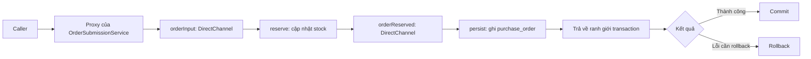

# DirectChannel và transaction context

Trong chương **DirectChannel** của module `SPRING_INTEGRATION_CORE`, bài này giải thích cách thiết kế một luồng thông điệp mà các thao tác dữ liệu cùng tham gia transaction của bên gọi. Các thành phần `Message`, `MessageChannel`, endpoint, gateway và Java DSL được đặt vào một tình huống cụ thể: trừ tồn kho và tạo đơn hàng phải thành công hoặc thất bại cùng nhau.

Sau bài học, bạn có thể xác định nơi bắt đầu và kết thúc transaction, giải thích vì sao đổi loại channel có thể làm thay đổi tính nhất quán, và viết kiểm thử kiểm tra dữ liệu sau commit hoặc rollback.

## 1. DirectChannel giữ đường thực thi đồng bộ

`DirectChannel` gọi handler ngay trên thread đang thực hiện `send()`. Handler được thực thi trước khi lời gọi `send()` trả về. Vì vậy, nếu bên gửi đang ở trong một transaction gắn với thread, các thao tác dữ liệu tương thích ở handler có thể sử dụng transaction đó. Đây là một mục đích quan trọng của thiết kế DirectChannel. [Message Channel Implementations](https://docs.spring.io/spring-integration/reference/channel/implementations.html#channel-implementations-directchannel).

Ví dụ đường gọi:

```text
Thread request-1
  -> transaction interceptor: bắt đầu T1
     -> OrderSubmissionService.place()
        -> orderInput.send(message)
           -> reserveStock()
              -> orderReserved.send(message)
                 -> insertOrder()
        <- các handler đồng bộ đã trả về
     <- place() trả về
  -> transaction interceptor: commit T1
```

Nếu `insertOrder()` ném lỗi phù hợp quy tắc rollback và lỗi đi ngược ra ngoài phương thức được quản lý transaction, T1 sẽ rollback thay vì commit.

Điều cần phân biệt là **channel giữ cách gọi đồng bộ**, còn **transaction manager quản lý transaction**. Tạo một bean `DirectChannel` không tự tạo transaction cho mọi thông điệp gửi qua nó.

Một chuỗi DirectChannel cũng có thể được gọi đồng thời bởi nhiều thread. Mỗi lời gọi đi theo thread của bên gửi tương ứng; channel không biến toàn bộ ứng dụng thành một luồng xử lý tuần tự duy nhất.

## 2. Transaction context nằm ở đâu?

Trong phạm vi bài này, ta xét transaction imperative dùng `PlatformTransactionManager`, điển hình là JDBC. Context liên quan đến tài nguyên đang tham gia transaction và trạng thái quản lý transaction trên thread thực thi. Cơ chế này khác với transaction reactive dựa trên Reactor context.

| Thành phần | Trách nhiệm trong ví dụ |
| --- | --- |
| `Message<OrderCommand>` | Mang yêu cầu đặt hàng và metadata của thông điệp |
| `DirectChannel` | Chuyển thông điệp tới handler trên thread của bên gửi |
| Endpoint service activator | Gọi phương thức nghiệp vụ và chuyển kết quả sang bước kế tiếp |
| Java DSL | Khai báo cấu trúc các bước và channel của flow |
| `@Transactional` hoặc `TransactionTemplate` | Xác định phạm vi công việc cần quản lý transaction |
| `DataSourceTransactionManager` | Quản lý transaction JDBC cho một `DataSource` |
| `JdbcTemplate` | Truy cập JDBC theo cơ chế lấy connection có nhận biết transaction của Spring |

Với `DataSourceTransactionManager`, Spring liên kết connection của `DataSource` với thread hiện tại. `JdbcTemplate` sử dụng cơ chế này khi truy cập dữ liệu. Nếu handler tự lấy connection độc lập bằng `dataSource.getConnection()` và tự quản lý nó, không thể mặc nhiên coi connection đó thuộc transaction đang có. [DataSourceTransactionManager API](https://docs.spring.io/spring-framework/docs/current/javadoc-api/org/springframework/jdbc/datasource/DataSourceTransactionManager.html).

Transaction context không phải một header cần sao chép khi tạo `Message` mới. Thêm `transactionId` vào header chỉ cung cấp dữ liệu ứng dụng hoặc dấu vết quan sát; nó không làm một thread khác sử dụng cùng transaction JDBC. Tương tự, mã tương quan thông điệp không phải connection hoặc transaction của cơ sở dữ liệu.

## 3. Điều kiện để các bước cùng tham gia một transaction

Trước khi kết luận một flow có tính nguyên tử, cần xác định đủ các điều kiện sau:

1. **Transaction đã bắt đầu trước thao tác đầu tiên cần bảo vệ.** Ví dụ, bên gọi đi qua proxy của phương thức `@Transactional`, hoặc toàn bộ lời gọi gửi nằm trong callback của `TransactionTemplate`.
2. **Các thao tác nằm trong phạm vi transaction còn hiệu lực.** Giữ cùng thread giúp duy trì context, nhưng transaction vẫn phải bao trùm đúng thời gian thực thi các bước đó.
3. **Các tài nguyên thực sự tham gia transaction đã chọn.** Trong ví dụ JDBC, các thao tác dùng cùng `DataSource` và transaction manager tương ứng.
4. **Không xuất hiện ranh giới thực thi làm tách context.** Chẳng hạn executor chuyển công việc sang worker thread, một poller nhận thông điệp sau đó, hoặc handler tự tạo thread.
5. **Các cấu hình propagation không chủ động tách transaction.** `REQUIRES_NEW` và `NOT_SUPPORTED` làm thay đổi phạm vi tham gia dù vẫn ở cùng thread.
6. **Kết quả lỗi được phản ánh tới ranh giới transaction.** Nếu flow che lỗi và trả về bình thường, transaction interceptor có thể không nhận được tín hiệu rollback.

Spring Integration sử dụng cơ chế transaction của Spring cho flow do ứng dụng khởi phát; có thể đặt ranh giới ở service bên gọi hoặc cấu hình transaction thích hợp cho thành phần khởi phát. [Transaction Support](https://docs.spring.io/spring-integration/reference/transactions.html).

Không nhất thiết phải đánh dấu `@Transactional` trên mọi handler. Một handler không có annotation vẫn có thể sử dụng tài nguyên đã gắn với transaction bên ngoài. Ngược lại, gắn annotation lên một handler cũng chưa đủ để kết luận mọi bước sau handler đều nằm trong cùng phạm vi.

## 4. Ví dụ JDBC: trừ tồn kho và tạo đơn hàng

### 4.1. Yêu cầu và các giả định của ví dụ

Một yêu cầu đặt hàng cần thực hiện:

1. Trừ số lượng sản phẩm còn trong kho.
2. Ghi một đơn hàng mới.
3. Nếu ghi đơn thất bại sau khi đã trừ kho, khôi phục thay đổi tồn kho bằng rollback.

Flow được khai báo rõ hai DirectChannel:



Các public type dưới đây được đặt thành từng tệp Java trong cùng package `demo.directtx`. Chúng là mã minh họa cho bài học; cần ghép vào dự án với bộ phiên bản Spring tương thích trước khi chạy.

Các dependency cần có:

| Dependency | Mục đích |
| --- | --- |
| `org.springframework.integration:spring-integration-core` | Channel, endpoint và Java DSL |
| `org.springframework:spring-jdbc` | `JdbcTemplate`, transaction manager JDBC và cơ sở dữ liệu nhúng |
| `org.springframework:spring-tx` | Annotation và API transaction; thường đã được kéo vào bởi Spring JDBC |
| `com.h2database:h2` | Cơ sở dữ liệu trong bộ nhớ cho lab |
| `org.springframework:spring-test` | Khởi tạo application context khi kiểm thử |
| `org.junit.jupiter:junit-jupiter` | Các kiểm thử JUnit 5 |

Dùng cơ chế quản lý phiên bản của dự án, chẳng hạn BOM Spring Boot tương thích, để đồng bộ dependency Spring. Ví dụ sử dụng `record` và text block nên cần Java 17 trở lên; bản Spring cụ thể có thể yêu cầu JDK cao hơn. Không cần thêm một thư viện Java DSL tách riêng cho cách cấu hình này.

### 4.2. Payload bất biến

```java
package demo.directtx;

public record OrderCommand(long orderId, String sku, int quantity) {

    public OrderCommand {
        if (orderId <= 0) {
            throw new IllegalArgumentException("orderId phải lớn hơn 0");
        }
        if (sku == null || sku.isBlank()) {
            throw new IllegalArgumentException("sku không được rỗng");
        }
        if (quantity <= 0) {
            throw new IllegalArgumentException("quantity phải lớn hơn 0");
        }
    }
}
```

Kiểm tra dữ liệu đầu vào giúp tránh yêu cầu trừ kho với số lượng âm. Tính bất biến của payload giúp các bước diễn giải cùng một yêu cầu ổn định; cơ chế rollback vẫn do transaction JDBC đảm nhiệm.

### 4.3. Hai bước nghiệp vụ

```java
package demo.directtx;

import org.springframework.jdbc.core.JdbcTemplate;

public class OrderSteps {

    private final JdbcTemplate jdbc;

    public OrderSteps(JdbcTemplate jdbc) {
        this.jdbc = jdbc;
    }

    public OrderCommand reserve(OrderCommand command) {
        int changed = jdbc.update("""
                update stock
                   set available = available - ?
                 where sku = ? and available >= ?
                """,
                command.quantity(),
                command.sku(),
                command.quantity());

        if (changed != 1) {
            throw new IllegalStateException("Sản phẩm không tồn tại hoặc không đủ tồn kho");
        }

        return command;
    }

    public void persist(OrderCommand command) {
        jdbc.update("""
                insert into purchase_order(order_id, sku, quantity)
                values (?, ?, ?)
                """,
                command.orderId(),
                command.sku(),
                command.quantity());
    }
}
```

Câu lệnh trừ kho kết hợp kiểm tra số lượng và cập nhật trong cùng một thao tác SQL. Bài không dùng mô hình đọc số lượng ra Java rồi cập nhật sau đó, vì mô hình ấy còn cần giải quyết tranh chấp giữa các yêu cầu đồng thời.

`reserve()` trả lại payload để flow tiếp tục. `persist()` trả `void`, kết thúc luồng một chiều. Cả hai phương thức đều dùng cùng bean `JdbcTemplate`.

### 4.4. Service xác định ranh giới transaction

```java
package demo.directtx;

import org.springframework.messaging.MessageChannel;
import org.springframework.messaging.support.MessageBuilder;
import org.springframework.transaction.annotation.Transactional;

public class OrderSubmissionService {

    private final MessageChannel orderInput;

    public OrderSubmissionService(MessageChannel orderInput) {
        this.orderInput = orderInput;
    }

    @Transactional(transactionManager = "orderTxManager")
    public void place(OrderCommand command) {
        boolean accepted = orderInput.send(
                MessageBuilder.withPayload(command).build());

        if (!accepted) {
            throw new IllegalStateException("Thông điệp đặt hàng không được chấp nhận");
        }
    }
}
```

Caller phải lấy `OrderSubmissionService` từ Spring context và gọi phương thức qua proxy của bean. Tự tạo đối tượng bằng `new OrderSubmissionService(...)` ở code bên ngoài context sẽ không kích hoạt transaction annotation.

Trong chế độ proxy thông thường, một phương thức trong cùng đối tượng gọi `this.place(...)` cũng không đi qua transaction interceptor. Vì vậy, ranh giới giao dịch ở đây được đặt tại một phương thức public mà bean khác hoặc caller của bài lab gọi vào. [Using @Transactional](https://docs.spring.io/spring-framework/reference/data-access/transaction/declarative/annotations.html).

`send()` trả `true` biểu thị việc gửi đã được chấp nhận theo hành vi channel. Nó không phải biên nhận commit cơ sở dữ liệu. Trong ví dụ, transaction interceptor còn phải thực hiện commit sau khi thân phương thức `place()` trả về; commit vẫn có thể thất bại.

### 4.5. Cấu hình Spring và Java DSL

```java
package demo.directtx;

import javax.sql.DataSource;

import org.springframework.beans.factory.annotation.Qualifier;
import org.springframework.context.annotation.Bean;
import org.springframework.context.annotation.Configuration;
import org.springframework.integration.channel.DirectChannel;
import org.springframework.integration.config.EnableIntegration;
import org.springframework.integration.dsl.IntegrationFlow;
import org.springframework.jdbc.core.JdbcTemplate;
import org.springframework.jdbc.datasource.DataSourceTransactionManager;
import org.springframework.jdbc.datasource.embedded.EmbeddedDatabase;
import org.springframework.jdbc.datasource.embedded.EmbeddedDatabaseBuilder;
import org.springframework.jdbc.datasource.embedded.EmbeddedDatabaseType;
import org.springframework.messaging.MessageChannel;
import org.springframework.transaction.PlatformTransactionManager;
import org.springframework.transaction.annotation.EnableTransactionManagement;

@Configuration
@EnableIntegration
@EnableTransactionManagement
public class DirectTxConfig {

    @Bean(destroyMethod = "shutdown")
    public EmbeddedDatabase dataSource() {
        return new EmbeddedDatabaseBuilder()
                .generateUniqueName(true)
                .setType(EmbeddedDatabaseType.H2)
                .build();
    }

    @Bean
    public JdbcTemplate jdbcTemplate(DataSource dataSource) {
        JdbcTemplate jdbc = new JdbcTemplate(dataSource);

        // Khởi tạo schema chỉ để ví dụ lab tự chứa.
        jdbc.execute("""
                create table stock (
                    sku varchar(64) primary key,
                    available integer not null check (available >= 0)
                )
                """);
        jdbc.execute("""
                create table purchase_order (
                    order_id bigint primary key,
                    sku varchar(64) not null,
                    quantity integer not null check (quantity > 0)
                )
                """);

        return jdbc;
    }

    @Bean
    public PlatformTransactionManager orderTxManager(DataSource dataSource) {
        return new DataSourceTransactionManager(dataSource);
    }

    @Bean
    public DirectChannel orderInput() {
        DirectChannel channel = new DirectChannel();
        channel.setFailover(false);
        return channel;
    }

    @Bean
    public DirectChannel orderReserved() {
        DirectChannel channel = new DirectChannel();
        channel.setFailover(false);
        return channel;
    }

    @Bean
    public OrderSteps orderSteps(JdbcTemplate jdbcTemplate) {
        return new OrderSteps(jdbcTemplate);
    }

    @Bean
    public OrderSubmissionService orderSubmissionService(
            @Qualifier("orderInput") MessageChannel orderInput) {
        return new OrderSubmissionService(orderInput);
    }

    @Bean
    public IntegrationFlow orderFlow(OrderSteps orderSteps) {
        return IntegrationFlow.from("orderInput")
                .handle(orderSteps, "reserve")
                .channel("orderReserved")
                .handle(orderSteps, "persist")
                .get();
    }
}
```

`@EnableIntegration` kích hoạt hạ tầng Spring Integration trong cấu hình không dùng Boot. `@EnableTransactionManagement` bật xử lý annotation transaction. Bean `orderFlow` mô tả cấu trúc endpoint; việc khai báo Java DSL tự nó không tạo transaction cho mỗi thông điệp. [Java DSL](https://docs.spring.io/spring-integration/reference/dsl.html).

Ví dụ khai báo mỗi bước trên một channel riêng. Không đăng ký `reserve()` và `persist()` thành hai subscriber cạnh tranh của cùng DirectChannel rồi kỳ vọng cả hai luôn chạy theo thứ tự.

`setFailover(false)` làm chủ ý xử lý lỗi rõ ràng hơn nếu sau này có thêm subscriber. Nó không phải cấu hình bật transaction; với một subscriber trên mỗi channel, đường xử lý chính vẫn là một chuỗi đồng bộ.

### 4.6. Phân tích trường hợp thành công và thất bại

Giả sử kho ban đầu có `SI-BOOK = 10`, bảng đơn hàng đã có đơn `order_id = 100`.

| Lời gọi | Diễn biến | Dữ liệu sau khi caller nhận kết quả |
| --- | --- | --- |
| `place(new OrderCommand(101, "SI-BOOK", 2))` | Trừ kho 2, thêm đơn 101, commit | Kho còn 8, có thêm đơn 101 |
| `place(new OrderCommand(100, "SI-BOOK", 2))` | Trừ kho 2, thêm đơn bị trùng khóa, rollback | Kho vẫn 10, chỉ giữ đơn 100 ban đầu |
| `place(new OrderCommand(101, "SI-BOOK", 11))` | Cập nhật kho không tác động dòng nào, ném lỗi | Kho vẫn 10, không có đơn 101 |

Trong trường hợp trùng khóa, tồn kho có giá trị 8 bên trong transaction sau bước `reserve()`. Sau rollback, thay đổi đó không được lưu. Chính trường hợp lỗi ở bước thứ hai giúp kiểm chứng hai thao tác được bảo vệ chung.

## 5. Kiểm thử bằng trạng thái dữ liệu sau transaction

Kiểm thử cần gọi service do Spring quản lý, chờ lời gọi hoàn tất và truy vấn dữ liệu sau khi transaction của service kết thúc.

```java
package demo.directtx;

import org.junit.jupiter.api.BeforeEach;
import org.junit.jupiter.api.Test;
import org.springframework.beans.factory.annotation.Autowired;
import org.springframework.jdbc.core.JdbcTemplate;
import org.springframework.test.context.junit.jupiter.SpringJUnitConfig;
import org.springframework.transaction.support.TransactionSynchronizationManager;

import static org.junit.jupiter.api.Assertions.assertEquals;
import static org.junit.jupiter.api.Assertions.assertFalse;
import static org.junit.jupiter.api.Assertions.assertThrows;

@SpringJUnitConfig(DirectTxConfig.class)
class DirectChannelTransactionTest {

    @Autowired
    OrderSubmissionService service;

    @Autowired
    JdbcTemplate jdbc;

    @BeforeEach
    void resetData() {
        jdbc.update("delete from purchase_order");
        jdbc.update("delete from stock");
        jdbc.update("insert into stock(sku, available) values (?, ?)",
                "SI-BOOK", 10);
        jdbc.update("""
                insert into purchase_order(order_id, sku, quantity)
                values (?, ?, ?)
                """, 100L, "SI-BOOK", 1);
    }

    @Test
    void commitsStockAndOrderTogether() {
        assertFalse(TransactionSynchronizationManager.isActualTransactionActive());

        service.place(new OrderCommand(101L, "SI-BOOK", 2));

        assertFalse(TransactionSynchronizationManager.isActualTransactionActive());
        assertEquals(8, available());
        assertEquals(2, orderCount());
        assertEquals(1, countOrder(101L));
    }

    @Test
    void rollsBackStockWhenOrderInsertFails() {
        assertFalse(TransactionSynchronizationManager.isActualTransactionActive());

        assertThrows(RuntimeException.class,
                () -> service.place(new OrderCommand(100L, "SI-BOOK", 2)));

        assertFalse(TransactionSynchronizationManager.isActualTransactionActive());
        assertEquals(10, available());
        assertEquals(1, orderCount());
        assertEquals(1, countOrder(100L));
    }

    @Test
    void createsNoOrderWhenStockIsInsufficient() {
        assertThrows(RuntimeException.class,
                () -> service.place(new OrderCommand(101L, "SI-BOOK", 11)));

        assertEquals(10, available());
        assertEquals(1, orderCount());
        assertEquals(0, countOrder(101L));
    }

    private int available() {
        return jdbc.queryForObject(
                "select available from stock where sku = ?",
                Integer.class, "SI-BOOK");
    }

    private int orderCount() {
        return jdbc.queryForObject(
                "select count(*) from purchase_order", Integer.class);
    }

    private int countOrder(long orderId) {
        return jdbc.queryForObject(
                "select count(*) from purchase_order where order_id = ?",
                Integer.class, orderId);
    }
}
```

Lớp kiểm thử không gắn `@Transactional`. Nếu test tự mở transaction và service tham gia transaction đó, ranh giới commit/rollback thực tế có thể bị che bởi transaction của test; thậm chí việc bỏ annotation ở service vẫn có thể để handler dùng transaction do test tạo. Cách trên giúp quan sát ranh giới của chính service. [Transaction Management trong Spring TestContext](https://docs.spring.io/spring-framework/reference/testing/testcontext-framework/tx.html).

Kiểm tra exception đơn thuần chưa chứng minh được tính nguyên tử. Điểm quyết định là tồn kho được khôi phục sau lỗi ghi đơn. Kiểu exception cụ thể có thể được Spring Integration bọc trong `MessagingException` hoặc lớp con; khi chẩn đoán cần xem chuỗi nguyên nhân bên trong.

## 6. Lỗi đi tới transaction interceptor như thế nào?

### 6.1. Lỗi đồng bộ đi ngược call stack

Với cấu hình chính của bài, một lỗi ở `persist()` đi theo đường:

```text
persist() ném lỗi truy cập dữ liệu
  -> service activator / endpoint
  -> orderReserved.send()
  -> endpoint gọi reserve() và chuyển tiếp kết quả
  -> orderInput.send()
  -> OrderSubmissionService.place()
  -> transaction interceptor
  -> rollback theo quy tắc áp dụng
  -> caller nhận exception
```

Không cần một consumer của `errorChannel` để transaction này rollback. Khi gửi trực tiếp qua channel trên cùng thread, lỗi được ném về caller; mô hình xử lý lỗi bằng thông điệp cần được xét theo thành phần khởi phát hoặc executor thực tế. [Error Handling](https://docs.spring.io/spring-integration/reference/error-handling.html).

### 6.2. Quy tắc rollback xét exception tới ranh giới

Theo cấu hình mặc định thông thường của Spring, `RuntimeException` và `Error` gây rollback; checked exception không tự gây rollback chỉ vì là exception. Có thể điều chỉnh bằng `rollbackFor` hoặc quy tắc cấu hình phù hợp. [Rolling Back a Declarative Transaction](https://docs.spring.io/spring-framework/reference/data-access/transaction/declarative/rolling-back.html).

Trong flow tích hợp, exception nghiệp vụ có thể được bọc thành một exception runtime của messaging. Vì vậy, cần xem **exception thực sự thoát khỏi phương thức transactional**, thay vì chỉ nhìn kiểu exception được khai báo ở phương thức handler. Quy tắc `rollbackFor` đối chiếu exception đi tới interceptor; không nên giả định nó luôn tìm mọi kiểu nguyên nhân sâu bên trong.

Ví dụ sau phù hợp khi hợp đồng service thực sự để checked exception này thoát ra:

```java
@Transactional(
        transactionManager = "orderTxManager",
        rollbackFor = BusinessCheckedException.class)
public void placeWithBusinessCheck(OrderCommand command)
        throws BusinessCheckedException {
    // Kiểm tra nghiệp vụ và gửi thông điệp trong cùng phạm vi.
}
```

`BusinessCheckedException` là kiểu exception do ứng dụng tự định nghĩa. Đoạn này minh họa quy tắc rollback, không thay thế các lớp của lab JDBC phía trên.

### 6.3. Bắt rồi bỏ qua lỗi có thể dẫn tới commit

Đây là cách viết nguy hiểm nếu caller vẫn kỳ vọng toàn bộ đơn hàng rollback:

```java
@Transactional(transactionManager = "orderTxManager")
public void placeIgnoringFailure(OrderCommand command) {
    try {
        orderInput.send(MessageBuilder.withPayload(command).build());
    } catch (RuntimeException ex) {
        // Chỉ ghi log và trả về bình thường.
    }
}
```

Nếu chưa có thành phần nào đánh dấu rollback-only và tài nguyên vẫn cho phép commit, interceptor có thể commit phần cập nhật đã thực hiện. Một số lỗi cơ sở dữ liệu hoặc lớp transaction bên trong có thể đã làm transaction không thể commit, nên việc nuốt lỗi cũng không bảo đảm sẽ commit thành công.

Cách rõ ràng nhất khi thao tác thất bại là để lỗi phù hợp đi ra ngoài. Nếu cần trả kết quả nghiệp vụ thay vì ném exception, phải chủ động thiết kế rollback, chẳng hạn `status.setRollbackOnly()` trong `TransactionTemplate`, đồng thời cho caller biết yêu cầu đã thất bại.

## 7. Messaging gateway vẫn cần ranh giới transaction rõ ràng

Có thể thay API gửi `Message` trực tiếp bằng một interface gateway:

```java
package demo.directtx;

import org.springframework.integration.annotation.MessagingGateway;

@MessagingGateway(defaultRequestChannel = "orderInput")
public interface OrderGateway {

    void place(OrderCommand command);
}
```

Để tạo proxy gateway bằng quét annotation trong cấu hình Java, bật `@IntegrationComponentScan(basePackageClasses = OrderGateway.class)` trên lớp cấu hình thích hợp; annotation này thuộc package `org.springframework.integration.annotation`. [Annotation Support](https://docs.spring.io/spring-integration/reference/configuration/annotations.html).

Service bao ngoài có thể giữ ranh giới giao dịch như sau; đây là một phương án thay thế service gửi trực tiếp:

```java
package demo.directtx;

import org.springframework.transaction.annotation.Transactional;

public class GatewayOrderSubmissionService {

    private final OrderGateway gateway;

    public GatewayOrderSubmissionService(OrderGateway gateway) {
        this.gateway = gateway;
    }

    @Transactional(transactionManager = "orderTxManager")
    public void place(OrderCommand command) {
        gateway.place(command);
    }
}
```

Đăng ký lớp service thay thế thành Spring bean và gọi qua proxy như ví dụ chính. Gateway có kiểu trả về `void` diễn đạt hợp đồng một chiều, nhưng không tự chuyển một flow DirectChannel sang thread nền. Với cấu hình đồng bộ và không tùy biến xử lý lỗi gateway, lỗi downstream được chuyển về caller. [Messaging Gateways](https://docs.spring.io/spring-integration/reference/gateway.html).

Nếu cấu hình gateway chuyển lỗi sang `errorChannel` rồi error flow hoàn tất bình thường hoặc cung cấp fallback, caller có thể không nhận exception. Khi đó phải xác định transaction đã được đánh dấu rollback-only hay chưa. Có `errorChannel` không đồng nghĩa với tự động rollback; cần kiểm thử cả kết quả gateway lẫn dữ liệu.

## 8. Ranh giới đồng bộ và ranh giới transaction là hai chuyện liên quan

### 8.1. ExecutorChannel có thể chuyển công việc sang thread khác

```text
Thread request-1, transaction T1:
  update A -> ExecutorChannel.send() -> tiếp tục -> kết thúc T1

Thread worker-1:
  nhận công việc -> update B -> có thể thất bại sau đó
```

Khi executor thực sự chuyển công việc sang worker thread, transaction thread-bound T1 không tự đi theo. Nếu B mở transaction thì đó là transaction ở phía xử lý B, không mặc nhiên là cùng transaction với A.

Điểm chuyển thread làm chấm dứt khả năng lan truyền context theo đường gọi này, nhưng không có nghĩa T1 lập tức commit ngay tại câu lệnh `send()`. T1 vẫn kết thúc tại ranh giới transaction của bên gửi.

Không dùng kết quả tình cờ chạy cùng thread, chẳng hạn executor trực tiếp hoặc chính sách caller-runs khi quá tải, làm cơ sở cho bảo đảm nghiệp vụ. Hãy thiết kế theo đường thực thi mà cấu hình executor có thể tạo ra.

### 8.2. QueueChannel tách thời điểm gửi và xử lý

Với QueueChannel, `send()` có thể chỉ đưa thông điệp vào hàng đợi. Một poller nhận và xử lý sau đó thường có phạm vi transaction riêng. Muốn xử lý có giao dịch ở phía poller, cần cấu hình transaction cho poller và tài nguyên tương ứng.

QueueChannel dùng bộ nhớ mặc định không trở thành một hàng đợi transactional chỉ vì bên gửi có `@Transactional`. Nếu T1 gửi vào queue rồi rollback, không được giả định thông điệp trong bộ nhớ sẽ tự được thu hồi. Hàng đợi hoặc message store có hỗ trợ transaction cần một thiết kế riêng. [Transaction Support — Transaction Boundaries](https://docs.spring.io/spring-integration/reference/transactions.html#transaction-boundaries).

### 8.3. Chờ kết quả không tự nối lại transaction

Một handler gọi `CompletableFuture`, `@Async` hoặc executor có thể chuyển thao tác JDBC sang thread khác. Bên gửi gọi `join()` để chờ không làm worker lấy lại connection đang gắn với thread bên gửi.

Lỗi từ worker vẫn có thể được chờ rồi ném ra bên ngoài để làm T1 rollback, nhưng điều đó không hoàn tác một transaction riêng mà worker đã commit. Cần phân biệt việc **truyền lỗi** với việc **chia sẻ transaction**.

### 8.4. Router, filter và aggregator cần được xét theo hành vi

| Thành phần | Điều cần xác định về transaction |
| --- | --- |
| Transformer trả payload mới | Nếu xử lý đồng bộ trong phạm vi đang có, việc tạo `Message` mới không tự tách transaction |
| Router | Channel đích và cách thực thi của nhánh được chọn có giữ đường gọi hiện tại không? |
| Filter | Thông điệp bị loại có được coi là kết quả hợp lệ, hay cần ném lỗi để yêu cầu rollback? |
| Aggregator | Có lưu nhóm để chờ thông điệp tương lai, timeout hoặc giải phóng nhóm ở lần gọi khác không? |

Ví dụ, một filter loại thông điệp bình thường sau bước trừ kho có thể làm flow kết thúc mà không tạo đơn, đồng thời không có exception yêu cầu rollback. Với aggregator, không thể coi mọi thông điệp trong nhóm là cùng một transaction chỉ vì các channel đầu vào đều là DirectChannel. Đây là các hệ quả thiết kế cần xét trên đường thực thi đầy đủ của ứng dụng.

## 9. Propagation có thể thay đổi transaction ngay trên cùng thread

DirectChannel không ghi đè quy tắc propagation của Spring. [Transaction Propagation](https://docs.spring.io/spring-framework/reference/data-access/transaction/declarative/tx-propagation.html).

| Propagation của phương thức được gọi qua proxy | Khi bên ngoài đang có T1 |
| --- | --- |
| `REQUIRED` | Thường tham gia T1 khi dùng transaction manager phù hợp |
| `MANDATORY` | Yêu cầu phải có transaction hiện hữu |
| `REQUIRES_NEW` | Tạm ngưng T1 và tạo transaction độc lập T2 |
| `NOT_SUPPORTED` | Tạm ngưng transaction hiện hữu trong phạm vi phương thức |
| `NESTED` | Dùng phạm vi lồng với savepoint nếu transaction manager và tài nguyên hỗ trợ |

Ví dụ, một bean ghi audit dùng `REQUIRES_NEW` có thể commit bản ghi audit rồi T1 rollback. Cùng thread không làm hai transaction đó trở thành một. Việc mở T2 cũng có thể cần thêm connection khi connection của T1 vẫn đang được giữ.

Nếu một phương thức `REQUIRED` bên trong đánh dấu T1 rollback-only và bên ngoài bắt lỗi rồi vẫn cố hoàn tất bình thường, caller có thể nhận `UnexpectedRollbackException` khi ranh giới bên ngoài kết thúc.

Cũng cần đặt đúng phạm vi: nếu chỉ `reserve()` được đánh dấu transactional và chưa có transaction bên ngoài, transaction bao quanh phương thức ấy có thể kết thúc ngay khi `reserve()` trả về. Sau đó endpoint mới chuyển kết quả sang `persist()`. Muốn bảo vệ cả hai bước như lab, đặt ranh giới ở service bao ngoài toàn bộ lời gọi gửi.

## 10. TransactionTemplate khi muốn thể hiện phạm vi bằng code

Một cách khác là bao lời gọi gửi trong `TransactionTemplate`. Với propagation mặc định, template tạo transaction nếu chưa có hoặc tham gia transaction hiện hữu phù hợp. [Programmatic Transaction Management](https://docs.spring.io/spring-framework/reference/data-access/transaction/programmatic.html).

```java
package demo.directtx;

import org.springframework.messaging.MessageChannel;
import org.springframework.messaging.support.MessageBuilder;
import org.springframework.transaction.PlatformTransactionManager;
import org.springframework.transaction.support.TransactionTemplate;

public class ProgrammaticOrderSubmissionService {

    private final TransactionTemplate transactionTemplate;
    private final MessageChannel orderInput;

    public ProgrammaticOrderSubmissionService(
            PlatformTransactionManager transactionManager,
            MessageChannel orderInput) {
        this.transactionTemplate = new TransactionTemplate(transactionManager);
        this.orderInput = orderInput;
    }

    public void place(OrderCommand command) {
        transactionTemplate.executeWithoutResult(status -> {
            boolean accepted = orderInput.send(
                    MessageBuilder.withPayload(command).build());
            if (!accepted) {
                throw new IllegalStateException("Gửi thông điệp thất bại");
            }
        });
    }
}
```

Khi tạo bean cho phương án này, truyền đúng `orderTxManager` và `orderInput`. Đây là lựa chọn thay thế service dùng annotation, không cần ghép hai kiểu chỉ để bao cùng một lời gọi.

Callback cho thấy rõ phần cần transaction. Các thao tác chạy trên worker thread bên trong callback vẫn không tự tham gia transaction của thread gọi template.

## 11. Nhiều subscriber và failover có thể làm thay đổi cách quan sát lỗi

DirectChannel dùng mô hình point-to-point. Nhiều subscriber trên một channel là các ứng viên nhận thông điệp, không phải danh sách các bước nghiệp vụ tuần tự. Dispatcher có cơ chế cân bằng tải và mặc định có failover; khi một handler ném lỗi, nó có thể thử handler tiếp theo. [DirectChannel configuration](https://docs.spring.io/spring-integration/reference/channel/configuration.html).

Trong flow có ghi dữ liệu, cần xét các hệ quả sau:

- Handler đầu có thể đã thay đổi dữ liệu trước khi thất bại.
- Việc thử handler khác không mặc nhiên rollback riêng phần việc của handler đầu.
- Nếu handler sau thành công và transaction chưa bị đánh dấu rollback-only, lỗi đầu có thể không đi tới ranh giới ngoài.
- Nếu transaction đã bị đánh dấu rollback-only, thành công của handler sau không xóa dấu đó.

Lab sử dụng một subscriber trên mỗi channel và tắt failover để giữ hợp đồng lỗi rõ ràng. Trong ứng dụng thực, nếu cần retry hoặc chuyển tuyến dự phòng, phải thiết kế phạm vi transaction của từng lần thử, khả năng thực thi lặp an toàn và cách báo thất bại cho caller.

## 12. Giới hạn nguyên tử và cách chẩn đoán

### 12.1. Transaction JDBC không hoàn tác mọi tác dụng phụ

Trong lab, phạm vi nguyên tử bao gồm các thay đổi JDBC sử dụng cùng tài nguyên được quản lý. Nếu chèn thêm bước gọi API thanh toán, gửi email hoặc ghi một tệp, rollback JDBC không tự đảo ngược những tác dụng phụ đó.

Tương tự, dùng hai cơ sở dữ liệu với hai transaction manager cục bộ không tự tạo một giao dịch phân tán, dù toàn bộ handler chạy trên một thread.

Với yêu cầu ghi dữ liệu rồi phát sự kiện đáng tin cậy, có thể thiết kế transactional outbox: lưu thay đổi nghiệp vụ và bản ghi sự kiện trong cùng transaction cơ sở dữ liệu, sau đó có tiến trình phát sự kiện riêng cùng cơ chế xử lý lặp. Đây là một hướng thiết kế bổ sung khi cần vượt ra ngoài phạm vi transaction cục bộ của bài.

### 12.2. Quan sát thread và trạng thái transaction

Có thể tạm đặt đoạn sau ở service trước `send()` và trong từng handler khi làm lab:

```java
import org.springframework.transaction.support.TransactionSynchronizationManager;

System.out.printf(
        "thread=%s, txActive=%s, txName=%s%n",
        Thread.currentThread().getName(),
        TransactionSynchronizationManager.isActualTransactionActive(),
        TransactionSynchronizationManager.getCurrentTransactionName());
```

Cùng tên thread và `txActive=true` là dấu hiệu quan sát hữu ích, nhưng chưa chứng minh mọi thao tác dùng cùng transaction vật lý. Vẫn phải kiểm tra `DataSource`, transaction manager, propagation và kết quả dữ liệu sau khi kết thúc lời gọi.

| Hiện tượng | Điểm nên kiểm tra trước |
| --- | --- |
| Handler chạy cùng thread nhưng không có transaction | Service có được gọi qua proxy và transaction management đã bật chưa? |
| Trừ kho không rollback sau lỗi tạo đơn | Hai bước có dùng cùng tài nguyên? Lỗi có bị bắt hoặc chuyển thành kết quả bình thường không? |
| Chỉ một phần dữ liệu rollback | Có `REQUIRES_NEW`, connection độc lập hoặc một transaction manager khác không? |
| Caller nhận thành công rồi worker mới thất bại | Có ExecutorChannel, QueueChannel, `@Async` hoặc future không? |
| Test luôn qua nhưng ứng dụng sai | Transaction của test có đang che việc thiếu transaction ở service không? |
| Nhận `UnexpectedRollbackException` | Một phạm vi tham gia bên trong đã đánh dấu rollback-only rồi lỗi bị bắt chưa? |

### 12.3. Bài tập thực hành

1. Chạy ba kịch bản ở phần kiểm thử, ghi lại số lượng tồn kho và số dòng đơn sau mỗi lời gọi.
2. Trong bản sao lab, bỏ annotation ở service và quan sát trường hợp trùng mã đơn. Giải thích vì sao hai câu SQL không còn được bảo vệ chung.
3. Thêm logging thread và trạng thái transaction ở cả hai bước. Đối chiếu kết quả khi dùng DirectChannel và khi cố ý đưa bước ghi đơn sang executor có worker thread riêng.
4. Khi thử phương án bất đồng bộ, chờ worker hoàn tất bằng cơ chế đồng bộ kiểm thử phù hợp, rồi truy vấn dữ liệu; không dùng thời gian ngủ tùy ý để kết luận rollback.
5. Thử đặt một filter sau bước trừ kho: một lần loại thông điệp bình thường, một lần từ chối bằng exception. So sánh dữ liệu cuối cùng và xác định hợp đồng nghiệp vụ mong muốn.

Mỗi thí nghiệm cần trả lời được ba câu: transaction bắt đầu ở đâu, những thao tác nào thực sự tham gia, và kết quả lỗi tới ranh giới transaction bằng đường nào. Đó là cơ sở để dùng DirectChannel đúng khi xây dựng luồng tích hợp có yêu cầu nhất quán dữ liệu.
