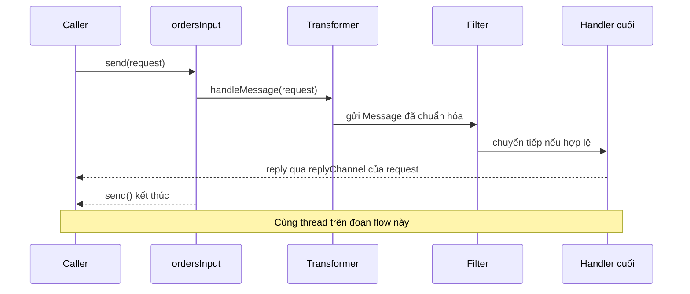

# DirectChannel làm channel mặc định

Trong module **SPRING_INTEGRATION_CORE**, chương **DirectChannel**, bài này giải thích cách dùng `DirectChannel` làm lựa chọn ban đầu khi kết nối các thành phần trong một luồng thông điệp. Trọng tâm là hiểu hành vi thực thi và biết lúc nào cần khai báo một loại channel khác.

Một flow chuẩn hóa mã đơn hàng sẽ được dùng xuyên suốt: nhận `Message<String>`, biến đổi payload, lọc mã không hợp lệ rồi trả kết quả. Ví dụ kết nối các khái niệm Message, MessageChannel, endpoint, gateway và Java DSL trong cùng một tình huống.

## 1. “Channel mặc định” có nghĩa gì?

`DirectChannel` là loại channel mặc định trong những ngữ cảnh cấu hình thông thường của Spring Integration. Chẳng hạn, phần tử XML không có cấu hình đặc biệt bên trong:

```xml
<int:channel id="ordersInput"/>
```

tạo một `DirectChannel`. Trong Java, có thể biểu diễn lựa chọn đó tường minh:

```java
@Bean
public MessageChannel ordersInput() {
    return new DirectChannel();
}
```

Đoạn XML là trích đoạn trong cấu hình đã khai báo namespace Spring Integration; đoạn Java đặt trong lớp cấu hình thích hợp. Xem [Configuring Message Channels](https://docs.spring.io/spring-integration/reference/channel/configuration.html).

“Mặc định” ở đây là **mặc định về loại channel khi framework tạo channel trong ngữ cảnh được hỗ trợ**. Nó không có nghĩa mọi thông điệp sẽ tự tìm đến một bean duy nhất tên `defaultChannel`. Producer vẫn phải biết điểm vào của flow, thông qua tên channel, tham chiếu bean hoặc cấu hình gateway.

Cũng cần phân biệt:

| Khái niệm | Vai trò |
| --- | --- |
| `DirectChannel` là loại mặc định | Quyết định cách chuyển thông điệp khi tạo channel theo mặc định |
| Tên `ordersInput` | Định danh một điểm nối cụ thể trong flow |
| `@Primary` | Giúp Spring chọn bean khi dependency injection có nhiều ứng viên |
| `defaultRequestChannel` của gateway | Chọn đích gửi mặc định cho các phương thức của gateway |

Ví dụ, đặt `@Primary` lên một `DirectChannel` không thay đổi loại của những channel khác được Java DSL tạo ra. Tương tự, gateway trỏ tới `ordersInput` vẫn có thể gửi vào một `QueueChannel` nếu bean mang tên đó được khai báo như vậy.

## 2. Cơ chế thực thi khiến DirectChannel phù hợp làm điểm bắt đầu

`DirectChannel` là một `SubscribableChannel` có ngữ nghĩa point-to-point. Consumer đăng ký một `MessageHandler` với channel; channel chuyển thông điệp trực tiếp cho handler trong thread của bên gửi. Nó không cung cấp API `receive()` như `PollableChannel`.

Trong đường đi đồng bộ, lời gọi handler xảy ra trước khi `send()` kết thúc. Cách thực thi này cho phép việc xử lý hai phía channel tham gia cùng transaction đang gắn với thread, nếu các thành phần còn lại cũng đáp ứng điều kiện transaction. Xem [Message Channel Implementations — DirectChannel](https://docs.spring.io/spring-integration/reference/channel/implementations.html#channel-implementations-directchannel).



Sơ đồ lược bớt các channel trung gian để làm rõ call stack. Trong flow thực tế, endpoint gửi kết quả sang channel nối tiếp; channel đó lại gọi endpoint kế tiếp.

Các thành phần có trách nhiệm riêng:

- **Message** mang payload và headers.
- **Channel** xác định điểm nối và cách chuyển giao thông điệp.
- **Endpoint** gắn handler vào flow; transformer, filter, router và service activator là các dạng xử lý thường gặp.
- **Gateway** cung cấp giao diện gọi thuận tiện cho mã nghiệp vụ và thực hiện việc chuyển đổi giữa lời gọi phương thức với thông điệp.

Ví dụ, mã nghiệp vụ gửi `"  dh-042  "` mà không cần biết endpoint cụ thể nào chuẩn hóa chuỗi. Channel giúp tách sự phụ thuộc vào đối tượng consumer, trong khi cách gọi vẫn có thể đồng bộ.

### 2.1. Không có hàng đợi không có nghĩa là không chặn

Giả sử một lời gọi đi qua ba bước tuần tự:

| Bước | Thời gian giả định |
| --- | ---: |
| Chuẩn hóa dữ liệu | 2 ms |
| Gọi dịch vụ kiểm tra | 80 ms |
| Ghi dữ liệu | 18 ms |

Nếu cả ba bước chạy trực tiếp, caller phải chờ khoảng tổng thời gian các bước, cộng chi phí của framework và hệ thống. `DirectChannel` không tự làm lời gọi dịch vụ trở nên bất đồng bộ.

Cần đặt timeout ở đúng nơi thực hiện I/O. Truyền timeout cho `send(message, timeout)` không biến channel thành cơ chế ngắt một handler đang chạy chậm.

### 2.2. Đồng bộ là thuộc tính của một đoạn đường đi

Một flow có thể bắt đầu bằng `DirectChannel` rồi chuyển sang `ExecutorChannel`, hàng đợi hoặc adapter thực hiện công việc bên ngoài tiến trình. Khi đó phải đánh giá lại ý nghĩa của “đã xử lý xong” tại ranh giới mới.

Ngay cả khi không chuyển thread, filter có thể loại thông điệp; aggregator có thể giữ thông điệp trong một nhóm chưa đủ điều kiện release. Vì vậy, không suy ra “nghiệp vụ đã hoàn tất và đã có reply” chỉ từ việc channel đầu vào là `DirectChannel`.

## 3. Java DSL tạo DirectChannel ở đâu?

Trong Java DSL, các endpoint liên tiếp thường được nối bằng những `DirectChannel` do framework tạo. Với tham chiếu tên như `IntegrationFlow.from("ordersInput")` hoặc `.channel("someChannel")`, DSL sử dụng bean channel đã tồn tại; nếu chưa có, nó có thể tạo channel tương ứng.

Tên sinh tự động của channel trung gian thường theo dạng `[tênFlow].channel#[chỉSố]`. Xem quy tắc và ví dụ tại [Java DSL — Message Channels](https://docs.spring.io/spring-integration/reference/dsl/java-channels.html).

Có thể đọc cấu hình theo ba trường hợp:

| Cấu hình | Cách hiểu |
| --- | --- |
| `IntegrationFlow.from("ordersInput")` | Bắt đầu từ channel mang tên `ordersInput`; kiểm tra xem bean đã được khai báo chưa |
| `.transform(...).filter(...).handle(...)` | Các endpoint được DSL nối với nhau; không cần tự khai báo mọi channel trung gian |
| `.channel(MessageChannels.queue(...))` | Chủ động yêu cầu loại channel khác tại vị trí đó |

Với người đọc flow, việc không thấy một lệnh `.channel(...)` giữa hai bước **không có nghĩa là hai bước mất kết nối**. DSL đã đảm nhiệm phần nối đó.

Đặt tên rõ cho các điểm vào, điểm chia nhánh và ranh giới thực thi quan trọng. Với một đoạn xử lý nội bộ đơn giản, channel sinh tự động thường giúp cấu hình ngắn hơn. Tránh để mã gọi bên ngoài phụ thuộc vào số thứ tự channel do framework sinh: thêm một endpoint có thể làm thay đổi tên trung gian.

## 4. Ví dụ hoàn chỉnh: chuẩn hóa và kiểm tra mã đơn hàng

Ví dụ dưới đây dùng Java 17+ và API Java DSL của Spring Integration 6.x. Dự án cần `spring-integration-core` cùng các dependency Spring phù hợp; nên để BOM của dự án quản lý phiên bản đồng bộ.

```java
import java.util.Locale;

import org.springframework.context.annotation.Bean;
import org.springframework.context.annotation.Configuration;
import org.springframework.integration.config.EnableIntegration;
import org.springframework.integration.dsl.IntegrationFlow;

@Configuration
@EnableIntegration
public class OrderFlowConfiguration {

    @Bean
    public IntegrationFlow orderAcceptanceFlow() {
        return IntegrationFlow.from("ordersInput")
                .transform(String.class,
                        code -> code.trim().toUpperCase(Locale.ROOT))
                .filter(String.class,
                        code -> code.matches("DH-[0-9]+"),
                        filter -> filter.throwExceptionOnRejection(true))
                .handle(String.class,
                        (code, headers) -> "ACCEPTED:" + code)
                .get();
    }
}
```

`@EnableIntegration` bật hạ tầng Spring Integration cho application context trong ví dụ độc lập này. Flow là một bean để framework đăng ký và quản lý các thành phần của nó.

Quá trình xử lý:

1. `ordersInput` tiếp nhận thông điệp chứa mã đơn.
2. Transformer bỏ khoảng trắng ở hai đầu và chuyển sang chữ hoa.
3. Filter kiểm tra mã đã chuẩn hóa theo mẫu `DH-` và ít nhất một chữ số.
4. Handler tạo chuỗi phản hồi.

Ví dụ đầu vào `"  dh-042  "` tạo phản hồi `"ACCEPTED:DH-042"`. Tiền tố `ACCEPTED` chỉ biểu thị vượt qua bước kiểm tra của ví dụ; flow chưa lưu đơn hay thực hiện thanh toán.

Ta không khai báo bean `ordersInput` riêng trong cấu hình này để quan sát cách DSL tạo channel đầu vào. Các điểm nối giữa transformer, filter và handler cũng được tạo mặc định.

### 4.1. Gọi flow bằng MessagingTemplate

Đặt đoạn gọi sau trong một phương thức, chẳng hạn `main` hoặc một bài kiểm thử:

```java
try (var context = new AnnotationConfigApplicationContext(
        OrderFlowConfiguration.class)) {

    MessageChannel input =
            context.getBean("ordersInput", MessageChannel.class);

    MessagingTemplate template = new MessagingTemplate();
    template.setReceiveTimeout(1_000);

    Message<?> reply = template.sendAndReceive(
            input,
            new GenericMessage<>("  dh-042  "));

    if (reply == null) {
        throw new IllegalStateException("Không nhận được phản hồi");
    }

    System.out.println(reply.getPayload());
}
```

Các import bổ sung cho đoạn gọi:

```java
import org.springframework.context.annotation.AnnotationConfigApplicationContext;
import org.springframework.integration.core.MessagingTemplate;
import org.springframework.messaging.Message;
import org.springframework.messaging.MessageChannel;
import org.springframework.messaging.support.GenericMessage;
```

`sendAndReceive` thiết lập cơ chế nhận phản hồi cho request. Handler cuối trả về payload; endpoint chuyển kết quả về đích reply của request khi không có output channel riêng.

Một lệnh `input.send(message)` chỉ trả về `boolean` về thao tác gửi; nó không trực tiếp trả chuỗi kết quả nghiệp vụ. Nếu flow tạo reply nhưng request không có đích nhận reply phù hợp, có thể gặp lỗi không xác định được output channel hoặc reply channel.

Trong ví dụ đồng bộ này, `receiveTimeout` không phải giới hạn cứng cho tổng thời gian thực thi handler. Nếu handler chặn thread, thời gian gửi request vẫn có thể kéo dài trước khi bước chờ reply được thực hiện.

### 4.2. Gọi qua gateway

Trong ứng dụng, có thể cung cấp một interface:

```java
import org.springframework.integration.annotation.MessagingGateway;

@MessagingGateway(defaultRequestChannel = "ordersInput")
public interface OrderGateway {

    String accept(String orderCode);
}
```

Để interface được tạo thành gateway bean, cấu hình `@IntegrationComponentScan` cho package chứa nó, chẳng hạn `@IntegrationComponentScan(basePackageClasses = OrderGateway.class)` trên lớp cấu hình. Annotation này thuộc package `org.springframework.integration.annotation`.

Sau đó mã nghiệp vụ có thể gọi `gateway.accept("  dh-042  ")` và nhận kết quả chuỗi. Gateway quản lý việc tạo request và chờ reply; thông thường nó dùng một reply channel tạm trong header của request. Xem [Messaging Gateways](https://docs.spring.io/spring-integration/reference/gateway.html).

Từ `default` trong `defaultRequestChannel` nói đến đích gửi của gateway. Nó không bắt buộc bean `ordersInput` phải thuộc lớp `DirectChannel`.

## 5. Khi nào nên khai báo channel tường minh?

Tạo bean riêng khi channel là một phần quan trọng của thiết kế: có nhiều flow cùng tham chiếu, cần interceptor, cần giới hạn subscriber hoặc cần bảo đảm người đọc nhìn thấy ngay kiểu chuyển giao.

Ví dụ dưới đây là phương án thay thế cho việc để DSL tự tạo `ordersInput`:

```java
import org.springframework.context.annotation.Bean;
import org.springframework.integration.channel.DirectChannel;

@Bean
public DirectChannel ordersInput() {
    DirectChannel channel = new DirectChannel();
    channel.setMaxSubscribers(1);
    return channel;
}
```

Đặt phương thức này vào `OrderFlowConfiguration`. Flow giữ nguyên `IntegrationFlow.from("ordersInput")` và sử dụng bean đã khai báo.

`setMaxSubscribers(1)` phù hợp khi thiết kế chỉ cho phép một endpoint nhận request tại điểm vào. Đây là giới hạn **số handler đăng ký**, không phải giới hạn số thông điệp, số thread hay số request đồng thời. API này được mô tả tại [DirectChannel Javadoc](https://docs.spring.io/spring-integration/api/org/springframework/integration/channel/DirectChannel.html#setMaxSubscribers(int)).

Nếu hai caller đồng thời gửi vào channel, handler vẫn có thể được gọi đồng thời trên hai thread đó. Vì vậy, handler dùng trạng thái mutable chung vẫn phải có thiết kế an toàn với truy cập đồng thời.

### 5.1. Tự tạo input channel và nguy cơ viết sai tên

Spring Integration có global property `spring.integration.channels.autoCreate`, mặc định là `true`, để hỗ trợ tự tạo các input channel chưa được khai báo thành `DirectChannel`. Có thể đặt global property này thành `false` thông qua cơ chế global properties của framework, ví dụ tài nguyên classpath `META-INF/spring.integration.properties`:

```properties
spring.integration.channels.autoCreate=false
```

Đây là ví dụ cấu hình dành cho dự án áp dụng chính sách khai báo channel; bài học không yêu cầu tạo tài nguyên này. Không mặc nhiên xem mọi cấu hình tự tạo channel của Java DSL là chịu sự điều khiển của property đó. Xem phạm vi property tại [Global Properties](https://docs.spring.io/spring-integration/reference/configuration/global-properties.html).

Ví dụ, producer gửi vào `ordersInput` nhưng consumer tham chiếu nhầm `orderInput`. Trong ngữ cảnh cho phép tạo channel từ tên, lỗi có thể hình thành hai điểm nối khác nhau. Việc application context khởi động được chưa chứng minh producer và consumer đã nối đúng với nhau.

Cách giảm lỗi là khai báo rõ các channel ở biên của flow và có kiểm thử gửi thông điệp qua điểm vào thật.

## 6. Các hệ quả cần tính đến trước khi giữ mặc định

### 6.1. Nhiều subscriber tạo các consumer cạnh tranh

Một `DirectChannel` có thể có nhiều subscriber. Cấu hình mặc định dùng round-robin để chọn handler và bật failover; nếu handler được chọn ném exception, dispatcher có thể thử handler khác. Xem [DirectChannel Configuration](https://docs.spring.io/spring-integration/reference/channel/configuration.html#channel-configuration-directchannel).

Giả sử cả `validateOrder` và `saveOrder` cùng đăng ký trực tiếp vào `ordersInput`. Cấu hình đó không mô tả “kiểm tra rồi lưu”. Nó mô tả hai consumer cạnh tranh ở cùng một điểm nhận.

Muốn xử lý tuần tự, hãy nối các bước:

```text
ordersInput -> validate endpoint -> validatedOrders -> save endpoint
```

Muốn cả lưu trữ và gửi thông báo đều nhận cùng một sự kiện, cần thiết kế broadcast hoặc các nhánh rõ ràng. Việc đổi sang `PublishSubscribeChannel` cũng chưa tự tạo quan hệ “lưu thành công rồi mới thông báo”; quan hệ nghiệp vụ phải được biểu diễn trong flow.

Failover giữa subscriber không phải cơ chế retry có lịch chờ, cũng không cung cấp bảo đảm exactly-once. Nếu handler đầu đã thực hiện một tác động phụ rồi mới ném lỗi, handler tiếp theo có thể nhận thông điệp đã gây ra một phần tác động. Vì vậy, các consumer cạnh tranh nên có cùng vai trò và có quy tắc idempotency phù hợp.

### 6.2. Transaction phải bắt đầu từ một cơ chế thực sự

Việc giữ cùng thread giúp một transaction hiện có đi qua các endpoint đồng bộ. Tuy nhiên, `DirectChannel` không tự mở transaction.

Ví dụ, một service được gọi qua Spring proxy có `@Transactional`, rồi gửi request vào một chuỗi endpoint đồng bộ. Các thao tác repository có thể tham gia transaction đó khi dùng transaction manager và cơ chế propagation phù hợp.

Cần xem lại ranh giới khi:

- Một endpoint dùng `REQUIRES_NEW` hoặc tài nguyên không cùng transaction manager.
- Flow chuyển sang executor, poller hay hệ thống bên ngoài.
- Mã bắt exception rồi trả kết quả thành công khiến bên gọi không còn thấy lỗi cần xử lý.

Một HTTP request hoặc thao tác gửi email không tự được hoàn tác chỉ vì một thao tác cơ sở dữ liệu phía sau rollback. Với luồng có nhiều loại tác động phụ, cần xác định rõ thứ tự và cơ chế bù trừ hoặc xuất bản sự kiện thích hợp.

### 6.3. Lỗi đồng bộ đi về caller

Khi gửi trực tiếp vào một flow đồng bộ, exception từ handler được truyền về bên gọi, có thể được framework bọc trong exception thuộc hệ thống messaging. Đăng ký một consumer trên global `errorChannel` không tự chuyển mọi lỗi của `DirectChannel` sang đó.

Gateway có thể được cấu hình cơ chế xử lý lỗi riêng. Vì vậy, phải phân biệt đường gửi trực tiếp, đường qua gateway có cấu hình lỗi và đoạn xử lý bất đồng bộ. Xem [Error Handling](https://docs.spring.io/spring-integration/reference/error-handling.html).

Trong ví dụ mã đơn, `throwExceptionOnRejection(true)` biến dữ liệu không hợp lệ thành lỗi quan sát được ở caller. Nếu filter chỉ loại request mà không tạo reply, một caller đang chờ phản hồi sẽ cần hành vi timeout hoặc nhánh xử lý bị loại được thiết kế rõ ràng.

Khi đọc stack trace, kiểm tra cả exception ngoài cùng, nguyên nhân gốc và thông điệp thất bại; không kết luận mọi lỗi đều có cùng lớp exception.

## 7. Chọn loại channel theo yêu cầu tại từng ranh giới

| Nhu cầu | Lựa chọn thường phù hợp | Điều cần thiết kế thêm |
| --- | --- | --- |
| Xử lý trực tiếp, caller cần kết quả, không cần đệm | `DirectChannel` | Độ trễ và lỗi ảnh hưởng trực tiếp caller |
| Chuyển xử lý sang executor | `ExecutorChannel` | Năng lực executor, hàng đợi công việc, lỗi và transaction |
| Đệm thông điệp để consumer nhận sau | `QueueChannel` | Dung lượng, poller cho consuming endpoint, tốc độ tiêu thụ |
| Phát cùng một thông điệp cho nhiều subscriber | `PublishSubscribeChannel` | Thứ tự, lỗi và tính đồng bộ tùy cấu hình |
| Cần lưu bền hoặc trao đổi giữa tiến trình | Broker và adapter/channel phù hợp | Delivery semantics, phục hồi, bảo mật và vận hành |

Bảng là định hướng thiết kế; mỗi loại channel có tùy chọn cấu hình riêng. `QueueChannel` thông thường giữ thông điệp trong bộ nhớ, nên việc thêm hàng đợi không tự cung cấp độ bền dữ liệu. Cơ chế executor cũng có thể khiến caller chạy công việc trong một số chính sách từ chối tải. Xem [Message Channel Implementations](https://docs.spring.io/spring-integration/reference/channel/implementations.html).

Ví dụ, flow nhận dữ liệu để lập báo cáo dài có thể dùng một điểm chuyển sang xử lý nền sau khi ghi nhận yêu cầu. Lúc đó phản hồi “đã nhận yêu cầu” và sự kiện “báo cáo hoàn tất” là hai kết quả khác nhau, cần hai hợp đồng rõ ràng.

Với router, kiểm tra loại channel của từng nhánh vì một flow có thể chứa nhiều ranh giới thực thi. Với aggregator, còn phải xét correlation, release condition và lưu trữ nhóm; mặc định của channel không thay thế những quyết định đó.

## 8. Mẫu kiểm thử hành vi mặc định

Các kiểm thử sau dành cho cấu hình `OrderFlowConfiguration` ở mục 4, trước khi thêm bất kỳ ranh giới bất đồng bộ nào. Chúng dùng JUnit Jupiter; lớp cấu hình và lớp kiểm thử cần nằm trong cùng package hoặc có import phù hợp.

```java
import java.util.ArrayList;
import java.util.List;

import org.junit.jupiter.api.Test;
import org.springframework.context.annotation.AnnotationConfigApplicationContext;
import org.springframework.integration.channel.DirectChannel;
import org.springframework.integration.core.MessagingTemplate;
import org.springframework.messaging.Message;
import org.springframework.messaging.MessageChannel;
import org.springframework.messaging.MessageDeliveryException;
import org.springframework.messaging.MessagingException;
import org.springframework.messaging.support.ChannelInterceptor;
import org.springframework.messaging.support.GenericMessage;

import static org.junit.jupiter.api.Assertions.*;

class OrderFlowConfigurationTest {

    @Test
    void defaultChannelsProcessRequestOnCallerThread() {
        try (var context = new AnnotationConfigApplicationContext(
                OrderFlowConfiguration.class)) {

            MessageChannel input =
                    context.getBean("ordersInput", MessageChannel.class);
            assertInstanceOf(DirectChannel.class, input);

            Thread callerThread = Thread.currentThread();
            List<Thread> observedThreads = new ArrayList<>();

            ChannelInterceptor probe = new ChannelInterceptor() {
                @Override
                public Message<?> preSend(
                        Message<?> message, MessageChannel channel) {
                    observedThreads.add(Thread.currentThread());
                    return message;
                }
            };

            context.getBeansOfType(DirectChannel.class)
                    .values()
                    .forEach(channel -> channel.addInterceptor(probe));

            MessagingTemplate template = new MessagingTemplate();
            template.setReceiveTimeout(1_000);

            Message<?> reply = template.sendAndReceive(
                    input,
                    new GenericMessage<>("  dh-042  "));

            assertNotNull(reply);
            assertEquals("ACCEPTED:DH-042", reply.getPayload());

            // Điểm vào và các channel nối ba endpoint.
            assertTrue(observedThreads.size() >= 3);
            assertTrue(observedThreads.stream()
                    .allMatch(thread -> thread == callerThread));
        }
    }

    @Test
    void rejectedRequestThrowsToCaller() {
        try (var context = new AnnotationConfigApplicationContext(
                OrderFlowConfiguration.class)) {

            MessageChannel input =
                    context.getBean("ordersInput", MessageChannel.class);
            MessagingTemplate template = new MessagingTemplate();
            template.setReceiveTimeout(1_000);

            assertThrows(MessagingException.class,
                    () -> template.sendAndReceive(
                            input,
                            new GenericMessage<>("invalid-code")));
        }
    }

    @Test
    void channelWithoutSubscriberDoesNotBufferRequest() {
        DirectChannel channel = new DirectChannel();

        assertThrows(MessageDeliveryException.class,
                () -> channel.send(new GenericMessage<>("DH-042")));
    }
}
```

Ba kiểm thử xác nhận những hợp đồng khác nhau:

1. **Đường thành công:** nhận đúng payload sau biến đổi và lọc; các lần gửi qua channel được quan sát trên thread của caller.
2. **Đường bị từ chối:** request không hợp lệ tạo lỗi ngay trên lời gọi gửi trong cấu hình đồng bộ.
3. **Thiếu consumer:** gửi vào `DirectChannel` không có subscriber gây lỗi giao thông điệp, không cất request để chờ consumer đăng ký sau.

Việc quan sát các channel của flow tránh phụ thuộc vào tên trung gian sinh tự động. Danh sách `ArrayList` trong probe chỉ phù hợp với giả định tất cả lần gọi đang được kiểm tra là đồng bộ; nếu đổi flow sang nhiều thread, cần một probe an toàn với truy cập đồng thời và cơ chế chờ kết quả.

Mẫu này kiểm tra hợp đồng messaging của ví dụ. Khi bổ sung repository, transaction hoặc adapter thực tế, cần kiểm thử thêm tác động phụ và hành vi thất bại tương ứng.

## 9. Chẩn đoán các hiểu nhầm thường gặp

| Hiện tượng | Giả thuyết cần kiểm tra | Hướng xử lý |
| --- | --- | --- |
| Caller chậm theo dịch vụ phía sau | Cả đường đi vẫn xử lý trực tiếp | Đo thời gian handler và I/O; đặt timeout thích hợp hoặc thiết kế ranh giới xử lý nền |
| Báo lỗi “Dispatcher has no subscribers” | Không có handler đang đăng ký tại channel gửi | Kiểm tra tên channel, endpoint đã khởi động và bean flow đã được đăng ký |
| Chỉ một trong hai tác vụ chạy | Hai endpoint cùng đăng ký vào DirectChannel | Nối thành chuỗi nếu cần tuần tự, hoặc thiết kế broadcast nếu cần phát cho cả hai |
| Không thấy lỗi trong global errorChannel | Lỗi đang truyền theo call stack đồng bộ | Kiểm tra đường gọi trực tiếp và cấu hình lỗi của gateway |
| Đổi sang QueueChannel rồi flow không chạy như trước | Thiếu consuming endpoint có poller hoặc cấu hình mới chưa đúng | Khai báo poller và kiểm tra hợp đồng request-reply sau khi thêm hàng đợi |
| Gửi thành công nhưng không có phản hồi | Filter loại request, aggregator chưa release hoặc không có đích reply | Theo dõi từng endpoint và xác định rõ điều kiện tạo reply |

Khi xem xét một flow mới, bắt đầu bằng điểm vào có tên rõ ràng, một consumer với trách nhiệm cụ thể và đường đi đồng bộ dễ quan sát. Giữ `DirectChannel` tại những chỗ đáp ứng đúng yêu cầu; thay loại channel ở những ranh giới cần đệm, chuyển thread, broadcast hoặc lưu bền. Mỗi lần thay, kiểm tra lại thời điểm caller nhận kết quả, cách truyền lỗi và phạm vi transaction.
