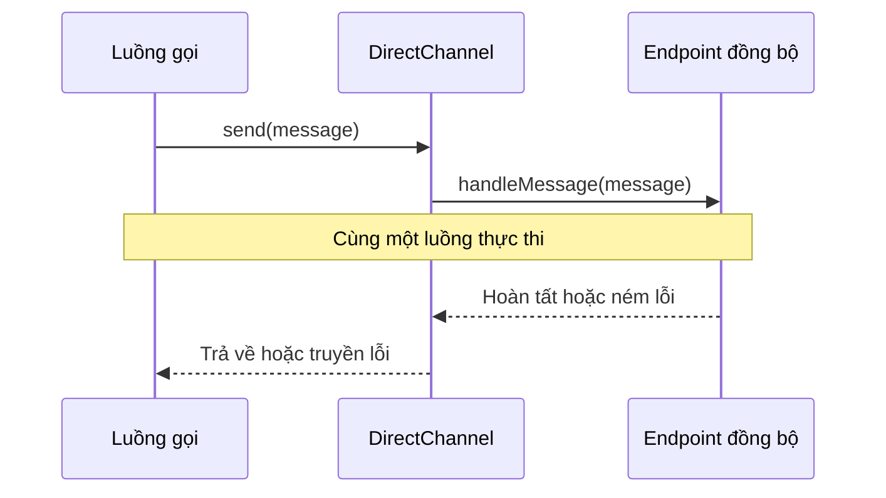
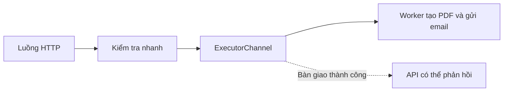

# Khi không nên dùng DirectChannel

Trong module `SPRING_INTEGRATION_CORE`, việc chọn `MessageChannel` là một phần của thiết kế luồng thông điệp: lựa chọn này quyết định bên nào thực thi endpoint, bên gửi phải chờ đến đâu và lỗi đi về đâu. Bài học thuộc chương **DirectChannel**, tập trung vào các yêu cầu khiến cơ chế giao thông điệp trực tiếp không còn phù hợp.

Sau bài học, bạn cần giải thích được vì sao một luồng có `Message`, gateway và Java DSL vẫn có thể chạy hoàn toàn đồng bộ; chọn được ranh giới chuyển luồng hoặc lưu đệm; đồng thời nhận biết những bảo đảm phải thiết kế thêm khi thay channel.

## 1. Hiểu đúng hợp đồng trước khi quyết định thay channel

`DirectChannel` gọi handler trên chính luồng đang thực hiện `send()`. Với một handler xử lý đồng bộ, lời gọi gửi chỉ trở về sau khi handler kết thúc hoặc ném lỗi. Đây là cơ chế point-to-point: thông điệp được giao cho một bên xử lý, thay vì phát đến mọi subscriber. Xem [Javadoc DirectChannel](https://docs.spring.io/spring-integration/api/org/springframework/integration/channel/DirectChannel.html).



Một đoạn mã tối thiểu giúp quan sát hợp đồng đó:

```java
import org.springframework.integration.channel.DirectChannel;
import org.springframework.messaging.support.GenericMessage;

public class DirectChannelThreadDemo {

    public static void main(String[] args) {
        DirectChannel channel = new DirectChannel();

        channel.subscribe(message -> {
            System.out.println("handler: " + Thread.currentThread().getName());
            System.out.println("payload: " + message.getPayload());
        });

        System.out.println("before: " + Thread.currentThread().getName());
        channel.send(new GenericMessage<>("ORDER-814"));
        System.out.println("after: " + Thread.currentThread().getName());
    }
}
```

Khi chạy trực tiếp từ `main`, phần thân handler được gọi giữa hai dòng `before` và `after`, trên luồng `main`. Channel không tạo worker chỉ vì dữ liệu đã được bọc trong `Message`.

Từ cơ chế này có thể suy ra ba hệ quả thiết kế:

- Thời gian chạy của endpoint đồng bộ trở thành một phần thời gian mà bên gửi phải chờ.
- Nếu nhiều luồng cùng gửi, chúng có thể đồng thời đi vào cùng handler. Cùng luồng với từng bên gửi không có nghĩa là toàn ứng dụng chỉ dùng một luồng.
- Một chuỗi transformer, filter, router và service activator nối bằng các channel trực tiếp vẫn có thể nằm trên cùng call stack. Việc tách thành nhiều endpoint chưa tạo ra ranh giới xử lý nền.

Các hệ quả này giải thích các tình huống cần chọn channel khác ở những phần tiếp theo.

## 2. Không dùng làm ranh giới xử lý nền cho công việc chậm

Giả sử API tiếp nhận đơn hàng cần phản hồi trong khoảng 200 ms. Sau bước kiểm tra dữ liệu, hệ thống tạo PDF và gọi dịch vụ email; hai thao tác này có thể mất vài giây.

Nếu controller gọi gateway rồi đi qua `DirectChannel` đến endpoint tạo PDF, luồng phục vụ HTTP phải thực thi công việc đó. Tên bean như `backgroundJobs` hay tên phương thức như `submitAsync` không thay đổi cơ chế gọi.

Trong ví dụ giả định này:

```text
Kiểm tra dữ liệu:        15 ms
Tạo PDF:             1.400 ms
Gọi dịch vụ email:     650 ms
Tổng tối thiểu:      2.065 ms, chưa tính chờ tài nguyên và framework
```

Đưa hai thao tác sau vào các endpoint riêng vẫn giữ tổng thời gian trên đường gọi nếu chưa có ranh giới chuyển luồng.

Khi yêu cầu là giải phóng bên gửi sau lúc bàn giao tác vụ trong cùng tiến trình, có thể dùng `ExecutorChannel` với executor phù hợp. Channel này ủy quyền việc dispatch cho executor; khả năng chạy trên worker phụ thuộc executor được cung cấp. Xem [Javadoc ExecutorChannel](https://docs.spring.io/spring-integration/api/org/springframework/integration/channel/ExecutorChannel.html).



**Bàn giao thành công** và **nghiệp vụ hoàn tất** cần có ý nghĩa riêng. Nếu API phản hồi rằng đơn đã gửi email ngay sau khi executor nhận tác vụ, thông tin trả về có thể sai khi worker thất bại sau đó. Với công việc dài, nên trả mã công việc cùng trạng thái ban đầu như `ACCEPTED`, rồi cập nhật trạng thái khi xử lý kết thúc.

Việc chuyển luồng chỉ giải quyết chỗ thực thi. Nếu công việc phải sống qua lần khởi động lại hoặc được xử lý bởi ứng dụng khác, cần thiết kế nơi lưu bền hay broker như phần 5.

## 3. Không dùng khi cần hấp thụ tải tăng đột biến bằng hàng đợi

Một hệ thống nhập dữ liệu có thể nhận 600 yêu cầu mỗi giây trong 10 giây, trong khi downstream chỉ xử lý 200 yêu cầu mỗi giây. Nếu muốn tiếp nhận toàn bộ đợt tải rồi xử lý dần, cần một nơi giữ phần công việc chưa xử lý.

`DirectChannel` không cung cấp hàng đợi backlog. Khi handler chậm, các luồng gửi bị giữ trên đường gọi; công việc có thể dồn lại ở HTTP server, thread pool hoặc hệ thống nguồn. Dồn tải về phía nguồn có thể là lựa chọn có chủ đích, nhưng không đáp ứng yêu cầu lưu đệm độc lập của bài toán này.

Với số liệu giả định trên, mức tăng backlog xấp xỉ:

```text
(600 - 200) yêu cầu/giây × 10 giây = 4.000 yêu cầu
```

Đây chỉ là phép ước lượng ban đầu, giả sử tốc độ ổn định trong đợt tải. Cần tính thêm kích thước payload, bộ nhớ thực tế, thời gian chờ cho phép và thời gian xử lý hết backlog sau đợt tải.

`QueueChannel` cho phép cấu hình sức chứa. Bên gửi đưa thông điệp vào queue, còn bên nhận lấy ra bằng `receive()`; endpoint tiêu thụ thông thường cần poller. Xem [Javadoc QueueChannel](https://docs.spring.io/spring-integration/api/org/springframework/integration/channel/QueueChannel.html).

Ví dụ đầy đủ về cấu hình một queue trong ứng dụng Spring đã có dependency Spring Integration Core:

```java
import java.time.Duration;

import org.springframework.context.annotation.Bean;
import org.springframework.context.annotation.Configuration;
import org.springframework.integration.channel.QueueChannel;
import org.springframework.integration.config.EnableIntegration;
import org.springframework.integration.dsl.IntegrationFlow;
import org.springframework.integration.dsl.Pollers;

@Configuration
@EnableIntegration
public class BufferedImportConfiguration {

    @Bean
    public QueueChannel importRequests() {
        return new QueueChannel(500);
    }

    @Bean
    public IntegrationFlow importFlow(QueueChannel importRequests) {
        return IntegrationFlow.from(importRequests)
                .handle(String.class, (payload, headers) -> {
                    // Thay bằng thao tác nhập dữ liệu của ứng dụng.
                    System.out.println("Importing " + payload);
                    return null;
                }, endpoint -> endpoint.poller(
                        Pollers.fixedDelay(Duration.ofMillis(100))
                                .maxMessagesPerPoll(5)))
                .get();
    }
}
```

`maxMessagesPerPoll(5)` giới hạn số thông điệp trong một lần poll; giá trị này không tạo năm worker song song. Các con số 500, 100 ms và 5 chỉ minh họa cấu hình, cần được chọn lại theo tải thực tế.

Ở phía gửi, đặt giới hạn chờ khi queue đầy và xử lý kết quả:

```java
boolean accepted = importRequests.send(
        new org.springframework.messaging.support.GenericMessage<>("batch-814"),
        100L);

if (!accepted) {
    // Trả trạng thái quá tải hoặc chuyển sang cơ chế tiếp nhận khác.
    throw new IllegalStateException("Import queue is full");
}
```

Cần có chính sách rõ ràng khi đầy queue: từ chối, chờ có giới hạn hoặc chuyển sang nơi lưu khác. Queue lớn hơn chỉ kéo dài khả năng hấp thụ tải; nếu tốc độ đến luôn cao hơn tốc độ xử lý, hệ thống vẫn tiến tới quá tải.

## 4. Không dùng với kỳ vọng timeout gửi sẽ ngắt handler

Đây là một lỗi thiết kế dễ gặp:

```java
// Không có nghĩa handler phải hoàn tất trong 100 ms.
directChannel.send(message, 100L);
```

Ở lớp nền của `DirectChannel`, `doSend(message, timeout)` dispatch trực tiếp tới handler mà không dùng tham số timeout để tạo bộ hẹn giờ hủy xử lý. Có thể xem [mã nguồn AbstractSubscribableChannel](https://raw.githubusercontent.com/spring-projects/spring-integration/main/spring-integration-core/src/main/java/org/springframework/integration/channel/AbstractSubscribableChannel.java).

Nếu handler gọi một HTTP client đồng bộ trong 5 giây, lời gọi gửi có thể bị giữ tương ứng. Đặt `send(..., 100)` không tự ngắt socket, hủy truy vấn cơ sở dữ liệu hay dừng tác vụ.

Tương tự, `replyTimeout` của gateway không ngắt một endpoint đang chạy trên cùng luồng gọi. Khi flow có ranh giới bất đồng bộ, gateway mới có thể chờ reply với timeout sau khi bàn giao. Xem mục về tiến trình downstream chạy lâu trong [Messaging Gateways](https://docs.spring.io/spring-integration/reference/gateway.html#gateway-behavior-no-response).

Phân biệt ba loại thời gian trong thiết kế:

| Giới hạn | Câu hỏi cần trả lời | Nơi cần cấu hình |
| --- | --- | --- |
| Thời gian chờ được nhận vào queue | Khi quá tải, bên gửi chờ còn chỗ trong bao lâu? | Channel có khả năng lưu đệm và lời gọi gửi |
| Thời gian chờ reply | Sau khi bàn giao, bên gọi chờ kết quả trong bao lâu? | Gateway hoặc thành phần request-reply |
| Thời gian thực thi I/O | Một lần gọi HTTP, JDBC hay dịch vụ ngoài kéo dài tối đa bao lâu? | Client, driver và endpoint thực hiện I/O |

Nếu cần giới hạn thời gian phản hồi của bên gọi độc lập với công việc nền, hãy thiết kế ranh giới bất đồng bộ cùng timeout chờ. Việc bên gọi hết thời gian chờ không tự bảo đảm tác vụ đã bị hủy; tác vụ vẫn có thể hoàn tất hoặc gây tác động nghiệp vụ muộn hơn.

Gateway trả về `void` chỉ thể hiện hợp đồng không trả kết quả nghiệp vụ. Khi nó gửi vào một flow đồng bộ qua `DirectChannel`, bên gọi vẫn thực thi flow đó. Muốn xử lý nền, phải xem cả cấu hình gateway và ranh giới thực thi downstream.

## 5. Không dùng làm cơ chế giao nhận bền hoặc giao tiếp liên tiến trình

Xét yêu cầu: “Sau khi API xác nhận nhận tác vụ, ứng dụng bị dừng đột ngột thì tác vụ vẫn phải được xử lý tiếp”. Một channel gọi handler trong bộ nhớ tiến trình không tự cung cấp cam kết này.

Thay `DirectChannel` bằng queue bộ nhớ hoặc executor cũng chưa giải quyết yêu cầu. Các tác vụ chưa hoàn tất có thể mất khi tiến trình bị kết thúc. Thay đổi đó giải quyết việc bàn giao trong lúc ứng dụng đang sống, chưa tạo một nhật ký giao nhận bền.

Hai hướng cần cân nhắc theo yêu cầu hệ thống:

- Dùng channel dựa trên persistent message store. Với lưu trữ JDBC cho channel, Spring Integration có `JdbcChannelMessageStore`; cần chuẩn bị schema và query provider phù hợp cơ sở dữ liệu. Xem [JDBC Message Store](https://docs.spring.io/spring-integration/reference/jdbc/message-store.html).
- Giao tiếp qua broker hoặc nền tảng thông điệp bên ngoài bằng adapter tương ứng; thiết kế thêm lưu bền, xác nhận giao nhận, phát lại và xử lý trùng theo đặc tính của hệ thống được chọn.

Persistent store cũng cần ranh giới transaction đúng. Chẳng hạn, với transactional store và poller có transaction phù hợp, việc lấy thông điệp khỏi store có thể rollback khi xử lý lỗi. Xem [cấu hình queue có message store](https://docs.spring.io/spring-integration/reference/channel/configuration.html#channel-configuration-queuechannel).

Một tình huống nghiệp vụ cần phân tích riêng:

```text
1. Ghi đơn hàng vào cơ sở dữ liệu thành công.
2. Tiến trình dừng trước khi công bố sự kiện yêu cầu gửi email.
3. Đơn tồn tại nhưng yêu cầu gửi email chưa từng được ghi nhận.
```

Nếu có hai bước ghi độc lập như vậy, đổi channel không tự làm chúng trở thành nguyên tử. Một phương án thiết kế là ghi bản ghi đơn hàng và bản ghi outbox trong cùng transaction cơ sở dữ liệu; một tiến trình khác chuyển bản ghi outbox sang hệ thống thông điệp, kèm cơ chế xử lý trùng.

Với tác vụ có thể giao lại, hãy dùng khóa nghiệp vụ như `orderId` hoặc `jobId` để thiết kế idempotency. Trường hợp worker đã gửi email nhưng chưa ghi được trạng thái hoàn tất cho thấy lưu bền thông điệp vẫn cần đi cùng thiết kế tác động nghiệp vụ.

Nếu producer và consumer chạy ở hai JVM, hai container hoặc hai máy khác nhau, một bean `DirectChannel` chỉ hiện hữu trong một application context không phải đường truyền giữa chúng. Cần adapter và giao thức hoặc broker phù hợp; hai bean trùng tên ở hai tiến trình không kết nối với nhau.

## 6. Không dùng khi một sự kiện phải đi đến nhiều bên nhận

Giả sử sự kiện `OrderCreated` phải đến cả ba nhánh:

```text
OrderCreated
    ├── Gửi thông báo
    ├── Ghi audit
    └── Cập nhật thống kê
```

Nếu ba endpoint cùng subscribe vào một `DirectChannel`, chúng trở thành các bên nhận cạnh tranh cho việc dispatch, thay vì ba nhánh đều nhận mỗi sự kiện. Cấu hình đó dễ dẫn đến hiện tượng một đơn chỉ được audit, đơn khác chỉ được gửi thông báo.

`PublishSubscribeChannel` cung cấp cơ chế gửi đến các subscriber. Có thể tạo channel phát sự kiện và nối các flow nhận vào đó. Xem [Javadoc PublishSubscribeChannel](https://docs.spring.io/spring-integration/api/org/springframework/integration/channel/PublishSubscribeChannel.html).

Ví dụ đoạn cấu hình Java DSL; `notificationService`, `auditService` và `statisticsService` là các bean nghiệp vụ do ứng dụng cung cấp:

```java
@Bean
IntegrationFlow orderCreatedFanOut(
        NotificationService notificationService,
        AuditService auditService,
        StatisticsService statisticsService) {

    return IntegrationFlow.from("orderCreatedEvents")
            .publishSubscribeChannel(subscribers -> subscribers
                    .subscribe(flow -> flow
                            .handle(notificationService, "send"))
                    .subscribe(flow -> flow
                            .handle(auditService, "record"))
                    .subscribe(flow -> flow
                            .handle(statisticsService, "update")))
            .get();
}
```

Fan-out và chạy nền là hai yêu cầu khác nhau. Nếu không cấp executor, channel publish-subscribe vẫn có thể gọi các nhánh đồng bộ; một nhánh chậm tiếp tục ảnh hưởng thời gian xử lý. Lỗi của nhánh cũng cần chính sách riêng, vì việc cấu hình phát tới nhiều subscriber chưa bảo đảm mọi tác động nghiệp vụ đều hoàn tất.

Khi audit bắt buộc phải bền còn thống kê chấp nhận xử lý trễ, nên thiết kế từng nhánh theo yêu cầu của nó. Nếu cần ghép kết quả từ các nhánh bằng aggregator, phải thiết kế correlation, điều kiện giải phóng nhóm và tình huống thiếu reply; riêng channel phát thông điệp không cung cấp các quyết định nghiệp vụ này.

## 7. Không dùng để tự tạo song song, bảo đảm thứ tự toàn cục hoặc chọn nhánh nghiệp vụ

### Nhiều subscriber không tạo thêm worker

Đăng ký nhiều handler trên `DirectChannel` hỗ trợ phân phối công việc giữa các bên nhận, nhưng một bên gửi tuần tự vẫn thực thi từng lần gửi trên chính luồng của nó. Muốn tăng mức đồng thời, cần nguồn gửi có nhiều luồng hoặc một cơ chế thực thi song song có kiểm soát.

Vì nhiều bên gửi có thể cùng đi vào handler, handler cũng cần an toàn khi chạy đồng thời. Ví dụ, một biến instance dùng làm bộ đếm hoặc một collection dùng chung không trở nên an toàn chỉ nhờ nằm sau `DirectChannel`.

### Cùng luồng theo lần gửi không tạo thứ tự chung cho mọi producer

Giả sử hai luồng gửi cập nhật trạng thái của cùng đơn hàng. Luồng A gửi `PAID`, luồng B gửi `CANCELLED`. Thứ tự hoàn thành còn phụ thuộc lịch chạy và thời gian xử lý; không thể suy ra quy tắc nghiệp vụ chỉ từ loại channel.

Nếu cần xử lý tuần tự theo `orderId`, có thể dùng phân vùng theo khóa. Spring Integration cung cấp `PartitionedChannel` từ phiên bản 6.1 để đưa các thông điệp cùng khóa về cùng luồng xử lý. Cơ chế này cần được chọn theo phiên bản và topology thực tế. Xem [phần PartitionedChannel](https://docs.spring.io/spring-integration/reference/channel/implementations.html#channel-implementations-partitionedchannel).

Việc đưa về cùng partition không tự sửa thứ tự sự kiện đã bị đảo từ phía nguồn và không tạo thứ tự toàn cục giữa nhiều instance ứng dụng. Với cập nhật trạng thái quan trọng, có thể cần thêm số phiên bản nghiệp vụ hoặc kiểm tra chuyển trạng thái hợp lệ.

### Load balancing không thay router

Nếu yêu cầu là “đơn quốc tế đi qua kiểm tra hải quan, đơn nội địa đi qua tính phí nội địa”, hãy dùng router và các channel đích rõ ràng. Đăng ký hai handler lên một `DirectChannel` không diễn đạt điều kiện chọn nhánh theo nội dung thông điệp.

### Failover không thay retry có chính sách

Theo cấu hình mặc định, dispatcher có thể thử subscriber tiếp theo khi subscriber trước ném exception; đó là failover giữa các bên nhận. Cần chủ động cấu hình nếu các handler không thể thay thế nhau. Xem [cấu hình DirectChannel và failover](https://docs.spring.io/spring-integration/reference/channel/configuration.html#channel-configuration-directchannel).

Ví dụ nguy hiểm là handler A gọi cổng thanh toán thành công rồi lỗi khi đọc phản hồi; dispatcher thử tiếp handler B và B lại thực hiện thanh toán. Các bên nhận trong kịch bản failover phải có vai trò thay thế phù hợp và cần bảo vệ tác động nghiệp vụ khỏi xử lý trùng.

Nếu muốn một lỗi làm dừng ngay việc dispatch thay vì thử handler khác:

```java
DirectChannel paymentCommands = new DirectChannel();
paymentCommands.setFailover(false);
```

Thiết lập này không tạo retry, lịch thử lại hay hàng đợi lỗi. Các chính sách như chỉ retry lỗi tạm thời, giới hạn số lần, backoff và đưa tác vụ thất bại sang nơi xử lý riêng cần được thiết kế ở thành phần thích hợp.

## 8. Không dùng với giả định lỗi tự động đi vào errorChannel

Khi gửi trực tiếp vào `DirectChannel`, lỗi xử lý còn thoát ra khỏi flow thường truyền về bên gọi qua call stack. Chỉ thêm header `errorChannel` không tự biến lời gọi này thành xử lý lỗi bằng thông điệp. Gateway hoặc advice có thể bổ sung cơ chế bắt và định tuyến lỗi, tùy cấu hình.

Khi xử lý nằm trong tác vụ bất đồng bộ của Spring Integration hoặc trong poller, lỗi có thể được chuyển thành `ErrorMessage` qua cơ chế error handler tương ứng. Luồng lỗi thường tra header `errorChannel`, sau đó tới channel lỗi chung. Xem [Error Handling](https://docs.spring.io/spring-integration/reference/error-handling.html).

Ví dụ giả định: API chỉ cần tiếp nhận công việc gửi email, còn worker sẽ thử gửi sau. Khi chuyển từ direct sang executor, cần thay đổi cả cách quan sát kết quả:

| Tình huống | Bên gửi cần hiểu gì? | Thiết kế tiếp theo |
| --- | --- | --- |
| Không bàn giao được vì executor đầy | Công việc chưa được tiếp nhận qua ranh giới này | Xử lý lỗi từ chối ở phía gọi |
| Worker nhận rồi gọi dịch vụ email thất bại | Lỗi xuất hiện sau lúc bên gửi đã tiếp tục | Xử lý qua flow lỗi hoặc cơ chế theo dõi tác vụ |
| Worker hoàn tất | Có kết quả nghiệp vụ cuối cùng | Cập nhật trạng thái theo `jobId` |
| Bên gọi hết thời gian chờ | Kết quả hiện chưa được bên gọi nhận | Kiểm tra trạng thái và tránh gửi lại mù quáng |

Chỉ bắt exception quanh lệnh gửi của producer sẽ bỏ sót lỗi xảy ra sau đó trên worker. Ngược lại, chỉ đăng ký một flow trên `errorChannel` mà vẫn gửi trực tiếp đồng bộ có thể không bắt được lỗi theo kỳ vọng của người viết.

## 9. Ví dụ tạo ranh giới bất đồng bộ có giới hạn tải

Cấu hình sau dành cho một ứng dụng Spring có dependency Spring Integration Core. Nó nhận payload chuỗi, chuẩn hóa khoảng trắng, loại chuỗi rỗng bằng lỗi, rồi gọi endpoint minh họa trên executor riêng. Trong ứng dụng thực tế, thay phần in console bằng nghiệp vụ gửi thông báo.

```java
import java.util.concurrent.ThreadPoolExecutor;

import org.springframework.beans.factory.annotation.Qualifier;
import org.springframework.context.annotation.Bean;
import org.springframework.context.annotation.Configuration;
import org.springframework.integration.channel.ExecutorChannel;
import org.springframework.integration.config.EnableIntegration;
import org.springframework.integration.dsl.IntegrationFlow;
import org.springframework.scheduling.concurrent.ThreadPoolTaskExecutor;

@Configuration
@EnableIntegration
public class NotificationFlowConfiguration {

    @Bean
    public ThreadPoolTaskExecutor notificationExecutor() {
        ThreadPoolTaskExecutor executor = new ThreadPoolTaskExecutor();
        executor.setCorePoolSize(4);
        executor.setMaxPoolSize(4);
        executor.setQueueCapacity(200);
        executor.setThreadNamePrefix("notification-");
        executor.setRejectedExecutionHandler(
                new ThreadPoolExecutor.AbortPolicy());
        return executor;
    }

    @Bean
    public ExecutorChannel notificationRequests(
            @Qualifier("notificationExecutor")
            ThreadPoolTaskExecutor executor) {
        return new ExecutorChannel(executor);
    }

    @Bean
    public IntegrationFlow notificationFlow(
            ExecutorChannel notificationRequests) {
        return IntegrationFlow.from(notificationRequests)
                .<String, String>transform(String::trim)
                .filter(String.class, text -> !text.isEmpty(),
                        endpoint -> endpoint.throwExceptionOnRejection(true))
                .handle(String.class, (text, headers) -> {
                    System.out.println("Sending " + text + " on "
                            + Thread.currentThread().getName());
                    return null;
                })
                .get();
    }
}
```

Executor được khai báo là Spring bean nên lifecycle khởi tạo và hủy do container quản lý. `ThreadPoolTaskExecutor` cho phép cấu hình kích thước pool, sức chứa queue và chính sách từ chối. Xem [Javadoc ThreadPoolTaskExecutor](https://docs.spring.io/spring-framework/docs/current/javadoc-api/org/springframework/scheduling/concurrent/ThreadPoolTaskExecutor.html).

Các quyết định trong ví dụ cần được đọc theo hợp đồng nghiệp vụ:

- Bốn worker giới hạn mức đồng thời của executor này; queue giữ tối đa 200 tác vụ đang chờ, ngoài các tác vụ đang chạy.
- `AbortPolicy` từ chối tác vụ khi hết khả năng tiếp nhận. Phía gọi cần xử lý lỗi từ chối, chẳng hạn trả phản hồi quá tải phù hợp.
- Transformer và filter nằm sau channel executor. Vì vậy, lỗi payload rỗng ở đây xảy ra trong giai đoạn xử lý nền. Nếu API phải từ chối dữ liệu sai trước khi xác nhận tiếp nhận, chuyển bước kiểm tra đó về trước ranh giới executor.
- Ví dụ chưa lưu bền tác vụ. Không thể dùng nó để cam kết phục hồi mọi công việc sau khi tiến trình chết.

Nếu thay chính sách từ chối bằng `CallerRunsPolicy`, khi quá tải, tác vụ có thể quay lại chạy trên luồng gửi. Điều này làm thay đổi thời gian phản hồi và mức cách ly mong muốn. Tương tự, cấp một executor chạy đồng bộ không tạo ra ranh giới worker thực sự. Đặc tính này được giải thích trong [phần ExecutorChannel](https://docs.spring.io/spring-integration/reference/channel/implementations.html#channel-implementations-executorchannel).

## 10. Chỉ đổi channel sau khi xác định transaction và context

Một lý do hợp lệ để giữ `DirectChannel` là cần xử lý đồng bộ trong phạm vi transaction của bên gọi. Tuy nhiên, cùng luồng chỉ tạo điều kiện cho việc tham gia transaction; còn phải có transaction đang hoạt động, transaction manager và tài nguyên tham gia phù hợp.

Khi chuyển sang một executor chạy worker, không được tiếp tục giả định transaction gắn với luồng gọi tự đi sang handler. Ví dụ:

```text
Luồng gọi:
    mở transaction A
    ghi trạng thái đơn hàng
    bàn giao thông điệp cho worker
    rollback transaction A

Worker:
    vẫn có thể đã nhận thông điệp và thực thi một tác động khác
```

Để giải quyết, cần chọn ranh giới nghiệp vụ rõ ràng: xử lý đồng bộ trong transaction thích hợp, công bố sau commit, hoặc dùng outbox nếu yêu cầu còn bao gồm khả năng phục hồi khi tiến trình dừng. Việc chỉ công bố sau commit vẫn cần phân tích khoảng trống xảy ra sự cố trước lúc công bố.

Ngoài transaction, các dữ liệu thường gắn với luồng như MDC, security context và thông tin request cũng cần được xem xét khi chuyển sang worker. Nên đưa metadata cần thiết và được phép truyền vào message headers; nếu dùng cơ chế truyền context của executor, cấu hình và xác nhận nó theo nhu cầu ứng dụng.

Tránh đưa một đối tượng entity đang phụ thuộc session hoặc một payload mutable dùng chung sang worker rồi tiếp tục sửa ở phía gửi. Một DTO có dữ liệu cần thiết, kèm khóa nghiệp vụ, thường làm hợp đồng bàn giao rõ ràng hơn.

## 11. Không dùng như cơ chế Reactive Streams backpressure

`DirectChannel` gọi endpoint theo cơ chế imperative. Việc producer bị giữ vì handler chậm tạo ra áp lực ngược trên đường gọi đồng bộ, nhưng không đồng nghĩa có giao thức `request(n)` của Reactive Streams.

Nếu bài toán yêu cầu consumer điều tiết nhu cầu nhận dữ liệu bằng Reactive Streams, hãy xem xét `FluxMessageChannel` và các endpoint reactive phù hợp. Chỉ đặt một channel reactive vào giữa nhiều thao tác I/O blocking chưa làm toàn bộ luồng trở thành non-blocking. Xem [Reactive Streams Support](https://docs.spring.io/spring-integration/reference/reactive-streams.html).

Quyết định cần xuất phát từ nguồn dữ liệu, loại client downstream và cách quản lý nhu cầu nhận. Không nên thay mọi `DirectChannel` bằng channel reactive chỉ vì hệ thống cần xử lý nhiều yêu cầu đồng thời.

## 12. Bảng chọn giải pháp theo yêu cầu

Bảng này là công cụ ra quyết định thiết kế. Những giới hạn nêu kèm phải được đưa vào hợp đồng tiếp nhận và xử lý của hệ thống.

| Yêu cầu chính | Hướng lựa chọn | Điều cần thiết kế thêm |
| --- | --- | --- |
| Xử lý nhanh, đồng bộ trong tiến trình | `DirectChannel` | Thời gian I/O, thread safety, đường truyền lỗi |
| Bàn giao sang worker trong cùng tiến trình | `ExecutorChannel` với executor phù hợp | Giới hạn pool/queue, từ chối, lỗi nền, trạng thái tác vụ |
| Giữ backlog để xử lý dần | `QueueChannel` có sức chứa | Poller, tải tối đa, thời gian chờ, chính sách khi đầy |
| Tác vụ tồn tại qua restart | Persistent channel store hoặc hệ thống thông điệp có lưu bền | Transaction, xác nhận, phát lại, xử lý trùng |
| Một sự kiện đến nhiều nhánh | `PublishSubscribeChannel` hoặc fan-out qua broker | Cách ly các nhánh, lỗi từng nhánh, yêu cầu lưu bền |
| Chọn nhánh theo nội dung | Router và các channel đích | Trường hợp không khớp và đường đi mặc định |
| Tuần tự theo khóa trong phạm vi phù hợp | `PartitionedChannel` hoặc cơ chế partition của hệ thống nguồn | Phiên bản, khóa partition, nhiều instance, thứ tự tại nguồn |
| Điều tiết nhu cầu theo Reactive Streams | `FluxMessageChannel` và thành phần reactive | I/O blocking, scheduler, xử lý lỗi và nhu cầu nhận |
| Giao tiếp giữa các ứng dụng | Adapter, gateway giao thức hoặc broker | Hợp đồng dữ liệu, timeout, bảo mật kết nối, giao nhận |

Các phương án có thể xuất hiện trong cùng một flow: giữ direct cho kiểm tra dữ liệu và biến đổi nhanh, dùng ranh giới lưu bền để tiếp nhận công việc, rồi tiếp tục direct giữa các endpoint trong từng worker.

## 13. Kiểm chứng hợp đồng bằng các ví dụ nhỏ

Các ví dụ JUnit 5 dưới đây tập trung vào hành vi cần hiểu khi chọn channel. Chúng cần Spring Integration Core và JUnit Jupiter trên classpath; các assertion không dựa vào việc ngủ một số mili giây rồi đoán thứ tự thread.

```java
import java.util.concurrent.atomic.AtomicInteger;
import java.util.concurrent.atomic.AtomicReference;

import org.junit.jupiter.api.Test;
import org.springframework.integration.channel.DirectChannel;
import org.springframework.integration.channel.QueueChannel;
import org.springframework.messaging.MessagingException;
import org.springframework.messaging.support.GenericMessage;

import static org.junit.jupiter.api.Assertions.*;

class DirectChannelContractTest {

    @Test
    void handlerRunsOnTheSendingThreadBeforeSendReturns() {
        DirectChannel channel = new DirectChannel();
        Thread caller = Thread.currentThread();
        AtomicReference<Thread> handlerThread = new AtomicReference<>();

        channel.subscribe(message ->
                handlerThread.set(Thread.currentThread()));

        assertTrue(channel.send(new GenericMessage<>("ORDER-814")));
        assertSame(caller, handlerThread.get());
    }

    @Test
    void successfulDispatchDoesNotBroadcastToBothSubscribers() {
        DirectChannel channel = new DirectChannel();
        AtomicInteger firstCalls = new AtomicInteger();
        AtomicInteger secondCalls = new AtomicInteger();

        channel.subscribe(message -> firstCalls.incrementAndGet());
        channel.subscribe(message -> secondCalls.incrementAndGet());

        channel.send(new GenericMessage<>("OrderCreated"));

        assertEquals(1, firstCalls.get() + secondCalls.get());
    }

    @Test
    void handlerFailureReachesTheSynchronousSender() {
        DirectChannel channel = new DirectChannel();
        channel.setFailover(false);
        channel.subscribe(message -> {
            throw new IllegalStateException("Email provider unavailable");
        });

        assertThrows(MessagingException.class,
                () -> channel.send(new GenericMessage<>("ORDER-814")));
    }

    @Test
    void boundedQueueCanAcceptBeforeAnyConsumerReceives() {
        QueueChannel channel = new QueueChannel(1);

        assertTrue(channel.send(new GenericMessage<>("first"), 0));
        assertFalse(channel.send(new GenericMessage<>("second"), 0));
        assertEquals("first", channel.receive(0).getPayload());
    }
}
```

Khi đưa thiết kế sang worker hoặc lưu bền, cần quan sát các tình huống tương ứng:

| Tình huống kiểm chứng | Dấu hiệu mong đợi |
| --- | --- |
| Executor chưa quá tải | Handler chạy trên worker theo cấu hình; kết quả được theo dõi độc lập |
| Pool và queue executor đều đầy | Từ chối có thể quan sát ở bên gọi, không im lặng mất tác vụ |
| Worker ném lỗi sau khi tiếp nhận | Có bản ghi lỗi hoặc trạng thái thất bại gắn với `jobId` |
| Queue không còn sức chứa | Producer tuân thủ thời gian chờ và chính sách quá tải |
| Tiến trình dừng giữa công việc | Khả năng phục hồi khớp với store hoặc broker đã cấu hình |
| Hai tác vụ cùng khóa đến đồng thời | Thứ tự và ràng buộc trạng thái khớp với hợp đồng nghiệp vụ |

Đây là những hành vi cần kiểm chứng trong ứng dụng thực tế; đoạn cấu hình channel riêng lẻ chưa chứng minh được chúng.

## 14. Bài tập áp dụng: tách luồng tiếp nhận đơn hàng

Một API hiện chạy flow sau:

```text
Gateway
  → DirectChannel
  → Filter kiểm tra đơn
  → Transformer chuẩn hóa dữ liệu
  → Lưu đơn hàng
  → Tạo hóa đơn PDF
  → Gửi email
```

Yêu cầu mới: dữ liệu sai phải bị từ chối ngay; sau khi trả trạng thái tiếp nhận, công việc tạo hóa đơn phải có khả năng phục hồi; email lỗi không được làm mất thông tin đơn hàng.

Hãy xác định chỗ cần giữ direct và chỗ cần tạo ranh giới khác trước khi viết cấu hình. Một hướng giải quyết có thể là:

```text
Luồng tiếp nhận đồng bộ:
    Gateway
      → DirectChannel
      → Filter/Transformer nhanh
      → Transaction ghi đơn hàng và bản ghi outbox
      → Trả orderId cùng trạng thái tiếp nhận sau commit

Luồng công việc:
    Bộ chuyển outbox
      → Hệ thống thông điệp có lưu bền
      → Worker tạo hóa đơn
      → Cập nhật trạng thái theo orderId
      → Gửi email với chính sách retry và xử lý trùng
```

Ở đây, `DirectChannel` tiếp tục phục vụ các bước đồng bộ ngắn và cần phản hồi trực tiếp. Ranh giới outbox cùng hệ thống thông điệp được bổ sung để đáp ứng hợp đồng tiếp nhận và phục hồi của công việc dài.

Để hoàn thiện lời giải, hãy mô tả cách xử lý ba sự cố: bộ chuyển outbox công bố cùng bản ghi hai lần; worker tạo PDF thành công rồi dừng trước khi cập nhật trạng thái; dịch vụ email trả lỗi tạm thời nhiều lần. Với mỗi sự cố, chỉ rõ khóa nghiệp vụ, nơi giữ trạng thái và điều kiện được phép thử lại.
