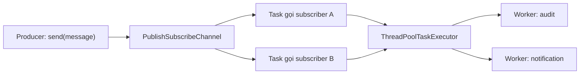

# TaskExecutor cho publish-subscribe

Trong chương **PublishSubscribeChannel** của module **SPRING_INTEGRATION_CORE**, bài này giải thích cách điều khiển việc thực thi các nhánh của một luồng thông điệp bằng `TaskExecutor`. Tình huống xuyên suốt là phát sự kiện tạo đơn hàng cho hai subscriber độc lập: ghi dấu vết kiểm toán và gửi thông báo.

Sau bài học, bạn có thể:

- Phân biệt broadcast đồng bộ với broadcast qua executor.
- Cấu hình `ThreadPoolTaskExecutor` và gắn vào `PublishSubscribeChannel` hoặc Java DSL.
- Giải thích ý nghĩa của `send()`, lỗi bất đồng bộ, tình trạng quá tải và thứ tự xử lý.
- Thiết kế payload, retry và kiểm thử phù hợp với việc nhiều nhánh chạy đồng thời.

## 1. TaskExecutor thay đổi điều gì?

`PublishSubscribeChannel` phân phối một thông điệp tới các subscriber đang đăng ký. Executor quyết định cách các lời gọi handler được thực thi; nó không thay đổi broadcast thành cơ chế chọn một subscriber.

Không truyền executor:

```java
PublishSubscribeChannel events = new PublishSubscribeChannel();
```

Các handler được gọi trên luồng gửi. Khi các nhánh không tạo thêm ranh giới bất đồng bộ, một handler chậm sẽ giữ luồng gửi trong lúc xử lý.

Truyền executor:

```java
PublishSubscribeChannel events = new PublishSubscribeChannel(executor);
```

Channel giao việc gọi từng subscriber cho executor. Với thread pool phù hợp, các subscriber có thể chạy đồng thời trên các worker khác nhau. Đây là cơ chế được mô tả trong [cấu hình PublishSubscribeChannel](https://docs.spring.io/spring-integration/reference/channel/configuration.html#channel-configuration-publishsubscribechannel).

Tên `TaskExecutor` không tự bảo đảm có luồng mới. `SyncTaskExecutor` vẫn chạy trên luồng gọi; `ThreadPoolTaskExecutor` sử dụng thread pool. Constructor của channel nhận `java.util.concurrent.Executor`, nên một `TaskExecutor` của Spring có thể được truyền vào đó. Xem [TaskExecutor trong Spring Framework](https://docs.spring.io/spring-framework/reference/integration/scheduling.html#scheduling-task-executor).

| Cấu hình | Nơi chạy handler | Hệ quả cần nhớ |
| --- | --- | --- |
| Không có executor | Luồng gửi | Các lời gọi handler nối tiếp trên luồng này |
| `SyncTaskExecutor` | Luồng gửi | Có executor nhưng vẫn đồng bộ |
| `ThreadPoolTaskExecutor` | Thường là worker của pool | Có thể thực thi song song nếu còn tài nguyên |
| Pool dùng `CallerRunsPolicy` | Có thể là luồng gửi khi bão hòa | Độ trễ phía gửi thay đổi theo tải |

Không cần thêm `@Async` hoặc `@EnableAsync` chỉ để channel sử dụng executor được truyền qua constructor.

## 2. Một message tạo ra nhiều công việc

Với hai subscriber, channel tạo công việc phân phối riêng cho từng subscriber:



Hàng đợi trong sơ đồ là hàng đợi công việc của executor. `PublishSubscribeChannel` vẫn là channel kiểu subscribable; bạn không thêm poller chỉ vì đã cấu hình thread pool.

Phạm vi một task bao gồm lời gọi handler và phần downstream chạy đồng bộ tiếp theo. Ví dụ, subscriber là một subflow gồm transformer rồi service activator thì worker có thể thực thi cả hai endpoint. Chỉ khi gặp ranh giới bất đồng bộ tiếp theo, phần xử lý sau đó mới được giao sang cơ chế khác.

Cơ chế tách công việc theo subscriber được thể hiện trong [BroadcastingDispatcher của Spring Integration](https://github.com/spring-projects/spring-integration/blob/main/spring-integration-core/src/main/java/org/springframework/integration/dispatcher/BroadcastingDispatcher.java).

### Ba mốc thời gian khác nhau

Với sự kiện `OrderCreated`, hãy phân biệt:

1. Producer gửi message.
2. Executor chấp nhận các task phân phối.
3. Từng subscriber hoàn thành nghiệp vụ.

Trong luồng bất đồng bộ, `send()` trả về `true` không phải là xác nhận nghiệp vụ của tất cả subscriber. Một handler có thể hoàn thành rất nhanh trước khi `send()` trả về; handler khác có thể vẫn đang chờ trong queue hoặc đang chạy.

Nếu cần phản hồi “mọi nhánh đã thành công”, bạn phải thiết kế một luồng thu thập kết quả và điều kiện hoàn tất riêng. Việc thêm executor không tự cung cấp cơ chế đó.

## 3. Ví dụ Java Configuration

Ví dụ dùng Java 17 trở lên với Spring Integration 6.x và Spring Framework tương thích do dự án quản lý. Cần các thư viện `spring-integration-core`, `spring-context` và thư viện liên quan được quản lý cùng phiên bản; trong ứng dụng Spring Boot có thể dùng `spring-boot-starter-integration`.

Lớp sau là một cấu hình độc lập. Hai handler chỉ ghi log để quan sát; nhánh notification cố ý ném lỗi nếu tổng tiền âm để có thể thử đường xử lý lỗi.

```java
import java.math.BigDecimal;
import java.util.concurrent.ThreadPoolExecutor;
import java.util.logging.Level;
import java.util.logging.Logger;

import org.springframework.beans.factory.annotation.Qualifier;
import org.springframework.context.annotation.Bean;
import org.springframework.context.annotation.Configuration;
import org.springframework.integration.annotation.ServiceActivator;
import org.springframework.integration.channel.DirectChannel;
import org.springframework.integration.channel.PublishSubscribeChannel;
import org.springframework.integration.config.EnableIntegration;
import org.springframework.messaging.MessageChannel;
import org.springframework.messaging.MessageHandler;
import org.springframework.scheduling.concurrent.ThreadPoolTaskExecutor;

@Configuration(proxyBeanMethods = false)
@EnableIntegration
public class OrderFanOutConfig {

    private static final Logger LOG =
            Logger.getLogger(OrderFanOutConfig.class.getName());

    public record OrderCreated(
            String eventId,
            String orderId,
            BigDecimal total) {
    }

    @Bean
    public ThreadPoolTaskExecutor orderFanOutExecutor() {
        ThreadPoolTaskExecutor executor = new ThreadPoolTaskExecutor();
        executor.setCorePoolSize(4);
        executor.setMaxPoolSize(8);
        executor.setQueueCapacity(64);
        executor.setThreadNamePrefix("order-fanout-");
        executor.setRejectedExecutionHandler(
                new ThreadPoolExecutor.AbortPolicy());
        executor.setWaitForTasksToCompleteOnShutdown(true);
        executor.setAwaitTerminationSeconds(15);
        return executor;
    }

    @Bean
    public PublishSubscribeChannel orderEvents(
            @Qualifier("orderFanOutExecutor")
            ThreadPoolTaskExecutor executor) {

        return new PublishSubscribeChannel(executor, true);
    }

    @Bean
    public MessageChannel orderEventErrors() {
        return new DirectChannel();
    }

    @Bean
    @ServiceActivator(inputChannel = "orderEvents")
    public MessageHandler auditOrder() {
        return message -> {
            OrderCreated event = (OrderCreated) message.getPayload();

            LOG.info(() -> "audit eventId=" + event.eventId()
                    + ", orderId=" + event.orderId()
                    + ", thread=" + Thread.currentThread().getName());
        };
    }

    @Bean
    @ServiceActivator(inputChannel = "orderEvents")
    public MessageHandler notifyCustomer() {
        return message -> {
            OrderCreated event = (OrderCreated) message.getPayload();

            if (event.total().signum() < 0) {
                throw new IllegalArgumentException(
                        "Total must not be negative: " + event.eventId());
            }

            LOG.info(() -> "notify eventId=" + event.eventId()
                    + ", orderId=" + event.orderId()
                    + ", thread=" + Thread.currentThread().getName());
        };
    }

    @Bean
    @ServiceActivator(inputChannel = "orderEventErrors")
    public MessageHandler recordOrderFailure() {
        return message -> {
            Throwable failure = (Throwable) message.getPayload();
            LOG.log(Level.SEVERE, "Order subscriber failed", failure);
        };
    }
}
```

Các điểm cần đọc đúng:

- `@EnableIntegration` đăng ký hạ tầng Spring Integration trong ví dụ không dựa vào tự cấu hình của Boot.
- `@ServiceActivator` đăng ký hai endpoint cùng nhận từ `orderEvents`.
- Đối số `true` trong constructor yêu cầu channel phải có subscriber khi gửi. Nó không yêu cầu mọi subscriber xử lý thành công.
- Pool là Spring bean nên Spring thực hiện khởi tạo và quản lý vòng đời. Không gọi thêm `initialize()` trong phương thức `@Bean` này.
- `eventId` là định danh nghiệp vụ ổn định của sự kiện; nó sẽ hữu ích khi retry.

Ý nghĩa của constructor và tùy chọn `requireSubscribers` được nêu trong [API PublishSubscribeChannel](https://docs.spring.io/spring-integration/api/org/springframework/integration/channel/PublishSubscribeChannel.html).

### Gửi một sự kiện

Đoạn sau đặt bên trong một phương thức đã có `ApplicationContext context`. Nó tạo message và chỉ rõ kênh nhận lỗi cho sự kiện này:

```java
import java.math.BigDecimal;

import org.springframework.messaging.Message;
import org.springframework.messaging.MessageChannel;
import org.springframework.messaging.support.MessageBuilder;

// Bên trong phương thức sử dụng ApplicationContext:
MessageChannel events =
        context.getBean("orderEvents", MessageChannel.class);
MessageChannel failures =
        context.getBean("orderEventErrors", MessageChannel.class);

Message<OrderFanOutConfig.OrderCreated> message =
        MessageBuilder.withPayload(
                new OrderFanOutConfig.OrderCreated(
                        "evt-1001",
                        "order-42",
                        new BigDecimal("250000")))
                .setErrorChannel(failures)
                .setHeader("traceId", "trace-1001")
                .build();

boolean dispatched = events.send(message);
```

Kỳ vọng là có hai log tương ứng audit và notify, thường mang tên luồng bắt đầu bằng `order-fanout-`. Không dựa vào thứ tự hai dòng log để suy ra thứ tự nghiệp vụ.

Thay tổng tiền thành `new BigDecimal("-1")` để thử lỗi của notification. Với tài nguyên executor còn đủ, audit vẫn có thể chạy; lỗi notification được chuyển vào `orderEventErrors`. Giá trị `dispatched` không trở thành `false` chỉ vì notification thất bại sau đó.

## 4. Biểu diễn bằng Java DSL

Nếu thích nhìn rõ từng nhánh trong cùng một flow, có thể dùng `publishSubscribeChannel(executor, ...)`.

Đoạn sau là **phương án thay thế** cho các bean `orderEvents`, `auditOrder` và `notifyCustomer` ở cấu hình trước. Giữ lại bean executor, bean xử lý lỗi và record `OrderCreated`. Đặt phương thức này trong cùng lớp cấu hình, cùng biến `LOG`:

```java
import org.springframework.integration.dsl.IntegrationFlow;

@Bean
public IntegrationFlow orderEventsFlow(
        @Qualifier("orderFanOutExecutor")
        ThreadPoolTaskExecutor executor) {

    return IntegrationFlow.from("orderEvents")
            .publishSubscribeChannel(executor, subscribers -> subscribers
                    .subscribe(flow -> flow.handle(message -> {
                        OrderCreated event =
                                (OrderCreated) message.getPayload();
                        LOG.info("audit eventId=" + event.eventId());
                    }))
                    .subscribe(flow -> flow.handle(message -> {
                        OrderCreated event =
                                (OrderCreated) message.getPayload();

                        if (event.total().signum() < 0) {
                            throw new IllegalArgumentException(
                                    "Total must not be negative");
                        }

                        LOG.info("notify eventId=" + event.eventId());
                    })))
            .get();
}
```

Trong biến thể này, `orderEvents` là channel đầu vào được DSL tạo khi chưa có bean cùng tên; điểm broadcast nằm ở `publishSubscribeChannel(...)` phía sau. Mỗi `subscribe(...)` khai báo một subflow nhận sự kiện.

Overload nhận executor được mô tả trong [API Java DSL](https://docs.spring.io/spring-integration/api/org/springframework/integration/dsl/BaseIntegrationFlowDefinition.html#publishSubscribeChannel(java.util.concurrent.Executor,java.util.function.Consumer)).

Nếu cần transformer hoặc filter, đặt chúng trong nhánh tương ứng:

```java
.subscribe(flow -> flow
        .<OrderCreated>filter(event -> event.total().signum() > 0)
        .<OrderCreated, String>transform(
                event -> "Order " + event.orderId() + " was created")
        .handle(message -> LOG.info((String) message.getPayload())))
```

Đây là một mảnh thay thế cho một lời gọi `subscribe` trong DSL trên. Filter chỉ ảnh hưởng nhánh chứa nó. Nếu filter loại message, nhánh đó không tạo ra kết quả; điều này cần được tính đến khi thiết kế aggregator.

Đặt nhiều endpoint nối tiếp trong một subflow sẽ tạo chuỗi xử lý trong nhánh đó. Muốn một handler luôn chạy sau handler khác, hãy thể hiện phụ thuộc bằng chuỗi endpoint, thay vì kỳ vọng hai subscriber của broadcast tự chờ nhau.

## 5. Chọn pool và queue theo tải fan-out

`ThreadPoolTaskExecutor` bọc thread pool với các thuộc tính như `corePoolSize`, `maxPoolSize` và `queueCapacity`. Mặc định của nó không phải là cấu hình nhiều worker với queue hữu hạn, vì vậy cần đặt rõ các giá trị theo mục tiêu của luồng. Tham khảo [API ThreadPoolTaskExecutor](https://docs.spring.io/spring-framework/docs/current/javadoc-api/org/springframework/scheduling/concurrent/ThreadPoolTaskExecutor.html).

Với cấu hình `core = 4`, `max = 8`, `queue = 64`, khi mọi task đang chạy đều còn bận:

1. Pool tạo worker đến kích thước core khi cần.
2. Sau đó các task mới được xếp vào queue khi queue còn chỗ.
3. Khi queue đầy, pool mới có thể tăng số worker vượt core đến max.
4. Khi cả pool và queue đều hết khả năng nhận việc, chính sách từ chối được áp dụng.

Đây là thứ tự tiếp nhận công việc của [ThreadPoolExecutor](https://docs.oracle.com/en/java/javase/17/docs/api/java.base/java/util/concurrent/ThreadPoolExecutor.html). Chỉ tăng `maxPoolSize` có thể không cải thiện độ trễ nếu queue lớn khiến pool tiếp tục xếp hàng ở kích thước core.

### Tính theo task, không chỉ theo message

Giả sử một bài toán đo được:

- 100 sự kiện mỗi giây.
- Hai subscriber luôn nhận mỗi sự kiện.
- Audit chiếm worker trung bình 20 ms.
- Notification chiếm worker trung bình 80 ms.

Tải chiếm worker ước tính:

```text
Task được gửi vào pool mỗi giây ≈ 100 × 2 = 200 task/giây

Thời gian chiếm worker cho một sự kiện:
20 ms + 80 ms = 100 ms

Mức đồng thời trung bình cần để theo kịp tải:
100 sự kiện/giây × 0,1 giây/sự kiện ≈ 10 worker
```

Đây là ước lượng cho ví dụ, không phải công thức chọn pool duy nhất. Pool có max 8 sẽ không theo kịp mức tải giả định nếu thời gian xử lý giữ nguyên. Queue chỉ trì hoãn thời điểm bão hòa; nó không tăng năng lực xử lý dài hạn.

Khi chọn cấu hình, tiếp tục xem xét:

| Yếu tố | Câu hỏi thực tế |
| --- | --- |
| CPU | Handler có đang tính toán nặng trên số lõi hữu hạn không? |
| Dịch vụ bên ngoài | API đích có giới hạn số request đồng thời hoặc timeout không? |
| Database | Pool connection có đủ cho số worker có thể truy cập DB không? |
| Bộ nhớ | Task chờ có giữ tham chiếu tới payload lớn không? |
| Độ trễ | Queue cho phép sự kiện chờ lâu đến mức nào? |
| Lưu lượng tăng đột biến | Hệ thống cần hấp thụ đỉnh tải trong bao lâu? |

Tăng worker vượt giới hạn của dịch vụ downstream có thể làm hệ thống chậm hơn vì tranh chấp hoặc timeout.

## 6. Quá tải và phân phối một phần

Ví dụ chính dùng `AbortPolicy` để việc từ chối được biểu hiện thành lỗi thay vì bỏ task im lặng. Với `ThreadPoolTaskExecutor`, lỗi từ chối tuân theo hợp đồng `TaskRejectedException` của Spring; khi đi qua message channel, caller có thể gặp ngoại lệ messaging bao ngoài. Đừng gắn logic nghiệp vụ vào giả định chỉ có đúng một lớp exception ngoài cùng.

Các chính sách thường gặp:

| Chính sách | Khi không nhận thêm được việc | Ảnh hưởng đến luồng |
| --- | --- | --- |
| `AbortPolicy` | Ném lỗi từ chối | Caller có cơ hội nhận biết việc giao task thất bại |
| `CallerRunsPolicy` | Caller thực thi task khi executor còn hoạt động | Producer bị chậm lại vì phải xử lý việc |
| `DiscardPolicy` | Bỏ task mới | Có thể mất xử lý của một subscriber mà caller không nhận lỗi |
| `DiscardOldestPolicy` | Loại task cũ đang chờ rồi thử nhận task mới | Có thể làm thiếu một nhánh của sự kiện trước đó |

Hành vi khi bão hòa và lựa chọn `CallerRunsPolicy` được giải thích trong [cấu hình executor của Spring Framework](https://docs.spring.io/spring-framework/reference/integration/scheduling.html#scheduling-task-namespace-executor).

`CallerRunsPolicy` khiến handler có thể chạy trên luồng producer. Vì vậy, một flow đã cấu hình executor vẫn có thể giữ luồng HTTP trong lúc xử lý khi tải cao. Chính sách này cũng không bảo đảm nhận task sau khi executor đã shutdown.

### Vì sao retry toàn bộ message có thể gây trùng?

Hãy xét channel có subscriber A, B và C:

```text
Task A được executor chấp nhận.
Task B được executor chấp nhận.
Task C bị từ chối vì pool và queue đã đầy.
send(message) phát sinh lỗi.
A và B vẫn có thể tiếp tục chạy.
```

Broadcast không cung cấp một giao dịch nguyên tử cho việc submit tất cả các task. Lỗi khi giao task C không tự hủy hoặc hoàn tác A và B.

Nếu producer gửi lại toàn bộ sự kiện, A và B có thể chạy lần nữa. Khi cần retry, hãy thiết kế mỗi subscriber idempotent, chẳng hạn dùng khóa:

```text
(eventId, subscriberName)

(evt-1001, audit)
(evt-1001, notification)
```

Khóa gồm tên subscriber giúp mỗi nhánh được xử lý một lần theo ý nghĩa nghiệp vụ riêng; một bản ghi “event đã xử lý” dùng chung có thể khiến nhánh này vô tình ngăn nhánh khác làm việc.

Việc ghi nhận khóa và cập nhật dữ liệu của một nhánh nên nằm trong cùng transaction khi cùng dùng một database. Với tác động bên ngoài như gửi email, cần cơ chế idempotency của dịch vụ đích hoặc thiết kế lưu trạng thái gửi phù hợp.

## 7. Tách lỗi giao task khỏi lỗi trong handler

Hai nhóm lỗi xảy ra ở hai thời điểm khác nhau:

| Nhóm lỗi | Ví dụ | Hướng quan sát |
| --- | --- | --- |
| Lỗi giao việc | Không có subscriber khi bắt buộc phải có; executor từ chối task | Có thể phát sinh trong lời gọi `send()` |
| Lỗi xử lý | Subscriber ném lỗi trên worker | Đi qua cơ chế xử lý lỗi của channel |

Khi có executor, `PublishSubscribeChannel` mặc định sử dụng `MessagePublishingErrorHandler`. Nó gửi `ErrorMessage` tới channel trong header `errorChannel` của message gốc; nếu không có thì dùng bean toàn cục `errorChannel`. Khi không cấu hình executor, `ErrorHandler` của channel không được dùng theo cách này và lỗi handler được ném trên luồng gửi. Xem [xử lý lỗi của PublishSubscribeChannel](https://docs.spring.io/spring-integration/api/org/springframework/integration/channel/PublishSubscribeChannel.html#setErrorHandler(org.springframework.util.ErrorHandler)).

### Vì sao try/catch quanh send() chưa đủ?

```java
try {
    events.send(message);
} catch (RuntimeException ex) {
    // Có thể xử lý lỗi phát sinh trong quá trình gửi/giao task.
    // Không phải điểm nhận mọi lỗi xảy ra sau đó trên worker.
}
```

Stack gọi của producer không còn chờ kết quả nghiệp vụ của worker. Để quan sát lỗi xử lý, phải có consumer cho kênh lỗi. `ErrorMessage` có payload là `Throwable`; ngoại lệ messaging thường cung cấp `failedMessage` để truy ngược message gây lỗi. Cơ chế này được mô tả trong [Error Handling của Spring Integration](https://docs.spring.io/spring-integration/reference/error-handling.html).

Trong ví dụ, `orderEventErrors` là `DirectChannel`. Handler ghi lỗi chạy đồng bộ trên luồng đang gửi lỗi, thường chính là worker gặp lỗi. Nếu thao tác ghi lỗi chậm, nó cũng chiếm worker. Nếu cần tách việc xử lý lỗi, hãy thiết kế thêm ranh giới bất đồng bộ và năng lực tiếp nhận riêng cho luồng lỗi.

Ví dụ chỉ ghi log để dễ quan sát. Trong hệ thống có yêu cầu khôi phục, có thể lưu bản ghi thất bại gồm `eventId`, tên nhánh, thời điểm và nguyên nhân để hỗ trợ retry có chọn lọc.

### ignoreFailures không thay thế error flow

`ignoreFailures` mặc định là `false`. Khi bật, dispatcher có thể ghi cảnh báo và bỏ qua lỗi của handler để tiếp tục phân phối; bạn không nên kỳ vọng lỗi bị bỏ qua vẫn đi qua đường xử lý lỗi mặc định như trước.

Với executor, các nhánh đã được giao cho worker vẫn có thể tiếp tục dù một nhánh lỗi. Không cần bật `ignoreFailures` chỉ để có tính độc lập này. Nếu muốn retry và thống kê lỗi rõ ràng, giữ chính sách mặc định rồi xử lý lỗi có chủ đích thường dễ quan sát hơn.

## 8. Thứ tự, tính an toàn luồng và transaction

### Thứ tự submit không bảo đảm thứ tự hoàn tất

Giả sử producer gửi `E1` rồi `E2`. Trong pool nhiều worker, một subscriber có thể hoàn tất `E2` trước `E1`. Với một sự kiện, audit cũng không được bảo đảm hoàn tất trước notification.

`@Order` của endpoint, nếu dùng để ảnh hưởng thứ tự dispatcher duyệt handler, không tạo ra quan hệ “handler trước đã xong thì handler sau mới chạy” trong pool nhiều worker.

Nếu nghiệp vụ yêu cầu “ghi audit thành công rồi mới thông báo”, hãy nối các endpoint trong cùng nhánh. Nếu cần giữ thứ tự theo `orderId`, có thể phân vùng công việc theo khóa và xử lý tuần tự trong mỗi phân vùng, hoặc dùng cơ chế lưu trữ/hàng đợi có bảo đảm thứ tự phù hợp.

### Một handler có thể xử lý nhiều message đồng thời

Bean handler thường là singleton. Khi nhiều sự kiện cùng vào channel, cùng một handler có thể được gọi đồng thời bởi nhiều worker.

Tránh giữ trạng thái của lần xử lý trong field dùng chung:

```java
// Sai nếu cùng một bean nhận nhiều message đồng thời:
private String currentOrderId;
```

Dùng biến cục bộ, giá trị bất biến và thành phần truy cập dữ liệu có hợp đồng an toàn luồng phù hợp. Nếu cần chia sẻ trạng thái, xác định rõ khóa đồng bộ hoặc cơ chế lưu trữ nhất quán.

### Message bất biến không đồng nghĩa payload được sao chép sâu

Các subscriber thường nhận cùng tham chiếu payload. Record `OrderCreated` trong ví dụ chứa `String` và `BigDecimal` nên phù hợp để chia sẻ.

Một record chứa `List` có thể sửa đổi vẫn không tự trở thành bất biến sâu. Một nhánh sửa danh sách dùng chung có thể gây race condition cho nhánh khác. Hãy tạo dữ liệu bất biến hoặc bản sao cần thiết trước khi broadcast.

Khi `applySequence` được bật, channel có thể tạo các message với header khác nhau nhưng vẫn giữ chung tham chiếu payload. Xem [cấu hình apply-sequence](https://docs.spring.io/spring-integration/reference/channel/configuration.html#channel-configuration-publishsubscribechannel).

### Ranh giới luồng là ranh giới cần thiết kế transaction

Transaction gắn với luồng của producer không tự chuyển sang worker. Nếu subscriber cần transaction database, hãy để worker gọi một Spring bean có phương thức transaction qua proxy phù hợp, hoặc dùng `TransactionTemplate` ngay trong nhánh.

Đừng dựa vào việc đôi lúc `CallerRunsPolicy` chạy trên luồng producer để thiết kế transaction: hành vi như vậy thay đổi theo tải. Ngoài ra, nếu phát sự kiện trước khi transaction tạo đơn hàng commit, subscriber có thể chạy sớm và chưa đọc được dữ liệu vừa tạo. Hãy chọn thời điểm phát sau commit; khi cần gắn việc lưu dữ liệu với khả năng phát lại sự kiện, xem xét transactional outbox.

MDC, thông tin bảo mật và các giá trị `ThreadLocal` khác cũng cần cơ chế truyền ngữ cảnh rõ ràng. `TaskDecorator` có thể bọc task để thiết lập và khôi phục ngữ cảnh thực thi; phải dọn ngữ cảnh sau mỗi task để tránh rò rỉ sang công việc tiếp theo.

## 9. Dùng applySequence khi cần gom kết quả

Executor chỉ điều khiển thực thi. Nếu muốn gom kết quả của các nhánh, cần mô hình message trả kết quả và aggregator riêng.

Ví dụ bật thông tin sequence trên bean channel đã khai báo:

```java
@Bean
public PublishSubscribeChannel orderEvents(
        @Qualifier("orderFanOutExecutor")
        ThreadPoolTaskExecutor executor) {

    PublishSubscribeChannel channel =
            new PublishSubscribeChannel(executor, true);
    channel.setApplySequence(true);
    return channel;
}
```

Các header correlation và sequence hỗ trợ nhận diện nhóm và số phần tử mong đợi. Chúng không ép các nhánh hoàn thành theo thứ tự.

Với hai subscriber, điều kiện đếm đủ hai kết quả chỉ hợp lý nếu mỗi nhánh thực sự gửi đúng một kết quả tới điểm gom. Nếu một nhánh filter bỏ message, kết thúc bằng handler `void`, lỗi hoặc bị từ chối task, aggregator có thể không nhận đủ dữ liệu. Khi đó phải thiết kế timeout, kết quả lỗi hoặc điều kiện release phù hợp.

Hai handler trong ví dụ chính chỉ ghi log, nên bật `applySequence` riêng lẻ chưa biến flow đó thành luồng gom kết quả.

## 10. Gateway và ý nghĩa của việc đã nhận sự kiện

Gateway giúp mã gọi không phụ thuộc trực tiếp vào channel. Với broadcast thông báo một chiều, chữ ký `void` thường thể hiện đúng ý định:

```java
import org.springframework.integration.annotation.MessagingGateway;
import org.springframework.messaging.Message;

@MessagingGateway(defaultRequestChannel = "orderEvents")
public interface OrderEventsGateway {
    void publish(Message<OrderFanOutConfig.OrderCreated> event);
}
```

Khi dùng giao diện này, cần đăng ký gateway bằng `@IntegrationComponentScan` trên lớp cấu hình trong package phù hợp. Truyền `Message` cho phép caller giữ header `errorChannel` như ví dụ gửi trực tiếp.

Phương thức `publish` trả về không có nghĩa audit và notification đã hoàn tất. Nếu API bên ngoài cần trạng thái hoàn tất, có thể trả mã theo dõi sự kiện và cung cấp nơi truy vấn kết quả, hoặc thiết kế luồng request/reply có một điểm tổng hợp phản hồi rõ ràng. Không để nhiều nhánh tùy ý trả lời cùng một yêu cầu rồi xem phản hồi đầu tiên là kết quả của toàn bộ broadcast.

## 11. Kiểm thử bất đồng bộ bằng điều kiện quan sát được

Ví dụ JUnit 5 dưới đây dùng context riêng để kiểm tra hai đặc tính:

1. Hai subscriber có thể cùng bắt đầu và vẫn đang chờ khi `send()` đã trả về.
2. Ngoại lệ của subscriber được phát thành error message.

Không dùng `Thread.sleep(...)` để đoán thời điểm worker chạy. `CountDownLatch` và timeout giúp biểu diễn điều kiện cần kiểm tra.

```java
import java.util.concurrent.CountDownLatch;
import java.util.concurrent.ExecutorService;
import java.util.concurrent.Executors;
import java.util.concurrent.Future;

import org.junit.jupiter.api.Test;
import org.springframework.context.annotation.AnnotationConfigApplicationContext;
import org.springframework.context.annotation.Bean;
import org.springframework.context.annotation.Configuration;
import org.springframework.integration.channel.PublishSubscribeChannel;
import org.springframework.integration.channel.QueueChannel;
import org.springframework.integration.config.EnableIntegration;
import org.springframework.messaging.Message;
import org.springframework.messaging.MessagingException;
import org.springframework.messaging.support.ErrorMessage;
import org.springframework.messaging.support.GenericMessage;
import org.springframework.messaging.support.MessageBuilder;
import org.springframework.scheduling.concurrent.ThreadPoolTaskExecutor;

import static java.util.concurrent.TimeUnit.SECONDS;
import static org.junit.jupiter.api.Assertions.*;

class PublishSubscribeExecutorTest {

    @Configuration(proxyBeanMethods = false)
    @EnableIntegration
    static class TestConfig {

        @Bean
        ThreadPoolTaskExecutor testExecutor() {
            ThreadPoolTaskExecutor executor = new ThreadPoolTaskExecutor();
            executor.setCorePoolSize(2);
            executor.setMaxPoolSize(2);
            executor.setQueueCapacity(4);
            executor.setThreadNamePrefix("test-fanout-");
            executor.setWaitForTasksToCompleteOnShutdown(true);
            executor.setAwaitTerminationSeconds(3);
            return executor;
        }

        @Bean
        PublishSubscribeChannel testEvents(
                ThreadPoolTaskExecutor executor) {
            return new PublishSubscribeChannel(executor, true);
        }

        @Bean
        QueueChannel testErrors() {
            return new QueueChannel(4);
        }
    }

    @Test
    void sendReturnsWhileBothSubscribersAreStillWorking() throws Exception {
        try (var context =
                     new AnnotationConfigApplicationContext(TestConfig.class)) {

            PublishSubscribeChannel channel =
                    context.getBean(PublishSubscribeChannel.class);
            CountDownLatch started = new CountDownLatch(2);
            CountDownLatch release = new CountDownLatch(1);
            CountDownLatch completed = new CountDownLatch(2);

            channel.subscribe(message -> block(started, release, completed));
            channel.subscribe(message -> block(started, release, completed));

            ExecutorService producer = Executors.newSingleThreadExecutor();
            try {
                Future<Boolean> sent = producer.submit(
                        () -> channel.send(new GenericMessage<>("evt-1")));

                assertTrue(sent.get(3, SECONDS));
                assertTrue(started.await(3, SECONDS));
                assertEquals(2L, completed.getCount());
            } finally {
                release.countDown();
                producer.shutdownNow();
            }

            assertTrue(completed.await(3, SECONDS));
        }
    }

    @Test
    void subscriberFailureIsPublishedToTheRequestedErrorChannel() {
        try (var context =
                     new AnnotationConfigApplicationContext(TestConfig.class)) {

            PublishSubscribeChannel channel =
                    context.getBean(PublishSubscribeChannel.class);
            QueueChannel errors =
                    context.getBean("testErrors", QueueChannel.class);

            channel.subscribe(message -> {
                throw new IllegalArgumentException("boom");
            });

            Message<String> event = MessageBuilder.withPayload("evt-2")
                    .setErrorChannel(errors)
                    .build();

            assertTrue(channel.send(event));

            Message<?> received = errors.receive(3_000);
            assertNotNull(received);
            assertInstanceOf(ErrorMessage.class, received);

            MessagingException failure = assertInstanceOf(
                    MessagingException.class, received.getPayload());
            assertNotNull(failure.getFailedMessage());
            assertEquals("evt-2", failure.getFailedMessage().getPayload());
        }
    }

    private static void block(
            CountDownLatch started,
            CountDownLatch release,
            CountDownLatch completed) {

        started.countDown();
        try {
            if (!release.await(10, SECONDS)) {
                throw new IllegalStateException("Timed out waiting for release");
            }
        } catch (InterruptedException ex) {
            Thread.currentThread().interrupt();
            throw new IllegalStateException("Interrupted", ex);
        } finally {
            completed.countDown();
        }
    }
}
```

Luồng producer trong test thứ nhất giúp lời gọi `send()` cũng có timeout quan sát. Nếu cấu hình vô tình trở thành đồng bộ, test không phải chờ vô hạn trên luồng chạy JUnit. Khối `finally` luôn mở chốt cho các handler và dọn executor producer.

Không kiểm tra rằng một tên worker cụ thể phải xử lý subscriber A. Điều cần xác nhận là khả năng chạy đồng thời và sự khác biệt giữa hoàn tất gửi với hoàn tất xử lý.

Các tình huống nên kiểm tra thêm khi áp dụng vào một hệ thống thực tế:

| Tình huống | Điều cần xác nhận |
| --- | --- |
| Pool và queue đầy | Lỗi giao task được quan sát; các nhánh đã nhận không bị hiểu nhầm là chưa chạy |
| Gửi lại cùng `eventId` | Tác động nghiệp vụ của mỗi subscriber không bị nhân đôi |
| Một nhánh chậm | Queue và thời gian chờ vẫn trong giới hạn chấp nhận |
| Tắt ứng dụng khi còn task | Cách chờ và lưu công việc chưa xong đáp ứng yêu cầu khôi phục |
| Nhánh filter bỏ kết quả | Aggregator có thể kết thúc hoặc timeout theo chính sách đã chọn |

Để dựng tình trạng bão hòa trong test, có thể dùng pool một worker, queue một phần tử, rồi giữ worker bằng latch và gửi thêm việc. Cần chờ worker thực sự bắt đầu trước khi gửi tiếp để kịch bản không phụ thuộc tốc độ máy.

## 12. Vận hành và giới hạn bảo đảm

Một pool dùng chung có thể làm nhánh notification chậm chiếm hết worker, khiến audit chờ theo. Nếu hai nhánh có ngân sách độ trễ hoặc mức ưu tiên khác nhau, có thể dùng broadcast đồng bộ để chuyển nhanh message vào các channel bất đồng bộ riêng cho từng nhánh. Mỗi channel nhánh dùng executor có giới hạn phù hợp; đồng thời vẫn phải xử lý lỗi giao việc tại các điểm đó.

Các tín hiệu hữu ích để theo dõi:

- Số worker đang hoạt động và độ dài queue.
- Số lần task bị từ chối.
- Thời gian chờ trước khi bắt đầu handler.
- Thời gian và tỷ lệ lỗi xử lý theo subscriber.
- Số bản ghi lỗi đang chờ retry và tuổi của sự kiện lâu nhất.

Thời gian `send()` ngắn chỉ cho biết producer giao việc nhanh trong điều kiện đang đo. Hãy đo thời gian hoàn tất nghiệp vụ riêng bằng `eventId` hoặc correlation ID.

Cấu hình `setWaitForTasksToCompleteOnShutdown(true)` và `setAwaitTerminationSeconds(15)` trong ví dụ thể hiện ý định chờ task khi đóng context. Giới hạn chờ không phải cam kết mọi công việc sẽ hoàn tất trong 15 giây. Cần timeout cho I/O downstream và phối hợp vòng đời của các tài nguyên được handler sử dụng.

Queue trong `ThreadPoolTaskExecutor` nằm trong bộ nhớ. Nó không tự tạo lưu trữ bền vững, không bảo đảm phát lại sau khi tiến trình chết và không biến channel thành topic của message broker. Nếu sự kiện phải tồn tại qua sự cố, thiết kế thêm nơi lưu bền vững hoặc broker cùng cơ chế retry và idempotency.

## 13. Bài thực hành

Dùng cấu hình ví dụ để hoàn thành lần lượt:

1. Gửi một sự kiện hợp lệ, quan sát tên luồng của hai subscriber.
2. Dùng latch giữ một subscriber đang chạy; xác nhận việc gửi đã hoàn tất trước khi mở latch.
3. Gửi sự kiện có tổng tiền âm và quan sát error flow; đối chiếu với log audit.
4. Hạ giới hạn pool và queue, tạo bão hòa có kiểm soát và ghi lại sự kiện nào đã vào từng nhánh.
5. Bổ sung nơi ghi nhận kết quả theo `(eventId, subscriberName)` rồi gửi lại cùng sự kiện để kiểm tra tính idempotent.
6. Đổi một nhánh thành transformer tạo kết quả, thêm aggregator và chỉ rõ cách kết thúc khi một nhánh không trả kết quả.

Kết quả cần giải thích được là: executor điều khiển cách thực thi các nhánh; sự thành công của nghiệp vụ, xử lý lỗi, thứ tự, giới hạn tải và độ bền của sự kiện đều cần hợp đồng riêng trong thiết kế luồng.
