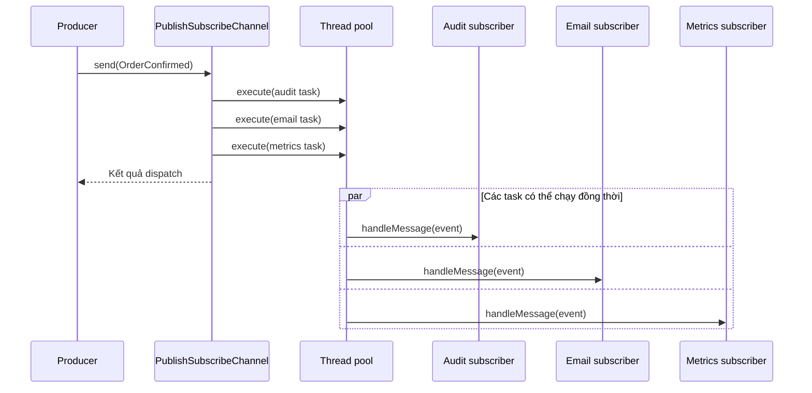

# Asynchronous broadcast với PublishSubscribeChannel

Trong module **SPRING_INTEGRATION_CORE**, `PublishSubscribeChannel` giúp biểu diễn một sự kiện bằng `Message` rồi phân phối sự kiện đó đến nhiều endpoint. **Asynchronous broadcast** là cách thực hiện việc phân phối này qua một executor, để các subscriber có thể xử lý trên các worker thread và producer có thể tiếp tục công việc trước khi chúng hoàn tất.

Ví dụ, sau khi đơn hàng được xác nhận, ứng dụng cần ghi audit, gửi email và cập nhật số liệu. Ba việc cùng quan tâm đến một sự kiện nhưng có thời gian xử lý và khả năng thất bại khác nhau. Đây là tình huống phù hợp để tìm hiểu broadcast bất đồng bộ, xử lý lỗi và Java DSL trong Spring Integration.

## 1. Mục tiêu và kiến thức cần có

Sau bài này, bạn có thể:

- Phân biệt broadcast đồng bộ, broadcast bất đồng bộ và phân phối một message cho một consumer.
- Cấu hình `PublishSubscribeChannel` với executor do Spring quản lý.
- Hiểu chính xác ý nghĩa của `send()`, `minSubscribers` và lỗi khi executor từ chối task.
- Thiết kế subscriber an toàn khi chạy đồng thời, theo dõi lỗi bằng `ErrorMessage`.
- Viết luồng bằng Java DSL và kiểm thử kết quả cuối cùng bằng cơ chế chờ có timeout.

Bạn cần biết Spring bean, `Message<T>`, `MessageChannel`, `MessageHandler` và thread pool ở mức cơ bản. Ví dụ sử dụng Java 17 và các API có trong Spring Integration 6.5; hãy dùng một bộ Spring Boot/Spring Integration tương thích do BOM của dự án quản lý.

## 2. Broadcast bất đồng bộ hoạt động như thế nào?

### 2.1. Executor tạo ranh giới thực thi

Không truyền executor:

```java
PublishSubscribeChannel synchronous = new PublishSubscribeChannel();
```

Theo cấu hình mặc định, các handler được gọi lần lượt trên thread gửi message. Handler chậm làm producer chờ; exception có thể truyền ngược lên call stack của producer.

Truyền một thread pool:

```java
PublishSubscribeChannel asynchronous =
        new PublishSubscribeChannel(executor);
```

Channel tạo công việc để gọi từng subscriber rồi giao các công việc đó cho executor. Với thread pool thực sự chạy nền, handler thực thi trên worker thread. Các nhánh có thể chạy chồng thời gian nếu executor có đủ worker. Một executor chỉ có một worker vẫn tách khỏi producer nhưng không làm các handler chạy song song. Cơ chế mặc định và constructor nhận executor được mô tả trong [cấu hình PublishSubscribeChannel](https://docs.spring.io/spring-integration/reference/channel/configuration.html#channel-configuration-pubsubchannel).

Chỉ nhìn thấy kiểu `Executor` chưa đủ để khẳng định công việc luôn chạy nền: một executor có thể thực thi trực tiếp task trên thread gọi nó. Chính sách `CallerRunsPolicy` cũng có thể làm producer thực thi task khi pool quá tải. Khi đọc một flow, cần xem cả channel lẫn cấu hình executor.



Sơ đồ thể hiện hai tiến trình độc lập: giao task và xử lý nghiệp vụ. Worker có thể bắt đầu, thậm chí hoàn tất một nhánh, trước lúc `send()` trả về; không có cam kết rằng mọi worker đều phải đợi producer nhận kết quả dispatch.

### 2.2. Phân biệt các channel liên quan

| Channel | Ai nhận một message? | Thread xử lý theo cấu hình thông thường | Có polling trực tiếp không? |
| --- | --- | --- | --- |
| `DirectChannel` | Một subscriber được chọn | Thread gửi | Không |
| `ExecutorChannel` | Một subscriber được chọn | Thread do executor quyết định | Không |
| `PublishSubscribeChannel` không có executor | Các subscriber đang đăng ký | Thread gửi | Không |
| `PublishSubscribeChannel` có thread pool | Các subscriber đang đăng ký | Các worker của pool | Không |
| `QueueChannel` | Một consumer lấy được message khỏi queue | Thread của bên nhận hoặc poller | Có |

`ExecutorChannel` không thay thế cho broadcast: có nhiều subscriber vẫn không có nghĩa là mọi subscriber nhận cùng một message. `PublishSubscribeChannel` không cung cấp `receive()`; subscriber nhận message qua `handleMessage()`. Tham khảo [các hiện thực MessageChannel](https://docs.spring.io/spring-integration/reference/channel/implementations.html).

Thread pool có thể có queue chứa task, nhưng queue đó không biến channel thành `QueueChannel` và không tạo cơ chế lưu giữ sự kiện cho subscriber đăng ký muộn.

### 2.3. Ý nghĩa của send()

Với executor chạy nền và chính sách từ chối có báo lỗi, `send(message)` trả về `true` cho biết bước dispatch đáp ứng điều kiện số subscriber và các lời gọi giao task đã trả về bình thường. Nó không phải biên nhận cho kết quả nghiệp vụ của từng nhánh.

| Quan sát | Có thể kết luận | Chưa thể kết luận |
| --- | --- | --- |
| `send()` trả về `true` | Bước dispatch được channel coi là thành công | Email đã được gửi, audit đã commit |
| Nhận một `ErrorMessage` | Có một tác vụ xử lý gặp lỗi | Mọi nhánh còn lại đều thất bại |
| Đã nhận kết quả audit | Nhánh audit đạt mốc mà kết quả biểu diễn | Nhánh email và metrics đã xong |
| Producer không bắt được exception | Không có exception truyền qua call stack đó | Worker không xảy ra lỗi |

`minSubscribers` mặc định là `0`. Khi dùng executor, việc kiểm tra ngưỡng không chờ kết quả nghiệp vụ của handler. Nếu cấu hình `setMinSubscribers(3)` mà chỉ có hai subscriber, channel vẫn có thể giao task cho hai subscriber rồi trả về `false`. Đây không phải kiểm tra nguyên tử “đủ ba thì mới gửi”, cũng không phải quorum thành công nghiệp vụ. Chi tiết hợp đồng nằm trong [API PublishSubscribeChannel](https://docs.spring.io/spring-integration/docs/6.5.0/api/org/springframework/integration/channel/PublishSubscribeChannel.html).

Tương tự, truyền `send(message, 1000)` không thiết lập thời hạn một giây để mọi subscriber hoàn tất. Muốn chờ kết quả, cần một giao thức phản hồi hoặc một luồng tập hợp kết quả riêng.

## 3. Ví dụ hoàn chỉnh: ba subscriber và kênh lỗi

### 3.1. Bối cảnh thực hành

Sự kiện `OrderConfirmed` được gửi đến ba nhánh:

| Nhánh | Công việc mô phỏng | Tên branch trong kết quả |
| --- | --- | --- |
| Audit | Ghi nhận xác nhận đơn | `audit` |
| Email | Mô phỏng gửi thông báo, có thể chủ động gây lỗi | `email` |
| Analytics | Ghi nhận sự kiện thống kê | `analytics` |

Ví dụ sử dụng một hàng đợi thread-safe để thu kết quả mô phỏng. Nó giúp quan sát broadcast mà không cần SMTP, database hoặc hệ thống thống kê bên ngoài. Việc đưa một `Receipt` vào queue chỉ xác nhận nhánh mô phỏng đã chạy đến điểm ghi nhận đó.

Trong dự án Spring Boot đã có parent hoặc BOM phù hợp, cần dependency ứng dụng và dependency kiểm thử sau:

```xml
<dependencies>
    <dependency>
        <groupId>org.springframework.boot</groupId>
        <artifactId>spring-boot-starter-integration</artifactId>
    </dependency>
    <dependency>
        <groupId>org.springframework.boot</groupId>
        <artifactId>spring-boot-starter-test</artifactId>
        <scope>test</scope>
    </dependency>
</dependencies>
```

Đây là phần dependency để ghép vào dự án Boot, không phải toàn bộ `pom.xml` độc lập. Không tự ghép các phiên bản Spring Framework, Spring Integration và Spring Boot khác dòng tương thích.

### 3.2. Cấu hình Java

Đặt cấu hình sau trong package `example.broadcast`. Không cần `@EnableAsync` vì chính channel sử dụng executor để dispatch.

```java
package example.broadcast;

import java.math.BigDecimal;
import java.util.concurrent.BlockingQueue;
import java.util.concurrent.LinkedBlockingQueue;
import java.util.concurrent.ThreadPoolExecutor;
import java.util.concurrent.TimeUnit;

import org.springframework.beans.factory.annotation.Qualifier;
import org.springframework.context.annotation.Bean;
import org.springframework.context.annotation.Configuration;
import org.springframework.integration.channel.MessagePublishingErrorHandler;
import org.springframework.integration.channel.PublishSubscribeChannel;
import org.springframework.integration.channel.QueueChannel;
import org.springframework.integration.config.EnableIntegration;
import org.springframework.integration.dsl.IntegrationFlow;
import org.springframework.scheduling.concurrent.ThreadPoolTaskExecutor;

@Configuration
@EnableIntegration
public class AsyncBroadcastConfig {

    public record OrderConfirmed(
            String eventId,
            String orderId,
            BigDecimal total,
            boolean simulateEmailFailure) {
    }

    public record Receipt(
            String eventId,
            String branch,
            String threadName) {
    }

    public static final class DemoEffects {
        private final BlockingQueue<Receipt> receipts =
                new LinkedBlockingQueue<>();

        public void audit(OrderConfirmed event) {
            record(event, "audit");
        }

        public void email(OrderConfirmed event) {
            if (event.simulateEmailFailure()) {
                throw new IllegalStateException(
                        "Simulated SMTP failure: " + event.orderId());
            }
            record(event, "email");
        }

        public void analytics(OrderConfirmed event) {
            record(event, "analytics");
        }

        public Receipt awaitReceipt(long timeout, TimeUnit unit)
                throws InterruptedException {
            return receipts.poll(timeout, unit);
        }

        private void record(OrderConfirmed event, String branch) {
            receipts.add(new Receipt(
                    event.eventId(),
                    branch,
                    Thread.currentThread().getName()));
        }
    }

    @Bean
    public DemoEffects demoEffects() {
        return new DemoEffects();
    }

    @Bean
    public ThreadPoolTaskExecutor broadcastExecutor() {
        ThreadPoolTaskExecutor executor = new ThreadPoolTaskExecutor();
        executor.setCorePoolSize(3);
        executor.setMaxPoolSize(6);
        executor.setQueueCapacity(100);
        executor.setThreadNamePrefix("order-broadcast-");
        executor.setRejectedExecutionHandler(
                new ThreadPoolExecutor.AbortPolicy());
        executor.setWaitForTasksToCompleteOnShutdown(true);
        executor.setAwaitTerminationSeconds(10);
        return executor;
    }

    @Bean
    public QueueChannel broadcastErrors() {
        return new QueueChannel(100);
    }

    @Bean
    public MessagePublishingErrorHandler broadcastErrorHandler(
            @Qualifier("broadcastErrors") QueueChannel errors) {
        MessagePublishingErrorHandler handler =
                new MessagePublishingErrorHandler();
        handler.setDefaultErrorChannel(errors);
        handler.setSendTimeout(1000);
        return handler;
    }

    @Bean
    public PublishSubscribeChannel orderEvents(
            @Qualifier("broadcastExecutor")
            ThreadPoolTaskExecutor executor,
            @Qualifier("broadcastErrorHandler")
            MessagePublishingErrorHandler errorHandler) {

        PublishSubscribeChannel channel =
                new PublishSubscribeChannel(executor, true);
        channel.setMinSubscribers(3);
        channel.setErrorHandler(errorHandler);
        return channel;
    }

    @Bean
    public IntegrationFlow auditFlow(
            @Qualifier("orderEvents") PublishSubscribeChannel events,
            DemoEffects effects) {
        return IntegrationFlow.from(events)
                .handle(OrderConfirmed.class, (event, headers) -> {
                    effects.audit(event);
                    return null;
                })
                .get();
    }

    @Bean
    public IntegrationFlow emailFlow(
            @Qualifier("orderEvents") PublishSubscribeChannel events,
            DemoEffects effects) {
        return IntegrationFlow.from(events)
                .handle(OrderConfirmed.class, (event, headers) -> {
                    effects.email(event);
                    return null;
                })
                .get();
    }

    @Bean
    public IntegrationFlow analyticsFlow(
            @Qualifier("orderEvents") PublishSubscribeChannel events,
            DemoEffects effects) {
        return IntegrationFlow.from(events)
                .handle(OrderConfirmed.class, (event, headers) -> {
                    effects.analytics(event);
                    return null;
                })
                .get();
    }
}
```

Các điểm cần đọc đúng trong cấu hình:

- `@EnableIntegration` đăng ký hạ tầng Spring Integration cho context Java thuần.
- `ThreadPoolTaskExecutor` là bean; Spring khởi tạo và quản lý vòng đời. Không gọi `initialize()` thủ công trong phương thức `@Bean` này.
- `new PublishSubscribeChannel(executor, true)` bật `requireSubscribers`: gửi khi không có subscriber sẽ phát sinh lỗi thay vì bị bỏ qua.
- `setMinSubscribers(3)` diễn đạt ngưỡng dispatch của ví dụ ba nhánh; nó không chờ cả ba nhánh thành công.
- `@Qualifier` chọn đúng channel và error handler vì context có thể còn chứa các bean hạ tầng cùng kiểu.
- Các lambda trả về `null` vì đây là endpoint xử lý sự kiện một chiều. Ví dụ chưa tạo luồng tổng hợp phản hồi.

`MessagePublishingErrorHandler` có thể gửi lỗi đến channel được cấu hình qua `setDefaultErrorChannel`. `setSendTimeout(1000)` giới hạn thời gian thử gửi lỗi khi kênh đích có thể chờ vì đầy; nó không giới hạn thời gian chạy của subscriber. Tham khảo [API MessagePublishingErrorHandler](https://docs.spring.io/spring-integration/api/org/springframework/integration/channel/MessagePublishingErrorHandler.html).

Queue kết quả của `DemoEffects` chỉ phục vụ demo và được làm rỗng bởi bên quan sát. Khi thay bằng triển khai thật, subscriber nên gọi dịch vụ tương ứng thay vì tích lũy kết quả không giới hạn trong bộ nhớ.

### 3.3. Gửi message và quan sát kết quả

Có thể chạy lớp dưới đây cùng package với cấu hình:

```java
package example.broadcast;

import java.math.BigDecimal;
import java.util.concurrent.TimeUnit;

import org.springframework.context.annotation.AnnotationConfigApplicationContext;
import org.springframework.messaging.MessageChannel;
import org.springframework.messaging.support.MessageBuilder;

public class AsyncBroadcastDemo {

    public static void main(String[] args) throws InterruptedException {
        try (var context =
                new AnnotationConfigApplicationContext(
                        AsyncBroadcastConfig.class)) {

            MessageChannel events =
                    context.getBean("orderEvents", MessageChannel.class);

            var event = new AsyncBroadcastConfig.OrderConfirmed(
                    "evt-1001",
                    "order-1001",
                    new BigDecimal("350000"),
                    false);

            boolean dispatched = events.send(
                    MessageBuilder.withPayload(event)
                            .setHeader("eventId", event.eventId())
                            .build());

            System.out.println("Dispatch accepted: " + dispatched);

            var effects =
                    context.getBean(AsyncBroadcastConfig.DemoEffects.class);

            for (int i = 0; i < 3; i++) {
                var receipt = effects.awaitReceipt(5, TimeUnit.SECONDS);
                if (receipt == null) {
                    throw new IllegalStateException(
                            "Timed out waiting for a branch result");
                }
                System.out.println(receipt);
            }
        }
    }
}
```

Ba receipt phải mang cùng `eventId` và đủ các branch `audit`, `email`, `analytics`. Tên thread có tiền tố `order-broadcast-`. Thứ tự receipt có thể thay đổi giữa các lần chạy; nhiều receipt cũng có thể mang cùng tên worker nếu pool tái sử dụng thread.

Trong demo, việc poll đủ ba receipt là bước chờ quan sát do chương trình chủ động thực hiện. `events.send(...)` không thực hiện bước chờ này.

## 4. Biểu diễn broadcast bằng Java DSL

Khi các nhánh thuộc cùng một cấu hình luồng, có thể khai báo chúng bằng `publishSubscribeChannel(executor, ...)`. Cách này tạo một channel broadcast và đăng ký các sub-flow làm subscriber.

Đoạn sau là phương án thay thế cho bean `orderEvents` và ba bean flow riêng trong ví dụ trước. Giữ lại executor, error handler và `DemoEffects`; gửi message vào `dslOrderInput` khi dùng phương án này.

```java
@Bean
public IntegrationFlow dslOrderFlow(
        @Qualifier("broadcastExecutor")
        ThreadPoolTaskExecutor executor,
        @Qualifier("broadcastErrorHandler")
        MessagePublishingErrorHandler errorHandler,
        DemoEffects effects) {

    return IntegrationFlow.from("dslOrderInput")
            .publishSubscribeChannel(executor, spec -> spec
                    .id("dslOrderBroadcast")
                    .applySequence(false)
                    .minSubscribers(3)
                    .errorHandler(errorHandler)
                    .subscribe(flow -> flow
                            .handle(OrderConfirmed.class,
                                    (event, headers) -> {
                                        effects.audit(event);
                                        return null;
                                    }))
                    .subscribe(flow -> flow
                            .handle(OrderConfirmed.class,
                                    (event, headers) -> {
                                        effects.email(event);
                                        return null;
                                    }))
                    .subscribe(flow -> flow
                            .handle(OrderConfirmed.class,
                                    (event, headers) -> {
                                        effects.analytics(event);
                                        return null;
                                    })))
            .get();
}
```

Đoạn này được đặt trong `AsyncBroadcastConfig` để dùng trực tiếp hai nested type `DemoEffects` và `OrderConfirmed`. Các tùy chọn `applySequence`, `minSubscribers`, `errorHandler` và `subscribe` được cung cấp bởi [PublishSubscribeSpec](https://docs.spring.io/spring-integration/api/org/springframework/integration/dsl/PublishSubscribeSpec.html).

Cần chú ý hai điều khi đọc DSL:

1. Các `subscribe(...)` đăng ký những nhánh độc lập. Chúng không phải các bước nối tiếp trên cùng một message.
2. Viết tiếp một bước sau `publishSubscribeChannel(...)` không tạo điểm đợi mọi nhánh hoàn tất; phần tiếp theo có thể trở thành một subscriber khác của broadcast. Muốn “fan-out rồi fan-in”, cần xây dựng luồng thu kết quả rõ ràng. Xem [hỗ trợ sub-flow trong Java DSL](https://docs.spring.io/spring-integration/reference/dsl/java-subflows.html).

Với ba side effect một chiều, kết thúc flow ngay sau phần đăng ký subscriber giúp hợp đồng của luồng dễ đọc.

## 5. Xử lý lỗi qua ranh giới thread

### 5.1. Tách lỗi dispatch và lỗi nghiệp vụ

Hai loại lỗi có vị trí phát sinh khác nhau:

| Loại lỗi | Ví dụ | Nơi cần quan sát |
| --- | --- | --- |
| Lỗi trong bước giao task | Executor đã shutdown, pool và queue đầy với `AbortPolicy` | Lời gọi gửi message có thể ném exception |
| Lỗi nghiệp vụ trên worker | SMTP lỗi, database timeout, dữ liệu không hợp lệ trong handler | Error handler và kênh lỗi |
| Lỗi khi chuyển thông tin lỗi | Queue lỗi đầy, error consumer ngừng hoạt động | Log, metric và trạng thái của luồng xử lý lỗi |

Đoạn `try/catch` quanh `send()` vẫn cần cho lỗi phát sinh ngay lúc dispatch. Tuy nhiên, nó không bắt được exception xảy ra sau đó trên một worker khác.

Spring Integration biểu diễn lỗi bất đồng bộ bằng `ErrorMessage` có payload là `Throwable`. Với cơ chế chuẩn, header `errorChannel` của request được ưu tiên; nếu không có thì dùng kênh mặc định. Khi không tự cấu hình kênh mặc định cho error handler, cơ chế thông thường tìm global `errorChannel`. Xem [Error Handling](https://docs.spring.io/spring-integration/reference/error-handling.html).

Trong ví dụ, `broadcastErrorHandler` đã chọn `broadcastErrors` làm kênh mặc định. Message không đặt header `errorChannel` sẽ đi theo lựa chọn đó.

### 5.2. Lấy thông tin message gây lỗi

Khi đặt `simulateEmailFailure=true`, có thể đọc lỗi như sau:

```java
QueueChannel errors =
        context.getBean("broadcastErrors", QueueChannel.class);

org.springframework.messaging.Message<?> received =
        errors.receive(5000);

if (received instanceof
        org.springframework.messaging.support.ErrorMessage error) {

    Throwable failure = error.getPayload();

    if (failure instanceof
            org.springframework.messaging.MessagingException messaging) {

        org.springframework.messaging.Message<?> failed =
                messaging.getFailedMessage();

        if (failed != null) {
            System.out.println(
                    "Failed payload: " + failed.getPayload());
        }
    }

    System.err.println("Asynchronous failure: " + failure);
}
```

`MessagingException.getFailedMessage()` là nguồn thông tin quan trọng để lấy payload và header đã được framework gắn vào lỗi. Không nên giả định mọi `Throwable` đều có failed message; cần xử lý trường hợp không có thông tin này.

Trong ví dụ, lỗi email không hủy những task audit và analytics đã giao cho executor. Kết quả bình thường là hai receipt thành công và một `ErrorMessage`, thay vì ba receipt.

### 5.3. Kênh lỗi cũng là một luồng cần được tiêu thụ

`broadcastErrors` là `QueueChannel`; nó không tự chạy handler. Demo và test chủ động gọi `receive(timeout)`. Trong ứng dụng chạy lâu dài, cần một consumer có poller, hoặc thay bằng channel có subscriber xử lý lỗi phù hợp.

Nội dung bản ghi lỗi nên gắn `eventId`, `orderId`, tên nhánh, exception gốc và thông tin lần thử. Không chỉ ghi “gửi message thất bại” vì cùng một sự kiện có thể thành công ở hai nhánh và thất bại ở nhánh còn lại.

Không bật `ignoreFailures=true` chỉ để luồng “không báo lỗi”. Tùy chọn đó có thể làm lỗi handler bị ghi log rồi bỏ qua, thay đổi đường đi qua error handler. Nếu cần retry hoặc lưu sự kiện thất bại, hãy thiết kế các hành vi đó trực tiếp.

Nếu queue lỗi đầy quá thời gian cho phép, thông tin lỗi có thể không được chuyển đến nơi mong muốn. Vì vậy, năng lực xử lý lỗi phải được tính cùng với năng lực xử lý message, đặc biệt khi một dịch vụ phụ thuộc bị lỗi hàng loạt.

## 6. Chọn kích thước pool và hành vi khi quá tải

### 6.1. Đếm task theo số subscriber

Với một message và ba subscriber, broadcast thường giao ba task. Queue capacity `100` trong ví dụ là khoảng trống cho task đang chờ, không phải cam kết lưu được một trăm sự kiện trọn vẹn.

Một ước lượng ban đầu cho tải worker là:

```text
task arrival rate ≈ event rate × số subscriber

số worker bận trung bình
    ≈ event rate × tổng thời gian xử lý trung bình của các nhánh
```

Ví dụ do bài học giả định:

- Tốc độ đầu vào: 40 sự kiện/giây.
- Audit: 20 ms/sự kiện.
- Email: 40 ms/sự kiện.
- Analytics: 10 ms/sự kiện.

Tổng nhu cầu thời gian worker xấp xỉ `40 × 0,07 = 2,8` giây xử lý mỗi giây, tương đương trung bình 2,8 worker bận. Nếu muốn sử dụng khoảng 70% năng lực worker, mốc khởi đầu là khoảng bốn worker. Đây chỉ là ước lượng cho workload blocking đơn giản; cần đo latency, phân bố thời gian xử lý, retry và giới hạn dịch vụ phụ thuộc trước khi chốt cấu hình.

Tăng số thread vượt quá connection pool hoặc giới hạn SMTP có thể làm thời gian chờ tăng thêm. Với tác vụ dùng CPU, còn phải xét số core và chi phí chuyển ngữ cảnh.

### 6.2. Queue và maxPoolSize tương tác với nhau

`ThreadPoolTaskExecutor` cung cấp `corePoolSize`, `maxPoolSize` và `queueCapacity`. Các giá trị mặc định không phải cấu hình phù hợp cho mọi workload; tham khảo [ThreadPoolTaskExecutor](https://docs.spring.io/spring-framework/docs/current/javadoc-api/org/springframework/scheduling/concurrent/ThreadPoolTaskExecutor.html).

Với pool kiểu `ThreadPoolExecutor` thông thường, quá trình nhận task diễn ra theo nguyên tắc:

1. Chưa đủ core worker: có thể tạo thêm worker.
2. Đã đạt core size: ưu tiên đưa task vào queue.
3. Queue đầy: mới thử tăng worker đến max size.
4. Đã chạm max size và không thể đưa vào queue: áp dụng rejection policy.

Vì vậy, `corePoolSize=3`, `maxPoolSize=6` và queue lớn không có nghĩa pool lập tức tăng lên sáu worker khi có task thứ tư. Quy tắc này được mô tả trong [ThreadPoolExecutor của JDK](https://docs.oracle.com/en/java/javase/17/docs/api/java.base/java/util/concurrent/ThreadPoolExecutor.html).

Queue dài che được một đợt tăng tải ngắn nhưng có thể khiến message chờ lâu. Queue trong bộ nhớ còn giữ tham chiếu đến payload; một lượng task vừa phải vẫn có thể giữ rất nhiều dữ liệu nếu payload lớn.

### 6.3. Rejection policy thay đổi hợp đồng

| Policy | Hành vi khi không nhận thêm task | Tác động với broadcast |
| --- | --- | --- |
| `AbortPolicy` | Báo lỗi bằng exception | Producer có tín hiệu lỗi dispatch |
| `CallerRunsPolicy` | Có thể chạy task ngay trên thread gọi khi executor còn hoạt động | Tạo sức ép ngược, làm producer chờ |
| `DiscardPolicy` | Bỏ task không báo exception | `send()` có thể trông thành công dù một nhánh không chạy |
| `DiscardOldestPolicy` | Loại task chờ cũ để thử nhận task mới | Có nguy cơ làm mất công việc của sự kiện trước |

`CallerRunsPolicy` không bảo đảm mọi task sẽ được chạy sau khi executor đã shutdown. Với dữ liệu nghiệp vụ quan trọng, phải hiểu cả hành vi lúc đầy tải và lúc dừng ứng dụng.

Broadcast cũng không có tính nguyên tử trong bước submit. Giả sử task audit đã được chấp nhận nhưng task email bị từ chối, việc `send()` ném exception không thu hồi task audit. Nếu producer gửi lại toàn bộ sự kiện, audit có thể chạy lần nữa.

Hệ quả thiết kế là mỗi subscriber cần chiến lược chống xử lý trùng phù hợp, chẳng hạn khóa nghiệp vụ `(eventId, branch)` lưu ở nơi bền vững. Không dùng riêng message ID mới sinh của mỗi lần gửi lại làm khóa chống trùng, vì hai message có thể biểu diễn cùng một sự kiện nghiệp vụ.

## 7. An toàn dữ liệu, thứ tự và transaction

### 7.1. Không sửa payload dùng chung

`Message` và map header có tính bất biến ở mức tham chiếu, nhưng object được đặt trong payload hoặc header vẫn có thể mutable. Các subscriber của channel nội bộ có thể cùng giữ tham chiếu đến một payload.

Ví dụ nguy hiểm:

```java
// Không dùng cách này với payload dùng chung giữa các worker.
Map<String, Object> event = new HashMap<>();
event.put("orderId", "order-1001");

// Nếu một subscriber sửa event.put(...),
// subscriber khác có thể quan sát trạng thái đang thay đổi.
```

Nên dùng payload bất biến, dữ liệu snapshot và kết quả mới cho từng nhánh. `OrderConfirmed` trong ví dụ dùng `String`, `BigDecimal` và `boolean`, phù hợp cho việc chia sẻ để đọc.

Java record chỉ bất biến nông. Nếu record chứa `List` hoặc `Map` mutable, cần tạo bản sao thích hợp và xem xét cả phần tử bên trong. Khi một nhánh cần biến đổi dữ liệu, transformer nên tạo payload mới thay vì sửa object mà các nhánh khác đang sử dụng.

### 7.2. Không suy thứ tự nghiệp vụ từ thứ tự đăng ký

Đăng ký audit trước email không bảo đảm audit đã ghi xong trước khi email bắt đầu. Hai sự kiện cùng đơn hàng cũng có thể hoàn tất ngược thứ tự khi nhiều worker xử lý.

Nếu nghiệp vụ bắt buộc “ghi audit xong mới gửi email”, hãy thể hiện quan hệ phụ thuộc bằng các bước nối tiếp hoặc một cơ chế phối hợp kết quả. Nếu cần giữ thứ tự theo `orderId` nhưng vẫn chạy nhiều đơn hàng đồng thời, có thể cân nhắc chia công việc theo khóa với cơ chế xử lý tuần tự cho mỗi partition.

Một pool dùng chung còn có nguy cơ bị nhánh chậm chiếm hết worker. Khi mức tải và yêu cầu cách ly tăng, có thể tách executor cho các nhánh hoặc đặt ranh giới queue/broker riêng. Việc tách này cần cấu hình thật; một `PublishSubscribeChannel` có một executor không tự tạo pool độc lập cho từng subscriber.

### 7.3. Transaction không tự lan qua worker thread

Transaction imperative gắn với thread gửi không tự trở thành transaction của các worker. Sau khi sự kiện được giao cho pool, rollback transaction ở producer không tự hoàn tác email đã gửi hoặc một transaction độc lập đã commit ở subscriber.

Một rủi ro cụ thể là publish trong transaction tạo đơn hàng: worker có thể chạy trước khi bản ghi đơn hàng được commit. Subscriber đọc database có thể chưa thấy dữ liệu hoặc nhìn thấy trạng thái cũ.

Cần xác định rõ thời điểm phát sự kiện, transaction của từng nhánh và cơ chế bù trừ khi có side effect. Phát sau commit giúp tránh đọc trước commit, nhưng vẫn cần xử lý khoảng trống giữa commit và giao message nếu yêu cầu không mất sự kiện. Những luồng có yêu cầu bền vững thường cần outbox hoặc cơ chế lưu và chuyển tiếp tương đương. Xem [transaction boundaries trong Spring Integration](https://docs.spring.io/spring-integration/reference/transactions.html#transaction-boundaries).

MDC, locale hoặc security context cũng không nên được mặc định là có sẵn trên worker. Truyền định danh cần thiết qua header và dùng cơ chế truyền context phù hợp khi ứng dụng yêu cầu; không sao chép tùy tiện transaction context.

## 8. Khi cần chờ tất cả các nhánh

### 8.1. applySequence hỗ trợ tương quan kết quả

Nếu cần thu kết quả từ nhiều nhánh, có thể bật:

```java
channel.setApplySequence(true);
```

Channel bổ sung thông tin tương quan và thứ tự phần tử, gồm `correlationId`, `sequenceNumber` và `sequenceSize`. Các message dành cho từng subscriber có header phù hợp để aggregator tập hợp.

`applySequence` không ép các handler chạy theo thứ tự và không tạo deep copy payload. Nó cũng không tự thêm aggregator vào flow.

### 8.2. Fan-out cần đi cùng thiết kế fan-in

Để biết một yêu cầu đã có đủ kết quả, cần:

1. Mỗi nhánh gửi kết quả hoặc trạng thái kết thúc về một kênh chung.
2. Aggregator gom theo correlation key.
3. Release strategy xác định khi nào nhóm đủ điều kiện hoàn tất.
4. Timeout và chính sách xử lý nhánh thất bại, bị filter hoặc không trả kết quả.

Theo chiến lược mặc định, aggregator có thể dùng `correlationId` để gom nhóm và thông tin `sequenceSize` để quyết định đủ phần tử. Xem [Aggregator](https://docs.spring.io/spring-integration/reference/aggregator.html).

Ba handler trong demo trả về `null`, nên chỉ bật `applySequence` sẽ không tạo được ba kết quả cho aggregator. Phải sửa hợp đồng nhánh để phát ra message kết quả.

Ngoài ra, nếu có ba subscriber nhưng một filter loại bỏ message, aggregator không tự biết rằng nhánh đó đã “hoàn tất nhưng bỏ qua”. Hãy phát trạng thái tường minh hoặc thiết kế release strategy/timeout tương ứng để tránh chờ vô hạn.

Gateway cũng không tự giải quyết việc này. Một gateway một chiều có thể che thao tác gửi message khỏi code nghiệp vụ, nhưng không bổ sung xác nhận hoàn tất của mọi subscriber. Gateway yêu cầu phản hồi cần được nối với luồng tạo đúng kết quả trả về và timeout thích hợp.

## 9. Kiểm thử bất đồng bộ bằng điều kiện hoàn tất

### 9.1. Không dùng thời gian ngủ làm bằng chứng

`Thread.sleep(200)` chỉ trì hoãn test. Trên máy nhanh, nó làm test chậm; trên CI bận, hai trăm mili giây có thể không đủ.

Trong ví dụ, dùng `BlockingQueue.poll(timeout, unit)` để chờ receipt và `QueueChannel.receive(timeout)` để chờ lỗi. Test có điều kiện hoàn tất cụ thể và thời hạn hữu hạn. So sánh tập tên branch thay vì thứ tự receipt.

Lớp test sau dùng đúng cấu hình ở mục 3, không dùng phương án DSL thay thế:

```java
package example.broadcast;

import java.math.BigDecimal;
import java.util.HashSet;
import java.util.Set;
import java.util.concurrent.TimeUnit;

import org.junit.jupiter.api.Test;
import org.springframework.context.annotation.AnnotationConfigApplicationContext;
import org.springframework.integration.channel.QueueChannel;
import org.springframework.messaging.MessageChannel;
import org.springframework.messaging.MessagingException;
import org.springframework.messaging.support.ErrorMessage;
import org.springframework.messaging.support.MessageBuilder;

import static org.junit.jupiter.api.Assertions.*;

class AsyncBroadcastTest {

    @Test
    void broadcastsToAllThreeBranchesOnWorkerThreads() throws Exception {
        try (var context =
                new AnnotationConfigApplicationContext(
                        AsyncBroadcastConfig.class)) {

            MessageChannel events =
                    context.getBean("orderEvents", MessageChannel.class);
            var effects =
                    context.getBean(AsyncBroadcastConfig.DemoEffects.class);

            var event = new AsyncBroadcastConfig.OrderConfirmed(
                    "evt-success", "order-1",
                    new BigDecimal("100000"), false);

            assertTrue(events.send(
                    MessageBuilder.withPayload(event).build()));

            Set<String> branches = new HashSet<>();

            for (int i = 0; i < 3; i++) {
                var receipt =
                        effects.awaitReceipt(5, TimeUnit.SECONDS);

                assertNotNull(receipt, "Missing branch result");
                assertEquals(event.eventId(), receipt.eventId());
                assertTrue(
                        receipt.threadName()
                                .startsWith("order-broadcast-"));
                assertNotEquals(
                        Thread.currentThread().getName(),
                        receipt.threadName());

                branches.add(receipt.branch());
            }

            assertEquals(
                    Set.of("audit", "email", "analytics"),
                    branches);
        }
    }

    @Test
    void routesWorkerFailureToErrorChannel() throws Exception {
        try (var context =
                new AnnotationConfigApplicationContext(
                        AsyncBroadcastConfig.class)) {

            MessageChannel events =
                    context.getBean("orderEvents", MessageChannel.class);
            QueueChannel errors =
                    context.getBean("broadcastErrors", QueueChannel.class);
            var effects =
                    context.getBean(AsyncBroadcastConfig.DemoEffects.class);

            var event = new AsyncBroadcastConfig.OrderConfirmed(
                    "evt-failure", "order-2",
                    new BigDecimal("200000"), true);

            boolean dispatched = assertDoesNotThrow(
                    () -> events.send(
                            MessageBuilder.withPayload(event).build()));
            assertTrue(dispatched);

            ErrorMessage error = assertInstanceOf(
                    ErrorMessage.class, errors.receive(5000));

            MessagingException failure = assertInstanceOf(
                    MessagingException.class, error.getPayload());

            assertNotNull(failure.getFailedMessage());
            assertEquals(
                    event, failure.getFailedMessage().getPayload());

            Throwable root = failure;
            while (root.getCause() != null) {
                root = root.getCause();
            }
            assertInstanceOf(IllegalStateException.class, root);

            Set<String> successfulBranches = new HashSet<>();

            for (int i = 0; i < 2; i++) {
                var receipt =
                        effects.awaitReceipt(5, TimeUnit.SECONDS);

                assertNotNull(receipt, "Missing successful branch");
                assertEquals(event.eventId(), receipt.eventId());
                successfulBranches.add(receipt.branch());
            }

            assertEquals(
                    Set.of("audit", "analytics"),
                    successfulBranches);
        }
    }
}
```

Mỗi test tạo một context mới, vì vậy receipt và lỗi của lần trước không lẫn sang lần sau. Context được đóng để giải phóng tài nguyên. Hai test kiểm tra fan-out thực tế và đường đi của lỗi; chúng không đo throughput hay chứng minh hệ thống đáp ứng một SLA cụ thể.

### 9.2. Kiểm tra send() không chờ hoàn tất

Muốn kiểm tra riêng hợp đồng thời gian này, hãy dùng một subscriber có cổng chờ:

1. Subscriber báo đã bắt đầu qua một `CountDownLatch`.
2. Subscriber chờ một latch khác do test giữ.
3. Test xác nhận lời gọi gửi đã trả về trong khi latch hoàn tất còn chưa mở.
4. Test mở cổng trong `finally`, rồi chờ subscriber hoàn tất với timeout.

Nên chạy lời gọi gửi bằng một future có timeout để test không bị treo nếu vô tình đổi channel thành đồng bộ. Đặt thời hạn cho cả các lần chờ bên worker và đóng executor ở cuối test. `CountDownLatch` cung cấp cơ chế đợi theo tín hiệu hoàn tất, thay vì đoán thời gian chạy; xem [CountDownLatch của JDK](https://docs.oracle.com/en/java/javase/17/docs/api/java.base/java/util/concurrent/CountDownLatch.html).

### 9.3. Các tình huống cần bổ sung khi triển khai thực tế

| Tình huống | Điều nên xác minh |
| --- | --- |
| Không có subscriber nhưng `requireSubscribers=true` | Producer nhận lỗi dispatch |
| Ít subscriber hơn `minSubscribers` | Không nhầm `false` với “chưa nhánh nào chạy” |
| Một nhánh bị chặn | Nhánh khác vẫn tiến triển trong giới hạn pool đã thiết kế |
| Pool bão hòa | Có tín hiệu reject hoặc hành vi sức ép ngược đúng hợp đồng |
| Retry sau dispatch một phần | Side effect đã thành công không bị thực hiện trùng ngoài dự kiến |
| Queue lỗi đầy | Việc không chuyển được lỗi có thể quan sát |
| Shutdown khi còn task | Producer dừng nhận việc đúng lúc và thời hạn drain rõ ràng |

Khi kiểm tra bão hòa, dùng latch để giữ worker và điều khiển số task trong queue. Không tạo tải bằng một vòng lặp rồi giả định pool chắc chắn đã đầy tại một mốc thời gian cố định.

## 10. Giới hạn bảo đảm và cách thiết kế vận hành

### 10.1. Channel nội bộ không cung cấp độ bền của broker

`PublishSubscribeChannel` với thread pool trong ví dụ là cơ chế trong một process. Nó không tự cung cấp:

- Lưu bền message hoặc task qua lần khởi động lại.
- Replay cho subscriber đăng ký muộn.
- Broadcast sang các instance ứng dụng khác.
- Retry hoặc dead-letter tự động cho mọi subscriber.
- Xác nhận nghiệp vụ exactly-once.

Nếu process dừng đột ngột, task trong bộ nhớ có thể mất. Cấu hình chờ task khi shutdown chỉ hỗ trợ quá trình dừng có kiểm soát; nó không thay thế persistence.

Khi cần giao sự kiện bền vững qua nhiều dịch vụ, hãy thiết kế broker/topic và cơ chế lưu trạng thái phù hợp. Channel nội bộ vẫn hữu ích cho các bước xử lý bên trong từng dịch vụ, nhưng các bảo đảm giao nhận phải được xác định ở đúng ranh giới.

### 10.2. Retry theo nhánh và đo trạng thái theo nhánh

Đặt retry quanh riêng thao tác email giúp giới hạn phạm vi thực hiện lại. Retry ở producer bằng cách gửi lại cả sự kiện có thể lặp audit và analytics. Spring Integration cung cấp advice cho handler như `RequestHandlerRetryAdvice`; xem [các advice có sẵn](https://docs.spring.io/spring-integration/reference/handler-advice/classes.html).

Ngay cả retry theo nhánh cũng cần idempotency: dịch vụ SMTP có thể đã nhận yêu cầu trước khi client timeout. Hãy xét kết quả “không biết đã thành công hay chưa”, không chỉ trường hợp thất bại rõ ràng.

Nên quan sát ít nhất các đại lượng sau:

| Nhóm | Ví dụ thông tin |
| --- | --- |
| Executor | Số worker đang bận, queue depth, số task bị từ chối |
| Từng subscriber | Số lần thành công/thất bại, thời gian xử lý, số lần retry |
| Sự kiện nghiệp vụ | `eventId`, branch, thời điểm bắt đầu/kết thúc |
| Luồng lỗi | Tốc độ lỗi vào/ra, tuổi lỗi cũ nhất, lỗi không chuyển được |
| Lifecycle | Task còn chờ khi shutdown, thời gian drain |

Giữ `eventId` trong log hoặc trace để theo dõi một sự kiện qua nhiều nhánh. Không dùng từng `eventId` hay `orderId` làm metric label vì số lượng giá trị khác nhau tăng không giới hạn.

## 11. Bài thực hành mở rộng

1. Chạy ví dụ với `simulateEmailFailure=false`, thu đủ ba receipt và quan sát tên thread.
2. Đổi sang `true`, xác nhận có hai receipt thành công và một lỗi gắn với đúng payload.
3. Dùng pool một worker và một cổng chờ để quan sát sự khác nhau giữa tách thread và chạy song song.
4. Thay phần ghi nhận bằng transformer tạo kết quả riêng cho từng nhánh; bật `applySequence` và thêm aggregator.
5. Thêm filter vào một nhánh rồi thiết kế trạng thái “bỏ qua” để aggregator không chờ vô hạn.
6. Mô phỏng dispatch bị từ chối sau khi một task đã nhận, sau đó thêm chống trùng theo `eventId` và tên nhánh.

Khi giải thích thiết kế của mình, hãy trả lời rõ ba câu: producer xác nhận điều gì sau `send()`, lỗi mỗi nhánh được lưu hoặc chuyển đến đâu, và điều gì xảy ra nếu cùng một sự kiện được gửi lại. Ba câu trả lời này xác định hợp đồng thực tế của asynchronous broadcast trong ứng dụng.

