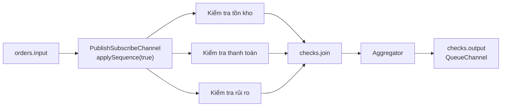

# apply-sequence trong PublishSubscribeChannel

**Mô-đun:** `SPRING_INTEGRATION_CORE`  
**Chương:** `PublishSubscribeChannel`

Một đơn hàng có thể cần được kiểm tra tồn kho, hạn mức thanh toán và rủi ro trước khi được chấp nhận. `PublishSubscribeChannel` phát thông điệp đầu vào đến các nhánh kiểm tra; một aggregator gom kết quả để bước sau đưa ra quyết định. Thuộc tính `apply-sequence` cung cấp metadata giúp liên kết các phản hồi thuộc cùng một lần phát.

Bài này tập trung vào mối quan hệ giữa `Message`, channel phát quảng bá, endpoint xử lý ở từng nhánh và aggregator nhận phản hồi. Bạn sẽ cấu hình bằng Java và Java DSL, đọc các header liên quan, nhận diện nguyên nhân thiếu phản hồi và viết kiểm thử cho luồng gom kết quả.

## 1. Vấn đề mà apply-sequence giải quyết

Giả sử hai đơn hàng `O-100` và `O-200` cùng đi qua ba nhánh. Khi các nhánh chạy bất đồng bộ, phản hồi có thể đến xen kẽ:

| Thời điểm đến | Đơn hàng | Kết quả nhánh |
| --- | --- | --- |
| 1 | O-100 | Tồn kho |
| 2 | O-200 | Rủi ro |
| 3 | O-100 | Thanh toán |
| 4 | O-200 | Tồn kho |
| 5 | O-100 | Rủi ro |
| 6 | O-200 | Thanh toán |

Bộ gom cần biết hai điều:

1. Những phản hồi nào thuộc cùng một lần xử lý.
2. Bao nhiêu phản hồi cần xuất hiện trước khi tạo kết quả chung.

`apply-sequence=true` yêu cầu channel gắn thông tin nhóm và vị trí chuỗi lên thông điệp gửi đến từng subscriber. Giá trị mặc định là `false`. Đây là tùy chọn cấu hình channel, không phải một header tên `apply-sequence`. Xem [cấu hình PublishSubscribeChannel](https://docs.spring.io/spring-integration/reference/channel/configuration.html#channel-configuration-pubsubchannel).

Trong luồng của bài, mỗi nhánh cam kết trả đúng một kết quả về cùng bộ gom. Chính cam kết này khiến số subscriber trở thành số phản hồi cần đợi.

## 2. Các header được tạo ra

Với một thông điệp đầu vào có `id=M0` và ba subscriber trực tiếp, thông tin ở các bản gửi có dạng:

| Bản gửi | correlationId | sequenceNumber | sequenceSize |
| --- | --- | --- | --- |
| Đến subscriber thứ nhất | M0 | 1 | 3 |
| Đến subscriber thứ hai | M0 | 2 | 3 |
| Đến subscriber thứ ba | M0 | 3 | 3 |

Các tên dùng trong Java là:

| Hằng trong IntegrationMessageHeaderAccessor | Tên header | Vai trò |
| --- | --- | --- |
| `CORRELATION_ID` | `correlationId` | Khóa liên kết các thông điệp trong một nhóm |
| `SEQUENCE_NUMBER` | `sequenceNumber` | Vị trí của bản gửi trong chuỗi |
| `SEQUENCE_SIZE` | `sequenceSize` | Kích thước chuỗi |

`sequenceNumber` và `sequenceSize` có kiểu `Integer`. `correlationId` về mặt API có thể là một `Object`; với lần broadcast thông thường này, giá trị được lấy từ ID của thông điệp đi vào channel. Dùng các hằng hoặc getter của [IntegrationMessageHeaderAccessor](https://docs.spring.io/spring-integration/api/org/springframework/integration/IntegrationMessageHeaderAccessor.html) giúp tránh viết sai tên.

### 2.1. Khóa nhóm thuộc về lần phát thông điệp

Với message chuẩn có ID, dispatcher dùng ID đầu vào làm khóa cho lớp sequence mới. Kích thước chuỗi được lấy từ số handler đăng ký tại lần dispatch; số thứ tự được gán khi dispatcher duyệt các handler. Chi tiết này thể hiện trong [BroadcastingDispatcher của Spring Integration 6.5.10](https://github.com/spring-projects/spring-integration/blob/v6.5.10/spring-integration-core/src/main/java/org/springframework/integration/dispatcher/BroadcastingDispatcher.java).

Do đó:

- Hai `Message` mới có cùng `orderId` vẫn thường tạo hai nhóm riêng vì ID thông điệp khác nhau.
- Gửi lại nguyên một đối tượng `Message` có thể lặp lại khóa nhóm. Cần thiết kế retry và xử lý phản hồi muộn phù hợp.
- Nếu cần nhóm theo một lần thử nghiệp vụ cụ thể, có thể bổ sung `requestId` hoặc `attemptId` và dùng correlation strategy riêng.

Nên giữ mã đơn hàng trong payload hoặc header nghiệp vụ như `orderId`. Đừng mặc định coi `correlationId` do broadcast tạo ra là mã đơn hàng.

### 2.2. Kích thước chuỗi đếm subscriber trực tiếp

Channel chỉ thấy các subscriber của nó. Channel không biết một nhánh về sau:

- Có bị filter loại bỏ hay không.
- Có rẽ sang luồng không đi đến aggregator hay không.
- Có phát sinh nhiều kết quả hay không.
- Có hoàn tất tác vụ bên ngoài thành công hay không.

Ví dụ, nếu ba subscriber kiểm tra và một subscriber ghi nhật ký cùng đăng ký trực tiếp vào channel, `sequenceSize` là 4. Nếu nhánh nhật ký không gửi phản hồi về bộ gom, nhóm kiểm tra chỉ nhận 3 kết quả.

Đây là hệ quả của topology: phải đối chiếu số nhánh được đếm với số phản hồi thực sự đi đến điểm hội tụ.

### 2.3. Luồng lồng nhau có nhiều lớp sequence

Nếu đầu vào đã có thông tin sequence, các thành phần hỗ trợ sequence lồng nhau có thể lưu ngữ cảnh ngoài trong `sequenceDetails` trước khi tạo lớp mới. Không nên tự xóa header này để “làm sạch” thông điệp.

Khi một nhánh lại có splitter hoặc broadcast riêng, hãy gom xong nhóm bên trong trước khi đưa một phản hồi trở về nhóm ngoài. Việc coi mọi header sequence trong toàn hệ thống là cùng một lớp sẽ làm sai ranh giới nhóm.

## 3. Message được tạo mới nhưng payload không được sao chép sâu

Khi bật `apply-sequence`, channel tạo các `Message` mang header riêng cho các subscriber; chúng vẫn tham chiếu đến cùng payload đầu vào. Bản thân `Message` giữ cố định tham chiếu payload và cấu trúc headers, nhưng object payload vẫn có thể là object thay đổi được. Xem [mô hình Message và tính bất biến](https://docs.spring.io/spring-integration/reference/message.html).

Ví dụ không phù hợp khi các nhánh cùng sửa dữ liệu:

```java
Map<String, Object> order = new HashMap<>();
order.put("id", "O-100");
// Các nhánh cùng nhận tham chiếu tới map này.
// Một nhánh sửa map có thể ảnh hưởng nhánh khác.
```

Nên dùng payload bất biến, hoặc tạo bản dữ liệu riêng tại nhánh cần thay đổi. Các `record` trong ví dụ sau chỉ chứa `String` và các trường nguyên thủy.

Tạo nhiều wrapper `Message` không tạo nhiều bản sao độc lập của toàn bộ dữ liệu nghiệp vụ.

## 4. Cấu hình bằng Java và XML

### 4.1. Java configuration

```java
import org.springframework.context.annotation.Bean;
import org.springframework.integration.channel.PublishSubscribeChannel;

@Bean
public PublishSubscribeChannel orderChecksChannel() {
    PublishSubscribeChannel channel = new PublishSubscribeChannel();
    channel.setApplySequence(true);
    return channel;
}
```

Đây là phương thức bean đặt trong một lớp cấu hình Spring. Các endpoint đăng ký vào bean channel này sẽ nhận thông điệp có thông tin sequence của lần broadcast.

### 4.2. XML configuration

Trong cấu hình đã khai báo namespace Spring Integration với tiền tố `int`:

```xml
<int:publish-subscribe-channel
        id="orderChecksChannel"
        apply-sequence="true"/>
```

Hai cách cấu hình trên thể hiện cùng ý định. Trong Java DSL, tùy chọn tương ứng là `.applySequence(true)`, được cung cấp bởi [PublishSubscribeChannelSpec](https://docs.spring.io/spring-integration/api/org/springframework/integration/dsl/PublishSubscribeChannelSpec.html).

## 5. Ví dụ Java DSL: ba nhánh kiểm tra đơn hàng

### 5.1. Thiết kế luồng



Mỗi transformer nhận toàn bộ đơn hàng và tạo một `CheckResult`. Các kết quả được gửi đến cùng channel `checks.join`; aggregator là consumer của channel này.

Để theo dõi hành vi, ví dụ dùng các điều kiện kiểm tra đơn giản trong bộ nhớ. Trong ứng dụng thực, một endpoint có thể gọi dịch vụ tồn kho hoặc hệ thống thanh toán, nhưng vẫn cần giữ hợp đồng phản hồi của nhánh.

### 5.2. Cấu hình hoàn chỉnh

Ví dụ dùng Java 17 trở lên, đã có dependency `spring-integration-core`. Đặt lớp sau trong source Java của ứng dụng; điều chỉnh package theo dự án.

```java
import org.springframework.context.annotation.Bean;
import org.springframework.context.annotation.Configuration;
import org.springframework.integration.channel.QueueChannel;
import org.springframework.integration.config.EnableIntegration;
import org.springframework.integration.dsl.IntegrationFlow;

@Configuration
@EnableIntegration
public class ApplySequenceConfig {

    public record Order(String id, int quantity, long amount) {
    }

    public record CheckResult(
            String orderId,
            String branch,
            boolean approved) {
    }

    @Bean
    public QueueChannel checksOutput() {
        return new QueueChannel();
    }

    @Bean
    public IntegrationFlow orderChecks() {
        return IntegrationFlow.from("orders.input")
                .publishSubscribeChannel(channel -> channel
                        .applySequence(true)
                        .subscribe(flow -> flow
                                .<Order, CheckResult>transform(order ->
                                        new CheckResult(
                                                order.id(),
                                                "inventory",
                                                order.quantity() > 0
                                                        && order.quantity() <= 10))
                                .channel("checks.join"))
                        .subscribe(flow -> flow
                                .<Order, CheckResult>transform(order ->
                                        new CheckResult(
                                                order.id(),
                                                "payment",
                                                order.amount() >= 0
                                                        && order.amount() <= 5_000_000))
                                .channel("checks.join"))
                        .subscribe(flow -> flow
                                .<Order, CheckResult>transform(order ->
                                        new CheckResult(
                                                order.id(),
                                                "risk",
                                                !order.id().startsWith("RISK-")))
                                .channel("checks.join")))
                .get();
    }

    @Bean
    public IntegrationFlow collectChecks() {
        return IntegrationFlow.from("checks.join")
                .aggregate()
                .channel(checksOutput())
                .get();
    }
}
```

Các tham chiếu channel bằng tên được Java DSL phân giải trong Spring context. Với tên chưa có bean, DSL có thể tạo `DirectChannel`; các luồng ở đây cùng tham chiếu `checks.join`. Bean `checksOutput` được khai báo rõ vì nó cần là `QueueChannel` để phía nhận lấy kết quả. Xem [channel trong Java DSL](https://docs.spring.io/spring-integration/reference/dsl/java-channels.html).

### 5.3. Vì sao bộ gom tạo được một kết quả?

Luồng tuân theo hợp đồng:

1. Mỗi đơn hàng đầu vào đi tới đúng ba subscriber.
2. Channel gắn cùng `correlationId`, các số thứ tự 1–3 và `sequenceSize=3`.
3. Mỗi transformer trả một payload kết quả và để framework tạo message phản hồi.
4. Cả ba phản hồi đi vào cùng aggregator.

Aggregator mặc định nhóm theo `correlationId` và dùng thông tin kích thước chuỗi để quyết định khi nào nhóm đủ. Bộ xử lý kết quả mặc định tạo một message có payload là danh sách các payload trong nhóm. Xem [correlation và release của Aggregator](https://docs.spring.io/spring-integration/reference/aggregator.html#aggregator-functionality).

Với `Order("O-100", 2, 1_000_000)`, kết quả chứa ba phần tử:

```text
CheckResult[orderId=O-100, branch=inventory, approved=true]
CheckResult[orderId=O-100, branch=payment, approved=true]
CheckResult[orderId=O-100, branch=risk, approved=true]
```

Đây là tập kết quả kỳ vọng; không nên dùng vị trí trong danh sách làm định danh nghiệp vụ của nhánh. Trường `branch` cho phép bước sau nhận diện kết quả rõ ràng.

Nếu số lượng đặt là 20, nhánh tồn kho vẫn trả `CheckResult(..., false)`. Nhóm vẫn hoàn thành; bước sau có đủ thông tin để từ chối đơn hàng.

### 5.4. Đặt điểm hội tụ đúng chỗ

Luồng trên kết thúc ngay sau `.publishSubscribeChannel(...)`; bộ gom nằm trong luồng riêng đọc `checks.join`.

Không nên giả định rằng viết `.aggregate()` ngay sau `.publishSubscribeChannel(...)` sẽ tự nối đầu ra của mọi subflow vào aggregator. Đoạn tiếp theo của luồng chính có thể trở thành một subscriber khác của channel, nhận một bản thông điệp đầu vào.

Với cách thiết kế đang dùng, hãy nối rõ đầu ra từng nhánh về `checks.join`. Khi thêm nhánh mới, phải kiểm tra lại hợp đồng số lượng phản hồi.

## 6. Phân biệt sequence với thứ tự thực thi

Tên `apply-sequence` dễ khiến người học nghĩ nó điều phối thứ tự xử lý. Thực tế, các header mô tả quan hệ giữa những thông điệp được phát.

| Nhu cầu | Cơ chế phù hợp |
| --- | --- |
| Gắn thông tin nhóm và vị trí khi broadcast | `applySequence(true)` |
| Chạy các nhánh trên executor | Cấu hình executor cho channel |
| Gom nhiều kết quả thành một kết quả | Aggregator |
| Phát lại thông điệp theo thứ tự sequence | Resequencer |
| Buộc bước B sử dụng kết quả của bước A | Nối các endpoint thành một pipeline |

Trong ví dụ chưa có executor, việc dispatch diễn ra trên thread gửi. Nếu bổ sung executor bất đồng bộ, nhánh mang `sequenceNumber=3` vẫn có thể hoàn tất trước nhánh mang số 1.

Resequencer có thể dùng thông tin sequence để sắp lại thông điệp trước khi phát tiếp. Aggregator phục vụ việc gom nhóm; yêu cầu thứ tự nghiệp vụ cần được thể hiện riêng. Xem [Aggregator và Resequencer trong Java DSL](https://docs.spring.io/spring-integration/reference/dsl/java-aggregators.html).

Nếu cần gọi dịch vụ A, dùng kết quả của A để gọi B rồi mới phát thông báo C, hãy nối các bước theo quan hệ phụ thuộc đó. Bật sequence cho một channel quảng bá không diễn đạt được quan hệ phụ thuộc này.

## 7. Giữ header xuyên suốt các nhánh

Điểm cần bảo vệ là đường đi từ bản gửi của channel đến phản hồi đưa vào aggregator.

### 7.1. Ưu tiên endpoint trả payload khi phù hợp

Trong ví dụ, transformer trả `CheckResult` và framework xây message phản hồi. Không cần tự tạo `GenericMessage` ở từng nhánh chỉ để đổi payload.

Một lỗi dễ gặp trong handler tự viết:

```java
// Tạo message mới từ đầu có thể làm mất correlation và sequence.
Message<CheckResult> reply = new GenericMessage<>(result);
```

Khi cần chủ động xây message, hãy mang theo headers từ message đầu vào của chính nhánh đó:

```java
import org.springframework.messaging.Message;
import org.springframework.messaging.support.MessageBuilder;

// input là message đã đi qua PublishSubscribeChannel.
Message<ApplySequenceConfig.CheckResult> reply =
        MessageBuilder.withPayload(result)
                .copyHeaders(input.getHeaders())
                .build();
```

Đây là đoạn mã đặt trong handler đã có biến `input` và `result`. Header ID của message mới được framework quản lý; điều cần duy trì ở đây là correlation, sequence và các header định tuyến cần thiết.

### 7.2. Cẩn thận ở ranh giới hệ thống

Nếu một nhánh gửi thông điệp qua HTTP, broker hoặc kho dữ liệu rồi nhận phản hồi về sau, không nên mặc định mọi header nội bộ đều đi xuyên qua ranh giới đó.

Cần thiết kế rõ:

- Metadata nào được ánh xạ ra ngoài và được khôi phục khi nhận phản hồi.
- Khóa nào phân biệt các lần yêu cầu của cùng đơn hàng.
- Đầu ra mỗi nhánh có đúng một phản hồi hợp lệ hay không.
- Phản hồi trùng hoặc quá hạn sẽ được xử lý thế nào.

`apply-sequence` tại channel đầu nguồn không thay thế giao thức tương quan giữa hai hệ thống.

## 8. Thiếu phản hồi, lỗi nhánh và timeout

### 8.1. Các tình huống thường gặp

| Tình huống | Hệ quả đối với thiết kế gom kết quả | Hướng xử lý |
| --- | --- | --- |
| Filter loại một message sau broadcast | Số kết quả thực nhận có thể nhỏ hơn kích thước chuỗi | Trả kết quả nghiệp vụ “không đạt”, hoặc thiết kế lại điều kiện release |
| Handler chỉ ghi log hoặc trả `null` | Nhánh không tạo phản hồi để gom | Tách tác vụ quan sát hoặc cho nhánh trả kết quả xác nhận |
| Router chuyển kết quả khỏi đường hội tụ | Bộ gom thiếu một phản hồi | Bảo đảm mọi tuyến cần tham gia đều trở về điểm gom |
| Nhánh trả một message mới thiếu headers | Không còn đủ metadata cho cách gom mặc định | Giữ các header liên quan từ input của nhánh |
| Thêm subscriber trực tiếp chỉ để audit | Kích thước chuỗi tăng nhưng số phản hồi nghiệp vụ không tăng | Tách đường quan sát khỏi nhóm phản hồi |
| Một nhánh phát nhiều message | Hợp đồng một nhánh–một phản hồi bị phá vỡ | Gom bên trong nhánh trước hoặc thiết kế correlation/release riêng |

Một kết quả kiểm tra `approved=false` là phản hồi nghiệp vụ hợp lệ. Nó khác với việc message bị loại bỏ hoàn toàn và không đến aggregator.

### 8.2. Lỗi thực thi không tự biến thành phản hồi nghiệp vụ

Khi không có executor và dùng cấu hình lỗi mặc định, lỗi của một handler có thể làm dispatch dừng sớm, khiến các handler phía sau chưa được gọi. Với executor, các tác vụ khác có thể đã được gửi đi và vẫn tiếp tục. Xem [hành vi lỗi của BroadcastingDispatcher](https://docs.spring.io/spring-integration/api/org/springframework/integration/dispatcher/BroadcastingDispatcher.html).

Cần chọn ý nghĩa nghiệp vụ của lỗi:

- Nếu một dịch vụ không phản hồi đồng nghĩa “chưa quyết định được”, xử lý nhóm thiếu bằng timeout hoặc tuyến lỗi.
- Nếu nghiệp vụ cho phép biểu diễn lỗi thành kết quả nhánh, chuyển lỗi thành một đối tượng kết quả có thông tin nguyên nhân và giữ metadata tương quan.
- Nếu cho phép kết quả một phần, đầu ra phải thể hiện rõ những nhánh còn thiếu.

`ignoreFailures=true` không bổ sung kết quả thay thế cho nhánh lỗi. Việc các nhánh khác tiếp tục chạy chưa đủ để nhóm có đầy đủ phản hồi.

### 8.3. Timeout của bộ gom là một quyết định riêng

Có thể thay `.aggregate()` trong `collectChecks()` bằng cấu hình minh họa sau:

```java
.aggregate(aggregator -> aggregator
        .groupTimeout(5_000)
        .sendPartialResultOnExpiry(false)
        .discardChannel("checks.discard"))
```

Trong ứng dụng, cần có consumer cho `checks.discard` để ghi nhận và xử lý các message của nhóm bị loại. Giá trị 5 giây là ví dụ, phải chọn theo thời gian đáp ứng của nghiệp vụ.

Với `groupTimeout` dạng khoảng thời gian, lịch timeout được tính lại khi nhóm nhận thêm message và vẫn chưa đủ điều kiện release. `sendPartialResultOnExpiry(false)` chọn loại nhóm thiếu thay vì phát kết quả một phần. Các lựa chọn này thuộc aggregator, tách biệt với `apply-sequence`. Xem [Aggregator and Group Timeout](https://docs.spring.io/spring-integration/reference/aggregator.html#aggregator-and-group-timeout).

Nếu cả ba nhánh không có phản hồi nào đến aggregator, chưa có nhóm được tạo tại đó để lên lịch timeout. Khi cần giới hạn thời gian toàn bộ yêu cầu từ lúc bắt đầu, phải có cơ chế theo dõi ở phía gọi hoặc tầng điều phối.

## 9. Kiểm thử hành vi của apply-sequence

Kiểm thử nên chứng minh được metadata của lần phát và khả năng hội tụ kết quả. Chỉ kiểm tra `send()` trả `true` chưa chứng minh mọi nhánh đã hoàn thành nghiệp vụ.

Lớp dưới đây dùng JUnit Jupiter và lớp cấu hình ở phần 5. Hai lớp nằm trong cùng package của dự án.

```java
import java.util.ArrayList;
import java.util.Collection;
import java.util.List;
import java.util.Set;
import java.util.stream.Collectors;

import org.junit.jupiter.api.Test;
import org.springframework.context.annotation.AnnotationConfigApplicationContext;
import org.springframework.integration.IntegrationMessageHeaderAccessor;
import org.springframework.integration.channel.PublishSubscribeChannel;
import org.springframework.integration.channel.QueueChannel;
import org.springframework.messaging.Message;
import org.springframework.messaging.MessageChannel;
import org.springframework.messaging.support.MessageBuilder;

import static org.junit.jupiter.api.Assertions.*;

class ApplySequenceTest {

    @Test
    void sequenceHeadersDescribeOneBroadcast() {
        PublishSubscribeChannel channel = new PublishSubscribeChannel();
        channel.setApplySequence(true);

        List<Message<?>> received = new ArrayList<>();
        channel.subscribe(received::add);
        channel.subscribe(received::add);
        channel.subscribe(received::add);

        List<String> payload = List.of("SKU-1", "SKU-2");
        Message<List<String>> original =
                MessageBuilder.withPayload(payload).build();

        assertTrue(channel.send(original));
        assertEquals(3, received.size());

        Set<Integer> sequenceNumbers = received.stream()
                .map(message ->
                        new IntegrationMessageHeaderAccessor(message)
                                .getSequenceNumber())
                .collect(Collectors.toSet());

        assertEquals(Set.of(1, 2, 3), sequenceNumbers);

        for (Message<?> message : received) {
            IntegrationMessageHeaderAccessor headers =
                    new IntegrationMessageHeaderAccessor(message);

            assertEquals(original.getHeaders().getId(),
                    headers.getCorrelationId());
            assertEquals(3, headers.getSequenceSize());
            assertNotSame(original, message);
            assertSame(payload, message.getPayload());
        }

        assertFalse(original.getHeaders().containsKey(
                IntegrationMessageHeaderAccessor.SEQUENCE_NUMBER));
    }

    @Test
    void defaultChannelDoesNotAddSequenceHeaders() {
        PublishSubscribeChannel channel = new PublishSubscribeChannel();

        List<Message<?>> received = new ArrayList<>();
        channel.subscribe(received::add);
        channel.subscribe(received::add);

        Message<String> original =
                MessageBuilder.withPayload("order-created").build();

        assertTrue(channel.send(original));
        assertEquals(2, received.size());

        for (Message<?> message : received) {
            assertFalse(message.getHeaders().containsKey(
                    IntegrationMessageHeaderAccessor.CORRELATION_ID));
            assertFalse(message.getHeaders().containsKey(
                    IntegrationMessageHeaderAccessor.SEQUENCE_NUMBER));
            assertFalse(message.getHeaders().containsKey(
                    IntegrationMessageHeaderAccessor.SEQUENCE_SIZE));
        }
    }

    @Test
    void threeBranchesProduceOneAggregatedResult() {
        try (AnnotationConfigApplicationContext context =
                     new AnnotationConfigApplicationContext(
                             ApplySequenceConfig.class)) {

            MessageChannel input = context.getBean(
                    "orders.input", MessageChannel.class);
            QueueChannel output = context.getBean(
                    "checksOutput", QueueChannel.class);

            ApplySequenceConfig.Order order =
                    new ApplySequenceConfig.Order(
                            "O-100", 2, 1_000_000);

            assertTrue(input.send(
                    MessageBuilder.withPayload(order).build()));

            Message<?> result = output.receive(1_000);
            assertNotNull(result);

            Collection<?> checks = assertInstanceOf(
                    Collection.class, result.getPayload());

            assertEquals(3, checks.size());

            Set<ApplySequenceConfig.CheckResult> actual =
                    checks.stream()
                            .map(ApplySequenceConfig.CheckResult.class::cast)
                            .collect(Collectors.toSet());

            assertEquals(Set.of(
                    new ApplySequenceConfig.CheckResult(
                            "O-100", "inventory", true),
                    new ApplySequenceConfig.CheckResult(
                            "O-100", "payment", true),
                    new ApplySequenceConfig.CheckResult(
                            "O-100", "risk", true)), actual);

            assertNull(output.receive(0));
        }
    }
}
```

Kiểm thử đầu dùng channel đồng bộ nên `ArrayList` đủ cho việc thu các message trong test. Nếu chuyển sang executor bất đồng bộ, cần collection an toàn theo luồng và cơ chế đợi có thời hạn, chẳng hạn latch hoặc queue, trước khi kiểm tra kết quả.

Kiểm thử thứ hai bắt đầu từ message chưa có sequence. Tắt `apply-sequence` nghĩa là channel không tự thêm lớp sequence mới; không nên suy diễn rằng channel sẽ xóa mọi header sequence đã có sẵn từ đầu vào.

Các tình huống nên mở rộng khi đưa luồng vào ứng dụng:

| Trường hợp | Kết quả cần chứng minh |
| --- | --- |
| Hai message mới cho hai đơn hàng | Hai kết quả tổng hợp, không lẫn phản hồi |
| Hai message mới có cùng mã đơn hàng | Hai lần xử lý vẫn được phân biệt theo thiết kế khóa |
| Một kiểm tra nghiệp vụ không đạt | Vẫn có đủ ba phần tử, trong đó có kết quả `false` |
| Một nhánh không gửi phản hồi | Không phát nhầm một kết quả đầy đủ |
| Có timeout và tuyến discard | Nhóm thiếu được chuyển đến xử lý quá hạn |
| Thêm subscriber quan sát | Không vô tình thay đổi hợp đồng số phản hồi |
| Một phản hồi bị gửi trùng | Không tạo quyết định nghiệp vụ sai do đếm message trùng |

Với test bất đồng bộ, nên tạo thời điểm hoàn tất khác nhau có kiểm soát để kiểm tra việc gom nhóm. Không cố định kỳ vọng rằng nhánh có số sequence nhỏ hơn phải xong trước.

## 10. Chọn khi nào bật apply-sequence

| Thiết kế | Cách cân nhắc |
| --- | --- |
| Phát sự kiện cho các consumer độc lập, không gom lại | Thường có thể giữ mặc định `false` |
| Mỗi subscriber trả một kết quả về aggregator dùng strategy mặc định | Bật `true` và giữ metadata trên đường phản hồi |
| Cần resequencer xử lý chuỗi sau broadcast | Bật `true`, đồng thời xác định rõ điểm nhận và phát lại |
| Có subscriber chỉ quan sát, không tham gia phản hồi | Tách đường quan sát khỏi tập nhánh được đếm |
| Số kết quả mỗi nhánh thay đổi theo nghiệp vụ | Thiết kế quy tắc hoàn thành riêng hoặc gom nội bộ từng nhánh |
| Luồng đã có correlation/release strategy riêng | Xác định rõ lớp sequence nào còn cần sử dụng |

Trước khi sử dụng trong một luồng gom phản hồi, hãy tự trả lời:

1. `sequenceSize` đang đếm những subscriber nào?
2. Mỗi subscriber có trả đúng một kết quả về điểm gom không?
3. Khóa nhóm phân biệt được các lần yêu cầu và các lần thử lại không?
4. Header có được giữ khi qua transformer, handler và ranh giới hệ thống không?
5. Nhóm thiếu, phản hồi trùng và phản hồi đến muộn được xử lý thế nào?

Trong ví dụ kiểm tra đơn hàng, bật sequence phù hợp vì ba nhánh có chung mục tiêu hội tụ và cùng tuân thủ hợp đồng một phản hồi cho mỗi lần phát. Khi topology hoặc hợp đồng này thay đổi, cần xem lại cả cấu hình channel lẫn cách aggregator quyết định hoàn thành.