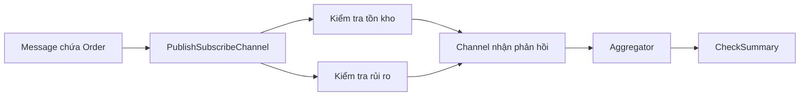

# Sequence header cho aggregator

Trong chương **PublishSubscribeChannel** của **SPRING_INTEGRATION_CORE**, bài này giải thích cách nối một điểm phát thông điệp đến nhiều nhánh với một aggregator thu kết quả. Trọng tâm là hợp đồng giữa `Message`, `MessageChannel` và các endpoint: thông điệp nào thuộc cùng một lượt xử lý, cần chờ bao nhiêu phản hồi và khi nào có thể tổng hợp kết quả.

Sau bài học, bạn có thể:

- Bật `applySequence` đúng chỗ trong Java configuration và Java DSL.
- Phân biệt `correlationId`, `sequenceNumber`, `sequenceSize` với mã nghiệp vụ và mã của từng message.
- Thiết kế luồng phát đến nhiều nhánh rồi gom kết quả mà không vô tình chờ một phản hồi không tồn tại.
- Nhận diện ảnh hưởng của filter, lỗi, retry, thông điệp trùng và sequence lồng nhau.

## 1. Bài toán: phát một yêu cầu, thu nhiều kết quả

Một đơn hàng cần được kiểm tra tồn kho và rủi ro trước khi trả kết quả cho bước xử lý tiếp theo. Cả hai nhánh đều nhận cùng thông tin đơn hàng, nhưng mỗi nhánh tạo một kết quả riêng.



Đối với thiết kế này, cần thống nhất ba điều:

1. Kết quả tồn kho và kết quả rủi ro của cùng một yêu cầu phải vào cùng nhóm.
2. Mỗi nhóm cần hai kết quả để hoàn thành bình thường.
3. Kết quả của hai yêu cầu khác nhau phải nằm ở hai nhóm khác nhau, kể cả khi phản hồi đến xen kẽ.

Đây là cách kết hợp các mẫu tích hợp doanh nghiệp Publish-Subscribe và Aggregator. Việc phát đến nhiều nhánh chưa quyết định chúng có chạy song song hay không; yếu tố đó phụ thuộc cấu hình thực thi.

## 2. Ba header tạo nên hợp đồng gom nhóm

Các tên header chuẩn được khai báo trong [`IntegrationMessageHeaderAccessor`](https://docs.spring.io/spring-integration/docs/current/api/org/springframework/integration/IntegrationMessageHeaderAccessor.html).

| Header trong message | Hằng Java | Ý nghĩa trong một sequence |
| --- | --- | --- |
| `correlationId` | `CORRELATION_ID` | Khóa liên kết các thành viên của cùng nhóm |
| `sequenceNumber` | `SEQUENCE_NUMBER` | Vị trí của thành viên, bắt đầu từ 1 |
| `sequenceSize` | `SEQUENCE_SIZE` | Số thành viên dự kiến của nhóm |

Với hai subscriber, có thể biểu diễn thông điệp ở đầu mỗi nhánh như sau:

```text
Nhánh tồn kho: correlationId=M42, sequenceNumber=1, sequenceSize=2
Nhánh rủi ro: correlationId=M42, sequenceNumber=2, sequenceSize=2
```

`M42` chỉ là ký hiệu dễ đọc trong bài. Với message thông thường, mã thực tế là một UUID.

### Phân biệt ba loại định danh

| Định danh | Ví dụ | Dùng để làm gì? |
| --- | --- | --- |
| `MessageHeaders.ID` của một message | UUID của yêu cầu hoặc của phản hồi | Nhận diện một message cụ thể |
| `correlationId` của lượt phát | ID của message đi vào channel phát | Liên kết các phản hồi thuộc lượt phát đó |
| Mã nghiệp vụ trong payload hoặc header riêng | `orderId=ORD-42` | Nhận diện đơn hàng trong miền nghiệp vụ |

Khi `applySequence=true`, dispatcher sử dụng ID của message đầu vào tại điểm phát làm correlation key cho sequence mới, rồi gán số thứ tự cho từng subscriber. Nếu message đã có correlation của một tầng ngoài, thông tin đó được quản lý theo cơ chế sequence lồng nhau, trình bày ở phần sau. Có thể đối chiếu hành vi tại [`BroadcastingDispatcher.dispatch()`](https://raw.githubusercontent.com/spring-projects/spring-integration/main/spring-integration-core/src/main/java/org/springframework/integration/dispatcher/BroadcastingDispatcher.java).

Không dùng `sequenceNumber=1` để suy ra một nhánh luôn là “tồn kho”. Khi thay đổi cấu hình subscriber, vị trí có thể thay đổi. Hãy dùng trường nghiệp vụ như `branch="stock"` để nhận diện loại kết quả.

## 3. Bật `applySequence` tại điểm phát

`PublishSubscribeChannel` mặc định không bổ sung sequence header. Điều này phù hợp với các luồng chỉ phát sự kiện đến những consumer độc lập, không cần gom phản hồi. Khi downstream dùng correlation và release strategy mặc định của aggregator, cần bật thuộc tính này. Xem [`PublishSubscribeChannel.setApplySequence()`](https://docs.spring.io/spring-integration/docs/current/api/org/springframework/integration/channel/PublishSubscribeChannel.html#setApplySequence(boolean)).

```java
@Bean
public PublishSubscribeChannel checks() {
    PublishSubscribeChannel channel = new PublishSubscribeChannel();
    channel.setApplySequence(true);
    return channel;
}
```

`applySequence` là **thuộc tính cấu hình của channel**, không phải tên một header cần tự thêm vào message. Trong XML, cùng cấu hình này được viết bằng `apply-sequence="true"`; trong Java DSL là `.applySequence(true)`.

Khi bật sequence, framework tạo message riêng cho các subscriber để chứa những header khác nhau. Các message này vẫn dùng chung tham chiếu payload đầu vào; framework không sao chép sâu đối tượng nghiệp vụ. Vì vậy, nên truyền payload bất biến hoặc bảo đảm từng nhánh không sửa đối tượng dùng chung. Đây là hành vi được mô tả trong [cấu hình PublishSubscribeChannel](https://docs.spring.io/spring-integration/reference/channel/configuration.html#publishsubscribechannel-configuration).

## 4. Aggregator sử dụng các header như thế nào?

Một aggregator có ba trách nhiệm cần tách bạch:

| Thành phần | Câu hỏi cần trả lời | Lựa chọn trong bài |
| --- | --- | --- |
| `CorrelationStrategy` | Message này thuộc nhóm nào? | Lấy `correlationId` |
| `ReleaseStrategy` | Nhóm đã đủ điều kiện để tổng hợp chưa? | Chờ số message bằng `sequenceSize` |
| `MessageGroupProcessor` | Tổng hợp những message đã gom thành kết quả gì? | Tạo `CheckSummary` |

Correlation mặc định dựa trên header `correlationId`. Cùng correlation key thì các phản hồi được đưa vào cùng `MessageGroup`; khác key thì tách nhóm. Aggregator giữ trạng thái của nhóm trong message store trong thời gian chờ. Xem [mô hình hoạt động của Aggregator](https://docs.spring.io/spring-integration/reference/aggregator.html#functionality).

Với chế độ thông thường không giải phóng từng phần sequence, release strategy mặc định là `SimpleSequenceSizeReleaseStrategy`. Strategy này so sánh số message trong nhóm với kích thước sequence dự kiến; nó **không kiểm tra trùng số thứ tự**. `sequenceNumber` vì thế không tự biến một luồng thành cơ chế xử lý đúng một lần. Xem [`SimpleSequenceSizeReleaseStrategy`](https://docs.spring.io/spring-integration/docs/current/api/org/springframework/integration/aggregator/SimpleSequenceSizeReleaseStrategy.html).

Trong ví dụ hai nhánh, giả sử không có bản trùng:

```text
Nhận stock(M42, 1/2): nhóm M42 có 1 message -> tiếp tục chờ.
Nhận fraud(M42, 2/2): nhóm M42 có 2 message -> tạo CheckSummary.
```

Nếu nhánh rủi ro đến trước, nhóm vẫn chờ cho đến khi nhận đủ hai message. Số thứ tự không phải điều kiện yêu cầu phản hồi phải đến tuần tự, cũng không phải cam kết rằng danh sách đầu ra tự được sắp theo số thứ tự.

## 5. Ví dụ Java configuration và Java DSL đầy đủ

Ví dụ dùng Java 17 trở lên và các API thuộc `spring-integration-core`. Trong dự án Spring Boot đã có parent hoặc BOM quản lý phiên bản, có thể dùng dependency sau; giữ các dependency Spring theo bộ phiên bản của ứng dụng.

```xml
<dependency>
    <groupId>org.springframework.boot</groupId>
    <artifactId>spring-boot-starter-integration</artifactId>
</dependency>
```

Lớp dưới đây có cấu hình channel, hai nhánh, aggregator và hàm `main()` gửi thử một yêu cầu. Không cần broker bên ngoài. Các `IntegrationFlow` phải được đăng ký thành bean để framework tạo và nối các endpoint, như mô tả trong [hướng dẫn Java DSL](https://docs.spring.io/spring-integration/reference/dsl.html).

```java
import java.util.Comparator;
import java.util.List;

import org.springframework.context.annotation.AnnotationConfigApplicationContext;
import org.springframework.context.annotation.Bean;
import org.springframework.context.annotation.Configuration;
import org.springframework.integration.channel.DirectChannel;
import org.springframework.integration.channel.PublishSubscribeChannel;
import org.springframework.integration.channel.QueueChannel;
import org.springframework.integration.config.EnableIntegration;
import org.springframework.integration.dsl.IntegrationFlow;
import org.springframework.integration.store.MessageGroup;
import org.springframework.integration.support.MessageBuilder;
import org.springframework.messaging.Message;
import org.springframework.messaging.MessageChannel;

@Configuration
@EnableIntegration
public class SequenceAggregationDemo {

    public record Order(String orderId, int quantity) {
    }

    public record CheckResult(
            String orderId, String branch, boolean accepted) {
    }

    public record CheckSummary(
            String orderId, List<CheckResult> results) {
    }

    @Bean
    public PublishSubscribeChannel checks() {
        PublishSubscribeChannel channel = new PublishSubscribeChannel();
        channel.setApplySequence(true);
        return channel;
    }

    @Bean
    public DirectChannel replies() {
        return new DirectChannel();
    }

    @Bean
    public QueueChannel results() {
        return new QueueChannel();
    }

    @Bean
    public IntegrationFlow stockCheck(
            PublishSubscribeChannel checks, DirectChannel replies) {
        return IntegrationFlow.from(checks)
                .<Order, CheckResult>transform(order -> new CheckResult(
                        order.orderId(),
                        "stock",
                        order.quantity() > 0 && order.quantity() <= 10))
                .channel(replies)
                .get();
    }

    @Bean
    public IntegrationFlow fraudCheck(
            PublishSubscribeChannel checks, DirectChannel replies) {
        return IntegrationFlow.from(checks)
                .<Order, CheckResult>transform(order -> new CheckResult(
                        order.orderId(),
                        "fraud",
                        order.quantity() > 0 && order.quantity() <= 5))
                .channel(replies)
                .get();
    }

    @Bean
    public IntegrationFlow aggregateReplies(
            DirectChannel replies, QueueChannel results) {
        return IntegrationFlow.from(replies)
                .aggregate(spec -> spec.outputProcessor(
                        SequenceAggregationDemo::summarize))
                .channel(results)
                .get();
    }

    private static CheckSummary summarize(MessageGroup group) {
        List<CheckResult> checks = group.getMessages().stream()
                .map(message -> (CheckResult) message.getPayload())
                .sorted(Comparator.comparing(CheckResult::branch))
                .toList();

        return new CheckSummary(checks.get(0).orderId(), checks);
    }

    public static void main(String[] args) {
        try (var context = new AnnotationConfigApplicationContext(
                SequenceAggregationDemo.class)) {
            MessageChannel input = context.getBean(
                    "checks", MessageChannel.class);
            QueueChannel output = context.getBean(
                    "results", QueueChannel.class);

            Message<Order> request = MessageBuilder
                    .withPayload(new Order("ORD-42", 2))
                    .build();

            if (!input.send(request)) {
                throw new IllegalStateException("Không gửi được yêu cầu");
            }

            Message<?> response = output.receive(1000);
            if (response == null) {
                throw new IllegalStateException("Chưa nhận được bản tổng hợp");
            }

            System.out.println(response.getPayload());
        }
    }
}
```

Kết quả mong đợi:

```text
CheckSummary[orderId=ORD-42, results=[CheckResult[orderId=ORD-42, branch=fraud, accepted=true], CheckResult[orderId=ORD-42, branch=stock, accepted=true]]]
```

Điểm cần đọc từ cấu hình:

- `checks` có hai subscriber trực tiếp: endpoint đầu của `stockCheck` và `fraudCheck`. Vì thế sequence có kích thước 2.
- Mỗi transformer trả một payload `CheckResult`; phần xử lý reply của framework giữ những header cần thiết từ yêu cầu nếu không có cấu hình loại bỏ hoặc ghi đè chúng.
- Cả hai nhánh đều chuyển kết quả tới `replies`. Channel này có một consumer là aggregator, nên mọi phản hồi đều đi đến cùng điểm gom.
- `outputProcessor` chỉ định hình kết quả. Bài không tùy biến correlation và release strategy, nên vẫn dùng hợp đồng sequence mặc định.
- `summarize()` chủ động sắp theo tên nhánh để kết quả dễ đọc, không dựa vào thứ tự collection của nhóm.
- Điều kiện `accepted` chỉ mô phỏng nghiệp vụ. Cả kết quả chấp nhận và từ chối đều là phản hồi hợp lệ cần được gom.

API cấu hình bộ tổng hợp được mô tả tại [`AggregatorSpec.outputProcessor()`](https://docs.spring.io/spring-integration/docs/current/api/org/springframework/integration/dsl/AggregatorSpec.html#outputProcessor(org.springframework.integration.aggregator.MessageGroupProcessor)).

### Biến thể: khai báo các subscriber ngay trong Java DSL

Có thể thay ba bean `checks`, `stockCheck`, `fraudCheck` ở ví dụ trên bằng flow dưới đây. Giữ các bean `replies`, `results`, `aggregateReplies`, các record và hàm `summarize()`. Khi dùng biến thể này, gửi đầu vào tới bean channel `requestInput` thay vì `checks`.

```java
@Bean
public IntegrationFlow requestFlow(DirectChannel replies) {
    return IntegrationFlow.from("requestInput")
            .publishSubscribeChannel(spec -> spec
                    .applySequence(true)
                    .subscribe(branch -> branch
                            .<Order, CheckResult>transform(order ->
                                    new CheckResult(order.orderId(), "stock",
                                            order.quantity() > 0
                                                    && order.quantity() <= 10))
                            .channel(replies))
                    .subscribe(branch -> branch
                            .<Order, CheckResult>transform(order ->
                                    new CheckResult(order.orderId(), "fraud",
                                            order.quantity() > 0
                                                    && order.quantity() <= 5))
                            .channel(replies)))
            .get();
}
```

`subscribe(...)` đăng ký subflow làm subscriber; `applySequence(true)` nằm trên đặc tả channel phát. Cả hai nhánh vẫn phải định tuyến phản hồi về `replies`. Xem [`PublishSubscribeSpec`](https://docs.spring.io/spring-integration/docs/current/api/org/springframework/integration/dsl/PublishSubscribeSpec.html).

## 6. Quan sát một lượt gom nhóm

Giả sử gửi hai yêu cầu A và B. `MA` và `MB` là ID của hai message tại đầu vào channel phát. Trong một cấu hình thực thi bất đồng bộ, thứ tự tới aggregator có thể như sau:

| Lần nhận | Payload | `correlationId` | `sequenceNumber` | `sequenceSize` | Trạng thái sau khi nhận |
| --- | --- | --- | --- | --- | --- |
| 1 | Kết quả rủi ro của A | MA | 2 | 2 | Nhóm MA có 1 kết quả |
| 2 | Kết quả tồn kho của B | MB | 1 | 2 | Nhóm MB có 1 kết quả |
| 3 | Kết quả tồn kho của A | MA | 1 | 2 | Nhóm MA đủ 2, tạo tổng hợp cho A |
| 4 | Kết quả rủi ro của B | MB | 2 | 2 | Nhóm MB đủ 2, tạo tổng hợp cho B |

Bảng là tình huống minh họa, không phải cam kết về thứ tự subscriber. Nó cho thấy vì sao chỉ kiểm tra “đã có hai message” trên một danh sách toàn cục là sai: ở lần nhận thứ hai, hai message đang thuộc hai yêu cầu khác nhau.

Khi gỡ lỗi, nên ghi nhận tại đầu mỗi nhánh và ngay trước aggregator:

```text
messageId, correlationId, sequenceNumber, sequenceSize,
orderId, branch, thời điểm nhận, tên thread
```

Nếu có nhiều lần chạy trên cùng đơn hàng, bổ sung mã lượt chạy riêng để đối chiếu nghiệp vụ. `sequenceNumber` chỉ có ý nghĩa khi đi cùng correlation của nó.

## 7. Giữ nguyên metadata khi tạo phản hồi

Một lỗi thường gặp là nhánh tự gửi kết quả bằng một message hoàn toàn mới:

```java
// incoming là message mà nhánh vừa nhận từ PublishSubscribeChannel.
CheckResult result = new CheckResult("ORD-42", "stock", true);

// Không có thao tác sao chép header từ incoming.
replies.send(new org.springframework.messaging.support.GenericMessage<>(result));
```

Ở đây, `GenericMessage` mới không mang correlation và sequence của `incoming`. Aggregator dùng correlation mặc định không thể liên kết nó đúng với nhánh còn lại.

Nếu đang viết mã tự tạo và tự gửi message, hãy sao chép header cần thiết:

```java
Message<CheckResult> reply = MessageBuilder.withPayload(result)
        .copyHeaders(incoming.getHeaders())
        .build();

replies.send(reply);
```

Không cố giữ lại `id` của message đầu vào bằng cách sửa header hệ thống. Builder mặc định coi `id` và `timestamp` là những header chỉ đọc khi sao chép; phản hồi có danh tính riêng trong khi vẫn giữ correlation. Hành vi sao chép được thể hiện trong [`BaseMessageBuilder`](https://raw.githubusercontent.com/spring-projects/spring-integration/6.5.x/spring-integration-core/src/main/java/org/springframework/integration/support/BaseMessageBuilder.java).

Trong một transformer thông thường, trả payload như ví dụ chính giúp framework xây reply. Nếu tự trả cả `Message`, lọc header hoặc đi qua giao thức ngoài tiến trình, phải kiểm soát metadata thực tế còn lại. Xem [hợp đồng đầu vào và đầu ra của Transformer](https://docs.spring.io/spring-integration/reference/transformer.html#configuring-a-transformer-with-xml).

## 8. Khi số phản hồi không khớp `sequenceSize`

### 8.1. Thêm subscriber chỉ để ghi audit

Giả sử bổ sung một subscriber thứ ba trên `checks` chỉ ghi log rồi kết thúc. Lúc này channel phát cho ba subscriber nên mỗi nhánh mang `sequenceSize=3`. Tuy nhiên, chỉ có tồn kho và rủi ro gửi phản hồi về aggregator.

```text
Số subscriber tại điểm phát:       3
Số phản hồi gửi vào aggregator:    2
Số phản hồi dự kiến theo header:   3
```

Theo hợp đồng chờ đủ phản hồi, nhóm sẽ chưa hoàn thành. Có thể chọn một trong các thiết kế sau:

- Tách audit khỏi tập nhánh cần gom, chẳng hạn đặt wire tap ở phía trước điểm phát kiểm tra.
- Cho audit trả một kết quả nếu nghiệp vụ thật sự yêu cầu chờ xác nhận audit.
- Dùng release strategy riêng thể hiện chính xác tập kết quả cần chờ.

Không sửa `sequenceSize` tùy tiện ở từng nhánh để “làm cho đủ”; các phản hồi trong cùng sequence phải thống nhất về hợp đồng hoàn thành.

### 8.2. Filter loại một phản hồi

Một đơn bị từ chối vì thiếu tồn kho vẫn cần một kết quả `accepted=false`. Nếu dùng filter để bỏ hoàn toàn kết quả âm, aggregator chỉ nhận phản hồi rủi ro và tiếp tục chờ.

Trong thiết kế ví dụ, nên mô hình hóa kết quả của từng nhánh thành dữ liệu, kể cả trạng thái từ chối, bỏ qua có chủ đích hoặc không áp dụng. Việc một nhánh không đồng ý về nghiệp vụ không đồng nghĩa với việc nhánh đó không phản hồi.

Nếu nghiệp vụ thực sự loại thành viên khỏi tập cần gom, phải thay đổi thiết kế release hoặc có thông điệp bù tương ứng, thay vì vẫn dựa vào kích thước sequence ban đầu.

### 8.3. Một nhánh sinh nhiều phản hồi hoặc gửi trùng

Giả sử sequence dự kiến có hai thành viên, nhưng aggregator nhận:

```text
stock lần đầu:  correlationId=M42, sequenceNumber=1, sequenceSize=2
stock bản trùng: correlationId=M42, sequenceNumber=1, sequenceSize=2
fraud:          chưa đến
```

Nếu hai kết quả tồn kho là hai message riêng được chấp nhận vào nhóm, số message đã đạt 2. Strategy đơn giản có thể giải phóng nhóm dù chưa có phản hồi rủi ro. Đây là hệ quả của cách đếm, không phải cơ chế xác nhận đủ các loại nhánh. Có thể đối chiếu phép so sánh trong [mã nguồn `SimpleSequenceSizeReleaseStrategy`](https://raw.githubusercontent.com/spring-projects/spring-integration/6.5.x/spring-integration-core/src/main/java/org/springframework/integration/aggregator/SimpleSequenceSizeReleaseStrategy.java).

Trong hệ thống có retry hoặc delivery trùng, cần quy định khóa chống trùng, chẳng hạn `(executionId, branch)`, và release dựa trên các nhánh bắt buộc nếu đó là điều kiện nghiệp vụ. Đồng thời phải quyết định giữ kết quả đầu tiên, kết quả cuối cùng hay từ chối bản trùng.

Với nhánh có splitter nội bộ, nên gom kết quả nội bộ về một phản hồi của nhánh rồi mới đưa vào điểm gom bên ngoài. Khi đó hợp đồng “mỗi subscriber đóng góp một phản hồi” được duy trì.

## 9. Lỗi thực thi và thời gian chờ là hai vấn đề riêng

Không có executor, `PublishSubscribeChannel` gọi các handler trên thread của bên gửi. Một exception ở handler có thể ngăn các handler phía sau được gọi khi dùng chế độ lỗi mặc định. Có executor, những handler khác có thể vẫn chạy trên các thread riêng. `ignoreFailures=true` không tạo ra phản hồi thay thế cho nhánh lỗi. Xem [`BroadcastingDispatcher`](https://docs.spring.io/spring-integration/docs/current/api/org/springframework/integration/dispatcher/BroadcastingDispatcher.html).

Với luồng bất đồng bộ, lỗi có thể được chuyển đến `errorChannel` theo cơ chế xử lý lỗi của framework. Một `ErrorMessage` trên error channel không tự trở thành `CheckResult` trong nhóm đang chờ; nếu chọn khôi phục bằng phản hồi lỗi, flow khôi phục phải tạo kết quả và giữ đúng correlation, sequence cùng định danh nhánh. Xem [Error Handling](https://docs.spring.io/spring-integration/reference/error-handling.html).

### Thêm chính sách nhóm hết thời gian chờ

Có thể thay bean `aggregateReplies` bằng cấu hình dưới đây và bổ sung bean `expiredReplies`. Các phần còn lại giữ như ví dụ chính:

```java
@Bean
public QueueChannel expiredReplies() {
    return new QueueChannel();
}

@Bean
public IntegrationFlow aggregateReplies(
        DirectChannel replies,
        @org.springframework.beans.factory.annotation.Qualifier("results")
        QueueChannel results,
        @org.springframework.beans.factory.annotation.Qualifier("expiredReplies")
        QueueChannel expiredReplies) {
    return IntegrationFlow.from(replies)
            .aggregate(spec -> spec
                    .groupTimeout(3000)
                    .sendPartialResultOnExpiry(false)
                    .expireGroupsUponTimeout(false)
                    .discardChannel(expiredReplies)
                    .outputProcessor(SequenceAggregationDemo::summarize))
            .channel(results)
            .get();
}
```

`groupTimeout(3000)` đặt thời gian chờ theo nhóm. Khi hết hạn mà nhóm vẫn không đủ điều kiện release, cấu hình này đưa các message đã nhận sang discard channel, không tạo `CheckSummary` thiếu kết quả. `.expireGroupsUponTimeout(false)` giữ dấu trạng thái nhóm sau khi hoàn tất vì timeout để phản hồi đến muộn không mở lại nhóm ngay. Các tùy chọn DSL được mô tả trong [`CorrelationHandlerSpec`](https://docs.spring.io/spring-integration/docs/current/api/org/springframework/integration/dsl/CorrelationHandlerSpec.html).

Cần hiểu đúng phạm vi thời gian chờ:

- Khoảng chờ hằng số được lên lịch lại khi có message mới đến nhóm chưa hoàn thành; nó không mặc nhiên là hạn chót tính từ lúc gửi yêu cầu.
- Nếu mọi nhánh đều im lặng và chưa message nào tới aggregator, chưa có nhóm để timeout của aggregator xử lý.
- Timeout nhóm không hủy tác vụ đang chạy ở nhánh; timeout kết nối hoặc lời gọi dịch vụ phải được cấu hình ở vị trí gọi tương ứng.
- Một bản tổng hợp từng phần chỉ phù hợp khi đầu ra biểu diễn rõ các nhánh còn thiếu và bên nhận chấp nhận trạng thái đó.

Phần lịch và hoàn tất nhóm được giải thích trong [Aggregator and Group Timeout](https://docs.spring.io/spring-integration/reference/aggregator.html#aggregator-and-group-timeout).

Ví dụ dùng queue để dễ quan sát discard. Trong ứng dụng thực tế, cần consumer đọc queue này và chính sách dọn metadata của các nhóm đã hoàn tất, chẳng hạn dùng reaper với thời gian giữ phù hợp. Không giữ vô hạn trạng thái nhóm chỉ để chặn mọi phản hồi đến muộn.

## 10. Sequence lồng nhau và `sequenceDetails`

Một luồng phức tạp hơn có thể tách đơn hàng thành các dòng hàng, rồi phát mỗi dòng đến hai nhánh kiểm tra:

```text
Order
  -> Splitter: tạo N dòng hàng
      -> PublishSubscribeChannel: hai kiểm tra cho mỗi dòng
          -> Aggregator trong: một kết quả cho mỗi dòng
              -> Aggregator ngoài: một kết quả cho cả đơn
```

Tại đây tồn tại hai tầng correlation:

| Vị trí | Correlation đang có hiệu lực | Số thứ tự và kích thước |
| --- | --- | --- |
| Sau splitter | Nhóm các dòng của đơn | `i/N` |
| Trong hai nhánh kiểm tra của dòng i | Nhóm kiểm tra riêng của dòng i | `1/2` và `2/2` |
| Sau aggregator trong | Khôi phục ngữ cảnh các dòng của đơn | `i/N` |
| Sau aggregator ngoài | Hoàn tất tầng gom dòng | Không dùng lại sequence nội bộ như sequence của một công việc mới |

Framework có `sequenceDetails` để lưu các tầng sequence trước đó. Các thao tác `pushSequenceDetails()` và `popSequenceDetails()` hỗ trợ chuyển vào và ra khỏi tầng hiện tại. Không nên tự ghi đè bộ ba header ngoài rồi bỏ mất ngữ cảnh cần cho aggregator tiếp theo. Xem [`MessageBuilder`](https://docs.spring.io/spring-integration/docs/current/api/org/springframework/integration/support/MessageBuilder.html).

Aggregator thông thường xử lý việc pop ngữ cảnh sequence khi tạo đầu ra. Tùy chọn `popSequence` điều khiển hành vi này; việc khôi phục còn phụ thuộc dạng đầu ra, đặc biệt khi bộ tổng hợp tự trả `Message` hoặc một collection chứa message. Khi tùy biến sâu, cần giữ đúng hợp đồng của tầng kế tiếp. API [`AbstractCorrelatingMessageHandler.setPopSequence()`](https://docs.spring.io/spring-integration/docs/current/api/org/springframework/integration/aggregator/AbstractCorrelatingMessageHandler.html#setPopSequence(boolean)) mô tả mục đích của tùy chọn.

Với người mới, cách dễ kiểm soát là mỗi tầng có điểm phát và điểm gom tương ứng, còn bộ tổng hợp trả một payload nghiệp vụ như `CheckSummary`. Không tắt `popSequence` chỉ để giữ header phục vụ log; có thể lưu mã theo dõi nghiệp vụ trong một trường riêng.

## 11. Correlation kỹ thuật và correlation nghiệp vụ

Trong ví dụ, hai message yêu cầu mới cho cùng `orderId=ORD-42` có ID khác nhau. Mỗi message được phát thành một sequence riêng, nên kết quả của hai lượt không tự trộn vào nhau.

Nếu tùy biến aggregator theo mã đơn hàng:

```java
// Đoạn cấu hình minh họa; chỉ dùng khi orderId thật sự nhận diện một nhóm.
.aggregate(spec -> spec
        .correlationExpression("payload.orderId")
        .outputProcessor(SequenceAggregationDemo::summarize))
```

thì các lần xử lý đồng thời của cùng đơn hàng có thể vào chung một nhóm. Một khóa như `orderId + executionId` thường diễn đạt tốt hơn khi hệ thống cho phép kiểm tra lại. Đổi correlation strategy cũng không tự giải quyết trường hợp thiếu hoặc trùng phản hồi; chính sách release vẫn là một quyết định độc lập.

Chọn khóa nên dựa vào câu hỏi: “Một kết quả tổng hợp đại diện cho đơn hàng trong toàn bộ vòng đời, hay cho một lần thực hiện một tác vụ trên đơn hàng?”.

## 12. Kiểm thử hành vi của sequence và điểm gom

Các đoạn sau là mã thực hành cho người học; cần JUnit Jupiter trong dependency test. Chúng dùng channel trong bộ nhớ và context từ ví dụ chính, không cần gọi dịch vụ thật.

### 12.1. Kiểm tra header được tạo ở điểm phát

```java
import java.util.ArrayList;
import java.util.List;
import java.util.Set;
import java.util.stream.Collectors;

import org.junit.jupiter.api.Test;
import org.springframework.integration.IntegrationMessageHeaderAccessor;
import org.springframework.integration.channel.PublishSubscribeChannel;
import org.springframework.integration.support.MessageBuilder;
import org.springframework.messaging.Message;

import static org.junit.jupiter.api.Assertions.*;

class PublishSubscribeSequenceTest {

    @Test
    void createsOneSequenceWithTwoMembers() {
        PublishSubscribeChannel channel = new PublishSubscribeChannel();
        channel.setApplySequence(true);

        // Không có executor: các callback chạy trên thread gửi message.
        List<Message<?>> received = new ArrayList<>();
        channel.subscribe(message -> received.add(message));
        channel.subscribe(message -> received.add(message));

        Message<String> request = MessageBuilder.withPayload("ORD-42").build();
        assertTrue(channel.send(request));
        assertEquals(2, received.size());

        for (Message<?> message : received) {
            assertEquals(request.getHeaders().getId(),
                    message.getHeaders().get(
                            IntegrationMessageHeaderAccessor.CORRELATION_ID));
            assertEquals(Integer.valueOf(2), message.getHeaders().get(
                    IntegrationMessageHeaderAccessor.SEQUENCE_SIZE,
                    Integer.class));
            assertSame(request.getPayload(), message.getPayload());
        }

        Set<Integer> numbers = received.stream()
                .map(message -> message.getHeaders().get(
                        IntegrationMessageHeaderAccessor.SEQUENCE_NUMBER,
                        Integer.class))
                .collect(Collectors.toSet());

        assertEquals(Set.of(1, 2), numbers);
        assertNotSame(received.get(0), received.get(1));
    }
}
```

Phép kiểm tra tập số thứ tự tránh gắn một nhánh nghiệp vụ vào thứ tự callback cụ thể. `assertSame` đối với payload ghi nhận hành vi chia sẻ tham chiếu, không khuyến khích sửa đối tượng đó.

### 12.2. Kiểm tra nhận một bản tổng hợp đủ hai nhánh

```java
import java.util.Set;
import java.util.stream.Collectors;

import org.junit.jupiter.api.Test;
import org.springframework.context.annotation.AnnotationConfigApplicationContext;
import org.springframework.integration.channel.QueueChannel;
import org.springframework.integration.support.MessageBuilder;
import org.springframework.messaging.Message;
import org.springframework.messaging.MessageChannel;

import static org.junit.jupiter.api.Assertions.*;

class SequenceAggregationFlowTest {

    @Test
    void returnsOneSummaryContainingBothBranches() {
        try (var context = new AnnotationConfigApplicationContext(
                SequenceAggregationDemo.class)) {
            MessageChannel input = context.getBean(
                    "checks", MessageChannel.class);
            QueueChannel output = context.getBean(
                    "results", QueueChannel.class);

            assertTrue(input.send(MessageBuilder.withPayload(
                    new SequenceAggregationDemo.Order("ORD-42", 2)).build()));

            Message<?> reply = output.receive(1000);
            assertNotNull(reply);
            var summary = assertInstanceOf(
                    SequenceAggregationDemo.CheckSummary.class,
                    reply.getPayload());

            assertEquals("ORD-42", summary.orderId());
            assertEquals(2, summary.results().size());
            assertEquals(Set.of("stock", "fraud"), summary.results().stream()
                    .map(SequenceAggregationDemo.CheckResult::branch)
                    .collect(Collectors.toSet()));

            // Luồng mẫu đồng bộ: mọi nhánh đã xử lý khi send() trả về.
            assertNull(output.receive(0));
        }
    }
}
```

### Các tình huống cần bổ sung khi áp dụng thực tế

| Tình huống | Kỳ vọng cần xác minh |
| --- | --- |
| Phản hồi nhánh 2 đến trước nhánh 1 | Chỉ có một tổng hợp sau khi đủ cả hai |
| Hai yêu cầu có phản hồi xen kẽ | Mỗi tổng hợp chứa kết quả của đúng yêu cầu |
| Hai lượt kiểm tra trên cùng đơn hàng | Không trộn lượt nếu nghiệp vụ yêu cầu tách lượt |
| Một nhánh không phản hồi | Thực thi đúng chính sách timeout, discard hoặc kết quả thiếu |
| Một nhánh trả `accepted=false` | Vẫn đủ phản hồi và kết quả âm được giữ trong tổng hợp |
| Nhánh gửi trùng phản hồi | Không nhầm bản trùng với nhánh còn thiếu theo chính sách chống trùng đã chọn |
| Thêm subscriber audit | Không làm nhóm bị chờ sai kích thước |
| Phản hồi tới sau khi nhóm đã hết hạn | Không tạo kết quả thứ hai trái với chính sách vòng đời nhóm |

Các phép kiểm tra đảo thứ tự hoặc xen kẽ có thể thực hiện bằng cách cấp các message mang header kiểm soát trực tiếp vào `replies` trong một context test riêng. Với executor, cần thu thập kết quả bằng cấu trúc an toàn cho nhiều thread và dùng cơ chế chờ có giới hạn; không dùng `ArrayList` của bài kiểm tra đồng bộ để nhận callback đồng thời.

## 13. Thực hành thiết kế

Từ ví dụ chính, thực hiện lần lượt:

1. Gửi đơn hàng số lượng 7. Giữ hai phản hồi và quan sát `fraud.accepted=false`, thay vì lọc bỏ phản hồi đó.
2. Thêm nhánh `pricing` có trả kết quả về `replies`. Kiểm tra kích thước sequence và bản tổng hợp đều thành 3.
3. Thêm subscriber chỉ ghi audit, không gửi phản hồi. Giải thích vì sao hợp đồng đếm ban đầu không còn đúng, rồi tách audit khỏi tập kiểm tra cần gom.
4. Mô phỏng mất một phản hồi và áp dụng cấu hình timeout. Quan sát discard channel cùng hành vi của phản hồi đến muộn.
5. Mô phỏng hai kết quả từ cùng nhánh. Xác định khóa chống trùng và điều kiện hoàn thành phù hợp trước khi thay release strategy.

Kết quả cần đạt là giải thích được cả đường đi bình thường lẫn trường hợp nhóm chưa đủ phản hồi, thay vì chỉ quan sát một lần chạy thành công.

## 14. Các nguyên tắc cần nhớ

- Bật `applySequence` tại điểm phát khi muốn dùng aggregator dựa trên sequence.
- `correlationId` trả lời “cùng lượt nào”; `sequenceSize` trả lời “dự kiến bao nhiêu”; `sequenceNumber` nhận diện vị trí trong lượt đó.
- Giữ tương ứng giữa subscriber được tính vào sequence và phản hồi thật sự đưa về điểm gom.
- Bảo toàn metadata qua các nhánh; không xem thông điệp bị lọc hoặc lỗi là một phản hồi đã được gom.
- Quy định riêng về chống trùng, thời gian chờ và phản hồi đến muộn; header sequence không thay thế các chính sách này.
- Khi có nhiều tầng phát và gom, giữ đúng ngữ cảnh sequence của từng tầng.
