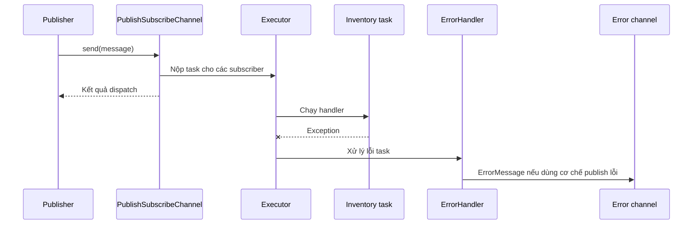

# Exception từ subscriber

Trong chương **PublishSubscribeChannel** của **SPRING_INTEGRATION_CORE**, bài này giải thích điều gì xảy ra khi một subscriber ném exception và cách thiết kế nhánh xử lý lỗi phù hợp. Mục tiêu là nối hành vi của `MessageChannel`, endpoint và Java DSL với yêu cầu thực tế: một nhánh thất bại có được phép cản các nhánh khác, ai nhận thông báo lỗi, và nhánh nào cần thực hiện lại.

Các ví dụ dùng Java 17 và API Spring Integration 6.5.x. Phần retry dùng Spring Retry tương ứng với dòng phiên bản này. Khi tích hợp vào ứng dụng, sử dụng bộ dependency tương thích do dự án quản lý; không trộn ví dụ retry giữa các dòng phiên bản có cơ chế retry khác nhau.

## 1. Đặt câu hỏi ở đúng ranh giới thực thi

Giả sử ứng dụng phát sự kiện `OrderCreated` đến ba subscriber:

- **Audit** ghi nhận sự kiện.
- **Inventory** giữ hàng.
- **Email** gửi thư xác nhận.

Nếu Inventory ném exception, cần phân biệt ba kết quả: Audit đã thực hiện đến đâu, Email có được gọi không, và lời gọi `send()` nhìn thấy kết quả nào. `PublishSubscribeChannel` phát message đến các handler đã subscribe, nhưng cơ chế broadcast tự nó không cung cấp một giao dịch nghiệp vụ bao trùm ba tác vụ.

Điểm đầu tiên cần kiểm tra là có executor tại channel hay không:

| Cấu hình | Nơi chạy handler trực tiếp được channel gọi | Hệ quả chính khi handler ném lỗi |
| --- | --- | --- |
| Không có executor, `ignoreFailures=false` | Thread gọi `send()` | Exception lan lên caller; có thể chặn các subscriber còn lại |
| Không có executor, `ignoreFailures=true` | Thread gọi `send()` | Dispatcher ghi cảnh báo cho lỗi được bỏ qua và tiếp tục thử subscriber khác |
| Có executor thực hiện trên worker, `ignoreFailures=false` | Task trên worker | Lỗi xử lý được chuyển cho `ErrorHandler`; các task khác có thể vẫn chạy |
| Có executor thực hiện trên worker, `ignoreFailures=true` | Task trên worker | Lỗi bị dispatcher bỏ qua sẽ không tiếp tục đến `ErrorHandler` |

Bảng giả định lỗi là `RuntimeException` phát sinh trong quá trình gọi handler. Lỗi khi nộp task cho executor là một trường hợp riêng. Quy tắc fail fast và bỏ qua lỗi được mô tả trong [API BroadcastingDispatcher](https://docs.spring.io/spring-integration/api/org/springframework/integration/dispatcher/BroadcastingDispatcher.html).

Một flow còn có thể đổi thread ở sâu bên trong subscriber, chẳng hạn đi qua một `ExecutorChannel` khác. Khi đó, phải tìm ranh giới bất đồng bộ thực sự, thay vì suy luận toàn bộ flow chỉ từ channel đầu tiên.

## 2. Đồng bộ: exception quay lại caller

Với `new PublishSubscribeChannel()`, channel gọi handler trong thread gửi. Nếu một handler ném exception và `ignoreFailures` vẫn là `false`, dispatcher dừng tại lỗi đó. Những handler đã chạy trước không được tự động hoàn tác.

Trong ví dụ này, thứ tự được tạo bằng các lời gọi `subscribe()` trực tiếp, nối tiếp nhau. Đây là thứ tự minh họa; không nên dựa vào thứ tự khai báo các bean để tạo quan hệ phụ thuộc nghiệp vụ.

```java
import java.util.ArrayList;
import java.util.List;

import org.springframework.integration.channel.PublishSubscribeChannel;
import org.springframework.messaging.MessageHandlingException;
import org.springframework.messaging.MessagingException;
import org.springframework.messaging.support.GenericMessage;

public class SubscriberFailureDemo {

    public static void main(String[] args) throws Exception {
        demonstrate(false);
        demonstrate(true);
    }

    private static void demonstrate(boolean ignoreFailures) throws Exception {
        List<String> trace = new ArrayList<>();

        PublishSubscribeChannel channel = new PublishSubscribeChannel();
        channel.setIgnoreFailures(ignoreFailures);
        channel.afterPropertiesSet();

        channel.subscribe(message -> trace.add("audit"));

        channel.subscribe(message -> {
            trace.add("inventory");
            throw new MessageHandlingException(
                    message, "Inventory temporarily unavailable");
        });

        channel.subscribe(message -> trace.add("email"));

        try {
            boolean sent = channel.send(new GenericMessage<>("ORDER-42"));
            System.out.println("sent=" + sent);
        }
        catch (MessagingException ex) {
            System.out.println("exception=" + ex.getClass().getSimpleName());
        }

        System.out.println("ignoreFailures=" + ignoreFailures);
        System.out.println("trace=" + trace);
    }
}
```

Các kết quả cần quan sát:

| Lần chạy | Trace | Caller |
| --- | --- | --- |
| `ignoreFailures=false` | `[audit, inventory]` | Nhận `MessagingException`; không nhận giá trị boolean từ lời gọi bị lỗi |
| `ignoreFailures=true` | `[audit, inventory, email]` | `send()` trả `true` với `minSubscribers` mặc định |

Trong lần thứ hai, `true` không chứng minh Inventory thành công. Một tác vụ đã thất bại và bị bỏ qua. Cũng không nên bắt buộc caller luôn nhận đúng kiểu exception nghiệp vụ ban đầu: endpoint và channel có thể bổ sung ngữ cảnh bằng các exception thuộc hệ thống messaging. Khi điều tra, cần xem cả `cause` và failed message.

### Header errorChannel không tự bắt lỗi đồng bộ

Đoạn sau chỉ gắn nơi nhận lỗi vào message:

```java
Message<?> request = MessageBuilder.withPayload("ORDER-42")
        .setHeader(MessageHeaders.ERROR_CHANNEL, errors)
        .build();
```

Nó không biến lời gọi đồng bộ thành cơ chế bắt lỗi và phát `ErrorMessage`. Nếu không có executor ở `PublishSubscribeChannel`, `ErrorHandler` cấu hình trên channel không được áp dụng. Caller cần xử lý exception hoặc một thành phần bao ngoài, chẳng hạn gateway được cấu hình xử lý lỗi, cần chuyển đổi lỗi theo hợp đồng riêng. Đây là phân biệt được nêu trong [API PublishSubscribeChannel](https://docs.spring.io/spring-integration/api/org/springframework/integration/channel/PublishSubscribeChannel.html).

Nếu lời gọi vào flow đi qua `@MessagingGateway`, hãy kiểm tra thêm cấu hình lỗi và hợp đồng trả lời của gateway. Không đồng nhất việc gửi trực tiếp bằng `MessageChannel.send()` với mọi cách gọi qua gateway.

## 3. ignoreFailures là chính sách bỏ qua lỗi

`ignoreFailures=true` hữu ích khi sản phẩm cho phép một nhánh thất bại mà quá trình phát sự kiện vẫn tiếp tục. Ví dụ, lỗi đồng bộ ở nhánh cập nhật thống kê có thể được chấp nhận sau khi tác vụ chính đã hoàn tất.

Cần hiểu chính xác chi phí của lựa chọn đó:

- Handler lỗi không được channel tự động chạy lại.
- Không có kết quả thay thế được tự sinh cho nhánh lỗi.
- Lỗi bị bỏ qua không còn đi tiếp ra ngoài dispatcher để cơ chế bắt lỗi ở tầng ngoài xử lý.
- Không có bảo đảm rằng mọi loại lỗi đều bị bỏ qua. Trong triển khai 6.5.0, `invokeHandler()` bắt `RuntimeException`, không phải mọi `Throwable`.

Điểm cuối được đối chiếu với [mã nguồn BroadcastingDispatcher 6.5.0](https://raw.githubusercontent.com/spring-projects/spring-integration/v6.5.0/spring-integration-core/src/main/java/org/springframework/integration/dispatcher/BroadcastingDispatcher.java). Không dùng cờ này như một cơ chế phục hồi sau lỗi nghiêm trọng của JVM.

Một lỗi cấu hình thường gặp là bật `ignoreFailures=true` trên channel dùng executor rồi chờ một `ErrorMessage` từ chính lỗi đã bị bỏ qua. Cờ này làm mất đường truyền lỗi đó. Nếu cần lưu lỗi có cấu trúc để điều tra hoặc thực hiện lại, nên giữ `ignoreFailures=false` và thiết kế error flow.

## 4. Bất đồng bộ: tách kết quả gửi và kết quả xử lý

Với executor thực sự chuyển task sang worker, caller không còn ở cùng call stack với handler lỗi:



Sơ đồ chỉ thể hiện một lịch thực thi có thể xảy ra. Worker có thể bắt đầu hoặc thất bại trước khi `send()` trả về. Điều cần nhớ là giá trị trả về không đợi tổng hợp kết quả nghiệp vụ của mọi worker.

Khi channel là bean được Spring khởi tạo, cơ chế mặc định bảo vệ task và chuyển lỗi cho error handler. Việc khởi tạo này có ý nghĩa thực tế: không nên tạo channel bất đồng bộ bằng `new`, bỏ qua lifecycle, rồi kỳ vọng có đủ hạ tầng xử lý lỗi. Có thể xem việc bọc executor trong [mã nguồn PublishSubscribeChannel 6.5.0](https://raw.githubusercontent.com/spring-projects/spring-integration/v6.5.0/spring-integration-core/src/main/java/org/springframework/integration/channel/PublishSubscribeChannel.java).

Với `MessagePublishingErrorHandler` mặc định, lỗi được biểu diễn bằng `ErrorMessage`, có payload là `Throwable`. Đích nhận được chọn từ header `errorChannel` trên failed request nếu có; nếu không có, cơ chế mặc định dùng bean toàn cục mang tên `errorChannel`. Xem [Error Handling](https://docs.spring.io/spring-integration/reference/error-handling.html).

Từ đó có hai quy tắc vận hành:

1. `try/catch` quanh `send()` vẫn cần cho lỗi phát message, nhưng không phải nơi thu nhận toàn bộ lỗi xử lý trên worker.
2. Cần một đường tiếp nhận lỗi có consumer, ngữ cảnh điều tra và chính sách xử lý rõ ràng.

## 5. Ví dụ đầy đủ: ba nhánh và một kênh nhận lỗi

Ví dụ sau dùng `spring-integration-core` và hạ tầng Spring Context. Có thể đặt cả lớp vào một ứng dụng thử nghiệm có Java 17 và bộ dependency Spring Integration 6.5.x tương thích.

Thiết kế minh họa:

- Channel `orderEvents` dùng pool ba worker và yêu cầu có subscriber.
- Ba endpoint subscribe qua Java DSL.
- Inventory cố ý lỗi với đơn hàng `FAIL-42`.
- Message mang tham chiếu tới `orderErrors` trong header.
- Chương trình đọc một lỗi bằng `receive(timeout)`, không dùng `Thread.sleep()`.

```java
import java.util.concurrent.Executor;

import org.springframework.beans.factory.annotation.Qualifier;
import org.springframework.context.annotation.AnnotationConfigApplicationContext;
import org.springframework.context.annotation.Bean;
import org.springframework.context.annotation.Configuration;
import org.springframework.integration.channel.PublishSubscribeChannel;
import org.springframework.integration.channel.QueueChannel;
import org.springframework.integration.config.EnableIntegration;
import org.springframework.integration.dsl.IntegrationFlow;
import org.springframework.messaging.Message;
import org.springframework.messaging.MessageHeaders;
import org.springframework.messaging.MessagingException;
import org.springframework.messaging.support.ErrorMessage;
import org.springframework.messaging.support.MessageBuilder;
import org.springframework.scheduling.concurrent.ThreadPoolTaskExecutor;

@Configuration
@EnableIntegration
public class AsyncSubscriberFailureDemo {

    public record OrderCreated(String eventId, String orderId) {
    }

    @Bean
    public ThreadPoolTaskExecutor eventsExecutor() {
        ThreadPoolTaskExecutor executor = new ThreadPoolTaskExecutor();
        executor.setCorePoolSize(3);
        executor.setMaxPoolSize(3);
        executor.setQueueCapacity(100);
        executor.setThreadNamePrefix("order-event-");
        executor.setWaitForTasksToCompleteOnShutdown(true);
        executor.setAwaitTerminationSeconds(5);
        return executor;
    }

    @Bean
    public PublishSubscribeChannel orderEvents(
            @Qualifier("eventsExecutor") Executor executor) {
        PublishSubscribeChannel channel =
                new PublishSubscribeChannel(executor, true);
        channel.setIgnoreFailures(false);
        return channel;
    }

    @Bean
    public QueueChannel orderErrors() {
        return new QueueChannel(50);
    }

    @Bean
    public IntegrationFlow auditBranch(
            @Qualifier("orderEvents") PublishSubscribeChannel channel) {
        return IntegrationFlow.from(channel)
                .handle(OrderCreated.class, (event, headers) -> {
                    System.out.println("audit: " + event.eventId());
                    return null;
                }, endpoint -> endpoint.id("auditHandler"))
                .get();
    }

    @Bean
    public IntegrationFlow inventoryBranch(
            @Qualifier("orderEvents") PublishSubscribeChannel channel) {
        return IntegrationFlow.from(channel)
                .handle(OrderCreated.class, (event, headers) -> {
                    if (event.orderId().startsWith("FAIL-")) {
                        throw new IllegalStateException(
                                "Inventory unavailable for " + event.orderId());
                    }
                    System.out.println("inventory: " + event.orderId());
                    return null;
                }, endpoint -> endpoint.id("inventoryHandler"))
                .get();
    }

    @Bean
    public IntegrationFlow emailBranch(
            @Qualifier("orderEvents") PublishSubscribeChannel channel) {
        return IntegrationFlow.from(channel)
                .handle(OrderCreated.class, (event, headers) -> {
                    System.out.println("email: " + event.orderId());
                    return null;
                }, endpoint -> endpoint.id("emailHandler"))
                .get();
    }

    public static void main(String[] args) {
        try (AnnotationConfigApplicationContext context =
                new AnnotationConfigApplicationContext(
                        AsyncSubscriberFailureDemo.class)) {

            PublishSubscribeChannel events =
                    context.getBean("orderEvents", PublishSubscribeChannel.class);
            QueueChannel errors =
                    context.getBean("orderErrors", QueueChannel.class);

            OrderCreated event = new OrderCreated("evt-42", "FAIL-42");
            Message<OrderCreated> request = MessageBuilder.withPayload(event)
                    .setHeader("eventId", event.eventId())
                    .setHeader(MessageHeaders.ERROR_CHANNEL, errors)
                    .build();

            boolean dispatched = events.send(request);
            System.out.println("dispatched=" + dispatched);

            Message<?> received = errors.receive(5_000);
            if (!(received instanceof ErrorMessage error)) {
                throw new IllegalStateException(
                        "Expected an ErrorMessage within the demo timeout");
            }

            Throwable failure = error.getPayload();
            Message<?> failedMessage =
                    failure instanceof MessagingException messagingException
                            ? messagingException.getFailedMessage()
                            : null;

            Object eventId = failedMessage == null
                    ? "unknown"
                    : failedMessage.getHeaders().get("eventId");

            System.out.println("failed eventId=" + eventId);
            System.out.println("failure=" + failure.getClass().getSimpleName());
            failure.printStackTrace(System.out);
        }
    }
}
```

### Diễn giải kết quả

Trong điều kiện pool nhận đủ task, `dispatched=true` có thể xuất hiện cùng một `ErrorMessage` cho Inventory. Audit và Email vẫn có thể chạy. Không có thứ tự cố định giữa các dòng in của worker.

Các handler đều trả `null` vì ví dụ chỉ tiêu thụ sự kiện, không tạo reply để tổng hợp. Nhận được lỗi của Inventory cũng không chứng minh hai nhánh thành công đã kết thúc; đó là hai điều kiện quan sát khác nhau.

Channel bất đồng bộ được Spring khởi tạo trước khi các endpoint hoạt động. Không gọi `subscribe()` ngay trong phương thức `@Bean` tạo channel có executor. Việc đăng ký endpoint qua các `IntegrationFlow` giúp đi đúng lifecycle.

### Vì sao dùng failedMessage có kiểm tra null?

Một lỗi ở endpoint thường được bao bởi `MessagingException` có failed message, nhưng không nên coi mọi `Throwable` đều có cấu trúc này. Đoạn đọc lỗi kiểm tra kiểu và giá trị trước khi lấy header. Trong hệ thống thực, có thể cần đi qua chuỗi cause hoặc sử dụng ngữ cảnh do error strategy cung cấp.

Không tìm `eventId` bằng cách mặc định đọc từ headers của `ErrorMessage`: đó là một message lỗi riêng. Nên lấy ngữ cảnh từ failed message hoặc đưa vào bản ghi lỗi bằng một strategy có chủ đích.

### QueueChannel ở đây là bộ đệm minh họa

`orderErrors` có giới hạn 50 message và chỉ được chương trình đọc một lần cho một sự kiện. Trong dịch vụ chạy lâu dài, cần consumer xử lý liên tục, giám sát số lỗi tồn và chính sách khi kênh lỗi đầy.

Kênh này không tạo lưu trữ bền vững. Nếu yêu cầu phục hồi qua lần khởi động lại, cần lưu bản ghi lỗi hoặc chuyển tới hạ tầng có độ bền phù hợp. Một consumer nhận lỗi thành công cũng chưa có nghĩa nghiệp vụ đã được khôi phục.

## 6. ErrorHandler tùy chỉnh thay đổi trách nhiệm xử lý lỗi

Khi gọi `setErrorHandler(...)`, bạn chọn chiến lược xử lý lỗi task cho channel. Một callback chỉ ghi log rồi kết thúc sẽ không tự đồng thời gửi lỗi vào `errorChannel`.

Nếu vẫn muốn publish lỗi và chọn đích mặc định riêng, có thể dùng `MessagePublishingErrorHandler`. Ví dụ dưới đây là phần cấu hình bên trong phương thức tạo channel, với `executor`, `errors` và `beanFactory` được truyền từ Spring:

```java
MessagePublishingErrorHandler errorPublisher =
        new MessagePublishingErrorHandler();
errorPublisher.setBeanFactory(beanFactory);
errorPublisher.setDefaultErrorChannel(errors);
errorPublisher.setSendTimeout(1_000);

PublishSubscribeChannel channel =
        new PublishSubscribeChannel(executor, true);
channel.setIgnoreFailures(false);
channel.setErrorHandler(errorPublisher);
return channel;
```

Các import bổ sung là `org.springframework.beans.factory.BeanFactory` và `org.springframework.integration.channel.MessagePublishingErrorHandler`. Phần này thay thế cách tạo channel trong ví dụ trước, không phải một bean thứ hai cùng tên.

`setDefaultErrorChannel(errors)` chọn đích mặc định; header `errorChannel` của request vẫn có thể chọn đích riêng. `setSendTimeout(...)` giới hạn thời gian gửi lỗi cho các loại channel hỗ trợ chờ gửi. Nó không thiết lập timeout chạy handler nghiệp vụ. Các khả năng cấu hình được mô tả trong [API MessagePublishingErrorHandler](https://docs.spring.io/spring-integration/api/org/springframework/integration/channel/MessagePublishingErrorHandler.html) và [API ErrorMessagePublisher](https://docs.spring.io/spring-integration/api/org/springframework/integration/core/ErrorMessagePublisher.html).

Nhánh xử lý lỗi cũng có thể thất bại. Ví dụ, nơi lưu lỗi không truy cập được hoặc kênh lỗi không nhận thêm message. Thiết kế cần có cách phát hiện thất bại thứ cấp và tránh vòng lặp gửi lỗi về chính flow đang hỏng.

## 7. Viết fan-out trực tiếp bằng Java DSL

Thay vì khai báo một bean channel và nhiều flow đầu vào như trên, có thể mô tả các nhánh bằng `publishSubscribeChannel`:

```java
@Bean
public IntegrationFlow compactOrderFlow(
        @Qualifier("eventsExecutor") Executor executor) {

    return IntegrationFlow.from("orderInput")
            .publishSubscribeChannel(executor, subscribers -> subscribers
                    .ignoreFailures(false)
                    .subscribe(flow -> flow
                            .handle(OrderCreated.class, (event, headers) -> {
                                System.out.println("audit: " + event.eventId());
                                return null;
                            }))
                    .subscribe(flow -> flow
                            .handle(OrderCreated.class, (event, headers) -> {
                                throw new IllegalStateException(
                                        "Inventory unavailable");
                            }))
                    .subscribe(flow -> flow
                            .handle(OrderCreated.class, (event, headers) -> {
                                System.out.println("email: " + event.orderId());
                                return null;
                            })))
            .get();
}
```

Đây là phương án thay thế phần fan-out của ví dụ trước; nó dùng lại kiểu `OrderCreated` và bean executor. Publisher gửi request có header lỗi vào `orderInput`. Ba `subscribe(...)` tạo ba subflow; việc một nhánh ném exception vẫn tuân theo cơ chế executor và `ignoreFailures`.

API dùng để đăng ký subflow có thể đối chiếu tại [PublishSubscribeSpec 6.5.0](https://raw.githubusercontent.com/spring-projects/spring-integration/v6.5.0/spring-integration-core/src/main/java/org/springframework/integration/dsl/PublishSubscribeSpec.java).

Đổi sang cú pháp DSL không tạo ra cơ chế gom tất cả exception về caller. Tương tự, đặt bước ghi log phía sau fan-out không phải bằng chứng tất cả nhánh đã hoàn tất. Nếu nghiệp vụ cần chờ đủ kết quả, hãy thiết kế reply và thành phần tổng hợp một cách tường minh.

## 8. Retry tại nhánh thất bại

Trong tình huống Audit đã ghi dữ liệu, Inventory lỗi và Email đã gửi, việc gửi lại toàn bộ sự kiện có thể làm Audit hoặc Email thực hiện thêm lần nữa. Khi chỉ Inventory cần thử lại, nên đặt retry tại handler của Inventory.

Với Spring Integration 6.5.x, có thể tạo advice như sau; cần có dependency `spring-retry` tương thích:

```java
import org.springframework.integration.handler.advice.RequestHandlerRetryAdvice;
import org.springframework.retry.backoff.FixedBackOffPolicy;
import org.springframework.retry.policy.SimpleRetryPolicy;
import org.springframework.retry.support.RetryTemplate;

@Bean
public RequestHandlerRetryAdvice inventoryRetry() {
    RetryTemplate template = new RetryTemplate();
    template.setRetryPolicy(new SimpleRetryPolicy(3));

    FixedBackOffPolicy backOff = new FixedBackOffPolicy();
    backOff.setBackOffPeriod(200);
    template.setBackOffPolicy(backOff);

    RequestHandlerRetryAdvice advice = new RequestHandlerRetryAdvice();
    advice.setRetryTemplate(template);
    return advice;
}
```

Trong phương thức `inventoryBranch`, nhận thêm tham số bean `RequestHandlerRetryAdvice inventoryRetry` và đổi phần cấu hình endpoint thành:

```java
endpoint -> endpoint
        .id("inventoryHandler")
        .advice(inventoryRetry)
```

Ba lần thử gồm lần gọi đầu và tối đa hai lần thử lại. Đây là cấu hình minh họa; chính sách mặc định của `SimpleRetryPolicy(3)` không phân loại lỗi nghiệp vụ. Khi dùng thực tế, cần giới hạn retry cho các lỗi có khả năng tạm thời, thay vì lặp lại dữ liệu sai hoặc yêu cầu không hợp lệ.

Nếu không cấu hình recovery callback, sau khi hết lượt retry, exception tiếp tục đi theo cơ chế lỗi của flow. Với channel dùng worker và `ignoreFailures=false`, đó là đường đến error handler. Retry có backoff cũng giữ worker trong quá trình chờ, nên cần tính vào năng lực pool. Xem [Retry Advice của Spring Integration 6.5](https://docs.spring.io/spring-integration/reference/6.5/handler-advice/classes.html).

Ở cấp thiết kế, nên lưu khóa chống thực hiện trùng theo cặp `(eventId, subscriber)`. Ví dụ, `(evt-42, inventory)` và `(evt-42, email)` biểu diễn hai công việc khác nhau. Một cờ chung “sự kiện đã xử lý” có thể làm mất công việc còn thiếu ở nhánh khác.

## 9. Những bảo đảm cần thiết kế thêm

### Transaction không tự bao trùm broadcast

Trong flow đồng bộ, các thao tác trên tài nguyên cùng tham gia transaction hiện hữu có thể được rollback theo cấu hình transaction. Tuy nhiên, gọi API bên ngoài hoặc gửi email thường không được hoàn tác chỉ vì subscriber sau ném exception.

Khi dùng worker, transaction gắn với thread gửi không tự trở thành transaction chung cho các task. Nếu từng nhánh cần transaction, hãy tạo ranh giới transaction phù hợp tại nhánh đó. Cơ chế và ranh giới transaction của message flow được trình bày trong [Transaction Support](https://docs.spring.io/spring-integration/reference/transactions.html).

Ví dụ, “đã gửi email” là một tác động cần cân nhắc độc lập với “đã rollback cập nhật cơ sở dữ liệu”. Nếu ba tác vụ có quan hệ bắt buộc trước sau, hãy mô hình hóa quan hệ ấy trong flow hoặc quy trình nghiệp vụ thay vì dựa vào thứ tự subscriber.

### minSubscribers không phải số nhánh nghiệp vụ đã hoàn tất

`minSubscribers` quyết định điều kiện thành công của dispatch. Với xử lý bất đồng bộ, không thể dùng nó để kết luận đã có từng ấy kết quả nghiệp vụ thành công. Chi tiết về ý nghĩa giá trị trả về của `send()` được nêu trong [Message Channel Implementations](https://docs.spring.io/spring-integration/reference/channel/implementations.html).

Nếu cần phát hiện channel chưa có subscriber, dùng lựa chọn `requireSubscribers` phù hợp, như constructor `new PublishSubscribeChannel(executor, true)` trong ví dụ. Đây là kiểm tra sự hiện diện của subscriber, không phải health check mọi hệ thống mà subscriber sẽ gọi.

### Aggregator cần chính sách cho kết quả thiếu

Khi fan-out cấp dữ liệu cho aggregator, một nhánh lỗi trước khi gửi reply có thể khiến nhóm không đủ kết quả để release. `applySequence=true` bổ sung thông tin sequence và correlation; nó không tự sinh reply thay cho nhánh lỗi. Cách cấu hình sequence được mô tả trong [Configuring Message Channels](https://docs.spring.io/spring-integration/reference/channel/configuration.html).

Từ đó, người thiết kế phải chọn chính sách nghiệp vụ:

| Yêu cầu | Hướng thiết kế |
| --- | --- |
| Mọi nhánh đều bắt buộc thành công | Có trạng thái thất bại tổng thể và đường kết thúc cho trường hợp thiếu kết quả |
| Chấp nhận kết quả một phần | Có timeout và quy tắc release cho phần dữ liệu đã nhận |
| Phải ghi nhận cả thành công lẫn thất bại của mỗi nhánh | Chuẩn hóa thành một kết quả có `eventId`, tên nhánh và trạng thái |

Bảng là gợi ý thiết kế, không phải hành vi mặc định của `PublishSubscribeChannel` hay aggregator. Một `ErrorMessage` gửi tới kênh lỗi riêng không tự trở thành phần tử kết quả trong nhóm aggregation.

## 10. Tách lỗi subscriber và lỗi nộp task

Có executor không đồng nghĩa mọi lỗi đều xảy ra sau khi gửi. Khi executor từ chối task, lời gọi `execute()` có thể ném lỗi ngay trong quá trình dispatch. Các task đã được nhận trước đó vẫn có thể thực hiện, còn các subscriber phía sau có thể chưa được nộp task.

Cần phân biệt:

| Sự cố | Vị trí quan sát chính | Việc cần xác định |
| --- | --- | --- |
| Handler ném lỗi trong worker | Error handler và error flow | Message nào, nhánh nào, nguyên nhân nào |
| Pool từ chối task | Caller và giám sát executor | Có bao nhiêu task đã được nhận trước khi lỗi |
| Nhánh tự tạo công việc bất đồng bộ ngoài flow | Cơ chế lỗi của công việc đó | Ai thu nhận exception hoặc kết quả hoàn thành |
| Consumer của kênh lỗi thất bại | Giám sát error flow | Lỗi gốc có được lưu và có thể phục hồi không |

Đặc biệt, nếu subscriber tự gọi `CompletableFuture.runAsync(...)` rồi trả về, channel chỉ quan sát được lời gọi handler đã kết thúc. Lỗi trong future cần được nối vào một cơ chế hoàn thành hoặc xử lý lỗi riêng.

Executor cũng có thể chạy task ngay trên thread gọi. Ví dụ, `CallerRunsPolicy` thực hiện task bị từ chối trên caller khi executor còn hoạt động; khi executor đã shutdown, policy này bỏ task. Do đó, cấu hình rejection policy ảnh hưởng cả độ trễ lẫn cách xác định mất công việc. Xem [JDK 17 CallerRunsPolicy](https://docs.oracle.com/en/java/javase/17/docs/api/java.base/java/util/concurrent/ThreadPoolExecutor.CallerRunsPolicy.html).

Việc task chạy trên caller không tự loại bỏ lớp xử lý lỗi do Spring bọc quanh task. Khi điều tra một cấu hình cụ thể, cần xét đồng thời executor, wrapper và error handler, thay vì suy từ tên “async”.

## 11. Thực hành kiểm thử theo hành vi quan sát được

Nên kiểm thử trực tiếp yêu cầu lỗi của flow, thay vì chỉ kiểm tra ứng dụng khởi động thành công. Các kịch bản dưới đây có thể triển khai bằng JUnit cùng Spring Test trong dự án thực hành:

| Kịch bản | Điều cần chứng minh |
| --- | --- |
| Đồng bộ, `ignoreFailures=false` | Caller nhận exception; subscriber đứng sau điểm lỗi chưa được gọi |
| Đồng bộ, `ignoreFailures=true` | Subscriber sau vẫn chạy; tác vụ lỗi vẫn được ghi nhận là thất bại |
| Worker, `ignoreFailures=false` | Kênh lỗi nhận `ErrorMessage` và có thể truy về request gây lỗi |
| Worker, `ignoreFailures=true` | Lỗi bị bỏ qua không tạo thông báo qua error handler của channel |
| Đã có header kênh lỗi riêng | Lỗi đến đúng kênh được chọn |
| Không có header kênh lỗi riêng | Lỗi đến đích mặc định của error handler |
| Một nhánh retry ba lần rồi thất bại | Đếm đủ ba lần gọi nhánh đó; các nhánh khác không bị gọi lại do advice này |
| Executor từ chối task | Caller thấy lỗi dispatch; kiểm tra được công việc đã nhận trước đó |
| Không có subscriber khi yêu cầu phải có | Gửi message thất bại theo chính sách đã chọn |

Với nhánh bất đồng bộ, dùng `CountDownLatch`, hàng đợi quan sát hoặc primitive đồng bộ khác để chờ một điều kiện cụ thể với timeout hữu hạn. Chẳng hạn, dùng hai latch để xác nhận Audit và Email hoàn tất, rồi dùng `orderErrors.receive(timeout)` để kiểm tra lỗi Inventory.

Các điểm cần giữ khi viết test:

- Không dùng thứ tự dòng log làm bằng chứng cho thứ tự hoàn tất của worker.
- Không dùng `ArrayList` chung để ghi trace đồng thời; chọn cấu trúc an toàn cho nhiều thread.
- Không kết luận “không có lỗi” chỉ vì kiểm tra kênh lỗi quá sớm. Hãy đợi dấu hiệu tác vụ lỗi đã đi qua ranh giới xử lý.
- Với kiểm tra phủ định một thông báo, luôn giới hạn thời gian chờ và tạo điều kiện thực thi có kiểm soát.
- Dùng context Spring hoặc khởi tạo đầy đủ lifecycle khi kiểm tra cơ chế lỗi mặc định của channel có executor.

Đoạn demo đồng bộ dùng `ArrayList` được vì các handler chạy trên một thread. Đem nguyên cấu trúc ghi trace đó sang ví dụ có pool sẽ thay đổi điều kiện an toàn.

## 12. Chẩn đoán nhanh một sự cố thực tế

Nếu publisher nhận exception và một số subscriber chưa chạy, trước hết kiểm tra channel có đang gọi đồng bộ hay không, `ignoreFailures` có còn mặc định `false` không, và flow có đổi thread ở đâu.

Nếu publisher trả về bình thường nhưng tác vụ nghiệp vụ thiếu, tìm kết quả ở error flow và trạng thái của từng nhánh. Kiểm tra thêm task có bị từ chối, bị bỏ bởi policy, hoặc bị chuyển sang một future không được theo dõi hay không.

Nếu không thấy `ErrorMessage`, lần lượt kiểm tra việc khởi tạo channel, cờ `ignoreFailures`, error handler tùy chỉnh, header `errorChannel` và consumer của kênh lỗi. Không xem việc không có exception trên caller là bằng chứng mọi subscriber đã thành công.

Nếu thực hiện lại tạo dữ liệu trùng, xác định phạm vi retry đang là toàn bộ sự kiện hay chỉ nhánh lỗi. Sau đó đối chiếu khóa idempotency, kết quả từng nhánh và các tác động bên ngoài đã xảy ra.

Khi thiết kế flow mới, hãy viết rõ ba quyết định: nhánh nào bắt buộc, lỗi được chuyển cho ai, và công việc nào được phép chạy lại. Những quyết định này giúp lựa chọn `ignoreFailures`, executor, error flow và retry dựa trên yêu cầu nghiệp vụ cụ thể.
