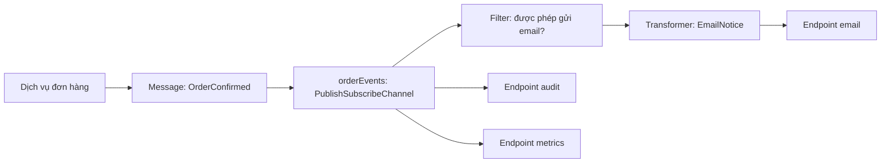

# Publish-subscribe và notification event

## Mục tiêu và phạm vi

Trong Spring Integration Core, `PublishSubscribeChannel` là điểm phân phối một thông điệp tới nhiều subscriber. Bài này dùng sự kiện đơn hàng đã được xác nhận để kết nối các thành phần cốt lõi: `Message`, `MessageChannel`, endpoint, filter, transformer và Java DSL.

Sau bài học, bạn có thể:

- Phân biệt phát sự kiện thông báo với gửi lệnh cho một bên xử lý.
- Thiết kế nhiều nhánh phản ứng với cùng một sự kiện.
- Giải thích ranh giới thực thi, lỗi và ý nghĩa kết quả `send()`.
- Chọn cách nhận biết mất subscriber, kiểm thử fan-out và tránh gửi thông báo trùng.

Ví dụ dùng Java 17 và API Spring Integration 6.5. Các đoạn mở rộng ghi rõ vị trí bổ sung hoặc thay thế; chúng không phải các cấu hình cần bật đồng thời.

## 1. Từ gọi trực tiếp sang phát sự kiện

Giả sử sau khi xác nhận đơn hàng, hệ thống cần:

1. Gửi email nếu khách hàng đồng ý nhận thông báo.
2. Ghi nhận dấu vết nghiệp vụ.
3. Cập nhật số liệu thống kê.

Nếu dịch vụ đơn hàng gọi trực tiếp cả ba dịch vụ, nó phải biết danh sách bên nhận và cách gọi từng bên. Với publish-subscribe, dịch vụ phát một sự kiện `OrderConfirmed`; các nhánh tự quyết định phản ứng của mình.



Sơ đồ mô tả cấu trúc phân phối. Các mũi tên tách nhánh chưa thể hiện nhánh nào chạy trên thread riêng.

Một **notification event** thông báo một sự việc đã xảy ra. Ví dụ, `OrderConfirmed` biểu đạt sự kiện trong quá khứ; `SendConfirmationEmail` biểu đạt một yêu cầu thực hiện hành động. Việc phân biệt này giúp publisher công bố sự thật nghiệp vụ mà không quy định mọi phản ứng.

| Khía cạnh | Sự kiện thông báo | Lệnh |
| --- | --- | --- |
| Ý nghĩa | Một việc đã xảy ra | Một việc cần được thực hiện |
| Ví dụ | `OrderConfirmed` | `SendConfirmationEmail` |
| Bên nhận | Có thể có nhiều bên quan tâm | Có một trách nhiệm xử lý rõ ràng |
| Quan hệ với publisher | Subscriber có thể được bổ sung độc lập | Bên gửi cần biết hợp đồng xử lý lệnh |
| Phản hồi | Thường không cần một kết quả chung | Có thể cần kết quả thực thi |

Tên gọi không tự tạo ra đặc tính giao nhận. Một sự kiện thông báo vẫn có thể được xử lý đồng bộ, vẫn có thể thất bại và vẫn có thể bị mất nếu chỉ tồn tại trong bộ nhớ.

## 2. Hợp đồng của PublishSubscribeChannel

`PublishSubscribeChannel` triển khai mô hình broadcast tới các `MessageHandler` đã đăng ký. Đây là `SubscribableChannel`, không phải `PollableChannel`: subscriber được gọi qua `handleMessage()`, không lấy thông điệp bằng `receive()`. Xem [Message Channel Implementations](https://docs.spring.io/spring-integration/reference/6.5/channel/implementations.html).

Publisher thường chỉ cần giữ tham chiếu `MessageChannel` và gọi `send(message)`. Endpoint của mỗi `IntegrationFlow` đảm nhiệm đăng ký handler vào channel khi context hoạt động.

### 2.1. Phân biệt các cơ chế gần nhau

| Cơ chế | Cách phân phối | Cách áp dụng cho ví dụ đơn hàng |
| --- | --- | --- |
| `DirectChannel` | Một handler được chọn cho mỗi lần dispatch; có thể thử handler khác khi failover | Chọn một worker xử lý lệnh |
| `PublishSubscribeChannel` | Phân phối tới các subscriber của channel | Email, audit và metrics cùng quan sát một sự kiện |
| `QueueChannel` | Mỗi message được một lần nhận lấy khỏi queue | Đệm công việc cho các consumer cạnh tranh |
| Router | Chọn channel đích theo nội dung hoặc quy tắc | Đưa đơn nội địa và quốc tế sang luồng phù hợp |
| Filter | Chấp nhận hoặc loại thông điệp tại vị trí của nó trong luồng | Chặn riêng nhánh email khi không có consent |

Đặt filter trước channel broadcast sẽ loại sự kiện khỏi tất cả các nhánh. Trong ví dụ này, consent chỉ chi phối email, nên filter nằm trong nhánh email.

Một content-based router có thể được cấu hình trả về nhiều đích. Điểm lựa chọn ở đây là ý nghĩa thiết kế: broadcast dùng khi các subscriber cùng quan sát một dòng sự kiện; routing dùng khi cần quy tắc quyết định đích đến.

### 2.2. Ranh giới của việc phân phối

Channel này không tự tạo kho lịch sử, cơ chế replay hoặc đăng ký bền vững. Subscriber được thêm sau khi một sự kiện đã phát không được tự động nhận lại sự kiện đó. Một application instance có các subscriber của instance đó; tạo bean cùng tên ở instance khác không tạo ra một topic liên máy.

Ba subscriber được cấu hình là ba điểm nhận ở đầu nhánh. Nếu nhánh email chủ động filter sự kiện, điều đó không có nghĩa channel đã quên phân phối cho subscriber email.

## 3. Thiết kế thông điệp cho notification

Một payload phù hợp nên thể hiện sự kiện và dữ liệu cần để hiểu sự kiện, tránh truyền một entity đang được quản lý bởi persistence context.

Trong ví dụ, `OrderConfirmed` chứa:

| Trường | Vai trò |
| --- | --- |
| `eventId` | Định danh của sự kiện nghiệp vụ, giữ nguyên khi phát lại cùng sự kiện |
| `orderId` | Khóa đơn hàng |
| `occurredAt` | Thời điểm sự kiện xảy ra |
| `customerEmail` | Địa chỉ dùng trong bài thực hành |
| `emailAllowed` | Quyết định cho phép thông báo tại thời điểm phát sự kiện |

Trong hệ thống thực, cần xác định rõ consent trong event là ảnh chụp tại thời điểm xảy ra hay nhánh gửi phải kiểm tra lại quyền nhận hiện tại. Nếu không muốn mọi subscriber thấy địa chỉ email, có thể chỉ phát khóa khách hàng và cho nhánh email truy xuất dữ liệu cần thiết theo quyền của nó.

Phân biệt hai định danh:

- `MessageHeaders.ID` định danh một message kỹ thuật.
- `eventId` định danh sự kiện nghiệp vụ mà message đang mang.

Khi retry hoặc phát lại tạo một `Message` mới, không nên dựa vào message ID để kết luận đó là một sự kiện nghiệp vụ mới.

### Payload bất biến khi dùng chung giữa các nhánh

`Message` không cung cấp khả năng thay thế tùy ý payload và header của nó, nhưng đối tượng payload vẫn có thể là một `List`, `Map` hoặc entity có thể sửa. Dùng cùng tham chiếu đó ở nhiều nhánh có thể làm nhánh này nhìn thấy thay đổi của nhánh kia.

Ví dụ dùng `record` với `UUID`, `String`, `Instant` và `boolean` để tránh vấn đề này. Nếu record chứa collection, cần sao chép hoặc dùng collection bất biến; record không tự làm mọi đối tượng bên trong trở thành bất biến.

## 4. Ví dụ hoàn chỉnh: ba subscriber bằng Java DSL

### 4.1. Chuẩn bị dependency

Với dự án Maven đã quản lý phiên bản bằng BOM tương thích của Spring, dependency cần cho phần thực hành chính là:

```xml
<dependency>
    <groupId>org.springframework.integration</groupId>
    <artifactId>spring-integration-core</artifactId>
</dependency>
```

Ví dụ không cần broker, cơ sở dữ liệu hoặc tài khoản email. Nếu dự án chưa có BOM, cần cấu hình phiên bản Spring Integration và các dependency tương thích trước khi biên dịch; đoạn dependency trên không phải một `pom.xml` độc lập.

Đặt mã sau trong `NotificationDemo.java`. Các endpoint ghi vào bộ nhớ để quan sát việc phân phối, không gửi email thật.

```java
import java.time.Instant;
import java.util.List;
import java.util.UUID;
import java.util.concurrent.CopyOnWriteArrayList;

import org.springframework.beans.factory.annotation.Qualifier;
import org.springframework.context.annotation.Bean;
import org.springframework.context.annotation.Configuration;
import org.springframework.context.annotation.AnnotationConfigApplicationContext;
import org.springframework.integration.channel.PublishSubscribeChannel;
import org.springframework.integration.config.EnableIntegration;
import org.springframework.integration.dsl.IntegrationFlow;
import org.springframework.messaging.Message;
import org.springframework.messaging.MessageChannel;
import org.springframework.messaging.support.MessageBuilder;

public class NotificationDemo {

    public record OrderConfirmed(
            UUID eventId,
            String orderId,
            Instant occurredAt,
            String customerEmail,
            boolean emailAllowed) {
    }

    public record EmailNotice(
            UUID eventId,
            String orderId,
            String recipient,
            String subject) {
    }

    public static class DeliveryLog {
        public final List<EmailNotice> emails =
                new CopyOnWriteArrayList<>();
        public final List<String> audits =
                new CopyOnWriteArrayList<>();
        public final List<String> metrics =
                new CopyOnWriteArrayList<>();
    }

    @Configuration
    @EnableIntegration
    public static class Config {

        @Bean
        public PublishSubscribeChannel orderEvents() {
            // true: coi việc không có subscriber là lỗi cấu hình.
            return new PublishSubscribeChannel(true);
        }

        @Bean
        public DeliveryLog deliveryLog() {
            return new DeliveryLog();
        }

        @Bean
        public IntegrationFlow emailFlow(
                @Qualifier("orderEvents") MessageChannel input,
                DeliveryLog log) {

            return IntegrationFlow.from(input)
                    .<OrderConfirmed>filter(OrderConfirmed::emailAllowed)
                    .<OrderConfirmed, EmailNotice>transform(event ->
                            new EmailNotice(
                                    event.eventId(),
                                    event.orderId(),
                                    event.customerEmail(),
                                    "Xác nhận đơn " + event.orderId()))
                    .handle(EmailNotice.class, (notice, headers) -> {
                        log.emails.add(notice);
                        return null;
                    })
                    .get();
        }

        @Bean
        public IntegrationFlow auditFlow(
                @Qualifier("orderEvents") MessageChannel input,
                DeliveryLog log) {

            return IntegrationFlow.from(input)
                    .handle(OrderConfirmed.class, (event, headers) -> {
                        log.audits.add(event.orderId());
                        return null;
                    })
                    .get();
        }

        @Bean
        public IntegrationFlow metricsFlow(
                @Qualifier("orderEvents") MessageChannel input,
                DeliveryLog log) {

            return IntegrationFlow.from(input)
                    .handle(OrderConfirmed.class, (event, headers) -> {
                        log.metrics.add(event.orderId());
                        return null;
                    })
                    .get();
        }
    }

    public static void publish(
            MessageChannel channel, OrderConfirmed event) {

        Message<OrderConfirmed> message =
                MessageBuilder.withPayload(event)
                        .setHeader("eventType", "OrderConfirmed")
                        .setHeader("eventId", event.eventId().toString())
                        .build();

        if (!channel.send(message)) {
            throw new IllegalStateException(
                    "Channel không chấp nhận sự kiện " + event.eventId());
        }
    }

    public static void main(String[] args) {
        try (var context =
                     new AnnotationConfigApplicationContext(Config.class)) {

            MessageChannel events =
                    context.getBean("orderEvents", MessageChannel.class);

            publish(events, new OrderConfirmed(
                    UUID.randomUUID(), "ORD-1001", Instant.now(),
                    "customer@example.test", true));

            publish(events, new OrderConfirmed(
                    UUID.randomUUID(), "ORD-1002", Instant.now(),
                    "customer@example.test", false));

            DeliveryLog log = context.getBean(DeliveryLog.class);
            System.out.printf(
                    "email=%d, audit=%d, metrics=%d%n",
                    log.emails.size(),
                    log.audits.size(),
                    log.metrics.size());
        }
    }
}
```

Kết quả mong đợi của cấu hình đồng bộ này:

```text
email=1, audit=2, metrics=2
```

Đây là kết quả để người học đối chiếu khi chạy ví dụ. `CopyOnWriteArrayList` chỉ là công cụ quan sát trong bài; nó không thay thế kho audit hoặc hệ thống thống kê thực tế.

### 4.2. Đọc luồng thực thi

`@EnableIntegration` bật hạ tầng tích hợp. Mỗi bean `IntegrationFlow` được phân tích thành các channel và endpoint trong Spring context.

Cả ba flow bắt đầu từ cùng đối tượng `orderEvents`. Subscriber trực tiếp của nhánh email là endpoint filter; channel không cần biết sau filter còn có transformer và handler.

Nhánh email tạo `EmailNotice` mới từ `OrderConfirmed`. Nhánh audit và metrics vẫn nhận payload sự kiện ban đầu. Việc transform chỉ thay đổi thông điệp đi tiếp trong nhánh đó.

Handler cuối trả về `null` vì nhánh kết thúc bằng tác dụng phụ. Nếu trả về một giá trị khác, endpoint có thể tiếp tục xử lý giá trị đó như reply và cần đích đi tiếp thích hợp.

### 4.3. Viết các nhánh ngay trong một flow

Khi các nhánh thuộc một cấu hình nhỏ, Java DSL hỗ trợ `publishSubscribeChannel(...)` với các subflow `subscribe(...)`. Đây là cách viết thay thế cho cấu trúc tách flow; không ghép cả hai cách nếu muốn mỗi phản ứng chỉ xảy ra một lần. Xem [API Java DSL về publishSubscribeChannel](https://docs.spring.io/spring-integration/docs/6.5.0/api/org/springframework/integration/dsl/BaseIntegrationFlowDefinition.html#publishSubscribeChannel(java.util.function.Consumer)).

Ví dụ rút gọn sau có hai subscriber và cần một bean `DeliveryLog` như ở trên. Nếu dùng thay cấu hình chính, gửi vào bean channel `notificationInput` và bỏ ba flow cũ:

```java
@Bean
public IntegrationFlow compactNotifications(
        NotificationDemo.DeliveryLog log) {

    return IntegrationFlow.from("notificationInput")
            .publishSubscribeChannel(spec -> spec
                    .subscribe(email -> email
                            .<NotificationDemo.OrderConfirmed>filter(
                                    NotificationDemo.OrderConfirmed::emailAllowed)
                            .handle(
                                    NotificationDemo.OrderConfirmed.class,
                                    (event, headers) -> {
                                        log.emails.add(
                                                new NotificationDemo.EmailNotice(
                                                        event.eventId(),
                                                        event.orderId(),
                                                        event.customerEmail(),
                                                        "Xác nhận đơn "
                                                                + event.orderId()));
                                        return null;
                                    }))
                    .subscribe(audit -> audit
                            .handle(
                                    NotificationDemo.OrderConfirmed.class,
                                    (event, headers) -> {
                                        log.audits.add(event.orderId());
                                        return null;
                                    })))
            .get();
}
```

`subscribe(...)` mô tả một nhánh của broadcast. Nó không có nghĩa tự tạo thread, retry hay đợi các nhánh hoàn tất. Các ví dụ notification kết thúc bên trong từng nhánh để hợp đồng không cần một phản hồi chung.

## 5. Đồng bộ, bất đồng bộ và ý nghĩa của send()

### 5.1. Cấu hình mặc định dùng thread của sender

Constructor không nhận executor gọi các subscriber trong thread đang gửi. Một nhánh chậm có thể làm chậm `publish()`; ba nhánh không tự động chạy song song.

Trong ví dụ chính, khi `publish()` trả về bình thường, các handler đồng bộ đã trở về. Email giả lập được thêm ngay vào danh sách, nên có thể đọc danh sách ngay sau đó.

Nếu handler chỉ gọi một API email rồi được API chấp nhận, điều đó vẫn chưa chứng minh email đã tới hộp thư khách hàng. Mức đảm bảo ở cuối nhánh phụ thuộc hợp đồng của hệ thống nhận.

Thông tin về constructor và lựa chọn executor có trong [API PublishSubscribeChannel](https://docs.spring.io/spring-integration/docs/6.5.0/api/org/springframework/integration/channel/PublishSubscribeChannel.html).

### 5.2. Chuyển sang thread pool

Thay bean `orderEvents()` trong `Config` bằng hai bean sau. Bổ sung import `org.springframework.scheduling.concurrent.ThreadPoolTaskExecutor`; các import còn lại đã có trong ví dụ chính.

```java
@Bean
public ThreadPoolTaskExecutor notificationExecutor() {
    ThreadPoolTaskExecutor executor = new ThreadPoolTaskExecutor();
    executor.setCorePoolSize(3);
    executor.setMaxPoolSize(6);
    executor.setQueueCapacity(100);
    executor.setThreadNamePrefix("notification-");
    executor.setWaitForTasksToCompleteOnShutdown(true);
    executor.setAwaitTerminationSeconds(10);
    return executor;
}

@Bean
public PublishSubscribeChannel orderEvents(
        @Qualifier("notificationExecutor")
        ThreadPoolTaskExecutor executor) {

    return new PublishSubscribeChannel(executor, true);
}
```

Spring quản lý việc khởi tạo và hủy `ThreadPoolTaskExecutor` vì nó là bean. Các con số trên phục vụ bài thực hành, cần đo tải để lựa chọn cho ứng dụng cụ thể.

Với executor này, subscriber có thể chạy trên các worker khác nhau. `send()` có thể trở về trong khi công việc chưa xong; kết quả đọc danh sách ngay sau hai lần `publish()` không còn là cách kiểm tra đáng tin cậy.

Thread pool và queue đều có giới hạn. Khi không nhận thêm được task, chính sách từ chối có thể làm lệnh gửi gặp lỗi. Nếu một số nhánh đã được submit trước đó, lỗi submit nhánh tiếp theo không hủy ngược những công việc đã được nhận.

`CallerRunsPolicy`, nếu được chọn, có thể chạy task ngay trên thread gửi khi quá tải. Vì vậy cần đánh giá cả độ trễ phía publisher khi chọn chính sách này. Xem [Task Execution and Scheduling](https://docs.spring.io/spring-framework/reference/integration/scheduling.html).

### 5.3. Phân biệt các mức thành công

| Quan sát | Có thể kết luận | Chưa thể kết luận |
| --- | --- | --- |
| `send()` trả `true` ở cấu hình đồng bộ | Channel chấp nhận theo cấu hình dispatch và các handler được gọi đã trở về | Tác dụng phụ bên ngoài sẽ không bao giờ thất bại về sau |
| `send()` trả `true` với thread pool | Dispatch đáp ứng điều kiện tại thời điểm gửi | Mọi nhánh đã chạy xong và thành công |
| Nhận phản hồi thành công từ nhà cung cấp email | Nhà cung cấp xác nhận theo hợp đồng API | Khách hàng đã đọc email |
| Có trạng thái thành công riêng cho từng nhánh | Có dữ liệu để theo dõi tiến độ từng phản ứng | Có giao dịch nguyên tử bao phủ mọi hệ thống |

Hàng đầu tiên giả định `ignoreFailures=false` như mặc định và không có endpoint chủ động bắt rồi nuốt lỗi. Không biến boolean của channel thành trạng thái giao nhận notification trên giao diện nghiệp vụ.

### 5.4. Không dùng thứ tự subscriber làm điều kiện nghiệp vụ

Nếu metrics chỉ được phép cập nhật sau khi audit thành công, hai thao tác đó có quan hệ phụ thuộc. Đặt chúng thành chuỗi xử lý rõ ràng trong một nhánh hoặc mô hình hóa bước điều phối phù hợp.

Thứ tự gọi trong một lần gửi đồng bộ không phải thứ tự hoàn tất khi chạy bằng pool. Khi có nhiều publisher gửi đồng thời, cũng không có một thứ tự toàn cục tự động cho mọi sự kiện của cùng đơn hàng.

## 6. Subscriber vắng mặt và cấu hình kiểm soát

### 6.1. Không có subscriber vẫn có thể gửi thành công

Với `new PublishSubscribeChannel()`, `minSubscribers` mặc định bằng 0. Vì thế, việc gửi vào channel chưa có subscriber có thể trả `true` mà không tạo ra phản ứng nghiệp vụ nào.

Ví dụ chính dùng `new PublishSubscribeChannel(true)` để bật `requireSubscribers`. Nếu channel không có subscriber, dispatch bị từ chối và caller gặp messaging exception. Lỗi ở tầng dispatcher có thể được channel bọc lại; khi kiểm thử, nên dựa vào hợp đồng `MessagingException` thay vì giả định caller luôn nhận đúng lớp exception nội bộ.

Lựa chọn này giúp phát hiện các tình huống như consumer endpoint chưa khởi động hoặc cấu hình không còn nhánh nhận. Nó không chứng minh đủ cả ba nhánh mà nghiệp vụ yêu cầu.

### 6.2. minSubscribers không phải xác nhận nghiệp vụ

Có thể đặt:

```java
PublishSubscribeChannel channel = new PublishSubscribeChannel(true);
channel.setMinSubscribers(3);
```

`minSubscribers` ảnh hưởng điều kiện thành công của dispatch; với xử lý bất đồng bộ, điều kiện này dựa vào số subscriber, không chờ kết quả của từng task. Tham khảo [cấu hình PublishSubscribeChannel](https://docs.spring.io/spring-integration/reference/6.5/channel/configuration.html).

Không coi thiết lập này là một bước kiểm tra nguyên tử trước mọi tác dụng phụ. Một lần gửi không đạt ngưỡng vẫn có thể đã giao thông điệp cho một số subscriber. Retry toàn bộ trong tình huống đó có thể chạy lại các nhánh đã thành công.

Nếu cần đúng các nhánh email, audit và metrics, nên kiểm tra endpoint nào đang hoạt động trong quá trình khởi động và theo dõi tiến độ riêng. Ba subscriber bất kỳ không chứng minh đó là ba trách nhiệm mong muốn.

## 7. Xử lý lỗi theo ranh giới thread

### 7.1. Đồng bộ: lỗi có thể dừng các subscriber phía sau

Mặc định `ignoreFailures=false`. Nếu một handler đồng bộ ném exception, caller có thể nhận lỗi và các handler chưa được gọi có thể không nhận sự kiện.

Giả sử trong một lần dispatch, audit đã ghi dữ liệu, email thất bại và metrics chưa được gọi. Khi caller retry sự kiện, audit có thể ghi lần nữa. Channel không tự hoàn tác audit và không ghi nhớ nhánh nào đã hoàn thành.

Đặt `setIgnoreFailures(true)` cho phép dispatcher cố gắng tiếp tục tới các handler khác khi một handler lỗi. Đây là lựa chọn bỏ qua lỗi ở cấp dispatch, không tạo ra retry, bản ghi thất bại bền vững hay cam kết rằng mọi phản ứng đều thành công. Quy tắc fail-fast và khác biệt khi có executor được mô tả trong [API BroadcastingDispatcher](https://docs.spring.io/spring-integration/docs/6.5.0/api/org/springframework/integration/dispatcher/BroadcastingDispatcher.html).

Nếu cần các nhánh độc lập nhưng vẫn phải biết từng lỗi, hãy thiết kế xử lý lỗi ở từng endpoint hoặc dùng ranh giới bất đồng bộ với error flow quan sát được. Không dùng một cờ bỏ qua lỗi để thay cho hợp đồng theo dõi notification.

### 7.2. Bất đồng bộ: đưa lỗi về error flow

Khi subscriber chạy trong worker thread, exception xử lý không thể quay ngược qua call stack của sender đã trở về.

Trong Spring context, `PublishSubscribeChannel` có executor sử dụng `MessagePublishingErrorHandler` mặc định nếu không được cấu hình handler lỗi khác. Lỗi được biểu diễn bằng `ErrorMessage`; đích mặc định được tìm từ header `errorChannel` của message, rồi tới bean toàn cục `errorChannel`. Xem [Error Handling](https://docs.spring.io/spring-integration/reference/6.5/error-handling.html).

Để dành luồng lỗi riêng cho notification, bổ sung vào `Config` các bean sau. Cần thêm import `org.springframework.integration.channel.DirectChannel` và `org.springframework.messaging.MessagingException`.

```java
@Bean
public DirectChannel notificationErrors() {
    return new DirectChannel();
}

@Bean
public IntegrationFlow notificationErrorFlow(
        @Qualifier("notificationErrors") MessageChannel errors) {

    return IntegrationFlow.from(errors)
            .handle(Throwable.class, (failure, headers) -> {
                Message<?> failedMessage =
                        failure instanceof MessagingException exception
                                ? exception.getFailedMessage()
                                : null;

                Object eventId = failedMessage == null
                        ? "unknown"
                        : failedMessage.getHeaders().get("eventId");

                System.getLogger("notifications").log(
                        System.Logger.Level.ERROR,
                        "notification_failed eventId=" + eventId,
                        failure);
                return null;
            })
            .get();
}
```

Sau đó, trong `publish()`, thêm dòng sau vào chuỗi `MessageBuilder`, trước `.build()`:

```java
.setHeader(
        org.springframework.messaging.MessageHeaders.ERROR_CHANNEL,
        "notificationErrors")
```

Tên channel trong header được phân giải trong Spring context của ví dụ. `ErrorMessage` có payload là lỗi; header của nó không nhất thiết là bản sao toàn bộ header sự kiện ban đầu. Đoạn xử lý tìm message thất bại từ `MessagingException` để lấy `eventId`, đồng thời chấp nhận trường hợp không có message đó.

Error flow trên minh họa đường đi của lỗi bằng log. Với yêu cầu vận hành, có thể ghi thêm bản ghi thất bại chứa `eventId`, tên nhánh, số lần thử và nguyên nhân vào nơi lưu trữ phù hợp.

### 7.3. Các giới hạn cần hiểu khi dùng error flow

- Header `errorChannel` không tự chuyển một channel đồng bộ thành cơ chế xử lý lỗi bằng message. Với cấu hình chính không có executor, exception vẫn truyền về caller, trừ khi endpoint/gateway có cơ chế xử lý lỗi riêng.
- Lỗi từ chối submit task có thể xảy ra ngay trong thread gửi; cần xử lý tại biên publish, không giả định mọi lỗi đều đi vào error flow bất đồng bộ.
- Một task đã được nhận không bị hủy chỉ vì một task khác lỗi.
- Handler lỗi cũng có thể thất bại. Cần có quan sát cho error flow và tránh tạo vòng lặp phát lỗi trở lại chính luồng đang lỗi.
- Nếu nhánh đi qua một channel bất đồng bộ khác, lỗi phía sau phụ thuộc cơ chế xử lý lỗi của ranh giới đó.

Không có giao dịch nguyên tử ngầm giữa email, audit, metrics và error flow.

## 8. Gateway và Spring ApplicationEvent

### 8.1. Gateway làm biên gọi cho code nghiệp vụ

Thay vì để dịch vụ nghiệp vụ tự tạo `Message`, có thể dùng `@MessagingGateway` để che API messaging sau một interface. Cơ chế tạo proxy và quét interface được trình bày trong [Messaging Gateways](https://docs.spring.io/spring-integration/reference/6.5/gateway.html). Khi dự án đã bật quét gateway bằng `@IntegrationComponentScan`, hợp đồng minh họa có thể viết như sau:

```java
import org.springframework.integration.annotation.MessagingGateway;

@MessagingGateway(defaultRequestChannel = "orderEvents")
public interface OrderEventGateway {
    void publish(NotificationDemo.OrderConfirmed event);
}
```

Phương thức `void` diễn đạt việc phát thông báo không chờ một reply nghiệp vụ chung. Điều này không bắt buộc nó chạy bất đồng bộ: với channel đồng bộ, lời gọi gateway vẫn thực thi các nhánh trên thread gọi và có thể trả lỗi theo cấu hình gateway.

Nếu cần header `errorChannel`, hãy cấu hình việc ánh xạ header hoặc bước enrich header ở biên gateway phù hợp. Gateway minh họa trên không tự bổ sung các header tùy biến của phương thức `NotificationDemo.publish()`.

Nếu yêu cầu là “đợi tất cả nhánh và trả một báo cáo tổng hợp”, cần mô hình hóa reply, correlation, thời hạn chờ và kết quả thiếu. Đó là một hợp đồng khác với notification một chiều.

### 8.2. Spring event không tự chạy vào MessageChannel

`ApplicationEventPublisher.publishEvent(...)` và `MessageChannel.send(...)` thuộc hai cơ chế phát sự kiện khác nhau. Một bean `PublishSubscribeChannel` không tự đăng ký nhận mọi Spring application event.

Nếu hệ thống đã phát Spring event và muốn đưa nó vào integration flow, Spring Integration cung cấp `ApplicationEventListeningMessageProducer`. Adapter này cần module `spring-integration-event` bổ sung, nằm ngoài dependency core của ví dụ chính. Xem [Spring ApplicationEvent Support](https://docs.spring.io/spring-integration/reference/6.5/event.html).

Đoạn tùy chọn sau đặt trong `Config`, sau khi đã thêm dependency đó và import `org.springframework.integration.event.inbound.ApplicationEventListeningMessageProducer`:

```java
@Bean
public ApplicationEventListeningMessageProducer orderEventBridge(
        @Qualifier("orderEvents") MessageChannel output) {

    var bridge = new ApplicationEventListeningMessageProducer();
    bridge.setEventTypes(NotificationDemo.OrderConfirmed.class);
    bridge.setOutputChannel(output);
    return bridge;
}
```

Adapter chỉ nhận kiểu sự kiện đã chọn. Với payload event phù hợp, nó đưa payload vào message gửi tới `orderEvents`.

Chọn một đường phát cho cùng một sự kiện: gọi gateway/channel trực tiếp hoặc đi qua Spring event bridge. Nếu publisher gọi cả hai đường, các subscriber có thể nhận hai lần. Nếu có cả cầu inbound và outbound, cần tách kiểu hoặc luồng để tránh vòng lặp sự kiện.

## 9. applySequence và giới hạn khi tổng hợp kết quả

Notification thường cho các nhánh kết thúc độc lập, nên không cần bật `applySequence`.

Nếu cần aggregator phía sau các nhánh, có thể bật:

```java
PublishSubscribeChannel channel = new PublishSubscribeChannel(true);
channel.setApplySequence(true);
```

Channel bổ sung các header correlation và sequence cho các message phân phối. Trong Java, các header thường được quan sát là `correlationId`, `sequenceNumber` và `sequenceSize`. Mặc định tùy chọn này tắt; khi bật, các message có thể khác header nhưng vẫn dùng cùng tham chiếu payload. Xem [cấu hình apply-sequence](https://docs.spring.io/spring-integration/reference/6.5/channel/configuration.html).

Áp dụng vào ví dụ có ba subscriber:

- Sequence mô tả ba điểm phân phối, không mô tả ba lần gửi thông báo thành công.
- Nhánh email có thể bị filter và không trả message tới aggregator.
- Nhánh audit và metrics kết thúc bằng `return null`, nên cũng không tạo reply để tổng hợp.

Chỉ thêm `applySequence=true` không biến ví dụ thành một luồng scatter-gather hoàn chỉnh. Nếu aggregator đợi đủ ba reply mà một nhánh không trả, nhóm có thể chờ mãi nếu chưa có timeout hoặc chiến lược release khác.

Khi cần tổng hợp, hãy thiết kế mỗi nhánh trả một kết quả rõ như `SENT`, `SKIPPED`, `FAILED`; bảo toàn correlation, định nghĩa thời hạn chờ và quy tắc xử lý kết quả đến muộn. Không dùng các header sequence như trạng thái nghiệp vụ của notification.

## 10. Giao dịch, phát lại và chống trùng

### 10.1. Phát trước commit có thể tạo notification sai thời điểm

Giả sử dịch vụ thực hiện trong một transaction:

```text
Lưu trạng thái đơn hàng
→ Phát OrderConfirmed
→ Nhánh email gửi thông báo
→ Một bước sau đó lỗi
→ Transaction rollback
```

Email đã ra ngoài có thể không thu hồi được. Việc các nhánh chạy cùng thread cũng không làm API email tham gia transaction cơ sở dữ liệu.

Có thể gắn một Spring event listener với `@TransactionalEventListener(phase = AFTER_COMMIT)` để chỉ chuyển sự kiện vào integration flow sau khi transaction commit. Mặc định listener loại này không chạy khi không có transaction, trừ khi bật fallback. Tham khảo [Transaction-bound Events](https://docs.spring.io/spring-framework/reference/data-access/transaction/event.html).

Phát sau commit vẫn có khoảng trống: cơ sở dữ liệu đã commit nhưng tiến trình dừng trước khi notification được lưu hoặc gửi. Khi nghiệp vụ yêu cầu phục hồi qua lỗi tiến trình, một thiết kế thường dùng là:

```text
Transaction cơ sở dữ liệu:
    cập nhật đơn hàng + ghi outbox event
                 ↓ commit
Worker đọc outbox đã commit
                 ↓
Phát tới luồng notification hoặc hạ tầng message phù hợp
                 ↓
Theo dõi kết quả và cơ chế thử lại
```

Đây là hướng thiết kế bổ sung để bảo đảm phục hồi. `PublishSubscribeChannel` tự nó không ghi outbox, không lưu trạng thái giao nhận và không phân phối bền vững giữa các tiến trình.

### 10.2. Retry đúng nhánh và giữ eventId

Tình huống:

```text
event E
  email   → thành công
  audit   → thành công
  metrics → thất bại
```

Nếu gửi lại toàn bộ E vào `orderEvents`, email có thể được gửi lần nữa. Nếu lỗi chỉ ở metrics, ưu tiên retry endpoint metrics theo chính sách của nó, thay vì luôn phát lại cả sự kiện qua mọi nhánh.

Để nhận biết xử lý trùng, có thể thiết kế khóa:

```text
(eventId, subscriberName)
```

Ví dụ `(E, email)` khác `(E, metrics)`. Chỉ lưu trạng thái “event E đã xử lý” dùng chung cho tất cả subscriber có thể khiến nhánh thành công che mất nhánh chưa hoàn thành.

Một bảng theo dõi có thể chứa:

| eventId | subscriberName | status | attempt |
| --- | --- | --- | --- |
| E | email | SENT | 1 |
| E | audit | RECORDED | 1 |
| E | metrics | FAILED | 2 |

Khóa duy nhất và thao tác cập nhật cần xử lý cạnh tranh khi nhiều worker cùng gặp một event. Một kiểm tra `contains()` rồi mới ghi bằng collection trong bộ nhớ không đủ để bảo đảm qua nhiều instance hoặc sau restart.

Với tác dụng phụ bên ngoài, còn có cửa sổ lỗi giữa “nhà cung cấp đã nhận” và “ứng dụng đã lưu thành công”. Nếu nhà cung cấp hỗ trợ idempotency key, có thể dùng khóa ổn định theo sự kiện và nhánh. Nếu không có hỗ trợ đó, phải định nghĩa cách đối soát và xử lý kết quả không rõ; không tuyên bố exactly-once chỉ từ channel và retry.

## 11. Kiểm thử hành vi fan-out

Các kiểm thử sau dùng JUnit Jupiter 5 và lớp `NotificationDemo` ở phần 4. Đặt `NotificationDemoTest.java` cùng package với lớp đó, và cấu hình dependency test tương ứng trong dự án. Không cần SMTP server vì các endpoint đã được thay bằng đầu ra trong bộ nhớ.

Các kiểm thử dùng cấu hình đồng bộ gốc, chưa thay `orderEvents` bằng bản có executor.

```java
import static org.junit.jupiter.api.Assertions.assertEquals;
import static org.junit.jupiter.api.Assertions.assertThrows;
import static org.junit.jupiter.api.Assertions.assertTrue;

import java.time.Instant;
import java.util.UUID;
import java.util.concurrent.atomic.AtomicInteger;

import org.junit.jupiter.api.Test;
import org.springframework.context.annotation.AnnotationConfigApplicationContext;
import org.springframework.integration.channel.PublishSubscribeChannel;
import org.springframework.messaging.MessageChannel;
import org.springframework.messaging.MessagingException;
import org.springframework.messaging.support.GenericMessage;

class NotificationDemoTest {

    private NotificationDemo.OrderConfirmed event(
            String orderId, boolean emailAllowed) {

        return new NotificationDemo.OrderConfirmed(
                UUID.randomUUID(),
                orderId,
                Instant.parse("2026-01-01T00:00:00Z"),
                "customer@example.test",
                emailAllowed);
    }

    @Test
    void everyEligibleBranchReactsToTheSameEvent() {
        try (var context = new AnnotationConfigApplicationContext(
                NotificationDemo.Config.class)) {

            MessageChannel channel =
                    context.getBean("orderEvents", MessageChannel.class);
            var log = context.getBean(NotificationDemo.DeliveryLog.class);
            var input = event("ORD-1", true);

            NotificationDemo.publish(channel, input);

            assertEquals(1, log.emails.size());
            assertEquals(input.eventId(), log.emails.get(0).eventId());
            assertEquals("ORD-1", log.emails.get(0).orderId());
            assertEquals("Xác nhận đơn ORD-1", log.emails.get(0).subject());
            assertEquals(1, log.audits.size());
            assertEquals("ORD-1", log.audits.get(0));
            assertEquals(1, log.metrics.size());
            assertEquals("ORD-1", log.metrics.get(0));
        }
    }

    @Test
    void optingOutOfEmailDoesNotSuppressOtherSubscribers() {
        try (var context = new AnnotationConfigApplicationContext(
                NotificationDemo.Config.class)) {

            MessageChannel channel =
                    context.getBean("orderEvents", MessageChannel.class);
            var log = context.getBean(NotificationDemo.DeliveryLog.class);

            NotificationDemo.publish(channel, event("ORD-2", false));

            assertTrue(log.emails.isEmpty());
            assertEquals(1, log.audits.size());
            assertEquals(1, log.metrics.size());
        }
    }

    @Test
    void requiringSubscribersRejectsAnUnobservedEvent() {
        var permissive = new PublishSubscribeChannel();
        assertTrue(permissive.send(new GenericMessage<>("event")));

        var strict = new PublishSubscribeChannel(true);
        assertThrows(
                MessagingException.class,
                () -> strict.send(new GenericMessage<>("event")));
    }

    @Test
    void synchronousFailureCanPreventLaterDelivery() {
        var channel = new PublishSubscribeChannel(true);
        var laterInvocations = new AtomicInteger();

        channel.subscribe(message -> {
            throw new IllegalStateException("Mô phỏng lỗi subscriber đầu");
        });
        channel.subscribe(message -> laterInvocations.incrementAndGet());

        assertThrows(
                MessagingException.class,
                () -> channel.send(new GenericMessage<>("event")));

        assertEquals(0, laterInvocations.get());
    }
}
```

Kiểm thử đầu quan sát cả dữ liệu transform và việc các nhánh cùng phản ứng. Kiểm thử thứ hai xác nhận vị trí filter: nếu đưa filter consent ra trước broadcast, kiểm thử này sẽ phát hiện audit và metrics cũng bị mất sự kiện.

Kiểm thử cuối đăng ký trực tiếp hai handler không có order riêng theo thứ tự trong mã, để quan sát fail-fast ở chế độ đồng bộ. Nó không kiểm chứng thứ tự nghiệp vụ giữa các bean flow.

### Kiểm thử bổ sung khi chuyển sang bất đồng bộ

Không giữ nguyên kỳ vọng “đọc ngay danh sách là đủ” khi thay bằng thread pool. Có thể dùng `CountDownLatch` hoặc nhận message từ `QueueChannel` đầu ra của kiểm thử với timeout hữu hạn.

| Tình huống | Cách kiểm soát trong kiểm thử | Điều cần xác nhận |
| --- | --- | --- |
| Handler còn đang xử lý | Cho handler báo đã bắt đầu rồi chờ một latch do test giữ | `send()` đã trở về nhưng handler chưa hoàn tất |
| Một nhánh ném lỗi | Gắn `errorChannel` vào một `QueueChannel` dùng trong test | Nhận `ErrorMessage`, tìm được cause và message thất bại |
| Hai nhánh hoàn thành | Mỗi nhánh giảm một latch chung | Latch về 0 trước deadline; không khẳng định thứ tự |
| Không có subscriber | Tạo channel với `requireSubscribers=true` | Không coi sự kiện là được nhận thành công |
| Phát lại cùng event | Gửi hai message chứa cùng `eventId` | Hành vi phù hợp với chính sách chống trùng của từng nhánh |
| Executor từ chối task | Dùng executor kiểm thử chủ động từ chối submit | Caller thấy lỗi và không giả định các nhánh trước đó đã bị hủy |

Nếu dùng latch chặn handler, luôn mở latch trong `finally` và dừng executor sau test để không giữ worker treo khi assertion thất bại. Tránh `Thread.sleep(...)` như điều kiện đúng/sai của kiểm thử: tốc độ máy không phải hợp đồng của luồng.

## 12. Thực hành theo từng bước

1. **Quan sát cấu hình đồng bộ.** Chạy `NotificationDemo.main()` và đối chiếu kết quả mong đợi. Ghi lại thread name trong từng handler để thấy chúng chạy trên thread gửi.
2. **Kiểm tra vị trí filter.** Cho `emailAllowed=false` và xác nhận chỉ email bị bỏ qua. Giữ audit và metrics hoạt động để phản ánh đúng ý nghĩa sự kiện.
3. **Thêm subscriber mới.** Tạo nhánh cập nhật dashboard và cho nó nhận cùng `orderEvents`. Publisher vẫn phát cùng loại sự kiện.
4. **Mô phỏng lỗi độc lập.** Làm nhánh dashboard ném exception. Với chế độ đồng bộ mặc định, quan sát lỗi tại publisher; không suy luận nhánh nào đã chạy nếu chưa ghi nhận cụ thể.
5. **Thử thread pool.** Thay bean channel bằng bản dùng executor, bổ sung error flow và header lỗi. Dùng cơ chế chờ có deadline để đo kết quả từng nhánh.
6. **Phát lại sự kiện.** Giữ nguyên `eventId`, gửi hai lần và ghi nhận trùng ở đầu ra trong bộ nhớ. Sau đó thiết kế trạng thái theo `(eventId, subscriberName)` cho nhánh có yêu cầu chống trùng.

Các bước trên mở rộng bài thực hành theo một hành vi mỗi lần. Không bật cùng lúc cấu hình ba flow và cấu hình compact nếu đang đo số lần phản ứng.

## 13. Các lỗi thiết kế thường gặp

| Biểu hiện | Nguyên nhân thường gặp | Hướng sửa |
| --- | --- | --- |
| Chỉ một nhánh nhận sự kiện | Dùng `DirectChannel` hoặc một queue có các consumer cạnh tranh | Dùng channel có ngữ nghĩa broadcast tại điểm cần fan-out |
| Audit cũng mất sự kiện khi tắt email | Filter consent đặt trước broadcast | Đưa filter vào nhánh email |
| Gửi thành công nhưng không có phản ứng | Không có subscriber và cấu hình vẫn cho phép | Bật yêu cầu có subscriber, kiểm tra endpoint và theo dõi nhánh |
| Publisher chậm dù gọi là notification | Các handler chạy đồng bộ, có nhánh chậm | Đo từng nhánh, chọn ranh giới executor/queue có chủ đích |
| Email lặp sau khi retry | Retry cả broadcast sau một lỗi cục bộ | Retry đúng nhánh và dùng định danh nghiệp vụ ổn định |
| Không thấy lỗi ở caller khi dùng pool | Handler lỗi ở worker thread | Cấu hình và kiểm tra error flow |
| Một nhánh thấy payload bị sửa | Nhiều nhánh dùng chung đối tượng mutable | Dùng payload bất biến hoặc tạo dữ liệu riêng trong nhánh |
| Aggregator không release | Nhánh bị filter hoặc không trả kết quả | Thiết kế reply đầy đủ, timeout và quy tắc release |
| Mất thông báo sau restart | Công việc chỉ ở bộ nhớ hoặc executor queue | Bổ sung lưu trữ và chiến lược phục hồi phù hợp |
| Hai lần xử lý cùng một sự kiện | Cùng phát qua channel trực tiếp và Spring event bridge | Chọn rõ đường phát, kết hợp chống trùng khi có phát lại |

Một thiết kế notification rõ ràng cần nêu được sự kiện biểu đạt điều gì, ai đang đăng ký nhận, mỗi nhánh chấp nhận mức mất/trùng nào và cách quan sát kết quả. `PublishSubscribeChannel` đảm nhiệm điểm phân phối trong luồng; các yêu cầu về hoàn tất, phục hồi và tác dụng phụ cần được thể hiện bằng các thành phần và hợp đồng bổ sung.
