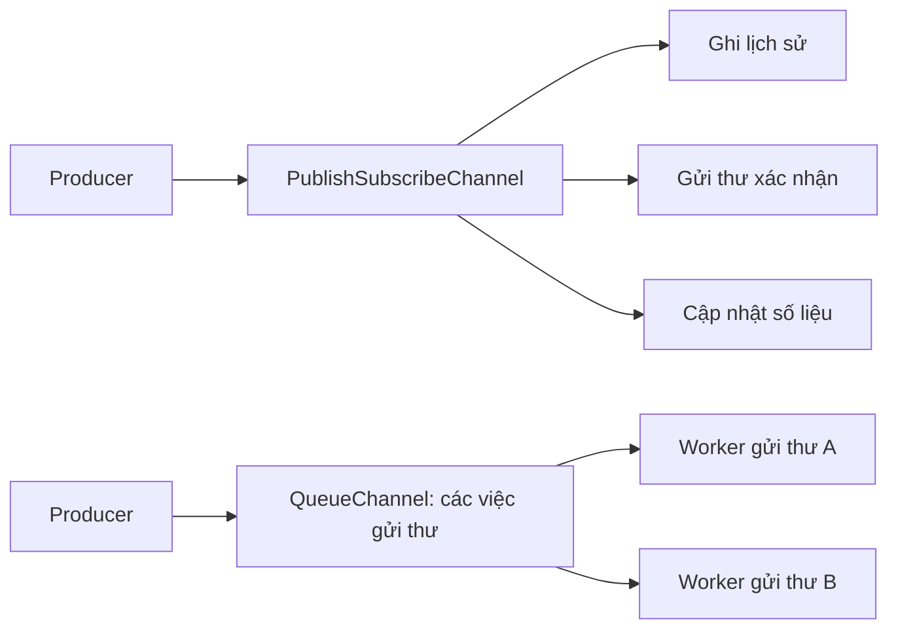
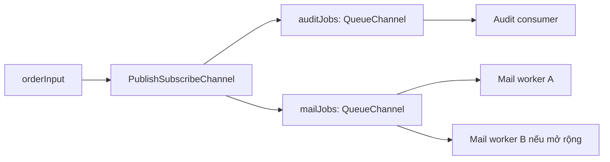

# Khác biệt với QueueChannel

Trong Spring Integration Core, `PublishSubscribeChannel` và `QueueChannel` trả lời hai câu hỏi thiết kế khác nhau: **những nhánh nào cần nhận thông điệp** và **công việc được giữ lại, lấy ra xử lý như thế nào**. Đổi từ loại kênh này sang loại kênh kia có thể thay đổi cả kết quả nghiệp vụ, chứ không chỉ thay đổi hiệu năng.

Bài học thuộc chương **PublishSubscribeChannel**, tập trung so sánh hai loại kênh qua `Message`, cách endpoint nhận thông điệp, ranh giới thực thi, xử lý lỗi và cấu hình Java DSL. Sau bài học, bạn có thể chọn kênh cho một luồng phát sự kiện, một nhóm worker chia việc hoặc một thiết kế kết hợp cả hai.

## 1. Một sự kiện cho nhiều nhánh hay một việc cho một worker?

Giả sử hệ thống vừa xác nhận đơn hàng `ORDER-1042`. Ba chức năng cần phản ứng là ghi nhận lịch sử, gửi thư xác nhận và cập nhật số liệu kinh doanh.

Với `PublishSubscribeChannel`, các handler đang đăng ký là những bên cùng quan tâm đến sự kiện. Khi việc phân phối diễn ra thành công, mỗi handler đều được gọi với thông điệp đó. Đây là cơ chế **broadcast**, thường gọi là **fan-out**. Với `QueueChannel`, các consumer cùng đọc một hàng đợi **cạnh tranh lấy thông điệp**; một phần tử được lấy ra bởi một consumer sẽ không còn nằm trong hàng đợi để consumer khác lấy lại. Hai cơ chế được mô tả trong [tài liệu các loại message channel](https://docs.spring.io/spring-integration/reference/channel/implementations.html).



Trong nửa dưới của sơ đồ, hai mũi tên từ hàng đợi thể hiện hai consumer có thể lấy việc. Chúng không có nghĩa mỗi phần tử được phát cho cả hai worker.

Nếu có 10 thông điệp và 3 handler đăng ký vào pub-sub, trường hợp mọi lần phân phối đều thành công tạo ra 30 lần gọi handler. Với 10 phần tử trong một hàng đợi dùng chung và 3 consumer, việc đọc hết hàng đợi tạo ra tổng cộng 10 lần nhận thành công, nếu không có thao tác gửi lại hoặc cơ chế phát lại khác. Ví dụ này mô tả phân phối; nó chưa phải cam kết xử lý nghiệp vụ đúng một lần.

**Hệ quả thiết kế:** nếu gửi thư và ghi lịch sử đều bắt buộc xảy ra, không đặt hai chức năng đó làm consumer cạnh tranh trên cùng một `QueueChannel`. Một đơn hàng có thể chỉ được ghi lịch sử, trong khi đơn khác chỉ được gửi thư.

## 2. Bảng so sánh để chọn cấu trúc luồng

| Tiêu chí | `PublishSubscribeChannel` | `QueueChannel` |
| --- | --- | --- |
| Ngữ nghĩa phân phối | Phát tới các handler đang đăng ký | Mỗi phần tử được một consumer lấy ra |
| Hợp đồng nhận thông điệp | `SubscribableChannel`, đăng ký `MessageHandler` | `PollableChannel`, gọi `receive()` |
| Cách endpoint thông thường hoạt động | Được kênh gọi khi có thông điệp | Polling consumer chủ động lấy thông điệp |
| Có bộ đệm thông điệp riêng mặc định? | Không | Có, mặc định ở bộ nhớ |
| Không có consumer lúc gửi | Không giữ lại để subscriber tương lai đọc | Giữ phần tử nếu hàng đợi còn chỗ |
| Thực thi mặc định | Gọi handler trên thread của sender | `send()` đưa thông điệp vào hàng đợi |
| Muốn xử lý bằng thread khác | Cấu hình executor hoặc thêm ranh giới bất đồng bộ ở nhánh | Dùng poller/receiver chạy trên thread khác |
| Khi tải tăng | Sender đồng bộ phải chờ handler; executor có giới hạn riêng | Queue tích lũy phần tử đến giới hạn sức chứa |
| Thêm consumer cùng chức năng | Tạo thêm nơi nhận cùng sự kiện | Tăng số bên cạnh tranh lấy việc |
| Thứ tự đáng quan tâm | Không dùng thứ tự hoàn thành các nhánh làm quy tắc nghiệp vụ | Hàng đợi mặc định FIFO khi lấy ra; hoàn thành có thể khác thứ tự |
| Nhu cầu điển hình | Nhiều chức năng cùng phản ứng với sự kiện | Nhiều worker chia một tập công việc |

Hai interface nhận thông điệp được phân biệt trong [hợp đồng MessageChannel](https://docs.spring.io/spring-integration/reference/channel/interfaces.html). Việc tạo `EventDrivenConsumer` hay `PollingConsumer` theo loại kênh được giải thích trong [tài liệu Poller](https://docs.spring.io/spring-integration/reference/polling-consumer.html).

Số consumer và số thread là hai đại lượng khác nhau. Ba subscriber có thể được gọi tuần tự trên một thread; một queue có thể chỉ được đọc bởi một poller duy nhất. Cần xem cả cấu trúc kênh lẫn cấu hình endpoint để hiểu mức độ đồng thời của luồng.

## 3. Khác biệt ở API và ý nghĩa của send()

### 3.1. Pub-sub nhận đăng ký, không cung cấp receive()

Một `PublishSubscribeChannel` nhận `MessageHandler` qua `subscribe(handler)` và phân phối bằng cách gọi handler. Consumer không gọi `receive()` trên kênh này. Ngược lại, `QueueChannel` cung cấp `receive()` để lấy thông điệp và không phải kênh đăng ký handler theo hợp đồng `SubscribableChannel`.

Điều đó giải thích vì sao một service activator nối trực tiếp vào pub-sub thường hoạt động theo kiểu event-driven, còn service activator nối với queue cần poller, được cấu hình tại endpoint hoặc thông qua poller mặc định của ứng dụng.

### 3.2. Cùng trả về true nhưng xác nhận những việc khác nhau

Đối với queue, `send()` thành công cho biết thông điệp đã được chấp nhận vào hàng đợi. Chưa thể suy ra worker đã gửi thư, ghi dữ liệu hay hoàn tất giao dịch.

Đối với pub-sub đồng bộ, khi `send()` kết thúc bình thường, các lời gọi handler được thực hiện trực tiếp trong lần phân phối đó đã trả về theo cấu hình hiện hành. Nếu handler chỉ chuyển tiếp sang một queue khác, phần xử lý phía sau queue vẫn có thể chưa chạy.

Đối với pub-sub có executor thực thi trên thread khác, sender có thể tiếp tục trước khi handler xử lý xong. Không dùng giá trị trả về của `send()` như xác nhận hoàn thành nghiệp vụ của mọi nhánh. Thuộc tính `minSubscribers` mặc định bằng `0`; nó điều chỉnh ngưỡng phân phối, không tạo cơ chế chờ kết quả nghiệp vụ. Xem [API PublishSubscribeChannel](https://docs.spring.io/spring-integration/api/org/springframework/integration/channel/PublishSubscribeChannel.html).

### 3.3. Không có subscriber không đồng nghĩa gửi sẽ thất bại

Với cấu hình mặc định, gửi vào pub-sub không có subscriber vẫn có thể trả về `true`. Thông điệp không được xếp lại để chờ một subscriber đăng ký sau.

Nếu ứng dụng yêu cầu phải có bên nhận tại thời điểm gửi, có thể khai báo bean:

```java
@Bean
public PublishSubscribeChannel orderEvents() {
    return new PublishSubscribeChannel(true);
}
```

Đối số `true` ở đây là `requireSubscribers`. Khi không có subscriber, quá trình gửi phát sinh lỗi phân phối. Tùy chọn này có từ Spring Integration 5.4.3; dùng nó để phát hiện cấu hình thiếu nơi nhận, không xem nó là cơ chế lưu trữ sự kiện. Hành vi và phiên bản được ghi trong [hướng dẫn cấu hình pub-sub](https://docs.spring.io/spring-integration/reference/channel/configuration.html#channel-configuration-pubsubchannel).

Đoạn khai báo trên giả định đã có import `org.springframework.context.annotation.Bean` và `org.springframework.integration.channel.PublishSubscribeChannel` trong lớp cấu hình.

## 4. Ví dụ Java: nhìn thấy hai kiểu phân phối

Ví dụ dưới đây dùng trực tiếp các channel, chưa cần tạo Spring application context. Classpath cần có `org.springframework.integration:spring-integration-core` cùng các dependency Spring tương thích, được quản lý phiên bản đồng bộ với dự án. Không thêm một phiên bản thư viện tùy ý vào ứng dụng đang dùng Spring Boot.

```java
import java.util.ArrayList;
import java.util.List;

import org.springframework.integration.channel.PublishSubscribeChannel;
import org.springframework.integration.channel.QueueChannel;
import org.springframework.messaging.Message;
import org.springframework.messaging.support.GenericMessage;

public class ChannelSemanticsDemo {

    public static void main(String[] args) {
        Message<String> event = new GenericMessage<>("ORDER-1042");

        PublishSubscribeChannel events = new PublishSubscribeChannel();
        List<String> audit = new ArrayList<>();
        List<String> mail = new ArrayList<>();

        events.subscribe(message ->
                audit.add((String) message.getPayload()));
        events.subscribe(message ->
                mail.add((String) message.getPayload()));

        require(events.send(event), "Không phân phối được sự kiện");
        require(audit.size() == 1, "Nhánh audit phải được gọi");
        require(mail.size() == 1, "Nhánh mail phải được gọi");

        QueueChannel jobs = new QueueChannel(2);
        require(jobs.send(event, 0), "Không đưa được việc vào queue");

        Message<?> receivedByA = jobs.receive(0);
        Message<?> receivedByB = jobs.receive(0);

        require(receivedByA != null, "Lần nhận đầu phải có thông điệp");
        require(receivedByB == null, "Queue đã hết phần tử");

        System.out.println("pubsub: audit=" + audit + ", mail=" + mail);
        System.out.println("queue: A=" + receivedByA.getPayload()
                + ", B=" + receivedByB);
    }

    private static void require(boolean condition, String description) {
        if (!condition) {
            throw new IllegalStateException(description);
        }
    }
}
```

Kết quả dự kiến của ví dụ:

```text
pubsub: audit=[ORDER-1042], mail=[ORDER-1042]
queue: A=ORDER-1042, B=null
```

Hai lần `receive(0)` được thực hiện tuần tự để quan sát xác định rằng một phần tử đã lấy ra không được phát lại cho lần nhận tiếp theo. Ví dụ chưa mô phỏng lịch chạy của hai worker song song. Khi nhiều worker chạy đồng thời, worker nào nhận được phần tử phụ thuộc thời điểm gọi nhận và cấu hình thực thi; không suy ra quy tắc chia đều từ ví dụ này.

Các danh sách `ArrayList` phù hợp ở đây vì pub-sub không có executor và toàn bộ ví dụ chạy trên một thread. Nếu chuyển các handler sang thread khác, cần thay cấu trúc lưu kết quả và cách chờ hoàn thành cho phù hợp.

## 5. Bộ đệm, sức chứa và timeout

### 5.1. Queue hấp thụ chênh lệch tốc độ trong một khoảng hữu hạn

Giả sử producer tạo 120 việc/giây, trong khi tổng năng lực của nhóm worker là 100 việc/giây. Khi tốc độ ổn định, hàng đợi tăng khoảng 20 phần tử/giây. Nếu queue còn 200 chỗ, nó có thể đầy sau khoảng 10 giây. Đây là ước lượng phục vụ thiết kế, bỏ qua dao động tải và thời gian lập lịch.

Queue giúp chịu một đợt tải ngắn, nhưng không tự giải quyết tình trạng tốc độ tạo việc luôn lớn hơn năng lực xử lý. Khi đầy, hệ thống phải chờ, từ chối, giảm đầu vào hoặc chuyển sang một nơi lưu trữ khác theo chính sách đã chọn.

Đoạn minh họa độc lập sau sử dụng cùng các import `QueueChannel` và `GenericMessage` của ví dụ trước:

```java
QueueChannel backlog = new QueueChannel(1);

boolean firstAccepted = backlog.send(new GenericMessage<>("JOB-1"), 0);
boolean secondAccepted = backlog.send(new GenericMessage<>("JOB-2"), 0);

System.out.println(firstAccepted);   // true
System.out.println(secondAccepted);  // false: queue đầy, không chờ

System.out.println(backlog.receive(0).getPayload()); // JOB-1
System.out.println(backlog.receive(0));              // null: queue rỗng
```

Các timeout là mili giây. Với queue, `send(message, 0)` thử đưa vào ngay, còn `receive(0)` thử lấy ra ngay. Nếu không có phần tử, `receive(0)` trả về `null`; nếu hết chỗ, `send(message, 0)` trả về `false` trong tình huống thông thường, không có interceptor hay lỗi khác. Các overload không truyền timeout có thể chờ vô hạn khi queue đầy hoặc rỗng. API và thao tác quan sát sức chứa nằm trong [QueueChannel Javadoc](https://docs.spring.io/spring-integration/api/org/springframework/integration/channel/QueueChannel.html).

Trong ứng dụng, luôn kiểm tra kết quả gửi khi dùng timeout hữu hạn. Bỏ qua `false` có thể làm thất lạc công việc ngay tại điểm tiếp nhận.

### 5.2. Pub-sub đồng bộ làm sender chờ các nhánh

Giả sử một lần phát gọi ba handler đồng bộ, mất lần lượt 20 ms, 300 ms và 15 ms. Thời gian của `send()` xấp xỉ 335 ms cộng chi phí phân phối, nếu các handler không chuyển việc sang một ranh giới bất đồng bộ khác.

Khi thêm executor dùng thread pool, các nhánh có thể chạy đồng thời tùy số thread rảnh và chính sách của executor. Hàng đợi task của executor là tài nguyên khác với `QueueChannel`: nó không tự cung cấp replay, lưu trữ bền vững hay chính sách retry nghiệp vụ cho sự kiện.

Một executor cũng có thể thực thi task ngay trên thread gọi, chẳng hạn do chính sách khi quá tải. Vì vậy, cần kiểm tra loại executor và chính sách từ chối task trước khi kết luận sender luôn được tách khỏi việc xử lý.

## 6. Thread và transaction thay đổi ở đâu?

```text
Pub-sub đồng bộ:
thread producer -> send -> handler A -> handler B -> trở về producer

Queue với polling consumer:
thread producer -> send -> enqueue -> trở về producer
thread poller   -> receive -> handler

Pub-sub với thread pool:
thread producer -> send -> giao task cho executor -> trở về producer
thread executor -> handler A hoặc handler B
```

Ở cấu hình đầu, các handler có thể tham gia transaction đang gắn với thread producer nếu tài nguyên và transaction manager phù hợp. Tuy nhiên, việc gửi HTTP hoặc email đã thực hiện không tự được hoàn tác bởi rollback cơ sở dữ liệu.

Ở hai cấu hình sau, không giả định transaction gắn với thread producer được truyền sang thread xử lý. Nếu consumer cần transaction, thiết lập transaction tại ranh giới consumer/poller cùng tài nguyên tương ứng. `PollerSpec` hỗ trợ cấu hình transaction và executor; xem [API PollerSpec](https://docs.spring.io/spring-integration/api/org/springframework/integration/dsl/PollerSpec.html).

Bản thân một `QueueChannel` không tạo thread xử lý. Bạn vẫn có thể gửi rồi gọi `receive()` trên chính thread đó như ví dụ Java ở trên. Khả năng tách thời điểm gửi và nhận là thuộc tính của bộ đệm; việc tách thread đến từ cách ứng dụng bố trí receiver hoặc polling endpoint.

## 7. Lỗi ở consumer ảnh hưởng sender như thế nào?

### 7.1. Lỗi trong pub-sub đồng bộ

Mặc định `ignoreFailures=false`. Nếu một handler ném exception, sender nhận lỗi qua call stack; các handler chưa được gọi trong lần phân phối đó có thể không được chạy. Những side effect ở handler đã chạy trước lỗi không tự biến mất.

Ví dụ, nhánh ghi lịch sử thành công rồi nhánh gửi thư thất bại. Nếu sender retry toàn bộ lần phát, nhánh ghi lịch sử có thể nhận lại cùng sự kiện. Vì thế, thiết kế handler theo hướng idempotent bằng một khóa sự kiện hoặc khóa nghiệp vụ ổn định.

Đặt `ignoreFailures=true` cho phép bộ phân phối tiếp tục khi có lỗi handler, nhưng không tạo bản ghi thất bại hay cơ chế retry tự động. Đừng dùng nó như cách duy nhất để đáp ứng yêu cầu mọi nhánh phải xử lý thành công. Cách dispatcher thực thi từng handler và kiểm soát lỗi được thể hiện trong [mã nguồn BroadcastingDispatcher](https://github.com/spring-projects/spring-integration/blob/main/spring-integration-core/src/main/java/org/springframework/integration/dispatcher/BroadcastingDispatcher.java).

### 7.2. Lỗi khi pub-sub có executor

Với executor thực thi bất đồng bộ, handler có thể lỗi sau khi `send()` đã kết thúc. Pub-sub hỗ trợ `ErrorHandler`; cơ chế mặc định phát `ErrorMessage` tới kênh được chỉ định bởi header `errorChannel`, hoặc kênh toàn cục `errorChannel` khi không có header phù hợp. `ErrorHandler` của pub-sub không xử lý thay cho call stack trực tiếp khi không cấu hình executor.

Một lỗi giao task cho executor, chẳng hạn executor từ chối task, vẫn có thể xảy ra ngay trên thread gửi. Do đó cần phân biệt lỗi **giao việc** với lỗi **thực thi handler**, thay vì gom tất cả thành lỗi bất đồng bộ.

### 7.3. Lỗi sau khi lấy thông điệp khỏi queue

Với polling endpoint do Spring Integration quản lý, lỗi xử lý được đưa qua cơ chế xử lý lỗi của poller. Có thể cấu hình kênh lỗi riêng cho từng nhóm công việc. Việc producer từng nhận `true` từ `send()` không cho phép exception phát sinh sau này quay ngược về lần gọi đã kết thúc.

Nếu tự gọi `receive()` rồi tự gọi service bên ngoài endpoint của framework, ứng dụng phải tự bắt lỗi và quyết định retry hoặc lưu thất bại. Queue không tự biến đoạn mã thủ công thành một error flow. Nguyên tắc phân biệt lỗi đồng bộ và bất đồng bộ nằm trong [tài liệu Error Handling](https://docs.spring.io/spring-integration/reference/error-handling.html).

Trong cả hai mô hình, một error flow thường cần lưu khóa sự kiện, tên nhánh, nguyên nhân và số lần thử. Để tránh gửi thư lặp hoặc ghi trùng, khóa chống trùng nên gắn với công việc nghiệp vụ; không chỉ dựa vào `MessageHeaders.ID` nếu quá trình retry có thể tạo `Message` mới.

## 8. Kết hợp pub-sub và queue bằng Java DSL

Một thiết kế phù hợp cho ví dụ đơn hàng là phát sự kiện tới hai nhánh, rồi đặt queue riêng ở mỗi nhánh:



Hai queue giữ hai tập công việc khác nhau. Các worker gửi thư cùng đọc `mailJobs` để chia việc, còn nhánh audit có tập thông điệp riêng trong `auditJobs`.

Ví dụ cấu hình đầy đủ dưới đây dùng payload `String` làm mã đơn hàng để tập trung vào cấu trúc kênh. Dùng Java 17 trở lên với Spring Integration 6.x; nếu dùng dòng phiên bản khác, đáp ứng yêu cầu JDK của dòng đó và quản lý dependency tương thích. Java DSL là thành phần của `spring-integration-core`.

```java
import org.springframework.beans.factory.annotation.Qualifier;
import org.springframework.context.annotation.Bean;
import org.springframework.context.annotation.Configuration;
import org.springframework.integration.channel.DirectChannel;
import org.springframework.integration.channel.QueueChannel;
import org.springframework.integration.config.EnableIntegration;
import org.springframework.integration.dsl.IntegrationFlow;
import org.springframework.integration.dsl.Pollers;

@Configuration
@EnableIntegration
public class OrderEventFlowConfiguration {

    @Bean
    public DirectChannel orderInput() {
        return new DirectChannel();
    }

    @Bean
    public QueueChannel auditJobs() {
        return new QueueChannel(100);
    }

    @Bean
    public QueueChannel mailJobs() {
        return new QueueChannel(100);
    }

    @Bean
    public IntegrationFlow orderFanOut(
            @Qualifier("orderInput") DirectChannel input,
            @Qualifier("auditJobs") QueueChannel audit,
            @Qualifier("mailJobs") QueueChannel mail) {

        return IntegrationFlow.from(input)
                .publishSubscribeChannel(spec -> spec
                        .subscribe(branch -> branch
                                .bridge(endpoint -> endpoint.sendTimeout(500))
                                .channel(audit))
                        .subscribe(branch -> branch
                                .bridge(endpoint -> endpoint.sendTimeout(500))
                                .channel(mail)))
                .get();
    }

    @Bean
    public IntegrationFlow auditWorker(
            @Qualifier("auditJobs") QueueChannel audit) {

        return IntegrationFlow.from(audit)
                .handle(String.class, (orderId, headers) -> {
                    System.out.println("AUDIT " + orderId);
                    return null;
                }, endpoint -> endpoint.poller(Pollers.fixedDelay(100)
                        .receiveTimeout(0)
                        .maxMessagesPerPoll(10)))
                .get();
    }

    @Bean
    public IntegrationFlow mailWorker(
            @Qualifier("mailJobs") QueueChannel mail) {

        return IntegrationFlow.from(mail)
                .handle(String.class, (orderId, headers) -> {
                    System.out.println("MAIL " + orderId);
                    return null;
                }, endpoint -> endpoint.poller(Pollers.fixedDelay(100)
                        .receiveTimeout(0)
                        .maxMessagesPerPoll(10)))
                .get();
    }
}
```

`publishSubscribeChannel(...subscribe(...))` đăng ký các subflow làm nơi nhận. Trong mỗi nhánh, `bridge()` chuyển thông điệp sang queue và giới hạn thời gian chờ gửi là 500 ms. Mỗi `.handle(...)` đầu tiên sau queue có poller riêng, lấy tối đa 10 phần tử trong một lượt poll. `return null` thể hiện handler kết thúc nhánh mà không tạo reply. Cách xây dựng flow được giới thiệu trong [Java DSL](https://docs.spring.io/spring-integration/reference/dsl.html), phần subflow được mô tả bởi [PublishSubscribeSpec](https://docs.spring.io/spring-integration/api/org/springframework/integration/dsl/PublishSubscribeSpec.html), và endpoint bridge có thể tùy chỉnh qua [BaseIntegrationFlowDefinition](https://docs.spring.io/spring-integration/api/org/springframework/integration/dsl/BaseIntegrationFlowDefinition.html).

Để quan sát, đặt lớp cấu hình vào ứng dụng đã khởi động Spring context, lấy bean `orderInput` và gửi một `GenericMessage<String>` chứa `ORDER-1042`. Sau khi các poller xử lý, kết quả dự kiến có cả `AUDIT ORDER-1042` và `MAIL ORDER-1042`; thứ tự hai dòng không phải hợp đồng nghiệp vụ. Các lệnh in chỉ đại diện cho service xử lý thật.

Muốn tăng worker gửi thư trong cùng ứng dụng, tạo thêm polling flow đọc chính bean `mailJobs` và gọi cùng chức năng gửi thư. Muốn audit luôn nhận riêng một phần công việc, tiếp tục để audit đọc `auditJobs`.

### Giới hạn cần hiểu của thiết kế kết hợp

Pub-sub trong ví dụ phân phối đồng bộ vào hai bridge; phần nghiệp vụ sau queue được poller xử lý sau. Nếu queue audit đầy, việc chờ gửi vào queue đó vẫn làm chậm producer trong tối đa khoảng timeout cấu hình trước khi phát sinh lỗi. Queue riêng giúp tách thời điểm xử lý nghiệp vụ, nhưng không bảo đảm mọi lần enqueue ở các nhánh đều độc lập.

Đặc biệt, fan-out vào hai queue không phải một giao dịch nguyên tử chỉ vì chúng nằm trong một DSL flow. Có thể một nhánh đã enqueue thành công trong khi nhánh kia thất bại. Nếu yêu cầu hai nơi nhận đều phải được bảo đảm trước sự cố, cần thiết kế lưu trữ, transaction hoặc hạ tầng messaging thích hợp và vẫn xử lý khả năng trùng khi retry.

## 9. Thứ tự, payload và aggregator

### 9.1. Lấy ra theo thứ tự không bảo đảm hoàn thành theo thứ tự

Với queue mặc định, `JOB-1` vào trước `JOB-2` được lấy ra trước. Nếu worker A xử lý `JOB-1` mất 3 giây, worker B xử lý `JOB-2` mất 100 ms, `JOB-2` có thể hoàn thành trước.

Với pub-sub có thread pool, nhánh gửi thư có thể kết thúc trước nhánh audit ở sự kiện này và ngược lại ở sự kiện khác. Nếu bước B cần dữ liệu do bước A tạo ra, nên biểu diễn bằng một chuỗi endpoint nối tiếp hoặc một cơ chế đồng bộ hóa rõ ràng. Không dùng hai subscriber độc lập để ngầm áp đặt quan hệ phụ thuộc.

### 9.2. Fan-out không tự deep-copy payload

Các nhánh pub-sub có thể cùng giữ tham chiếu đến một payload. Không nên để một handler sửa trực tiếp `Map`, `List` hoặc đối tượng nghiệp vụ mà handler khác cũng đang đọc. Payload bất biến giúp tránh kết quả phụ thuộc thứ tự chạy và race condition.

Nếu nhánh cần dữ liệu khác, dùng transformer để tạo một payload mới cho nhánh đó. Khi tạo đối tượng mới, vẫn phải chú ý các thành phần lồng bên trong có thể tiếp tục dùng chung tham chiếu.

### 9.3. applySequence hỗ trợ tập hợp kết quả, không tạo thêm nơi nhận

Nếu các nhánh tạo kết quả để aggregator thu gom, `setApplySequence(true)` trên pub-sub có thể bổ sung thông tin correlation và sequence phục vụ chiến lược mặc định. Khi đó message wrapper có thể khác nhau giữa các nhánh, nhưng payload không được deep-copy. Tùy chọn này mặc định tắt đối với `PublishSubscribeChannel`; xem [cấu hình sequence của pub-sub](https://docs.spring.io/spring-integration/reference/channel/configuration.html).

Một aggregator cũng cần timeout hoặc chiến lược release phù hợp nếu nhánh lỗi, filter loại bỏ thông điệp hoặc không trả kết quả. Bật sequence không giúp aggregator nhận kết quả vốn chưa được tạo.

Nếu thay pub-sub bằng một queue chung, aggregator không tự có đủ kết quả của mọi chức năng: queue chỉ chia các phần tử cho consumer. Cần tạo đúng các công việc của từng nhánh trước khi mong đợi tập hợp kết quả từ chúng.

## 10. Bộ nhớ, độ bền và giới hạn bảo đảm giao nhận

`new QueueChannel(100)` trong ví dụ dùng bộ nhớ của tiến trình. Nếu ứng dụng dừng đột ngột, các phần tử chưa xử lý có thể mất. Một subscriber đăng ký muộn vào pub-sub cũng không tự nhận lại sự kiện đã được phát trước đó.

Queue có thể cấu hình lưu thông điệp qua persistent message store. Với transactional store và poller có transaction phù hợp, rollback có thể khôi phục việc lấy thông điệp. Tuy nhiên, điều này không tự hoàn tác các side effect bên ngoài như email đã gửi. Phần lưu trữ và transaction được mô tả trong [Persistent QueueChannel Configuration](https://docs.spring.io/spring-integration/reference/channel/configuration.html#channel-configuration-queuechannel).

Vì vậy, không suy ra các thuộc tính sau chỉ từ tên channel:

- Mọi thông điệp đều sống sót sau khi tiến trình hỏng.
- Một công việc chỉ gây side effect đúng một lần.
- Lỗi consumer tự động đưa thông điệp trở lại queue mặc định.
- Mọi nhánh fan-out hoặc cùng thành công hoặc cùng rollback.
- Nhiều instance ứng dụng tự chia sẻ cùng một queue Java trong bộ nhớ.

Khi cần giao tiếp qua nhiều tiến trình, lưu trữ bền vững hoặc phát lại, có thể tích hợp broker hay persistent store thích hợp qua adapter và cấu hình tương ứng. Đó là phần thiết kế bổ sung; tạo một channel bean trong từng instance chưa tạo ra hệ thống messaging dùng chung.

Một gateway có phương thức trả về kết quả cũng cần hợp đồng trả lời rõ ràng. Đưa yêu cầu vào queue chưa đủ tạo kết quả cho gateway; phát pub-sub tới nhiều nhánh cũng chưa tự thu gom thành một reply. Nếu caller cần một kết quả tổng hợp, thiết kế đường reply và aggregator/scatter-gather phù hợp với yêu cầu.

## 11. Thực hành quan sát và tự kiểm tra

Các tình huống sau có thể thực hiện dựa trên hai ví dụ, không cần viết thêm một ứng dụng nghiệp vụ lớn:

| Thay đổi | Điều cần quan sát | Kết luận cần rút ra |
| --- | --- | --- |
| Thêm subscriber thứ ba vào ví dụ Java | Subscriber mới nhận cùng sự kiện khi được đăng ký trước lúc gửi | Pub-sub tăng số nhánh phản ứng |
| Chỉ gửi một message vào queue rồi gọi `receive(0)` hai lần | Lần thứ hai trả về `null` | Queue không phát mỗi phần tử cho mọi receiver |
| Dùng queue sức chứa 1 và gửi hai lần với timeout 0 | Lần gửi thứ hai trả `false` khi chưa nhận bớt | Phải có chính sách khi queue đầy |
| Gửi vào pub-sub mặc định trước khi đăng ký handler | Handler đăng ký sau không nhận lại sự kiện cũ | Pub-sub không có lịch sử phát lại mặc định |
| Dùng `new PublishSubscribeChannel(true)` mà chưa có subscriber | Gửi phát sinh lỗi phân phối | Có thể phát hiện thiếu nơi nhận |
| Làm handler pub-sub đồng bộ ném exception | Sender thấy lỗi, nhánh chưa được gọi có thể không chạy | Fan-out đồng bộ có thể dừng giữa chừng |
| Tạm dừng mail consumer nhưng vẫn để audit consumer chạy | `mailJobs` tích lũy việc trong khi audit vẫn có thể xử lý các việc đã nhận | Queue riêng tách backlog của từng chức năng |
| Thêm mail worker đọc cùng `mailJobs` | Tổng số lần nhận bằng số phần tử, không đòi mỗi worker nhận bằng nhau | Các worker chia việc, không cùng nhận từng việc |

Khi viết kiểm thử cho pub-sub đồng bộ, có thể kiểm tra kết quả ngay sau `send()` vì handler trực tiếp đã trả về. Với queue hoặc executor, dùng timeout chờ có giới hạn, latch hay cơ chế await theo điều kiện. Tránh coi một khoảng `Thread.sleep(...)` cố định là bằng chứng consumer đã xử lý xong.

Trong kiểm thử có nhiều worker, hãy kiểm tra tập khóa công việc nhận được và tổng số lần xử lý ở điều kiện thành công. Không kiểm tra rằng worker A luôn nhận phần tử đầu hoặc mỗi worker luôn nhận đúng một nửa, vì đó không phải hợp đồng của queue.

## 12. Quy tắc áp dụng vào luồng thực tế

Trước khi chọn channel, xác định mỗi message đại diện cho **sự kiện nhiều chức năng cần biết** hay **công việc một worker cần làm**.

- Chọn `PublishSubscribeChannel` khi mỗi nhánh đang đăng ký đều cần được thông báo, ví dụ audit và gửi thư cùng phản ứng với đơn hàng đã xác nhận.
- Chọn `QueueChannel` khi cần giữ việc chờ xử lý và có một hoặc nhiều worker chia nhau lấy việc.
- Kết hợp pub-sub với queue riêng cho từng nhánh khi cần cả phát tới nhiều chức năng lẫn bộ đệm độc lập cho mỗi chức năng.
- Nếu caller cần biết toàn bộ nghiệp vụ đã hoàn tất, thiết kế kết quả/reply rõ ràng thay vì suy từ `send()` trả về `true`.

Ví dụ đơn hàng vì thế có hai cấp quyết định: pub-sub xác định audit và mail đều có phần việc; queue trong mỗi nhánh quyết định phần việc được giữ ở đâu và worker nào lấy nó. Phân biệt hai cấp này giúp luồng Java DSL thể hiện đúng yêu cầu nghiệp vụ ngay từ cấu trúc.
