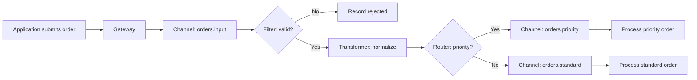

# What is an Enterprise Integration Pattern?

> **Chapter:** Introduction  
> **Module:** `SPRING_INTEGRATION_PATTERN` — learn to implement Enterprise Integration Patterns with Spring Integration to build loosely coupled, extensible message flows; practice Router, Filter, Transformer, Splitter, Aggregator, Gateway, retry, error channel, correlation, and per-branch testing/observability.

## 1. Learning Objectives

After this lesson, you will be able to:

1. Explain what problems **Enterprise Integration Patterns (EIP)** solve when multiple systems must exchange data.
2. Distinguish between **message**, **channel**, **endpoint**, and **integration flow**; understand the difference between a design pattern and the technology that implements it.
3. Recognize common EIPs such as **Gateway, Filter, Transformer, Content-Based Router, Splitter, and Aggregator** and know when to use them.
4. Sketch a simple Spring Integration flow, identifying how routing, error handling, message correlation, and testing points work.

## 2. Why Do We Need Enterprise Integration Patterns?

Imagine an e-commerce system that must connect with an ERP, a payment service, a warehouse, email, and a shipping platform. Each system may use different APIs, data formats, operating schedules, and load capacities. If the order-processing code calls every system directly and embeds all transformation/routing rules itself, it will easily run into the following problems:

- **Tight coupling:** changing the warehouse API forces changes to the ordering logic as well.
- **Heterogeneous data:** one place uses JSON, another uses XML; the same field may be named or represented differently.
- **Hard-to-extend processing flows:** adding branches for priority orders, international orders, or new notification channels leads to scattered `if/else` conditions.
- **Error propagation:** a slow or disconnected target service can stall the entire transaction without proper timeout, retry, and error-handling policies.
- **Difficult to trace:** it is unclear which steps an order went through, where it was dropped, and whether resulting messages belong to the same request.

**Enterprise Integration Patterns** are a **set of design patterns with clear names, structures, and purposes** for solving recurring problems in application connectivity, particularly through **message-based integration**. These patterns are prominently systematized in the book *Enterprise Integration Patterns* by Gregor Hohpe and Bobby Woolf.

EIP is a **shared design language**, not a specific library, protocol, or product. You can apply them using Spring Integration, Apache Camel, a message broker system, or a custom-built solution. Pattern names help team members describe architecture precisely: "filter out invalid messages", "route by content", "split an order into line items", "aggregate results by order" instead of describing an ambiguous block of processing code.

> **Core idea:** break a large integration process into small steps with distinct responsibilities, connecting them via messages and channels. Steps can be configured, tested, replaced, and observed more independently.

## 3. Foundational Components

### 3.1. Message

A message typically consists of a **payload** (business content) and **headers** (metadata for routing, tracing, replies, etc.). Spring Integration represents it using `Message<T>`.

For example, an order can be packaged as follows:

```java
import org.springframework.messaging.Message;
import org.springframework.messaging.support.MessageBuilder;

Message<String> message = MessageBuilder.withPayload(
        "{\"orderId\":\"ORD-101\",\"total\":750000}")
    .setHeader("sourceSystem", "web-store")
    .setHeader("tenantId", "shop-vn")
    .build();

System.out.println(message.getPayload());
System.out.println(message.getHeaders().get("sourceSystem"));
```

The payload is the information to be processed; headers can carry data such as `id`, `timestamp`, `replyChannel`, `errorChannel`, `correlationId`, or tracing data. You should not assume every header is preserved when crossing every system or adapter: header mapping across protocol boundaries must be configured and verified.

### 3.2. Message Channel

A channel is the conduit for exchanging messages between steps. The component sending a message does not necessarily know which specific component will receive and process it.

In Spring Integration, common channels include:

| Channel | Key Characteristics | When to Consider |
| --- | --- | --- |
| `DirectChannel` | Passes directly to a subscriber, typically on the calling thread | Synchronous, simple flows needing immediate reply/error |
| `QueueChannel` | Holds messages in a queue for consumers to poll/receive | Decoupling send and receive timing within the application's configuration scope |
| `ExecutorChannel` | Dispatches processing via a `TaskExecutor` | Separating execution threads; requires thread pool and load management |
| `PublishSubscribeChannel` | Broadcasts a single message to multiple subscribers | The same event needs to go through multiple independent branches |

**Note:** A default `QueueChannel` does not mean a durable queue across application restarts. Data durability, network delivery, and delivery guarantees depend on the message store, broker/adapter, transactions, and specific configuration. A *Spring Integration channel* is also not automatically a *RabbitMQ or Kafka topic/queue*.

### 3.3. Message Endpoint

An endpoint is a component that connects to a channel to receive, produce, or process messages. For example:

- **Gateway:** provides a familiar calling interface for business code while introducing the request into the messaging system.
- **Transformer:** changes payload structure/representation to fit the next step.
- **Filter:** decides which messages are allowed to proceed.
- **Router:** selects the target branch or channel based on content/headers.
- **Service Activator:** invokes business logic from a message.
- **Splitter/Aggregator:** splits a message into multiple parts and combines related results.

### 3.4. Integration Flow

An integration flow is a sequence of endpoints and channels working together to achieve a goal, such as **receive order → validate → normalize → route → send to the appropriate system**. A flow does not have to run strictly sequentially; it can branch, process in parallel, wait for results, or pass through external components.



The diagram illustrates the **responsibilities** of each step; it does not imply that every channel is asynchronous or that routing itself guarantees successful delivery to the target system.

## 4. Common EIP Patterns

| Pattern | Problem Solved | Example in an Order System |
| --- | --- | --- |
| **Messaging Gateway** | How does the application invoke a message flow without knowing channel details? | `orderGateway.submit(order)` |
| **Message Channel** | Through what path do components communicate? | `orders.input`, `orders.priority` |
| **Message Filter** | Which messages qualify to continue? | Accept only orders with a positive total |
| **Message Translator / Transformer** | How to convert data between two different representations? | Convert payload from web order to ERP format |
| **Content-Based Router** | How to select a destination based on message values? | Urgent orders go to the priority branch |
| **Recipient List** | How should one message reach multiple selected destinations? | Send to required target systems depending on order type |
| **Splitter** | How is a large message split into independent parts? | Split an order into line items |
| **Aggregator** | How are related messages combined into one result? | Combine inventory check results for each line item |
| **Resequencer** | How to reorder messages that arrive out of sequence? | Restore order of sequenced events |
| **Service Activator** | How to connect a message flow to business processing? | Invoke inventory check/reservation service |
| **Publish-Subscribe Channel** | How is one event broadcast to multiple recipients? | Update inventory and send notification after confirmation |
| **Wire Tap** | How to observe messages without altering the main flow? | Send a copy of the message to an audit branch |

EIP also describes mechanisms for handling reliability and system boundaries such as **Dead Letter Channel**, **Idempotent Receiver**, **Correlation Identifier**, and **Message Store**. In Spring Integration, **retry advice** and **error channel** are key execution mechanisms for realizing fault-tolerance policies; you should not treat "just retry" as the default solution for every business error.

### 4.1. Distinguishing Filter, Router, and Transformer

Three patterns that are frequently confused:

- **Filter:** decides whether to *keep or discard* a message; it is not responsible for choosing one of several business branches.
- **Router:** decides *where* a message goes; a message can be sent to one or multiple channels depending on the router type and configuration.
- **Transformer:** decides *what the data looks like* after the conversion step; it does not necessarily perform routing.

For example, with order `ORD-101`: Filter rejects orders with `total <= 0`; Transformer converts `total` into a standard internal structure; Router sends orders with `urgent=true` to `orders.priority`.

### 4.2. Splitter and Aggregator Must Be Paired with Correlation Rules

Suppose order `ORD-101` has three line items. A Splitter can generate three inventory-check messages. The Aggregator needs to know **which three results belong together under `ORD-101`** and **when they are considered complete** to emit a combined result.

```text
Order ORD-101
   |
   v
 Splitter
   +--> Line A -- inventory check -- result A --+
   +--> Line B -- inventory check -- result B --+--> Aggregator --> Result ORD-101
   +--> Line C -- inventory check -- result C --+
```

Key concepts:

1. **Correlation ID:** the key linking messages that belong to the same group (e.g., `orderId`).
2. **Sequence number / sequence size:** the item index and total number of parts, if the system produces this information.
3. **Release strategy:** the condition allowing the group result to be released (all three parts received, all required response types received, or a business condition met).
4. **Timeout / group expiry:** behavior when a part is missing, delayed, or never arrives.
5. **Message group store:** how group state is stored; requirements for fault tolerance across restarts need appropriate persistent storage design.

**Correlation ID does not replace idempotency.** A duplicate response sent twice can cause the aggregator to miscalculate if there are no rules to detect and handle duplicates.

## 5. How Does Spring Integration Implement EIP?

**Spring Integration** is a component in the Spring ecosystem that lets you declare integration flows via Java DSL, annotations, or other configurations. It provides `Message`, `MessageChannel`, endpoints, channel adapters, gateways, transformers, routers, aggregators, and components supporting interaction with external services.

As a result, business logic (what constitutes a valid order, what constitutes a priority order) can live in separate functions, while the flow structure (where to receive from, which steps to pass through, which channel to route to) is described in one place.

### 5.1. Minimal Example with Java DSL

The example below illustrates a flow in a Spring application with the Spring Integration dependency declared. To keep things simple, both branches only print to the console instead of calling an actual ERP.

```java
import java.math.BigDecimal;

import org.springframework.context.annotation.Bean;
import org.springframework.context.annotation.Configuration;
import org.springframework.integration.annotation.Gateway;
import org.springframework.integration.annotation.IntegrationComponentScan;
import org.springframework.integration.annotation.MessagingGateway;
import org.springframework.integration.config.EnableIntegration;
import org.springframework.integration.dsl.IntegrationFlow;

record Order(String id, BigDecimal total, boolean urgent) {}
record NormalizedOrder(String id, BigDecimal total, boolean urgent) {}

@MessagingGateway
interface OrderGateway {
    @Gateway(requestChannel = "orders.input")
    void submit(Order order);
}

@Configuration
@EnableIntegration
@IntegrationComponentScan
class OrderFlowConfiguration {

    @Bean
    IntegrationFlow incomingOrders() {
        return IntegrationFlow.from("orders.input")
            // Filter: only allow orders with a positive total to proceed.
            .filter(Order.class, order -> order.total().signum() > 0)
            // Transformer: normalize data before routing.
            .transform(Order.class, order -> new NormalizedOrder(
                order.id().trim(), order.total(), order.urgent()))
            // Router: choose channel name based on content.
            .route(NormalizedOrder.class,
                order -> order.urgent() ? "orders.priority" : "orders.standard")
            .get();
    }

    @Bean
    IntegrationFlow priorityOrders() {
        return IntegrationFlow.from("orders.priority")
            .handle(message -> System.out.println(
                "PRIORITY: " + message.getPayload()))
            .get();
    }

    @Bean
    IntegrationFlow standardOrders() {
        return IntegrationFlow.from("orders.standard")
            .handle(message -> System.out.println(
                "STANDARD: " + message.getPayload()))
            .get();
    }
}
```

Once the application has the gateway bean, the sender simply calls:

```java
orderGateway.submit(new Order("ORD-101", new BigDecimal("750000"), true));
// Output on priority branch: PRIORITY: NormalizedOrder[...]
```

**Reading the flow from left to right:** the gateway puts `Order` into `orders.input` → Filter checks `total` → Transformer creates `NormalizedOrder` → Router selects the priority/standard channel → the corresponding handler processes it.

This example is intentionally simple: by default, Filter may drop messages that fail the predicate without raising a business error; the handler only logs to the console and ends the flow; no discard channel, retry, error handling, persistence, or external adapters are configured. In a real production system, you must explicitly design what happens to rejected orders and failures when communicating with target systems.

### 5.2. EIP Does Not Dictate Synchronous or Asynchronous Execution

If a flow primarily uses `DirectChannel`, steps may be invoked **synchronously on the same thread**. When using executors, queues, or external brokers, execution boundaries and how errors are detected will differ. Therefore:

- **Message-based** does not mean **asynchronous**.
- **Having a channel** does not mean **having a durable queue**.
- **Successful routing** does not mean **the target system processed it successfully**.
- **A gateway returning** does not by itself prove that a distributed process has completed across all systems.

For request–reply calls, you also need to design the reply channel, timeout, and behavior when no reply arrives; for one-way messages, you need to clarify when a message is considered accepted and who is responsible for downstream processing.

## 6. Retry, Error Channel, and Operability

In enterprise integration, errors come not only from code but also from network timeouts, brokers, authentication, invalid data, or third-party system outages.

| Situation | Appropriate Handling | What to Avoid |
| --- | --- | --- |
| Temporary failure connecting to external service | Bounded retry, backoff, timeout | Infinite retries or piling load onto an overloaded target |
| Input data violates business rules | Filter with discard channel or explicit rejection flow | Retrying data that can never be valid |
| A handler throws an exception | Identify synchronous vs. poller/async flow error; configure appropriate error handling | Assuming every exception automatically goes to the same `errorChannel` |
| Same message delivered multiple times | Idempotent Receiver/deduplication by business key | Creating duplicate orders, shipments, or payments |
| Part of a group never arrives | Aggregator timeout and incomplete-group handling policy | Waiting forever, retaining unbounded memory/groups |

In Spring Integration, errors on a synchronous flow can typically propagate back up the call stack; errors across an asynchronous boundary can be wrapped into an error message and sent to a configured **error channel**. Retries are typically placed at recoverable points (such as calling an outbound adapter to an external service), combined with **max attempts**, **backoff**, **retryable error classification**, and **idempotency**. You must not rely on retries alone to imply "exactly-once" processing across multiple systems.

### Tracing a Message Across Branches

To test and operate a flow, attach meaningful trace attributes: `orderId`, source system code, correlation ID, endpoint/branch name, outcome, and processing duration. You can use logging, metrics/tracing, observation points such as Wire Tap, and built-in observability mechanisms suited to your Spring version. Sensitive data (customer info, tokens, payment details) must be masked from logs and traces.

Example questions to answer when an order goes missing:

- Did the gateway receive the order? Did the input pass the Filter condition?
- Did the Transformer produce the expected target payload?
- Which channel did the Router actually pick, and is there a subscriber handling it?
- Did the error occur before or after an asynchronous boundary?
- If the Splitter produced three parts, do all three results share the same correlation ID and did the Aggregator release them?

## 7. Behavior-Based Testing of EIP Flows

An integration flow should not be tested solely by calling individual business functions in isolation. You need to verify that **messages follow the right path**, **payloads/headers are correct**, **error branches are explicit**, and **behavior is sound when a step is slow or data is missing**.

| Test Scenario | Expected Outcome |
| --- | --- |
| Valid order, `urgent=true` | Routes to `orders.priority`, does not go to standard branch |
| Valid order, `urgent=false` | Routes to `orders.standard` |
| `total = 0` or negative | Not forwarded to handler; if a rejection flow exists, records the proper reason |
| Payload needs normalization | Handler receives `NormalizedOrder` structure with trimmed/normalized `id` |
| External adapter has transient failure | Retries only according to policy; failed message is recorded when attempts are exhausted |
| Splitter emits three parts, one arrives late | Aggregator does not mix groups and honors release/timeout strategy |
| Same event delivered again | Processing is idempotent when business rules forbid duplicate execution |

With Spring Integration, you can write tests using Spring Test/JUnit, mock channels/handlers to observe messages, or Spring Integration's testing utilities. The key is to **assert outcomes at destination channels and important headers**, not just verify that a single method returns the right value.

## 8. When Should and Shouldn't You Use EIP?

**Consider EIP** when a process needs to connect multiple systems, involves data transformation steps, dynamic routing, event-driven processing, splitting/aggregating work, or requires replaceable adapters. EIP is especially useful when a flow can be described in terms of clear responsibilities rather than one monolithic function.

**Do not build a complex flow** just to call a simple internal method. If a problem only involves a few synchronous computations within the same application, direct implementation can be clearer and easier to maintain. EIP reduces coupling between steps, but it also introduces concepts of channels, delivery, state, errors, and observability; the level of abstraction should be proportional to the problem.

## 9. Thought Exercise

Design a flow that accepts shipping requests from two sources, **website** and **ERP**, where input data has different formats; only accepts orders with a shipping address; requires a separate inspection branch for international orders; and calculates shipping fees per package for multi-package orders before aggregating them.

Self-check prompts:

1. Which pattern brings both input sources into the same flow without forcing business logic to know the source protocols?
2. Where would you place Transformer, Filter, and Router, and why?
3. Splitter splits by package; which key does Aggregator use and when does it finish the group?
4. If the shipping-fee API times out, how many times should it retry, which errors should not be retried, and how do you avoid double-charging?
5. Where would you place metrics/logging points to know which branch a package took and at which step it was lost?

**One reference design:** `Inbound Adapter/Gateway → normalizing Transformer → address Filter → domestic/international Router → package Splitter → per-package fee calculation → Aggregator by orderId → Service Activator persisting result`. Error paths, timeouts, idempotency, and group release policies must be defined explicitly before going to production.

## 10. Summary

**Enterprise Integration Patterns are reusable design patterns for modeling how applications communicate, transform, route, split/aggregate, and handle messages.** In Spring Integration, these patterns are composed into an integration flow from messages, channels, and endpoints. Understanding each pattern's responsibility helps you design flows that are loosely coupled, easier to extend, easier to test, and easier to troubleshoot.

Three things to keep in mind as you learn specific patterns next: **(1)** clearly define the payload, headers, and contract of each channel; **(2)** treat Filter, Transformer, Router, Splitter, and Aggregator as distinct responsibilities; **(3)** design retry, error channels, correlation, timeouts, idempotency, and observability from the outset whenever a flow crosses system boundaries.

**Further reading:** Gregor Hohpe & Bobby Woolf, *Enterprise Integration Patterns*; official Spring Integration reference documentation on Messaging, Java DSL, Routing, Message Endpoints, and Error Handling.
