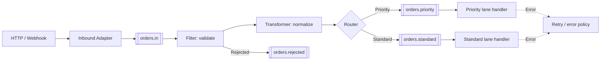

# Why Does an Integration System Need Clear Communication Patterns?

A system can run fine when there is only one application, one database, and a few method calls. But when it must connect a website, ERP, payment, warehouse, email, partner applications, and analytics systems, the question is no longer simply *how to send data*. The engineering team also has to answer: **who receives the message, by what rules, does it need to wait for a result, how are errors handled, and how do we know where an order has gone?**

That is why **clear communication patterns** (*integration patterns*) are needed: a way to describe recurring responsibilities in an integration flow as steps with explicit names, boundaries, data contracts, and error rules. In the Java ecosystem, **Spring Integration** implements many **Enterprise Integration Patterns (EIP)** to build loosely coupled, testable, and extensible message flows.

> **Key point:** Communication patterns do not just make diagrams look nicer. They turn implicit assumptions in source code into decisions that can be read, tested, observed, and changed independently.

## 1. From a Simple Call to an Integration System

Suppose an e-commerce platform receives an order creation request. After accepting it, the system must:

1. Validate the data, discard invalid requests, and normalize item codes.
2. Route priority orders to a fast-processing lane and regular orders to a standard lane.
3. Split each line item to check inventory across multiple warehouses.
4. Aggregate the check results into a result for the entire order.
5. Send the information to the ERP, trigger payment, and emit notifications.
6. Track network errors, timeouts, duplicate responses, and retries.

If all of this is written inside a single `createOrder()` method, the system looks simple at first:

```java
// Sketch of a hard-to-maintain structure; not an example to follow.
void createOrder(Order order) {
    validate(order);
    normalize(order);
    if (order.isPriority()) {
        priorityService.send(order);
    } else {
        standardService.send(order);
    }
    for (OrderLine line : order.getLines()) {
        warehouseClient.check(line);
    }
    erpClient.create(order);
    paymentClient.charge(order);
    notificationClient.send(order);
}
```

The snippet does not make it clear whether inventory checks must all finish before creating the ERP order; whether a payment failure requires redoing the order creation step; or whether a callback retry from a partner is allowed to trigger notifications again. Moving HTTP calls onto a queue does not answer these questions by itself either.

As the system scales, problems tend to appear together:

| Problem | Consequence When Communication Conventions Are Scattered in Code |
| --- | --- |
| **Tight coupling** | Changing the ERP API may force edits to controllers, classification rules, and notifications. |
| **Heterogeneous formats** | Each party interprets item codes, order statuses, timestamps, and required fields differently. |
| **Missing routing policy** | It is unclear which order goes to which branch, where the default branch is, and how unmatched cases are handled. |
| **Partial failures** | Warehouse reserved stock, but payment failed; re-running the whole method can create duplicate side effects. |
| **Unclear synchronicity** | An API expected to respond quickly ends up waiting on multiple slow or unavailable partners. |
| **Hard to trace** | Isolated logs do not show which messages belong to the same order or the same execution attempt. |
| **Hard to test** | Testing a small branch requires standing up nearly every external system. |

**The root problem is a lack of contracts between steps**, not the lack of a library for sending and receiving data.

## 2. What Does a "Communication Pattern" Describe?

An EIP pattern answers a recurring design question: how to transform a message, choose a recipient, discard data, break work into smaller pieces, combine results, or handle errors without forcing components to know too much about one another.

For example, instead of placing many `if` statements inside a business service, we use a **Content-Based Router** to express the decision of forwarding a message to the appropriate channel. Instead of scattering JSON/XML conversions across every controller, we use a **Message Translator/Transformer** to normalize at a single boundary. Each step has its own responsibility, with clearly described inputs/outputs and behavior under abnormal conditions.

### 2.1. The Core Triad: Message, Channel, Endpoint

Spring Integration typically organizes flows around three concepts:

- **Message:** consists of a `payload` containing the main data and `headers` containing metadata such as identifiers, timestamps, correlation info, or reply instructions. A message is a unit of exchange, not necessarily a record in a broker.
- **Message Channel:** the boundary for passing messages between steps. The sender knows the channel to send to, not necessarily the receiver's Java class or network address.
- **Endpoint:** a component that connects to a channel to transform, filter, route, run business logic, or communicate with external systems.

A simple architecture can be depicted as follows:



The diagram represents **logical responsibilities**. The channels can live entirely inside the same Java process; the diagram itself does not claim that the flow already runs asynchronously, has a durable queue, or guarantees delivery across application restarts.

### 2.2. Contracts Need More Than Just Channel Names

For each connection segment, the engineering team should agree on at least the following:

| Aspect | Questions to Answer |
| --- | --- |
| Data | What type and version does the payload have? Which fields are required? |
| Routing | What are the entry conditions for each branch? What happens if nothing matches? |
| Timing | Must a response be awaited? How long is the timeout? |
| Ordering | Which events strictly require ordering? |
| Reliability | When processing fails, do we retry, send to a dead-letter queue, or require manual intervention? |
| Duplication | Which key identifies whether a request has already been processed? |
| Tracing | Which `orderId`, `eventId`, or correlation ID is used for tracing? |
| Security | Does the payload contain sensitive data; which fields are allowed in logs? |

In other words, **"sending through a channel" is an implementation detail; "what the receiver commits to doing with that message" is the integration contract**.

## 3. How Do EIP Patterns Clarify Responsibilities?

| Pattern | Primary Responsibility | Example in Order Processing |
| --- | --- | --- |
| **Message Gateway** | Gives business calling code a familiar interface to send requests through the messaging system; can follow a request–reply model. | REST/controller calls `orderGateway.submit(...)` instead of knowing internal channels. |
| **Filter** | Allows only qualifying messages to proceed; policy for discarded messages must be defined. | Routes orders missing item codes to a rejection flow and records the reason. |
| **Transformer** | Converts the payload into a shape or data type suitable for the next step. | Normalizes SKU codes and currency units to match the target contract. |
| **Router** | Selects one or more channels based on routing rules. | Routes priority orders and standard orders to separate lanes. |
| **Splitter** | Splits a single message into child messages for independent processing. | Splits an order into multiple line items to check inventory. |
| **Aggregator** | Combines related messages using a correlation key and completion condition. | Emits the inventory check outcome after receiving all required results. |
| **Service Activator** | Calls a business method or service to process a message. | Sends the actual request to the ERP processor. |
| **Channel Adapter** | Connects sources/destinations that do not use internal message channels to the integration flow. | Receives HTTP, reads from a broker, writes files, or sends to an external system. |
| **Error Channel / Error Flow** | Centralizes part of error handling as error messages in appropriate flows. | Logs errors, triggers alerts, and forwards to a retry lane. |

Not every flow needs every pattern. They are a **design vocabulary**, not a mandatory sequence of steps. Naming steps meaningfully lets a newcomer reading the diagram understand what the system is doing and which part is responsible.

### 3.1. Router vs. Filter

**Filter** answers "is this message eligible to continue?". **Router** answers "which channel should this message go to?". A message blocked by a Filter is not automatically an error; it may be an event allowed to be ignored. Conversely, if an order cannot find a matching branch at a Router, that may be a data error or a configuration bug. You need to define a default branch, a rejection path, or an appropriate error-reporting mechanism.

### 3.2. Splitter Must Come with Aggregator Questions

When splitting an order into five line items, the five requests may travel through different paths and return out of order. The **Aggregator** needs to know:

- Which responses belong to the same order (`correlationId` or a stable business key)?
- When are results considered complete (`release strategy`)? Must all five line items arrive?
- What happens when a response is lost or arrives late (timeout, partial result, error reporting, compensation)?
- Where is the waiting group stored, and how is unbounded memory growth prevented?

In Spring Integration, Splitter/Aggregator support correlation and sequence mechanisms. However, **you should not assume an Aggregator will automatically handle every case of packet loss, late results, or restarts**; you must choose the message store, timeout, and group completion policy based on real requirements.

## 4. Same Flow, Different Channels Change Behavior

Pattern names do not equate to execution mechanics. In particular, **channels** directly affect who runs the processing, when it runs, and load capacity:

| Common Mechanism in Spring Integration | Key Behavior | Points to Watch |
| --- | --- | --- |
| `DirectChannel` | Delivers messages directly to a subscriber, typically right on the sender's thread. | A slow handler makes the sender wait; errors can propagate back through the synchronous call. |
| `ExecutorChannel` | Hands work to a `TaskExecutor`, creating an async boundary when the executor accepts the task. | Does not create durability by itself; requires managing queue capacity, executor saturation, and async errors. |
| `QueueChannel` | Temporarily stores messages in a queue for a consumer/poller to fetch later. | Capacity limits, polling mechanics, and durability depend on configuration/channel store. |
| `PublishSubscribeChannel` | Distributes to multiple subscribers. | By default does not equal a durable pub/sub broker; how subscribers are invoked depends on executor/configuration. |

For example, using `DirectChannel` between Router and Handler fits short processing where synchronous execution and immediate error return are needed. When the Handler calls a slow-responding partner, an async channel and separate reply design may be needed. However, **replacing `DirectChannel` with `ExecutorChannel` does not automatically protect data against power loss or guarantee no duplicate processing**.

Similarly, integrating via Kafka, RabbitMQ, or HTTP is a **transport/adapter** choice, whereas Filter, Router, Transformer, Splitter, and Aggregator are ways of **organizing behavior**. These two layers complement each other; they do not replace one another.

## 5. Illustrating How to Express a Flow with Spring Integration DSL

The snippet below illustrates only the **ingestion and classification lane**. Suppose `OrderEvent` has methods `isWellFormed()`, `normalized()`, and `priority()`. The channels `orders.rejected`, `orders.priority`, and `orders.standard` must have corresponding subscribers/flows in a real application.

```java
import org.springframework.context.annotation.Bean;
import org.springframework.context.annotation.Configuration;
import org.springframework.integration.dsl.IntegrationFlow;

@Configuration
class OrderFlowConfiguration {

    @Bean
    IntegrationFlow classifyOrders() {
        return IntegrationFlow.from("orders.in")
            .filter(OrderEvent.class,
                OrderEvent::isWellFormed,
                endpoint -> endpoint.discardChannel("orders.rejected"))
            .transform(OrderEvent.class, OrderEvent::normalized)
            .route(OrderEvent.class,
                event -> event.priority() ? "priority" : "standard",
                router -> router
                    .channelMapping("priority", "orders.priority")
                    .channelMapping("standard", "orders.standard"))
            .get();
    }
}
```

Reading from top to bottom, the **lane contract** is very clear: receive data from `orders.in` → filter invalid messages to `orders.rejected` → normalize → route by priority level. A change in input validation logic does not force changes in the ERP-calling part; a change in priority policy does not require rewriting the Transformer.

This is a **flow structure example**, not a complete application: to actually run it, you need to define `OrderEvent`, the source sending to `orders.in`, the flows receiving from the three target channels, invalid-data handling, and configuration appropriate for the Spring Integration version in use. If `orders.rejected` has no receiver, `discardChannel` **does not by itself guarantee that rejected records are persisted**.

A larger flow can further add a Splitter for each line item, an Aggregator for inventory results, and a Gateway for the business calling layer. The key is that **each step retains an explainable responsibility**, rather than cramming everything into a single handler.

## 6. When Errors Occur: The Communication Contract Must State What Happens Next

In a multi-partner system, failures are normal: flaky networks, services returning `429`, timeouts, malformed data, or one branch succeeding while another fails. "Retry on error" is too vague a requirement to implement safely.

### 6.1. Distinguish Error Types Before Retrying

| Situation | Typically Appropriate Handling |
| --- | --- |
| Network timeout or transient external system error | Bounded retry, increasing delay (*backoff*), and tracking attempt counts. |
| Payload fails schema validation, missing required fields | Reject/quarantine, return reason or move to error queue; retrying as-is is usually futile. |
| Receiver responds slowly but may have already completed the action | Query status or retry **with idempotency** to avoid duplicate side effects. |
| One branch in a multi-system chain fails | Define intermediate states, *compensation*, or manual intervention per business rules. |
| Continuously failing message (*poison message*) | Cap retries, move to dead-letter queue/quarantine, alert, and provide a replay procedure. |

**Spring Integration can support retries and error routing**, but actual mechanics depend on endpoints, advice, transactions, channels, and adapters. In a synchronous flow, exceptions can be thrown back to the caller; in many asynchronous flows, errors can be converted into an `ErrorMessage` sent to an error channel if configured. **Do not assume that merely declaring an `errorChannel` means every exception, across every transport, will be retained or handled safely.**

### 6.2. At-Most-Once, At-Least-Once, and Idempotency

Three concepts often conflated:

- **At-most-once:** limits duplicate processing but may lose messages if an error occurs before completion.
- **At-least-once:** messages may be resent/reprocessed to reduce the risk of loss, so consumers must account for duplicates.
- **Exactly-once in business effect:** the final state is applied only once per business key, even if resent or received multiple times. This is a property **of the overall design and transaction boundaries**, not an automatic guarantee of Spring Integration.

For example, if a partner resends event `eventId=EVT-781`, the proper acceptance check should be "has this event already been processed successfully?", not "does the new message in the JVM have a new `MessageHeaders.ID`?". You need a stable idempotency key (e.g., `eventId` from the source), a store recording completed processing/results, and concurrency control when two duplicates arrive simultaneously. For multi-system transactions, consider **transactional outbox**, idempotent consumers, or compensation patterns; each solution has its own guarantee scope.

### 6.3. Correlation Does Not Equal Message ID

A technical message may change its `id` when rebuilt or passing through an adapter. Yet inventory checks for the same `orderId` still need to stay linked together. Therefore, separate:

- **`eventId`:** event identifier for detecting redeliveries/duplicates.
- **`orderId`:** durable business identifier of the order.
- **`correlationId` or business correlation key:** links messages belonging to one request/processing group, especially when Splitter/Aggregator are active.
- **`traceId`:** helps stitch logs/spans for distributed observability; does not replace business keys or idempotency.

Some Spring Integration patterns use dedicated correlation/sequence headers; you must verify how headers are attached, forwarded, and preserved across adapters rather than assuming headers cross every boundary automatically.

## 7. Clarity Also Determines Testability and Operability

When a flow is split into transparent steps, testing can focus on contracts:

| Scenario | What to Verify |
| --- | --- |
| Valid, priority order | Passes Filter, Transformer, and arrives at `orders.priority`; does not enter standard lane. |
| Invalid order | Does not call ERP/payment; rejection reason appears on the defined lane. |
| Standard order | Reaches only `orders.standard`, payload matches target schema after normalization. |
| Splitter creates multiple messages | Parts carry the proper correlation identifier and required group info. |
| Warehouse responses return out of order | Aggregator does not mix up orders; honors completion condition and timeout policy. |
| Slow partner or transient failure | Bounded retry with backoff; does not duplicate charging actions. |
| Resending the same `eventId` | Business outcome is not written or triggered twice unintentionally. |

In Spring Integration, flows and endpoints can be tested individually with mocks/stubs at channel boundaries. Unit testing Router/Filter does not require starting a real ERP; separate integration tests verify adapters, transactions, brokers, and behavior when the network is disconnected.

Operationally, a system with clear patterns should emit signals such as **messages received/processed/rejected counts**, per-step latency, queue age and depth, retry rates, error-lane message counts, long-lived Aggregator group counts, and traces by `orderId`/correlation key. When logging, sensitive data such as payment details and access tokens must be stripped or masked. Metrics/observability must be **configured and actually measured**, not assumed to appear automatically just from using the DSL.

## 8. Pattern Selection Principle: Clear Without Over-Complicating

A simple flow may only need **Inbound Adapter → Transformer → Service Activator**. Do not create a Router when there is only one destination, an Aggregator when there are no results to combine, or a dedicated broker just to replace an internal method call with no asynchronous requirement.

When designing a new integration, answer these in order:

1. **Who produces, who consumes, and what is the canonical payload?** Choose the format conversion boundary.
2. **Does a message go to one branch or multiple branches?** Pick Filter/Router/Publish-Subscribe with the right semantics.
3. **Does work need to be split and re-combined?** If yes, define correlation, completion, timeout, and where group state is stored.
4. **Does the caller wait for a result?** Define Gateway, timeout, reply, and synchronous vs. asynchronous channels.
5. **Can messages be lost or delivered multiple times?** State transport assumptions, acknowledgements, retries, transactions, and idempotency explicitly.
6. **Where do errors go?** Define rejection, retry, error flow, dead-letter, and intervention paths.
7. **How do you prove the system works correctly?** Design test cases, logs/traces, and metrics before implementation.

Do not pick a pattern because its name sounds impressive. Pick a pattern because it **accurately names a business or infrastructure decision that needs to be managed**.

## 9. Self-Check Comprehension

**Scenario A.** A webhook resends the same payment message three times because it did not receive HTTP `200`. Does using `DirectChannel` or `QueueChannel` automatically prevent charging three times?

*No.* A channel only defines part of how messages are handed off. You need a stable idempotency key and guarantees that the payment processing/recording side does not produce duplicate side effects.

**Scenario B.** An order with four line items is split by a Splitter; only three inventory check responses return. What should the Aggregator do?

*There is no universal default answer for all systems.* It must follow the contract: wait until timeout, return an error, allow a partial result, or trigger compensation. The decision must be expressed in the release/expiry policy and tests.

**Scenario C.** A flow uses `ExecutorChannel` to process an API request. The API already returned success, but the application stops abruptly before finishing the task. Does `ExecutorChannel` automatically guarantee re-execution after restart?

*No.* Handing off to another thread is not equivalent to a durable queue. If process-crash fault tolerance is required, consider a broker/persistent store along with appropriate acknowledgement, retry, and deduplication mechanisms.

## Conclusion

Integration systems become hard to maintain not just because there are many APIs, but because there are many **unstated assumptions**: who owns the data, which paths are valid, which steps must wait, when it is safe to retry, and how outcomes are tracked. **Enterprise Integration Patterns** create a shared language to model those decisions; **Spring Integration** provides the components to implement them with `Message`, `Channel`, `Endpoint`, and composable flows.

When applied in the right measure, Router, Filter, Transformer, Splitter, Aggregator, Gateway, retry, error channel, and correlation help **reduce coupling between steps, clarify processing flows, establish testing boundaries, and enable observable operations**. The ultimate goal is not to use as many patterns as possible, but to enable any reader to answer: *"For this message, what will the system do — even when things go wrong?"*
