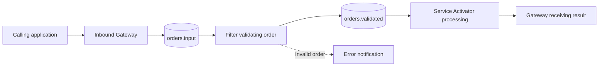

# Message, Channel, and Endpoint in an Integration Flow

## 1. The Big Picture

In an integration application, a requirement is rarely just calling a Java method and getting a return value. Data may arrive from HTTP, a queuing system, files, a database, or another application; along the way, data must be validated, transformed, routed, aggregated, and delivered to the right destination. **Spring Integration** implements **Enterprise Integration Patterns (EIP)** to express those steps using components with clear responsibilities.

The three foundational concepts are:

| Concept | Question Answered | Primary Responsibility |
|---|---|---|
| **Message** | *What is being transmitted?* | Wraps business data (payload) and processing context (headers). |
| **Message channel** | *Where does the message travel?* | Connects components, hands off messages, and defines delivery semantics: synchronous, asynchronous, point-to-point, or broadcast. |
| **Endpoint** | *Who sends, receives, or processes the message?* | Connects external sources/destinations or performs a processing step such as filter, transformer, router, or service activator. |

An **integration flow** is how endpoints are wired together through channels to form a processing pipeline that can be read, tested, and modified piece by piece. For example, with an order:



In the diagram: **the order is the message's payload**, `orders.input` and `orders.validated` are **channels**, and the gateway, filter, and service activator are **endpoints**. A channel does not validate orders by itself; an endpoint does not need to know the entire downstream system to perform its own responsibility.

## 2. Message: The Unit of Data Exchanged

Spring Messaging defines `Message<T>` with two parts:

- **Payload (`T`)**: the core data, such as `Order`, `PaymentEvent`, `String`, `byte[]`, or another DTO.
- **Headers (`MessageHeaders`)**: metadata for orchestration and observability, such as message ID, creation timestamp, trace ID, correlation ID, reply channel, or error channel.

Example creating a message:

```java
import org.springframework.messaging.Message;
import org.springframework.messaging.support.MessageBuilder;

Message<String> message = MessageBuilder.withPayload("ORDER-1001")
        .setHeader("tenantId", "shop-vn")
        .setHeader("traceId", "trace-8f21")
        .build();

String payload = message.getPayload();       // ORDER-1001
String traceId = (String) message.getHeaders().get("traceId");
```

Key headers to recognize:

| Header | Meaning in Practice |
|---|---|
| `id`, `timestamp` | Typically generated by the framework when constructing the message, aiding identification and observability. |
| `replyChannel` | Where to send the reply when the flow uses a request–reply model. |
| `errorChannel` | Where `ErrorMessage` is routed under appropriate error-handling configurations. |
| `correlationId` | Links related messages together, commonly used in Splitter/Aggregator. |
| `sequenceNumber`, `sequenceSize` | Helps identify an element and group size when splitting/aggregating messages. |
| Custom headers like `tenantId`, `traceId` | Propagates application context through processing steps. |

`Message` and its header map expose an immutable interface: changing a header generally requires **creating a new message**, for example via `MessageBuilder.fromMessage(original).setHeader(...).build()`. Immutability of the message envelope **does not mean** the payload object is always immutable; prefer DTOs/records that are not mutated arbitrarily as they pass through multiple endpoints.

Do not confuse a message's `id` with a **business identifier** (`orderId`, `transactionId`). One order can generate multiple messages during processing; message ID and order ID have different lifecycles. Similarly, `correlationId` does not appear automatically on every message; the flow or participating components must set and maintain the appropriate correlation semantics.

## 3. Message Channel: Transport Conduit and Delivery Contract

A `MessageChannel` is an abstraction for a destination where messages are sent. The sending component only needs to know the target channel, without calling methods on the receiving component directly. This allows you to change the handler or execution mechanism without tightly coupling the two sides.

Two important interface groups:

- **`SubscribableChannel`**: endpoints subscribe to receive messages in an **event-driven** style; messages are dispatched to subscribers when sent to the channel.
- **`PollableChannel`**: endpoints actively **poll/receive** messages when ready; typically used when buffering or consumption-rate control is needed.

### Commonly Used Channels

| Channel | Model | Characteristics | When to Use |
|---|---|---|---|
| `DirectChannel` | Subscribable, point-to-point | Dispatches synchronously on the sender's thread; exceptions can propagate back through the call. | Fast flows, synchronous request–reply, needing transaction context on the same thread. |
| `ExecutorChannel` | Subscribable, point-to-point | Dispatches through a `TaskExecutor`; decouples sender and receiver threads. | Asynchronous processing when the caller does not need to wait for processing. |
| `QueueChannel` | Pollable, queue | Buffers messages temporarily for a poller/consumer to fetch later; supports bounded capacity. | Need buffering and consumption rate control. |
| `PublishSubscribeChannel` | Subscribable, one-to-many | Broadcasts messages to multiple subscribers; not necessarily asynchronous by default, depends on executor config. | One event needing multiple branches such as audit, notifications, and metrics updates. |

**Note on delivery guarantees:** `DirectChannel`, `ExecutorChannel`, and `QueueChannel` are normally **in-process** components and are not durable across restarts by default. Choosing a channel does not automatically provide retries, durability, exactly-once delivery, or distributed multi-node execution. If those capabilities are needed, you must also design a message store, transactions, idempotency, or the corresponding adapter/broker.

With `DirectChannel`, if multiple handlers subscribe, typically **one handler** receives a given message according to the dispatch strategy. Conversely, with `PublishSubscribeChannel`, **multiple handlers** can receive the same message. Conditional branching based on content is usually the responsibility of a **Router**, not something the channel decides on its own.

Example declaring two clearly named channels:

```java
@Bean(name = "orders.input")
MessageChannel ordersInput() {
    return new DirectChannel();
}

@Bean(name = "orders.validated")
MessageChannel ordersValidated() {
    return new DirectChannel();
}
```

The bean name serves as the logical address for endpoints to find one another. This is why you must distinguish the **Java method name** `ordersInput` from the **channel name** `orders.input` specified in `@Bean(name = ...)`.

## 4. Endpoint: Where Interaction and EIP Execution Happen

An **endpoint** is a component that introduces messages into a flow, receives messages out of a flow, or connects a processing step to a channel. You can think of an endpoint as a station along a route, while channels are the roads between stations.

| Endpoint Group | Role | Example |
|---|---|---|
| **Inbound channel adapter** | Reads/produces messages from an external source, usually one-way. | Reads new files and sends their contents to a channel. |
| **Outbound channel adapter** | Consumes messages to write/send to an external system, usually without returning a reply to the flow. | Sends events to a broker or writes a file. |
| **Inbound/outbound gateway** | **Request–reply** communication at a system or API boundary. | Receives an HTTP request, sends it into the flow, and returns a response; calls another service and receives its reply. |
| **Service activator** | Calls application logic to process a message, optionally returning a result message/value. | Checks inventory, creates an order confirmation receipt. |
| **Transformer** | Converts the shape of the payload and/or headers. | JSON → DTO, DTO → structure tailored to the target system. |
| **Filter** | Keeps or drops messages according to a predicate. | Processes only orders with a valid total amount. |
| **Router** | Selects target channel(s)/branch(es) based on conditions. | High-value orders → approval branch. |
| **Splitter / Aggregator** | Splits a message into parts / combines related parts. | Splits an order by line item / aggregates item processing results. |

Three important details:

1. **Adapters differ from gateways**: adapters typically operate one-way; gateways carry a reply contract. You should not use an outbound adapter and expect it to return a processing result to the caller.
2. **Endpoint does not mean HTTP endpoint**: a filter, transformer, or service activator in the middle of a flow is also an integration endpoint, even without a URL.
3. **Channels transport, endpoints decide**: an invalid message at a filter can be discarded or trigger an exception; the channel does not make that decision on the filter's behalf.

In the Java DSL, many intermediate endpoints and channels are registered automatically by Spring Integration when building an `IntegrationFlow`. Thus, `.filter(...).handle(...)` still corresponds to EIP endpoints even without manually writing a separate class for each endpoint.

## 5. Complete Example: Order Intake and Confirmation Flow

We will implement a simple path: the application sends an `Order` through a **messaging gateway**; a **filter** rejects orders with a non-positive amount; a **service activator** creates an `OrderReceipt`; the result returns to the gateway. We use `DirectChannel` so the caller receives the reply on a synchronous path.

### 5.1. Declaring the Components

With Java 17+, Spring Boot, and the `spring-boot-starter-integration` dependency, the example below can live in the same package (split into separate classes/files in a real project):

```java
import java.math.BigDecimal;

import org.springframework.context.annotation.Bean;
import org.springframework.context.annotation.Configuration;
import org.springframework.integration.annotation.Gateway;
import org.springframework.integration.annotation.IntegrationComponentScan;
import org.springframework.integration.annotation.MessagingGateway;
import org.springframework.integration.channel.DirectChannel;
import org.springframework.integration.config.EnableIntegration;
import org.springframework.integration.dsl.IntegrationFlow;
import org.springframework.messaging.MessageChannel;

record Order(String id, BigDecimal amount) {}

record OrderReceipt(String orderId, String status) {}

@MessagingGateway
interface OrderGateway {
    @Gateway(requestChannel = "orders.input")
    OrderReceipt submit(Order order);
}

@Configuration
@EnableIntegration
@IntegrationComponentScan
class OrderIntegrationConfig {

    @Bean(name = "orders.input")
    MessageChannel ordersInput() {
        return new DirectChannel();
    }

    @Bean(name = "orders.validated")
    MessageChannel ordersValidated() {
        return new DirectChannel();
    }

    @Bean
    IntegrationFlow validateOrderFlow() {
        return IntegrationFlow.from("orders.input")
                .filter(Order.class,
                        order -> order.amount() != null
                                && order.amount().signum() > 0,
                        spec -> spec.throwExceptionOnRejection(true))
                .channel("orders.validated")
                .get();
    }

    @Bean
    IntegrationFlow processOrderFlow() {
        return IntegrationFlow.from("orders.validated")
                .handle(Order.class, (order, headers) ->
                        new OrderReceipt(order.id(), "ACCEPTED"))
                .get();
    }
}
```

The application invokes the gateway like a regular Java interface:

```java
OrderReceipt receipt = orderGateway.submit(
        new Order("ORD-1001", new BigDecimal("250000")));

// receipt.orderId() = "ORD-1001"
// receipt.status()  = "ACCEPTED"
```

`@IntegrationComponentScan` registers the interface annotated with `@MessagingGateway` as a bean; `orderGateway` is injected into the caller, for instance via constructor injection. It is **not** an object you instantiate with `new`.

### 5.2. What Happens to the Message at Each Step?

1. **Gateway** accepts the `Order` argument, creates a message whose payload is the order, and sets up a reply path (`replyChannel`) for the request–reply call.
2. The message enters **`orders.input`**. Because it is a `DirectChannel`, the filter is invoked within the sender's synchronous execution chain.
3. **Filter** checks `amount`. If invalid, `throwExceptionOnRejection(true)` raises an error instead of silently dropping the message. This is an intentional choice for a gateway expecting a reply.
4. Valid messages are forwarded through **`orders.validated`**. The channel does not modify `Order`; it only delivers the message to its subscriber.
5. **Service activator** (`.handle(...)`) creates `OrderReceipt`. The request–reply infrastructure uses the message's reply context to return the result to the gateway.
6. The caller receives `OrderReceipt` without manually managing `Message<?>` or calling the handler directly.

Without `throwExceptionOnRejection(true)` or a **discard flow** that returns an appropriate reply, the filter may drop the message and the gateway will not receive the expected reply; the call may end up waiting until timeout. When designing request–reply flows, both **the success branch and the rejection branch** must be clearly defined.

### 5.3. When Do You Need Transformers, Routers, and Adapters?

The example above is intentionally brief to highlight the three foundational components. A real-world flow might evolve into a structure like:

```text
HTTP inbound gateway
  -> inboundOrders channel
  -> Transformer (JSON/request -> Order)
  -> Filter (Order valid?)
  -> Router (standard order / order requiring approval)
     -> normalOrders channel -> Service Activator
     -> reviewOrders channel -> Service Activator
  -> Outbound gateway/adapter (write to target system)
```

Not every branch automatically rejoins after a router. To combine multiple results, you need an explicit aggregation step, correlation, and timeout; that is when you use an Aggregator. Nor should `JSON -> DTO` be treated as an inherent capability of a channel: that belongs to a **Transformer** or a configured message conversion mechanism.

## 6. Synchronous, Asynchronous, and Common Pitfalls

Consider two flows that both use a service activator to process an order, but change the input channel type:

```text
A. Gateway -> DirectChannel -> Service Activator -> Reply
   Caller and handler can execute on the same thread; synchronous errors
   can propagate back to the caller.

B. Producer -> ExecutorChannel -> Service Activator
   The sending thread hands the message to an executor, handler runs on another thread;
   errors and replies require mechanisms suited to asynchronous execution.
```

Things to check before replacing `DirectChannel` with `ExecutorChannel` or `QueueChannel`:

- **Request–reply:** Is a reply awaited? The gateway needs a timeout, reply channel, and clear semantics. Do not assume that switching to async still yields an immediate Java method return.
- **Transaction:** Transaction/thread-local context does not automatically propagate across executor or poller thread boundaries.
- **Backpressure / load:** `QueueChannel` needs capacity, a poller, and full-queue handling; an executor needs thread bounds, queue limits, and a rejection policy.
- **Ordering:** Multi-threaded processing and multiple subscribers can alter completion order; ordering requirements must be designed and tested explicitly.
- **Errors:** Errors in a synchronous flow can be thrown back to the caller. In an asynchronous flow, you must account for `errorChannel`, `ErrorMessage`, retries, and the actual transport's acknowledgement mechanism.

Additionally, `replyChannel` or `errorChannel` headers sometimes hold references to internal channel objects. When passing messages across process/broker boundaries, you cannot assume those Java references serialize and work intact; you must design a reply/error protocol at the system boundary.

## 7. Testing and Observing a Flow

For the example flow, at least three scenarios should be tested:

| Scenario | Input Data | Expected Behavior |
|---|---|---|
| Valid order | `amount = 250000` | Gateway returns `OrderReceipt` with `status = ACCEPTED`. |
| Zero-amount order | `amount = 0` | Filter rejects and caller receives an error; success handler does not run. |
| Missing amount | `amount = null` | Filter rejects without throwing a `NullPointerException`. |

An illustrative integration test with JUnit 5 and Spring Boot:

```java
import java.math.BigDecimal;
import org.junit.jupiter.api.Test;
import org.springframework.beans.factory.annotation.Autowired;
import org.springframework.boot.test.context.SpringBootTest;
import org.springframework.messaging.MessagingException;

import static org.junit.jupiter.api.Assertions.assertEquals;
import static org.junit.jupiter.api.Assertions.assertThrows;

@SpringBootTest
class OrderIntegrationTest {
    @Autowired
    private OrderGateway orderGateway;

    @Test
    void acceptsPositiveAmount() {
        OrderReceipt result = orderGateway.submit(
                new Order("ORD-1", new BigDecimal("100")));

        assertEquals("ORD-1", result.orderId());
        assertEquals("ACCEPTED", result.status());
    }

    @Test
    void rejectsZeroAmount() {
        assertThrows(MessagingException.class, () ->
                orderGateway.submit(new Order("ORD-2", BigDecimal.ZERO)));
    }
}
```

The test lives in the same package as `Order`, `OrderReceipt`, and `OrderGateway`, and requires Spring Boot Test/JUnit 5 dependencies. The test results prove the **gateway → channel → filter → channel → handler → reply** path, rather than just verifying an isolated business function. For async flows, replace assumptions of immediate results with synchronization/awaiting with a timeout and test the error flow as well.

In production, emit structured logs keyed by **business identifier** (`orderId`) and appropriate **trace/correlation IDs**, monitor message ingress/egress counts at key points, and measure latency. You can use interceptors, wire taps, or Micrometer/observation depending on configuration; avoid logging raw payloads containing sensitive data.

## 8. Common Design Pitfalls

| Misconception | Correct Understanding |
|---|---|
| "A message is just the payload." | A message also has headers; they govern much of reply, error, and correlation behavior. |
| "Channels handle business logic." | Channels transport; endpoints/handlers execute logic. |
| "All channels are asynchronous." | `DirectChannel` processes synchronously; `PublishSubscribeChannel` is also not async automatically without a configured executor. |
| "Having a QueueChannel means data can never be lost." | An in-memory queue does not replace a broker or durable storage. |
| "When a Filter drops a message, the gateway automatically knows it failed." | Request–reply must explicitly define an exception, discard/rejection reply, or timeout. |
| "Using a Router automatically provides a path to combine results." | A Router picks a branch; combining branches requires an additional pattern such as an Aggregator if business rules demand it. |
| "Moving a channel to a thread pool doesn't change transactions." | Thread boundaries alter transaction propagation and error handling; semantics must be re-evaluated. |

## 9. Hands-On Extension Exercises

Starting from the order example, work through these steps in order:

1. Add a `traceId` header on the message-sending side and log it in the handler; identify which steps create or forward the header.
2. Change the filter policy from `throwExceptionOnRejection` to a **discard channel** with an endpoint returning `OrderReceipt(..., "REJECTED")`. Verify both branches complete the request–reply cycle.
3. Add a **Router** that splits orders with `amount >= 10_000_000` into an approval branch and the rest into standard processing; build a table showing which messages enter which channels.
4. Try replacing a synchronous channel with an `ExecutorChannel`, and observe the executing thread, response latency, and how errors surface. Do this only after defining an appropriate reply contract.

**Self-check question:** In the diagram `Source -> Channel A -> Filter -> Channel B -> Service Activator -> Destination`, which component holds the business data, which handles handoff/transport, and which decides whether processing continues? The answers, respectively, are **the Message payload**, **the Channel**, and **the Filter endpoint**. Keeping these three responsibilities separate is the foundation for designing Router, Transformer, Splitter, Aggregator, Gateway, retries, and error flows in a controlled way.
