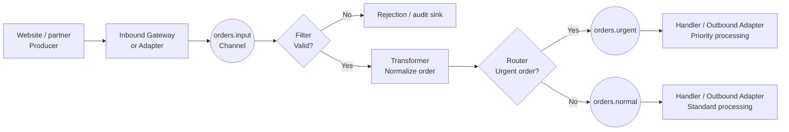
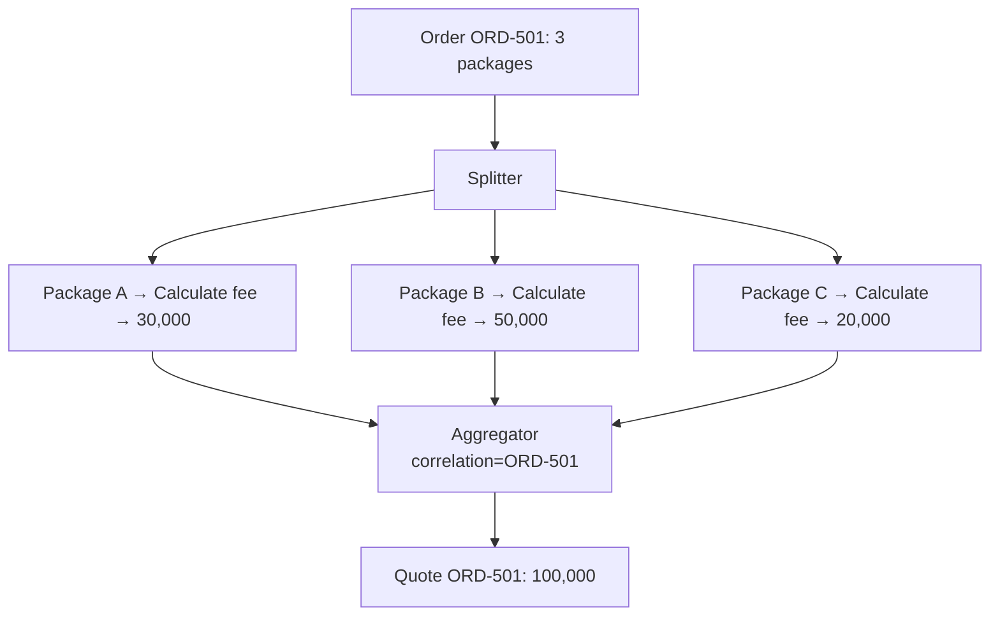
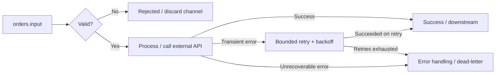

# From Producer to Consumer Across Multiple Steps

> **Chapter:** Introduction  
> **Scope:** `SPRING_INTEGRATION_PATTERN` — learn how to apply Enterprise Integration Patterns with Spring Integration to compose loosely coupled, extensible, testable, and observable message processing steps. This lesson focuses on **the journey of a message from the producing system to the receiving system**, laying the groundwork for Router, Filter, Transformer, Splitter, Aggregator, Gateway, retry, error channel, and correlation.

## 1. Learning Objectives

After this lesson, you will be able to:

1. Read and sketch a message path comprising **producer → inbound entry → channel → processing steps → channel → destination**.
2. Distinguish the roles of **producer, inbound adapter/gateway, message, channel, endpoint, outbound adapter/gateway**; recognize when payloads or headers change.
3. Identify where to place **Filter, Transformer, Router**, and explain how to extend with **Splitter/Aggregator** when one request fans out into multiple subtasks.
4. Describe the behavior of **synchronous, asynchronous, error, retry, and message correlation** flows without equating "sent successfully" with "finished processing".
5. Implement and test a Spring Integration Java DSL example with clear processing branches.

## 2. Context: An Order Passing Through Multiple Systems

Suppose a store receives orders from both a website and a partner. The two sources may have different input formats; upon intake, the system must validate the data, normalize it into a common structure, route urgent and standard orders, and forward them to the corresponding processors.

Putting all logic inside one method like `receiveAndProcessOrder()` forces that method to understand input protocols, enforce business rules, reformat payloads, pick destinations, call APIs, and handle errors all at once. Adding a new source or destination increases the risk of modifying many parts of the code.

**Enterprise Integration Patterns (EIP)** thinking splits the journey into small responsibilities communicating through **message channels**. An endpoint only needs to understand the message it receives and the contract of the output it must produce, without knowing every detail of the entire system.



The diagram depicts **processing logic**; it does not assume that channels are durable queues or that steps execute on separate threads. Those characteristics are determined by implementation choices and operational configuration.

## 3. Component Map of a Message Journey

| Component | Responsibility | In the Example | What to Watch Out For |
| --- | --- | --- | --- |
| **Producer / Source** | Emits events, requests, or data needing integration | Website, partner API | The source may emit the same request multiple times |
| **Inbound Channel Adapter** | Receives from external technology and introduces a message into the flow, usually one-way | File reader, broker listener | Must know polling/event-driven mechanics, acknowledgements, and retries |
| **Inbound Gateway** | Handles request–reply interaction and bridges it to the message flow | HTTP gateway or interface gateway | May require response handling, timeouts, and error responses |
| **Message** | Packages `payload` and `headers` | Order + `orderId`, `sourceSystem`, trace info | Payload and headers should not be conflated |
| **Message Channel** | Transfers messages between endpoints | `orders.input`, `orders.urgent` | The channel partly determines dispatch and threading models |
| **Filter / Transformer / Router** | Filters, transforms, selects target channels | Order validation, normalization, branching | Each step has its own contract and error scenarios |
| **Service Activator / Handler** | Invokes business logic with a message | Fee calculation, order confirmation | May run locally or call external services |
| **Outbound Channel Adapter** | Pushes messages out to a target system, usually without waiting for a business reply | Emit events, write files, publish to broker | Successful send does not always mean target finished processing |
| **Outbound Gateway** | Sends a request to a target and receives a reply | Query inventory API | Requires timeout, retry, and error-return policies |
| **Consumer / Sink** | Final destination of a processing branch | ERP, shipping service, audit system | One flow may have multiple distinct sinks |

### 3.1. A Message Is More Than Just Its Payload

In Spring Integration, a message is represented by `org.springframework.messaging.Message<T>`; `getPayload()` retrieves the content, and `getHeaders()` retrieves metadata:

```java
import org.springframework.messaging.Message;
import org.springframework.messaging.support.MessageBuilder;

Message<String> incoming = MessageBuilder.withPayload(
        "{\"orderId\":\"ORD-501\",\"total\":1250000}")
    .setHeader("sourceSystem", "website")
    .setHeader("businessKey", "ORD-501")
    .build();

System.out.println(incoming.getPayload());
System.out.println(incoming.getHeaders().get("businessKey"));
```

From a processing perspective:

- **Payload** tells *what needs to be processed*: order details, payment event, list of packages, etc.
- **Headers** tell *in what context the message should be processed*: source system, business type, correlation key, reply/error channel, trace ID, etc.
- Each message can carry an `id` and `timestamp`; **message ID is not automatically a business key**. One order can generate multiple messages with different IDs.
- When a message passes through a Transformer, the payload type may change; headers may be preserved or mapped by the endpoint, but **you should not assume they are preserved across every adapter and external protocol**.

### 3.2. Channels Are Decoupling Points, Not Necessarily Brokers

A producer sends to `orders.input`; it does not need to hold direct object references to `ValidationService`, `NormalizationService`, or `WarehouseClient`. Consumers subscribe to the channel and perform their own work. This **reduces structural coupling**.

However, reducing coupling in code **does not mean** independence in timing, deployment, or durability. For instance, Spring Integration's `DirectChannel` normally invokes its subscriber on the sender's thread; it can be a synchronous, in-app step. Only when an executor, queue, broker, or other appropriate boundary is introduced do specific asynchronous/buffering properties emerge.

## 4. Tracking a Message Through Each Stage

Let's use order `ORD-501`, total amount `1,250,000`, with flag `urgent=true`. An ideal journey includes the following stages.

### Stage 1 — Ingestion from the Producer

The external source may call HTTP, push a message to a broker, or write a file. An **inbound adapter/gateway** translates the input into a message and places it onto the first channel, such as `orders.input`.

At this boundary, answer: Who authenticates the source? Does the data match the schema? What is the business identifier key? Is acknowledgement needed immediately upon receipt or only after processing? Will a resent request trigger duplicate side effects?

### Stage 2 — Filter: Should the Message Proceed?

The Filter checks a condition such as a non-empty order ID and a positive total. If invalid, the message can be **dropped** or routed to a **discard channel** for explicit logging/rejection.

Do not equate "Filter rejected the message" with "application threw an exception". Rejecting according to a business rule is an intentional design decision; an exception is a runtime failure. Both cases usually need different metrics and responses.

### Stage 3 — Transformer: Normalize the Message

The Transformer produces a unified payload—for example, trimming whitespace from `orderId`, converting currency codes to a canonical type, or mapping fields to an internal schema. It solves **representation differences**, rather than serving as a dumping ground for all business rules.

Example with two sources:

| Source | Initial Representation | After Transformer |
| --- | --- | --- |
| Website | `{ "orderId": " ORD-501 ", "total": 1250000 }` | `PreparedOrder(id="ORD-501", amount=1250000)` |
| Partner | `{ "external_id": "ORD-501", "gross_amount": "1250000" }` | `PreparedOrder(id="ORD-501", amount=1250000)` |

Each source may need its own inbound transformer before converging into a shared schema. The simple example below assumes the gateway has already received a type-valid `OrderRequest`.

### Stage 4 — Router: Choose the Next Destination

The Router inspects the payload or headers and selects a channel: `orders.urgent` or `orders.normal`. It does **not** replace Filter or Transformer; the Router's job is to decide the **path**.

A well-designed flow must have a policy for data matching no branch (e.g., a default output channel or a configured exception), rather than letting messages vanish without a trace.

### Stage 5 — Handler and Target System

An internal handler might call a fee-calculation service; an outbound adapter might publish an event; an outbound gateway might call an external API and wait for a response. Then the flow can terminate or continue with the returned result.

**Three distinct milestones must be distinguished:**

1. **Sent to channel:** the framework accepted/dispatched according to the channel's semantics.
2. **Successfully sent across the external boundary:** the external broker/API accepted it per protocol and sent its corresponding acknowledgement.
3. **Target completed business work:** the ERP created the order, the warehouse reserved stock, or the carrier generated a waybill.

Never infer milestone 3 from milestone 1. You need a reply, confirmation event, or business status if the system requires knowing when completion actually occurred.

## 5. Implementing a Flow with Spring Integration Java DSL

The example uses **Java 17+** (`record`) and the Spring Integration Java DSL API; it assumes the project has configured Spring Integration appropriately. The three sinks currently only print to the console to focus on demonstrating the path. In a real application, replace console handlers with service activators or adapters/gateways to target systems.

```java
import java.math.BigDecimal;

import org.springframework.context.annotation.Bean;
import org.springframework.context.annotation.Configuration;
import org.springframework.integration.annotation.Gateway;
import org.springframework.integration.annotation.IntegrationComponentScan;
import org.springframework.integration.annotation.MessagingGateway;
import org.springframework.integration.config.EnableIntegration;
import org.springframework.integration.dsl.IntegrationFlow;
import org.springframework.messaging.handler.annotation.Header;

// Contract at the producer side.
record OrderRequest(String orderId, BigDecimal amount, boolean urgent) {}

// Internal contract after normalization.
record PreparedOrder(String orderId, BigDecimal amount, boolean urgent) {}

@MessagingGateway
interface OrderIngress {
    @Gateway(requestChannel = "orders.input")
    void submit(OrderRequest request, @Header("sourceSystem") String sourceSystem);
}

@Configuration
@EnableIntegration
@IntegrationComponentScan
class OrderPipelineConfiguration {

    @Bean
    IntegrationFlow acceptOrders() {
        return IntegrationFlow.from("orders.input")
            // 1. Filter: messages failing rules go to the rejection branch.
            .filter(OrderRequest.class,
                order -> order.orderId() != null
                    && !order.orderId().isBlank()
                    && order.amount() != null
                    && order.amount().signum() > 0,
                spec -> spec.discardChannel("orders.rejected"))

            // 2. Transformer: normalize payload without changing business meaning.
            .transform(OrderRequest.class,
                order -> new PreparedOrder(
                    order.orderId().trim(), order.amount(), order.urgent()))

            // 3. Router: returns channel names declared in the flows below.
            .route(PreparedOrder.class,
                order -> order.urgent() ? "orders.urgent" : "orders.normal")
            .get();
    }

    @Bean
    IntegrationFlow rejectedOrders() {
        return IntegrationFlow.from("orders.rejected")
            .handle(message -> System.out.println(
                "REJECTED: " + message.getPayload()))
            .get();
    }

    @Bean
    IntegrationFlow urgentOrders() {
        return IntegrationFlow.from("orders.urgent")
            .handle(message -> System.out.println(
                "URGENT: " + message.getPayload()))
            .get();
    }

    @Bean
    IntegrationFlow normalOrders() {
        return IntegrationFlow.from("orders.normal")
            .handle(message -> System.out.println(
                "NORMAL: " + message.getPayload()))
            .get();
    }
}
```

Caller code from a Spring-managed bean with `OrderIngress` injected:

```java
orderIngress.submit(
    new OrderRequest(" ORD-501 ", new BigDecimal("1250000"), true),
    "website");

orderIngress.submit(
    new OrderRequest("ORD-502", new BigDecimal("90000"), false),
    "partner");

orderIngress.submit(
    new OrderRequest("ORD-503", BigDecimal.ZERO, false),
    "website");
```

Expected behavior (omitting `record` formatting details):

```text
URGENT: PreparedOrder[orderId=ORD-501, amount=1250000, urgent=true]
NORMAL: PreparedOrder[orderId=ORD-502, amount=90000, urgent=false]
REJECTED: OrderRequest[orderId=ORD-503, amount=0, urgent=false]
```

Observations from this example:

- The Gateway hides messaging details from the calling code. The `sourceSystem` argument is placed into a header, while `OrderRequest` becomes the payload.
- The Filter has an explicit `discardChannel` branch instead of silently dropping rule-violating orders.
- The Transformer creates a new payload; downstream branches do not need to know whether the raw input came from the website or a partner.
- The Router sends the message to only one of the two channels, with both sinks implemented as separate flows.
- The current sample uses internal channels and synchronous handlers by default; **it does not yet provide persistence, retries, an external broker, or business completion guarantees**.
- The `void submit(...)` API returns no distributed processing status. If switching to request–reply, design the corresponding return value and timeout.

## 6. When the Journey Is No Longer Linear: Branching, Splitting, and Aggregating

An order has three packages. After acceptance, shipping fees must be calculated for each package by an independent service and combined into a single quote. Here we need **Splitter** and **Aggregator**.



### 6.1. Why Does the Aggregator Need Correlation?

If multiple orders pass through the pipeline concurrently, fee calculation results for `ORD-501` and `ORD-502` may arrive interleaved. The Aggregator must **group results belonging to the same order**, for instance using `orderId` or `correlationId`, rather than arbitrarily grouping whichever three responses arrive closest together.

The aggregation mechanism generally must also define:

- **Correlation strategy:** what is the exact grouping key? Is it unique within the processing scope?
- **Release strategy:** how does it know all results have arrived—via `sequenceSize`, counting against the package list, or a custom rule?
- **Timeout and expiry:** if one package gets no reply, how long should it wait, and should it emit a partial result or flag an error?
- **Message group store:** where is the state of already-received parts kept, and must it survive restarts?
- **Deduplication:** if package B's result arrives twice, will the system charge twice?

Spring Integration can provide sequence/correlation metadata in corresponding Splitter/Aggregator flows, but when crossing brokers or external services, you must **verify how headers are mapped and preserved**. Do not depend blindly on implicit headers if a technical boundary might strip them.

### 6.2. Fan-Out vs. Request–Reply

A message can be delivered to multiple subscribers using a Publish-Subscribe Channel, or multiple targets can be selected using a Recipient List. This is **duplicating/routing to multiple destinations**. An Aggregator, by contrast, **combines multiple replies into one grouped result**. Both ideas can appear in the same flow, but sending to multiple destinations does not automatically give you a consolidated result back.

## 7. Synchronous, Asynchronous Flows and Delivery Boundaries

An essential step when moving from logical design to a production system is determining **which step runs when, who is responsible for holding the message, and where errors surface**.

| Model | Key Behavior | Design Implications |
| --- | --- | --- |
| `DirectChannel` | Subscriber typically runs immediately on the producer's thread | Simple, synchronous errors are easy to spot; one slow step extends the caller's execution time |
| `ExecutorChannel` | Dispatches consumer invocation via an executor | Decouples threads; requires queue/thread-pool bounds and overload strategies |
| `QueueChannel` | Holds messages for a consumer/poller to receive | Can buffer temporarily; needs a poller, capacity limits, and storage/restart management |
| External broker via adapter | Messages travel over the network using broker delivery mechanics | Must define acknowledgements, transactions, redelivery, serialization, and connection failures |
| Request–reply gateway | Caller typically waits for a reply within a configured limit | Needs timeouts, a response contract, and handling for late replies |

**Beware of false assumptions:**

1. "Using messages automatically means asynchronous" — false: `DirectChannel` can run synchronously.
2. "Having a QueueChannel means restarts are safe" — false: durability depends on the message store and configuration.
3. "Once published to a broker, the receiver definitely processes it exactly once" — false: this depends on broker semantics, acks, retries, and business idempotency.
4. "The gateway method not throwing an exception means the order completed at every destination" — false: confirmation scope depends on boundaries and the gateway/flow type.

To shed load, you can place an asynchronous boundary **after** basic validation and before heavy work; however, you must also design backlog handling, backpressure, replay, and when the request is acknowledged to the caller.

## 8. Error Paths Are Also Part of the Journey

A production journey does not consist solely of the happy path. Represent each outcome explicitly:



### 8.1. Filter Reject, Exception, and Timeout Are Three Different Cases

- **Filter reject:** the message failed a clearly stated rule; route it to a discard channel/business branch if you need to record the reason or send a response.
- **Exception:** a failure thrown in code or when calling another system; define which errors propagate back to the caller and which are sent to an error-handling channel.
- **Timeout:** no reply arrived in time; **you cannot automatically conclude the target did not process it**. The target may have completed the work while the response was delayed or lost.

In Spring Integration, errors occurring on a synchronous handler chain can propagate up to the sender; errors at an asynchronous boundary can be wrapped into an `ErrorMessage` according to configured error handling and `errorChannel`. Do not assume every exception on every channel type automatically lands on the same error channel.

### 8.2. Retry in the Right Place and Avoid Duplicate Side Effects

Retry helps with transient network glitches, rate limits, or brief disconnections. However, retrying an order creation, payment, or shipment request without knowing the outcome of the first attempt can cause **duplicate execution**.

A baseline policy needs: bounded attempts, backoff, classification of retryable errors, logs/metrics per attempt, an exhaustion path, and an **idempotency key** on the target for actions with side effects.

For example, use a key like `orderId + operation` to avoid creating a shipment twice. **Correlation ID** for grouping/tracing related messages does not replace an **idempotency key** used to prevent duplicate side effects.

## 9. Observing Every Stage Instead of Only Seeing Errors at the Sink

When an error happens after several steps, the question is not just "did the target receive it?" but also "which stage did the message reach and how did it change?". Design observability according to this table:

| Measurement Point | Information to Log/Measure | Question Answered |
| --- | --- | --- |
| Inbound | `orderId`, `sourceSystem`, receipt timestamp, parse result | Was the request received? |
| After Filter | Passed/rejected counts, rejection reason code | Why didn't the order proceed? |
| After Transformer | Schema/version, validation outcome, payload type | Is the normalized output valid? |
| After Router | Branch name, decision value | Which channel was the order sent to? |
| At Outbound | External request ID, wait duration, transport status | Was the call/publish successful? |
| After Reply / Aggregator | Correlation key, received/missing part counts, release reason | Were all parts received and combined properly? |
| Error Handler | Error type, attempt count, failing step, final disposition | Does this need retry, compensation, or intervention? |

Logs and traces should standardize business/correlation keys while **never exposing personal data, tokens, or payment details**. A Wire Tap or audit flow enables observation without forcing changes to core business processing, though the storage/write cost of the observation branch must also be controlled.

## 10. End-to-End Journey Testing

Testing an isolated Transformer is necessary but **not sufficient**: you must verify whether messages truly pass through the right endpoints, right channels, and reach the right sinks. You can use Spring Test/JUnit with mock/spy channels and handlers to observe final outcomes.

| Scenario | What to Verify |
| --- | --- |
| Valid, urgent order | Arrives **only** at `orders.urgent`, payload normalized |
| Valid, normal order | Arrives **only** at `orders.normal` |
| Blank order ID or non-positive total | Goes to `orders.rejected`; downstream business logic is not invoked |
| Two sources sending the same business meaning with different schemas | After normalization, the internal contract is consistent |
| Target call fails transiently | Retry count stays within policy; final failure routes to the right channel |
| Late reply | Caller receives configured timeout; late reply handling does not cause duplicate effects |
| Splitter emits three messages, one reply missing | Aggregator applies correlation, timeout, and release strategy properly |
| One message arrives twice | Side effects are not duplicated when proper idempotency is in place |

When testing, assert **payload, critical headers, invocation counts, branch routing, and the absence of messages on other branches**. Asynchronous tests should use explicit wait/await conditions with timeouts, avoiding assumptions of instant results or arbitrary `Thread.sleep()` calls.

### Pre-Production Checklist for a Flow

- [ ] Every channel has a clear name and payload/header contract.
- [ ] Valid, discarded, and error paths are each explicitly defined.
- [ ] Synchronous/asynchronous boundaries, timeouts, and delivery guarantees are documented.
- [ ] Retry, backoff, idempotency, and redelivery handling have been reviewed.
- [ ] For Splitter/Aggregator: correlation key, release strategy, and incomplete-group policy exist.
- [ ] Metrics/tracing exist for branches alongside matching end-to-end tests.
- [ ] Sensitive data is restricted in logs, traces, and error messages.

## 11. Applied Exercise

Design a flow synchronizing customers from **CRM** to **ERP** and an **email service**. CRM emits a `CustomerUpdated` event. ERP requires a different schema than CRM; only customers who opted in to emails may be sent to the email service. The ERP API may time out; the email service may return transient errors.

Answer for yourself:

1. Would you choose an inbound adapter or a gateway at the entry point? Why? Where is acknowledgement needed?
2. Where should the Transformer be placed so ERP gets the right schema without corrupting the message meant for email?
3. Should the Filter for email opt-in go on the **email branch** or ahead of the whole flow? How does that choice affect ERP?
4. Would you use a Router, Publish-Subscribe Channel, or Recipient List to distribute the event? What drives that choice?
5. When the ERP API times out, how do you distinguish **sent**, **received**, and **ERP updated**? How do you avoid duplicate updates on retry?
6. Which keys must each message carry to trace fully from CRM to both destinations?

A reference approach:

```text
CRM event
   |
   v
Inbound Adapter -> Channel: customer.updated
   |
   +--> ERP branch: Transformer(ERP schema) -> Outbound Gateway -> ERP
   |
   +--> Email branch: Filter(opt-in) -> Transformer(email payload)
                        -> Outbound Adapter -> Email service

Each branch must have its own timeout, retry, idempotency, and error-handling path.
```

Note: if one branch runs synchronously and throws an exception, it can affect other branches depending on channel type and configuration. To keep both destinations truly independent, deliberately design execution boundaries and error policies for each branch.

## 12. Summary

Moving **from producer to consumer across multiple steps** means shifting from "chaining method calls" to a model of **endpoints exchanging messages over channels with distinct responsibilities**. Inbound adapters/gateways bring data into the flow; Filters decide whether messages proceed, Transformers normalize content, Routers choose branches, and handlers/outbound adapters or gateways deliver results to destinations. When one request splits into multiple parts, Splitter and Aggregator require correlation and group-completion rules.

Always read an integration flow in **three parallel layers**: the **business path** (where messages go and what changes), the **execution path** (synchronous, queues, brokers, acknowledgement points), and the **error/observability path** (rejections, retries, error channels, traces, idempotency). All three layers determine whether a Spring Integration flow is truly extensible, testable, and reliable.

**Further reading:** Gregor Hohpe & Bobby Woolf, *Enterprise Integration Patterns*; official Spring Integration documentation on Messaging, Java DSL, Message Channels, Routers, Gateways, Splitters/Aggregators, and Error Handling.
