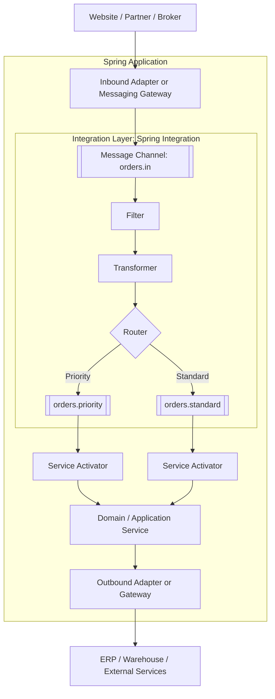
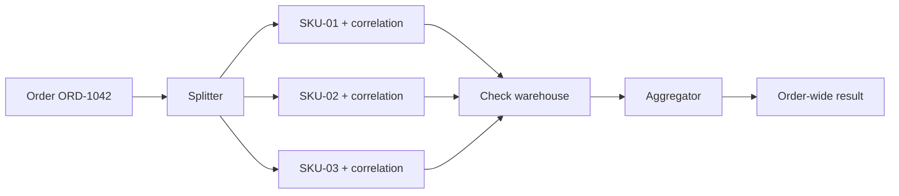
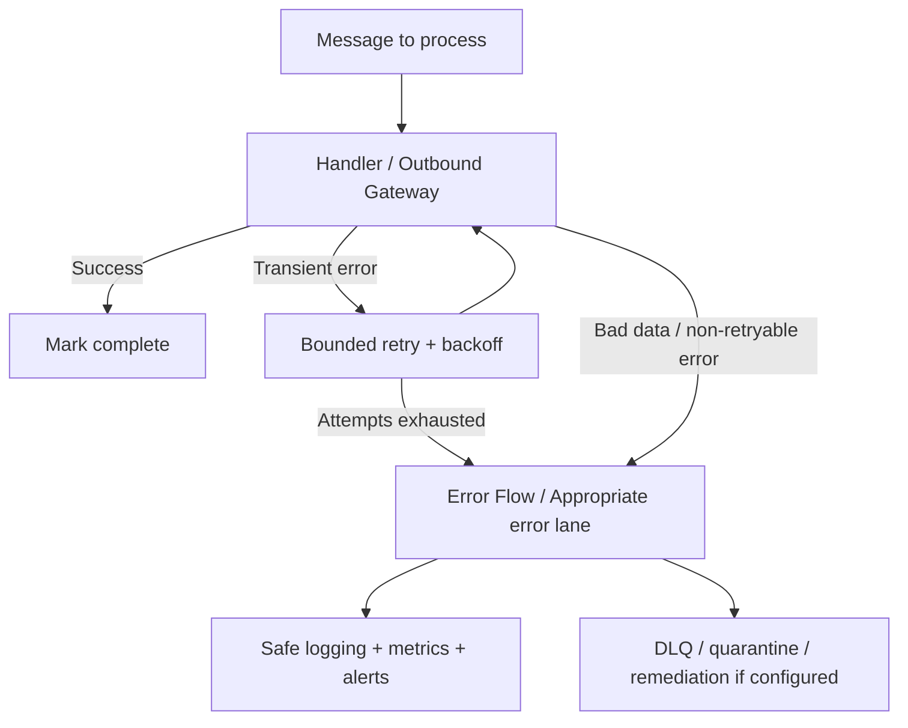

# At Which Layer Does Spring Integration Implement Patterns?

When learning **Enterprise Integration Patterns (EIP)**, a foundational question often comes up: **At which layer of the system do Router, Filter, Transformer, Splitter, Aggregator, Gateway, and similar patterns live?** Do they belong to the HTTP layer, the broker layer, the business service layer, or an independent architecture?

**Short answer:** Spring Integration implements EIP primarily at the **application integration layer**, through **messages, channels, endpoints, and integration flows** inside a Spring application. This layer sits between data ingestion/egress points and business capabilities, orchestrating **where messages go, how they are transformed, when results must be aggregated, and how errors are handled**. It can connect HTTP, Kafka, RabbitMQ, JMS, files, databases, and external systems, but it is **not identical to any single protocol or broker**.

This is introductory material for the `SPRING_INTEGRATION_PATTERN` module: understanding the integration layer's position and responsibilities is the prerequisite for implementing Router, Filter, Transformer, Splitter, Aggregator, Gateway, retry, error channel, and correlation, as well as systematically testing and observing each processing branch.

## 1. "Layer" Here Means Architectural Layer, Not a Fixed OSI Layer

The word *layer* is easily misunderstood because it has at least three distinct usages:

| Meaning | Example | Relationship to Spring Integration |
| --- | --- | --- |
| **Network/protocol layer** | TCP, HTTP, AMQP; layers in the OSI model | The transport or inbound/outbound communication medium. EIP is not pinned to a single OSI layer. |
| **Application architecture layer** | Controller, application service, domain, infrastructure, integration | **This is the primary meaning:** Spring Integration provides the integration layer, bridging inputs/outputs with business logic. |
| **Java/framework layer** | `Message`, `MessageChannel`, `IntegrationFlow`, `@MessagingGateway` | The APIs, objects, and technical configuration used to **implement** the integration layer. |

An HTTP request entering the application can be turned into a `Message<OrderEvent>`, routed between two internal channels, and processed within the same JVM. **No new broker or network protocol** exists between those two channels. Conversely, another flow can publish messages out to Kafka and receive results through a separate adapter. In both cases, the logical patterns still belong to organizing the **integration flow**, rather than becoming a separate network layer.

> **Principle to remember:** Protocols decide *how data crosses technical boundaries*; EIP decides *where data must go and through which chain of responsibilities it is processed*; the domain decides *whether business rules pass or fail*.

## 2. Architectural Picture: Where Does the Integration Layer Sit?

Consider a system that receives orders from a website, classifies them, checks inventory, and sends them to an ERP:



The layers in the diagram represent **responsibility boundaries**, not necessarily separate processes, servers, Maven modules, or Java packages. An integration `Service Activator` can call a business application service; the business layer itself does not need to know whether the message arrived from a webhook, a scheduler, or a broker.

### 2.1. Common Areas of Responsibility

| Area | Question It Resolves | Related Spring Integration Components |
| --- | --- | --- |
| **Data ingress boundary (inbound)** | Where does data come from? When does it become an internal `Message`? | Inbound Channel Adapter, Inbound Gateway, Messaging Gateway. |
| **Messaging infrastructure** | How do steps pass messages to one another? | `Message`, `MessageHeaders`, `MessageChannel`, `DirectChannel`, `QueueChannel`, `ExecutorChannel`. |
| **EIP processing/orchestration** | Do we filter, transform, route, split, or aggregate? | Filter, Transformer, Router, Splitter, Aggregator, Resequencer, Bridge. |
| **Business connection** | Which step actually creates the order, calculates prices, reserves stock, and enforces domain rules? | Service Activator calling an application/domain service; sometimes a Gateway invoking a flow. |
| **Data egress boundary (outbound)** | Which service receives the output, over which protocol? Is a reply awaited? | Outbound Channel Adapter, Outbound Gateway, protocol-specific connectors. |
| **Cross-cutting policies** | How are errors, retries, correlation, timeouts, group state, and flow observability handled? | Error channel/flow, advice, message store, correlation headers, metrics/tracing when configured. |

Do not interpret the table above as "each area requires its own server". One Spring Boot service can contain all of them, or just one adapter and a few endpoints. **The value of layering lies in clear responsibilities and contracts**, not in the number of services.

## 3. Technical Foundation: Message, Channel, Endpoint, and Flow

At the API level, Spring Integration builds on Spring's messaging abstractions and adds components for structuring EIP.

### 3.1. Message: Data Paired with Context

`Message<T>` consists of:

- **Payload**: the data exchanged, such as `OrderEvent` or `PaymentResult`.
- **Headers**: metadata supporting processing such as message ID, timestamp, correlation, reply/error channels, or application-supplied routing info.

Logical depiction of a message:

```text
Message<OrderEvent>
  payload:
    orderId = "ORD-1042"
    priority = true
    items = ["SKU-01", "SKU-02"]
  headers:
    id = <message-id>
    correlationId = "ORD-1042"  (if the flow sets/retains this value)
    traceId = <trace-context>   (if provided by the tracing system)
```

**Do not confuse** the infrastructure-generated message ID with `orderId` or a business deduplication key. A message may be reconstructed as it passes through a processing step; technical IDs are not always stable cross-system identifiers.

### 3.2. Channel: Send/Receive Boundary

`MessageChannel` is where senders submit messages and receivers poll or receive them. Channels keep the **producer from depending directly on consumer classes**. However, different channel types behave differently:

| Channel | What to Understand Before Choosing |
| --- | --- |
| `DirectChannel` | Invokes the handler synchronously, usually on the sender's thread; a slow handler slows down the caller. |
| `ExecutorChannel` | Hands processing off to a `TaskExecutor`; creates an asynchronous boundary, but does not automatically guarantee persistence or replay after restart. |
| `QueueChannel` | Buffers messages temporarily for the receiving side to poll; can use an appropriate store, but is not a durable queue by default. |
| `PublishSubscribeChannel` | Distributes messages to multiple subscribers; synchronous vs. asynchronous execution depends on configuration. |

**Internal channels are not brokers.** For Kafka/RabbitMQ/JMS, you need corresponding adapters/gateways and system configuration. Ensuring recovery after crashes also requires considering persistence, acknowledgements, transactions, and idempotency.

### 3.3. Endpoint: Where EIP Actually Executes Behavior

**Endpoints** connect channels to processing logic. An endpoint can check conditions, transform payloads, route, or invoke services. For example:

- Filter receives from `orders.in` and only passes valid orders to the next step.
- Transformer receives `OrderEvent` in its input form and returns a normalized payload.
- Router picks `orders.priority` or `orders.standard` based on message attributes.
- Service Activator receives from a channel and invokes a processing method on a Spring bean.

At their core, **Router/Filter/Transformer are message-processing responsibilities performed by endpoints**, not variants of HTTP controllers or broker publish commands.

### 3.4. IntegrationFlow: Connecting Responsibilities into a Pipeline

`IntegrationFlow` and the Java DSL express the step sequence, channel boundaries, endpoint selection, and part of processing configuration. A flow is not a "background business service running by itself"; it is a **definition of how a message moves through endpoints** when a producer sends to the input channel.

```text
Source → Channel → Filter → Transformer → Router → Channel → Service Activator
                               │
                               └── another branch → Channel → Another Handler
```

A flow can be completely synchronous or contain asynchronous segments. Looking only at the arrows in the DSL **is not enough to conclude** anything about threads, transactions, ordering, or durability.

## 4. Where Does Each Enterprise Integration Pattern Live?

Many EIPs are implemented as **endpoint/flow logic**, some are **boundary adapters/gateways**, and some are **infrastructure mechanisms supporting multiple endpoints**.

| Pattern/Concept | Primary Responsibility Location | Should Not Be Mistaken For |
| --- | --- | --- |
| **Filter** | Integration endpoint controlling which messages proceed. | System-wide user authentication or complete domain validation. |
| **Transformer** | Integration endpoint converting payload type/format. | Determining all new business values by itself. |
| **Content-Based Router** | Integration endpoint choosing a route based on content/headers. | Infrastructure load balancer or HTTP gateway. |
| **Splitter** | Integration endpoint breaking a message into multiple related parts. | Automatic parallel execution; that still depends on channels/executors. |
| **Aggregator** | Stateful integration endpoint grouping parts and emitting results when criteria are met. | Distributed transaction manager or automatic guarantee that all replies arrive. |
| **Messaging Gateway** | Boundary between method invocation and message flow; can support request–reply. | HTTP API Gateway or network gateway appliance. |
| **Channel Adapter** | Boundary connecting the application to external sources/sinks. | The place to put all business logic. |
| **Service Activator** | Node linking a message to a processing method. | Domain rules themselves having to live inside the framework. |
| **Retry** | Policy wrapping processing/endpoint or appropriate adapter execution. | An exactly-once guarantee across all systems. |
| **Error channel / error flow** | Route for reporting/handling errors when the system emits an `ErrorMessage`. | An automatic catch-all for every error in every flow without configuration. |
| **Correlation** | Metadata/strategy linking messages of the same business operation/processing group. | Synonymous with message ID or HTTP session. |

### 4.1. Router and Filter Handle *Flow*, Not Domain Replacement

Suppose orders with `priority=true` must go to the priority lane. A Router is the right place to **select the channel**. Yet whether a customer qualifies for priority may involve contracts, billing, and account standing — a **business policy** that should be decided/verified by business logic or a dedicated component, rather than stuffing complex rules into the DSL and treating that as the library's responsibility.

A useful separation:

```text
Domain/Application Service: Is this order entitled to priority?
Integration Router: Given the determined outcome, which channel receives the message?
```

Similarly, a Filter can drop messages with malformed schemas or outside the flow's scope, but it does not replace access control or domain invariants.

### 4.2. Splitter and Aggregator Require Both the Integration Layer and a State Contract

An order with three line items must be checked across three warehouses. The Splitter creates child messages; the Aggregator combines results using a **correlation key** and a **completion condition**.



At the **integration layer**, you must define `correlationKey`, sequence/grouping, release conditions, and expiry; at the **business layer**, you must decide whether "two out of three warehouses responded" counts as success. If asynchronous steps exist, consider a message store and timeouts. Spring Integration supplies the tools; **it will not choose the business policy for missing or late results on your behalf**.

### 4.3. Gateway Is a *Programming-Model Entry/Exit*, Not Necessarily a Network Server

A Java interface can be annotated with `@MessagingGateway` so callers invoke `submit(order)` like a normal method. The framework turns the call into a message sent to the configured channel. Callers do not write `MessageBuilder`, know individual endpoint names, or depend on a Router class.

A Gateway can support request–reply, but **blocking behavior, timeouts, error propagation, and thread boundaries depend on the method signature and flow configuration**. `MessagingGateway` is not synonymous with NGINX, an API gateway, a reverse proxy, or an HTTP endpoint.

## 5. Illustration with Spring Integration Java DSL

Suppose the application needs to accept `OrderEvent`, discard events missing an order ID, normalize the ID, and classify into two channels. The example below illustrates **separation of responsibilities**, without attempting to implement a full ERP or production error handling in one snippet.

```java
import java.util.Locale;
import org.springframework.context.annotation.Bean;
import org.springframework.context.annotation.Configuration;
import org.springframework.integration.annotation.MessagingGateway;
import org.springframework.integration.dsl.IntegrationFlow;

// Interface for the business caller: needs no knowledge of downstream Filter/Router.
@MessagingGateway(defaultRequestChannel = "ordersIn")
interface OrderGateway {
    void submit(OrderEvent order);
}

record OrderEvent(String orderId, boolean priority) {
    boolean valid() {
        return orderId != null && !orderId.isBlank();
    }

    OrderEvent normalized() {
        return new OrderEvent(
            orderId.trim().toUpperCase(Locale.ROOT), priority);
    }
}

@Configuration
class OrderIntegrationConfiguration {

    @Bean
    IntegrationFlow classifyOrders() {
        return IntegrationFlow.from("ordersIn")
            .filter(OrderEvent.class, OrderEvent::valid,
                spec -> spec.discardChannel("ordersRejected"))
            .transform(OrderEvent.class, OrderEvent::normalized)
            .route(OrderEvent.class,
                event -> event.priority() ? "P" : "S",
                spec -> spec
                    .channelMapping("P", "ordersPriority")
                    .channelMapping("S", "ordersStandard"))
            .get();
    }
}
```

Layer-by-layer breakdown:

1. **Java API boundary:** `OrderGateway` is the interface calling code uses. The application must configure gateway discovery/registration appropriately, such as integration component scanning.
2. **Messaging entry:** `ordersIn` is the name of the flow's input message channel.
3. **Filter endpoint:** lets only valid orders proceed; rejected orders go to `ordersRejected`.
4. **Transformer endpoint:** produces an `OrderEvent` with a normalized order ID.
5. **Router endpoint:** selects either the `ordersPriority` or `ordersStandard` branch.
6. **Downstream business system:** requires actual subscribers/flows/handlers for target channels, such as Service Activators calling the order-processing application service and adapters talking to the ERP.

This is **not yet a standalone runnable application**: it requires the appropriate Spring Integration dependencies and configuration, beans/handlers for the referenced channels, and an error policy. In particular, a message sent to `ordersRejected` **is not automatically persisted or handled** just by declaring the channel name.

### 5.1. Path When the Order Is Valid

```text
OrderGateway.submit(event)
        |
        v
      ordersIn
        |
        v
 Filter: valid() == true
        |
        v
 Transformer: normalized()
        |
        v
 Router: priority ? P : S
     /                 \
 ordersPriority    ordersStandard
     |                  |
 Appropriate Service Activator / Handler
     |                  |
 Application Service → Outbound adapter to external system
```

### 5.2. Path When Data Is Invalid

If `orderId` is `null` or blank, the Filter does not invoke the Transformer or Router. The message routes to `ordersRejected` per the `discardChannel` setting. For production deployment, the team needs to define a handler on the rejection lane, how callers are notified, safe logging levels, and whether events are persisted for investigation.

### 5.3. Why Is This Split Better Than One Long Method?

When the `OrderEvent` format changes, the team adjusts the Transformer/adapter. When routing rules change, edit the Router. When the ERP upgrades its API, update the downstream service/adapter. Every decision has a **clear point of change**, can be measured/logged, and can be tested independently—without making a Controller call every system directly while juggling retries, routing, transformations, and timeouts all at once.

## 6. Important Boundaries: What Spring Integration Does and Does Not Do Automatically

### 6.1. Does Not Replace HTTP, Kafka, RabbitMQ, or JMS

Spring Integration is a **flow and adapter orchestration framework**. HTTP, Kafka, AMQP, and JMS remain separate protocols/transport systems, each with its own acknowledgements, transactions, ordering, and storage mechanisms. Choosing a broker does not automatically turn a message into a Spring Integration `Message<?>`; you must configure the corresponding adapter and payload/header mapping contract.

An in-JVM `DirectChannel` does not have the persistence guarantees of a durable queue. An in-memory `QueueChannel` also does not preserve data across restarts. **End-to-end reliability is a property of the whole chain**, from source, adapter, message store, and handler to target system state.

### 6.2. Does Not Replace Domain/Application Services

Do not use a Router to decide entire payment rules or a Transformer to replace a pricing engine. The domain still owns decisions such as:

- Which customers qualify for priority shipping.
- When an order is eligible for invoicing.
- What inventory deduction, payment recording, and error compensation mean to the business.

The integration flow owns **step placement and wiring**. The same domain service can be invoked from HTTP, a scheduler, or a message flow without forcing its core methods to accept `Message<?>`.

### 6.3. Does Not Automatically Guarantee Exactly-Once Processing

Retries can cause a message to be processed again. If an HTTP request already charged funds but the response timed out, resending the same request can trigger a second transaction unless the target enforces an idempotency contract.

Distinguish clearly:

| Concept | Where Must It Be Designed? |
| --- | --- |
| **Retry** | Integration/adapter layer, with attempt limits, backoff, and error classification. |
| **Idempotency** | Boundary of business side effects; stable keys like `paymentId`/`eventId`, state persistence, and concurrency control. |
| **Transaction** | On transaction-capable resources within configured scope; local transactions do not span all remote systems. |
| **Compensation** | Business workflow when a multi-step chain cannot roll back atomically. |

**Spring Integration helps build the mechanism**, but does not by itself provide an exactly-once guarantee across every transport, service, and database.

### 6.4. Error Channels Do Not Automatically Cover Every Failure Case

A synchronous flow over `DirectChannel` can throw exceptions directly back to the caller. An asynchronous flow can be configured to convert exceptions into an `ErrorMessage` sent to an error channel. This **depends on endpoint type, adapter, execution mechanism, and configuration**. Therefore, test actual error paths rather than just adding a channel named `errorChannel` and assuming all failures are handled.

Example of a necessary error policy:



The diagram shows the **intended policy**, not a default configuration for every endpoint. If a dead-letter queue or durable storage is required, you must implement the concrete adapter/store.

## 7. Correlation and Aggregator Illustrate the Boundary Between Integration and Business Logic

A typical scenario: order `ORD-1042` is split into three inventory-check requests. Responses may arrive in the order `SKU-03`, `SKU-01`, `SKU-02`. Messages must carry enough info for the Aggregator to recognize **the same group**, yet whether the combined outcome is considered success or failure must follow business rules.

The design should answer:

1. **Correlation key:** Use `orderId`, `requestId`, or a dedicated group identifier? How do you avoid mixing two check runs for the same order?
2. **Release strategy:** Wait for all three replies, wait for the final reply, or allow partial results?
3. **Timeout/expiry:** After how long do we stop waiting? Where does an incomplete group go?
4. **Message store:** Must group state be persisted durably across restarts?
5. **Duplicate/late arrivals:** How are duplicate replies, late replies, and result replays handled?
6. **Tracing:** Can you trace from `orderId` to every branched step?

In flows with Splitter/Aggregator, Spring Integration supports correlation/sequence headers and grouping strategies. Still, **do not assume headers exist and survive across every adapter**; creating, forwarding, mapping, and validating metadata at external boundaries is a design responsibility.

## 8. How Do Layers Directly Affect Testing?

Separating responsibilities properly enables targeted testing, avoiding the need to spin up the entire ERP/broker for every check.

| Test Layer | Question | Example |
| --- | --- | --- |
| **Policy unit tests** | Are predicates and transformations correct? | `OrderEvent.valid()`, order ID normalization, priority classification. |
| **Integration-flow tests** | Did the message traverse the right endpoints/channels? | Priority orders arrive at `ordersPriority`, not `ordersStandard`. |
| **Boundary contract tests** | Does the adapter map payloads/headers and schema versions accurately? | Webhook JSON converts to `OrderEvent`; correlation key is preserved. |
| **Infrastructure integration tests** | Do transport, transactions, pollers, retries, and restarts behave as expected? | Stop broker, send duplicate messages, test timeouts or redelivery. |
| **Business end-to-end** | Is the final business state right? | Order is created once; inventory is not reserved twice after replay. |

When writing tests, identify which channels are synchronous and which introduce asynchrony. With an asynchronous flow, asserting immediately after send may not reflect final state; wait using an appropriate condition with a timeout. For an Aggregator, test **missing, extra, duplicate, and out-of-order** cases, not only the happy path with complete, neatly ordered messages.

## 9. Observing Flows: Monitoring Must Align with Concrete Boundaries

Once you have multiple Router branches or Splitter parts, logging `Received order` and `Finished order` is no longer enough for diagnostics. At the integration layer, actively monitor:

- **Message counts** entering, processed, filtered out, and entering each router branch.
- **Processing latency** per endpoint; wait times at channels, pollers, or outbound gateways.
- **Error and retry rates**, rejection reasons, final retry attempts, and counts reaching error lanes.
- **Aggregator groups** waiting, released, expired; late-arriving replies.
- **Correlation/business keys and trace context** to stitch steps without depending on technical message IDs.

Metrics/tracing must be **enabled and configured** according to your Spring version, observability stack, and adapters; do not assume everything is collected automatically. Logs should avoid recording tokens, payment card details, personal data, or full sensitive payloads.

A responsibility map makes operational questions concrete:

```text
Message never appears at input?
  → inspect inbound adapter / connection / mapping
Many messages dropped by Filter?
  → check data contract and filter predicate
Message took the wrong branch?
  → inspect Router, headers, and routing decision policy
Message waiting too long?
  → inspect Queue/Executor, poller, outbound service, or Aggregator
Message processed twice?
  → inspect redelivery, retry, idempotency, and transaction boundaries
```

## 10. Structuring Code to Keep the Integration Layer Clean

There is no mandatory package structure for every project. One possible layout is:

```text
com.example.orders
├── api/
│   └── OrderController.java             # receives HTTP, delegates to application layer
├── integration/
│   ├── OrderGateway.java               # method-to-message boundary
│   ├── OrderFlows.java                 # filter, transform, router, split...
│   ├── OrderChannels.java              # channel definitions if needed
│   └── OrderErrorFlow.java             # integration error-handling policy
├── application/
│   └── OrderApplicationService.java    # use cases and business orchestration
├── domain/
│   └── Order.java                      # business rules and domain state
└── infrastructure/
    └── ErpClient.java                  # external system communication
```

Directory structure is illustrative only. In practice, outbound adapters might live under `integration/adapters/`, domain-facing gateways near use cases, or the application might use hexagonal architecture with **ports and adapters**. More important than package names is a **clean dependency direction**: the domain avoids depending on integration endpoint types or APIs unless truly warranted; adapters and flows depend on stable business contracts.

### Signs the Integration Layer Has Mixed Responsibilities

- A controller picks brokers/topics, retries, and splits messages into parts instead of calling a clean application API.
- A Router contains customer eligibility queries, fee calculation, payment charging, and database updates.
- A domain service must know `DirectChannel` names, `replyChannel`, or header structures just to perform business calculations.
- Every exception is caught and returns `SUCCESS`, while the error flow records neither cause nor state.
- The same event is classified using different rules in an HTTP controller, a Kafka consumer, and a scheduler.

These symptoms do not mean "put everything into EIP"; the fix is usually clarifying contracts across **domain, integration, and infrastructure**.

## 11. Design Checklist for a Spring Integration Flow

Before introducing a pattern into a system, try filling in this table:

| Decision | Example for Order Processing |
| --- | --- |
| Source and communication boundary | HTTP webhook or an inbound broker adapter. |
| Canonical payload | `OrderEvent` with version, `orderId`, `eventId`, `priority`. |
| Input channel | `ordersIn`, defining subscriber and synchronicity behavior. |
| Filtering/normalization | Filter validates data, Transformer normalizes codes. |
| Target routing | Router priority/standard; invalid case also defined. |
| Business processing | Service Activator calls `OrderApplicationService`. |
| Asynchrony/durability | Choose channels and store/broker per fault-tolerance needs. |
| Correlation and group results | Group key, release, timeout, duplicate/late replies. |
| Retry and errors | Error classification, backoff, limits, error flow, quarantine. |
| Testing and observability | Per-channel/endpoint tests, per-branch metrics, traces with `orderId`. |

If an important row cannot be answered, renaming classes or adding an annotation **has not yet solved the integration risk**.

## 12. Self-Check Questions

**Question 1.** If an application only uses `DirectChannel`, Filter, and Router without configuring Kafka or RabbitMQ, is it applying EIP?

**Yes.** EIP describes how messages are organized and processed. The framework can run completely in-process; an external broker is an infrastructure choice, not a prerequisite.

**Question 2.** Does placing a Router in Spring Integration replace the algorithm that determines VIP customers in the domain?

**No.** The Router executes the decision of which channel to take. VIP eligibility can be a complex business rule and should be encapsulated and tested in the layer owning that business policy.

**Question 3.** Does replacing `DirectChannel` with `ExecutorChannel` guarantee durable delivery and recovery after a restart?

**No.** That mainly changes the asynchronous execution boundary. Durability requires persistent storage/delivery mechanisms, transactions/acknowledgements, and an appropriate error-handling policy.

**Question 4.** An Aggregator has received two of three inventory check results. Does Spring Integration automatically know whether to keep waiting or return a partial result?

**Never assume that.** You must configure release conditions, timeout/expiry, and business handling rules, while also accounting for the message store and late replies.

**Question 5.** A request passes through a Gateway into a flow and times out. Can you immediately retry the entire request without worrying about duplicate side effects?

**No.** You must distinguish unstarted work from completed work whose reply was lost; use business identifiers/idempotency and check target state when necessary.

## Conclusion

**Spring Integration implements Enterprise Integration Patterns at the application integration layer**, primarily through the **`Message` → `Channel` → `Endpoint` → `IntegrationFlow`** model; adapters and gateways bridge this layer with APIs, brokers, files, and external systems. Filter, Transformer, Router, Splitter, and Aggregator express **message-processing/routing** responsibilities; Gateways/Adapters express **communication boundaries**; retry, error channels, correlation, and observability support **reliability and traceability** when properly designed and configured.

Proper layering does not mean splitting into many microservices. It means each concern has a single accountable place: **transport moves data, integration orchestrates data flows, domain decides business rules, and infrastructure connects real resources**. As a result, the system is less coupled, easier to extend, testable per branch, and traceable when messages behave unexpectedly.
