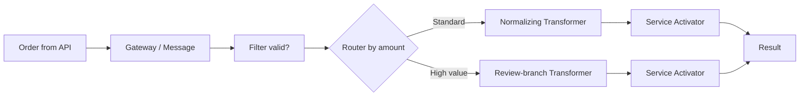
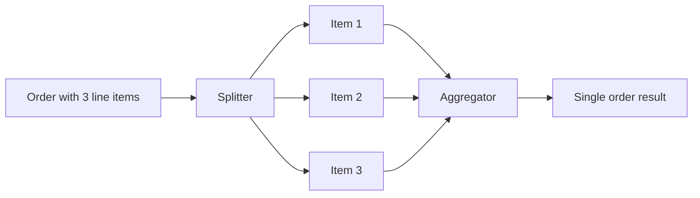
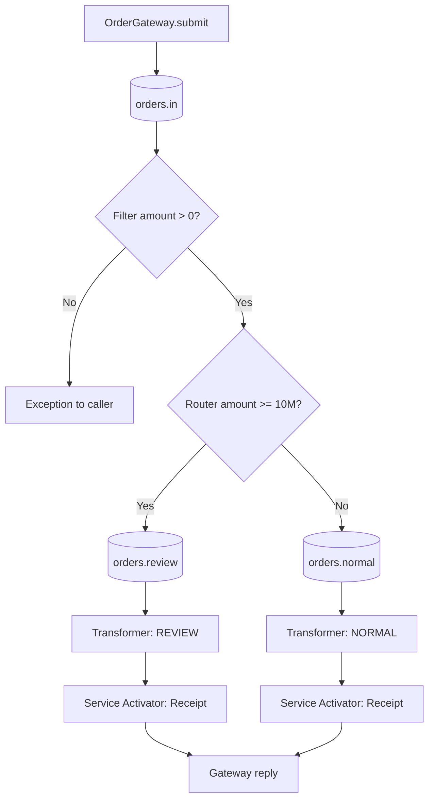

# Structural Patterns, Routing Patterns, and Transformation Patterns

## 1. Three Perspectives for Designing an Integration Flow

In enterprise systems, an integration requirement is rarely just moving data from A to B. For instance, when accepting an order, an application must package information so services can understand it, decide which orders are processed automatically and which require approval, and convert formats to match each target system. **Spring Integration** lets you express this work through **Enterprise Integration Patterns (EIP)** instead of writing a chain of directly coupled Java method calls.

In this introductory lesson, we group patterns by **design problem**:

| Pattern Group | Core Question | Example Tasks | Related Spring Integration Components |
|---|---|---|---|
| **Structural** (message/flow structure) | What does the message contain, what contract do parties exchange under, and how are they connected? | Command/Event/Document Message, Request–Reply, Correlation Identifier, Message Channel, Gateway | `Message<?>`, headers, `MessageBuilder`, `MessageChannel`, `@MessagingGateway`, adapters |
| **Routing** (routing) | Should this message continue, and to which branch/recipient must it be sent? | Message Filter, Content-Based Router, Recipient List, Splitter, Aggregator | `.filter()`, `.route()`, `.split()`, `.aggregate()`, `PublishSubscribeChannel` |
| **Transformation** (transformation) | What shape or semantics must the data take so the next step can use it? | Message Translator, Content Enricher, Header Enricher, Content Filter, Normalizer | `.transform()`, `.enrich()`, `.enrichHeaders()` |

**Note on naming:** This grouping is a way to learn and design patterns, **not the only three categories or an absolute EIP taxonomy**. The original EIP taxonomy also includes *Messaging Channels*, *Messaging Endpoints*, *Message Construction*, *Messaging Systems Management*, and other branches; a pattern such as Splitter/Aggregator sits in the routing family while simultaneously affecting message sequence structure. The goal here is knowing **when to use which pattern** and **which point owns which responsibility**.

Example order-processing flow:



- **Structural:** the gateway wraps the call into a message with payload/headers and sends it to a channel.
- **Routing:** the filter decides whether to accept or reject; the router picks the processing branch.
- **Transformation:** the transformer builds a suitable payload for each branch.

These patterns **work together** rather than replacing one another. A single message can readily pass through multiple routing and transformation endpoints in succession.

## 2. Shared Foundation: Message, Channel, Endpoint

Every flow is assembled from three parts:

1. **Message** contains a `payload` (business data) and `headers` (metadata such as `id`, `timestamp`, `replyChannel`, `correlationId`, `traceId`).
2. **Channel** transports messages between processing points. `DirectChannel` typically dispatches synchronously, `ExecutorChannel` hands work to an executor, `QueueChannel` holds messages for a consumer to poll, and `PublishSubscribeChannel` broadcasts to multiple subscribers.
3. **Endpoint** receives, processes, or emits messages: adapters, gateways, filters, routers, transformers, service activators, splitters, aggregators, etc.

Illustrative example with an order payload:

```java
import org.springframework.messaging.Message;
import org.springframework.messaging.support.MessageBuilder;

Message<String> orderMessage = MessageBuilder.withPayload("ORDER-1001")
        .setHeader("source", "checkout-api")
        .setHeader("traceId", "checkout-a71c")
        .build();

System.out.println(orderMessage.getPayload());              // ORDER-1001
System.out.println(orderMessage.getHeaders().get("source")); // checkout-api
```

So far this is only **how data is packaged**. Once you send the message through a `MessageChannel`, Spring Integration dispatches it to the registered endpoint. The sender does not need to know whether that endpoint is a bean, an adapter, or a processing chain.

## 3. Structural Patterns: Defining the Exchange Contract

### 3.1. Command, Document, and Event Messages

Three common message types in EIP express the **intent of the payload**, not three required subclasses of `Message`:

| Type | Meaning | Example | Design Considerations |
|---|---|---|---|
| **Command Message** | Requests a party to perform an action | `ApproveOrder`, `ReserveStock` | Name after intent; define duplicate handling and failure reporting. |
| **Document Message** | Carries a data representation for another party to process/store | `InvoiceDocument`, `CustomerSnapshot` | Define schema, versioning, and field ownership. |
| **Event Message** | Announces something that **has already happened** | `OrderCreated`, `PaymentCaptured` | Distinguish past facts from commands; consumers may be independent and receive late. |

For example, `OrderCreated` is typically an **event**: a consumer should not interpret it as a command to create yet another order. Conversely, `ReserveStock` is a **command**: it may require a success/failure result. Distinguishing these avoids coupling responsibilities incorrectly.

In Java, you can use `record` for payloads:

```java
import java.math.BigDecimal;

record OrderCreated(String orderId, BigDecimal amount, String currency) {}
record ReserveStock(String orderId, String sku, int quantity) {}
```

`Message<OrderCreated>` can still carry `traceId`, `tenantId`, and `schemaVersion` headers; the `record` only defines payload structure. Avoid stuffing transient technical data (internal reply address, retry timestamp) into permanent domain fields when they are actually transmission metadata.

### 3.2. Request–Reply, Return Address, and Correlation Identifier

With **Request–Reply**, the sender needs to receive a result corresponding to its request. `@MessagingGateway` helps hide the message/channel layer behind a Java interface; at the message layer, the reply mechanism typically relies on `replyChannel` and related metadata.

```text
Caller -> Gateway -> orders.request -> Service Activator
Caller <- Gateway <- replyChannel <- Receipt
```

- **Return Address:** where to send the reply. In internal Spring Integration flows, this is usually represented via `replyChannel`.
- **Correlation Identifier:** a value linking messages belonging to the same task, especially when a request splits into multiple branches or replies arrive asynchronously. `correlationId` **differs from** message ID: one task may generate multiple message IDs.
- **Message Sequence:** when splitting one task into parts, `sequenceNumber` and `sequenceSize` (when total count is known) help reassemble them and determine when completion is reached.

**Important:** merely setting a `correlationId` header **does not automatically** create request–reply behavior, handle timeouts, or aggregate results. You need an appropriate gateway/handler/aggregator and release/expiry rules. Similarly, an in-memory application channel is not by default a return address that can be sent verbatim through a broker or to another JVM.

### 3.3. Message Channels and Endpoints Organize Flow Structure

Flow structure is also expressed through **responsibility boundaries**:

```text
[Inbound Adapter/Gateway] -> [inputChannel]
                               -> [Validation Endpoint]
                               -> [validatedChannel]
                               -> [Routing Endpoint]
                               -> [branch-specific channel]
                               -> [Outbound Adapter/Gateway]
```

Naming channels meaningfully (`orders.received`, `orders.valid`, `orders.review`) is better than arbitrary names (`channel1`, `channel2`). A channel contract should clarify payload type, required headers, producer/consumer, error handling, and response-time expectations. That makes it possible to swap an endpoint or transport mechanism without rewriting the entire flow.

**Do not extrapolate:** using `QueueChannel` only gives you a buffer; it does not turn data into durable messages across restarts. Using `ExecutorChannel` creates a thread boundary; it does not mean transactions and thread-locals automatically propagate across it.

## 4. Routing Patterns: Right Place, Right Condition

### 4.1. Message Filter and Content-Based Router

Two patterns often confused:

| Pattern | Decision | Typical Outcome | Example |
|---|---|---|---|
| **Message Filter** | Should the **entire message** proceed? | Accepts or discards/rejects the message. | Reject orders without a valid amount. |
| **Content-Based Router** | **Which channel** should the message go to based on payload/headers? | One or more matching destinations depending on configuration. | Orders >= 10 million go to review; smaller ones go to automated processing. |

Example business routing condition:

```java
String routeForAmount(BigDecimal amount) {
    return amount.compareTo(new BigDecimal("10000000")) >= 0
            ? "review"
            : "normal";
}
```

A filter is **not** a transformer: `filter(order -> ...)` does not alter the payload of messages that pass. A router is also **not** where order-approval business logic runs: it simply moves the message to the right channel for downstream endpoints to handle.

In Spring Integration Java DSL, the corresponding operations are `.filter(...)` and `.route(...)`. For request–reply flows, you must actively handle the rejected branch (throw an exception, return a reply from a discard flow, or another explicit mechanism) so the gateway does not hang waiting for a reply that never arrives.

### 4.2. Recipient List and Publish–Subscribe

If a message needs to go to **multiple parties**, two ideas are closely related yet distinct:

- **Recipient List:** chooses a target list according to rules. For example, international orders must go to `fraudCheck` and `customsCheck`, while domestic orders only go to `fraudCheck`.
- **Publish–Subscribe:** broadcasts a message to **all current subscribers** of an event channel, such as an `OrderCreated` event listened to by audit, notification, and metrics components.

In Java DSL, you can use `.routeToRecipients(...)` for conditional lists and `.publishSubscribeChannel(...)` for fan-out. Which one you choose depends on whether destination selection is rule-driven, not merely the number of recipients.

**Caution:** sending a message to multiple branches does **not** automatically yield a single combined result back. If you need an aggregated result, you must design correlation, completion conditions, and an aggregation endpoint.

### 4.3. Splitter, Aggregator, and Resequencer

When an order contains multiple line items, it can be split for parallel processing:



**Splitter** produces component messages, usually carrying correlation and sequence metadata. **Aggregator** collects messages sharing the same correlation key into a group and emits a result only when the **release strategy** is satisfied. **Resequencer** restores ordering if processing/completion order differs from business order.

Example:

```text
Order #1001 has line items A, B, C
     | Splitter
     +-- item A: correlation=#1001, sequence=1/3
     +-- item B: correlation=#1001, sequence=2/3
     +-- item C: correlation=#1001, sequence=3/3
     | individual processing
     v
Aggregator (group #1001, all 3 parts) -> OrderResult #1001
```

This is a **logical** description; actual header names and values depend on Splitter and Aggregator configuration. If one part fails or is lost, `Aggregator` can wait forever without a timeout, group expiration, and missing-result policy. Under high load, consider a message store and group backlog limits. In multi-node flows, design an appropriate shared group store instead of assuming in-memory state suffices.

### 4.4. Other Routing Variants Worth Knowing

| Pattern | When to Consider | What to Design |
|---|---|---|
| **Message Router** | Pick a branch based on message attributes. | Channel mapping, default channel, invalid branch handling. |
| **Routing Slip** | Message traverses a pre-defined or dynamic sequence of processing stops. | Itinerary, next-step lookup, loop prevention. |
| **Scatter–Gather** | Send a request to multiple targets and combine replies. | Timeout, correlation, partial results, failure policy. |
| **Resequencer** | Processing results return out of the required order. | Ordering key, buffer capacity, release policy when parts are missing. |

You do not need every pattern from day one. Pick **Content-Based Router** for simple one-of-many choices; use Splitter/Aggregator only when the domain splits work and genuinely needs combined results.

## 5. Transformation Patterns: Changing Shape, Preserving Meaning

### 5.1. Message Translator / Transformer

A **Transformer** converts a payload or message representation from a source structure to a target structure. For instance, checkout sends amounts in `BigDecimal` with ISO currency codes, while the warehouse system expects a payload including a normalized `fulfillmentType`.

```java
record CheckoutOrder(String id, BigDecimal amount, String currency) {}
record FulfillmentOrder(String id, BigDecimal amount,
                        String currency, String fulfillmentType) {}

FulfillmentOrder translate(CheckoutOrder input) {
    return new FulfillmentOrder(
            input.id().trim(),
            input.amount(),
            input.currency().toUpperCase(java.util.Locale.ROOT),
            "STANDARD");
}
```

The **Message Translator** pattern applies when two systems have different data models or formats. For example, `JSON -> DTO -> XML` requires deliberate schema translation rather than mere Java type casting. The design must specify field mappings, currency units, date/time types, optional/null handling, versions, and invalid-data handling.

In Spring Integration, use `.transform(...)` for conversion steps. Do not use a transformer just to decide where to send a message: that is a router's job; nor should you bury network calls or complex database writes inside a pure mapping function when they belong in a service activator or gateway.

### 5.2. Content Enricher, Header Enricher, and Content Filter

| Pattern | Effect on Message | Example |
|---|---|---|
| **Content Enricher** | Adds missing payload data from another source or computation. | Populate shipping zone from the customer service. |
| **Header Enricher** | Adds/updates routing or observability metadata. | Attach `traceId`, `sourceSystem`, `tenantId` after authentication. |
| **Content Filter** | **Strips fields/details from the payload** while still producing an output message. | Remove sensitive payment fields before sending to a partner. |
| **Message Filter** | **Drops the entire message** if a predicate fails. | Reject requests missing an order ID. |

Notice how **Content Filter differs from Message Filter**: the names look similar, yet Content Filter is **a transformation**, whereas Message Filter is **a routing decision**. To prevent data leaks, a Content Filter should not merely rename fields—it must genuinely strip fields outside the target data contract.

In Spring Integration Java DSL, `.enrich(...)` and `.enrichHeaders(...)` are typically used for enrichment. You can use `.transform(...)` to build a new DTO containing only fields permitted to leave the boundary.

### 5.3. Normalizer and Canonical Formats at System Boundaries

If multiple sources send data with different schemas, a **Normalizer** converts them into a **canonical** shape so the core flow does not have to know which source sent it. Example:

```text
Mobile JSON ------- Transformer --+
                                   +--> CanonicalOrder --> Router --> Process
ERP XML ----------- Transformer --+
Partner CSV ------- Transformer --+
```

This approach reduces coupling: adding a new source only requires an adapter/translator at the boundary instead of modifying every business endpoint. However, avoid creating a bloated canonical model stuffed with every field from every system; normalize only the data the flow actually needs, with explicit versioning and validation rules.

## 6. Practical Example: Combining All Three Groups with Spring Integration Java DSL

### 6.1. Requirements

Design an internal order-processing API:

1. The application calls `OrderGateway.submit(...)` and receives a `Receipt` (**request–reply**).
2. Orders missing an amount or having a non-positive amount are rejected with an error (**filter**).
3. Orders of **10,000,000** or more route to `REVIEW`; smaller orders route to `NORMAL` (**router**).
4. Both branches convert the `OrderCommand` payload into a `RoutedOrder` carrying the route label (**transformer**).
5. The service activator produces a `Receipt` and returns it to the gateway. The example focuses on routing and omits real network/database integration.



### 6.2. Java Configuration

This example targets **Java 17+, Spring Integration 6.x, and Spring Boot 3.x** with `spring-boot-starter-integration`. Declarations can sit in the same package, or each Java type can be moved to its own file if declared `public` in a real project.

```java
import java.math.BigDecimal;

import org.springframework.context.annotation.Bean;
import org.springframework.context.annotation.Configuration;
import org.springframework.integration.annotation.Gateway;
import org.springframework.integration.annotation.IntegrationComponentScan;
import org.springframework.integration.annotation.MessagingGateway;
import org.springframework.integration.channel.DirectChannel;
import org.springframework.integration.config.EnableIntegration;
import org.springframework.integration.dsl.IntegrationFlow;
import org.springframework.messaging.MessageChannel;

record OrderCommand(String orderId, BigDecimal total, String currency) {}
record RoutedOrder(String orderId, BigDecimal total,
                   String currency, String route) {}
record Receipt(String orderId, String route) {}

@MessagingGateway
interface OrderGateway {
    @Gateway(requestChannel = "orders.in")
    Receipt submit(OrderCommand order);
}

@Configuration
@EnableIntegration
@IntegrationComponentScan
class OrderRoutingConfig {

    @Bean(name = "orders.in")
    MessageChannel ordersIn() {
        return new DirectChannel();
    }

    @Bean(name = "orders.review")
    MessageChannel reviewChannel() {
        return new DirectChannel();
    }

    @Bean(name = "orders.normal")
    MessageChannel normalChannel() {
        return new DirectChannel();
    }

    @Bean
    IntegrationFlow routeOrders() {
        return IntegrationFlow.from("orders.in")
                .filter(OrderCommand.class,
                        order -> order.total() != null
                                && order.total().signum() > 0,
                        spec -> spec.throwExceptionOnRejection(true))
                .route(OrderCommand.class,
                        order -> order.total()
                                .compareTo(new BigDecimal("10000000")) >= 0
                                ? "review" : "normal",
                        spec -> spec
                                .channelMapping("review", "orders.review")
                                .channelMapping("normal", "orders.normal"))
                .get();
    }

    @Bean
    IntegrationFlow reviewOrders() {
        return IntegrationFlow.from("orders.review")
                .transform(OrderCommand.class, order ->
                        new RoutedOrder(order.orderId(), order.total(),
                                order.currency(), "REVIEW"))
                .handle(RoutedOrder.class, (order, headers) ->
                        new Receipt(order.orderId(), order.route()))
                .get();
    }

    @Bean
    IntegrationFlow normalOrders() {
        return IntegrationFlow.from("orders.normal")
                .transform(OrderCommand.class, order ->
                        new RoutedOrder(order.orderId(), order.total(),
                                order.currency(), "NORMAL"))
                .handle(RoutedOrder.class, (order, headers) ->
                        new Receipt(order.orderId(), order.route()))
                .get();
    }
}
```

The application injects `OrderGateway` (managed as a Spring bean) and invokes it:

```java
Receipt normal = orderGateway.submit(
        new OrderCommand("ORD-1001", new BigDecimal("800000"), "VND"));
// Receipt(orderId="ORD-1001", route="NORMAL")

Receipt review = orderGateway.submit(
        new OrderCommand("ORD-1002", new BigDecimal("12500000"), "VND"));
// Receipt(orderId="ORD-1002", route="REVIEW")
```

### 6.3. Why Does This Example Span All Three Groups?

| Step | Pattern Category | What Happens |
|---|---|---|
| `OrderGateway.submit` + `orders.in` | Structural | The Java call is wrapped into a message and delivered to a channel; reply flows through request–reply mechanics. |
| `.filter(...)` | Routing | Only messages meeting the predicate proceed. Rejected ones throw the configured exception. |
| `.route(...)` | Routing | Selects `orders.review` or `orders.normal` based on amount. |
| `.transform(...)` | Transformation | Changes payload from `OrderCommand` to `RoutedOrder` tagged with the route label. |
| `.handle(...)` | Processing Endpoint | Applies logic to build `Receipt` and returns the result to the gateway. |

**Order matters:** the filter runs before the router so `compareTo` is never called on `null`; the router runs before the transformer so each branch can attach branch-specific metadata. You can reorder steps in other business scenarios, provided you check the input/output contract of every endpoint.

`@IntegrationComponentScan` registers the gateway interface. `DirectChannel` makes the illustrative flow execute synchronously; the return path is handled by the gateway/handler infrastructure. If replaced with an asynchronous channel, you must redesign timeouts, error handling, transactions, and ordering — not just swap a channel class and assume behavior stays identical.

### 6.4. Variant: Receiving Data from Multiple Systems

Suppose a second source provides XML with a `totalMinorUnits` field, while checkout sends JSON with `total` as a decimal. Do not make the router understand both schemas directly; add transformers at the boundary:

```text
Checkout JSON -> Checkout DTO ---->
                               Transformer -> OrderCommand -> Filter -> Router
ERP XML      -> ErpOrder DTO ---->
```

Here, the **Transformer/Normalizer** unifies the data, the **Router** keeps deciding based on `OrderCommand.total`, and the **Gateway/Channel** maintains a consistent exchange contract. If you also want to emit an `OrderReceived` event for auditing, add publish–subscribe or a recipient list at the right spot, without conflating that fan-out operation with the gateway's reply.

## 7. Testing, Retries, Errors, and Observability

### 7.1. Testing Behavior per Branch

Do not test only `routeForAmount`; verify that messages actually traverse the full path and return the right result:

| Case | Input | Expectation |
|---|---|---|
| Standard | `total = 800000` | `Receipt.route() == "NORMAL"` |
| Review threshold | `total = 10000000` | `Receipt.route() == "REVIEW"` |
| Above threshold | `total = 12500000` | `Receipt.route() == "REVIEW"` |
| Invalid | `total = 0` | Filter throws exception; no receipt is produced. |
| Missing amount | `total = null` | Filter throws controlled error; no `NullPointerException` inside router. |

Example Spring/JUnit 5 test (in the same package as `OrderRoutingConfig`):

```java
import java.math.BigDecimal;
import org.junit.jupiter.api.Test;
import org.springframework.beans.factory.annotation.Autowired;
import org.springframework.messaging.MessagingException;
import org.springframework.test.context.junit.jupiter.SpringJUnitConfig;

import static org.junit.jupiter.api.Assertions.assertEquals;
import static org.junit.jupiter.api.Assertions.assertThrows;

@SpringJUnitConfig(OrderRoutingConfig.class)
class OrderRoutingFlowTest {

    @Autowired
    OrderGateway gateway;

    @Test
    void normalOrderGoesToNormalChannel() {
        Receipt result = gateway.submit(
                new OrderCommand("A-1", new BigDecimal("800000"), "VND"));
        assertEquals("NORMAL", result.route());
    }

    @Test
    void thresholdOrderGoesToReviewChannel() {
        Receipt result = gateway.submit(
                new OrderCommand("A-2", new BigDecimal("10000000"), "VND"));
        assertEquals("REVIEW", result.route());
    }

    @Test
    void invalidAmountIsRejected() {
        assertThrows(MessagingException.class, () -> gateway.submit(
                new OrderCommand("A-3", BigDecimal.ZERO, "VND")));
    }
}
```

If you want to verify **which exact channel** received a message rather than only the final outcome, use Spring Integration's test support (`MockIntegrationContext`, `MockIntegration`) or an interceptor/test endpoint in your test configuration. Do not rely solely on log assertions, as logs can vary under concurrent execution.

### 7.2. Retries and Error Channels Do Not Replace Routing

A router pattern does **not** automatically retry a failed message; a transformer does **not** automatically send errors to an error channel. These are separate concerns:

- With synchronous execution via `DirectChannel`, exceptions from a filter or handler can propagate back to the gateway/caller.
- With executors, pollers, or async adapters, errors can be wrapped into an `ErrorMessage` and routed to an `errorChannel` configured in that context.
- **Retry** needs an explicit policy: which errors are retryable, attempt count, backoff, and duplicate handling. For operations with side effects (payments, invoicing), **idempotency** must be considered.
- When messages pass through Splitter/Aggregator, you must address correlation, timeouts, missing results, and stalled groups; if one branch fails, the aggregator does not know on its own how to emit a partial result.

In particular, do not send all errors to a generic channel and treat that as completing a request–reply call. Define **success outcomes**, **rejection outcomes**, and **infrastructure failures** clearly for every API.

### 7.3. Observing the Flow

Monitor at least the following:

- **Message identity and business identity:** message `id` to trace delivery events; `orderId` to trace business operations; `correlationId` for multi-part processing.
- **Per-branch counts:** how many orders entered `orders.in`, how many went to `orders.normal` and `orders.review`, and how many were rejected by the filter.
- **Latency and errors:** per-branch processing duration, retries, timeouts, and adapter/handler failures.
- **Capacity:** if switching to `QueueChannel` or executors, monitor queue depth, backlog, and saturation.

Interceptors, wire taps, metrics, and observation can aid measurement depending on configuration. Avoid logging raw payloads containing personal identifiers or payment details; log only fields needed for diagnostics.

## 8. Common Mistakes and How to Choose

| Misconception | Consequence | Better Approach |
|---|---|---|
| Using one transformer both to reshape data and pick a destination | Mapping logic mixes with orchestration; hard to test branches. | Use transformers for mapping and routers for channel selection. |
| Treating Message Filter and Content Filter as the same | Risk leaking sensitive data thinking the message was scrubbed. | Distinguish dropping **the whole message** from stripping **fields inside the payload**. |
| Using publish–subscribe to call multiple services expecting one combined reply | Gateway misses replies or gets ambiguous results. | Design Scatter–Gather/Aggregator and completion rules when an aggregated result is needed. |
| Setting a correlation ID and assuming the system auto-aggregates | Component messages get processed piecemeal or pile up. | Configure Splitter, correlation/release strategies, timeouts, and a message store. |
| Treating `QueueChannel` as a durable broker | Messages can be lost on process restart. | Pick a transport/store that meets real durability and delivery guarantees. |
| Passing an external system's DTO straight through the core flow | Adding a new source forces edits across many handlers. | Normalize at the boundary; keep a minimal canonical DTO. |
| Failing to handle filter rejections or unmapped routes | Request–reply hangs without results; hard-to-diagnose timeouts. | Define default/error/rejection behavior and test every branch. |
| Retrying all errors identically | Can duplicate side effects or overwhelm downstream systems. | Classify errors, bound retries/backoff, enforce idempotency, and use dead-letter/recovery paths. |

A concise selection rule: **package and connect using structural patterns; decide paths using routing patterns; adapt data contracts using transformation patterns**. If a single endpoint is doing all three, that is a strong signal to split responsibilities.

## 9. Hands-On Exercises

1. **Structural:** design a `Message<OrderCreated>` with a record payload and a `traceId` header; explain why `orderId` is a business identifier and why message ID should not replace it.
2. **Routing:** starting from the example flow, add an `orders.international` branch for orders not in `VND`. Define the precedence between the international route and the high-value route explicitly.
3. **Transformation:** write a `Transformer` that uppercases `currency` and normalizes `orderId`. Write tests for inputs with missing fields; decide when to reject rather than silently guessing defaults.
4. **Fan-out and aggregation:** describe a flow that checks both fraud and inventory concurrently, confirming only when both succeed. Specify the correlation key, wait timeout, and handling when one result is missing.
5. **Operations:** replace `orders.review` with an asynchronous processing segment. Analyze gateway reply timeouts, error flows, transactions, queue capacity, and idempotency strategy.

**Self-check:** An incoming message contains `amount = 12_500_000`, `currency = "vnd"`. To both pick the review branch and normalize `currency` to `"VND"`, you need a **router** to choose the channel and a **transformer** to convert the payload. Wrapping the input into a `Message` and passing it through `Gateway/Channel` belongs to **structural** patterns. The three groups answer three distinct questions; assigning each responsibility cleanly keeps flows extensible, testable, and traceable.
