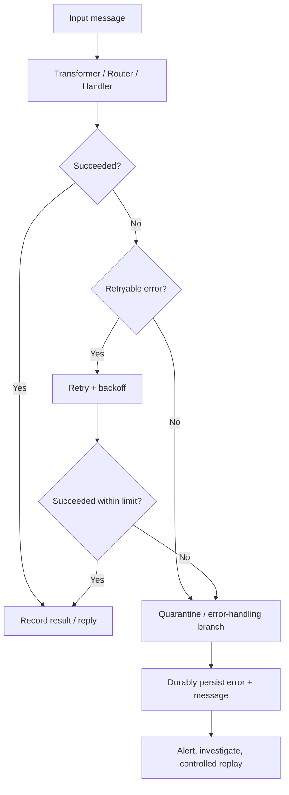

# Error Handling, Reliability, and Transaction Patterns

## 1. Why Does a Message Flow Need an Error-Handling Strategy?

In **Spring Integration**, a message typically traverses several *Enterprise Integration Patterns* (EIP): a Channel Adapter ingests data, a Transformer normalizes it, a Router picks a branch, a Service Activator invokes business logic, and an Outbound Adapter dispatches the result to another system. Every step can fail: a malformed message, a temporary database disconnect, an API returning HTTP 429, a broker disconnect, or a process crash mid-flight.

What matters is not just *catching exceptions*, but deciding **what must happen to the message and business state after a failure**. For example, the payment service already charged the card, but the application lost connectivity before recording the outcome. If reprocessed without control, a single order could be charged twice.

This lesson belongs to the **Introduction** chapter of the **SPRING_INTEGRATION_PATTERN** module. The goal is to learn how to combine *Router, Filter, Transformer, Splitter, Aggregator, Gateway, retry, error channel, and correlation* to build loosely coupled, extensible message flows while testing and observing every processing branch. Here we focus on three overarching questions:

1. **Where do errors go?** Exception propagation mechanics, `ErrorMessage`, error channels, and recovery branches.
2. **When should we retry?** Bounded retries, backoff, error classification, and where failed messages are stored.
3. **Is data consistent?** Transaction boundaries, processing-state tracking, duplicate messages, and crash recovery.

A practical classification:

| Failure Type | Examples | Typically Appropriate Handling |
| --- | --- | --- |
| **Transient** | Timeout, flaky network, HTTP 503, DB deadlock | Bounded retry, backoff, alert if thresholds are exceeded |
| **Invalid data** | Missing order ID, schema mismatch, failed business validation | Do not retry fruitlessly; reject, quarantine, and return a clear error |
| **Unknown completion state** | Payment API call timed out after the partner may have already processed it | Query status by business key; enforce idempotency before resending |
| **Prolonged infrastructure outage** | Broker down, storage unreachable | Shed load, back off retries, persist messages durably, alert operations |
| **Succeeded but lost acknowledgement** | Consumer committed DB write then crashed before ACK | Accept redelivery possibility; design idempotent consumers |

## 2. Error Mechanics: Exceptions, ErrorMessage, and Error Channels

### 2.1. Synchronous and Asynchronous Errors Differ

With a **DirectChannel**, the sender and handler typically run on the same execution thread. When the handler throws an exception, the error usually propagates back to the caller (possibly wrapped in a `MessagingException`). If a Gateway is awaiting a reply, the caller can receive the error or a result mapped by an error-handling branch.

With an **ExecutorChannel**, queues, and polled endpoints, processing may run on another thread or after the send call returns. Exceptions no longer unwind directly onto the original call stack. Spring Integration can publish an **ErrorMessage** over an *error channel* determined by the endpoint, headers, or global configuration. Exact behavior depends on endpoint type and error handler setup; do not assume every exception automatically turns into an `ErrorMessage`.

| Component | Role | What to Check |
| --- | --- | --- |
| `MessagingException` | Exception in messaging infrastructure; may carry `failedMessage` | Inspect root cause via `getCause()` and the original message if present |
| `ErrorMessage` | A `Message<Throwable>` for sending errors over a channel | Payload is the exception, not the original business payload |
| `errorChannel` | Default error channel in the application context | Subscribers, logging policy, and durability of error records |
| Dedicated error channel | Error-handling branch for a specific flow/endpoint | Avoid mixing unrelated domain errors; define who owns handling |
| `errorChannel` header | Suggests an error destination for a single message | Effective only in components that actually publish `ErrorMessage` |

A flow can deliberately separate errors by source, severity, and recovery approach:



**Note:** The diagram illustrates a design policy. Spring Integration supplies the building blocks; you must configure the actual paths and persistent failure store. If you merely log an error and return, the message may lose any chance of recovery.

### 2.2. What Should an Error Channel Carry?

A useful error branch must retain enough context for operations and recovery:

- **Identifiers**: `messageId`, order ID, correlation ID, source name, failing step name.
- **Cause**: exception type, business/infrastructure error code, timestamp, and attempt count.
- **Replayable message**: necessary payload or a reference to a durable store.
- **Processing status**: pending retry, under investigation, quarantined, replayed, resolved.

Do not assume `failedMessage` is always present or survives serialization intact. For sensitive payloads, store a protected reference rather than logging customer data or tokens directly.

## 3. Retry: Bounded Handling of Transient Failures

**Retry** helps when the cause is likely to clear without changing the data, such as a brief network timeout or temporary database lock. In Spring Integration, `RequestHandlerRetryAdvice` can wrap a handler and use **Spring Retry** (`RetryTemplate`) to re-invoke the handler according to a configured policy.

Three decisions must be explicit:

1. **Which errors are retried?** Timeouts, HTTP 502/503, and DB locks are retryable; malformed schemas or business rejections generally should not be retried.
2. **How many attempts and how far apart?** Cap attempt counts and set backoff intervals; use exponential backoff with jitter when multiple workers retry concurrently to avoid thundering herds.
3. **What happens once attempts are exhausted?** Route the failure to a recovery branch with durable persistence, alerting, and a replay procedure.

**Spring Integration Java DSL example**: receives orders on `ordersIn`, attempts processing up to three times (*one initial attempt + two retries*), spaced 500 ms apart, then sends an `ErrorMessage` to `ordersFailed`.

```java
import org.springframework.beans.factory.annotation.Qualifier;
import org.springframework.context.annotation.Bean;
import org.springframework.context.annotation.Configuration;
import org.springframework.integration.channel.DirectChannel;
import org.springframework.integration.config.EnableIntegration;
import org.springframework.integration.dsl.IntegrationFlow;
import org.springframework.integration.handler.advice.ErrorMessageSendingRecoverer;
import org.springframework.integration.handler.advice.RequestHandlerRetryAdvice;
import org.springframework.messaging.MessageChannel;
import org.springframework.messaging.support.ErrorMessage;
import org.springframework.retry.backoff.FixedBackOffPolicy;
import org.springframework.retry.policy.SimpleRetryPolicy;
import org.springframework.retry.support.RetryTemplate;

record Order(String id, String description) {}

interface OrderService {
    void process(Order order);
}

// Application-implemented repository; must persist errors durably.
interface FailedOrderStore {
    void save(ErrorMessage error);
}

@Configuration
@EnableIntegration
class OrdersIntegrationConfig {

    @Bean("ordersIn")
    MessageChannel ordersIn() {
        return new DirectChannel();
    }

    @Bean("ordersFailed")
    MessageChannel ordersFailed() {
        return new DirectChannel();
    }

    @Bean
    RequestHandlerRetryAdvice orderRetryAdvice(
            @Qualifier("ordersFailed") MessageChannel errors) {
        var retryTemplate = new RetryTemplate();
        retryTemplate.setRetryPolicy(new SimpleRetryPolicy(3));

        var backoff = new FixedBackOffPolicy();
        backoff.setBackOffPeriod(500);
        retryTemplate.setBackOffPolicy(backoff);

        var advice = new RequestHandlerRetryAdvice();
        advice.setRetryTemplate(retryTemplate);
        advice.setRecoveryCallback(new ErrorMessageSendingRecoverer(errors));
        return advice;
    }

    @Bean
    IntegrationFlow ordersFlow(
            @Qualifier("ordersIn") MessageChannel input,
            OrderService service,
            RequestHandlerRetryAdvice orderRetryAdvice) {
        return IntegrationFlow.from(input)
                .handle(Order.class, (order, headers) -> {
                    service.process(order);
                    return null; // Produce no reply upon completion.
                }, endpoint -> endpoint.advice(orderRetryAdvice))
                .get();
    }

    @Bean
    IntegrationFlow failedOrdersFlow(
            @Qualifier("ordersFailed") MessageChannel errors,
            FailedOrderStore store) {
        return IntegrationFlow.from(errors)
                .handle(message -> store.save((ErrorMessage) message))
                .get();
    }
}
```

In this example, `ordersFailed` is an **in-memory DirectChannel**. It is `FailedOrderStore` that is responsible for persisting the error to a database or durable storage. If `store.save` itself fails, that failure must surface and be monitored; never assume it saved successfully. The example focuses on the handler and recovery mechanics; real deployment requires adding Spring Retry, appropriate Spring Integration dependencies, and implementations of both interfaces.

In the snippet, `SimpleRetryPolicy(3)` retries all exceptions thrown by the handler under its default policy. In production systems, **classify exceptions** to avoid retrying validation errors, and avoid retrying non-idempotent operations without duplicate-prevention safeguards.

**Easy-to-miss detail:** `ErrorMessageSendingRecoverer` publishes the error to the recovery channel and can then complete the invocation without rethrowing the original exception. As a result, the sender may see processing as "finished" even though the business step failed. If the source requires ACK/NACK aligned with business status, design the relationship among recovery, durable error persistence, and ACK explicitly.

### 3.1. Immediate Retry vs. Delayed Retry?

| Approach | Advantages | Limitations |
| --- | --- | --- |
| Immediate retry in handler | Simple; good for brief glitches | Ties up active resources/threads; long backoffs reduce throughput |
| Delayed retry via broker/queue | Sheds load; recoverable after restart if durable | Must handle duplicates, message ordering, and delivery counts |
| Recovery / dead-letter | Isolates unprocessable messages from the main flow | Requires monitoring, analysis, and replay procedures |

For HTTP 429 responses, honor `Retry-After`; for external APIs, apply rate limiting/circuit breakers where appropriate. A circuit breaker does not replace retry: it temporarily halts calls when a target suffers prolonged failure, whereas retry re-attempts an operation.

## 4. Transactions: How Far Does the Consistency Boundary Reach?

A transaction guarantees atomicity **within the scope of resources participating in that transaction**. If a handler writes two tables in the same database via the same transaction manager, both can roll back on failure. However, a standard DB transaction **cannot undo** an email already sent, an HTTP request already executed, or a state change in a remote service.

| Component / Boundary | What Can Be Guaranteed | What Must Not Be Assumed |
| --- | --- | --- |
| `DirectChannel` + synchronous handler | Same-thread steps can join an existing transaction | That the channel starts a transaction by itself or rolls back non-DB actions |
| Polling endpoint + `TransactionInterceptor` | Can wrap polling and processing inside a configured transaction | That every data source / outbound adapter participates in the same transaction |
| `ExecutorChannel` | Hands processing to a configured executor | That a thread-bound transaction on the sender automatically follows onto the new thread |
| In-memory `QueueChannel` | Buffers and decouples producer/consumer rates | That messages survive application restarts |
| Durable queue/broker or `MessageStore` | Can recover messages per the backing store's semantics | Automatic end-to-end exactly-once or duplicate-free processing |

Example poller with transaction advice (assuming `MessageSource` and related resources are properly configured):

```java
@Bean
IntegrationFlow polledWorkFlow(
        org.springframework.integration.core.MessageSource<?> source,
        org.springframework.transaction.PlatformTransactionManager transactionManager,
        WorkHandler handler) {
    return IntegrationFlow.from(source, endpoint -> endpoint
                    .poller(org.springframework.integration.dsl.Pollers
                            .fixedDelay(1000)
                            .transactional(transactionManager)
                            .maxMessagesPerPoll(1)))
            .handle(handler, "process")
            .get();
}

// WorkHandler is an application-implemented business bean,
// with a process method matching the MessageSource payload.
```

This configuration only **wraps the poll operation in a transaction**. Rollback effectiveness still depends on the source (e.g., JDBC, JMS), the transaction manager, and which operations actually enlist in the transaction. Whenever executors or remote systems are involved, boundaries must be re-evaluated.

### 4.1. A Pitfall to Avoid

Suppose an order flow does:

```text
Receive OrderCreated
  → Write orders.status = PROCESSING to DB
  → Call payment capture API
  → Write orders.status = PAID
  → ACK message
```

If the payment API succeeds but the application crashes before updating `PAID`, a DB rollback **does not refund the captured charge**. The broker may redeliver the message. You must combine an **idempotency key** on the payment side, transaction status queries before retrying, and a reconciliation/*compensation* workflow when the two sides diverge.

### 4.2. Transactional Outbox and Idempotent Consumer

**Transactional outbox** solves the case where a database write succeeds but event publishing fails:

1. Within **a single DB transaction**, persist the business change and insert a row into an `outbox` table.
2. Another worker reads unpublished outbox rows, sends them to the broker, and marks them sent.
3. If the worker crashes between sending and marking, it may resend; consumers must guard against duplicates.

An **idempotent consumer** checks a stable business key (e.g., `eventId` or `paymentId`). Recording that processing occurred and updating business data must be **atomic**, typically via a unique constraint or conditional insert in the same DB transaction:

```text
BEGIN TRANSACTION
  INSERT processed_events(event_id) VALUES (:eventId)
    -- If key already exists: skip duplicate processing.
  UPDATE business_state ...
COMMIT
```

If the business update fails, the transaction also rolls back the `processed_events` row so a valid redelivery can still execute. For calls outside the DB, add target-side idempotency or reconciliation; the SQL pattern above does not magically make an HTTP call atomic.

**Distinguish delivery semantics:**

- **At-most-once:** messages may be lost, generally no duplicate processing.
- **At-least-once:** lower risk of loss with durable storage and proper retries, but duplicates may arrive.
- **Effectively-once:** business outcome remains invariant across replays thanks to idempotency, unique constraints, and proper transactions.

Never claim *end-to-end exactly-once* merely because `@Transactional`, `QueueChannel`, or retry is present. Evaluate the entire chain across source, database, broker, and external systems.

## 5. Designing Operable Recovery and Dead-Letter Flows

A reliable failure branch does more than print a stack trace. It must answer: which message failed, where did it fail, can it be replayed, and who is authorized to replay it?

For a **dead-letter queue (DLQ)** or durable error table, store at least:

| Field | Example / Meaning |
| --- | --- |
| `eventId` / `businessKey` | Unique key for reconciliation and preventing duplicate replays |
| `source`, `channel`, `flow` | Originating source and branch |
| `errorType`, `errorMessage` | Error categorization; avoid putting secrets into operational data |
| `attempts`, `firstFailedAt`, `lastFailedAt` | Retry history and timestamps |
| `payloadRef` / protected payload | Data required for reprocessing |
| `status` | `PENDING`, `QUARANTINED`, `REPLAYING`, `RESOLVED` |

When replaying, reuse business identifiers and correlation IDs if they still retain the same meaning; record a new attempt ID for tracking. Define replay ordering when events depend on one another. With **Splitter/Aggregator**, check correlation keys, expected part counts, timeouts, and behavior when one fragment fails: replaying a single fragment can deliver duplicates to the Aggregator or leave groups stuck indefinitely if expiration is missing.

With request–reply **Gateways**, callers usually impose timeouts. A flow may keep running after the caller times out; therefore, late callbacks, client retries, and duplicate replies must be anticipated. With **Router/Filter**, distinguish policy-rejected messages (valid discards) from real processing errors so routine discards do not flood the DLQ.

## 6. Monitoring and Testing Error Branches

Metrics should be tracked per **flow / channel / error type**, including at minimum: succeeded message counts, retry counts, post-retry failure rate, queue/DLQ backlog, age of oldest failed message, processing latency, and time from intake to recovery. Alert when backlog or message age breaches thresholds, not only when exceptions appear.

When logging, attach `correlationId`, `eventId`, and a consistent trace ID across steps. Never rely solely on `MessageHeaders.ID` as a cross-system idempotency key if messages can be reconstructed with new IDs.

Useful test suite scenarios:

| Scenario | Expected Outcome |
| --- | --- |
| Handler succeeds immediately | Business state written once; no `ErrorMessage` produced |
| Fails with timeout twice, succeeds on third try | Three total invocations; not sent to recovery |
| Transient failure exceeds max attempts | Routed to error branch and persisted durably as one logical record |
| Payload fails validation | Bypasses retries per error classification; rejection reason recorded |
| Consumer commits DB then drops before ACK | Redelivery does not duplicate business impact |
| DB transaction rolls back | No partial business state or stale `processed_events` marker remains |
| Recovery store fails | Persistence failure surfaces and is monitored; not silently treated as quarantined |
| Two messages with the same `eventId` arrive concurrently | Only one transaction applies the change thanks to atomic constraint |
| Aggregator misses one part, or receives an existing part again | Timeout, release, and deduplication behave according to defined policy |

For tests, replace handlers and external systems with fakes/mocks that can control failure counts; verify invocation counts, database state, `ErrorMessage` contents, event ordering, and post-replay outcomes. Lost-ACK scenarios, mid-operation crashes, and concurrent message delivery should be verified in integration tests against real brokers/databases or equivalent test environments.

## 7. Design Checklist for a New Flow

Before promoting a flow to production, answer each in turn:

1. Does the flow run **synchronously or asynchronously**? When an exception occurs, who receives the notification?
2. Which errors are retryable, **how many times at most**, with what backoff, and when must retries stop?
3. Does recovery **durably** persist enough data for investigation/replay before ACKing?
4. Where is the **transaction boundary**? Which actions cannot roll back with the DB?
5. If a message is redelivered, which **idempotency key** and unique constraint prevent duplicate side effects?
6. If an external system already processed the work but the reply was lost, what is the **lookup/reconciliation/compensation** path?
7. Are metrics, correlation logs, and alerts in place for **DLQ/backlog/error age**?

The three mechanisms—**error channel**, **retry/recovery**, and **transaction/idempotency**—solve different parts of reliability. Error channels provide paths to observe and handle failures; retries cope with transient glitches; transactions preserve consistency within their scope; and durable storage with idempotency enables recovery when messages are redelivered or processes are interrupted. Only by designing the entire chain properly will an EIP flow behave predictably during real incidents.
