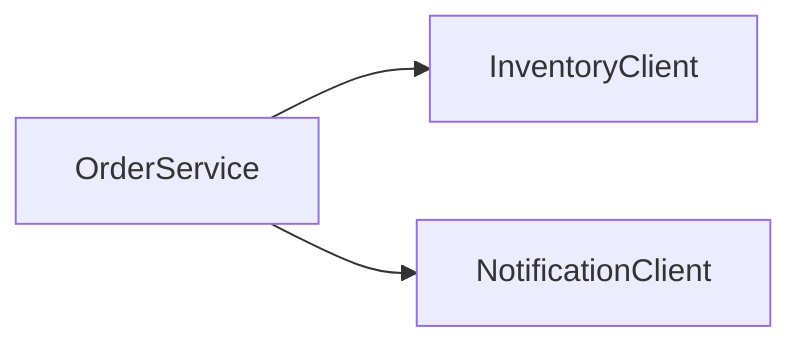
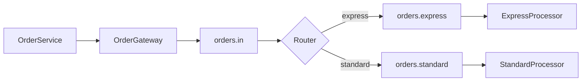

# When Patterns Reduce Coupling and When Patterns Add Indirection

When building an integration system, a direct method call between two components is often the shortest path. However, as the number of systems, data formats, routing rules, and failure scenarios grows, direct calls can cause a small change to ripple across many places. **Enterprise Integration Patterns (EIP)** help express exchange flows as messages, channels, and processing steps with clear responsibilities.

In **Spring Integration**, patterns such as **Gateway, Router, Filter, Transformer, Splitter, and Aggregator** are implemented with components that compose into an integration flow. They can reduce coupling, but every intermediate layer also introduces **indirection**: readers must trace channels, routers, and handlers to see where a message goes. The goal is not to use as many patterns as possible, but to choose **the level of indirection whose benefits outweigh its cost**.

After this lesson, you will be able to distinguish types of coupling, recognize when to apply EIP, explain why adding channels does not automatically create asynchrony, and make an informed choice between a direct call and an integration flow.

## 1. What Is Coupling in an Integration Flow?

**Coupling** is the degree to which one component must know or depend on another component to function properly. It does not live solely in the syntax of a method call.

| Coupling Type | Manifestation | Diagnostic Question |
| --- | --- | --- |
| Source-code coupling | Service must know a specific class or receiver API | Does swapping a library or adapter require editing the calling service? |
| Data-contract coupling | Both sides share payload structure, fields, and business meaning | Does changing the schema break the other side? |
| Temporal coupling | Caller must wait for receiver to finish processing | Does a slow receiver slow down the initial request? |
| Failure coupling | Receiver failure breaks caller processing | If the receiver goes down, can the caller keep operating? |
| Orchestration coupling | Caller decides recipients and step ordering itself | Does adding a branch force edits where the request originates? |
| Deployment/operational coupling | Components must be available, scaled, or released together | Can processing capacity be deployed and changed independently? |

A class calling through an interface reduces dependency on the **implementation**, yet it can still remain coupled to **response time**, **error types**, and **method contracts**. Similarly, turning a call into a message does not automatically eliminate all coupling: producer and consumer still must agree on message semantics.

### Example: Direct Call

```java
class OrderService {
    private final InventoryClient inventory;
    private final NotificationClient notification;

    OrderService(InventoryClient inventory, NotificationClient notification) {
        this.inventory = inventory;
        this.notification = notification;
    }

    void place(Order order) {
        inventory.reserve(order);
        notification.sendConfirmation(order);
    }
}
```



This is easy to read and completely appropriate when the flow is small, steps must run synchronously, and independent change is unnecessary. Yet `OrderService` currently knows the **recipients**, the **order of steps**, and **how to invoke them**. If it later must pick warehouses by region, send confirmations across different channels, or handle separate retries, integration logic will gradually leak into the business service.

## 2. How Do Patterns Reduce Coupling?

EIP pays off only when the intermediate layer **owns a decision that is likely to change**.

- **Gateway** creates a boundary between business code and messaging mechanics: callers interact with a domain-meaningful interface without touching `MessageChannel` directly.
- **Router** pulls recipient selection out of the producer: new routing rules can be centralized in the integration flow.
- **Filter** separates message acceptance/rejection rules from individual consumers. Discard rules must be explicit to avoid unintentional data loss.
- **Transformer** translates contracts at system boundaries: each side keeps the model suited to it.
- **Splitter/Aggregator** help when one request genuinely must split into independent parts and then merge results, with explicit correlation, completion, and timeout policies.
- **Channels paired with suitable execution mechanisms** can reduce temporal coupling or absorb load spikes, though the concrete effect depends on channel type and transport infrastructure.

Imagine an ordering flow that needs to route by order type:



Now `OrderService` merely asks to "process the order". Choosing the handler lives in the router. Coupling to individual implementations drops; in return, the system must maintain the `OrderCommand` contract and channel names.

### Example with Spring Integration Java DSL

The following example uses Java records (Java 17+) and Spring Integration APIs. Both processors are business beans configured in the application.

```java
import org.springframework.context.annotation.Bean;
import org.springframework.context.annotation.Configuration;
import org.springframework.integration.annotation.Gateway;
import org.springframework.integration.annotation.MessagingGateway;
import org.springframework.integration.config.EnableIntegration;
import org.springframework.integration.dsl.IntegrationFlow;

record OrderCommand(String orderId, boolean express) {}

interface ExpressProcessor {
    void process(OrderCommand command);
}

interface StandardProcessor {
    void process(OrderCommand command);
}

@MessagingGateway
interface OrderGateway {
    @Gateway(requestChannel = "orders.in")
    void submit(OrderCommand command);
}

@Configuration
@EnableIntegration
class OrderIntegrationConfig {

    @Bean
    IntegrationFlow routeOrders() {
        return IntegrationFlow.from("orders.in")
            .route(OrderCommand.class,
                order -> order.express() ? "express" : "standard",
                spec -> spec
                    .channelMapping("express", "orders.express")
                    .channelMapping("standard", "orders.standard"))
            .get();
    }

    @Bean
    IntegrationFlow expressOrders(ExpressProcessor processor) {
        return IntegrationFlow.from("orders.express")
            .handle(OrderCommand.class, (command, headers) -> {
                processor.process(command);
                return null; // one-way handler; produces no reply
            })
            .get();
    }

    @Bean
    IntegrationFlow standardOrders(StandardProcessor processor) {
        return IntegrationFlow.from("orders.standard")
            .handle(OrderCommand.class, (command, headers) -> {
                processor.process(command);
                return null;
            })
            .get();
    }
}
```

Another service can inject `OrderGateway` and call `gateway.submit(command)` without knowing `ExpressProcessor` or `StandardProcessor`. When a new order type arrives, you can update the routing logic and add a corresponding flow.

**Important limitation:** In this setup, channels are created by name and default to synchronous dispatch (`DirectChannel`). `submit(...)` may still wait for the processor, and exceptions from the processor can still unwind back to the caller. **Putting logic into a flow does not mean turning it asynchronous**. Only choosing an appropriate channel type, executor, queue, or broker changes timing behavior and error propagation.

Likewise, placing a call behind a gateway does **not** automatically grant durable message storage, cross-system transactions, or exactly-once delivery. Those requirements must be designed explicitly.

## 3. When Is Indirection Worth It?

### 3.1. Multiple Processing Destinations or Changing Routing Policies

If orders must reach different warehouses by country, sales channel, or priority level, a **Router** can centralize destination selection rules. Producers do not need to know the warehouse list. The biggest payoff comes when this policy changes frequently or is shared across multiple flows.

Conversely, if the entire application has only two fixed `if/else` branches inside one short method, a new router may just make the path harder to follow.

### 3.2. Two Systems Have Different Data Models

For example, sales emits `OrderPlaced`, while the warehouse API expects `ReserveInventoryRequest`. A **Transformer** performs translation at the integration boundary. When the warehouse API renames a field or bumps schema versions, the required edits are usually confined to the adapter/transformer.

However, a transformer does not erase contract coupling: you must define required fields, defaults, payload versions, and invalid-data handling. If you are only renaming one variable inside the same domain, adding a separate transformer may be pointless.

### 3.3. Separating Error Policies and Load Capacity

Sending an email does not necessarily have to block order confirmation. That task can move to an asynchronous channel or a queue with retries, load throttling, and error tracking.

Options in Spring Integration carry distinct operational semantics:

| Mechanism | Property to Remember | Consequence |
| --- | --- | --- |
| `DirectChannel` | Delivers messages to subscribers on the caller's execution thread | Decouples code structure, but remains coupled in time and exceptions |
| `ExecutorChannel` | Dispatches via `TaskExecutor` | Can return control early; worker-thread failures need separate handling, bounded by executor capacity |
| `QueueChannel` | Buffers messages for a consumer to receive later | Needs a consumer/poller; in-memory queues do not guarantee durability across restarts |
| `PublishSubscribeChannel` | Distributes one message to multiple subscribers | Without a configured executor, subscribers are normally called synchronously; fan-out is not async by default |
| External broker/queue | Can decouple processes and provide persistence/retries per configured features | Adds infrastructure, message contracts, redelivery rules, and operational overhead |

For instance, switching to `ExecutorChannel` can lower caller latency, yet **does not create durability by itself**. If the process crashes after the caller gets a response, work held only in memory can be lost. For work that must never be lost, evaluate a durable broker, transactional outbox, or equivalent solution matching system requirements.

### 3.4. Testing Integration Decisions Independently

A flow with clear responsibilities enables focused testing: a message with `express = true` must reach the express branch; an invalid message must be filtered or routed to error handling as designed. This is valuable when routing or transformation rules are important enough to merit dedicated test suites.

If testing forces spinning up the entire integration context just to verify a trivial calculation, the abstraction level may already be too high.

## 4. When Do Patterns Only Add Indirection?

**Indirection** means replacing a direct path with one or more intermediate steps. It is not inherently bad, but it is a real cost.

### 4.1. A Single Action Is Split Into Steps Without Distinct Responsibilities

Example:

```text
checkout()
  -> checkout.input
  -> passThroughTransformer
  -> alwaysTrueFilter
  -> constantRouter
  -> checkout.handler
  -> CheckoutService.place()
```

If the transformer returns the exact same payload, the filter always accepts, and the router always picks the same branch, the system gains many names to trace while **isolating no real decision**. These steps should be merged or removed unless they serve a specific documented constraint, such as a security checkpoint or audit policy.

### 4.2. Coupling Simply Moves from Java to Configuration and String Literals

`"orders.express"` is part of the routing contract. Renaming a channel without updating publisher/subscriber can keep messages from reaching their destination. The `OrderCommand` payload is also a shared contract. Using patterns requires managing channel names, schemas, unmapped route handling, and compatibility constraints rather than declaring that coupling has vanished.

### 4.3. Observability Overhead Exceeds the Change Cost Saved

A direct call lets you follow a stack trace. A long flow can traverse a gateway, multiple channels, a router, an executor, and handlers on different threads. Investigating a failure requires knowing the message ID, correlation ID, endpoint name, chosen router branch, retry count, and where exceptions were handled.

If the team lacks sufficient logging/metrics/tracing to pinpoint where a message stopped, adding extra hops can dramatically increase incident-resolution time.

### 4.4. Unintentionally Changing Business Semantics

Moving a synchronous command onto a queue can alter what the API promises. Previously `placeOrder()` returned once inventory was reserved; after introducing a queue, the call may return when **the request was merely accepted**. That affects the UI, order states, data consistency, and error reporting.

Decoupling processing time is a **business contract** decision, not merely a technical choice. Clearly distinguish "accepted", "processing", "completed", and "failed".

## 5. Choosing Patterns for Each Need

| Situation | Typically Reasonable Approach | Rationale and What to Check |
| --- | --- | --- |
| One service calls one stable dependency, needing immediate results | Direct call via interface | Easy-to-read flow; clear contract and errors |
| Multiple destinations depending on message attributes | Router | Isolates orchestration policy; needs a default branch or invalid-value handling |
| Inputs gated by conditions before proceeding | Filter or direct guard | Use Filter when the policy belongs to the integration flow; define how dropped messages are recorded |
| Two systems use different schemas | Transformer/adapter | Confines translation to the boundary; test schema compatibility |
| One message must be sent to multiple subscribers | Publish-Subscribe Channel | Clarify whether subscribers may fail independently and choose the execution mechanism |
| Slow work that need not finish before responding | Executor/Queue Channel or suitable broker | Define when acknowledgement occurs, retries, and durability |
| One request splits into multiple tasks then merges results | Splitter + Aggregator | Needs correlation, release strategy, timeout, and missing-result handling |
| Single pass-through hop with no transformation or choice | Remove intermediate endpoints | Reduces hops and configuration to maintain |

**Practical rule of thumb:** Every pattern introduced into a flow should answer three questions: (1) which decision or boundary does it own, (2) independently of which component does that decision change, and (3) how will we observe and handle errors here? If you cannot answer those, consider writing a plain method instead.

## 6. Two Contrasting Scenarios

### Scenario A: Multi-Region Order System — Router Adds Real Value

Initially the application had one warehouse. Later it added regional warehouses, preferring the nearest warehouse with fallback when a warehouse is overloaded. If that logic lives inside the controller or order service, every regional change hits the order-intake flow.

A viable solution:

1. Producer emits a command with a stable contract, e.g., `ReserveStock(orderId, region, priority)`.
2. Router selects a branch according to `region` and a validated policy.
3. Each branch has an adapter calling a specific warehouse system; transformers adapt models where needed.
4. Explicitly define unsupported regions, timeouts, retries, and duplicate-order handling.

Here indirection **buys independent evolvability**: the producer does not need to know each warehouse API. Even so, the warehouse-selection policy still needs an owner and tests, because a bad change can route orders to the wrong place.

### Scenario B: Internal Shipping-Fee Calculation Service — Keep Direct Calls

A module has a pure-Java `ShippingFeeCalculator` taking `Weight` and `Destination` and returning `Money` in-process; there are no network calls, routing, queues, or external system interactions. Wrapping it in gateway → channel → transformer → service activator makes the flow harder to read without meaningfully reducing coupling.

A clean interface paired with unit tests is enough:

```java
interface ShippingFeeCalculator {
    Money calculate(Weight weight, Destination destination);
}
```

If later it must call multiple carriers, translate differing schemas, or apply fallback policies, there will then be a solid reason to introduce an integration flow.

## 7. Questions to Answer Before Putting a Flow into Production

**Does message arrival mean processing is complete?** With a synchronous channel and a one-way handler, the caller may wait until the handler finishes; with asynchronous processing, the call may only confirm receipt/enqueuing. Method names and responses must reflect that commitment accurately.

**If processing fails, who finds out?** Synchronous errors can propagate to the caller; asynchronous errors must be captured and routed to an appropriate handler, such as an error channel, retry advice, or dead-letter flow. Cap retry attempts and identify unrecoverable errors.

**Is processing a message twice safe?** When using retries or a broker with redelivery, handlers must consider idempotency. Use a business key like `orderId` to avoid reserving stock or sending notifications twice.

**What happens if one branch slows down?** Monitor queue depth, active task counts, processing latency, backpressure behavior, and resource limits. Adding a queue does not remove a bottleneck; it shifts where the bottleneck manifests.

**Can the path be traced?** Include message ID/correlation ID and routing-branch info in logs/traces, and measure latency and errors per endpoint. With Splitter/Aggregator, explicitly define group policies, completion criteria, timeouts, and state cleanup.

**Are message contracts explicitly versioned?** When producer and consumer deploy independently, establish compatible schema-evolution rules, missing/extra field handling, and boundary contract tests.

## 8. Self-Assessment Exercise

Consider a ticket-booking API. After a booking succeeds, the system must (a) confirm payment to decide whether to issue the ticket, (b) send a confirmation email, and (c) update analytics data.

- **Step a:** If ticket issuance depends on the immediate payment outcome, keep a clear synchronous contract for confirmation; adding a synchronous channel only helps if a genuine integration boundary is needed.
- **Step b:** Email sending can be decoupled from the main response path, but you must choose between executor, queue, or broker, and define retries, idempotency, and how send status is viewed.
- **Step c:** You can emit an event to analytics subscribers via a Publish-Subscribe Channel or suitable event infrastructure. Check message-loss tolerance and how analytics copes with duplicate processing.

Answer for yourself: if the email service is down for 30 minutes, can the API still issue tickets; where are email messages stored; what status does the customer see; and by what identifier will operations locate failed messages? Those questions shape the real architecture far more than picking pattern names.

## Takeaways

**Patterns reduce coupling when they establish a stable boundary around a decision likely to change:** destination selection, data translation, message distribution, or timing and error handling. **Patterns create pure indirection when intermediate steps are added without isolating an independent responsibility or requirement.**

With Spring Integration, evaluate three layers simultaneously: **message contracts**, **flow structure**, and **channel execution semantics**. Doing so lets you apply Router, Filter, Transformer, Splitter, Aggregator, Gateway, and retry/error-channel mechanisms at the right moments while keeping the system understandable, testable, and operable.
