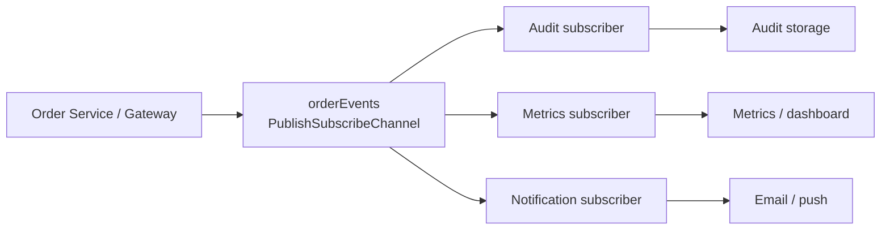
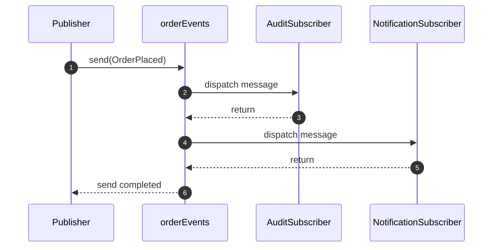
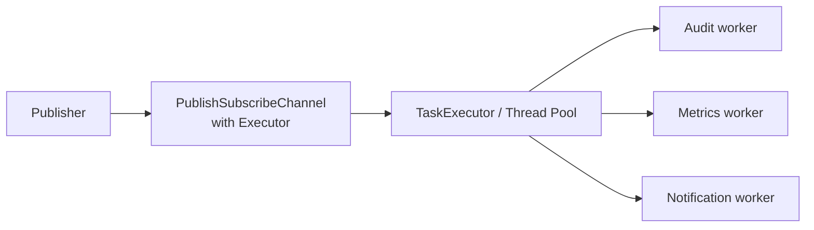
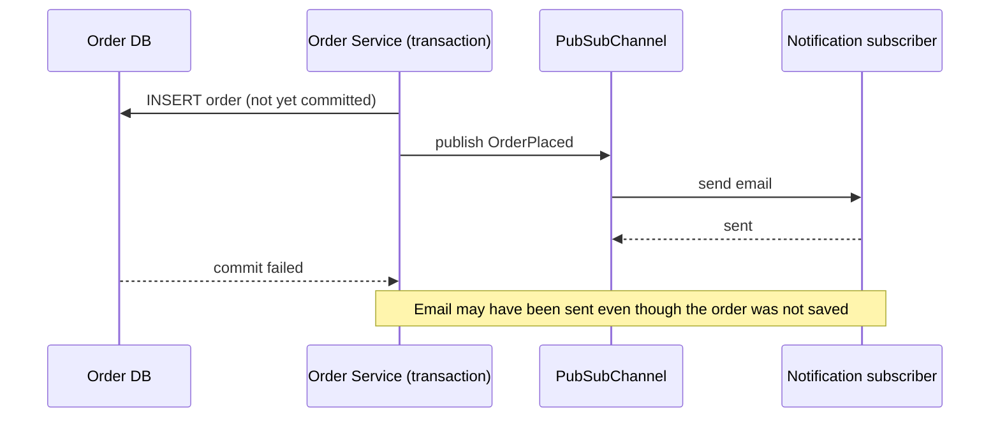
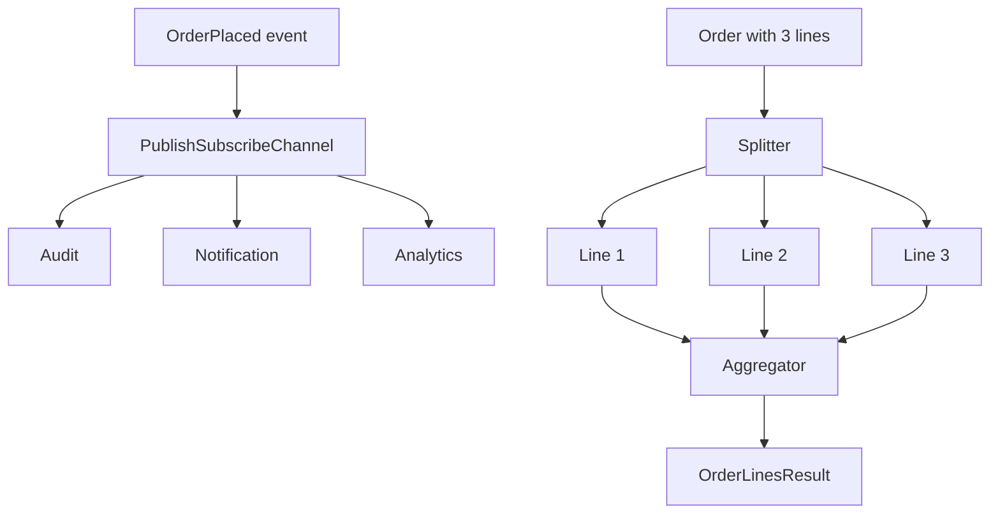
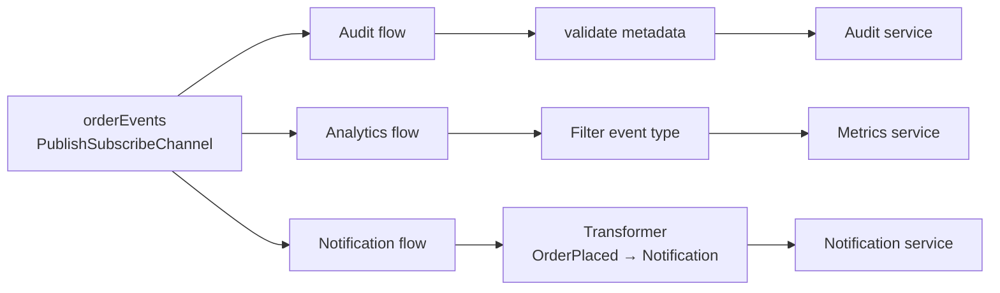

# Publish-Subscribe Channel and Multiple Subscribers in Spring Integration

> **Chapter:** Publish subscribe  
> **Lesson:** Publish-Subscribe Channel and Multiple Subscribers  
> **Scope:** Building Enterprise Integration Patterns (EIP) with Spring Integration; coordinating multiple loosely coupled processing branches, along with Router, Filter, Transformer, Splitter, Aggregator, Gateway, retry, error channel, correlation, and observability tools.

## 1. Problem: One Event, Multiple Interested Parties

When a customer successfully creates an order, the system may need to perform several tasks:

- Record an audit trail.
- Update operational metrics.
- Send a notification to the customer.
- Emit a signal for a downstream processing service.

If the order-receiving service directly calls all three or four of those services, it must know about every consumer. Every time a new feature is added, the event-publishing logic or orchestration code in the originating service has to be modified.

A **Publish-Subscribe Channel** allows one producer to publish a message to **one channel**, while **multiple subscribers** receive that same message. The publisher does not need to know the number or concrete implementations of the subscribers.



This is a **fan-out/broadcast** distribution style: a single event can trigger multiple branches with independent purposes. However, whether "every subscriber receives it" still depends on whether the subscriber has already subscribed, whether the channel sends successfully, how errors are handled, and whether the executor accepts the task.

### After This Lesson, You Can

1. Distinguish `PublishSubscribeChannel` from `DirectChannel`, `ExecutorChannel`, and `QueueChannel`.
2. Configure one publisher and multiple subscribers using the Spring Integration Java DSL.
3. Explain when subscribers run synchronously and when they run in parallel.
4. Test that an event is delivered to multiple handlers while the payload preserves its contract.
5. Identify limitations around ordering, transactions, retries, error channels, and durability.
6. Use correlation metadata to track individual branches and combine with Splitter/Aggregator when results need to be collected.

## 2. What Model Is Publish-Subscribe?

The *Publish-Subscribe Channel* Enterprise Integration Pattern defines a channel with multiple subscribing parties. When a message is published, the channel distributes it to eligible registered subscribers at the time of sending.

```text
Publisher
   |
   | send(OrderPlaced)
   v
Publish-Subscribe Channel
   |          |           |
   v          v           v
Audit       Metrics     Notification
```

In Spring Integration, the class commonly used for this case is `org.springframework.integration.channel.PublishSubscribeChannel`. It is a `SubscribableChannel` that receives messages from a publisher and dispatches them to subscribed `MessageHandler` instances.

Three roles should be distinguished:

| Role | Responsibility | Example |
| --- | --- | --- |
| **Publisher** | Publishes the message without needing to know individual subscribers | Flow receiving `OrderPlaced` |
| **PublishSubscribeChannel** | Delivers the message to subscribers | `orderEvents` |
| **Subscriber** | Performs one responsibility upon receiving the message | Audit handler, notification handler |

A subscriber is typically registered when Spring Integration creates an endpoint from an `IntegrationFlow` or `@ServiceActivator`. There is no need for the publisher to manually call `auditService.record(...)` and then `notificationService.send(...)`.

### What Is Decoupled?

The publisher only needs to know the **event** contract and the **channel**. New subscribers can register without changing the event-publishing code, as long as the payload and headers remain stable. Conversely, changing the event schema can affect all subscribers, so data contracts and versioning must be managed carefully.

**What must not be assumed:** an in-JVM channel is not a durable message broker. `PublishSubscribeChannel` does not automatically persist events to Kafka/RabbitMQ or guarantee that events survive an abrupt process crash.

## 3. Comparing Message Channels

The following table helps choose the right channel type for a given goal.

| Channel | Subscribers receiving one message | Typical thread | Usage |
| --- | --- | --- | --- |
| `DirectChannel` | One selected subscriber | Usually the sender's thread | Synchronous point-to-point |
| `ExecutorChannel` | One selected subscriber | Dispatched via `TaskExecutor` | Point-to-point with a thread boundary |
| **`PublishSubscribeChannel`** | Dispatched to multiple subscribers | Synchronous by default; can use an executor | In-application broadcast/fan-out |
| `QueueChannel` | Consumer actively polls for messages | Poller's thread | Queue, delivered when a consumer pulls |
| `FluxMessageChannel` | Follows the corresponding reactive model | Follows the reactive stream/scheduler | When the system is designed around reactive flows |

A `DirectChannel` with multiple subscribed handlers does **not** mean every handler receives every message; it is a unicast mechanism that selects one handler per dispatch. When the goal is to broadcast to multiple parties, use `PublishSubscribeChannel`.

Similarly, `ExecutorChannel` offloads work to an executor, yet still carries **single-subscriber** dispatch semantics. To achieve **both broadcast and parallel execution**, configure an executor on the Publish-Subscribe Channel or place asynchronous boundaries within the branches.

### Identifying Business Requirements

- "One order is processed by exactly one worker" → usually point-to-point / competing consumers.
- "Every order must be audited while simultaneously triggering metrics and notification" → publish-subscribe.
- "Persist events so multiple applications across different processes can replay them after a restart" → an external broker/topic or durable persistence mechanism, with the appropriate adapter.
- "Split a message into multiple parts for computation and then combine the results" → Splitter/Aggregator; publish-subscribe can support fan-out, but does not replace grouping and release strategies.

## 4. What Message Is Sent to Subscribers?

A `Message<T>` contains:

- **Payload**: for example, `OrderPlaced(orderId, amount)`.
- **Headers**: for example, `businessCorrelationId`, `sourceSystem`, `traceId`, and technical headers.

In a typical publish-subscribe flow, each subscriber is dispatched a message carrying that event payload. The channel does not automatically transform it into a new business payload type. Each subscriber can invoke its own Service Activator or Transformer after receiving it.

```text
OrderPlaced("ORD-101", 1250000)
  headers:
    businessCorrelationId = "order:ORD-101"
    sourceSystem = "checkout-api"

                     |
                     v
              orderEvents
            /      |       \
           v       v        v
       Audit    Metrics  Notification
       reads    reads    reads payload
       event    event    then processes
```

**Beware of mutable payloads:** multiple subscribers may hold references to the same object. If one subscriber mutates a mutable `OrderPlaced`, another subscriber may see the modified data; with an executor, this can even cause a race condition. Use immutable events, such as a Java record with immutable fields, or defensive copies for components with mutable collections.

`MessageHeaders` does not allow direct modification like an ordinary `Map`; however, that **does not automatically make the payload immutable**.

## 5. Java DSL Example: One Publisher and Two Subscribers

The example below uses a Spring Integration configuration with three flows:

1. A flow that receives and publishes the event to `orderEvents`.
2. An audit flow that subscribes to `orderEvents`.
3. A notification flow that also subscribes to `orderEvents`.

To focus on how distribution works, the two subscribers record messages into in-memory lists. In a real application, they would call the corresponding services/adapters.

### 5.1. Spring Integration Configuration

```java
package example.integration;

import java.math.BigDecimal;
import java.util.List;
import java.util.concurrent.CopyOnWriteArrayList;

import org.springframework.context.annotation.Bean;
import org.springframework.context.annotation.Configuration;
import org.springframework.integration.channel.DirectChannel;
import org.springframework.integration.channel.PublishSubscribeChannel;
import org.springframework.integration.config.EnableIntegration;
import org.springframework.integration.dsl.IntegrationFlow;
import org.springframework.messaging.Message;
import org.springframework.messaging.MessageChannel;

@Configuration
@EnableIntegration
public class OrderPubSubConfig {

    public record OrderPlaced(String orderId, BigDecimal amount) {}

    @Bean
    public MessageChannel ordersInput() {
        return new DirectChannel();
    }

    @Bean
    public PublishSubscribeChannel orderEvents() {
        return new PublishSubscribeChannel();
    }

    @Bean
    public AuditSubscriber auditSubscriber() {
        return new AuditSubscriber();
    }

    @Bean
    public NotificationSubscriber notificationSubscriber() {
        return new NotificationSubscriber();
    }

    // Publisher: send the message to the broadcast channel.
    @Bean
    public IntegrationFlow incomingOrdersFlow() {
        return IntegrationFlow.from("ordersInput")
            .channel("orderEvents")
            .get();
    }

    // First subscriber: handle audit.
    @Bean
    public IntegrationFlow auditFlow(AuditSubscriber auditSubscriber) {
        return IntegrationFlow.from("orderEvents")
            .handle(auditSubscriber, "record")
            .get();
    }

    // Second subscriber: handle notification.
    @Bean
    public IntegrationFlow notificationFlow(
            NotificationSubscriber notificationSubscriber) {

        return IntegrationFlow.from("orderEvents")
            .handle(notificationSubscriber, "notifyOrder")
            .get();
    }

    public static class AuditSubscriber {

        private final CopyOnWriteArrayList<Message<OrderPlaced>> received =
            new CopyOnWriteArrayList<>();

        public void record(Message<OrderPlaced> message) {
            received.add(message);
            // In practice: write audit with a timeout and error policy.
        }

        public List<Message<OrderPlaced>> received() {
            return List.copyOf(received);
        }
    }

    public static class NotificationSubscriber {

        private final CopyOnWriteArrayList<Message<OrderPlaced>> received =
            new CopyOnWriteArrayList<>();

        public void notifyOrder(Message<OrderPlaced> message) {
            received.add(message);
            // In practice: send notification with idempotency.
        }

        public List<Message<OrderPlaced>> received() {
            return List.copyOf(received);
        }
    }
}
```

In this example:

- `ordersInput` uses `DirectChannel` to receive messages from an adapter or caller.
- `incomingOrdersFlow` forwards messages to the `orderEvents` bean.
- `orderEvents` is a `PublishSubscribeChannel` without an executor, so dispatch is **synchronous** by default.
- `auditFlow` and `notificationFlow` both start from the same channel and register two independent handlers.
- Both subscriber methods return `void` to perform one-way processing. They do not produce competing reply payloads.
- `CopyOnWriteArrayList` is used for observation in the example; it is **not** a durable event storage mechanism.

Separate `public record` types and classes can be extracted into appropriate Java files if the project prefers a cleaner package layout.

### 5.2. Publishing an Event

Suppose `ordersInput` is injected as a `MessageChannel`:

```java
import java.math.BigDecimal;

import org.springframework.messaging.Message;
import org.springframework.messaging.support.MessageBuilder;

OrderPubSubConfig.OrderPlaced event =
    new OrderPubSubConfig.OrderPlaced(
        "ORD-101", new BigDecimal("1250000"));

Message<OrderPubSubConfig.OrderPlaced> message =
    MessageBuilder.withPayload(event)
        .setHeader("businessCorrelationId", "order:ORD-101")
        .setHeader("sourceSystem", "checkout-api")
        .build();

boolean accepted = ordersInput.send(message);
```

With a simple synchronous configuration, when no subscriber throws an exception, both handlers have normally been invoked by the time `send(...)` returns. If a handler throws an exception, the behavior may differ; this is covered in detail in the error handling section.

**Do not equate `accepted=true` with "all external side effects have been committed."** A handler might write an in-memory log, call an external service, or emit another message; the level of completion must be defined by a separate contract.

### 5.3. Execution Diagram



The diagram above illustrates **one possible dispatch order** when the channel is synchronous. Do not turn Audit appearing before Notification in the diagram into a business ordering contract. If one step must always run after another, chain them sequentially in **one flow** instead of treating independent subscribers as an ordered pipeline.

## 6. Testing That Multiple Subscribers Receive the Event

Unit testing `AuditSubscriber.record(...)` alone does not prove that Spring Integration has wired both subscribers to the channel properly. You need to test through the input channel.

```java
package example.integration;

import static org.junit.jupiter.api.Assertions.*;

import java.math.BigDecimal;

import org.junit.jupiter.api.Test;
import org.springframework.beans.factory.annotation.Autowired;
import org.springframework.beans.factory.annotation.Qualifier;
import org.springframework.messaging.Message;
import org.springframework.messaging.MessageChannel;
import org.springframework.messaging.support.MessageBuilder;
import org.springframework.test.context.junit.jupiter.SpringJUnitConfig;

@SpringJUnitConfig(OrderPubSubConfig.class)
class OrderPubSubTest {

    @Autowired
    @Qualifier("ordersInput")
    private MessageChannel ordersInput;

    @Autowired
    private OrderPubSubConfig.AuditSubscriber auditSubscriber;

    @Autowired
    private OrderPubSubConfig.NotificationSubscriber notificationSubscriber;

    @Test
    void publishesTheSameEventToBothSubscribers() {
        var event = new OrderPubSubConfig.OrderPlaced(
            "ORD-101", new BigDecimal("1250000"));

        Message<OrderPubSubConfig.OrderPlaced> input =
            MessageBuilder.withPayload(event)
                .setHeader(
                    "businessCorrelationId", "order:ORD-101")
                .build();

        assertTrue(ordersInput.send(input));

        assertEquals(1, auditSubscriber.received().size());
        assertEquals(1, notificationSubscriber.received().size());

        Message<OrderPubSubConfig.OrderPlaced> audit =
            auditSubscriber.received().get(0);
        Message<OrderPubSubConfig.OrderPlaced> notification =
            notificationSubscriber.received().get(0);

        assertSame(event, audit.getPayload());
        assertSame(event, notification.getPayload());

        assertEquals("order:ORD-101",
            audit.getHeaders().get("businessCorrelationId"));
        assertEquals("order:ORD-101",
            notification.getHeaders().get("businessCorrelationId"));
    }
}
```

This test proves that in a synchronous internal flow:

- A single input message is delivered to **both subscribers**.
- Both see a payload with the same content and the same object reference in an example without a copy/serialization step.
- The business correlation header can be read in each handler.
- Subscribers do not need to know about each other to receive the same event.

When switching to an asynchronous executor, you **must not** rely on assertions immediately after `send(...)` to conclude that subscribers have finished. In that case, use a `CountDownLatch`, Awaitility, or a waiting mechanism with a timeout.

**Limitations of this test:** it does not verify successful email delivery, database transactions, durability across restarts, or fan-out through a broker. Those requirements need integration tests at the corresponding boundaries.

## 7. Synchronous by Default: One Slow Subscriber Affects the Publisher

A `PublishSubscribeChannel` without an executor normally dispatches on the calling thread. If one subscriber takes 800 ms to send an email and another subscriber takes 100 ms to write an audit record, the publisher may have to wait for the processing time of the synchronous handlers.

```text
Caller thread
  |
  +---> PublishSubscribeChannel
          |
          +---> Subscriber A (audit, 100 ms)
          |
          +---> Subscriber B (notification, 800 ms)
          |
          +---> Dispatch completed
```

This has certain advantages:

- Easy to trace the call stack.
- In some configurations, handlers can participate in a transaction bound to the same thread.
- Testing is simpler because synchronous subscribers typically run before the send call returns.

But it also has drawbacks:

- A slow subscriber holds the incoming thread longer.
- An exception from one subscriber can fail the send operation and affect dispatch to other subscribers.
- Unsuitable if the publisher needs to respond quickly and side tasks take a long time.
- Increasing the number of subscribers can increase dispatch overhead and latency on the sending path.

**Do not use synchronous fan-out to replace a strictly ordered sequence of steps.** When Notification depends on the result of Audit, model that relationship as sequential steps or a follow-up event, rather than hoping subscriber registration order remains fixed.

## 8. Using TaskExecutor for Asynchronous Broadcast

A `PublishSubscribeChannel` can accept an `Executor`. Subscriber invocations are then dispatched through the executor, typically running on worker threads different from the publisher thread.



Example **replacing** the `orderEvents` bean in section 5 with an executor configuration:

```java
import java.util.concurrent.Executor;
import java.util.concurrent.ThreadPoolExecutor;

import org.springframework.beans.factory.annotation.Qualifier;
import org.springframework.context.annotation.Bean;
import org.springframework.integration.channel.PublishSubscribeChannel;
import org.springframework.scheduling.concurrent.ThreadPoolTaskExecutor;

@Bean
public ThreadPoolTaskExecutor orderEventsExecutor() {
    ThreadPoolTaskExecutor executor = new ThreadPoolTaskExecutor();
    executor.setCorePoolSize(2);
    executor.setMaxPoolSize(4);
    executor.setQueueCapacity(100);
    executor.setThreadNamePrefix("order-fanout-");
    executor.setRejectedExecutionHandler(
        new ThreadPoolExecutor.AbortPolicy());
    return executor;
}

@Bean
public PublishSubscribeChannel orderEvents(
        @Qualifier("orderEventsExecutor") Executor executor) {

    return new PublishSubscribeChannel(executor);
}
```

Spring manages the lifecycle for a `ThreadPoolTaskExecutor` declared as a bean. This is a **configuration variant**: keep only **one** bean named `orderEvents` in the application.

With an executor that has sufficient workers and capacity, the publisher can continue once dispatch tasks are **accepted**, while subscribers process on worker threads. However, keep in mind:

1. `send(...)` is not a signal that all subscribers have finished.
2. Execution and completion order among subscribers is **not guaranteed**.
3. When the queue and pool are full, task submission can be rejected.
4. A policy such as `CallerRunsPolicy` can cause tasks to run on the sending thread itself, breaking the "always runs on a worker" assumption.
5. An in-memory executor queue does not guarantee messages survive process termination.

### Pool and Queue Limits

With `corePoolSize=2`, `maxPoolSize=4`, and `queueCapacity=100`, when the core workers are busy, tasks may be placed in the queue. Only after the queue is full can the executor spawn additional workers up to `maxPoolSize`. Therefore, increasing `maxPoolSize` while keeping a very large queue does not necessarily make the pool increase concurrency early.

You need to monitor active workers, queue depth, wait time, retries, and rejections. A subscriber making slow API calls can occupy workers for a long time, causing other subscribers to queue up. Asynchronous fan-out keeps the publisher thread less blocked under normal conditions; **it does not make target systems process any faster**.

## 9. If One Subscriber Fails, Do Other Subscribers Still Receive the Message?

This is a point that must be clearly determined, because "publish-subscribe" does not mean "deliver to everyone at all costs."

### Synchronous Case

If the first subscriber throws an exception during synchronous dispatch, the exception can stop the send process and subsequent subscribers may not be invoked. Depending on the dispatcher configuration, subscription order, and error-handling policy, you should not assume all remaining subscribers still run.

```text
Publisher
  |
  v
PublishSubscribeChannel
  |--> Audit: OK
  |--> Notification: throws
  x--> Analytics: may not have been called
```

Some versions/components provide error-handling options to ignore failures or continue dispatching; consult the exact API and configuration in use. Even if dispatch continues, that alone does not guarantee transactions or durable delivery.

### Asynchronous Case

Each subscriber can be executed in its own task. One failed task does not necessarily stop other tasks, though a task could also be rejected upon submission or its error may not propagate back to the publisher thread. To track failures, configure an appropriate error handler/error channel and observability mechanisms for `PublishSubscribeChannel` and the executor.

**Do not treat an exception from one subscriber as a reason to automatically retry the entire event from the publisher.** If audit succeeded while notification failed, retrying the initial publication may cause audit to be recorded twice. Decide retries per branch and ensure idempotency.

### Per-Branch Error Design Strategy

| Subscriber | Common failure | Recovery approach |
| --- | --- | --- |
| Audit | Database temporarily unavailable | Bounded retry, durable storage if audit is mandatory |
| Metrics | Slow metrics backend | Observable drop or buffering depending on SLA |
| Notification | Email provider timeout | Retry by notification ID, idempotency |
| Business handler | Business or transaction error | Error flow, failure state, outbox/broker if needed |

Branches with different criticality levels should not accidentally share a single retry and durability policy. For events requiring reconciliation, design delivery guarantees at the transport layer or in persistence outside `PublishSubscribeChannel`.

## 10. Relationship Between Publish-Subscribe and Transactions

When a channel dispatches **synchronously**, subscribers can run on the same sending thread. If a transaction is opened at an appropriate point and handlers participate in that transaction according to configuration, certain database operations can commit or roll back together.

However, distinguish carefully:

- A transaction on the same thread does not automatically cover every external system.
- An already-sent external email cannot automatically "roll back" because a database transaction failed.
- If one subscriber commits independently, another subscriber's rollback does not necessarily undo the committed result.
- When switching to an asynchronous executor, a transaction context bound to the sending thread **does not automatically propagate to worker threads**.

Risk example:



### When Publishing Must Happen Only After Commit

You can publish events after commit for cases where losing an event on a process crash is acceptable. If the requirement is **zero event loss** and **consistent persistence of data and events**, consider the **transactional outbox** pattern:

1. Within the same DB transaction, write both the business data and the outbox record.
2. After commit, an independent publisher reads the outbox.
3. The publisher forwards the event to the appropriate broker/topic or processing system.
4. Subscribers process with idempotency and their own acknowledgement mechanisms.
5. Confirm the outbox/event per contract after publishing succeeds.

`PublishSubscribeChannel` is an in-application coordination tool; it can sit inside such an architecture, but does not by itself provide atomicity across a database, a broker, and multiple subscribers.

## 11. Correlation and Tracing When One Event Splits Into Multiple Branches

With multiple subscribers, root-cause investigation must rely on metadata with stable meaning.

Example:

```text
Event: OrderPlaced("ORD-101")
  eventId               = EVT-501
  businessCorrelationId = order:ORD-101
  traceId               = trace-abc
       |
       +-- Audit        eventId=EVT-501, businessCorrelationId=order:ORD-101
       +-- Metrics      eventId=EVT-501, businessCorrelationId=order:ORD-101
       +-- Notification eventId=EVT-501, businessCorrelationId=order:ORD-101
```

| Header | Purpose | Note |
| --- | --- | --- |
| `eventId` | Identifies the event to detect duplicate processing | Do not reuse across different business events |
| `businessCorrelationId` | Links steps belonging to the same order/request | Preserve across retries and branches |
| `traceId` | Distributed tracing | Prefer the existing tracing system |
| `MessageHeaders.id` | Framework-generated message ID | Do not use as a replacement for business correlation |
| `correlationId` | May serve as the Splitter/Aggregator group ID | Do not overwrite just for logging |
| `replyChannel` / `errorChannel` | Framework reply/error routing paths | Do not copy arbitrarily onto other transports |

In a publish-subscribe flow, subscribers can log the same `businessCorrelationId` and `eventId`, while each branch adds its subscriber name, status, and attempt count to show which step succeeded.

Log example:

```text
eventId=EVT-501 correlation=order:ORD-101 subscriber=audit        status=SUCCESS
eventId=EVT-501 correlation=order:ORD-101 subscriber=metrics      status=SUCCESS
eventId=EVT-501 correlation=order:ORD-101 subscriber=notification status=RETRYING attempt=2
```

Do not put tokens, card data, sensitive personal information, or entire payloads into logs. With Micrometer Observation/OpenTelemetry, use the tracing system's propagation instead of fabricating an incompatible `traceId`.

### ThreadLocal Is Not Copied Automatically

When using an executor, correlation headers still travel with the message if the flow preserves metadata properly. However, MDC, security context, and transactions bound to the sending thread do not automatically appear on worker threads. When needed, use proper context propagation or a `TaskDecorator` and clear the context after processing.

## 12. How Publish-Subscribe Differs from Splitter/Aggregator

Both patterns can create multiple branches, but their goals differ.

**Publish-Subscribe Channel** delivers **one message** to **multiple subscribers**. Each subscriber can perform a different task on the same event.

**Splitter** creates **multiple child messages** from the contents of one message; **Aggregator** gathers results according to a correlation/release strategy.



If you want to **wait for all subscribers to return results** and then aggregate them, you need a clearly configured request-reply/fan-out architecture and an Aggregator. `PublishSubscribeChannel` itself **is not an Aggregator** and does not automatically produce a combined result.

### Applying Sequence Metadata When Aggregation Is Needed

`PublishSubscribeChannel` can apply sequence metadata in certain configurations, allowing messages sent to subscribers to carry group/sequence information for downstream aggregation. This configuration is not a default requirement for every event broadcast.

When designing aggregation, you must know clearly:

- How many branches are expected to contribute results?
- Which subscribers might reject or filter out the message?
- Does each branch return one reply or multiple replies?
- Who manages `correlationId`, `sequenceNumber`, and `sequenceSize`?
- If a branch fails or times out, how is the group released or expired?

Do not overwrite correlation/sequence metadata set by a Splitter or another grouping flow, especially in pipelines with nested groups. If you only want auditing and sending notifications, keep it as a simple one-way fan-out.

## 13. Request-Reply Gateways and Multiple Subscribers

A Messaging Gateway may wait for **one** reply. Yet a Publish-Subscribe Channel can deliver the request to **multiple** subscribers.

Suppose two subscribers both return data:

```text
OrderGateway.submit(...)
         |
         v
    PubSubChannel
       /     \
      v       v
 Handler A  Handler B
 return X   return Y
       \     /
        ? reply
```

There is no default rule to "merge two replies into one business response." If both branches send replies to the same destination, the result can cause contention, late replies, or behavior inconsistent with the caller's contract.

**Choose one of these clear designs:**

1. **One-way event fan-out:** the Gateway or service emits an event and does not expect subscribers to return replies together; handlers perform `void` processing.
2. **One branch owns the reply:** only a single component produces the result for request-reply; auxiliary branches do not alter the reply contract.
3. **Fan-out then aggregate:** design a Collector/Aggregator, correlation, and completion strategy to produce **one** meaningful aggregated reply.

If the Gateway only needs to return "accepted," specify whether that status means the message entered an in-memory channel, was written to an outbox, or was acknowledged by a broker. Do not report "processing completed" while subscribers are still running asynchronously.

## 14. Organizing Subscribers Into Separate Flows

For independent components such as audit, analytics, and notification, let each subscriber own its own flow and error policy. For example:



This organization provides:

- Audit can process all events.
- Analytics only cares about certain events and actively applies a Filter inside **its own flow**.
- Notification has its own Transformer to build the appropriate command.
- The publisher does not need to change when a subscriber is added or removed.

**A Filter in the Analytics branch** discards messages in that branch; it does not necessarily discard messages for the Audit or Notification branches. Separating flows allows each subscriber to decide what data it cares about.

However, flows starting from the same `PublishSubscribeChannel` still share the channel's subscriber discovery semantics and dispatch policy. Stronger durability or fault isolation requirements may require a broker/topic and independent consumer groups/subscriptions.

### Adding a New Subscriber

To add a `SearchIndexSubscriber`, create a new flow subscribing to the same `orderEvents`. No publisher changes are needed. Still, re-evaluate fan-out cost, SLA, error policy, and event schema because a new subscriber can increase latency when the channel is synchronous.

## 15. Ordering, Duplicates, Backpressure, and Correctness

### 15.1. Do Not Use Subscriber Order as a Business Rule

Even when a synchronous configuration exhibits an observable invocation order, that order can depend on registration mechanics, endpoint order, and change as the system evolves. With an asynchronous executor, completion order is even more variable.

If Notification **must** wait for Audit to commit, model it as an explicit sequential flow:

```text
AuditHandler → auditCompletedEvent → NotificationHandler
```

That is a business dependency, not two independent subscribers handling one event.

### 15.2. Every Subscriber Must Account for Duplicate Processing

In real systems, events can be replayed after retries, restarts, or transport redelivery. Each branch needs its own idempotency rule: email sending uses a notification ID; search index updates use an event version; audit uses an event ID with a unique constraint if needed.

### 15.3. Overload

A slow subscriber can lengthen synchronous dispatch time. With a shared executor, it can occupy threads/queue capacity and affect other branches. Solutions include timeouts, bounded executors, rate limits, backpressure, or separating resources per subscriber when SLAs differ.

### 15.4. Durability

An event sent to an in-JVM `PublishSubscribeChannel` can be lost if the process terminates before all handlers finish. When zero message loss is required, persist events to an outbox or durable broker and treat acceptance as confirmed only after the appropriate acknowledgement step.

### 15.5. Metadata Security

Do not treat a `tenantId` or `sourceSystem` header supplied arbitrarily by a client as valid authorization. Subscribers must validate context at the appropriate boundary; messages with multiple recipients require even stricter control of sensitive data according to each branch's needs.

## 16. Per-Branch Observability in Operations

Fan-out multiplies one event into multiple outcomes. You must monitor not only "the publisher sent it," but also "each subscriber completed."

| Metric / log | Meaning |
| --- | --- |
| Event published count | How many events were put into the channel |
| Subscriber invocation count | How many times each branch was invoked |
| Per-subscriber latency | Which branch is slow |
| Per-subscriber failure/retry count | Which branch needs investigation or optimization |
| Executor active threads / queue depth | Whether the pool and queue are congested |
| Rejection count | Whether tasks are rejected under overload |
| Event age / backlog | How long events wait to be processed, if queued |
| End-to-end completion state | Whether business obligations are fulfilled |

A report keyed by `businessCorrelationId` can record:

```text
order:ORD-101
  published    : 10:00:00.010
  audit        : SUCCESS 10:00:00.030
  metrics      : SUCCESS 10:00:00.045
  notification : FAILED  10:00:01.200, retry scheduled
```

This format distinguishes the status of each subscriber; do not collapse everything into "event processing completely failed" when only the notification branch encountered an error.

## 17. Extended Testing: Asynchrony and Failures

The test in section 6 uses synchronous dispatch. When switching the channel to an executor, the testing approach must change:

```java
import java.util.concurrent.CountDownLatch;
import java.util.concurrent.TimeUnit;
import java.util.concurrent.atomic.AtomicInteger;

CountDownLatch bothHandled = new CountDownLatch(2);
AtomicInteger processed = new AtomicInteger();

// Inside subscriber A:
processed.incrementAndGet();
bothHandled.countDown();

// Inside subscriber B:
processed.incrementAndGet();
bothHandled.countDown();

// In the test after sending one event:
assertTrue(bothHandled.await(5, TimeUnit.SECONDS));
assertEquals(2, processed.get());
```

This is a **test coordination pattern**, not a standalone runnable class. Place the latch/handlers inside the test fixture and ensure each test run has isolated data. Do not use `Thread.sleep(...)` and assume subscribers have finished.

Important scenarios to test:

1. **Both subscribers run** when the channel publishes one message.
2. **One subscriber fails:** verify the behavior of the remaining subscribers according to the configured error policy.
3. **Executor overloaded:** observe rejections and how errors or retries are handled when a task cannot be submitted.
4. **No subscribers:** determine whether `send` should fail-fast, log, or accept dropping the event per contract.
5. **Duplicate events:** each branch does not perform unwanted side effects twice.
6. **Headers:** `eventId`, `businessCorrelationId`, and required metadata remain intact in each branch.
7. **Shutdown/restart:** if durable delivery is required, test the broker/outbox; testing `PublishSubscribeChannel` alone cannot prove durability.

### An Error From One Subscriber Is Not Automatically an Error of Every Subscriber

Tests should record the outcomes of the Audit and Notification branches separately. If you simulate Notification throwing an exception, verify Notification's error flow and retry mechanism while proving that Audit is not duplicated by an overly broad retry. If retrying the entire event is intentional, explicitly explain the idempotency of both branches.

## 18. Practice Exercise: One `OrderPlaced` Event, Three Subscribers

**Context:** a Spring Integration learning application receives `OrderPlaced(orderId, customerId, amount)`. When an order is placed, the system needs to record an audit entry, compute business metrics, and issue a command to send a notification.

**Requirements:**

1. Create `ordersInput` as a `DirectChannel` and `orderEvents` as a `PublishSubscribeChannel`.
2. Create an immutable `OrderPlaced` and a flow that routes messages from the input to the broadcast channel.
3. Register `AuditFlow`, `MetricsFlow`, and `NotificationFlow` with `orderEvents`.
4. Each flow receives the full event and reads `businessCorrelationId`; none mutates the payload directly.
5. Add a Filter in the Metrics branch to accept only orders with a positive amount, without blocking Audit and Notification.
6. Write a test verifying that one event invokes all three subscribers as expected.
7. Simulate the Notification subscriber throwing an error; design per-branch recording and retry handling.
8. Switch the channel to asynchronous dispatch and use a latch to test completion.
9. Evaluate ordering, transactions, and event durability if the process crashes before one branch finishes.
10. Propose an outbox + broker/topic architecture if audit and notification must be recoverable after a restart.

### Expected Results Table

| Scenario | Outcome |
| --- | --- |
| Publish one valid event, synchronously | Audit, Metrics, and Notification all receive it |
| Metrics Filter discards an event | Audit and Notification are not discarded with it |
| Add a new subscriber | Publisher code does not need to change |
| Switch to an executor | Publisher can return before subscribers finish |
| Notification timeout | Notification has its own error/retry state |
| Event has `businessCorrelationId` | Each subscriber records the same correlation ID |
| Restart before completion | Cannot rely on an in-RAM PubSubChannel to guarantee recovery |
| Both branches return replies to Gateway | Must design a clear single reply owner or Aggregator |

### Self-Assessment Questions

**Question 1.** Why is a `DirectChannel` with three subscribers not equivalent to a `PublishSubscribeChannel`?

*Because DirectChannel is unicast: one message is dispatched to one selected subscriber; PublishSubscribeChannel is designed to distribute to multiple subscribers.*

**Question 2.** When no executor is configured, can the publisher be slowed down by the Notification subscriber?

*Yes. Subscribers are normally dispatched synchronously on the sending thread, so a slow handler can make the publish operation take longer.*

**Question 3.** When using an executor, does a successful `send(...)` mean all subscribers have finished sending emails or writing to the DB?

*No. It may only indicate that task handoff was accepted; each subscriber's outcome must be tracked separately.*

**Question 4.** Can `PublishSubscribeChannel` be treated as a durable broker?

*No. It is an in-application channel; an appropriate outbox/broker/store is needed if events must survive restarts.*

**Question 5.** If you want to collect results from all subscribers and return them to a Gateway, what else is needed?

*You need correlation, a completion/release strategy, and an Aggregator/request-reply mechanism that produces one well-defined aggregated result.*

## 19. Practical Implementation Checklist

- **Event meaning:** stable payload and schema, with versioning when needed.
- **Subscribers:** each branch has a clear responsibility, without forcing the publisher to know internal implementations.
- **Fan-out:** define who must receive the event and the policy when no subscriber is registered.
- **Sync/async:** choose an executor and bound threads/queues according to SLAs.
- **Errors:** design failure isolation, bounded retries, and per-subscriber outcomes.
- **Idempotency:** prevent duplicate side effects upon redelivery/retry.
- **Transactions:** do not assume multiple subscribers commit atomically or that transactions automatically cross worker threads.
- **Durability:** use an outbox/broker if events must not be lost on crash.
- **Correlation:** use stable event IDs and business correlation IDs, keeping Aggregator group metadata to its proper role.
- **Request-reply:** avoid multiple subscribers producing competing replies; define a single owner or an Aggregator.
- **Observability:** log/track metrics by subscriber, correlation ID, and completion state.
- **Testing:** verify fan-out, payload/headers, error branches, overload, and recovery against the contract.

**Key takeaway:** `PublishSubscribeChannel` solves the *one message to many subscribers* problem in Spring Integration. It lets you add or change Audit, Metrics, and Notification branches without modifying publisher logic. In return, the designer must explicitly define synchronous vs. asynchronous execution, how a failing branch is handled, delivery guarantees, and how results across branches are correlated. When combined properly with Filter, Transformer, Service Activator, Gateway, retry, error channel, and correlation, this pattern yields integration flows that are easy to extend and observe.
