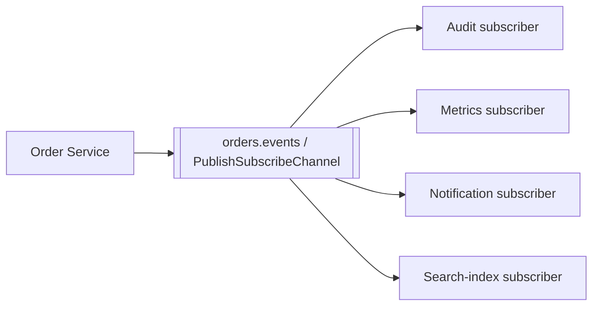
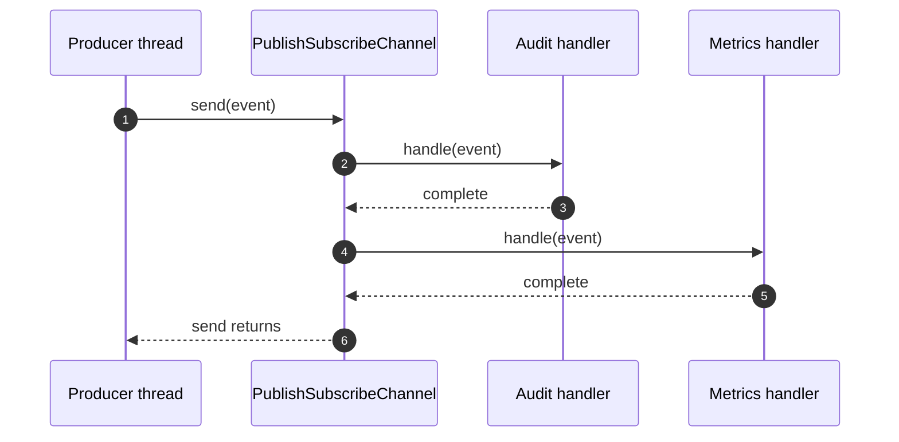
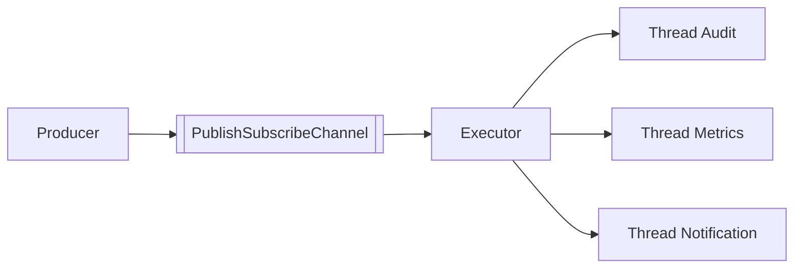
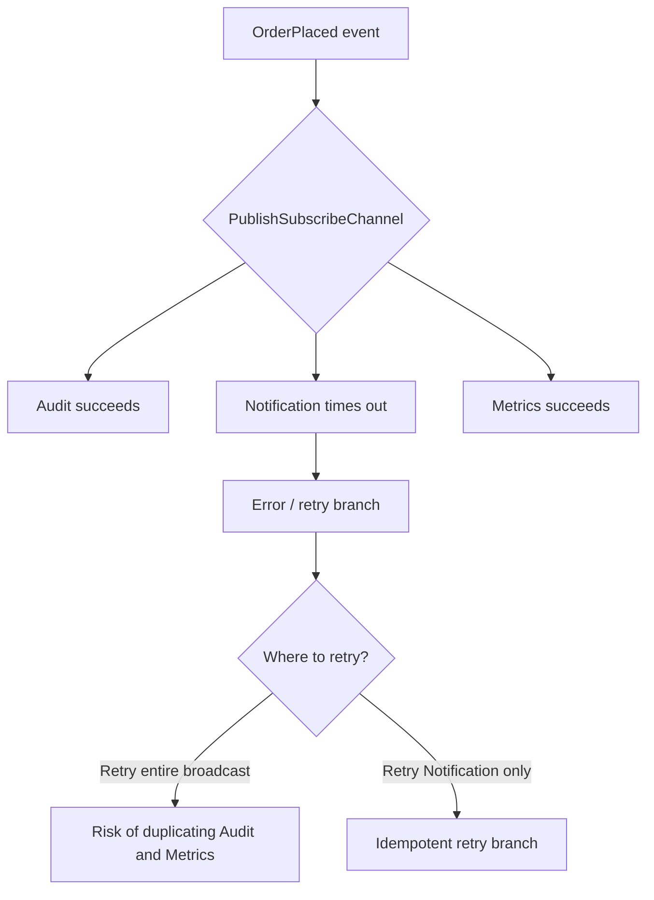
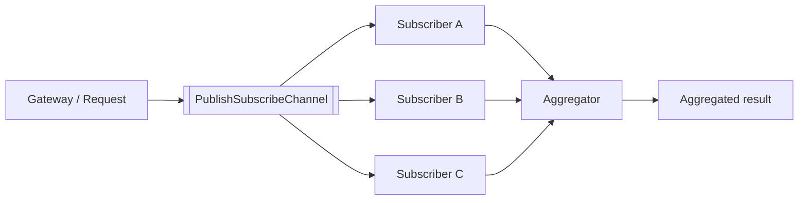

# One Message Broadcast to Multiple Consumers

In enterprise integration systems, a **successful order placement** event can simultaneously involve multiple functions: recording an audit entry, updating metrics, sending notifications, and synchronizing data to another system. If the producer calls each service directly, adding or removing a function forces changes to producer code, increases coupling, and makes error management harder.

**Publish–Subscribe** is an **Enterprise Integration Patterns (EIP)** pattern that allows a producer to **publish one message to a channel**, and the channel then distributes that message to **multiple registered subscribers**. In **Spring Integration**, the representative component for this idea is `PublishSubscribeChannel`.

The lesson **"One Message Broadcast to Multiple Consumers"** belongs to the **Publish subscribe** chapter in the `SPRING_INTEGRATION_PATTERN` module. It focuses on how fan-out works, how it differs from point-to-point channels, synchronous vs. asynchronous execution, error and retry boundaries, correlation, testing subscribers, and how Publish–Subscribe coordinates with Router, Filter, Transformer, Splitter, Aggregator, and Gateway to build loosely coupled, extensible, and observable messaging flows.

> **Key idea:** The producer sends **one message** to a `PublishSubscribeChannel`. The channel can **dispatch the message to all registered subscribers**, rather than just a single subscriber as in a point-to-point channel. However, **handoff/dispatch** does not by itself guarantee that every subscriber has completed its business work, that the message has been durably persisted, or that all branches succeed as a single transaction.

## 1. Why Does One Message Need to Reach Multiple Consumers?

Suppose an application service has determined that an order was just created:

```json
{
  "eventId": "evt-demo-101",
  "orderId": "ORD-101",
  "eventType": "ORDER_PLACED",
  "totalItems": 3
}
```

This is sample data. Downstream tasks have distinct responsibilities:

| Consumer | Goal | Should it directly impact the order-creation business logic? |
| --- | --- | --- |
| **Audit subscriber** | Record the event for operational auditing. | Depends on compliance and transaction requirements. |
| **Metrics subscriber** | Update the count of created orders. | Typically should not slow down the primary business flow. |
| **Notification subscriber** | Trigger a customer notification task. | Can be processed asynchronously with its own retry policy. |
| **Search-index subscriber** | Update the search index. | Typically accepts eventual consistency. |

If the producer had to know all consumers, adding a new subscriber would force modifications to the producer even when the **event contract** has not changed. Publish–Subscribe creates a boundary:



The producer only sends to `orders.events`. Each subscriber handles processing the event for its own purpose; the topology can evolve without the producer importing each consumer's service.

**Note:** This decoupling exists at the **message/channel contract** level. Producer and consumers must still agree on the payload schema, data validity, side effects, and event semantics.

## 2. How Does Publish–Subscribe Differ From Point-to-Point?

A channel name alone is not enough to tell whether fan-out occurs. The **channel type** determines how messages are distributed.

| Channel / Pattern | Typical distribution behavior | When to use |
| --- | --- | --- |
| **`DirectChannel`** | Each send is dispatched to **one** subscriber selected by the channel's strategy, typically running synchronously. | One message needs one handler to process it. |
| **`QueueChannel`** | Messages are stored in a queue for **a single receive** to pull; multiple consumers compete for items. | Point-to-point work with buffering/polling. |
| **`ExecutorChannel`** | Dispatches via an executor to a handler in a point-to-point model. | Offloading a single processing path to another thread; not fan-out by itself. |
| **`PublishSubscribeChannel`** | Broadcasts to **multiple registered subscribers**. | One event needs to trigger multiple independent handlers. |
| **Recipient List Router** | A router selects an explicit **list of target channels**, optionally based on conditions. | Each message has a policy-selected set of recipients. |
| **Splitter** | Splits a **payload** into multiple parts/child messages. | A batch needs line-by-line processing. |

### 2.1. Point-to-Point: Multiple Consumers Can Compete for the Same Message

```text
                  +--> Consumer A
Producer -> QueueChannel
                  +--> Consumer B

A single message is picked up by one consumer, rather than both A and B receiving separate copies.
```

### 2.2. Publish–Subscribe: Each Subscriber Is Dispatched the Message

```text
                            +--> Consumer A
Producer -> PublishSubscribeChannel --> Consumer B
                            +--> Consumer C

One send → registered subscribers have the opportunity to receive the message.
```

The difference does not lie in having "multiple consumers" in the topology, but in **distribution semantics**: **competing consumers** versus **broadcast to subscribers**.

### 2.3. Do Not Confuse With Kafka or a Pub/Sub Broker

A `PublishSubscribeChannel` is normally an **internal channel within a Spring application**. It is not by itself a Kafka topic, RabbitMQ exchange, or cross-process distribution system. If consumers live in other services, you need an **outbound adapter** to publish to external infrastructure, and each service uses an inbound adapter/consumer according to the broker's mechanism.

With Kafka, each consumer group receiving a record has its own topic/partition/group semantics and retention. Do not impose full Kafka semantics onto an in-JVM `PublishSubscribeChannel`, or vice versa.

## 3. Does "One Message" Mean One Record, One Reference, or Multiple Copies?

At the pattern level, the producer puts **one logical event** onto the channel. Multiple subscribers receive information about that event. That does **not** mean the framework guarantees creating an independent **deep copy** of the entire payload for every subscriber.

Example:

```java
import org.springframework.messaging.Message;
import org.springframework.messaging.support.MessageBuilder;

record OrderPlaced(String eventId, String orderId) {}

Message<OrderPlaced> message = MessageBuilder
    .withPayload(new OrderPlaced("evt-101", "ORD-101"))
    .build();
```

The `OrderPlaced` payload is a field-immutable record in this example, so subscribers can read it safely without modifying the message.

### 3.1. Risks With Mutable Payloads

Avoid sending:

```java
// Example of a mutable structure, NOT recommended for fan-out.
class MutableOrder {
    String status;
}
```

and letting the Audit subscriber change `status` before the Notification subscriber reads it. If subscribers see the same mutable object or copies sharing references, outcomes can depend on execution order, threads, or serialization boundaries.

**Recommendation:** Use **immutable DTOs/events**, never let subscribers mutate shared payloads/headers, and derive target-specific data via a Transformer when subscribers have different contracts.

### 3.2. Headers Are Also Part of the Contract

A message may carry `id`, `timestamp`, `correlationId`, trace context, and reply/sequence metadata. Some broadcast mechanisms can add or modify headers for result aggregation **when configured**, so do not write tests assuming every subscriber always receives the **exact same object reference** or that every header is immutable across all boundaries.

In particular, do not attach access tokens, cookies, emails, or unnecessary personal data into headers and fan them out to every subscriber. Fan-out **widens data exposure**, so data minimization and access control are essential.

## 4. Complete Example With `PublishSubscribeChannel` and Two Subscribers

The example below uses Java with `record` support, Spring Framework, Spring Integration, and compatible Spring Test/JUnit 5. We create an `orders.events` channel; Audit and Metrics are two independent subscriber flows.

### 4.1. Event and Two Handlers

```java
import java.util.List;
import java.util.concurrent.CopyOnWriteArrayList;
import java.util.concurrent.atomic.AtomicInteger;

record OrderPlaced(String eventId, String orderId) {}

class AuditEventHandler {
    private final List<String> processedEventIds =
        new CopyOnWriteArrayList<>();

    public void accept(OrderPlaced event) {
        processedEventIds.add(event.eventId());
    }

    public List<String> processedEventIds() {
        return List.copyOf(processedEventIds);
    }
}

class MetricsEventHandler {
    private final AtomicInteger total = new AtomicInteger();

    public void accept(OrderPlaced event) {
        total.incrementAndGet();
    }

    public int total() {
        return total.get();
    }
}
```

These handlers are **for illustration only**. `AuditEventHandler` keeps an in-memory list and `MetricsEventHandler` keeps a counter in the JVM; they do not replace a real audit store or metrics backend.

### 4.2. Registering the Channel and Two `IntegrationFlow` Subscribers

```java
import org.springframework.context.annotation.Bean;
import org.springframework.context.annotation.Configuration;
import org.springframework.integration.channel.PublishSubscribeChannel;
import org.springframework.integration.config.EnableIntegration;
import org.springframework.integration.dsl.IntegrationFlow;

@Configuration
@EnableIntegration
public class OrderPubSubConfiguration {

    @Bean("orders.events")
    PublishSubscribeChannel orderEventsChannel() {
        return new PublishSubscribeChannel();
    }

    @Bean
    AuditEventHandler auditEventHandler() {
        return new AuditEventHandler();
    }

    @Bean
    MetricsEventHandler metricsEventHandler() {
        return new MetricsEventHandler();
    }

    @Bean
    IntegrationFlow auditSubscriber(AuditEventHandler audit) {
        return IntegrationFlow.from("orders.events")
            .handle(audit, "accept")
            .get();
    }

    @Bean
    IntegrationFlow metricsSubscriber(MetricsEventHandler metrics) {
        return IntegrationFlow.from("orders.events")
            .handle(metrics, "accept")
            .get();
    }
}
```

In this configuration:

1. `@Bean("orders.events")` registers an explicitly named **`PublishSubscribeChannel`**.
2. `auditSubscriber(...)` registers an endpoint consuming messages from that channel.
3. `metricsSubscriber(...)` registers **a second endpoint** also subscribing to `orders.events`.
4. When an `OrderPlaced` message arrives, both endpoints act as subscribers receiving the event to invoke their respective `accept(...)` methods.

**Key point:** If you replace `PublishSubscribeChannel` with a point-to-point channel while keeping the two consumer flows, **there is no longer any guarantee that both are dispatched the same message**. The channel type is a critical part of the contract, not just "two flows reading from the same channel name."

### 4.3. Sending a Message

```java
import org.springframework.messaging.MessageChannel;
import org.springframework.messaging.support.MessageBuilder;

// context is a running ApplicationContext with OrderPubSubConfiguration.
MessageChannel channel =
    context.getBean("orders.events", MessageChannel.class);

channel.send(MessageBuilder
    .withPayload(new OrderPlaced("evt-101", "ORD-101"))
    .build());
```

`context` in this snippet is a Spring-initialized `ApplicationContext`; this illustrates how a caller sends to the channel, **not a standalone class runnable without a context**. In a real application, you can inject the `MessageChannel` by bean name or use `@MessagingGateway` so callers do not have to construct messages manually.

## 5. Testing: Both Consumers Receive the Same Event

The JUnit 5 test below creates a Spring context from the configuration in section 4, sends **one message**, and asserts that **both subscribers** received the data.

```java
import static org.junit.jupiter.api.Assertions.*;

import org.junit.jupiter.api.Test;
import org.springframework.beans.factory.annotation.Autowired;
import org.springframework.context.ApplicationContext;
import org.springframework.messaging.MessageChannel;
import org.springframework.messaging.support.MessageBuilder;
import org.springframework.test.context.junit.jupiter.SpringJUnitConfig;

@SpringJUnitConfig(OrderPubSubConfiguration.class)
class OrderPublishSubscribeTest {

    @Autowired ApplicationContext context;
    @Autowired AuditEventHandler audit;
    @Autowired MetricsEventHandler metrics;

    @Test
    void oneMessageIsDispatchedToBothSubscribers() {
        MessageChannel channel =
            context.getBean("orders.events", MessageChannel.class);

        OrderPlaced event = new OrderPlaced("evt-201", "ORD-201");
        assertTrue(channel.send(
            MessageBuilder.withPayload(event).build()));

        assertEquals(
            java.util.List.of("evt-201"),
            audit.processedEventIds());
        assertEquals(1, metrics.total());
    }
}
```

**Why can the test assert immediately after `send(...)`?** The example uses a `PublishSubscribeChannel` **without an executor**; on a standard synchronous dispatch path, handlers complete before the send call returns. If you switch the channel to asynchronous processing with an executor, the test must **wait on a condition with a timeout** instead of asserting immediately.

### 5.1. What Else Should Tests Verify?

| Scenario | Expected observation |
| --- | --- |
| Two active subscribers | Each handler receives the event according to contract. |
| Only one subscriber | One message is sent only to the registered subscriber; does not wait for a nonexistent subscriber. |
| No subscribers | Channel behavior must match the configured and tested **min-subscribers policy**. |
| One subscriber throws an exception | Verify whether the remaining branch is invoked per the sync/async configuration. |
| Mutable payload | Check the effects of shared references or switch to an immutable DTO. |
| Channel switched to an executor | Tests must wait for completion; understand send success is not business success. |
| Message is retried | Subscribers with side effects are not duplicated beyond contract. |
| Slow subscriber | Measure latency/saturation and timeout/backpressure policies. |

Do not just check `channel.send(...) == true` and conclude that fan-out works. The return value must be interpreted according to **channel/dispatcher semantics**; testing **effects in each subscriber** is what proves the requirement.

### 5.2. Watch Out for Shared State in Tests

If Spring Test caches the context and tests run concurrently, handlers holding a `List` or `AtomicInteger` can accumulate data from other tests. The example has only one test; as you expand, reset fixtures safely, isolate contexts/test instances, or use distinct IDs with order-independent assertions.

At the same time, an in-memory test does not prove durable delivery, cross-service transactions, or HTTP/Kafka adapter failures.

## 6. Synchronous by Default vs. Asynchronous via an Executor

One of the most important factors determining the behavior of `PublishSubscribeChannel` is **how it dispatches**.

### 6.1. Without an Executor: Synchronous Fan-Out

With typical usage `new PublishSubscribeChannel()`, dispatching to subscribers can happen **synchronously on the sender's thread**.



**Consequences:**

- Synchronous subscribers can increase the producer's response time.
- A slow subscriber can make `send(...)` slow.
- An exception can affect other recipients and the caller depending on dispatcher/error-handling policies.
- Do not assume that declaring two subscribers creates two separate threads.

**The Audit/Metrics order in the diagram is illustrative only** and does not promise that order is fixed. If the business logic requires "Audit must commit before Notification," design explicit orchestration/transaction constraints instead of relying on registration order.

### 6.2. With an Executor: Asynchronous Dispatch

Spring Integration lets you construct a `PublishSubscribeChannel` with an appropriate `Executor` to broadcast using a thread pool. **Alternative configuration** example for the channel in section 4:

```java
import org.springframework.context.annotation.Bean;
import org.springframework.integration.channel.PublishSubscribeChannel;
import org.springframework.scheduling.concurrent.ThreadPoolTaskExecutor;

@Bean
ThreadPoolTaskExecutor fanoutExecutor() {
    ThreadPoolTaskExecutor executor = new ThreadPoolTaskExecutor();
    executor.setCorePoolSize(2);
    executor.setMaxPoolSize(4);
    executor.setQueueCapacity(32);
    executor.setThreadNamePrefix("orders-fanout-");
    executor.initialize();
    return executor;
}

@Bean("orders.events")
PublishSubscribeChannel asynchronousOrdersChannel(
        ThreadPoolTaskExecutor fanoutExecutor) {
    return new PublishSubscribeChannel(fanoutExecutor);
}
```

Do **not** register the `orders.events` bean in this example at the same time as the bean with the same name in section 4. These are two alternative configuration choices. In a real application, executor lifecycle/shutdown management, queue bounds, and rejection policies must also be designed.



**Important consequences:**

- The sender can return **before the handlers finish**.
- There is no guarantee of completion order across branches.
- Exceptions in worker threads do not necessarily return to the caller the same way as in synchronous mode.
- The executor can saturate or reject tasks; monitoring and error handling must be configured.
- "Async" does not automatically provide durable storage or replay after a restart.

### 6.3. Comparing the Two Modes

| Criterion | Synchronous | Via executor |
| --- | --- | --- |
| Thread running subscriber | Usually caller thread. | Thread from executor. |
| Does caller wait for handlers? | May wait for each handler to complete. | Usually does not wait for all business processing. |
| Completion order | Depends on dispatcher/order/errors; more sequential. | Can interleave across threads. |
| How errors reach caller | Synchronous exceptions can propagate to caller. | Must handle async dispatch/handler errors. |
| Overload risk | Increased latency / blocking caller. | Pool/queue saturation, task rejection. |
| Durability | Not by default. | Also not by default. |

Do not choose an executor just thinking "everything will be faster." It **shifts queue placement and resource costs**, which can make it harder to determine which messages are done and which are still pending.

## 7. No Subscribers and Unavailable Subscribers

With a durable broker topic, a record can remain in the log for consumer groups to read later. With an internal `PublishSubscribeChannel`, you must understand clearly **who is subscribed at send time**.

### 7.1. No Subscribers

If the producer sends when **there are no subscribers**, do not assume the message waits for a future subscriber to read it later. `PublishSubscribeChannel` is not a message store. Some configurations/versions allow defining a **minimum subscriber count (`minSubscribers`)** required for a send to be considered satisfied.

Ask these design questions:

1. Is sending allowed when no consumers are present?
2. When consumers are missing, should it fail fast, warn, or persist durably for later processing?
3. Do you verify at startup that subscriber flows registered properly?
4. Does a restarting consumer need to replay events that occurred while it was absent?

If the requirement is **event replay after a consumer outage**, an in-memory broadcast channel is **not enough**; you need a suitable durable store, broker, or event store.

### 7.2. Slow Subscribers

A slow subscriber can block the sender in synchronous mode, or occupy the executor/queue in async mode. You cannot fully solve this by arbitrarily increasing `sendTimeout`: a **send timeout** is not automatically a deadline for a handler making a 10-second HTTP call.

Monitor **per-subscriber latency**, queue capacity, thread pool saturation, rejected task count, and end-to-end wait time.

### 7.3. Failing Subscribers

When a handler throws an exception:

- In a synchronous flow, the error may propagate back to the producer and affect subscribers not yet dispatched.
- In an async flow, the error may be handled by an appropriate **ErrorHandler/error flow** without returning to the caller in the same manner.
- Whether remaining subscribers are still attempted when one fails can depend on the dispatcher/ignore-failures configuration of your Spring Integration version.

**Never assume** "A failed, so B and C will definitely still run" or "A failed, so every subscriber will roll back." Verify the desired behavior with integration tests using the configured channel types and error handling.

## 8. Does One Message to Multiple Consumers Equal One Transaction?

**No.** If Audit succeeds and Notification fails, Publish–Subscribe alone does not guarantee rolling back Audit data or retrying only the failed branch.



To design safely:

1. **Separate error-handling responsibility per subscriber.**
2. **Use a stable event ID** and idempotency in handlers with side effects.
3. Distinguish **message acceptance**, **single-branch completion**, and **overall workflow completion**.
4. If events must not be lost across restarts, use a **durable transport/store** and transaction/outbox where appropriate.
5. If an external consumer performs irreversible actions, consider business states and compensating steps.

### 8.1. Per-Subscriber Idempotency

A common strategy is persisting processing state keyed by:

```text
(eventId, subscriberId)

(evt-101, audit)
(evt-101, notification)
(evt-101, metrics)
```

When the same event is replayed, each subscriber independently decides whether its side effect has already completed. Deduplication must be atomic and suitably durable; checking an in-memory `Set` alone is **not sufficient** across multiple instances or restarts.

### 8.2. If the Requirement Is "Every Consumer Must Succeed"

That is a **workflow/business contract** beyond broadcast functionality. You may need:

- Separate persistence of per-subscriber processing state.
- Independent retries and routing unrecoverable failures to a controlled quarantine/DLQ.
- Sending completion/failure messages from branches to a central collector.
- Using an Aggregator or an orchestration service to combine results.
- Timeouts/expiry, partial results, and handling for unresponsive branches.

Recipient List / Publish–Subscribe only solves **delivering a message to multiple destinations**; they do not automatically provide **atomic all-or-nothing** semantics.

## 9. Correlation, Sequence, and Aggregator After Broadcast

When a message is broadcast to three subscribers and each returns a result, you have a pattern close to **scatter–gather**:



With this architecture, several issues must be addressed **explicitly**:

| Concern | Question to answer |
| --- | --- |
| **Correlation ID** | Which request/batch do the three replies belong to? |
| **Sequence size** | How many reply parts/branches are expected? |
| **Sequence number** | How is each message numbered/identified? |
| **Release strategy** | When are enough results present for the Aggregator to emit output? |
| **Timeout/expiry** | What happens if one subscriber fails to respond? |
| **Late arrival** | How are replies arriving after group release/expiry handled? |
| **Duplicate reply** | Will retrying one branch cause the Aggregator to double-count results? |

### 9.1. What Is `applySequence`?

`PublishSubscribeChannel` has an option to **add sequence/correlation metadata during broadcast** to facilitate certain downstream aggregation patterns. **Do not assume** all flows enable `applySequence`, that this metadata passes unchanged through every adapter, or that flipping one option makes an Aggregator automatically know your completion policy.

When scatter–gather is needed:

- Choose a stable correlation ID for the request/batch.
- Verify how broadcast creates/preserves sequence headers on the **version you are using**.
- If subscribers are optional, determine expected response counts from the **actual selected recipients**.
- Design an explicit release strategy and timeout.
- Test missing branches, late replies, and duplicate replies.

### 9.2. Broadcast Differs From Splitter

A Splitter creates child messages from **parts of a payload**: one order with 5 line items can become 5 `OrderLine` messages. Publish–Subscribe broadcasts **the same logical event** to multiple subscribers: one `OrderPlaced` to Audit and Metrics. The two patterns can be combined, but they are not the same.

Example:

```text
Order(batch of 5 lines)
    -> Splitter -> 5 OrderLine messages
    -> PublishSubscribeChannel
       -> Inventory subscriber
       -> Pricing subscriber
    -> Aggregator (only with a complete correlation/reply design)
```

If child messages from a Splitter are then broadcast to multiple subscribers, the number of results can exceed the original number of parts. **Do not mechanically use the initial `sequenceSize`** as the expected reply count once additional branches have been fanned out.

## 10. How Do Gateway, Router, Filter, and Transformer Work Together?

### 10.1. Gateway as a Producer Facade

Producers can invoke an interface instead of constructing `Message<?>` manually:

```java
import org.springframework.integration.annotation.MessagingGateway;

@MessagingGateway(defaultRequestChannel = "orders.events")
public interface OrderEventsGateway {
    void publish(OrderPlaced event);
}
```

In a real application, you must enable/register gateway proxies via the appropriate Spring Integration configuration and package scan. `void` means the caller **does not receive a business result via a return value**, but it **does not guarantee** asynchronous sending, durable processing, or the absence of synchronous errors.

With a **request–reply** gateway, fan-out does not produce a single result by default. If replies must be aggregated, design the reply path, Aggregator, and deadline; if you only need to report "event accepted," define the accepted contract clearly rather than calling it "all consumers finished."

### 10.2. Filter Before Broadcast

A Filter before `PublishSubscribeChannel` can block invalid/unauthorized events, preventing bad data from spreading to multiple consumers:

```text
Inbound -> Deserialize/Validate -> Common Filter
        -> PublishSubscribeChannel
        -> Audit / Metrics / Notification
```

If Filters sit **after** broadcast, each subscriber applies its own criteria; this is useful when consumers have different policies. Still, do not skip common boundary validation/security just because "each branch has a Filter."

### 10.3. Transformer Before and Inside Each Branch

A canonical, minimal event can be broadcast first. Then each subscriber transforms it into its own payload: Audit persists a record in its schema, Notification builds an email command, Analytics computes metrics.

If the broadcaster sends the entire customer object or tokens to all three subscribers only for each branch to strip unnecessary fields, exposure risk has already grown. **Minimize the event before broadcast** and supply only appropriate permissions/DTOs per branch.

### 10.4. Router Before Broadcast

A Content-Based Router can pick an event branch (`orders.created` or `orders.cancelled`), and then each branch uses a `PublishSubscribeChannel` to fan out to multiple functions. A Recipient List Router is another option when you need to **select target channels based on an explicit policy** rather than a fixed set of subscribers.

## 11. Error Channel, Retry, and Timeout: Do Not Mix Boundaries

In a broadcast flow, the same symptom can originate at several layers:

| Situation | Where the error starts | Note |
| --- | --- | --- |
| No subscribers | Channel/subscription configuration | Check `minSubscribers` policy and startup wiring. |
| A handler throws an exception | Subscriber | Distinguish sync propagation from async error handler. |
| Executor out of capacity | Dispatch infrastructure | Tasks may be rejected; need backpressure and alerts. |
| Outbound HTTP timeout | Adapter in one branch | Receiver may still have processed it; need idempotency. |
| Retrying entire broadcast | Retry boundary | Risk of repeating actions in already-succeeded branches. |
| Publish without a reply | Request–reply gateway | Broadcast does not aggregate results automatically; design reply handling. |
| Aggregator missing one response | Scatter–gather group | Needs completion/expiry; cannot be fixed solely by send timeout. |

**Error channel** is not an automatic collector for every error on every channel. Synchronous exceptions may return to the caller; errors inside async/poller/adapter boundaries can become `ErrorMessage` instances if the system is configured accordingly. You must test the **actual error path** for each dispatch mode.

### 11.1. Why `sendTimeout` Is Not Maximum Processing Time

If a synchronous handler calls an ERP and takes 7 seconds, a 100 ms send timeout parameter **does not automatically interrupt the ERP call**. On a bounded queue, send timeout can bound how long to wait for free space. On an executor, consider queue capacity/rejection, whereas HTTP client timeouts and business deadlines are separate bounds.

Similarly, `receiveTimeout` belongs to pollable receive operations; `PublishSubscribeChannel` is a subscribable channel, **not a `QueueChannel` where each subscriber calls `receive(timeout)`**.

### 11.2. Controlled Retries

When Notification hits a transient failure, retry **only sending the notification**, rather than re-publishing the whole event into the broadcast unless necessary. Use exponential backoff/jitter where appropriate, bound retry attempts, classify errors, and keep idempotency keys stable.

If an event is resent after a system-wide outage, Audit, Metrics, and Notification must also specify clearly whether duplicate processing is safe. Non-idempotent counters can double-count; design deduplication or derive counts from canonical data sources if accuracy is required.

## 12. Data Safety in Fan-Out

Because **multiple consumers receive the event**, the footprint where data is stored, logged, or traced expands compared to a single handler.

| Risk | Mitigation |
| --- | --- |
| Event carries unnecessary email, tokens, or payment data | Minimize payload before broadcast; never send secrets in headers. |
| Every subscriber logs the entire message | Log only event type, outcome, error code, and opaque correlation ID. |
| A subscriber only needs metadata yet reads the full payload | Design separate DTOs/adapters or proper authorization boundaries. |
| `ErrorMessage`/stack trace contains the failed message | Redaction, access control, retention, and testing error paths. |
| Correlation ID contains personal data | Use opaque IDs; never derive them from emails or tokens. |
| Data is published to an external broker | Map only permitted headers; apply encryption and ACLs as required. |

**Do not use the fact that subscribers run in the same JVM as an excuse to ignore data classification.** A logging library, tracing library, or outbound adapter can ship data to external systems directly from an individual branch.

## 13. Observing Each Subscriber Instead of Only the Producer

Tracking **sends to the channel** is not enough to know that fan-out is working. Dashboards should distinguish:

1. **Published events:** number of logical events entering `orders.events`.
2. **Registered subscribers:** number of registered/active subscribers.
3. **Dispatched deliveries:** number of dispatches to each subscriber.
4. **Handler results:** successes, failures, retries, or timeouts per handler.
5. **Executor health:** active threads, task queue depth, rejections (if async).
6. **End-to-end outcome:** when the business process is considered complete.

Example of safe logging:

```text
event=pubsub_subscriber_completed
channel=orders.events
subscriber=audit
event_type=ORDER_PLACED
outcome=success
duration_ms=8
correlation_id=5aa37df4-d57b-4834-80a1-df631e0ce482
```

This is an **illustrative format**, not Spring Integration's default output. Subscriber/channel names should be a finite, configured set. Do not put per-message unique event IDs/correlation IDs, emails, or tokens into **metric labels**, as they cause high cardinality; opaque IDs can be used in logs/traces with appropriate access controls.

### 13.1. Investigating a Concrete Incident

Suppose the producer reports `published=100`, Audit has 100 outcomes, Metrics has 100, yet Notification only has 97:

- Verify whether Notification was **subscribed** to the right channel at publish time.
- If using an executor, check task rejections, queue saturation, and exception handlers.
- If using a broker/adapter behind Notification, check send acknowledgements, retries, DLQs, and adapter timeouts.
- Verify whether the 3 missing messages are pending, failed, or processed without updating metrics.
- Verify there are no duplicates from retries, and that metrics use the same denominator/time window.

Never conclude solely from `channel.send == true` that 100 emails were sent successfully.

## 14. Common Misconceptions

### Misconception 1 — "Having two consumers on a `QueueChannel` means both receive every message"

**False.** Two consumers on a queue normally **compete** for messages. For in-JVM broadcast, use `PublishSubscribeChannel` or an appropriate fan-out topology.

### Misconception 2 — "`PublishSubscribeChannel` creates a thread for each subscriber by default"

**False.** Without an executor, dispatch is typically synchronous. For async, configure an executor and manage resources/errors separately.

### Misconception 3 — "Sending once guarantees every subscriber completes"

**False.** You must distinguish dispatch, completion, failure, and transaction scope; async can also return before handlers finish.

### Misconception 4 — "An internal channel is like a durable Kafka topic"

**False.** An in-memory `PublishSubscribeChannel` does not retain events for offline subscribers or replay across restarts.

### Misconception 5 — "Recipient List and Publish–Subscribe are completely identical"

**No.** A Recipient List Router manages a **list of target channels** by policy, whereas `PublishSubscribeChannel` manages **subscribers to a single channel**. Both can achieve fan-out, but fit different configuration and operational needs.

### Misconception 6 — "It is fine to mutate a mutable payload in each subscriber"

**Dangerous.** Some dispatch paths may share references; mutating in one branch can affect another. Use immutable events and per-branch Transformers.

### Misconception 7 — "If one subscriber fails, the framework rolls everything back"

**False.** Broadcast is not a distributed transaction; per-branch retry/idempotency and state management are required.

### Misconception 8 — "Enabling `applySequence` gives you a complete Aggregator"

**False.** Sequence metadata only supports correlation; you still need a release strategy, timeout/expiry, reply path, and handling for late/duplicate results.

## 15. Practice Exercises

**Exercise 1 — Add a subscriber.** Add `SearchIndexEventHandler` and `IntegrationFlow.from("orders.events")`. Write a JUnit test verifying **one message** is recorded by all three handlers without modifying producer code.

**Exercise 2 — Compare channels.** Switch the `orders.events` bean to `DirectChannel` in an isolated test, keeping two subscribers. Observe why both handlers no longer receive the same event as with `PublishSubscribeChannel`.

**Exercise 3 — Run asynchronously.** Use a `ThreadPoolTaskExecutor` with a bounded queue. Test with a waiting mechanism (such as a latch or conditional await) and test the case where the executor rejects tasks.

**Exercise 4 — Unavailable subscribers.** Create a channel with no subscribers. Verify the actual behavior under default configuration and when setting the minimum-subscribers policy appropriate for your version. State when a durable transport is needed instead.

**Exercise 5 — Per-branch retry.** Simulate Notification failing after Audit completes. Design a way to retry Notification without causing Audit to record duplicates, using `eventId` + subscriber name as the idempotency key.

**Exercise 6 — Gateway + Aggregator.** The caller needs results from both Audit and Notification. Design the reply path, correlation, sequence, release strategy, timeout, and handling of a late reply; explain why `PublishSubscribeChannel` alone is insufficient.

**Exercise 7 — Data protection.** Payload contains an email and access token unnecessary for Analytics. Design a minimal event contract, separate Transformers/adapters if needed, and a test ensuring Analytics does not write sensitive data to logs.

**Exercise 8 — Metrics.** Build `published_total`, `subscriber_dispatch_total`, `subscriber_failure_total`, and `subscriber_duration` metrics. Explain why `correlationId` should not be a metric label even though it is useful for tracing.

## 16. Pre-Production Checklist for Fan-Out

| Question | What to verify |
| --- | --- |
| Does one message need to reach one or many consumers? | Choose point-to-point or Publish–Subscribe accordingly. |
| Is the channel type actually `PublishSubscribeChannel`? | Subscribers receive the same event per desired topology. |
| Are any subscribers unregistered or lifecycle-inactive? | Verify wiring and minimum-subscribers policy. |
| Does broadcast run synchronously or async? | Have an explicit decision on executor, threads, ordering, and latency cost. |
| What happens if a subscriber is slow or fails? | Exception/dispatch behavior and per-branch retry policy are tested. |
| Do handlers have mutable shared state/payload? | Use immutable events or proper concurrency protection. |
| Is durability/replay required? | Have a broker/store/outbox if needed; do not rely on an in-memory channel. |
| Must all subscribers succeed together? | Have an outcome workflow, idempotency, and compensation/aggregation as needed. |
| Is there a request–reply Gateway? | Reply/timeout/correlation are designed; do not assume broadcast replies by itself. |
| Is Splitter/Aggregator involved? | Sequence, group completion, timeout/expiry, and late replies are designed. |
| Are error channel/retry boundaries placed properly? | Sync vs. async is distinguished; never blindly retry the whole broadcast. |
| Are sensitive payloads/headers protected? | Fan-out sends minimal data; logging and adapters are controlled. |
| Are all subscribers tested? | Happy path, missing subscriber, failure, async, and replay are covered. |
| Can each branch's outcome be observed? | Metrics/logs exist per subscriber, executor, retry, and final outcome. |

## Conclusion

**One message broadcast to multiple consumers** is the essence of **Publish–Subscribe**. With Spring Integration, `PublishSubscribeChannel` provides a shared publication point and dispatches messages to multiple registered subscribers, freeing the producer from direct dependencies on Audit, Notification, Metrics, or other handlers. This is a solid foundation for building **Enterprise Integration Patterns** message flows where features can be added or removed while keeping the event contract stable.

However, **fan-out does not mean atomic transactions, asynchrony, durability, or exactly-once delivery**. A system must explicitly decide on **synchronous vs. executor dispatch, missing/failing subscriber behavior, resource bounds, per-branch retries and idempotency, data protection, correlation, and observability**. When combined properly with Filter, Transformer, Router, Gateway, Splitter, and Aggregator, Publish–Subscribe produces integration architectures that are **loosely coupled, testable, and resilient when one consumer slows down or fails**.
