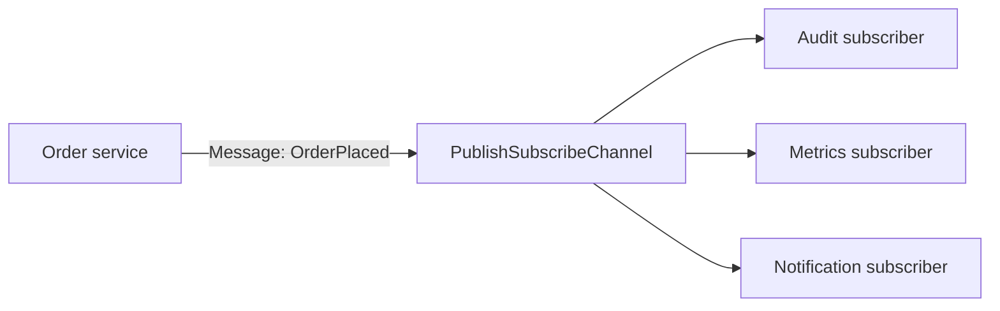
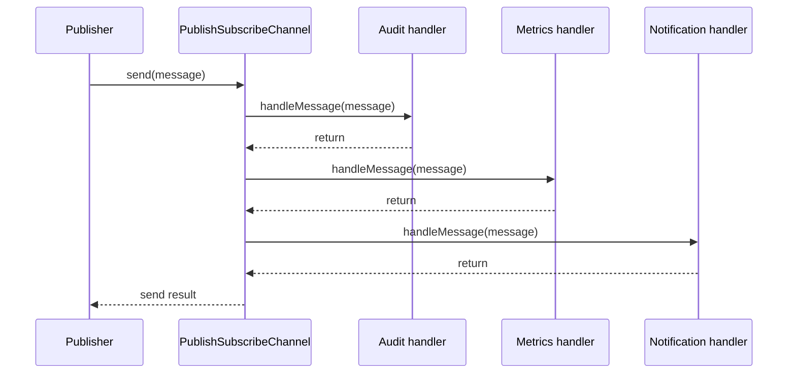
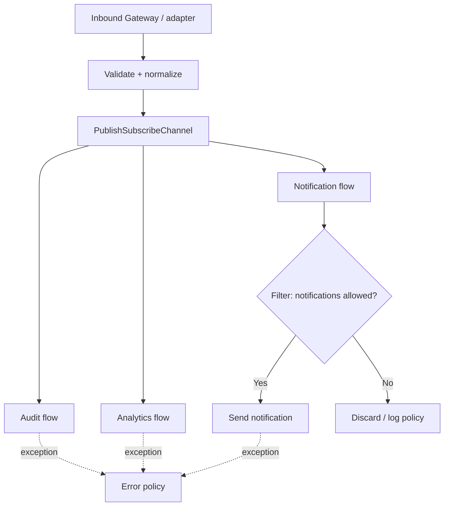
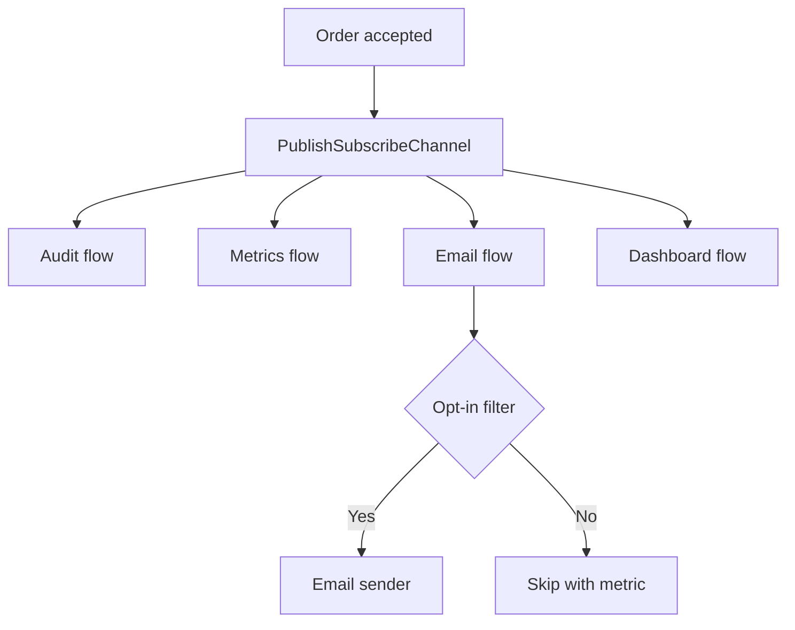
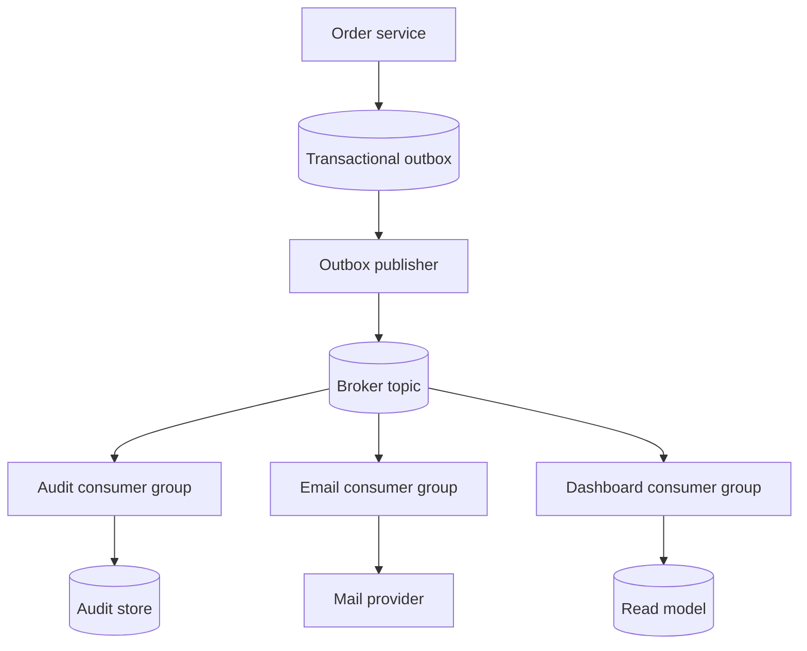

# In-Process Broadcasting

In **Spring Integration**, a single message may need to reach **multiple independent processors**: when an order is created, the system simultaneously updates operational metrics, writes an audit record, and sends a notification. If all of these steps run **within the same application/JVM**, you can use a **Publish–Subscribe Channel** to *broadcast* one message to registered subscribers.

This lesson is part of the **Publish subscribe** chapter in the `SPRING_INTEGRATION_PATTERN` module: learning how to implement Enterprise Integration Patterns (EIP) with Spring Integration so messaging flows are loosely coupled and easy to extend, combining Filter, Router, Transformer, Splitter, Aggregator, Gateway, retry, error channel, correlation, testing, and per-branch observability. This lesson focuses on **in-process fan-out**, which is distinct from publishing events over Kafka, RabbitMQ, or a distributed broker.

After this lesson, you can:

- Explain **broadcasting**, subscriber, publisher, and the *in-process* scope of `PublishSubscribeChannel`.
- Distinguish delivering one message to multiple subscribers from a **point-to-point channel** and a pub/sub broker.
- Configure a `PublishSubscribeChannel` and multiple `IntegrationFlow` instances to receive the same event.
- Predict the impact of **synchronous** processing versus using an `Executor` on send latency, errors, and ordering.
- Design retry policies, error flows, correlation, and idempotency when multiple independent branches exist.
- Test that **every expected subscriber** received the message, not merely that `send()` returned true.

## 1. What Is Broadcasting?

**Broadcasting** is the act of emitting the same message to **multiple recipients**. Instead of forcing the publisher to call three services directly, the publisher sends **one Spring `Message<?>`** to a channel. The channel distributes the message to registered subscribers.



Here, the publisher **does not need to know** how many subscribers currently exist or which classes/services they use. A new consumer can attach to the channel without editing the message-sending code, provided the payload and header contracts remain compatible.

However, this decoupling only exists at the **code and internal channel level**. A plain `PublishSubscribeChannel` does not by itself provide durable persistence, replay after restart, cross-JVM delivery, or any guarantee that the final subscriber has completed its business task.

### Key Terms

| Term | Meaning in the example |
| --- | --- |
| **Publisher** | Component sending a `Message<OrderPlaced>` to `orderEvents`. |
| **Publish–Subscribe Channel** | `PublishSubscribeChannel` holding the subscriber list and dispatching messages. |
| **Subscriber** | Endpoint/handler registered to receive messages from the channel. |
| **Broadcast** | The same event is sent to every subscriber selected according to channel configuration. |
| **In-process** | Recipients run inside the same application process/JVM without a network broker. |
| **Fan-out** | One incoming message spawns multiple independent processing paths. |

**Business example:** `OrderPlaced(eventId, orderId, totalCents)` can be used by one branch to increment an order counter, another branch to record an audit entry, and another to issue an email-sending command. Each branch should clearly define **what counts as complete** and **what happens if it fails**.

## 2. How Does `PublishSubscribeChannel` Differ From Other Channels?

Spring Integration provides several channel types, but not all of them broadcast:

| Channel or mechanism | Primary delivery model | Key difference |
| --- | --- | --- |
| `DirectChannel` | Point-to-point to one handler among available subscribers. | Processes on the sending thread by default; does **not** broadcast to every subscriber. |
| `ExecutorChannel` | Point-to-point dispatched via an executor. | Can decouple threads, yet does **not** fan out to all handlers by default. |
| `QueueChannel` | Messages are placed into a queue for consumers to poll. | Consumers on the same queue normally compete for messages; not one copy per consumer. |
| **`PublishSubscribeChannel`** | One message is dispatched to **multiple subscribers**. | Suitable for internal events requiring multiple independent side effects or processing steps. |
| `FluxMessageChannel` | Bridges `MessageChannel` with Reactive Streams publisher/subscriber. | Focused on reactive consumption; do not infer fan-out behavior from the name `Flux`. |
| Pub/sub broker (Kafka, AMQP, etc.) | Distributes across processes/machines per broker contract. | Has its own topic/queue, persistence/ack/retention mechanics; not an in-memory channel. |

A common mistake is registering two handlers on a `DirectChannel` and expecting both to receive every message. **Point-to-point is not broadcasting.** When an event must be processed by two independent branches, choose `PublishSubscribeChannel`, an equivalent fan-out mechanism, or a broker if crossing process boundaries is required.

### One Channel, Multiple Subscribers; Not Multiple Independent Business Copies

A Spring `Message<?>` holds a payload and headers. During broadcast, subscribers may observe **the same payload object or references to the same data**, with no guarantee that the framework will **deep-copy** every mutable object for each branch. Therefore, design event payloads to be **immutable** (such as a Java `record` with appropriately immutable fields) and never let subscriber A mutate data and expose subscriber B to unintended state.

If a branch needs to transform the payload, create its own message/result **inside that branch** using a Transformer or appropriate logic rather than mutating shared data.

## 3. Synchronous Broadcast on the Same Thread by Default

When creating a `PublishSubscribeChannel` **without passing an `Executor`**, subscriber invocation normally runs **synchronously on the sender's thread**. This is critical for understanding latency and exception propagation.



The diagram depicts the **error-free** synchronous case. Do not rely on bean name ordering to determine dispatch order; if the application needs a specific handler order, use a supported ordering mechanism or, more clearly, place dependent steps **in the same sequential flow**.

### Consequences of Synchronous Mode

1. **Cumulative latency:** if audit takes 40 ms, metrics 5 ms, and notification 200 ms, the send call may have to wait for those steps in synchronous mode. These numbers are illustrative, not a promise of real measurements.
2. **Blocking subscribers block the publisher:** blocking HTTP/JDBC calls in one subscriber can extend `send()` duration and slow down the incoming source.
3. **Errors can interrupt dispatch:** an unhandled exception from a handler can propagate back to the publisher and leave other subscribers **uninvoked**. Never assume "sent" means every branch finished.
4. **One channel is not a distributed transaction:** one subscriber may have already committed an audit record while the next subscriber fails. Retrying the whole message risks repeating side effects of branches that already succeeded.

In flows requiring independent side effects, define a **failure policy** per subscriber. Never rely solely on the boolean returned by `MessageChannel.send(...)` to conclude that all consumers' work succeeded in external systems.

## 4. Java DSL Configuration: One Event, Two `IntegrationFlow`s

The following example uses Spring Integration, Java 17+, and two branches handling the `OrderPlaced` event. The publisher only knows about the `orderEvents` bean. Two separate `IntegrationFlow` beans subscribe to **the same `PublishSubscribeChannel`**.

### 4.1. Defining the Payload and Result Observer

```java
import java.util.List;
import java.util.concurrent.CopyOnWriteArrayList;

record OrderPlaced(String eventId, String orderId, long totalCents) {}

final class OrderEventSink {
    private final List<String> audited = new CopyOnWriteArrayList<>();
    private final List<String> notified = new CopyOnWriteArrayList<>();

    void recordAudit(OrderPlaced event) {
        audited.add(event.eventId());
    }

    void recordNotification(OrderPlaced event) {
        notified.add(event.eventId());
    }

    List<String> auditedIds() {
        return List.copyOf(audited);
    }

    List<String> notifiedIds() {
        return List.copyOf(notified);
    }
}
```

`OrderEventSink` is strictly a **test-friendly in-memory sink** for illustration. It does not replace a durable audit store, email service, or broker. `CopyOnWriteArrayList` makes reading and writing safer in an example that may run asynchronously; in production, data structures must fit load and delivery contracts.

### 4.2. Registering the Channel and Two Subscribers

```java
import org.springframework.context.annotation.Bean;
import org.springframework.context.annotation.Configuration;
import org.springframework.integration.channel.PublishSubscribeChannel;
import org.springframework.integration.dsl.IntegrationFlow;

@Configuration
class OrderBroadcastConfiguration {

    @Bean
    PublishSubscribeChannel orderEvents() {
        return new PublishSubscribeChannel(); // Default: no Executor.
    }

    @Bean
    OrderEventSink orderEventSink() {
        return new OrderEventSink();
    }

    @Bean
    IntegrationFlow auditOrders(OrderEventSink sink) {
        return IntegrationFlow.from("orderEvents")
                .handle(OrderPlaced.class, (event, headers) -> {
                    sink.recordAudit(event);
                    return null; // One-way subscriber, produces no reply.
                })
                .get();
    }

    @Bean
    IntegrationFlow notifyOrders(OrderEventSink sink) {
        return IntegrationFlow.from("orderEvents")
                .handle(OrderPlaced.class, (event, headers) -> {
                    sink.recordNotification(event);
                    return null; // One-way subscriber, produces no reply.
                })
                .get();
    }
}
```

**Key point:** Both flows start with `IntegrationFlow.from("orderEvents")`. Because `orderEvents` is a `PublishSubscribeChannel`, the two flows act as **two subscribers** on the same channel, and each receives broadcast messages once registered and active. The two `.handle(...)` calls are terminal endpoints for their respective branches; `return null` from a request–reply-style handler here means **no output message**, not a new Spring message with a null payload.

If you replace `orderEvents` with `DirectChannel`, the example **no longer guarantees that both branches receive the message**. If you replace it with a broker, separate inbound/outbound adapters must be configured; changing the channel type alone does not enable multi-JVM delivery.

### 4.3. Publisher Sending a Message

```java
import org.springframework.integration.channel.PublishSubscribeChannel;
import org.springframework.messaging.support.MessageBuilder;

class OrderEventPublisher {
    private final PublishSubscribeChannel orderEvents;

    OrderEventPublisher(PublishSubscribeChannel orderEvents) {
        this.orderEvents = orderEvents;
    }

    void publish(OrderPlaced event) {
        boolean accepted = orderEvents.send(
                MessageBuilder.withPayload(event)
                        .setHeader("traceId", "trace-101")
                        .build()
        );
        // accepted does not confirm that both audit and notification
        // have durably completed in external systems.
    }
}
```

In the synchronous example, both handlers in the same JVM are invoked according to the channel's dispatch mechanism. The snippet **does not** create a persistent queue waiting to be processed after an application restart. When there are no subscribers, or when subscribers register/unregister during lifecycle transitions, `send()` behavior also depends on channel configuration and Spring Integration version. Test the **no active subscribers** case, especially if the publisher might emit early during startup.

### Configuring via DSL Directly Inside One Flow

Besides splitting into separate flows, Spring Integration Java DSL also lets you declare a **publish–subscribe** branch inline inside a flow. Illustrative example:

```java
IntegrationFlow.from("orderInbound")
        .publishSubscribeChannel(spec -> spec
                .subscribe(flow -> flow
                        .handle(OrderPlaced.class, (event, headers) -> {
                            auditService.audit(event);
                            return null;
                        }))
                .subscribe(flow -> flow
                        .handle(OrderPlaced.class, (event, headers) -> {
                            notificationService.notifyOrder(event);
                            return null;
                        })))
        .get();
```

`auditService` and `notificationService` here are **application-provided dependencies**; the snippet illustrates the topology rather than a complete bean definition. In production configurations, choose an organization that gives subscribers independent lifecycles, error policies, metrics, and tests. **Do not combine both demo configurations into one application context without deliberately designing the topology**, as doing so can create unintended duplicate subscribers.

## 5. Using an `Executor`: Asynchronous Fan-Out Instead of Waiting on Each Subscriber

When each subscriber performs slow I/O or relatively independent work, you can construct `PublishSubscribeChannel` with an `Executor`. This dispatches to handlers via executor threads instead of forcing every callback to run sequentially on the sender's thread.

```java
import java.util.concurrent.Executor;

import org.springframework.context.annotation.Bean;
import org.springframework.integration.channel.PublishSubscribeChannel;
import org.springframework.scheduling.concurrent.ThreadPoolTaskExecutor;

@Bean
ThreadPoolTaskExecutor broadcastExecutor() {
    ThreadPoolTaskExecutor executor = new ThreadPoolTaskExecutor();
    executor.setCorePoolSize(2);
    executor.setMaxPoolSize(4);
    executor.setQueueCapacity(100);
    executor.setThreadNamePrefix("broadcast-");
    return executor;
}

@Bean
PublishSubscribeChannel orderEvents(Executor broadcastExecutor) {
    return new PublishSubscribeChannel(broadcastExecutor);
}
```

**This is an alternative** to the `orderEvents()` bean in section 4; do not declare two beans with the same name in one configuration. When using this snippet in Spring, place it inside a valid configuration class and let Spring manage the executor's lifecycle.

### Differences When Switching to Async

| Aspect | Without Executor | With Executor |
| --- | --- | --- |
| Thread running handler | Usually the publisher's thread. | A thread supplied by the executor per configuration. |
| Duration of `send()` call | May include handler execution time. | May return after dispatch/scheduling, before handlers finish. |
| Completion order and timing | Sequential order may be observed when error-free. | Branches can run and finish out of order. |
| Exceptions | Can propagate synchronously to caller. | Typically handled in async context / error handler; does not automatically propagate to sender thread. |
| Load pressure | Slow handlers slow down the publisher. | Pressure shifts to the queue and thread pool; requires capacity bounds, rejection policy, and monitoring. |
| Testing | Can assert after the send call in synchronous flows. | Requires conditional wait / latch / timeout before asserting branch outcomes. |

**Async does not guarantee infinite load capacity.** If the publisher sends faster than total subscriber capacity, the executor queue grows, tasks may be rejected, or latency increases. Configure bounded thread pools, queue-full policies, and monitor metrics such as queue depth, active threads, and per-subscriber duration. If **zero event loss** on process crash is required, an in-memory executor still **does not replace** a broker or persistent queue.

### What Happens If a Subscriber Throws an Exception?

With synchronous dispatch, an unhandled exception can fail `send()` or prevent subsequent handlers from being called. With async dispatch, the exception occurs inside an executor task/thread, and handling depends on the error handler/channel/error policy of the framework and endpoint. **Never assume** every subscriber error automatically appears on `errorChannel`, or that `send()` returning `true` means all tasks finished.

In production, define separately for **each subscriber**: how transient errors are retried; whether events must be persisted before running; who reports failure status; and what happens when another branch has already committed side effects.

## 6. Broadcasting and an Immutable Message

Broadcasting increases the risk of **shared mutable state** when the payload is a mutable object. Avoid patterns like:

```java
class MutableOrderEvent {
    String orderId;
    String status;
}

// Subscriber A may modify status;
// Subscriber B may read the same object at a different time.
```

Use a record or immutable object for event messages:

```java
record OrderPlaced(String eventId, String orderId, long totalCents) {}
```

**Note:** `record` only guarantees fields are `final`; if a record contains a mutable `List` or mutable child object, make appropriate copies/immutable structures. When each branch needs a different representation, use a per-branch Transformer instead of mutating shared payloads.

Metadata also must be preserved deliberately. Headers like `traceId`, `correlationId`, and event ID serve distinct roles: `traceId` for observability, `correlationId` for grouping, and a stable `eventId` in the business contract for deduplication during retries.

## 7. Broadcasting Differs From Broker-Based Publish–Subscribe

The name **Publish–Subscribe** frequently appears in Kafka, RabbitMQ/AMQP, MQTT, and other technologies. Yet a `PublishSubscribeChannel` is **not automatically a broker topic**.

| Requirement | Internal `PublishSubscribeChannel` | External broker/topic |
| --- | --- | --- |
| Deliver to multiple handlers in the same JVM | Suitable. | Possible, but introduces network/infrastructure dependencies. |
| Deliver to different instances | Not supported out of the box. | Supported via broker topology and subscriptions/consumer groups. |
| Persist across process stops | No built-in durable persistence in the broker sense. | Depends on broker, retention/persistence, and configuration. |
| Replay history | No default durable replay mechanism. | Possible, depending on protocol/broker and retention. |
| Per-consumer Ack/commit | Does not carry a durable ack contract. | Many brokers provide ack/offset mechanisms per consumer group or subscription. |
| Simple deployment in a single app | Few components, low internal latency. | Must manage network, broker, schemas, retries, and infrastructure. |

### Scaling From One Instance to Multiple Instances

Suppose the `orders` service runs **three JVMs** behind a load balancer. Each JVM has a `PublishSubscribeChannel` and two audit/notification subscribers. If a request hits **instance A**, the message is broadcast only to subscribers inside **instance A**. It does not automatically propagate to B or C.

This **differs** from "every instance must receive the event." For inter-process event distribution, design an appropriate broker/subscription topology. With Kafka, each consumer group typically processes each record once per partition assignment, while different groups receive independently; those are Kafka's contract, **not built-in features of `PublishSubscribeChannel`**.

If an event must be durably persisted before emission, consider a **transactional outbox** paired with a broker or an equivalent durable delivery mechanism; do not substitute an in-memory `send()` and treat it as sufficient guarantee.

## 8. Fan-Out Does Not Mean All Branches Must Succeed Together

In many problems, independent subscribers have **different levels of criticality**:

| Branch | Business meaning | Recommended policy |
| --- | --- | --- |
| Mandatory audit | Store activity proof for auditing. | Durable, errors must be surfaced; consider appropriate outbox/transaction. |
| Metrics | System observability. | Can tolerate some dropped measurements per SLA; should not block main flow. |
| Email notification | Notify the user. | Bounded retries, idempotency by `eventId` + notification type. |
| Search index update | Update eventual read model. | Accepts eventual consistency, with rebuild/replay mechanism if needed. |

Not every subscriber needs to run in **the same transaction**. Even if the business requires "audit must succeed before accepting the order," plain synchronous fan-out can still leave **audit succeeded while notification failed**, or vice versa. Design transaction boundaries and dependent steps via an explicit workflow.

### One Exception Can Affect Remaining Subscribers

For example, the audit handler throws an exception after writing the audit row but before returning. The publisher retries the entire message, and **audit may be written twice**, while notification may not have been invoked on the first pass. Therefore:

1. Never treat one `send()` call as an atomic transaction across all side effects.
2. Use a **durable event ID** as the basis for idempotency when consumers can re-run.
3. Do not retry every exception infinitely; distinguish transient network errors from contract-violating data.
4. Measure status **per subscriber**, not just how many times the publisher called `send()`.
5. If message loss is unacceptable, place durable persistence **before** side effects that must be recoverable.

## 9. `applySequence`, Correlation, and Aggregator in Fan-Out

Some flows need to fan out into **multiple subtasks and then gather the results**. In Spring Integration, `PublishSubscribeChannel` has an **`applySequence`** option to add group/sequence metadata when dispatching messages to subscribers. This helps an Aggregator know which dispatched messages belong to the same fan-out round.

```text
                      Message<OrderPlaced>
                              |
                              v
                   PublishSubscribeChannel
                        (applySequence)
                        /           \
                       v             v
                Risk check       Tax calculation
                       |             |
                       v             v
                    Result 1      Result 2
                        \           /
                         v         v
                     Aggregator group
```

**Distinguish clearly:**

- `applySequence` deals with **correlation/sequence headers** on dispatched messages. It **does not create an Aggregator** and does not guarantee every subscriber will return a result.
- `correlationId` identifies **the same fan-out group**; never use a constant value like `AUDIT` across all events.
- `sequenceNumber` and `sequenceSize` help track counts, yet **one branch filtering out the message or returning no reply** can leave the Aggregator short of data.
- A side-effect branch that produces no reply (e.g., `.handle(...){ return null; }`) **does not supply a result** for the Aggregator to gather. Design **request–reply/result-producing** branches if aggregation is required.
- If subscribers can change via configuration/lifecycle, test release conditions as well as missing-result, timeout, partial-result, and failure-result cases.

### Optional Configuration Example

In the channel configuration, you may choose:

```java
@Bean
PublishSubscribeChannel orderEvents() {
    PublishSubscribeChannel channel = new PublishSubscribeChannel();
    channel.setApplySequence(true);
    return channel;
}
```

This is an **alternative** to the `orderEvents()` bean in the previous example when the problem genuinely needs sequence metadata. Do not enable it for ordinary fan-out: pattern-generated metadata must be preserved across Transformers/Routers/adapters, and the Aggregator needs a business-meaningful release strategy.

## 10. Combining Filter, Router, Gateway, and Error Flow

Broadcasting is only one piece of an EIP architecture. After a subscriber receives a message, each branch can have its own Filter, Transformer, or Router.



### A Filter in One Subscriber Is Not a Filter for the Whole Broadcast

If `Notification flow` has a Filter that only emails opted-in customers, a message dropped by that Filter **does not necessarily** stop `Audit flow` or `Analytics flow`. However, under synchronous dispatch, an unhandled exception can affect how other subscribers are called. **A predicate returning `false` and an exception are two different situations.**

### Router Differs From Fan-Out

A Header-based Router can choose `expressChannel` or `regularChannel` for **one** message; a Publish–Subscribe Channel delivers the message to **all subscribers that should receive it**. When you need conditional delivery to *a set of recipients*, use a **Recipient List Router** or design conditional fan-out; do not assume `PublishSubscribeChannel` understands business routing keys on its own.

### Gateway and Request–Reply

If a caller invokes a synchronous Gateway expecting **one result**, broadcasting the request to multiple subscribers can produce **multiple replies** or **no reply**, depending on endpoint types. Never assume the Gateway will automatically wait for and combine all replies. When multiple results are needed, design **Splitter/Recipient List → worker results → Aggregator → reply** with clear correlation/release strategies, or an orchestration service with an equivalent contract.

### Error Channel and Error Handling

`errorChannel`/`ErrorMessage` only come into play when a mechanism for **turning errors into messages** is configured on an appropriate endpoint/flow. With a synchronous channel, exceptions can propagate back to the sending thread; with an async executor, errors may be handled on the worker thread by an error handler. **Never assume** all subscriber exceptions are automatically routed to one `errorChannel` or roll back already-executed branches.

## 11. Testing Synchronous Broadcasting With Spring Test

Unit testing a single handler does not prove the publisher delivers to **all subscribers**. Tests should boot the context, register both flows, and send a message through the real channel. The example below uses `OrderBroadcastConfiguration` from section 4.

```java
import static org.junit.jupiter.api.Assertions.assertEquals;
import static org.junit.jupiter.api.Assertions.assertTrue;

import org.junit.jupiter.api.Test;
import org.springframework.beans.factory.annotation.Autowired;
import org.springframework.integration.channel.PublishSubscribeChannel;
import org.springframework.messaging.support.MessageBuilder;
import org.springframework.test.context.junit.jupiter.SpringJUnitConfig;

@SpringJUnitConfig(OrderBroadcastConfiguration.class)
class PublishSubscribeBroadcastTest {

    @Autowired
    PublishSubscribeChannel orderEvents;

    @Autowired
    OrderEventSink sink;

    @Test
    void broadcastsEventToBothSubscribers() {
        OrderPlaced event = new OrderPlaced("evt-11", "ORD-11", 500_000);

        assertTrue(orderEvents.send(
                MessageBuilder.withPayload(event).build()));

        // No Executor: handlers run synchronously during dispatch.
        assertEquals(1, sink.auditedIds().size());
        assertEquals(1, sink.notifiedIds().size());
        assertEquals("evt-11", sink.auditedIds().get(0));
        assertEquals("evt-11", sink.notifiedIds().get(0));
    }
}
```

The example demonstrates **broadcasting to two subscribers** in the same JVM; it does not test networking or a broker. Spring Integration, Spring Test, and JUnit 5 are required in a real project. If tests sharing a context mutate the sink, ensure isolation or fixture state resets; do not rely on item counts left over from another test.

### Testing With an Executor

With an asynchronous channel, never assert immediately after `send()` because a branch's task may not have run yet. Use `CountDownLatch`, Awaitility, or wait conditions with **explicit timeouts**.

```java
import java.util.concurrent.CountDownLatch;
import java.util.concurrent.TimeUnit;

CountDownLatch handled = new CountDownLatch(2);

// Each handler after finishing processing an event:
// handled.countDown();

boolean bothFinished = handled.await(5, TimeUnit.SECONDS);
// assertTrue(bothFinished) in the test, then verify each branch's result separately.
```

The `CountDownLatch` snippet is a **test synchronization pattern** that must be wired into the two handlers of a real fixture. It does not replace durable business confirmation and must not be used as a production message-processing policy.

### Recommended Additional Test Matrix

| Scenario | What to verify |
| --- | --- |
| Two active subscribers | Each expected subscriber receives the right event, preserving `eventId`/payload. |
| No subscribers when sending | Behavior matches channel/config/version clearly; never assume messages are buffered. |
| One subscriber rejects via Filter | That branch skips per policy; other independent branches still process as designed. |
| One subscriber throws an exception | Observe error, side-effect order, remaining subscribers' behavior, and caller behavior. |
| Executor queue full | Task rejection behavior, metrics, retries, and data preservation. |
| Two subscribers update the same object | No races / shared mutable state; payload is immutable or appropriately copied. |
| Fan-out then Aggregator | Correlation/sequence and completion conditions are accurate, with a timeout policy. |
| Process restart | Do not assume replay; verify persistence/outbox if required by contract. |
| Three service instances | Do not expect `PublishSubscribeChannel` in A to deliver to subscribers in B/C. |
| Subscriber writes side effect then retries | Idempotency based on event ID, preventing unintended duplicate emails/audits. |

## 12. Metrics, Tracing, and Branch Observability

In fan-out, the number of times a publisher sends a message and the number of handler executions **are not equal**. One message sent to three subscribers can generate three executions; if one subscriber retries, execution counts are even higher.

Monitor at a minimum:

| Illustrative metric | Meaning |
| --- | --- |
| `broadcast_published_total` | Number of messages put into the channel by the publisher. |
| `broadcast_dispatched_total{subscriber}` | Number of dispatches per subscriber (if instrumented). |
| `subscriber_processed_total{subscriber,outcome}` | Success/failure counts for each branch. |
| `subscriber_duration{subscriber}` | Processing latency of each subscriber. |
| `executor_queue_depth` | Queuing pressure when using an async executor. |
| `subscriber_retry_total{subscriber}` | Retry count per branch to spot recurring errors. |

These are **illustrative metric names**, not a guarantee that Spring Integration exposes these exact names automatically. Instrument with Micrometer/observability or an appropriate interceptor; with retries/fan-out, clearly define the denominator and when counters increment to avoid misleading numbers.

For distributed tracing, propagate `traceId`/trace context deliberately across endpoints. When running across an executor or reactive boundary, a `ThreadLocal`/MDC from the publisher thread **is not guaranteed** to be present on worker threads. Never put `orderId`, `eventId`, or personal data into **metric labels** due to high-cardinality and leakage risks; log IDs under proper access control when tracing is needed.

## 13. Common Pitfalls

**Pitfall 1 — Using `DirectChannel` and expecting every handler to be called.** `DirectChannel` is point-to-point per its dispatcher. **Fix:** use `PublishSubscribeChannel` for internal broadcasting.

**Pitfall 2 — Thinking an in-JVM broadcast also delivers to other instances.** An internal channel only manages subscribers in the current process. **Fix:** use a broker or inter-process mechanism if cross-instance event delivery is required.

**Pitfall 3 — Treating `send()` returning true as every consumer having durably persisted.** Especially wrong with an async executor. **Fix:** define confirmation/ACK at the right business or transport boundary.

**Pitfall 4 — Letting one failing subscriber make overall outcomes unpredictable.** Synchronous mode may halt dispatch; async is hard for callers to observe. **Fix:** design error policies, retries, ordering, and idempotency per branch.

**Pitfall 5 — Retrying the whole message even though some branches already produced side effects.** This can duplicate audit logs or emails. **Fix:** use a stable event ID and idempotent branches; separate processors with different delivery guarantees.

**Pitfall 6 — Sharing a mutable payload across subscribers.** Two branches can read inconsistent data when running concurrently. **Fix:** prefer immutable events and use Transformers to build branch-specific data.

**Pitfall 7 — Allowing the Executor queue to grow unbounded.** The system looks non-blocking while memory and latency climb. **Fix:** bounded executors, rejection/backpressure policies, and backlog alerts.

**Pitfall 8 — Enabling `applySequence` and expecting the Aggregator to always complete.** Branches that emit no reply or get filtered out leave groups incomplete. **Fix:** design each branch's result and a release/timeout strategy.

**Pitfall 9 — Registering duplicate subscribers in the context.** An event may unexpectedly be processed multiple times. **Fix:** verify lifecycle, bean wiring, subscriber counts, and integration tests.

**Pitfall 10 — Attaching all critical side effects to in-memory fan-out.** A crash can lose unfinished work. **Fix:** use transactions/outbox/brokers/persistent stores when recovery is mandatory.

## 14. Design Exercise: Broadcasting an Order Event to Multiple Branches

**Context:** When a customer places an order, the system must:

- Record a mandatory audit entry with `eventId`, `orderId`, and business timestamp.
- Increment the daily order counter metric.
- Send an email after the order is accepted.
- Generate data for a dashboard, which may be updated with some delay.
- Support multi-instance deployment and recovery after restarts in the future.

### Phase 1 Design: All in One JVM



Choose synchronous mode if tasks are short, easy debugging is valuable, and the publisher can afford to wait. Choose an async executor if branches are independent and involve slow I/O, while controlling capacity and error policies. If audit must exist before telling the user the order succeeded, **do not treat an in-memory fan-out branch as sufficient guarantee**: design appropriate audit persistence/transactions.

### Phase 2 Design: Broadcasting Across Instances



This diagram is **one architectural option**, not configuration generated automatically by Spring. Outbox, broker, consumer groups, offsets/acks, and retention must be implemented per each system's contract. Each consumer needs proper idempotency because broker redeliveries or retries can occur.

### Self-Assessment Questions

1. If an `Email subscriber` is added to a channel that already has audit and metrics, does the publisher need to call the email service directly? **No**, the publisher still sends messages to the channel; the new subscriber registers and processes according to topology.
2. If email fails in synchronous fan-out, can you be sure both audit and metrics already ran? **You cannot assume so** without examining dispatch order and exception policies.
3. If `send()` returns `true` in async mode, can you report that all emails were sent? **No**, tasks may still be waiting in the executor.
4. If the application restarts, will a new `PublishSubscribeChannel` automatically replay earlier events? **No**, an in-memory channel does not provide durable replay by default.
5. If two calculation results must be gathered after broadcast, is enabling `applySequence` alone enough? **No**, you must design result-producing branches, correlation, a release strategy, and timeouts.

## Summary

- **In-process broadcasting** with `PublishSubscribeChannel` lets one publisher send a message to **multiple subscribers** in the same application/JVM, reducing coupling between the sender and processing branches.
- By default **without an Executor**, dispatch is usually **synchronous**; adding an Executor lets branches run **asynchronously**, but requires resource bounds and error management.
- `PublishSubscribeChannel` **is not a broker**: it does not automatically provide durable storage, replay, per-consumer ACKs, or delivery to other instances.
- Messages/payloads should be **immutable** to avoid shared mutable state; each branch can apply its own Filter, Transformer, or business processing.
- When results must be aggregated, use correlation/sequence and an **Aggregator with a release/timeout policy**; `applySequence` alone does not guarantee every branch replies.
- Distinguish **successful dispatch**, **subscriber completion**, and **business/transport confirmation**, while designing error flows, retries, idempotency, fan-out tests, and per-branch observability.
