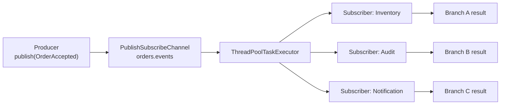
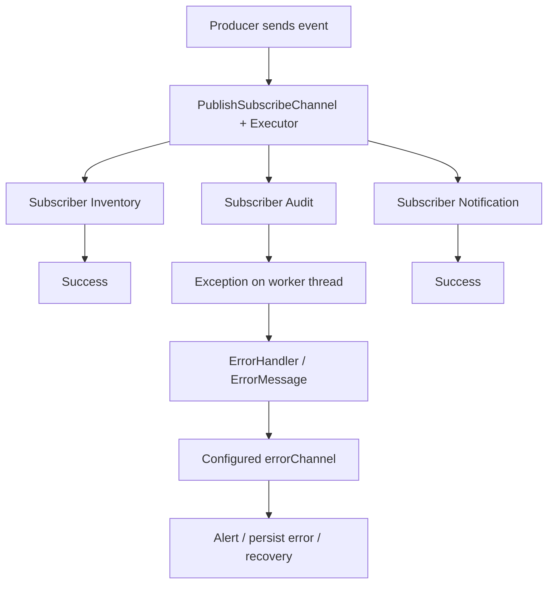
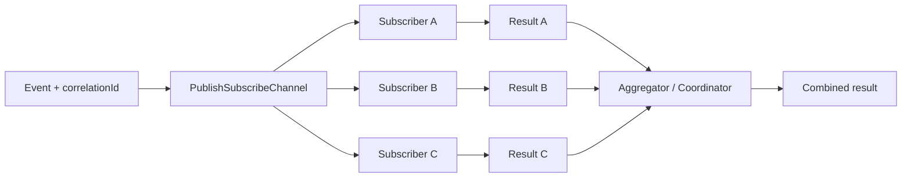

# Executor for Asynchronous Subscribers

## 1. Problem: One Slow Subscriber Can Hold Up the Entire Event-Publishing Flow

Suppose an e-commerce system has just confirmed order `ORD-105` and needs to publish the `OrderAccepted` event to three subscribers:

- **Inventory:** update reserved stock quantities.
- **Audit:** record processing history.
- **Notification:** call the email-sending service.

Sending one event to multiple destinations follows the **publish-subscribe** model. In Spring Integration, `PublishSubscribeChannel` distributes messages to registered subscribers. By default, if no `Executor` is configured, handlers are normally invoked **synchronously on the sender's thread**. Consequently, a slow email API can force the order-publishing thread to wait even when inventory and audit finish quickly.

Providing an **Executor** to `PublishSubscribeChannel` lets you **offload subscriber execution to a thread pool**, decoupling the moment a message is accepted from the moment each branch completes.



In the **Publish subscribe** chapter of the **SPRING_INTEGRATION_PATTERN** module, this is an important technique for building loosely coupled and extensible messaging flows with Spring Integration. An executor can separate load across branches containing Router, Filter, Transformer, Splitter, Aggregator, or Service Activator; however, retries, error channels, correlation, Gateway, and tests must be designed around the **asynchronous boundary**.

> **Principle:** Having an executor means having asynchronous processing capability; it does **not** mean messages are durably persisted, all subscribers succeeded, or branches run in a fixed order.

## 2. Where Do Synchronous and Asynchronous Differ?

### 2.1. `PublishSubscribeChannel` Without an Executor

```text
Producer thread
  send(event)
    -> Subscriber A: processes
    -> Subscriber B: processes
    -> Subscriber C: processes
  send(...) returns / throws exception
```

Subscribers are called on the sending thread through synchronous dispatch. If a handler blocks, the producer thread can block; if a handler throws an exception, the error can propagate back per channel configuration and affect remaining dispatches.

### 2.2. `PublishSubscribeChannel` With an Executor

```text
Producer thread
  send(event)
    -> executor.execute(task A)
    -> executor.execute(task B)
    -> executor.execute(task C)
  send(...) returns once dispatch is accepted

Worker thread 1 -> Subscriber A processes
Worker thread 2 -> Subscriber B processes
Worker thread 3 -> Subscriber C processes
```

This is an **illustrative** timeline: the actual number of worker threads may be fewer than the number of subscribers; one worker may execute multiple tasks sequentially. If the pool runs out of capacity, a task may wait in the queue or be rejected according to the executor's policy.

| Property | Without Executor | With Executor |
| --- | --- | --- |
| Handler execution thread | Usually the thread calling `send()` | Worker thread managed by the executor |
| When `send()` returns | Usually after synchronous processing | Can be before subscribers finish processing |
| Producer latency | Directly affected by slow handlers | Can decrease, though dispatch/backpressure overhead remains |
| Subscriber exceptions | Can propagate back to sender | Typically occur on worker thread; need dedicated error handling |
| Subscriber completion order | Follows dispatcher call order, but must not be a business contract | Not guaranteed |
| Retain messages after app stops | Not built in | **Also not built in** |
| Load throttling | Driven by caller/handler speed | Requires pool, queue, rejection configuration, and monitoring |

A `send()` call returning `true` only indicates that the channel **accepted the send according to its semantics**, not confirmation that all subscribers wrote data, called APIs, or committed successfully.

## 3. What Is an `Executor` in the Context of Spring Integration?

`Executor` is the Java contract that accepts a `Runnable` for execution. `PublishSubscribeChannel` can use an executor to dispatch messages to subscribers. In the Spring ecosystem, `ThreadPoolTaskExecutor` is a convenient choice because it supports pool configuration and bean lifecycle management.

Key parameters:

| Parameter | Role | Operational impact |
| --- | --- | --- |
| `corePoolSize` | Core worker count | Defines baseline processing capacity |
| `maxPoolSize` | Maximum worker limit | Caps thread count under load spikes |
| `queueCapacity` | Backlog waiting for execution | Long queues increase latency and RAM usage |
| `threadNamePrefix` | Worker name prefix | Helps identify threads in logs/traces |
| Rejection policy | What happens when pool cannot accept a task | Throws error, runs on caller, or other behaviors |
| Shutdown policy | Wait, complete, or cancel tasks on stop | Affects in-flight messages during redeployment |

**Note on pool sizing:** with a positive-capacity queue, `ThreadPoolExecutor` typically prioritizes filling the queue once `corePoolSize` is reached, and only scales up to `maxPoolSize` after the queue is full. Thus setting `maxPoolSize=32` does not mean the pool always runs 32 threads. If the queue is too long, latency can climb before thread count scales up.

### 3.1. One Shared Executor or Multiple Separate Executors?

A `PublishSubscribeChannel` with a shared executor shares resources across all its subscribers. This is simple, yet can cause *resource contention*:

- A slow email API consumes all threads.
- New inventory tasks must wait in the same queue.
- When the queue fills up, every branch faces rejection risk.

If one branch has a very different SLA or needs load/fault isolation, consider **fanning out to independent queues/broker subscriptions**, or giving branches separate executors. A shared executor is suitable when branches are lightweight, short, and share similar priorities.

## 4. Configuring `PublishSubscribeChannel` With `ThreadPoolTaskExecutor`

The example below uses **Spring Integration Java configuration** and Java 17+. An `OrderAccepted` event is broadcast to three subscribers via `@ServiceActivator`. They run asynchronously thanks to the executor attached to the channel.

### 4.1. Payload and Business Contract

```java
record OrderAccepted(
        String orderId,
        long amountVnd,
        boolean notifyCustomer) {}

interface OrderEventHandlers {
    void reserveInventory(OrderAccepted order, String eventId);
    void appendAudit(OrderAccepted order, String eventId);
    void notifyCustomer(OrderAccepted order, String eventId);
}
```

`eventId` is a stable business event ID: each subscriber can use it as an **idempotency key** to avoid duplicate processing on redelivery. In a three-branch fan-out, avoid a single shared "event processed" flag that causes branches to suppress one another; keys should take the form `(subscriber, eventId)` or be managed independently by each subscriber.

### 4.2. Declaring the Executor and Channel

```java
import java.util.concurrent.ThreadPoolExecutor;

import org.springframework.beans.factory.annotation.Qualifier;
import org.springframework.context.annotation.Bean;
import org.springframework.context.annotation.Configuration;
import org.springframework.integration.channel.PublishSubscribeChannel;
import org.springframework.integration.config.EnableIntegration;
import org.springframework.messaging.MessageChannel;
import org.springframework.scheduling.concurrent.ThreadPoolTaskExecutor;

@Configuration
@EnableIntegration
class AsyncEventsConfig {

    @Bean("ordersEventExecutor")
    ThreadPoolTaskExecutor ordersEventExecutor() {
        var executor = new ThreadPoolTaskExecutor();
        executor.setCorePoolSize(4);
        executor.setMaxPoolSize(8);
        executor.setQueueCapacity(100);
        executor.setThreadNamePrefix("order-event-");
        executor.setRejectedExecutionHandler(
                new ThreadPoolExecutor.AbortPolicy());
        executor.setWaitForTasksToCompleteOnShutdown(true);
        executor.setAwaitTerminationSeconds(15);
        return executor;
    }

    @Bean("orders.events")
    MessageChannel ordersEvents(
            @Qualifier("ordersEventExecutor")
            ThreadPoolTaskExecutor executor) {
        return new PublishSubscribeChannel(executor);
    }
}
```

**The configuration above uses illustrative values only.** A pool of 4–8 workers and a queue of 100 must be sized from processing times, subscriber counts, event rates, memory, and real SLAs. `AbortPolicy` surfaces overload via a task rejection error instead of silently dropping work. The shutdown settings above attempt to wait for pending tasks, yet do not guarantee in-RAM messages survive crashes, forced kills, or shutdown timeouts.

Spring manages the lifecycle of a `ThreadPoolTaskExecutor` declared as a bean. When instantiating it manually in tests without a Spring context, call `initialize()` and `shutdown()` appropriately.

### 4.3. Registering Multiple Subscribers on the Same Channel

```java
import org.springframework.integration.annotation.ServiceActivator;
import org.springframework.messaging.handler.annotation.Header;
import org.springframework.messaging.handler.annotation.Payload;
import org.springframework.stereotype.Component;

@Component
class OrderEventSubscribers {

    private final OrderEventHandlers handlers;

    OrderEventSubscribers(OrderEventHandlers handlers) {
        this.handlers = handlers;
    }

    @ServiceActivator(inputChannel = "orders.events")
    public void inventory(
            @Payload OrderAccepted order,
            @Header("eventId") String eventId) {
        handlers.reserveInventory(order, eventId);
    }

    @ServiceActivator(inputChannel = "orders.events")
    public void audit(
            @Payload OrderAccepted order,
            @Header("eventId") String eventId) {
        handlers.appendAudit(order, eventId);
    }

    @ServiceActivator(inputChannel = "orders.events")
    public void notification(
            @Payload OrderAccepted order,
            @Header("eventId") String eventId) {
        if (order.notifyCustomer()) {
            handlers.notifyCustomer(order, eventId);
        }
    }
}
```

With `PublishSubscribeChannel`, **all three subscribers are registered to receive the message**. The `notification()` method decides whether to act based on the payload. This **differs** from a `Recipient List` with selectors: in a Recipient List, the router itself can decide up front not to send the message to the notification branch.

These examples assume the application provides a bean implementing `OrderEventHandlers`. Each service method encapsulates business behavior; `@ServiceActivator` is the boundary translating messages into Java invocations.

### 4.4. Sending a Message to the Channel

```java
import org.springframework.beans.factory.annotation.Qualifier;
import org.springframework.messaging.MessageChannel;
import org.springframework.messaging.support.MessageBuilder;
import org.springframework.stereotype.Component;

@Component
class OrderEventPublisher {
    private final MessageChannel events;

    OrderEventPublisher(
            @Qualifier("orders.events") MessageChannel events) {
        this.events = events;
    }

    boolean publishExample() {
        var event = new OrderAccepted("ORD-105", 350_000L, true);
        return events.send(MessageBuilder.withPayload(event)
                .setHeader("eventId", "evt-105")
                .setHeader("tenantId", "shop-hcm")
                .setHeader("traceId", "trace-105")
                .build());
    }
}
```

After `publishExample()` returns, you **cannot assume** inventory, audit, and notification have all succeeded. The send may have been accepted by the executor while handlers are still queued or running on worker threads. If a task is rejected by the executor, an error can occur immediately during dispatch; handle that case according to the producer's policy.

## 5. Configuration via Java DSL and `PublishSubscribeChannel`

In addition to declaring `PublishSubscribeChannel` as a bean and using `@ServiceActivator`, Spring Integration Java DSL supports nesting **subscriber subflows** inside a publish-subscribe flow.

Conceptual example for lightweight steps:

```java
import org.springframework.context.annotation.Bean;
import org.springframework.integration.dsl.IntegrationFlow;

@Bean
IntegrationFlow lightEventFlow() {
    return flow -> flow
            .publishSubscribeChannel(subscribers -> subscribers
                    .subscribe(subflow -> subflow
                            .handle(message -> {
                                // Write lightweight logs/metrics.
                            }))
                    .subscribe(subflow -> subflow
                            .handle(message -> {
                                // Process another branch.
                            })));
}
```

This snippet illustrates **how to structure subflows**; it does not replace the `orders.events` example in section 4 and has no executor attached. When asynchronous subscribers are needed, configure an executor via the `publishSubscribeChannel` variant that accepts an executor or use a `PublishSubscribeChannel` backed by an executor as in section 4. Never register both configurations onto the same channel simultaneously without deliberately planning the topology, as doing so can create unintended extra subscribers.

**API note:** DSL overloads can vary across Spring Integration versions. For lessons focused on executors, the clearest and most controllable approach remains a `new PublishSubscribeChannel(executor)` bean plus independent subscribers.

## 6. Where Are Errors in Asynchronous Subscribers Handled?

When using an executor, exceptions in a subscriber typically arise **on a worker thread**, no longer on the call stack of the thread calling `send()`. Thus, wrapping `publisher.publishExample()` in `try/catch` is **not enough** to catch errors arising later from audit or notification.



Spring Integration provides error handling via `ErrorMessage` and **error channels**; asynchronous channels or endpoints can use an appropriate `ErrorHandler`, such as `MessagePublishingErrorHandler` in supported contexts. However, the exact path of an exception depends on the **channel, executor, endpoint, error handler, and version configuration in use**. Never assume that simply adding an `errorChannel` header automatically turns every failure into a durable record or triggers retries.

Error-handling design must answer:

1. Which subscriber failed? `inventory`, `audit`, or `notification`?
2. Is the error **transient** (timeout, 503) or **permanent** (bad schema, missing required field)?
3. Is the failed task retried in its **own branch** or will the **entire event** be re-published?
4. Where are the payload, `eventId`, `traceId`, attempt count, and cause persisted?
5. If a subscriber already performed a side effect before failing, how do you prevent duplicate effects on retry?

### 6.1. Does One Failing Branch Affect Other Branches?

Once tasks have been accepted by the executor, a failure in one task **does not automatically roll back** side effects of other tasks. Nor does it guarantee other branches finish, because the executor could saturate, the application could stop, or another branch could fail independently. Never treat a `PublishSubscribeChannel` as a distributed transaction across all subscribers.

For example, `inventory` reserved stock and `audit` timed out. Replaying the entire event could make `inventory` reserve stock a second time. The typical solution is **per-subscriber idempotency**:

```text
processed_events:
  (event_id, subscriber_name)
  ("evt-105", "inventory")
  ("evt-105", "audit")
  ("evt-105", "notification")
```

Each task must determine on its own whether it has already succeeded. When the operation and the idempotency record live in the same database, write them in the same transaction. For external APIs, use an idempotency key or status reconciliation if the target service supports it.

### 6.2. Retries, Recovery, and Durability

`ThreadPoolTaskExecutor` **is not a broker**. The executor's in-RAM task queue does not persist messages to disk; restarting the application can lose unexecuted tasks. If messages are critical (orders, payments, mandatory audits), consider:

- **Transactional outbox** when business writes and event emission must stay consistent.
- **Durable broker or message store** so each subscriber can receive messages reliably.
- **Bounded retry mechanisms** with backoff for transient errors.
- **Dead-letter/quarantine and replay** for unprocessable messages.
- **Stable idempotency keys** to safely handle redeliveries of the same event.

Adding more worker threads only addresses certain throughput/latency issues; it does not replace those reliability mechanisms.

## 7. Backpressure: When the Executor Cannot Keep Up With Message Volume

Suppose 1,000 events arrive per second, each broadcast to three subscribers, meaning **roughly 3,000 subscriber tasks/second** may be needed before even counting retries. If the executor completes only 500 tasks/second, the backlog will grow or tasks will be rejected.

Basic options:

| Policy | Advantage | Risk |
| --- | --- | --- |
| Bounded queue + `AbortPolicy` | Surfaces overload clearly; prevents unbounded RAM growth | Producer must handle rejections; fan-out may have partially dispatched |
| Long queue | Absorbs short traffic spikes | Increases latency, consumes RAM, loses tasks on crash |
| `CallerRunsPolicy` | Applies backpressure by running tasks on the sending thread | **Can break async assumptions**; blocks producer, impact must be measured |
| Split subscriptions onto separate queues/brokers | Isolates load per subscriber, flexible recovery | Greater infrastructure and operational complexity |
| Throttle producer / rate limit | Keeps system within capacity | Increases wait times or requires returning overload errors |

**Watch out for partial fan-out.** When the executor accepts tasks for subscribers A and B but rejects C's task, an exception at the producer does not mean A and B have not run. If re-invoking the entire event, be prepared for duplicate handling and per-subscriber state tracking.

### 7.1. Sizing the Pool Based on Execution Time

For CPU-bound workloads, adding too many threads can cause contention. For I/O-bound workloads, more workers than CPU cores can help, provided you cap concurrency against target databases and APIs. Measure **per-subscriber completion time**, **active threads**, **queue depth**, **rejected task count**, and **end-to-end latency** before tuning.

If one subscriber generates many long-running tasks, consider isolating it onto a dedicated worker pool or broker queue instead of simply raising the shared `maxPoolSize`.

## 8. Ordering, Correlation, and Return Values

### 8.1. Do Not Rely on Completion Order Across Subscribers

The executor schedules independently: audit may finish before inventory; two consecutive events `evt-105` and `evt-106` are also not guaranteed to be processed in order at each subscriber when multiple workers exist. When the business **strictly requires ordered processing**, design key-partitioned channels, single-consumer queues, or an explicit sequential coordinator.

### 8.2. When Multiple Results Must Be Combined, Add Fan-In

Publish-subscribe is **fan-out**; it does not aggregate replies by itself:



When using an Aggregator, define a **correlation strategy** (which belong to the same request), a **release strategy** (how many results to wait for), and a **timeout** (what to do if a subscriber never replies). `PublishSubscribeChannel` has an option to apply sequence/correlation metadata in appropriate configurations, but never assume that merely enabling an executor provides everything needed for fan-in.

For instance, suppose an event only sends an email when `notifyCustomer=true`; if fan-in always waits for three results even though the email branch produces no result when `notifyCustomer=false`, it can wait forever. Expected result counts must reflect **the set of subscribers actually obligated to respond**, not simply the count of registered handlers.

### 8.3. Gateways and Timeouts

A Gateway is commonly used for request-reply communication. If a Gateway sends into a flow backed by an executor without downstream producing an explicit reply, `send()` being accepted does **not** automatically give the Gateway a result; it may wait until timeout. When an aggregated result from subscribers is required, design aggregation and the reply channel deliberately.

## 9. Deterministic Testing of Asynchronous Subscribers

Unlike synchronous channels, never call `send()` and immediately assert that every handler has run. Wait on a completion signal with a **finite timeout**, avoiding `Thread.sleep(1000)` because tests become flaky on slow machines or busy CI.

### 9.1. Direct Unit Test Example for `PublishSubscribeChannel` + `Executor`

The unit test below verifies that **both subscribers received the message** and executed on workers named by the executor. It does not require booting a full Spring context.

```java
import java.util.Set;
import java.util.concurrent.ConcurrentHashMap;
import java.util.concurrent.CountDownLatch;
import java.util.concurrent.TimeUnit;
import org.junit.jupiter.api.Test;
import org.springframework.integration.channel.PublishSubscribeChannel;
import org.springframework.messaging.support.MessageBuilder;
import org.springframework.scheduling.concurrent.ThreadPoolTaskExecutor;

import static org.junit.jupiter.api.Assertions.*;

class AsyncPublishSubscribeTest {

    @Test
    void dispatchesToTwoSubscribersUsingExecutor() throws Exception {
        var executor = new ThreadPoolTaskExecutor();
        executor.setCorePoolSize(2);
        executor.setMaxPoolSize(2);
        executor.setQueueCapacity(10);
        executor.setThreadNamePrefix("test-pubsub-");
        executor.initialize();

        try {
            var channel = new PublishSubscribeChannel(executor);
            var done = new CountDownLatch(2);
            Set<String> recipients = ConcurrentHashMap.newKeySet();
            Set<String> workerThreads = ConcurrentHashMap.newKeySet();

            channel.subscribe(message -> {
                recipients.add("audit");
                workerThreads.add(Thread.currentThread().getName());
                done.countDown();
            });
            channel.subscribe(message -> {
                recipients.add("inventory");
                workerThreads.add(Thread.currentThread().getName());
                done.countDown();
            });

            boolean accepted = channel.send(
                    MessageBuilder.withPayload("ORD-105").build());

            assertTrue(accepted);
            assertTrue(done.await(5, TimeUnit.SECONDS),
                    "Some subscribers did not complete");
            assertEquals(Set.of("audit", "inventory"), recipients);
            assertTrue(workerThreads.stream()
                    .allMatch(name -> name.startsWith("test-pubsub-")));
        } finally {
            executor.shutdown();
        }
    }
}
```

This test waits on `CountDownLatch` instead of sleeping. Thread-safe collections prevent data races between workers. It proves **executor dispatch and that both handlers reached their completion signals**, not persistence, retries, or ordering across branches.

### 9.2. Integration Test for Three Service Activators

In a Spring Test context containing `AsyncEventsConfig`, `OrderEventSubscribers`, and a mock/stub `OrderEventHandlers` bean, use `CountDownLatch`, `Awaitility`, or bounded waits to wait for the three invocations. If using Mockito, avoid immediate `verify(mock)` right after `send()`; assert only after all completion conditions are met or timed out.

Cases to include:

| Scenario | What must be verified |
| --- | --- |
| Event with `notifyCustomer=true` | Inventory, audit, and notification are all invoked |
| `notifyCustomer=false` | Audit and inventory run; notification subscriber receives the message but sends no notification |
| One handler runs slowly | Producer can return early; other branches are still scheduled while executor has capacity |
| One handler throws an exception | Error is observed via ErrorHandler/error flow; do not assume sender sees the exception |
| Pool reaches capacity | Rejection/backpressure is clearly surfaced; no silent event loss |
| Same `eventId` resent | Per-subscriber idempotency prevents duplicate side effects |
| App stops with backlog remaining | Identify which tasks completed and the need to recover from durable storage |
| Subscriber mutates a mutable payload | Detect and eliminate shared-state dependencies |
| Fan-in with return values | Correlation, expected reply count, release strategy, and timeout are accurate |

When configuring async test conditions, ensure assertions and mocks are thread-safe. Error and rejection tests should use finite timeouts and controlled pool/queue sizes rather than relying by chance on machine speed.

## 10. Observability and Operations

An executor moves processing cost off the sending thread, yet can make failures and backlogs **harder to see** unless metrics are collected. Measure:

| Category | Metrics or signals |
| --- | --- |
| **Producer** | Publish rate, unaccepted `send` rate, submission latency |
| **Executor** | Active threads, pool size, queue depth, rejected tasks, long-waiting tasks |
| **Subscriber** | Throughput, successes/failures, duration, retries, timeouts |
| **Business** | Orders not yet audited, not yet reserved, not yet notified |
| **Recovery** | Dead-letter/quarantine count, backlog age, replay successes/failures |
| **End-to-end** | Time from event emission to each task's completion |

Attach `eventId`, `traceId`, and `tenantId` where appropriate in branch logs/traces; add `subscriberName` to tell which task produced the outcome. However, **thread-local context does not propagate across an executor by default**. MDC, security context, or request info must be forwarded intentionally (via message headers and/or a task decorator/context propagation) and cleared after processing to prevent context leakage across tasks sharing a worker.

Never use `eventId` or `orderId` as metric labels because of high cardinality. Use only bounded-cardinality subscriber/route categories as metric dimensions.

## 11. Common Design Mistakes

1. **Assuming `send() == true` means all handlers succeeded.** With an executor, business outcomes normally arrive later.
2. **Treating an executor like a durable queue.** Tasks in RAM can be lost if the process terminates abnormally.
3. **Leaving the queue unbounded.** Backlogs grow until RAM is exhausted.
4. **Raising `maxPoolSize` without measuring the queue.** A large queue capacity delays pool expansion.
5. **Using `CallerRunsPolicy` while still expecting never to block the producer.** Under overload, the caller may have to run tasks.
6. **Only catching exceptions around `send()`.** Exceptions later arising on worker threads need a separate error-reporting path.
7. **Missing per-subscriber idempotency.** Replaying the whole fan-out creates duplicate side effects in branches that already succeeded.
8. **Assuming the payload is deep-copied for every subscriber.** Mutable payloads can cause data races.
9. **Relying on completion order.** An executor does not guarantee business ordering across branches.
10. **Using `ThreadLocal`/MDC without context propagation.** Trace/security contexts can be lost or leak into other tasks.
11. **Assuming publish-subscribe aggregates replies automatically.** Fan-in requires correlation and an Aggregator/Coordinator.
12. **Not measuring backlog and rejections.** The system looks like it accepted events while subscribers fall behind.

## 12. Practice Exercise and Checklist

**Exercise:** Build a flow receiving `PaymentSettled` events and publishing to three subscribers: ledger update, audit, and notification. The event has `paymentId`, `amount`, and `currency`; headers include `eventId`, `tenantId`, and `traceId`.

1. Create a `PublishSubscribeChannel` with a `ThreadPoolTaskExecutor` having **bounded** pool and queue sizes.
2. Register three `@ServiceActivator`s listening to the channel; each handler calls a separate business interface.
3. Send a message from a producer and log thread names in both producer and subscribers to observe the asynchronous boundary.
4. Use `CountDownLatch` or an equivalent tool to test that all subscribers completed, without fixed sleeps.
5. Make notification intentionally slow and measure producer latency as well as executor backlog.
6. Have audit throw an exception; determine how the error handler/error channel receives the error and where the event is saved for replay.
7. Intentionally fill the queue and observe the rejection policy's reaction. Note that a partial fan-out may already have been dispatched.
8. Send the same `eventId` twice and add an idempotency mechanism **per subscriber**.
9. Simulate a mid-flight restart; explain why an executor is insufficient and propose a broker/outbox for critical events.
10. If the branches must return one combined result, propose a correlation ID, release strategy, timeout, and fan-in flow.

Before going to production, answer: **What does `send()` confirm? Where are subscriber exceptions observed? How many pool threads and how deep a queue are enough? When one branch slows down or fails, does the system retain the event for that branch?**

An **executor for asynchronous subscribers** helps `PublishSubscribeChannel` reduce temporal coupling between the producer and handlers, while shifting new responsibilities to operations: bounding load, handling errors off the sender thread, preserving context, tracking backlogs, and recovering safely on event redelivery. Choosing a bounded executor, testing asynchronously with timeouts, and adding a broker/outbox when durability is required is the practical, scalable way to use publish-subscribe.
