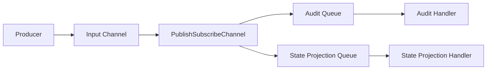
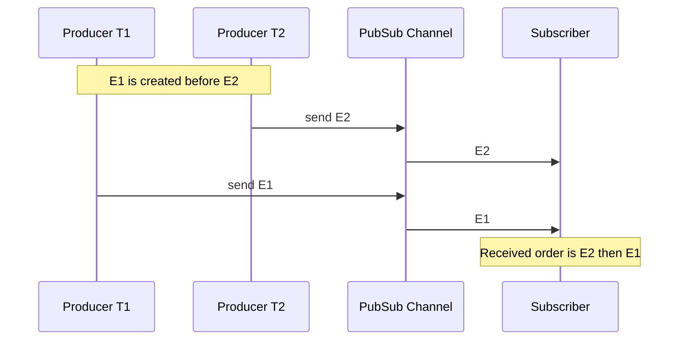
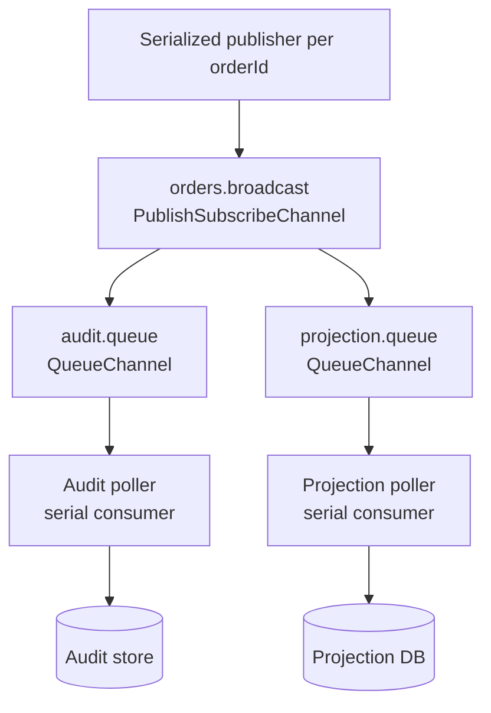
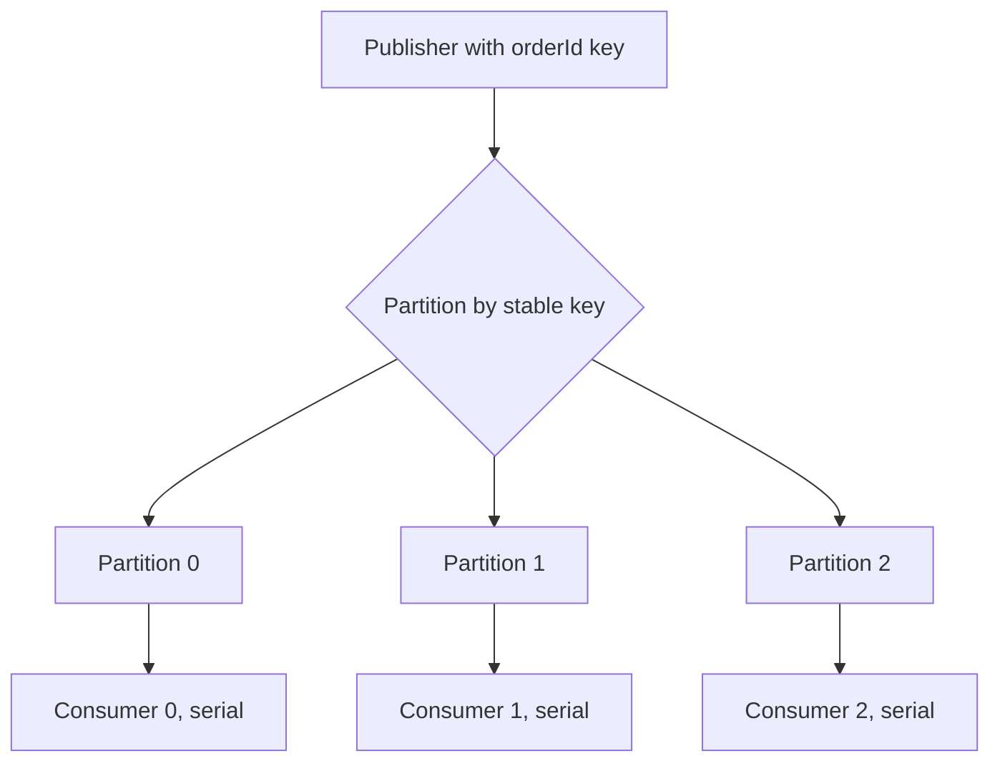
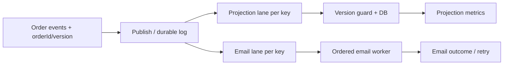

# Guaranteeing Ordering per Subscriber

In Enterprise Integration Patterns (EIP), **Publish-Subscribe** lets one message be broadcast to multiple subscribers. It separates concerns such as auditing, notifications, analytics, or data synchronization from the producer. However, **every subscriber receives the message** and **each subscriber processes messages in the right order** are two completely different requirements.

For example, an order goes through three events:

1. `OrderCreated(orderId="O-101", version=1)`.
2. `OrderPaid(orderId="O-101", version=2)`.
3. `OrderCancelled(orderId="O-101", version=3)`.

The system wants both **audit** and the **order state projection** to observe the 1 → 2 → 3 progression. If the projection-updating subscriber processes version 3 before version 2, the database could get overwritten back to `PAID` after the order was already cancelled. Meanwhile, an analytics subscriber might not require strict ordering if it only computes commutative metrics.

This lesson belongs to the **Publish subscribe** chapter of the **SPRING_INTEGRATION_PATTERN** module. In Spring Integration, we use Message Channel, Router, Filter, Transformer, Gateway, Splitter, Aggregator, retry, error channel, and correlation to design loosely coupled, extensible, and testable flows. The focus of this lesson is **guaranteeing ordering per subscriber**: defining the ordering scope, identifying what breaks order, and arranging publishing, receiving, and processing accordingly.

> **Short takeaway:** `PublishSubscribeChannel` is a *fan-out* mechanism, not a promise that every subscriber will process events in business order under all conditions. To achieve guarantees, you must control **the source publisher, dispatch, queues, consumer concurrency, retries, state, and data contracts**.

## 1. Which "Right Order" Are We Talking About?

An architecture typically has several distinct points in time:



There are at least four ways to interpret ordering here:

| Level | Question | Example |
| --- | --- | --- |
| **Publication order** | In what order does the producer emit events? | `OrderCreated` before `OrderPaid` |
| **Dispatch/enqueue order** | In what order does each branch receive or enqueue? | Audit queue receives version 1 then 2 |
| **Start order** | Which message does the handler start first? | Worker A starts v1 before v2 |
| **Completion/commit order** | Which side effect commits first? | Database writes v2 then v1 if two workers run in parallel |

**Dispatching in order does not equal completing in order.** A handler taking 10 seconds on version 1 and 100 ms on version 2 can finish out of order if executed concurrently.

A subscriber displaying history may only need to store events and sort by version when reading. A subscriber updating **current state** typically must protect commit order or check versions in the database.

### Global Order or Per-Key Order?

These are two very different requirements:

- **Global order:** every event across all orders is processed in a single sequence. This is simple to reason about, but limits parallelism.
- **Per-key order:** only events sharing the same `orderId` must be processed in ascending version order; two different orders can run in parallel.

In e-commerce, **per-aggregate/business-key ordering** is usually more practical. Document precisely which key defines the ordering scope, such as `orderId`, `accountId`, or `tenantId + entityId`. Choosing the wrong key can send related events onto two parallel lanes and finish them out of order.

## 2. What Does `PublishSubscribeChannel` Actually Guarantee?

Spring Integration provides `PublishSubscribeChannel` to distribute messages to registered subscribers. The default mechanism **without a `TaskExecutor`** normally calls subscribers synchronously on the sending thread according to the channel's dispatch mechanism.

Suppose a single sender sequentially calls:

```text
publish(E1) -> subscriber A receives E1; subscriber B receives E1
publish(E2) -> subscriber A receives E2; subscriber B receives E2
publish(E3) -> subscriber A receives E3; subscriber B receives E3
```

If all of the above operations are **synchronous**, **a single thread sends sequentially**, **there are no asynchronous components downstream**, and **no error aborts publication**, each subscriber can observe the sequence E1 → E2 → E3 in send order. Never turn this illustrative scenario into a blanket guarantee for every configuration.

Factors to distinguish:

| Configuration/scenario | Impact on ordering |
| --- | --- |
| Single sequential producer, synchronous `PublishSubscribeChannel` | Easy to preserve receive order per subscriber if downstream steps are also sequential |
| Multiple producer threads sending concurrently | No global business order is established by the channel alone |
| `PublishSubscribeChannel` with an executor | Subscribers can be dispatched asynchronously; start/completion order depends on the executor and downstream steps |
| Subscriber forwards to `ExecutorChannel` | Work can execute concurrently and finish out of order |
| Subscriber forwards to `QueueChannel` | Queue buffers messages; pull/processing order depends on poller/consumer count and retry behavior |
| Subscriber sends to a broker/HTTP | Must examine transport-specific ordering guarantees, partitions, groups, and retries |

**The invocation order across subscribers A, B, C** is also not **the order of events E1, E2, E3 inside subscriber A**. Priority/order configuration among subscribers only addresses the former; it does not solve the latter.

### Applying Sequence Headers

`PublishSubscribeChannel` has an option related to **applying sequence**, adding sequence/correlation metadata to messages dispatched to subscribers in a framework-supported way. However, **the sequence number within one fan-out** is not **the ascending version of business events across multiple publications**.

If `OrderCreated` is broadcast to three subscribers and `OrderPaid` is also broadcast to three subscribers, sequence headers belonging to a single broadcast are not enough to prove `OrderPaid` is always processed after `OrderCreated` at every subscriber. Use `orderId` and `version`/`sequence` at the business-contract level when cross-event ordering is needed.

## 3. Why Can a Subscriber See Out-of-Order Events?

### 3.1. Multiple Threads Publishing Concurrently

Suppose thread T1 has E1 and T2 has E2. Even if T1 starts building E1 first, T2 might call `send` before T1, or publications can interleave. In that situation, the channel cannot infer business order unless the producer attaches sequence/version metadata.



For per-key ordering, generate ordering at the **source of truth** (such as incrementing version inside the same transaction that updates the aggregate), or serialize publishing per key before fan-out.

### 3.2. Executors and Concurrency

An executor with multiple workers can receive E1 and E2 in submission order yet run them on different threads. E2 finishes before E1 if E1 runs slowly, hits a database lock, or has to retry.

Even when each subscriber has **its own executor**, if that executor runs multiple tasks concurrently, commit order cannot be assumed preserved.

### 3.3. Queues With Multiple Consumers

Queues generally preserve enqueue order under their implementation guarantees. Yet if two consumers pull E1 and E2 closely together, the second consumer can still write E2 before the first consumer writes E1. **Queue FIFO alone does not guarantee side-effect order under concurrent processing.**

### 3.4. Retries, Redelivery, and Dead-Lettering

E1 fails and enters a retry delay while E2 continues processing. E2 can finish before E1. If E1 is routed to a dead-letter queue while E2 proceeds, a gap appears in the state stream.

Define clearly: for a given key, **does a failed message block subsequent messages?** If not, the consumer must either tolerate out-of-order application or hold E2 until E1 is resolved.

### 3.5. Restarts, Rebalancing, and Subscriber Count Changes

When an application restarts, in-memory queues can lose messages; brokers can redeliver unacknowledged messages. Scaling consumers or changing partitions can alter distribution. A new subscriber registered after E1 was already published will not automatically receive E1 merely by using an internal `PublishSubscribeChannel`.

**In-process publish-subscribe is not a durable event log.** When historical replay or restart recovery is needed, choose a transport and message store supporting those requirements.

## 4. Define the Ordering Contract Explicitly Before Picking a Configuration

Instead of saying "it must be in order," write a **testable ordering contract**.

Example for an order projection:

> For the same `orderId`, the subscriber may apply event version `n + 1` only after version `n` has been applied successfully. Duplicate-version events must not cause duplicate side effects. If a version is missing, the subscriber pauses that key and requests recovery/reconciliation.

A contract should specify:

1. **Ordering unit:** entire stream or per `orderId`?
2. **Numbering source:** version assigned by database/aggregate or sequence number at publisher?
3. **Maintenance scope:** single JVM only, across instances, or across restarts?
4. **Completion milestone:** handler start, database commit, or acknowledgement from an external system?
5. **Gap policy:** if E3 arrives while E2 is missing, do we wait, retry, quarantine, or record a partial result?
6. **Duplicate policy:** does reappearance of the same event ID/version cause side effects?
7. **SLA and throughput:** is blocking the entire key acceptable when one event fails?

Subscribers **do not necessarily share the same contract**. An audit subscriber may store a stream ordered by version; analytics may upsert by key; email may need notification sequence preserved; another system may process independently. Do not impose global serialization on everyone just because one subscriber has strict requirements.

## 5. An Internal Design: Fan-Out to Each Subscriber's Independent Queue

An easy-to-explain architecture is:

1. Source publishes **sequentially within the chosen ordering scope**.
2. `PublishSubscribeChannel` runs **synchronously** to fan out messages into branches.
3. Each branch has its **own** FIFO `QueueChannel`.
4. Each queue has **one sequential processing thread**; do not place a multi-worker executor behind the poller.
5. If a message fails, the subscriber's policy decides blocking/retrying rather than letting later messages silently overtake it when strict ordering is required.



**Each subscriber is independent:** audit can run slowly without necessarily making the projection handler wait for audit to finish. However, **enqueuing** into each queue can still affect the publisher: if a queue is full, sending may block or fail depending on timeout and configuration. Handle that with backpressure/failure policies.

This is only **one way to protect ordering in-process** and still has limitations: `QueueChannel` is in-memory by default and does not guarantee messages survive process termination. If operation across restarts is required, use appropriate durable persistence or a broker with matching ordering and redelivery mechanics.

### 5.1. Message Contract With Sequence and Business Key

```java
import java.time.Instant;

record OrderChanged(
    String eventId,
    String orderId,
    long version,
    String status,
    Instant occurredAt
) {
    OrderChanged {
        if (eventId == null || eventId.isBlank()
                || orderId == null || orderId.isBlank()
                || version < 1 || status == null || status.isBlank()
                || occurredAt == null) {
            throw new IllegalArgumentException("Invalid order event");
        }
    }
}

interface AuditService {
    void append(OrderChanged event);
}

interface ProjectionService {
    void apply(OrderChanged event);
}
```

In this example, `eventId` identifies the event for duplicate checking; `orderId` is the ordering key; `version` is a version number **guaranteed to increment properly by the source system**, not generated arbitrarily on sending threads.

The constructor only performs structural validation. It does **not** prove version 3 was published after version 2. The ordering contract must be established and enforced at the producer/source of truth, plus the version-checking consumer.

### 5.2. Spring Integration Java DSL: Each Subscriber Has Its Own Queue

```java
import org.springframework.context.annotation.Bean;
import org.springframework.context.annotation.Configuration;
import org.springframework.integration.annotation.Gateway;
import org.springframework.integration.annotation.IntegrationComponentScan;
import org.springframework.integration.annotation.MessagingGateway;
import org.springframework.integration.channel.DirectChannel;
import org.springframework.integration.channel.PublishSubscribeChannel;
import org.springframework.integration.channel.QueueChannel;
import org.springframework.integration.config.EnableIntegration;
import org.springframework.integration.dsl.IntegrationFlow;
import org.springframework.integration.dsl.Pollers;
import org.springframework.messaging.MessageChannel;
import org.springframework.messaging.PollableChannel;

@MessagingGateway
interface OrderEventGateway {
    @Gateway(requestChannel = "orders.input")
    void publish(OrderChanged event);
}

@Configuration
@EnableIntegration
@IntegrationComponentScan
class SubscriberOrderingConfiguration {

    @Bean("orders.input")
    MessageChannel orderInput() {
        return new DirectChannel();
    }

    @Bean("orders.broadcast")
    PublishSubscribeChannel broadcast() {
        // No TaskExecutor: synchronous dispatch.
        return new PublishSubscribeChannel();
    }

    @Bean("audit.queue")
    PollableChannel auditQueue() {
        return new QueueChannel(500);
    }

    @Bean("projection.queue")
    PollableChannel projectionQueue() {
        return new QueueChannel(500);
    }

    @Bean
    IntegrationFlow toBroadcast() {
        return IntegrationFlow.from("orders.input")
            .channel("orders.broadcast")
            .get();
    }

    // The two bridges below register two subscribers on the same PubSub channel.
    @Bean
    IntegrationFlow broadcastToAudit() {
        return IntegrationFlow.from("orders.broadcast")
            .channel("audit.queue")
            .get();
    }

    @Bean
    IntegrationFlow broadcastToProjection() {
        return IntegrationFlow.from("orders.broadcast")
            .channel("projection.queue")
            .get();
    }

    @Bean
    IntegrationFlow auditConsumer(AuditService audit) {
        return IntegrationFlow.from("audit.queue",
                endpoint -> endpoint.poller(
                    Pollers.fixedDelay(100).maxMessagesPerPoll(1)))
            .handle(OrderChanged.class, (event, headers) -> {
                audit.append(event);
                return null; // one-way endpoint
            })
            .get();
    }

    @Bean
    IntegrationFlow projectionConsumer(ProjectionService projection) {
        return IntegrationFlow.from("projection.queue",
                endpoint -> endpoint.poller(
                    Pollers.fixedDelay(100).maxMessagesPerPoll(1)))
            .handle(OrderChanged.class, (event, headers) -> {
                projection.apply(event);
                return null;
            })
            .get();
    }
}
```

This is a Spring Integration Java DSL example for **one Spring application**. The application must include the appropriate Spring Integration dependencies, beans implementing `AuditService` and `ProjectionService`, and have the Gateway scanned by `@IntegrationComponentScan` or registered equivalently.

How to read the architecture:

- `orders.input` receives events from the Gateway.
- `orders.broadcast` is a `PublishSubscribeChannel` without an executor, broadcasting to the two registered flows.
- Each bridge flow places messages into a subscriber's **independent queue**.
- Each consuming flow has a poller with `maxMessagesPerPoll(1)` and no parallel task executor. With a sequential, non-overlapping poller configuration, handlers process messages in the order polled from the queue.
- Handlers return `null` to end the one-way flow without producing a reply.

**Important condition:** This configuration **does not automatically lock all threads calling `OrderEventGateway.publish`**. If multiple callers send for the same `orderId` concurrently, the actual arrival order at `orders.broadcast` can still differ from business order. Producers must serialize per key or use an already-ordered source before calling the Gateway.

### 5.3. Limitations of This Example

Do not treat `QueueChannel(500)` as a durable queue. A 500-message buffer can fill up; timeout/backpressure policies are needed. When a handler throws an exception, do not assume the message is **put back at the head of the queue** or retried ahead of the next message: poller error handling and retry paths must be configured explicitly.

`maxMessagesPerPoll(1)` limits messages per poll, yet **is not a distributed mechanism to lock system-wide order**. Do not attach a second poller, do not configure a concurrent task executor, and verify that the actual scheduler/endpoint does not run overlapping polls when strict ordering is required.

If the requirement is "once accepted, the event is guaranteed to be processed after a restart," persist durably at the source/broker/message store and manage acks/retries accordingly. An in-memory queue only illustrates independent fan-out and consumption order under specific assumptions.

## 6. Ensuring Ordering From Producer to Fan-Out

Sometimes the problem sits **before** `PublishSubscribeChannel`. If two services update an order concurrently and publish events, commit order and publish order may diverge.

```text
T1: updates Order v10, commits
T2: updates Order v11, commits
T2: publishes v11
T1: publishes v10

Subscriber receives v11 -> v10
```

Attaching `version` helps **detect** reordering; it does not **prevent** reordering on its own. Common mitigations depend on the architecture:

- **Serialize updates per aggregate:** allow only one update at a time for a given `orderId` or use optimistic concurrency/version checks.
- **Transactional Outbox:** write the event/outbox in the same transaction as the business update to avoid dual-write bugs. Design the publisher to emit events of the same aggregate in version/sequence order, as a bare outbox does not automatically promise publish order when multiple publishers run concurrently.
- **One publisher lane per key:** group events sharing a key onto a sequentially processed partition/worker.
- **Sequence/version at source:** downstream can detect duplicates, gaps, and late messages; timestamps alone are insufficient to determine strict order.
- **Sticky routing by business key:** keep all events for a key on the same sequential lane during a processing stage, with an ownership-handoff procedure on scaling/rebalance.

### Why Are Timestamps Insufficient?

Two events can share the same clock resolution, clocks across machines can skew, or timestamps can be generated **before** transaction commit. Sorting by `occurredAt` may be convenient for display, but when order determines business state, issue version/sequence numbers at a consistent boundary.

With **Kafka**, a producer can use `orderId` as the record key so events sharing a key land in the same partition under the active partitioning strategy. Kafka guarantees record order **within one partition** by append order; it does not fix mis-ordered producer publishes, and does not guarantee order across partitions. Each consumer group/subscriber must still preserve processing order from poll through side-effect commit.

## 7. Independent Subscribers: Each Branch Needs Its Own Failure Policy

Two subscribers may need different guarantees.

| Subscriber | Goal | Suggested mechanism |
| --- | --- | --- |
| **Audit ledger** | No event loss; preserve order per order | Durable event store/broker, one sequential consumer per key, idempotency |
| **State projection** | Never overwrite a newer version with an older one | Version check / optimistic update in DB; gap handling |
| **Email** | Do not send "paid" email before "order created" email when both are requested | Separate queue, per-key block/retry policy, idempotency with provider |
| **Aggregate analytics** | Can run in parallel if results are commutative | Per-key order may be unnecessary, though duplicate/late events must be handled |

If audit runs slowly, projection can keep progressing if the two queues are independent and the source enqueued to both successfully. **This does not mean the system is immune to backpressure**: a full audit queue can still affect a new fan-out.

### Define Explicitly What Happens When One Branch Fails

For subscribers requiring strict ordering, choose one of these policies:

1. **Block the key:** do not process E2 until E1 completes. Use a sequential queue/partition and retry E1 until it succeeds or moves to manual intervention.
2. **Buffer and handle gaps:** allow E2 to arrive without applying it yet; store it while waiting for E1 or recovering E1.
3. **Allow intentional skips:** suitable for some analytics, provided gaps are recorded and it is clear whether data will be backfilled.
4. **Quarantine/parking:** permanently invalid data must be isolated to avoid infinite retries; when deciding to drop E1, determine whether E2 can still be applied validly.

**Dead-lettering does not automatically preserve order.** Sending E1 to a dead-letter queue and continuing with E2 can leave a projection missing an intermediate state. If ordering/consistency must be preserved, you need a recovery workflow or skip semantics accepted by the business.

## 8. Version Guard: The Last Line of Defense in Each Subscriber

Even when transport is designed as FIFO, check versions in subscribers with critical side effects. Example database logic:

```text
On receiving event (orderId, eventId, version):
  current = current projection state for orderId

  if eventId already processed:
      ignore (duplicate)

  if version == current.version + 1:
      apply change and save current.version = version
      mark eventId as processed in the same transaction
      commit

  if version <= current.version:
      identify as duplicate/late event
      do not overwrite newer state with older data

  if version > current.version + 1:
      record GAP, park event for later processing or request replay
      do not silently skip versions
```

This is **pseudocode**, not something a transaction framework provides automatically. In a database with multiple consumers, reading the version and updating must be protected by a row lock or optimistic compare-and-set inside a transaction; an in-memory `if` check alone invites race conditions.

A design question: **is every single version present in the stream?** If the producer only emits events on significant business changes, domain versions may advance on updates that emit no events. Then `current.version + 1` no longer fits; use a **dedicated event-stream sequence** or a contract allowing controlled version jumps. You cannot rely on a number without knowing which ordering it represents.

### Events That Cannot Be Reapplied Safely

If a handler sends emails, calls a payment API, or affects an external system, a local database transaction does not automatically make external side effects atomic. Use provider-supported idempotency keys, or an outbox/worker with reconciliation, to avoid duplicate side effects on retry.

Thus, **ordering** and **idempotency** are two orthogonal axes:

- Ordering prevents applying **v2 before v1** when forbidden by the business.
- Idempotency prevents **v1 from being applied twice** when an event is redelivered.

Both are required whenever a subscriber maintains state.

## 9. Scaling Across Multiple Instances While Preserving Per-Key Order

A globally sequential subscriber becomes a bottleneck at high throughput. The standard scaling approach is **partitioning keys into lanes/partitions**, where each lane is processed sequentially by one consumer.



Basic conditions:

- The same `orderId` must go to **the same partition/lane** during the period requiring ordering.
- One partition is processed sequentially for the corresponding subscriber; if the handler delegates to another executor, commit order must still be preserved or guarded by versions.
- During scaling/rebalancing, manage **ownership, offsets/acks, and in-flight state** so two workers never apply side effects to the same key simultaneously outside policy.
- Changing partition counts or hashing strategies can relocate keys; plan transitions, draining, or fencing when local state exists.

### One Topic Is Not Necessarily One Subscriber

In Kafka, a **consumer group** receives a logical copy of the event stream from the topic's partitions for that group. Two services—audit and projection—can use **two distinct groups** to receive the same events. Within each group, partitions are assigned across consumers; ordering applies **within each partition**, not across the entire topic.

With RabbitMQ, a queue can preserve enqueue order under its constraints, yet competing consumers, prefetch, requeueing, priorities, and retries can change **completion** order unexpectedly. Do not infer side-effect ordering from queue FIFO when multiple consumers exist.

Inside Spring Integration, you can use independent queues/lanes or a durable message store depending on requirements. Whichever technology you pick, the **per-key ordering** and **version guard** contracts still require verification.

## 10. Fan-Out Is Not Splitter, Aggregator, or Recipient List

Publish-subscribe relates to other EIPs without replacing them.

| Pattern | Role | Relationship to ordering |
| --- | --- | --- |
| **Publish-Subscribe Channel** | Broadcasts the same event to subscribers | Each branch needs its own ordering design |
| **Recipient List Router** | Selects a list of recipients for a message | Also creates fan-out; each recipient needs an ordering policy |
| **Splitter** | Splits a multi-part message into multiple messages | Can generate sequence/correlation metadata; part order must be considered |
| **Aggregator** | Combines messages by group and release condition | Release strategy does not create commit order for independent subscribers |
| **Filter** | Passes or rejects messages | Can create gaps in sequences if events are dropped |
| **Transformer** | Changes payload/schema | Must preserve business key/version/correlation if needed downstream |
| **Router** | Chooses a channel by rules | Routing the same key across two different lanes can break ordering |

### Splitter Sequences Do Not Replace Stream Ordering

A Splitter can emit multiple parts of one request and attach correlation metadata for an Aggregator to reassemble. Yet **the `sequenceNumber` of parts inside one group** is different from **the `version` of multiple events belonging to an order over time**.

For example, an order has 3 line items: Splitter emits parts 1/3, 2/3, 3/3. Later `OrderUpdated(version=5)` arrives; that `5` does not share a frame of reference with `sequenceNumber=2` of a line item.

**Correlation ID** identifies messages in the same group, while **ordering key + version** controls event-stream order. A single message may need both.

### Filters Can Introduce Gaps

If a subscriber filters out E2 while the version guard still expects E1 → E2 → E3, E3 will be held forever. When designing per-key ordering, know whether the Filter runs before or after sequence assignment and whether "filtered out" counts as a valid resolved step.

You can assign sequences only on **the event stream actually delivered to that subscriber**, or record a controlled `SKIPPED` state for inapplicable versions. Never silently drop E2 while still demanding contiguous versions for E3.

## 11. Error Channels, Retries, and Unknown States

Suppose the projection handler throws an exception while processing E1:

- In a synchronous `DirectChannel` flow, the exception normally propagates back to the caller.
- In a `QueueChannel` with a poller or an `ExecutorChannel`, errors on the worker thread can be caught by an error handler and published as an `ErrorMessage` if configured.
- With a broker, the listener container, ack/offset, retry, and dead-letter configuration decide how messages are redelivered.

Simply creating a bean named `errorChannel` or a channel `projection.errors` **does not guarantee E1 will be retried ahead of E2**. Error paths must be configured and tested against the actual transport.

### Three Outcome States to Distinguish

| State | Meaning | Handling |
| --- | --- | --- |
| `SUCCESS` | Event side effect committed/confirmed per contract | Allow the next event to be applied |
| `FAILED_RETRYABLE` | Transient error that can be retried | Hold key/lane per policy; bounded backoff |
| `UNKNOWN` | Timeout; unknown whether external system processed it | Reconcile / check idempotency before reapplying or advancing |

For **strict** requirements, an event in `UNKNOWN` state cannot safely be treated as definitely failed to let the next event overtake it. For example, E1 is a payment and E2 is a refund: processing E2 while E1's status is unknown can yield wrong results.

With multiple subscribers, one branch can fail while others proceed. The goal of "guaranteeing ordering per subscriber" does **not** mean blocking every subscriber just because one branch failed. Choose between branch isolation and cross-branch synchronization, and define the contract explicitly.

## 12. Observing Ordering per Subscriber

Aggregate metrics and logs on `PublishSubscribeChannel` are not enough to know the actual order applied inside each subscriber's database. Observe at these milestones:

```text
event_published
  eventId=evt-21 orderId=O-101 version=1
subscriber_received
  subscriber=projection eventId=evt-21 version=1
subscriber_processing_started
  subscriber=projection eventId=evt-21 version=1
subscriber_committed
  subscriber=projection eventId=evt-21 version=1
subscriber_received
  subscriber=projection eventId=evt-22 version=2
subscriber_committed
  subscriber=projection eventId=evt-22 version=2
```

When detecting `subscriber_committed(version=3)` before `version=2` on the same key, you must know whether it is a violation, an intentional skip, or a case awaiting backfill.

Useful fields to observe:

| Field | Purpose |
| --- | --- |
| `eventId` and `orderId` | Locate specific messages, detect duplicates |
| `streamSequence`/`version` | Determine business order |
| `subscriberId` | Identify which branch is receiving/processing |
| `partition`/`laneId` | Track where sequential execution happens |
| `receivedAt`, `startedAt`, `committedAt` | Measure latency and spot reordering |
| `lastAppliedVersion` | Know the subscriber's current state |
| `retryCount` and `failureReason` | Distinguish retries/gaps from business failures |
| `correlationId`/`traceId` | Link to upstream steps or work groups |

Metrics should track **lag, gap count, duplicates, retries, dead-letters, queue depth, and processing latency** by subscriber name or partition. Avoid using `orderId` or `eventId` as metric tags due to high cardinality; keep them in access-controlled logs/traces/audits.

## 13. Testing Ordering as an End-to-End Contract

A unit test checking only that `QueueChannel` yields FIFO does not prove side effects stay ordered with two consumers or retries. Verify **the outcome at each subscriber**.

### 13.1. Test Matrix

| Scenario | Expectation |
| --- | --- |
| One publisher sends E1, E2, E3 sequentially | Audit and projection each observe 1 → 2 → 3 |
| Audit is slower than projection | The two branches are independent, yet each preserves internal order |
| E2 takes a long time to process | E3 does not commit before E2 when the same key requires strict order |
| Two publishers exist for the same key | System prevents or detects out-of-order version publication |
| Two subscribers run at different speeds | Do not assume audit and projection finish at the same time |
| E1 fails transiently | Retry/gap policy prevents E2 from overtaking E1 when forbidden by contract |
| Duplicate event E2 | E2 is not applied twice |
| E3 arrives before E2 | Gap is detected, held, or handled per policy |
| One queue fills up | Producer/fan-out reports error or applies backpressure per config; does not silently claim all subscribers received it |
| Restart with queued messages | Verify the chosen persistence/recovery mechanism |
| Subscriber scales from one to multiple instances | Per-key order remains controlled via partitions/ownership |

### 13.2. Example Test With JUnit 5 and Awaitility

In a Spring Integration test, you can use fake services recording received versions in thread-safe structures and send E1, E2, E3 sequentially from **one test thread**:

```java
import static org.junit.jupiter.api.Assertions.assertEquals;
import static org.awaitility.Awaitility.await;

import java.time.Duration;
import java.time.Instant;
import java.util.List;
import java.util.concurrent.CopyOnWriteArrayList;
import org.junit.jupiter.api.Test;

// Test sketch: gateway is a Spring Test bean,
// auditSeen and projectionSeen are recorded by fake services when processing finishes.
class SubscriberOrderingTest {

    OrderEventGateway gateway; // injected from test fixture

    List<Long> auditSeen = new CopyOnWriteArrayList<>();
    List<Long> projectionSeen = new CopyOnWriteArrayList<>();

    @Test
    void eachSubscriberAppliesEventsInSourceOrder() {
        for (long version = 1; version <= 3; version++) {
            gateway.publish(new OrderChanged(
                "evt-" + version,
                "O-101",
                version,
                "STATE-" + version,
                Instant.now()));
        }

        await().atMost(Duration.ofSeconds(5))
            .untilAsserted(() -> {
                assertEquals(List.of(1L, 2L, 3L), auditSeen);
                assertEquals(List.of(1L, 2L, 3L), projectionSeen);
            });
    }
}
```

This is an **assertion sketch**: the test fixture must inject `gateway` and wire fake `AuditService`/`ProjectionService` instances into the two lists; the Awaitility dependency is needed in test scope. This snippet is not a standalone runnable test class yet, and does **not** yet test concurrency, crashes, or brokers.

To evaluate thoroughly, add tests where:

- E1 is slow and E2 is fast; verify **commit order** is not reversed within the same subscriber.
- The same `orderId` is sent from two threads; verify upstream serialization or the version guard.
- E2 throws an exception; verify E3 is not applied while E2 remains unresolved.
- Consumers restart with a durable broker/message store and verify recovery.
- Partition/rebalance runs with multiple consumers, ensuring the same key is not concurrently updated outside policy.

### 13.3. Do Not Extrapolate From Simple Test Results

If a test with three sequential events passes, that only proves **the tested configuration and conditions**. It does not prove ordering across all multithreaded environments, message types, retries, redeliveries, or changing key/partition policies. Claim guarantees only within the stated and verified scope.

## 14. Common Pitfalls

**"`PublishSubscribeChannel` automatically guarantees strict order for every subscriber."** False if concurrent producers, multi-worker executors, or asynchronous downstream steps reorder processing.

**"Ordering subscriber A then B solves message ordering."** Subscriber invocation order for **one message** is completely different from E1/E2 ordering inside **one subscriber**.

**"Enabling `applySequence` guarantees cross-time event ordering."** Fan-out sequence metadata does not replace business versions/sequences across multiple publications.

**"FIFO queue means FIFO commits."** Two consumers can dequeue FIFO yet commit to the database out of order. Guarantees require controlling concurrency or using version guards/serialization.

**"Just set `maxMessagesPerPoll(1)`."** This parameter bounds messages per poll; it does not solve multiple publishers, multiple pollers, downstream executors, crash recovery, or retries overtaken by newer events.

**"Having a timestamp tells you which event came first."** Timestamps can suffer clock skew, collisions, or fail to reflect commit/publish order.

**"Dead-lettering E1 while E2 continues is still in order."** Wrong if business state requires applying E1 before E2. Dead-lettering must align with the gap policy.

**"Having an error channel automatically replays E1 back in the right spot."** Error channels transport error info when configured; retry/requeue/ordering must be designed explicitly.

**"All subscribers must wait on each other to keep order."** Each subscriber can have its own lane and pace; ordering requirements apply **within each branch**, unless the business truly requires cross-branch synchronization.

**"Kafka has ordering so idempotency isn't needed."** Per-partition ordering does not prevent redeliveries/duplicates or repeated side effects. You need keys, sequential processing, and idempotency together.

## 15. Design Exercise: Projection and Email From Order Events

An e-commerce platform emits `OrderStateChanged(orderId, version, status)`. Two subscribers must receive every event:

- **Projection:** updates order state in the database; newer versions must never be overwritten by older versions.
- **Email:** sends notifications along the state progression; must never send a "cancelled" email before a "paid" email for the same order if both notifications are requested.

The system handles up to 10,000 orders/hour. A single order can receive rapid updates, and the email provider occasionally times out. Design:



Answer these questions:

1. Should ordering be guaranteed **globally** or only per `orderId`? Why?
2. Which source assigns `version` and prevents two producers from generating the same version?
3. If email E2 times out while E3 has already reached the queue, is E3 processed immediately or held? Which retry/gap rule applies?
4. How do you avoid sending email E2 twice when the provider already sent it successfully but the response was lost?
5. If projection receives E5 and then E4, how does the database guard behave? How are missing messages stored/backfilled?
6. If using Kafka, how do you choose the partition key and consumer groups for each subscriber?
7. How do you scale a subscriber from 1 to 5 instances while preserving key ownership?
8. Which metrics/logs/traces are sufficient to prove which version each subscriber applied, not merely received?
9. When queues fill up or the broker goes down, under what contract must the producer report success or failure?
10. What integration test can prove commits do not reverse when E1 is slower than E2?

**Acceptance criteria:** Each branch has a clear ordering contract; solutions exist at publisher, transport, and consumer layers; errors/retries never silently skip versions; side effects are protected from duplicates; assumptions and limits are explicitly documented.

## Key Takeaways

To **guarantee ordering per subscriber**, first define **ordering of what**, by **which key**, and at **which milestone** (receive, start, or commit). `PublishSubscribeChannel` provides message fan-out, yet does not by itself guarantee ordering across threads, queues, brokers, retries, or restarts.

Design can begin with **per-key sequential publication**, **independent queues/lanes per subscriber**, **one sequential consumer per lane**, and **sequence/version guards plus idempotency at side-effect boundaries**. For distributed systems, add partition keys, durable delivery, gap handling, recovery, and observability. Once these conditions are clear, you can combine Publish-Subscribe with Gateway, Filter, Transformer, Router, Splitter, Aggregator, error channel, and correlation while keeping business ordering under control.
