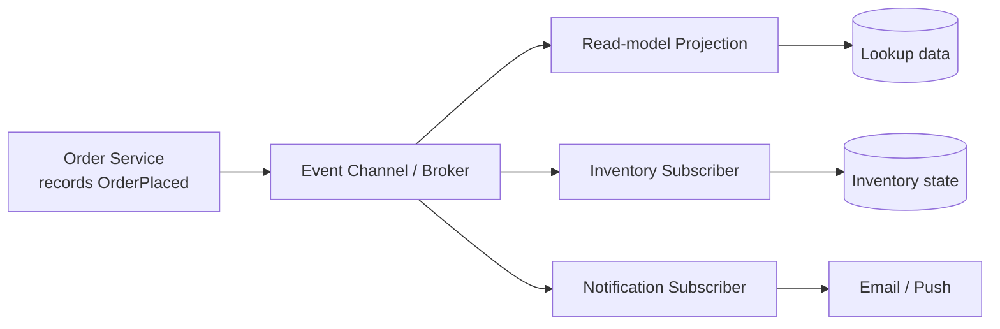
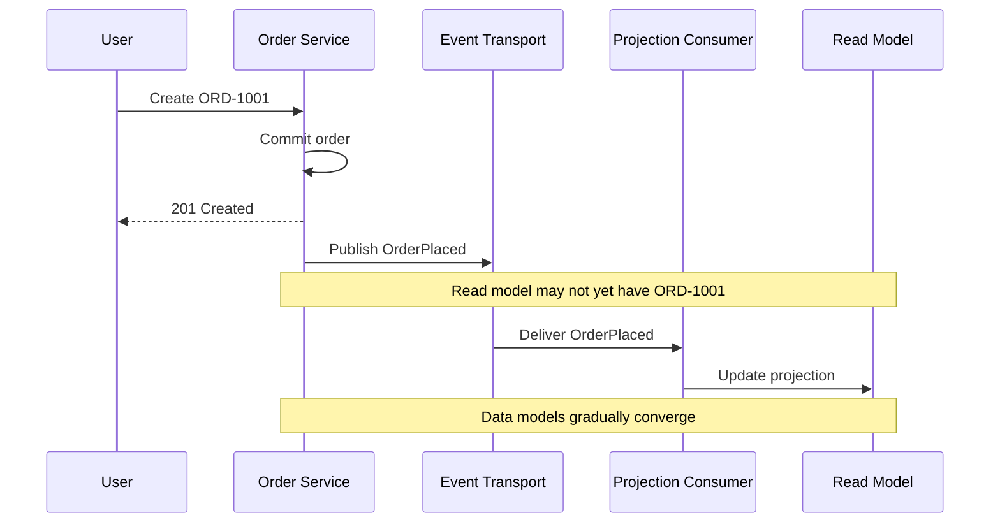
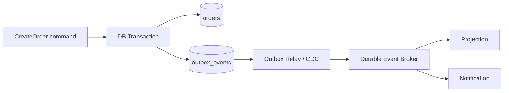
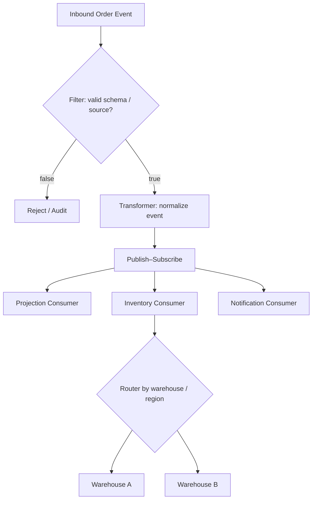

# Event Fan-Out and Eventual Consistency in Publish–Subscribe

An e-commerce system may need to do several things after an order is created: update a tracking view, deduct projected inventory, calculate business metrics, and send notifications. If the order-creation service calls every function sequentially, the responsiveness and reliability of order creation depend on every downstream component. The **Publish–Subscribe** pattern places an event on a channel for multiple subscribers to receive, separating responsibilities into more independent processing branches.

When branches update different data models or systems at different times, we typically accept **eventual consistency**: right after a change, some views may still be stale; if events are delivered, processed, and recovered successfully, those views will gradually converge to a consistent state. This is a **design contract**, not an automatic property that appears just because you created a `PublishSubscribeChannel`.

This lesson belongs to the **Publish subscribe** chapter in the `SPRING_INTEGRATION_PATTERN` module: learning how to implement Enterprise Integration Patterns with Spring Integration, combining Router, Filter, Transformer, Splitter, Aggregator, Gateway, retry, error channel, and correlation to build loosely coupled, extensible message flows while testing and monitoring branches.

## 1. Distinguishing Event Emission, Fan-Out, and Eventual Consistency

These three concepts are related, yet not synonymous:

| Concept | Answers the question | Example |
| --- | --- | --- |
| **Event** | What happened in the business domain? | `OrderPlaced(eventId, orderId, total)` |
| **Fan-out** | Who needs to be notified of that event? | Projection, inventory, and notification all receive `OrderPlaced` |
| **Eventual consistency** | How long can different data models diverge and how do they recover? | Order is saved, while the summary page does not display it immediately |

An event like `OrderPlaced` describes **a recorded fact**. It should not be interpreted as three commands that must execute instantaneously. Each subscriber decides the appropriate work for that event according to its own contract.



**Important condition:** the diagram represents a **logical model**. If you use a plain `PublishSubscribeChannel` inside one JVM, subscribers can be called synchronously, have no durable storage across restarts, and do not form a distributed event broker. For independent services to maintain eventual consistency when a process stops, you must also design reliable event storage and delivery mechanisms.

## 2. How Does Publish–Subscribe Differ From Point-to-Point and Recipient List?

| Pattern / channel | How recipients are chosen | Typical outcome |
| --- | --- | --- |
| **Point-to-Point / `QueueChannel`** | Each Message is pulled from the queue by one consumer per successful receive | Distributes work; not every consumer receives a copy |
| **`PublishSubscribeChannel`** | Sends to subscribers registered on the channel | Fans out the same Message to multiple subscribers |
| **Recipient List Router** | Computes a recipient list, optionally per predicate | Only selected channels receive the Message |
| **Single-target Content-Based Router** | Chooses one channel based on content or headers | One primary processing route |
| **Splitter** | Splits a payload into multiple child Messages | Each item can carry correlation/sequence metadata |

For example, if every order event needs three functions listening, `PublishSubscribeChannel` expresses **internal broadcast** intent better than writing three consecutive service calls. If only cross-border orders need compliance checks, use a Router/Recipient List or place a Filter in the corresponding subscriber branch.

**Fan-out is not a Splitter.** When an event goes to three subscribers, it remains the same business event. You cannot assume each dispatched copy carries `sequenceNumber=1/3`, `2/3`, `3/3` or that an Aggregator automatically knows when three subscribers have finished.

## 3. `PublishSubscribeChannel` in Spring Integration

`org.springframework.integration.channel.PublishSubscribeChannel` is a **`SubscribableChannel`**. The producer calls `send(message)` and registered `MessageHandler` instances receive the Message.

### 3.1. Synchronous Is the Default Behavior

When no `Executor` is supplied, `PublishSubscribeChannel` normally invokes subscribers **on the thread sending the Message**. Therefore:

- The producer may have to wait for handlers to execute.
- A slow handler can increase the latency of `send()`.
- An exception in one handler can affect delivery to other subscribers, depending on error-handling configuration.
- Handlers are structurally decoupled, yet not decoupled in execution time.

**Never state "using Publish–Subscribe is asynchronous" as a rule.** Asynchrony depends on the channel type, `Executor`, transport, and how subscribers are implemented.

### 3.2. Attaching an `Executor` for Asynchronous Handoff

`PublishSubscribeChannel` can accept an `Executor` to delegate subscriber invocations to other threads. Then the producer normally does not wait for each handler to finish, though:

- Tasks can be rejected when the executor is overloaded.
- Subscriber errors occur on other threads and require proper error handling.
- Completion order cannot be inferred from subscriber registration order.
- With an in-JVM executor alone, unfinished work can be lost when the process stops.

To achieve **eventual consistency across processes**, you normally combine a message broker, outbox, processing-state persistence, and retries/idempotency rather than merely adding a thread pool.

## 4. Minimal Example: One Message Received by Three Subscribers

The Java 17+ example below uses `PublishSubscribeChannel` and `MessageBuilder` directly, without needing a full Spring Boot project to demonstrate broadcast behavior. The payload is an immutable `record`, preventing subscribers from accidentally mutating the same business object.

```java
package example.integration;

import java.util.ArrayList;
import java.util.List;

import org.springframework.integration.channel.PublishSubscribeChannel;
import org.springframework.messaging.Message;
import org.springframework.messaging.support.MessageBuilder;

public class OrderFanOutDemo {

    public record OrderPlaced(
            String eventId,
            String orderId,
            long totalVnd) {
    }

    public static void main(String[] args) {
        PublishSubscribeChannel events = new PublishSubscribeChannel();
        List<String> processedBy = new ArrayList<>();

        events.subscribe(message -> processedBy.add("projection"));
        events.subscribe(message -> processedBy.add("inventory"));
        events.subscribe(message -> processedBy.add("notification"));

        OrderPlaced payload =
                new OrderPlaced("evt-1001", "ORD-1001", 1_250_000L);

        Message<OrderPlaced> event = MessageBuilder.withPayload(payload)
                .setHeader("eventId", payload.eventId())
                .setHeader("businessOrderId", payload.orderId())
                .build();

        boolean sent = events.send(event);

        System.out.println("Sent: " + sent);
        System.out.println("Subscribers invoked: " + processedBy.size());
        System.out.println("Results: " + processedBy);
    }
}
```

With three registered subscribers, no errors, and synchronous execution, `processedBy` contains three entries. One Message was dispatched to three handlers without **automatically creating three new business events**.

In this example, `ArrayList` is safe because handlers are called synchronously on the sending thread. When switching to an `Executor`, switch to a thread-safe structure (or proper synchronization) and wait for callbacks to finish before reading results.

### 4.1. How Many Times Can a Subscriber Process One Message?

Never use the output of the example above to promise "exactly once." When an event is resent from upstream, when retries happen, or when a broker redelivers, a subscriber can see the same **business event** multiple times. Distinguish:

- `MessageHeaders.ID`: identifier of a Message instance in Spring Messaging.
- `eventId`: stable identifier of the **business event**, which can be preserved across replays.
- `orderId`: identifier of the business entity; the same order can emit many distinct events.

For actions that must not execute twice, idempotency by `eventId` combined with subscriber name or action type is typically needed.

## 5. Configuring an Event Channel With Multiple Endpoints in Spring

In a Spring application, declare `PublishSubscribeChannel` as a bean and use `@ServiceActivator` endpoints to register consumers. The configuration example below focuses on wiring multiple handlers; the processing list is strictly illustrative and does not replace a database or broker.

```java
package example.integration;

import java.util.List;
import java.util.concurrent.CopyOnWriteArrayList;

import org.springframework.context.annotation.Bean;
import org.springframework.context.annotation.Configuration;
import org.springframework.integration.annotation.ServiceActivator;
import org.springframework.integration.channel.PublishSubscribeChannel;
import org.springframework.integration.config.EnableIntegration;

@Configuration
@EnableIntegration
public class OrderEventsConfiguration {

    public record OrderPlaced(String eventId, String orderId, long totalVnd) {
    }

    @Bean
    public PublishSubscribeChannel orderEvents() {
        return new PublishSubscribeChannel();
    }

    @Bean
    public List<String> processingLog() {
        return new CopyOnWriteArrayList<>();
    }

    @ServiceActivator(inputChannel = "orderEvents")
    public void updateReadModel(OrderPlaced event) {
        processingLog().add("READ_MODEL:" + event.eventId());
    }

    @ServiceActivator(inputChannel = "orderEvents")
    public void updateInventory(OrderPlaced event) {
        processingLog().add("INVENTORY:" + event.eventId());
    }

    @ServiceActivator(inputChannel = "orderEvents")
    public void sendNotification(OrderPlaced event) {
        processingLog().add("NOTIFICATION:" + event.eventId());
    }
}
```

With standard `@Configuration` bean declarations, `processingLog()` returns the Spring-managed singleton bean, so all three handlers write to the same list. Using a record payload keeps the example self-contained.

Points to understand:

1. Each `@ServiceActivator(inputChannel = "orderEvents")` method is an endpoint **registered as a subscriber** on the channel.
2. A Message entering `orderEvents` is distributed to the registered subscribers.
3. Methods returning `void` represent one-way processing; this is not a request-reply design expecting an aggregated response.
4. In practice, branches need separate business services, idempotency, transactions, monitoring, and error handling. Do not cram all logic into one class as in the example.
5. When subscriber endpoints are configured via annotations, do not manually register duplicate subscribers for the same responsibility and assume each event runs only once.

### When Is a Gateway or Adapter Needed?

A Gateway or inbound adapter can send Messages to `orderEvents`. If the Gateway needs a business reply, you must design **one explicit reply**; broadcasting an event to three `void` subscribers does not generate an answer for the Gateway automatically. For events emitted after a business command completes, a sensible pattern is returning the command's result first, then processing subscribers asynchronously or via a reliable broker mechanism.

## 6. How Does Eventual Consistency Play Out?

Suppose the system has a **source of truth** storing orders and a **read model** for search. The `OrderPlaced` event is emitted after the order is persisted.



Right after the API returns success, a user searching for the order may not see it yet, even though the system has saved the order. Moments later, the projection updates and the result appears. This is **consistency lag**.

**Eventual consistency does not mean "after a few seconds it is guaranteed to be right."** For replicas to truly converge, appropriate assumptions and guarantees must hold: events are not permanently lost, consumers can recover, failures are retried or repaired, and event order is handled consistently. If an event is lost or a consumer stays broken forever, data can stay out of sync indefinitely.

### 6.1. An Example Timeline

| Milestone | Order database | Read model | What the user observes |
| --- | --- | --- | --- |
| `t0` before creation | No order | No order | ORD-1001 not found |
| `t1` after commit | Has ORD-1001 | Not yet | Create-order API succeeded; search doesn't show it yet |
| `t2` while event pending | Has it | Possibly still stale | "Updating" status |
| `t3` after projection applies | Has it | Has it | Lookup results consistent with the event |

Under this model, an API can return `orderId` and an `ACCEPTED` status, provide an endpoint reading directly from the source of truth when *read-your-writes* is needed, or show a "syncing" status for asynchronously updated views.

Do not use `COMPLETED` for the entire business process just because the event was enqueued; individual branches may not have finished or may fail.

## 7. Asynchrony Does Not Automatically Bring Durability

Three layers are often confused:

| Layer | Mechanism | What is solved | What is not solved |
| --- | --- | --- | --- |
| **In-process synchronous** | `PublishSubscribeChannel()` without executor | Delivers to multiple handlers in the same app | Slowness/errors can hit the producer; not durable |
| **In-process asynchronous** | `PublishSubscribeChannel(executor)` | Moves handler execution to other threads | Not durable on JVM stop; does not share subscribers across instances |
| **Durable event delivery** | Broker/topic + appropriate consumers/subscriptions | Persists, delivers, and recovers on failure per configuration | Does not guarantee exactly-once side effects, global order, or convergence if consumers are buggy |

With multiple application replicas, a `PublishSubscribeChannel` **only delivers to subscribers in its own application context/JVM**. It does not automatically forward an event to every running instance. When independent services must all receive events, use an external transport/pub-sub or a distribution mechanism designed for distributed systems.

### 7.1. Configuring an Executor Changes the Execution Boundary

Minimal example:

```java
import java.util.concurrent.ExecutorService;
import java.util.concurrent.Executors;

import org.springframework.integration.channel.PublishSubscribeChannel;

ExecutorService executor = Executors.newFixedThreadPool(3);
try {
    PublishSubscribeChannel asyncEvents =
            new PublishSubscribeChannel(executor);
    // Subscribe consumers and send Messages here.
    // send() is not proof that subscribers have finished.
} finally {
    executor.shutdown();
}
```

In real application code, the executor should be Spring-lifecycle managed, with queue/rejection policies, metrics, and proper shutdown awaiting. The snippet above only illustrates the constructor; it is not a persistent event-delivery system.

### 7.2. Failing Subscribers Can Affect Fan-Out

In synchronous mode, if the first subscriber throws an exception, subsequent subscribers may not be invoked depending on error handling and channel configuration. In executor mode, branches can be running concurrently and errors surface after the producer has finished `send`.

Never assume "if one subscriber fails, the other branches are guaranteed to still receive the event." Decide:

- Should an error in one subscriber affect the producer?
- Is it acceptable for some branches to succeed while others fail?
- Are retries done **per branch** or by re-emitting **the whole event**?
- Where are events and retry states kept if the application or thread stops?

Depending on the version, `PublishSubscribeChannel` provides options for error handling, minimum subscriber requirements, and sequence metadata. Those options should be verified against your actual infrastructure, yet **never replace a broker or outbox**.

## 8. Transactional Outbox: Reducing Event Loss Between Database and Publisher

A common risk is **dual write**: the application writes to a database and emits an event as two separate operations.

```text
1. INSERT Order -> COMMIT succeeds
2. JVM stops before publishing OrderPlaced
3. Read model never receives the event without a recovery mechanism
```

Reversing the order is no safer:

```text
1. Publish OrderPlaced succeeds
2. INSERT Order -> ROLLBACK
3. Subscribers already saw an event for an unrecorded order
```

The **Transactional Outbox** pattern closes this gap by writing **the business entity** and **the outbox record** in the same database transaction:



The transaction commits only when both `orders` and `outbox_events` are written. A worker or CDC relay reads the outbox, emits events to the broker, and marks/records publish progress. If the relay stops, the outbox retains the events for redelivery.

### 8.1. Business Pseudocode

```java
@Transactional
public String createOrder(CreateOrder command) {
    Order order = orderRepository.save(Order.from(command));

    OutboxEvent event = OutboxEvent.orderPlaced(
            UUID.randomUUID().toString(), // stable eventId across relay retries
            order.getId(),
            order.getTotal());
    outboxRepository.save(event);

    return order.getId();
}

// Separate relay:
// - read unpublished outbox rows
// - send event to broker
// - record publish progress after broker acknowledges per contract
// - retry on error
```

This is **architectural pseudocode**, not standalone runnable code: repository, entity, and relay classes must be implemented for your system. The key point is that `eventId` is generated **once inside the transaction** and **kept unchanged across relay retries**, rather than generating a new ID on every retry.

Outbox reduces event loss from dual writes, yet a relay can still publish an event and crash before marking it sent. Upon recovery, the event is sent again. Therefore, consumers must still be **idempotent**.

## 9. Idempotency and Duplicate Delivery

Suppose projection receives `OrderPlaced(eventId="evt-1001")` twice. If it adds `totalVnd` to revenue each time without duplicate checking, figures will be wrong.

A common strategy:

1. Receive the event and validate schema/version.
2. Open a transaction in the consumer (if data and deduplication share the same database).
3. Insert `eventId + consumerName` into a processed-events table with a unique constraint.
4. If the key already exists, treat it as a duplicate delivery and skip **side effects**.
5. If the key does not exist, update the projection and commit in the same transaction.
6. Acknowledge to the broker per protocol only after stable processing.

Example logical keys:

```text
evt-1001:READ_MODEL
evt-1001:INVENTORY
evt-1001:NOTIFICATION
```

The same `eventId` across three subscribers represents three **distinct responsibilities**. If deduplication used a single global `eventId`, `NOTIFICATION` might mistakenly conclude `READ_MODEL` already handled it on its behalf. Keys must be scoped to the appropriate consumer/branch.

For final-state updates, *upserting by natural key and version* can be better than additive math. For external email/SMS, internal deduplication and provider-side idempotency keys must be designed together; a database transaction cannot undo an already-sent email.

## 10. Event Ordering, Versions, and State Convergence

Even with zero event loss, eventual consistency can still break due to **out-of-order processing**:

```text
OrderPlaced(orderId=ORD-1001, version=1)
OrderCancelled(orderId=ORD-1001, version=2)

Consumer may see version=2 before version=1 if transport/worker
does not preserve ordering by orderId.
```

If projection applies v2 and later overwrites it with a late v1, status reverts to `PLACED` even though the order was cancelled. Preventative measures:

- Every aggregate has a **monotonically increasing version**.
- The consumer stores `lastAppliedVersion`.
- When an event arrives, compare versions; never overwrite newer state with an older version.
- If a version jumps (at v1 and receives v3), follow a wait/replay/source-of-truth-read policy as required.
- Partition or key events by `orderId` if the transport supports ordering **within a key scope**.

Never promise **global ordering** across all orders when running multiple partitions or consumers. Ordering must match a real business scope, such as a single `orderId`.

### Event Time and Processing Time

An event may carry:

| Field | Meaning |
| --- | --- |
| `occurredAt` | When the business event happened |
| `recordedAt` | When the outbox or source of truth recorded it |
| `publishedAt` | When the relay/broker accepted it for publication |
| `processedAt` | When the subscriber completed processing |

These timestamps differ and can skew due to retries or clock drift across machines. Measuring lag requires consistent timestamp sources and explicitly stating which kind of lag is being measured.

## 11. Retries, Error Channels, and Dead-Lettering

Each subscriber should have its own error policy. An event may succeed in projection while failing in notification due to an email provider outage.

| Incident | Suitable handling |
| --- | --- |
| Timeout calling external service | Bounded retries, exponential backoff/jitter where appropriate |
| Unprocessable bad-schema event | Route to error flow / manual inspection; do not retry infinitely |
| Broker redelivers due to unacked consumer | Idempotency per event and subscriber |
| Projection misses a range of events | Replay from durable store or rebuild projection |
| Subscriber down for hours | Maintain backlog and alert on lag if transport supports it |
| Synchronous handler throws exception | Define impact on producer and other subscribers |

**Error channels in Spring Integration** process `ErrorMessage` according to how endpoints/pollers/executors are configured. They are not equivalent to a broker's **dead-letter topic**, nor do they automatically persist failed Messages across restarts.

For Messages that remain unprocessable after configured retries, a durable dead-letter queue/topic can retain the event, error cause, attempt count, and correlation info for investigation. Replaying from dead-letter storage should preserve `eventId` or link clearly to the original event.

### Why Retrying the Entire Fan-Out Is Dangerous

Suppose three subscribers were triggered; two succeeded and one failed. If the event is replayed to **all three branches** without idempotency, projection might double-count totals and notification might send duplicate alerts. The system must track progress per subscriber or implement replay with true idempotency.

## 12. Fan-Out With Router, Filter, Transformer, and Aggregator

EIPs are not mutually exclusive; they combine to form clear flows:



- **Filter** removes invalid or irrelevant events before fan-out.
- **Transformer** normalizes payloads, adds reliable metadata, and preserves `eventId`.
- **Publish–Subscribe** delivers events to independent subscribers.
- **Router** can operate inside a subscriber when it needs to pick a downstream route.
- **Splitter** can create child Messages when a payload holds a collection, though it is not required for fan-out.
- **Aggregator** fits when the business must **wait for results** from branches, not when simply emitting events for independent subscriber processing.

### 12.1. What If You Must Wait for All Branches to Finish?

When a Gateway must return a combined decision from Risk, Inventory, and Compliance, that is **Scatter–Gather** or orchestration/reply aggregation—no longer "emit an event and forget."

A possible design:

```text
requestId = attempt-101
expectedBranches = [RISK, INVENTORY, COMPLIANCE]

RiskResult(requestId, branch=RISK, status=OK)
InventoryResult(requestId, branch=INVENTORY, status=OK)
ComplianceResult(requestId, branch=COMPLIANCE, status=REVIEW)
```

The Aggregator must know the expected branches, correlation key, completion condition, duplicate handling, and timeout. `PublishSubscribeChannel` does not guarantee those three results will appear; fanning out Messages does not equal fanning in replies.

### 12.2. Preserving Correlation Across Services

Distinguish:

- **`eventId`**: identifier of the business event.
- **`aggregateId`/`orderId`**: related business entity.
- **`correlationId` or `requestId`**: groups Messages belonging to one processing round.
- **`traceId`**: tracks execution across multiple components.

When crossing HTTP, AMQP, or Kafka, configure header mapping/tracing properly; not all internal Spring Messaging headers survive every adapter. When durable replay is required, critical IDs should have an explicit serializable contract in the event envelope.

## 13. Designing UI and API Contracts for Eventual Consistency

A system embracing eventual consistency should reflect it in APIs and UX:

| Situation | Approach |
| --- | --- |
| Order creation command committed | Return `orderId` and source-of-truth status |
| Read model updates slowly | Display "syncing"; allow refresh or direct lookup by `orderId` |
| Must immediately read newly written data | Read from a suitably consistent source rather than a lagging projection |
| Notification subscriber fails | Display notification status separately; do not assume order creation failed |
| Event processing exceeds wait SLA | Alert on lag and provide a recovery procedure |
| Hard guarantees needed for money or stock | Enforce invariants in source-of-truth transactions or proper orchestration |

For example, **financial transaction values and recorded balances** may require atomic checks or strong consistency. You cannot cite "eventual consistency" to let two branches arbitrarily overwrite an account balance.

**Eventual consistency fits replicas/read models and post-processing tasks** where the business accepts a delay window, has recovery paths, and maintains a reliable source of truth.

## 14. Testing In-Process Fan-Out With JUnit 5

Before adding brokers and external systems, write a test proving **one Message reaches all registered subscribers**. With a synchronous channel, this test runs in plain Java:

```java
package example.integration;

import static org.junit.jupiter.api.Assertions.*;

import java.util.ArrayList;
import java.util.List;

import org.junit.jupiter.api.Test;
import org.springframework.integration.channel.PublishSubscribeChannel;
import org.springframework.messaging.Message;
import org.springframework.messaging.support.MessageBuilder;

class PublishSubscribeChannelTest {

    record OrderPlaced(String eventId, String orderId) {}

    @Test
    void oneEventIsDeliveredToAllThreeSubscribers() {
        PublishSubscribeChannel channel = new PublishSubscribeChannel();
        List<String> delivered = new ArrayList<>();

        channel.subscribe(message -> delivered.add("READ_MODEL"));
        channel.subscribe(message -> delivered.add("INVENTORY"));
        channel.subscribe(message -> delivered.add("NOTIFICATION"));

        Message<OrderPlaced> event = MessageBuilder
                .withPayload(new OrderPlaced("evt-401", "ORD-401"))
                .setHeader("eventId", "evt-401")
                .build();

        assertTrue(channel.send(event));
        assertEquals(3, delivered.size());
        assertTrue(delivered.containsAll(
                List.of("READ_MODEL", "INVENTORY", "NOTIFICATION")));
    }
}
```

This test proves synchronous internal fan-out; it **does not prove eventual consistency**, event durability, or exactly-once processing in a distributed system. Because it uses no executor, reading `delivered` after `send()` works; asynchronous channels require test synchronization.

### 14.1. Testing Asynchronous Dispatch

One way to wait for callbacks is `CountDownLatch`:

```java
import java.util.concurrent.CountDownLatch;
import java.util.concurrent.ExecutorService;
import java.util.concurrent.Executors;
import java.util.concurrent.TimeUnit;

import org.springframework.integration.channel.PublishSubscribeChannel;
import org.springframework.messaging.support.MessageBuilder;

ExecutorService executor = Executors.newFixedThreadPool(3);
try {
    PublishSubscribeChannel asyncChannel =
            new PublishSubscribeChannel(executor);
    CountDownLatch completed = new CountDownLatch(3);

    asyncChannel.subscribe(message -> completed.countDown());
    asyncChannel.subscribe(message -> completed.countDown());
    asyncChannel.subscribe(message -> completed.countDown());

    asyncChannel.send(MessageBuilder.withPayload("evt-501").build());

    boolean allReceived = completed.await(3, TimeUnit.SECONDS);
    if (!allReceived) {
        throw new AssertionError("At least one subscriber did not run");
    }
} finally {
    executor.shutdownNow();
}
```

The snippet only shows how to **wait for outcomes with a timeout**. In a complete test, verify each subscriber's state and side effects; avoid fixed `Thread.sleep()` to guess when threads finish.

### 14.2. Testing Eventual Consistency on a Real System

Additional tests should verify:

1. **Duplicate delivery:** delivering an `eventId` twice creates no double side effects.
2. **Subscriber outage:** events are retained and processed once the consumer recovers.
3. **Transient relay/broker failure:** outbox preserves data, and retries keep `eventId` unchanged.
4. **Out-of-order events:** an older version never overwrites a newer version on the read model.
5. **Single-branch failure:** notification failing does not undo completed projections; per-branch retries work.
6. **Zero subscribers:** the application has a clear accept, reject, or alert policy.
7. **Large backlogs:** lag from publish to apply is observable, and queues do not grow uncontrollably.
8. **Header mapping:** `eventId`, `orderId`, `correlationId`, and required trace context survive transport hops.
9. **Gateway or Scatter–Gather:** requests expecting replies have contract-compliant reply paths and timeouts.

## 15. Monitoring Fan-Out and Consistency Lag

A Publish–Subscribe flow should measure both **delivery health** and **data convergence progress**.

| Suggested metric | Meaning | Anomaly signal |
| --- | --- | --- |
| `events.published.count` | Events recorded by publisher | Drops abnormally relative to successful commands |
| `events.delivered.count{consumer=...}` | Events received by each subscriber | One consumer suddenly stops receiving |
| `events.processed.count{consumer=...}` | Successfully processed events | Lower than incoming event rate |
| `events.retry.count` | Retry attempts | Climbing continuously |
| `events.dead_letter.count` | Events isolated to DLQ | Unprocessable events exist |
| `outbox.pending.count` | Unpublished events waiting in outbox | Relay is slow or stopped |
| `consumer.lag` | Backlog per consumer | Climbing continuously |
| `projection.staleness` | Age of read model relative to source | Exceeds published SLA |
| `projection.version_gap` | Version gap awaiting application | Missing events or out-of-order processing |

These metrics are **design suggestions**, not provided out of the box with these exact names in Spring Integration. Measure them using Micrometer, Spring Boot Actuator, broker metrics, structured logging, and tracing. Never put `orderId`/`eventId` into metric tags due to excessive cardinality; put them in logs or traces instead.

Minimal log record per subscriber:

```json
{
  "eventId": "evt-1001",
  "eventType": "OrderPlaced",
  "orderId": "ORD-1001",
  "consumer": "READ_MODEL",
  "attempt": 2,
  "result": "APPLIED",
  "aggregateVersion": 1,
  "correlationId": "attempt-101"
}
```

Log only metadata needed for tracing and diagnosis; never write tokens, personal info, or full sensitive payloads into logs.

## 16. Common Design Mistakes

| Symptom | Cause | Fix |
| --- | --- | --- |
| Order-creation API slows down after adding a subscriber | Synchronous `PublishSubscribeChannel`; handler runs on producer thread | Offload long-running work or use an appropriate transport/executor |
| Subscribers miss events on JVM restart | Events were only emitted in memory | Design an outbox and durable broker if recovery is required |
| Three replicas exist, yet not all three receive | Each instance has its own internal channel | Define broker/subscription topology and cross-service fan-out |
| Metrics double-counted | Event replayed without idempotent consumer | Deduplicate by `eventId` and consumer, or upsert by version |
| Projection state moves backward | Older event arrives after newer event | Enforce versions, partition keys, and replay controls |
| One failing subscriber breaks order creation | Synchronous fan-out or improper exception handling | Define transaction boundaries and async/error flows |
| Gateway times out | Multiple subscribers do not produce a single aggregated reply | Use a one-way event contract or design aggregation |
| "Published" treated as "fully processed" | Confusing enqueue/dispatch with business completion | Track per-subscriber status and processing lag |
| Read model drifts indefinitely | Lost events or broken consumers without replay | Persist events durably, monitor lag, and support rebuilds |
| Retries send duplicate notifications | Non-idempotent external side effects | Lock tasks, use provider idempotency, and track send state |

## 17. Checklist for Implementing Fan-Out With Eventual Consistency

- **Identify the source of truth:** which data must commit before emitting an event?
- **Name events after recorded facts:** `OrderPlaced` differs from an imperative command "place order."
- **Know which subscribers need the event:** which branches are mandatory and which are auxiliary?
- **Pick the right delivery mechanism:** internal channels for in-JVM work; broker/outbox when durability and multiple services are required.
- **Do not confuse async with durable:** an executor does not preserve events after a process crash.
- **Design per-subscriber idempotency:** the same event may be redelivered.
- **Specify ordering/versioning:** prevent stale events from overwriting newer state.
- **Provide retries, dead-lettering, and replay:** each subscriber can fail independently.
- **Design read-your-writes when needed:** APIs and UIs must handle the unsynchronized window.
- **Maintain correlation and observability:** trace `eventId`, `orderId`, `requestId`, lag, and per-branch status.
- **Test failure scenarios:** crashes, duplicates, out-of-order events, backlogs, and timeouts.
- **Define what "done" means:** accepted, emitted, and processed by every subscriber are distinct milestones.

**Publish–Subscribe solves delivering the same event to multiple interested parties; eventual consistency solves the data contract between parties processing at different times.** Combining both ideas properly—along with an outbox, idempotency, error handling, correlation, and lag monitoring—lets you build Spring Integration flows that both separate responsibilities and recover and converge cleanly in real operations.
