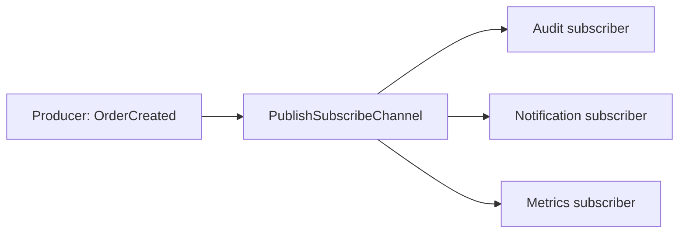
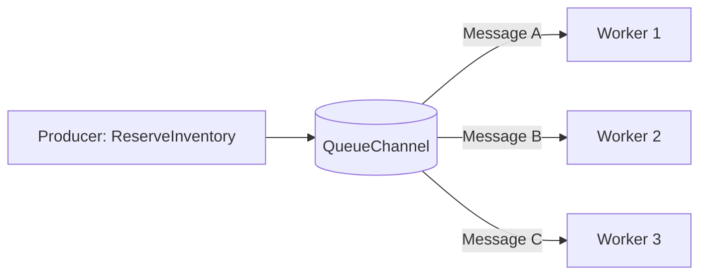
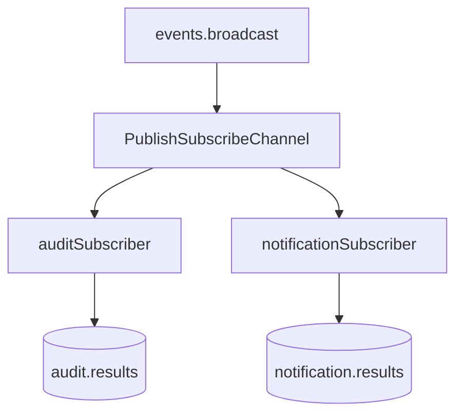
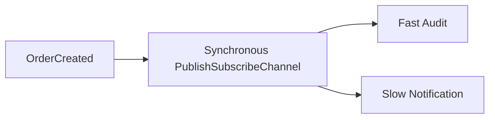
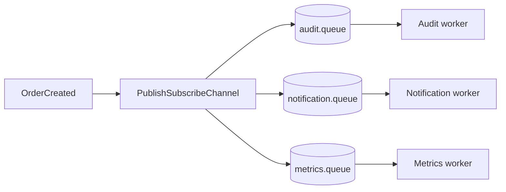
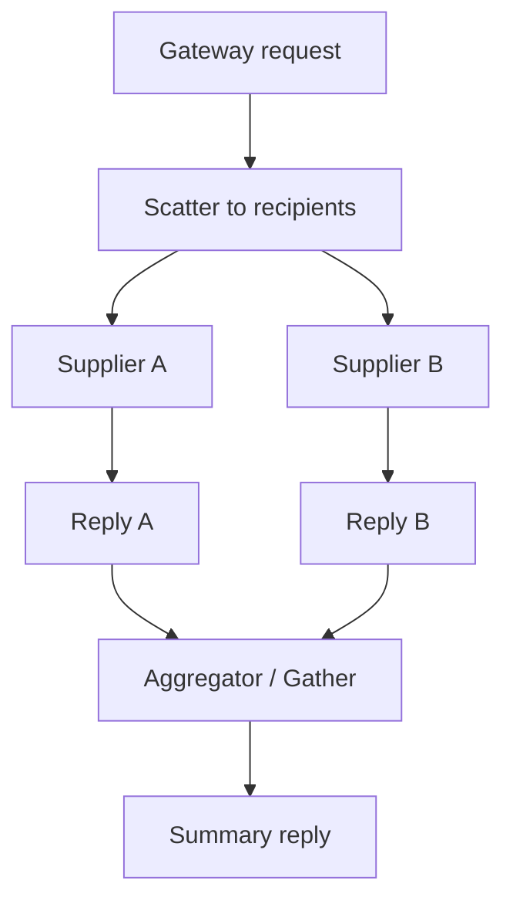

# Comparing Publish-Subscribe and Queue in Spring Integration

## Lesson Objectives

When the system receives an `OrderCreated` event, the audit, notification, and analytics services all need to know that the event occurred. Yet when the system receives a **work task to process an order** that must run once, three independent workers must not all deduct inventory for the same order. Two seemingly similar requirements—"deliver a message to multiple components"—actually require **two different distribution mechanisms**.

- **Publish-Subscribe**: one message is **broadcast to subscribers** of a channel. Each subscriber can perform its own responsibility.
- **Queue**: one message is **placed into a queue** and **pulled by one consumer** per successful receive; multiple consumers can compete to receive queued messages.

This lesson belongs to the **Publish subscribe** chapter of the **SPRING_INTEGRATION_PATTERN** module. The module aims to build loosely coupled, extensible message flows using Enterprise Integration Patterns with Spring Integration; practicing Router, Filter, Transformer, Splitter, Aggregator, Gateway, retry, error channel, and correlation, while testing and observing processing branches.

After this lesson, you can:

1. Distinguish **broadcast/fan-out** from **competing consumers**, avoiding confusion around the term "subscriber" across different architectures.
2. Choose `PublishSubscribeChannel`, `QueueChannel`, and combined channels according to the business contract.
3. Understand the effects of **sync/async, ordering, backpressure, failures, and transactions** on both models.
4. Build two Java DSL flows and use JUnit to verify in practice whether one message reaches **every branch** or is **consumed only once**.
5. Design resilient fan-out with per-branch queues when independent processing and backlogs are needed.
6. Handle retries, idempotency, correlation, timeouts, and per-subscriber observability.

## 1. Distinguish Immediately With Two Scenarios

### Scenario A — An Event Multiple Branches Need to Know About

An order was created successfully. The system wants to perform three distinct responsibilities:

- Write an audit log.
- Send a notification to the customer.
- Update statistics.



**One event** is delivered to **three subscribers**. Each subscriber receives the event information to carry out its own responsibility. They should not all execute the same single side effect, such as deducting stock three times.

### Scenario B — Work That Must Be Distributed to One of Many Workers

A `ReserveInventory` task needs one worker to process it. The system has three identical workers to scale throughput.



The diagram illustrates three distinct messages being picked up by three workers. **Each message is pulled from the queue once per successful dequeue**, rather than being broadcast simultaneously to all three workers. That does **not mean exactly-once business processing**: retries, mid-flight crashes, or broker redeliveries can cause the same work to run again without idempotency.

### Concise Selection Rule

> **If every recipient needs to know about the same event, think Publish-Subscribe. If one task needs to be picked up by one worker in a pool, think Queue.**

From here, let us examine edge cases and how the two mechanisms combine.

## 2. Publish-Subscribe and Queue Differ in Their Contracts

| Criterion | `PublishSubscribeChannel` | `QueueChannel` |
| --- | --- | --- |
| Purpose | Broadcast one message to multiple subscribers | Buffer work for consumers to pull actively |
| Distribution model | **Fan-out / broadcast** to the channel's subscribers | **Point-to-point**: one receive removes one message from the queue |
| Recipients per message | Potentially multiple subscribers | One consumer receives per successful dequeue |
| Consumption style | Handlers subscribe to the channel; channel dispatches on `send()` | Consumers call `receive()` or use a polling endpoint |
| Default backlog buffering | Not a message queue | Has an in-process queue holding unconsumed messages |
| Multiple handlers | Handlers receive events per publish-subscribe policy | Multiple pollers/consumers compete to pull messages |
| Default synchrony | Usually dispatches synchronously unless an executor is set | `send()` enqueues; handlers run only when a consumer/poller pulls |
| Asynchrony | Can configure an executor for dispatch | Queue already decouples send time from receive time |
| Ordering | Depends on dispatcher, executor, subscriber order, and processing speed | Queue is normally FIFO on pull; completion can be out of order |
| No recipients | May have zero subscribers; check minimum-subscriber config | Messages can wait in the queue until a consumer arrives |
| Backpressure | Slow subscribers can prolong synchronous dispatch; executor has its own queue | Queue capacity/send timeout determines behavior when full |
| Data durability | Channel is not by itself a durable event store | Default in-memory queue is also not durable; message store is configurable |
| Failures | One subscriber's failure can affect the send path depending on mode | Producer and consumer typically handle errors at different times |
| Scaling | More subscribers to add **new functions receiving the same event** | More consumers to increase **capacity for the same kind of work** |

This table describes **Spring Integration channels within one application**. In Kafka, RabbitMQ, JMS, or cloud messaging, *topic*, *subscription*, *consumer group*, and *queue* carry additional transport semantics. Do not assume an in-memory `PublishSubscribeChannel` automatically has all the persistence, replay, or multi-process distribution capabilities of a message broker.

## 3. How Does Spring Integration Manage Messages and Endpoints?

A message consists of a **payload** and **headers**:

```text
Message<OrderCreated>
  payload:
    orderId = ORD-42
    eventId = EV-42
  headers:
    traceId = trace-42
    tenantId = tenant-a
    eventType = OrderCreated
```

In Pipes and Filters, a **channel** connects a producer to downstream endpoints:

- `MessageChannel` defines the `send()` operation.
- `SubscribableChannel` lets handlers subscribe to receive dispatched messages.
- `PollableChannel` exposes `receive()` so consumers can actively pull messages.
- `PublishSubscribeChannel` is a `SubscribableChannel`.
- `QueueChannel` is a `PollableChannel`.

This explains the fundamental difference: `PublishSubscribeChannel` pushes events to subscribers, whereas `QueueChannel` holds messages waiting for someone to pull them.

### Do Not Confuse `DirectChannel` With `PublishSubscribeChannel`

`DirectChannel` is also a `SubscribableChannel` whose handlers run synchronously in typical configurations. However, when multiple subscribers exist, `DirectChannel` uses a dispatcher strategy to pick one handler—**not broadcast to all** like `PublishSubscribeChannel`.

If every subscriber must receive the same event, simply registering extra handlers on a `DirectChannel` violates the contract.

### Do Not Confuse Filter With Publish-Subscribe

A `Filter` in Spring Integration passes or discards **one message** based on a predicate. It does not create receiving branches by itself. With a `PublishSubscribeChannel`, each subscriber can place its own Filter to handle only relevant events, yet branch A's Filter should not accidentally decide whether branch B receives the event.

## 4. Java DSL Example: One Event to Two Subscribers

The example below builds a self-contained demo application with two subscribers:

- `audit` receives an `OrderCreated` event and emits a simulated branch outcome.
- `notification` also receives **that exact event** and produces its own outcome.
- Both outcomes are placed into two separate `QueueChannel`s so tests can inspect them via `receive()`.

We use queues **at the end of each branch strictly as test sinks**; this does not change the publish-subscribe nature of the flow's input.



### Complete Configuration

```java
import org.springframework.context.annotation.Bean;
import org.springframework.context.annotation.Configuration;
import org.springframework.integration.channel.PublishSubscribeChannel;
import org.springframework.integration.channel.QueueChannel;
import org.springframework.integration.config.EnableIntegration;
import org.springframework.integration.dsl.IntegrationFlow;
import org.springframework.messaging.PollableChannel;

@Configuration
@EnableIntegration
public class PubSubVsQueueConfig {

    public record OrderCreated(String orderId, String eventId) {}

    public record BranchResult(
        String branch,
        String eventId,
        String status
    ) {}

    // Input of the broadcast flow.
    @Bean("events.broadcast")
    PublishSubscribeChannel broadcast() {
        return new PublishSubscribeChannel();
    }

    // Two test sinks; replace with business handlers in a real application.
    @Bean("audit.results")
    PollableChannel auditResults() {
        return new QueueChannel();
    }

    @Bean("notification.results")
    PollableChannel notificationResults() {
        return new QueueChannel();
    }

    @Bean
    IntegrationFlow auditSubscriber() {
        return IntegrationFlow.from("events.broadcast")
            .transform(OrderCreated.class, event ->
                new BranchResult("AUDIT", event.eventId(), "SUCCEEDED"))
            .channel("audit.results")
            .get();
    }

    @Bean
    IntegrationFlow notificationSubscriber() {
        return IntegrationFlow.from("events.broadcast")
            .transform(OrderCreated.class, event ->
                new BranchResult(
                    "NOTIFICATION", event.eventId(), "SUCCEEDED"))
            .channel("notification.results")
            .get();
    }

    // Input of an independent workflow queue for comparison.
    @Bean("work.queue")
    PollableChannel workQueue() {
        return new QueueChannel(100);
    }
}
```

Key points:

1. `PublishSubscribeChannel` has **two subscribing flows** via `IntegrationFlow.from("events.broadcast")`.
2. Sending **one** event causes both flows to be dispatched, unless an error or other conditional policy intervenes.
3. The `QueueChannel` beans `audit.results` and `notification.results` receive **separate outcomes**; they are not two competing consumers on one shared queue.
4. `work.queue` is an **independent** job queue for the comparison part.
5. `BranchResult` is a DTO defined by the lesson; Spring Integration does not automatically generate a `SUCCEEDED` status when a channel send succeeds.

These examples use Java 17+ for `record` support and assume appropriate Spring Integration, Spring Context, and Spring Messaging dependencies.

### Producer Sending the Event

```java
import org.springframework.messaging.Message;
import org.springframework.messaging.support.MessageBuilder;

Message<PubSubVsQueueConfig.OrderCreated> message =
    MessageBuilder.withPayload(
        new PubSubVsQueueConfig.OrderCreated("ORD-42", "EV-42"))
        .setHeader("traceId", "trace-42")
        .setHeader("tenantId", "tenant-a")
        .build();

broadcastChannel.send(message);
```

`broadcastChannel` is the `MessageChannel` or `PublishSubscribeChannel` bean named `events.broadcast` injected from the Spring context. Without an executor configured, both subscribers execute via the channel's synchronous dispatch; however, never turn subscriber invocation order into a business contract.

### Not One Event Split Into Two Payloads

Above, **both subscribers receive the same `OrderCreated` payload**. Each transforms it into a different `BranchResult`. This differs from `Splitter`, where a payload like `List<OrderLine>` is split into child messages carrying **different pieces of data**.

## 5. `QueueChannel` Example: Multiple Consumers Pulling Work From One Place

`QueueChannel` enqueues incoming messages. A consumer calling `receive()` removes the message from the queue; another consumer cannot receive **that same existing element** from this in-memory queue once it has been pulled successfully.

```java
import org.springframework.integration.channel.QueueChannel;
import org.springframework.messaging.Message;
import org.springframework.messaging.support.MessageBuilder;

QueueChannel jobs = new QueueChannel(10);

jobs.send(MessageBuilder.withPayload("job-1").build());
jobs.send(MessageBuilder.withPayload("job-2").build());

Message<?> first = jobs.receive(0);  // job-1
Message<?> second = jobs.receive(0); // job-2
Message<?> empty = jobs.receive(0);  // null
```

Those three receives could be executed by three competing workers. With a FIFO queue, no other consumers, and no priority policy, `job-1` is pulled before `job-2`. However:

- The worker executing `job-1` may run slower than the worker executing `job-2`.
- `QueueChannel` does not emit results from handlers by itself; the application needs consumers/pollers.
- When a consumer pulls a message and fails to process it, **an in-memory queue does not automatically understand business logic to roll back the message**. Design retries, compensation, and idempotency explicitly.
- When data must survive restarts, a default in-RAM queue falls short; consider a persistent message store or broker.

### Two Competing Polling Consumers

In a real system, two Service Activators can attach to the same `QueueChannel`, each with a poller. Illustration:

```java
import org.springframework.integration.annotation.Poller;
import org.springframework.integration.annotation.ServiceActivator;
import org.springframework.messaging.Message;

public class InventoryWorkers {

    @ServiceActivator(
        inputChannel = "work.queue",
        poller = @Poller(fixedDelay = "200", maxMessagesPerPoll = "1")
    )
    public void workerA(Message<String> job) {
        process(job, "A");
    }

    @ServiceActivator(
        inputChannel = "work.queue",
        poller = @Poller(fixedDelay = "200", maxMessagesPerPoll = "1")
    )
    public void workerB(Message<String> job) {
        process(job, "B");
    }

    private void process(Message<String> job, String worker) {
        // Idempotent business logic, tracking jobId/traceId.
        System.out.printf("Worker %s: %s%n",
            worker, job.getPayload());
    }
}
```

This snippet requires registering `InventoryWorkers` as a bean in the Spring context with appropriate thread/poller policies. Both endpoints **poll** from one queue; they are not two subscribers each receiving every message.

There is no strict fairness contract guaranteeing workers A and B always receive equal counts. Poll timing, execution duration, thread counts, and runtime scheduling determine actual distribution.

## 6. Testing the Difference With JUnit

A test suite must verify **the number of recipients**. Never assert only that `send()` succeeded and conclude processing worked properly.

```java
import static org.assertj.core.api.Assertions.assertThat;

import org.junit.jupiter.api.Test;
import org.springframework.beans.factory.annotation.Autowired;
import org.springframework.beans.factory.annotation.Qualifier;
import org.springframework.messaging.Message;
import org.springframework.messaging.MessageChannel;
import org.springframework.messaging.PollableChannel;
import org.springframework.messaging.support.MessageBuilder;
import org.springframework.test.context.junit.jupiter.SpringJUnitConfig;

@SpringJUnitConfig(PubSubVsQueueConfig.class)
class PubSubVsQueueTest {

    @Autowired
    @Qualifier("events.broadcast")
    MessageChannel broadcast;

    @Autowired
    @Qualifier("audit.results")
    PollableChannel auditResults;

    @Autowired
    @Qualifier("notification.results")
    PollableChannel notificationResults;

    @Autowired
    @Qualifier("work.queue")
    PollableChannel workQueue;

    @Test
    void publishSubscribeDeliversAnEventToBothSubscribers() {
        var event = new PubSubVsQueueConfig.OrderCreated(
            "ORD-42", "EV-42");

        Message<?> request = MessageBuilder.withPayload(event)
            .setHeader("traceId", "trace-42")
            .build();

        assertThat(broadcast.send(request)).isTrue();

        Message<?> audit = auditResults.receive(2_000);
        Message<?> notification = notificationResults.receive(2_000);

        assertThat(audit).isNotNull();
        assertThat(notification).isNotNull();

        var a = (PubSubVsQueueConfig.BranchResult) audit.getPayload();
        var n = (PubSubVsQueueConfig.BranchResult)
            notification.getPayload();

        assertThat(a.branch()).isEqualTo("AUDIT");
        assertThat(n.branch()).isEqualTo("NOTIFICATION");
        assertThat(a.eventId()).isEqualTo("EV-42");
        assertThat(n.eventId()).isEqualTo("EV-42");

        assertThat(audit.getHeaders().get("traceId"))
            .isEqualTo("trace-42");
        assertThat(notification.getHeaders().get("traceId"))
            .isEqualTo("trace-42");

        assertThat(auditResults.receive(0)).isNull();
        assertThat(notificationResults.receive(0)).isNull();
    }

    @Test
    void oneQueueMessageIsRemovedByOneSuccessfulReceive() {
        var job = MessageBuilder.withPayload("job-42").build();

        assertThat(workQueue.send(job)).isTrue();

        Message<?> firstConsumer = workQueue.receive(2_000);
        Message<?> secondConsumer = workQueue.receive(0);

        assertThat(firstConsumer).isNotNull();
        assertThat(firstConsumer.getPayload()).isEqualTo("job-42");
        assertThat(secondConsumer).isNull();
    }
}
```

This test suite isolates both mechanisms with separate queues and no background consumers. When running tests in parallel or sharing a context with leftover state, design per-test queue isolation/resets.

What this test does **not** prove: that the system wrote to a real database, sent a real SMS, or achieved exactly-once semantics under all failure modes. We have verified the topology and simulated outcomes per the flow's contract.

### Recommended Extended Tests

- Add a third subscriber and verify the event appears in all three branches.
- Enqueue two jobs, run two independent workers, and assert the total jobs processed equals two, not four.
- Have one subscriber throw an exception; record the impact on the producer and the other subscriber under synchronous configuration.
- Switch `PublishSubscribeChannel` to an executor and verify results using a timeout instead of relying on completion order.
- Configure zero subscribers; decide whether the system permits accepting events without recipients or must raise an error.
- Fill the queue with a small capacity and verify how the producer handles send timeout.

## 7. Synchronous vs. Asynchronous: Two Axes Orthogonal to Topology

**Broadcast does not require asynchrony. Queue does not automatically guarantee parallel processing.**

### Synchronous `PublishSubscribeChannel`

Without an executor configured, `PublishSubscribeChannel` dispatches messages to subscribers synchronously. When one subscriber calls a slow API, the `send()` path can be held for the duration of that handler's execution.

```text
Producer.send(event)
  -> Audit handler        (30 ms)
  -> Notification handler (800 ms)
  -> Metrics handler      (10 ms)
Producer returns after synchronous dispatch
```

These durations are illustrative, not a promise of subscriber ordering or actual timings. A subscriber throwing an exception can interrupt dispatch or propagate the error back to the sender depending on dispatcher configuration, so never build transactional assumptions on "every branch always finishes."

### `PublishSubscribeChannel` With an Executor

You can use a `TaskExecutor` to dispatch to subscribers asynchronously.

```java
import org.springframework.core.task.TaskExecutor;
import org.springframework.integration.channel.PublishSubscribeChannel;

PublishSubscribeChannel asynchronousBroadcast(TaskExecutor executor) {
    return new PublishSubscribeChannel(executor);
}
```

With an executor:

- `send()` can return before subscribers finish their business work.
- Subscribers can finish in a different order than dispatched.
- Errors can occur on another thread; handle via error channel / error handler per endpoint configuration.
- Sender's MDC/`ThreadLocal` does not transfer automatically to executor threads; pass context via headers and configure propagation if needed.
- Internal executors/queues also need resource bounds and overload policies.

Do not enable an executor merely to "run faster" when the flow needs same-thread transactions or meaningful sequential ordering.

### `QueueChannel` and Pollers

`QueueChannel` stores messages. A consumer or poller pulls and processes them. If no consumer exists, the queue can retain messages—that is a backlog, not a failed subscriber.

```text
Producer -- send --> QueueChannel (backlog)
                        |
                 Poller / receive()
                        |
                      Handler
```

Choose poller/worker counts, concurrency policies, wait times, and capacity according to SLAs. Multiple workers can raise throughput, yet do not guarantee FIFO completion outcomes.

## 8. Backpressure and When One Branch Is Slow

An important architectural question: **Should a slow Notification be allowed to slow down Audit?**

### Direct Synchronous Fan-Out



In a synchronous broadcast, the producer can suffer the latency of the slow subscriber. If a subscriber fails, understand how exceptions affect the dispatch process.

### Fan-Out Into Per-Branch Queues



In this diagram, **each branch has its own queue**. The event fans out to three queues (each queue holds one message for its branch), and each branch's consumer processes independently. Thus a slow branch can build up a backlog **in its own queue** without necessarily slowing down the remaining handlers correspondingly.

Still, fan-out must send the message to every queue. If `notification.queue` is full or errors out, sending to that queue can block the producer or raise an error. Thus **separate queues isolate processing pace, yet do not automatically provide absolute isolation of event-dispatch failures**.

### Capacity and Resource Bounds

Example `QueueChannel(2)`:

```java
QueueChannel bounded = new QueueChannel(2);

boolean a = bounded.send(
    MessageBuilder.withPayload("A").build(), 0);
boolean b = bounded.send(
    MessageBuilder.withPayload("B").build(), 0);
boolean c = bounded.send(
    MessageBuilder.withPayload("C").build(), 0);
```

Assuming no consumers and an empty queue, `a` and `b` succeed while `c` returns `false` because the queue is full with timeout 0. The producer must handle that result: report overload, retry with backoff, spill to durable storage, or route to a managed error channel.

**Placing a `QueueChannel` behind a `PublishSubscribeChannel` does not automatically turn the system into durable pub/sub.** By default the queue remains in memory and can lose data if the process stops abruptly. When replay or restart survival is needed, evaluate a suitable message store or broker.

## 9. Reliability: Orthogonal to Distribution Style

Both publish-subscribe and queue designs may require retries, yet failures occur at different layers:

| Layer | Publish-Subscribe | Queue |
| --- | --- | --- |
| **Acceptance** | Channel accepted and dispatched the event per config | Queue accepted the message into its buffer/store |
| **Delivery** | Each subscriber may receive or encounter send/dispatch errors | Consumer may not have polled yet or failed to receive |
| **Processing** | Each subscriber can succeed/fail independently | A worker that received the item can still fail |
| **Retry** | Retry one branch or replay the whole event; prevent duplicate side effects | Retry the job or replay the job; requires idempotency |
| **Persistence** | Depends on external architecture or per-branch storage | Depends on message store/broker; not built into RAM queues |
| **Completion** | May need to aggregate status of all subscribers | Need to determine job completion by business status |

### One Event, Three Branches, One Branch Fails

Suppose:

```text
OrderCreated EV-42
    Audit         -> SUCCEEDED
    Notification  -> FAILED
    Metrics       -> SUCCEEDED
```

If the producer **retries the whole event** through `PublishSubscribeChannel`, Audit and Metrics may re-run. If retrying **Notification alone**, you need to know whether it actually received the event and whether side effects partially occurred.

Common solution:

1. Every event carries a stable `eventId`.
2. Each branch has an idempotency key `eventId + subscriberName`.
3. Each handler records durable processing state if recovery across restarts is required.
4. Retries use backoff and attempt limits, routing to a failure-handling channel once exhausted.
5. Monitor duplicates, late results, and replay policies.

### Queue Does Not Mean Exactly-Once Either

Even though one `receive()` removes a message from the queue, two problems remain:

- A worker updates the database successfully yet crashes before marking the job done. An external retry mechanism may re-execute the same job.
- A job may be submitted twice by the producer due to a timeout or uncertainty over whether the prior send succeeded.

Therefore, use business idempotency keys, transactions where appropriate, and result confirmation mechanisms. Never take "one message was received by one consumer" as proof that "the side effect happened strictly once."

### Message Brokers Have Different Semantics

With Kafka, a topic with **two consumer groups** lets both groups process the same record; within **one** group, partitions are assigned according to broker mechanics. With AMQP, exchanges and queues have distinct binding, fan-out, acknowledgement, and durability rules. When connecting Spring Integration to a broker via adapters, design for **both the channel contract and the broker contract** rather than guessing from queue/pub-sub names.

## 10. Ordering: Sending, Receiving, and Completing Are Not the Same

Consider two events:

```text
EV-1 is sent by the producer before EV-2.
```

### Publish-Subscribe

Each subscriber can observe different orderings when using executors, concurrency, brokers, or retries. A branch processing EV-2 very quickly may finish before EV-1. If the requirement is "for each `orderId`, events must be processed in order," you need key-based ordering policies or dedicated sequential handling for that branch.

### Queue

`QueueChannel` normally dequeues FIFO when there are no competing consumers or custom priority policies. Yet two competing workers can finish jobs out of dequeue order. With `PriorityChannel`, even **dequeue order** can differ from FIFO due to higher-priority messages.

### Using Correlation to Restore Relationships

The `traceId` header is for tracing. `correlationId` and `sequenceNumber` group and order related messages, such as after a Splitter or Scatter-Gather. **`PublishSubscribeChannel` does not automatically mean an Aggregator knows how many subscribers have completed.**

If each branch must produce an outcome, put `eventId`, `subscriber`, `status`, and processing timestamp into a `BranchOutcome`, then aggregate per a defined contract. Never use reply arrival order to infer which subscriber responded.

## 11. Combining With Router, Filter, Splitter, Aggregator, and Gateway

| Pattern | Combining with Publish-Subscribe | Combining with Queue |
| --- | --- | --- |
| **Router** | Broadcast events only to eligible recipients, or route before fan-out | Select processing queue by job type |
| **Filter** | Each subscriber filters out irrelevant events | Filter before enqueue or at worker, weighing lost work |
| **Transformer** | Each branch converts the event into its needed DTO | Normalize jobs before enqueuing |
| **Splitter** | Split a message and optionally broadcast parts to subscribers | Split a batch into independent jobs for workers to share load |
| **Aggregator** | Gather `BranchOutcome`s when a summary is needed | Gather results of multiple jobs by `correlationId` |
| **Gateway** | Needs a clear reply contract if sending requests to multiple subscribers | Waits for a worker reply; risks timeout if no consumers exist |
| **Retry / error channel** | Track failures per subscriber; do not retry all blindly | Retry job, handle poller/worker errors, and confirm results |
| **Correlation** | Attach `eventId`, branch ID, sequence if fan-out with join is needed | Attach `jobId`, batch ID for deduplication and result gathering |

### If All Results Are Needed, Consider Scatter-Gather



Publish-Subscribe is an event-broadcast choice; **it is not Scatter-Gather by itself**. To wait for a combined result, design Recipient List + Aggregator or Spring Integration Scatter-Gather with a correlation strategy, release strategy, and timeout.

Determine:

- Which recipients were actually selected?
- Does each recipient return a success/failure `BranchOutcome`, or do some branches only perform side effects?
- Must all replies arrive, or is a partial result returned at deadline?
- If one branch Filters out the event, will the Aggregator wait on the wrong `sequenceSize`?
- When replies arrive late or repeat due to retries, does the final result change?

If one branch never replies, the Gateway may wait until timeout. Never assume "the event was broadcast to subscribers" means "the gather has completed."

## 12. Monitoring Each Subscriber and Consumer

To observe accurately, separate the states:

```text
PUBLISHED / ENQUEUED
    -> RECEIVED
    -> STARTED
    -> SUCCEEDED | FAILED | TIMED_OUT
```

These states are an **application-designed contract**; not every state is emitted automatically by Spring Integration.

### Suggested Metrics

| Illustrative metric | Unit to monitor |
| --- | --- |
| `event_published_total` | Events entering `PublishSubscribeChannel` |
| `subscriber_selected_total{subscriber}` | Branches expected to receive events |
| `subscriber_processed_total{subscriber,status}` | Branches completed with success/failure |
| `subscriber_processing_duration{subscriber}` | Processing duration per subscriber |
| `subscriber_retry_total{subscriber}` | Retry count |
| `queue_depth{queue}` | Jobs waiting in each `QueueChannel` |
| `queue_send_failed_total{queue}` | Failed enqueue attempts |
| `queue_wait_duration{queue}` | Time from enqueue to consumer start |
| `job_processing_duration{workerType}` | Execution duration per job |
| `branch_summary_partial_total` | Events with partial results |

These are **illustrative application-defined metric names**, not a claim that the framework emits all of them under those exact names. You can use Micrometer, Spring Integration observations, structured logging, and durable business state.

Avoid placing `eventId`/`jobId` as metric labels when cardinality is high. Use them in logs/traces or DB queries, and never log tokens, personal data, or sensitive payment contents.

Log example:

```text
traceId=trace-42 eventId=EV-42 subscriber=AUDIT
state=SUCCEEDED durationMs=24

traceId=trace-42 eventId=EV-42 subscriber=NOTIFICATION
state=FAILED errorCode=PROVIDER_TIMEOUT

traceId=trace-42 jobId=JOB-99 worker=inventory-2
state=SUCCEEDED durationMs=135
```

## 13. Common Design Mistakes

| Symptom | Common cause | Fix |
| --- | --- | --- |
| Only one of several handlers receives the event | Using `DirectChannel` with multiple subscribers instead of `PublishSubscribeChannel` | Use a channel with broadcast semantics |
| Two workers execute the same job | Using broadcast for work needing only one consumer | Use a queue / competing consumers and idempotency |
| New subscriber misses historical events | `PublishSubscribeChannel` does not retain history | Use durable logs/brokers with controlled replay |
| Queue grows unboundedly | Producer faster than consumers or missing pollers | Set capacity, backpressure, scale consumers, and monitor |
| `send()` succeeds yet business work is unfinished | Queue or executor only accepted/handed off the task | Track outcomes at consumers |
| Producer slows down due to slow subscriber | Synchronous `PublishSubscribeChannel` | Per-branch queues, executors, or brokers matching SLAs |
| One failing subscriber prevents other branches from running | Exceptions affect synchronous dispatch | Isolate branches, define retry/error strategies, and test partial failures |
| Retrying notification re-runs audit | Replaying the entire event fan-out | Per-branch retries or per-subscriber idempotency |
| Branch outcomes get mixed up | Confusing `eventId`, relying on arrival order instead of branch ID | Correlation + subscriber ID |
| Gateway has no reply | Branches only perform side effects or queue has no workers | Define reply contract, timeout, and error response |
| Chose queue yet still need two systems to receive event | One queue lets only one consumer pull each message | Fan out to two queues or separate broker topics/subscriptions |
| Expecting exactly-once from `QueueChannel` | Confusing dequeue with business commit | Idempotency and technology-appropriate transaction/ack handling |
| Messages lost on restart | Using in-memory queue or non-durable broadcast | Persistent message store / broker / outbox when required |

## 14. Practice Exercises

### Exercise 1 — One Event to Two Subscribers

Using `PubSubVsQueueConfig`, send `OrderCreated(EV-100)`. Verify both audit and notification produce a `BranchResult`, sharing the `eventId` and `traceId` header, with only one outcome in each sink.

### Exercise 2 — Queue and Two Consumers

Put 100 jobs into a `QueueChannel` with appropriate capacity. Attach two polling Service Activators processing those jobs together. Record `jobId` values into a result set and verify the total unique `jobId` count is 100, not 200; test retries/idempotency separately on error.

### Exercise 3 — Latency Comparison

Simulate audit taking 20 ms and notification taking 500 ms. Compare `send()` latency between synchronous `PublishSubscribeChannel` and an executor-backed one. Explain why faster `send` does not mean all subscribers finished.

### Exercise 4 — One Branch Queue Full

Fan out events to `audit.queue` and `notification.queue`, each with capacity 2. Stop the Notification consumer and send multiple events. Observe the producer's reaction when `notification.queue` fills and design a backpressure policy.

### Exercise 5 — Partial Failure

Have Audit succeed and Notification fail after calling a provider. Define `BranchOutcome` and key `eventId + subscriberName`. Compare retrying the whole event vs. retrying Notification, noting the case where side effects may already have occurred even though the caller saw an error.

### Exercise 6 — Gateway and Aggregator

Replace the one-way event model with request-reply: scatter a request to two suppliers and wait for both replies before returning from the Gateway. When one supplier fails to respond, test timeouts and a partial-result policy.

### Exercise 7 — Durable Event Distribution

Design an option using a broker with two independent consumer groups/subscriptions so Audit and Notification can resume after a restart. Compare it with in-memory `PublishSubscribeChannel` and per-branch queues, focusing on persistence, acks, retries, and ordering.

### Exercise 8 — Observability

Add metrics for messages published, jobs enqueued, queue depth, subscriber latency, and per-branch failures. Verify you do not confuse accepted messages with completed work.

## 15. Pre-Deployment Checklist

1. Is this message an **event every subscriber needs** or a **job only one worker should handle**?
2. When multiple subscribers exist, does each branch have its **own responsibility** and idempotency key?
3. When multiple workers exist, are they competing from **the same queue** or accidentally receiving a broadcast?
4. Which paths are synchronous and which use executors, queues, pollers, or brokers?
5. If one branch slows down or fails, must remaining branches continue? Is an isolation policy in place?
6. Do queues have capacity bounds, send timeouts, consumers, retention, and plans for backlog growth?
7. If durability across restarts is required, are suitable stores/brokers/outboxes configured?
8. Do logs/metrics distinguish send accepted, handler started, business succeeded, and timed out?
9. If results must be aggregated, are correlation, release, timeout, and missing-reply handling clear?
10. Are there tests for 0 subscribers, 1 subscriber, multiple subscribers, competing consumers, and failing branches?
11. Are retries clearly scoped at the **event**, **subscriber**, **job**, or **message group** level?
12. Have you avoided assuming everything stays FIFO or exactly-once under concurrency and redelivery?

### Key Takeaways

**Publish-Subscribe and Queue solve two different problems:** broadcasting an event to subscribers versus distributing pending work to competing consumers. They can be **combined**: `PublishSubscribeChannel` fans out to multiple queues, each with its own workers. However, topology only answers *who gets a chance to receive a message*; durability, successful processing, retries, idempotency, correlation, ordering, and observability must be designed at the appropriate layers.

Understanding this distinction avoids two critical bugs: **missing event branches by using a shared queue**, and **executing a single task multiple times by mistakenly broadcasting to multiple workers**.

### References

- [Spring Integration Reference — Message Channel Implementations](https://docs.spring.io/spring-integration/reference/channel/implementations.html)
- [Spring Integration Reference — Configuring Message Channels](https://docs.spring.io/spring-integration/reference/channel/configuration.html)
- [Spring Integration Reference — Publish-Subscribe Channel](https://docs.spring.io/spring-integration/reference/channel/implementations.html#publish-subscribe-channel)
