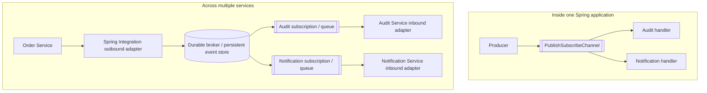
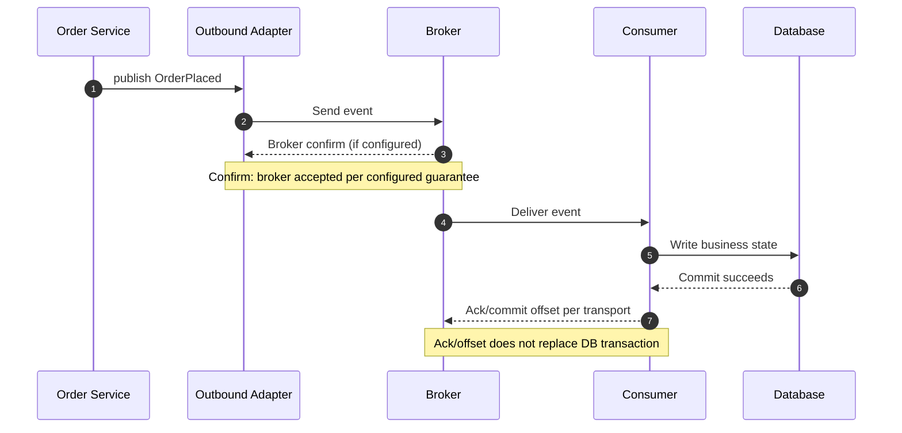
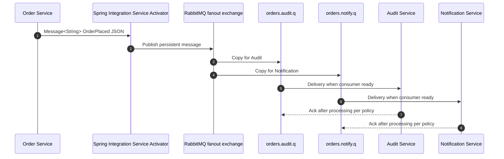
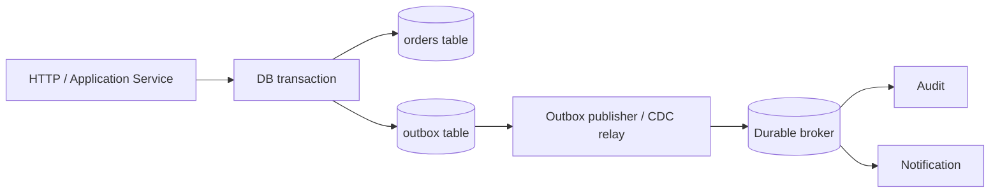

# When You Need a Durable Broker Instead of an Internal Channel

An order-taking system emits an `OrderPlaced` event to three consumers: Audit, Notification, and Analytics. When all components run inside the same application, you can wire them with Spring Integration's `PublishSubscribeChannel`. Yet what happens when **the producer application shuts down right after emitting the event**, the Notification consumer undergoes maintenance for an hour, or the system needs to **replay unprocessed events after deploying a new version**?

If the requirement is "critical events must be recoverable and reprocessable even if sending/receiving processes restart," an **in-memory internal channel** is normally insufficient. You may need a **durable message broker**—such as RabbitMQ, Kafka, or an appropriate JMS broker—along with durable storage configuration, send/receive acknowledgements, retries, dead-lettering, and idempotency.

In the **Publish subscribe** chapter of the `SPRING_INTEGRATION_PATTERN` module, this lesson focuses on **when to move from internal pub/sub to a durable broker**, and how to integrate those components into Spring Integration's **Enterprise Integration Patterns (EIP)** architecture. Using Router, Filter, Transformer, Splitter, Aggregator, Gateway, retry, error channel, and correlation remains essential; the broker adds a **delivery and recovery boundary**, rather than replacing those patterns.

> **Core takeaway:** `PublishSubscribeChannel` handles **distributing messages to active subscribers within the same application**. A durable broker **decouples producer from consumers in space and time** and can retain messages for processing when consumers return. However, a broker truly meets durability requirements only when **topology, persistence, acknowledgements, retention, transactions, and error-handling behavior** are properly configured, operated, and tested.

## 1. The Problem Changes When Consumers Are No Longer Always Available

Suppose `Order Service` emits an event after creating an order:

```json
{
  "eventId": "evt-101",
  "eventType": "ORDER_PLACED",
  "orderId": "ORD-101",
  "occurredAt": "2026-11-21T03:00:00Z"
}
```

This is sample data containing no tokens or payment details. There are three independent consumers:

- **Audit:** persists the event for reconciliation; must not be lost.
- **Notification:** creates a notification request; can lag by a few minutes.
- **Analytics:** updates metrics; can stop for deployment and resume afterward.

When consumers live in different services, requirements evolve:

| Requirement | Simple internal channel | Properly designed durable broker |
| --- | --- | --- |
| Multiple handlers **in the same process** receive one event | Well suited to `PublishSubscribeChannel`. | Possible, yet adds operational complexity. |
| Consumers run **in other services/processes** | Needs adapters/transport; channel alone is insufficient. | Common purpose of a broker. |
| Consumer is **offline** when event is emitted | Normally no automatic catch-up with in-memory pub/sub. | Can retain events for later consumption, depending on broker model. |
| Producer crashes, JVM restarts | Does not automatically recover in-memory events. | Can recover messages accepted and durably persisted by the broker per config. |
| Retries, DLQ, and controlled replay | Must build suitable mechanisms yourself. | Broker/consumers typically provide building blocks, yet still need policies. |
| Multi-day audit/replay | In-memory channel is not an event log. | Brokers like Kafka support log retention; RabbitMQ has different queue semantics. |
| "Exactly once" across databases and partner APIs | No. | Also not guaranteed end-to-end merely by having a broker. |

**Not every application needs a broker.** A message triggering only two handlers in the same JVM, needing no durability and reconstructible from canonical state, rarely justifies operating an entire broker cluster just to avoid a method call.

## 2. Three Levels of Decoupling That Are Often Conflated

Decoupling producers and consumers has multiple dimensions:

1. **Source-code decoupling:** the producer does not know individual consumer classes; they communicate via channels/interfaces.
2. **Process decoupling:** producer and consumers can run on different JVMs, services, or hosts.
3. **Temporal decoupling:** the producer can send while a consumer is not running, and the consumer still gets a chance to process when it comes back up.

An internal `PublishSubscribeChannel` handles the first level well. A durable broker typically enables both the second and third levels **provided messages are persisted and subscriptions/queues survive while consumers are offline**.



The distributed diagram does not imply a broker is always an **indefinite event store**. RabbitMQ, Kafka, and JMS have different queue/topic models, capacity limits, retention, and acknowledgements. When picking an architecture, rely on the real broker's actual semantics.

## 3. What Happens If You Only Use an Internal Channel?

### 3.1. `PublishSubscribeChannel`: Current Subscribers, Not an Event Log

A standard `PublishSubscribeChannel`:

- Broadcasts messages to **currently registered** subscribers.
- Can dispatch **synchronously** or via a `TaskExecutor`.
- Does not write messages to disk by default.
- Does not automatically replay events to subscribers that register after a message was sent.
- Does not provide a distributed transaction across all subscribers.

If the program crashes before an async subscriber finishes, unfinished tasks can disappear. A subscriber turned off while the producer emits events cannot expect the application to automatically retain every event and resend them upon restart.

### 3.2. `ExecutorChannel`: Asynchronous Does Not Mean Durable

Offloading dispatch to an executor can keep the producer from waiting on handlers:

```text
Producer → ExecutorChannel / PublishSubscribeChannel + executor
          → in-memory work queue of TaskExecutor
          → worker thread
```

Yet a **thread pool queue** is not a durable message store. If the process dies, tasks residing only in memory are not automatically recovered. If the pool saturates, tasks can be rejected. "Async" and "durable" are two **different** properties.

### 3.3. `QueueChannel`: Buffering Does Not Equal Durability

A `QueueChannel(100)` can temporarily hold messages while consumers have not pulled them. However, with an ordinary in-memory queue, unconsumed messages can be lost if the application stops abruptly.

Spring Integration supports **persistent `MessageStore`** mechanisms and `QueueChannel` can back onto an appropriate message store; thus **you should not claim no internal channel can ever persist**. Even so, a message-store-backed queue still differs from a **multi-service durable pub/sub broker**: you must independently handle separate consumers, transport, acknowledgements, replay capability, transactions, HA, and operations.

> **Section takeaway:** Choose a broker when you need **delivery contracts beyond JVM boundaries**, not merely because "an internal queue is slow" or "we want to run async."

## 4. What Commitments Does "Durable" Actually Include?

The word "durable" easily creates the impression that **messages can never be lost**. In reality, you must separate each boundary:

| Boundary | Verification question |
| --- | --- |
| Producer → adapter | Was the event constructed properly with a valid schema/event ID? |
| Adapter → broker | Did network transmission succeed, or was it only buffered in the client? |
| Broker receive → broker store | Did the broker confirm via the proper mechanism and persist/replicate per config? |
| Broker → consumer | Did the consumer actually receive the delivery? |
| Consumer → side effect | Did the target database/API commit successfully? |
| Consumer → acknowledgement | Was the broker notified that processing finished? |
| Restart/replay | Is the event still within retention/queue, who receives replays, and how are duplicates handled? |

A message-sending API returning **does not automatically prove** the broker durably persisted it, and the broker delivering a message to a consumer **does not prove** business state committed.

### 4.1. Three Distinct States to Separate



A "durable" path only has real meaning when you define what happens **if a process dies at each arrow**. For example, the consumer commits to the DB and crashes **before ack**: the broker may redeliver the same event. This common scenario leads to **at-least-once** delivery and requires idempotency.

## 5. When Should You Prefer a Durable Broker?

Strong indicators include:

1. **Independent services:** producers and consumers deploy and restart asynchronously.
2. **Absent consumers must still receive data later:** queues/subscriptions persist independently or retention supports replay.
3. **Critical events must not be lost:** crash recovery and delivery auditability are required.
4. **Backpressure exceeds in-process memory:** controlled buffering, capacity bounds, and overload policies are needed.
5. **Multiple consumer groups process the same event on independent schedules:** Audit, Analytics, and Notification advance at their own paces.
6. **Retries and error control:** handling poison messages, retry delays, dead-lettering, and authorized replay.
7. **Load distribution:** multiple instances of a consumer share work.
8. **Bounded history retention:** retention and business-level replay are required.

When most of these requirements are absent, an **internal channel** may remain simpler, more efficient, and easier to test.

### 5.1. Quick Decision Matrix

| Case | Option to consider |
| --- | --- |
| Two handlers in the same JVM; events can be reconstructed | Internal `PublishSubscribeChannel`. |
| One consumer can lag a few seconds in the same app | Bounded queue / async executor; if crash loss is unacceptable, add persistence or a broker. |
| One message must reach three independent services that may go offline | Durable broker with a **separate subscription/queue per recipient group**. |
| Need to retain events for backfill/replay over a defined window | Log broker with suitable retention, such as Kafka, or a fitting event store. |
| Queue needs competing consumers to scale throughput | Queue/work queue or consumer group; do not broadcast to every worker. |
| Operation requires synchronous result under a tight deadline | Request–reply Gateway or appropriate direct call; use a broker only if contract tolerates async/reply correlation. |
| Payment/order placement must be atomic with event emission | Transactional outbox or verified transaction mechanism, not merely `send(...)` after `save(...)`. |

## 6. Choosing a Broker: RabbitMQ, Kafka, or JMS?

There is no single "best" broker for every system. The key question is **how subscriptions/queues retain events and how consumers confirm outcomes**.

| Aspect | RabbitMQ (queue/exchange) | Kafka (topic/log) | JMS broker (queue/topic) |
| --- | --- | --- | --- |
| Primary model | Exchange routes copies to queues; consumers read queues. | Topic/partitions store logs; consumer groups read by offset. | Point-to-point queues and pub/sub topics per broker/JMS. |
| Fan-out to three independent consumers | Typically **one queue per logical subscriber** bound to an exchange. | **Three distinct consumer groups** reading the topic. | Durable topic subscriptions or suitable queues/topologies. |
| Consumer group with multiple instances | Multiple consumers compete on the same queue. | Instances in the same group share partitions. | Depends on destination/provider and subscription model. |
| Replay | Typically requires messages still in queue or a separate store/replay mechanism. | Can re-read from log within retention and permission/offset limits. | Depends on broker and subscription/retention. |
| Ack/progress | Consumer ack/nack per broker/client mechanics. | Commit offset / consumer position. | Ack/transactions per session and provider. |
| Durability | Durable exchange/queue, persistent delivery, HA/confirms per config. | Replication, acks, retention, ISR, and producer/broker config. | Persistent delivery, durable subscriptions, and provider config. |
| Common fits | Queue routing, work distribution, fan-out, retry/DLQ. | Event streams, retained audit logs, replay, analytics. | Enterprise integration using JMS standards and compatible brokers. |

### 6.1. RabbitMQ: A Fanout Exchange Does Not Store Messages by Itself

A **fanout exchange** sends copies to bound queues. The exchange is a **routing point**, not a storage queue. If you declare an exchange without **bound queues**, messages may have nowhere to wait for later consumers.

For three services to receive one event independently:

```text
orders.events.fanout exchange
    ├── orders.audit.q        → Audit consumer(s)
    ├── orders.notification.q → Notification consumer(s)
    └── orders.analytics.q    → Analytics consumer(s)
```

**Important:** If both Audit and Notification listen on **one queue**, they normally **split the work**, rather than each receiving its own copy. For group-level pub/sub, create a **separate queue per logical recipient** or an equivalent topology.

A durable RabbitMQ design must address at least **durable queues/exchanges, persistent messages, publisher confirms, consumer acks, queue types/replication, broker disk capacity, and DLQ policies**. Simply naming something "fanout" does not make messages durable.

### 6.2. Kafka: Consumer Groups Determine Who Sees Events

One Kafka topic can serve three consumer groups:

```text
                       Topic: order-events
                        /       |       \
               group=audit  group=notify  group=analytics
                     |           |             |
                 instances    instances      instances
```

Each group tracks its own progress and can normally read records still within **retention**. However, **two consumers in the same group do not each receive every record**; they normally split partitions. To let three functions each read all relevant events, they must use **different group IDs**.

Kafka does not keep events "forever" by default. Once messages are deleted by retention or log compaction per configuration, a consumer group that fell too far behind cannot replay deleted records. A durable broker does not replace retention/replay planning.

### 6.3. JMS: Durable Subscription Is a Separate Configuration

With a JMS topic, a **non-durable** subscriber normally misses messages published while it was offline. To make a topic subscription durable, configure it according to JMS/provider semantics and manage identities and lifecycles properly. JMS queues follow a different model than topics.

Do not assume that using `Jms.inboundAdapter(...)` gives you a **durable topic subscription** without checking connection factory, destination, subscription name/client ID, and provider settings.

## 7. Connecting Spring Integration to RabbitMQ: Illustrative Example

The example below uses:

- Spring Integration for **internal message flows**.
- Spring AMQP for **broker topology and `RabbitTemplate`**.
- Two durable queues so **two independent logical subscribers** receive the same event.
- A **JSON String payload built/validated at the application boundary** to avoid relying on arbitrary object converters.

This demonstrates **architecture and basic APIs**, not a zero-loss production deployment. Running it in production requires Spring Integration AMQP and Spring AMQP dependencies, a RabbitMQ broker, connection configuration, authentication, publisher confirms/returns, `RabbitAdmin` or topology provisioning, retention/HA, and version-matched integration tests.

### 7.1. Declaring a Durable Exchange and Queues

```java
import org.springframework.amqp.core.Binding;
import org.springframework.amqp.core.BindingBuilder;
import org.springframework.amqp.core.FanoutExchange;
import org.springframework.amqp.core.Queue;
import org.springframework.beans.factory.annotation.Qualifier;
import org.springframework.context.annotation.Bean;
import org.springframework.context.annotation.Configuration;

@Configuration
class OrderBrokerTopology {

    static final String EXCHANGE = "orders.events.fanout";
    static final String AUDIT_QUEUE = "orders.audit.q";
    static final String NOTIFY_QUEUE = "orders.notify.q";

    @Bean
    FanoutExchange ordersExchange() {
        return new FanoutExchange(EXCHANGE, true, false);
    }

    @Bean("auditQueue")
    Queue auditQueue() {
        return new Queue(AUDIT_QUEUE, true);
    }

    @Bean("notifyQueue")
    Queue notifyQueue() {
        return new Queue(NOTIFY_QUEUE, true);
    }

    @Bean
    Binding auditBinding(
            @Qualifier("auditQueue") Queue queue,
            FanoutExchange ordersExchange) {
        return BindingBuilder.bind(queue).to(ordersExchange);
    }

    @Bean
    Binding notifyBinding(
            @Qualifier("notifyQueue") Queue queue,
            FanoutExchange ordersExchange) {
        return BindingBuilder.bind(queue).to(ordersExchange);
    }
}
```

In this example:

1. The fanout exchange has `durable=true`, `autoDelete=false`.
2. Each logical recipient has a **dedicated queue** with `durable=true`.
3. Bindings ensure messages reaching the exchange are routed to both queues **when the topology exists and the message is eligible and accepted by the broker**.
4. These `@Bean` definitions describe topology; an actual **provisioning/declaration** mechanism with RabbitMQ (such as a configured `RabbitAdmin`) must create the resources on the broker.

**Distinguish carefully:** a `durable` queue guarantees the queue definition survives a broker restart per broker semantics; for **messages** to survive, you must also configure persistent delivery and proper storage/replication/ack mechanisms. Even with durable queues and persistent messages, you must still plan for outages, disk failures, and send confirmations.

### 7.2. Producer via Service Activator and `RabbitTemplate`

Application code can send events into a `MessageChannel`; a **Service Activator** performs the outbound action to RabbitMQ:

```java
import org.springframework.amqp.core.MessageDeliveryMode;
import org.springframework.amqp.rabbit.core.RabbitTemplate;
import org.springframework.integration.annotation.ServiceActivator;
import org.springframework.stereotype.Component;

@Component
class BrokerEventPublisher {
    private final RabbitTemplate rabbitTemplate;

    BrokerEventPublisher(RabbitTemplate rabbitTemplate) {
        this.rabbitTemplate = rabbitTemplate;
    }

    @ServiceActivator(inputChannel = "orders.publish")
    public void publish(String eventJson) {
        rabbitTemplate.convertAndSend(
            OrderBrokerTopology.EXCHANGE,
            "",
            eventJson,
            message -> {
                message.getMessageProperties()
                    .setDeliveryMode(MessageDeliveryMode.PERSISTENT);
                return message;
            });
    }
}
```

Internal channel to trigger the publisher:

```java
import org.springframework.context.annotation.Bean;
import org.springframework.context.annotation.Configuration;
import org.springframework.integration.channel.DirectChannel;
import org.springframework.integration.config.EnableIntegration;
import org.springframework.messaging.MessageChannel;

@Configuration
@EnableIntegration
class ProducerChannelConfiguration {
    @Bean("orders.publish")
    MessageChannel outboundEventsChannel() {
        return new DirectChannel();
    }
}
```

Here `@ServiceActivator` is the Spring Integration endpoint; `RabbitTemplate` is the AMQP client at the transport boundary. An alternative is the **Spring Integration AMQP outbound channel adapter**, reducing manual template code. Either way, **successful handoff to the client ≠ broker confirm succeeded ≠ consumer finished processing**.

For environments requiring zero event loss, configure and **monitor publisher confirms and handle unroutable messages/returns**, as well as network drops right around confirmation time. Setting `PERSISTENT` delivery mode on a message is not by itself an end-to-end guarantee.

### 7.3. Consumer via Spring Integration AMQP Inbound Adapter

Inside **an Audit service**, connect an inbound adapter reading from the Audit queue to a handler. The Java DSL snippet below illustrates configuration supported by Spring Integration AMQP; verify APIs/imports against your project's actual version:

```java
import org.springframework.amqp.rabbit.connection.ConnectionFactory;
import org.springframework.context.annotation.Bean;
import org.springframework.context.annotation.Configuration;
import org.springframework.integration.amqp.dsl.Amqp;
import org.springframework.integration.config.EnableIntegration;
import org.springframework.integration.dsl.IntegrationFlow;

@Configuration
@EnableIntegration
class AuditConsumerFlowConfiguration {

    @Bean
    IntegrationFlow auditEventsInbound(
            ConnectionFactory connectionFactory,
            AuditEventHandler auditHandler) {
        return IntegrationFlow
            .from(Amqp.inboundAdapter(
                connectionFactory, OrderBrokerTopology.AUDIT_QUEUE))
            .handle(auditHandler, "record")
            .get();
    }
}

// Assumed bean/implementation provided by the Audit application.
// class AuditEventHandler {
//     public void record(String eventJson) { ... }
// }
```

**Components do not have to run inside the same application.** In real deployments, `OrderBrokerTopology` should be provisioned via shared infrastructure or managed migrations/configuration. Audit Service only needs the queue/binding belonging to its contract; Notification Service has a **similar inbound flow reading `orders.notify.q`**. Never share one queue across both groups if each group must receive its own copy of the event.

The inbound adapter / consumer container must be configured for **acknowledgements, retries, backoff, non-retryable failures, DLQ, concurrency, and shutdown** per contract. Do not assume the snippet above sets up all of those policies automatically.

### 7.4. Journey of an Event



This is a logical model; RabbitMQ does not execute these steps as a single synchronous sequence in exact diagram order. Failures can happen at any boundary. Therefore, **integration tests with a real broker** are essential for delivery-guarantee requirements.

## 8. Differences Among Publisher Confirm, Consumer Ack, and Business Outcome

These three events are often lumped into a single "success," causing misleading reporting:

| Signal | Meaning | What it does not prove |
| --- | --- | --- |
| `send(...)` or publish API returns | Client/adapter finished the invoked step per API. | Broker persisted durably and consumers processed it. |
| RabbitMQ **Publisher confirm** | Broker confirmed the message per configured publisher-confirms mechanism. | Handlers wrote to DB or finished sending emails. |
| **Consumer ack** | Consumer reported delivery completion per broker/container policy. | Side effects in third-party systems cannot roll back or repeat. |
| **Kafka offset commit** | Consumer group recorded its processing position, depending on commit timing. | External DB transaction committed atomically with Kafka. |
| **Business completion** | Business domain confirmed final state in its own system. | Other consumers also finished. |

### 8.1. The Most Critical Crash Point: After DB Commit, Before Ack

```text
Broker --deliver--> Consumer --commit DB--> [CRASH] --X--> Ack
Broker sees unacked delivery / uncommitted offset
         ↓
May redeliver the same event
         ↓
Consumer must recognize the event was already processed
```

Hence, **at-least-once** designs normally pair with an **idempotent consumer**. For instance, a subscriber can record `(eventId, subscriberId)` in a database with a unique constraint inside the same transaction as the primary side effect. When the event is redelivered, the consumer atomically checks/records and avoids producing duplicate side effects.

An in-memory `Set` does not solve multi-instance deployments or restarts.

### 8.2. Is There "Exactly Once"?

Some brokers/frameworks offer transaction or exactly-once mechanisms **within a bounded scope**, such as read–process–write processing **within Kafka** using a transactional producer and matching settings. Yet an event triggering an **external payment API call** or writing to another database is not automatically covered by that guarantee.

**Never promise end-to-end exactly-once merely because you use Kafka, RabbitMQ, JMS, or Spring Integration.** Explicitly document guarantee scopes, duplicate handling, state confirmation, and recovery.

## 9. The "Write DB Then Publish" Problem: Why a Transactional Outbox Is Needed

Suppose an HTTP request creates an order:

```text
1. INSERT order into database
2. COMMIT succeeds
3. Publish OrderPlaced to broker
```

If the process crashes **after commit but before publish**, the order exists without an event, leaving Audit and Notification unaware. Reversing the order—publishing before commit—is equally dangerous: consumers can see an event for an order whose DB transaction later rolls back.

### 9.1. Transactional Outbox Pattern

Instead of writing to the DB and sending to the broker as two separate operations, the application service writes **the order and an outbox record in the same database transaction**:



Java pseudocode illustrating the idea:

```java
// Pseudocode: depends on the application's repository/transaction.
@Transactional
public void placeOrder(PlaceOrderCommand command) {
    Order order = orderRepository.save(Order.from(command));

    OutboxEvent event = new OutboxEvent(
        eventIdGenerator.newId(),
        "ORDER_PLACED",
        order.id(),
        serializeMinimalPayload(order)
    );

    outboxRepository.save(event);
    // Both records belong to the same DB transaction.
    // Do not call RabbitTemplate directly inside this transaction.
}
```

A separate **relay** reads the outbox, publishes, and updates the sent status once appropriate confirmation arrives. If the relay crashes after publishing yet before marking "sent," the same event may be published again. Thus outbox **closes the dual-write gap**, while still requiring **idempotent consumers and retries**.

### 9.2. What Does the Relay Process Need?

- Outbox records with a stable `eventId`, event type, schema version, and minimal payload.
- A mechanism to select/claim unsent records without two relays double-processing improperly.
- Publisher confirms or appropriate acknowledgements before marking status.
- Bounded retries with backoff, limits, and alerts for "stuck" records.
- Do not purge records too early while consumers still need replay/reconciliation.
- Maintain consistency between DB transactions and outbox records, with crash tests.

Do not treat outbox as a Spring Integration feature turned on automatically when sending to `PublishSubscribeChannel`. It is a **transaction and event-emission pattern** designed at the persistence layer together with a relay.

## 10. Offline Subscribers, Retention, Replay, and Dead-Lettering

### 10.1. "Durable Subscriber" Must Be Understood per Broker

| Scenario | RabbitMQ | Kafka | JMS topic |
| --- | --- | --- | --- |
| Consumer offline when event is emitted | Queue can still receive messages if binding/topology already exists, capacity remains, and broker retains them. | Record can be read later if still within retention and group/offset is valid. | Requires a proper durable subscription to receive missed events from offline periods. |
| Consumer deployed for the first time days later | Does not automatically receive messages emitted before the queue/binding existed. | Can read retained history if group/offset policy permits. | Depends on pre-existing subscription and broker policy. |
| Consumer wants to replay already-acked/committed data | Usually needs its own store/replay mechanism. | Can reset/seek offsets if records remain and policy permits. | Depends on provider and recovery mechanism. |
| Insufficient storage capacity | May block/reject/expire/DLQ depending on policy. | Retention, disk pressure, and broker limits govern kept data. | Depends on provider quotas and policy. |

**Important message:** Having a broker does not mean **every future subscriber automatically gets history**. The broker must be provisioned with the proper queues/subscriptions **before messages need retention**, or support replay from a retained log.

### 10.2. Poison Messages

A bad-schema message causes the consumer to throw an exception on every delivery. Without a policy, it can be redelivered endlessly, blocking later messages or causing heavy load.

A workable flow:

1. Validate schema/version at the inbound boundary.
2. Distinguish **transient** failures (service down) from **unrecoverable** ones (invalid payload).
3. Use bounded retries and bounded backoff to prevent retry storms.
4. Once thresholds are exceeded, move to a **DLQ/quarantine** per broker/consumer policy.
5. Attach safe metadata—`eventId`, `reasonCode`, attempt count, and failure timestamp—for investigation.
6. Replay only after fixing the root cause, protecting idempotency so side effects do not duplicate.

Never log or dump full sensitive payloads recklessly into an unprivileged DLQ. DLQs also need retention, quotas, alerts, and handling runbooks.

## 11. When Is a Durable Broker Unnecessary?

A broker brings recovery and temporal decoupling, yet carries **significant cost**:

- Managing clusters, storage, quotas, authentication/authorization, monitoring, and backup/recovery.
- Aligning schemas/versions, serialization, and contracts across services.
- Handling duplicate deliveries, reordering, handler failures, and consumer lag.
- Debugging becomes distributed across multiple processes.
- Defining retention, replay, DLQ, and data-classification policies.
- Clarifying who owns topology, operates subscribers, and remediates failed messages.

Example **not necessarily needing a broker**: within a single application, an internal UI event is consumed by only two handlers updating temporary caches that can be rebuilt; on restart, there is no requirement to retain past events.

Options worth considering when a broker is not yet needed:

- Use `PublishSubscribeChannel` for simple synchronous fan-out.
- Use `TaskExecutor` when thread decoupling is needed and **losing unfinished work on process death is acceptable**.
- Use `QueueChannel` with sensible capacity to smooth short-term bursts.
- Use a persistent `MessageStore` for certain internal queues needing recovery, if semantics and cost fit.

Never choose a broker just because "microservices must have Kafka." Choose based on **delivery contracts and operational capability**.

## 12. Integrating a Broker With Other Enterprise Integration Patterns

A broker changes **where messages are handed off and stored**; EIPs remain essential for content handling and branching.

| Pattern | Role before/after broker | What to watch |
| --- | --- | --- |
| **Transformer** | Normalize DTOs/schemas; serialize/deserialize at boundaries. | Versioning and compatibility; never deserialize arbitrary classes from headers. |
| **Filter** | Reject invalid or unauthorized messages. | Invalid schemas may go to DLQ; never retry infinitely. |
| **Router** | Select processing type or target channel. | Do not mix transport routing keys with business identifiers. |
| **Recipient List** | Select multiple internal/external destinations by policy. | Does not make destinations durable automatically; each needs a suitable durable path. |
| **Publish–Subscribe** | Fan out to multiple subscribers / consumer groups. | In brokers, fan-out topology depends on queues/groups/subscriptions. |
| **Gateway** | Facade for request–reply or publishing commands/events. | Needs deadlines/reply correlation; accepted differs from completed. |
| **Splitter** | Split batches into child messages. | Fanning out each part multiplies message counts and side effects. |
| **Aggregator** | Gather outcomes from consumers. | Correlation, release, expiry, missing/duplicate/late replies. |
| **Error Flow** | Handle adapter/consumer errors, retries/quarantine. | Do not treat every nack/error as the same business error. |

### 12.1. A Gateway Cannot Treat Broker Ack as a Business Result

An API calling `orderGateway.submit(...)` may send an event to the broker successfully while consumers process it minutes later. Callers should receive a clear contract such as:

```text
202 Accepted
{
  "orderId": "ORD-101",
  "processingStatus": "PENDING"
}
```

This is an example API response, not something Spring Integration generates automatically. If users need final outcomes, provide status-query, callback, or completion-event mechanisms instead of holding HTTP threads open indefinitely waiting on every subscriber.

### 12.2. Splitter/Aggregator Across a Broker

If a Splitter breaks an order into five lines and publishes them to a topic, consumers may process them concurrently, receive duplicates, or process out of order. The Aggregator must:

- Identify groups using a **stable correlation ID**.
- Distinguish `eventId`/`partId` to discard duplicates.
- Define **sequence size** or completion policy per contract.
- Manage **group timeout/expiry** when one part fails.
- Deliberately accept or reject **late replies**.
- Use a **persistent message group store** when group state must survive restarts.

A broker persisting messages does not mean **in-memory Aggregator state** recovers after a crash. That is separate state requiring its own durability.

## 13. Ordering, Partitions, and Consumer Concurrency

On a synchronous internal channel, learners may observe handlers processing messages in exact send order. Moving to a broker and multiple instances, **processing order can change**, even if messages were published in one order.

| Goal | What must be designed |
| --- | --- |
| Order **per `orderId`** | Stable routing/partition key and appropriate per-key consumer serialization. |
| Higher throughput | Multiple consumer instances, appropriate partitions/queues, backpressure. |
| Prevent two consumers overwriting newer state with older state | Versioning / optimistic locking or per-key serialization rules. |
| Handle redeliveries | Idempotent handlers and durable processing state. |
| Consumer rebalancing | Recovery without losing state or duplicating side effects. |

Kafka normally guarantees ordering **per partition**, not across an entire multi-partition topic. RabbitMQ queues have their own delivery ordering, yet concurrency, retries/requeues, priorities, and other factors can make **business completion order** differ from publish order. Never equate "durable broker" with "system-wide FIFO."

## 14. Security and Access Control When Moving to a Broker

Inside one JVM, a message might pass through just a few beans. Once sent to a broker, data traverses **networks, storage, broker operators, multiple consumer groups, DLQs, and observability systems**.

Design for:

1. **Authentication/authorization** for producers and consumers, with ACLs per queue/topic/group.
2. **TLS/encryption** in transit, and encryption at rest per sensitivity level.
3. **Schema validation** and allowlisted message types at ingress; never trust client-supplied type headers to instantiate arbitrary Java classes.
4. **Header allowlist**; never forward `Authorization`, `Cookie`, tokens, or HTTP session data onto a broker.
5. **Minimal payloads:** events carry only data required by necessary subscribers; separate public and internal events if needed.
6. **Retention/erasure policies** across topics, queues, DLQs, backups, and logs.
7. **Audit and replay permissions:** who is allowed to view, replay, or download events?
8. **Safe logging:** metadata, error codes, opaque event IDs; avoid dumping raw payloads.

Operational log example:

```text
event=broker_consumer_delivery
transport=rabbitmq
consumer=audit
event_type=ORDER_PLACED
attempt=2
outcome=committed
correlation_id=opaque-correlation-id
```

This is an application-defined format example. Do not put per-message correlation IDs or event IDs into **metric labels** causing high cardinality; use them in access-controlled logs/traces when investigating.

## 15. Observability: Measuring Lag, Redelivery, and Backlog Instead of Only `send=true`

When moving to a broker, monitor **both halves** of the flow: the publisher and each consumer.

| Signal | Explanation |
| --- | --- |
| `events_produced_total` | Events requested for publication by the application. |
| `publisher_confirm_success/failure` | Publications confirmed by the broker or failed per transport semantics. |
| `outbox_pending`/`outbox_age` | Unpublished records; detects a stuck relay. |
| `queue_depth` or `consumer_lag` | Backlog per queue/group, not just outbound request counts. |
| `delivery_attempts`/`redeliveries` | Redelivery frequency and duplicate-processing risk. |
| `consumer_processing_latency` | Business execution duration per branch. |
| `ack/commit_failures` | Failures or delays in recording processing progress. |
| `DLQ_count`/`oldest_age` | Failed messages and age of the oldest waiting item. |
| `last_success_timestamp` | Detects stalled subscribers even while the broker still receives events. |
| `replay_count`/`dedup_count` | Replay volume and deduplication effectiveness. |

Not every metric is built into every Spring Integration or broker version. The names above are design suggestions; configure appropriate instrumentation.

### 15.1. Distinguishing Symptoms

| Symptom | Causes to investigate |
| --- | --- |
| Producer reports sent yet broker lacks the event | Missing publisher confirms, routing error, broker/client buffer, or outbox relay failure. |
| Audit processed everything while Notification is missing events | Separate queue/group, consumer error, backlog, DLQ, or retention. |
| Consumer lag climbs continuously | Processing rate slower than publish rate, unsuitable batch/concurrency settings. |
| Retries increase and DB shows duplicate rows | Handler lacks idempotency or ack/commit happens at the wrong boundary. |
| Broker still holds events yet Aggregator does not release | Wrong correlation/sequence, missing part, or group expiry. |
| Messages vanish from Kafka before replay | Retention/compaction and replay policies are misaligned. |

## 16. Testing Crash and Offline Conditions

A unit test with `PublishSubscribeChannel` cannot prove broker durability. Test against a real broker/container or integration environment with matching semantics.

### 16.1. Test Matrix

| Test | How to execute | Outcome to prove |
| --- | --- | --- |
| **Fan-out** | Publish one event with two independent queues/groups. | Both Audit and Notification have the chance to process the same event. |
| **Consumer offline** | Stop Notification before publishing; start it afterward. | Events are processed after restart while still in retention/queue. |
| **Producer crashes before confirm** | Inject failure right during send. | Outbox/retries prevent losing the business event. |
| **Consumer crashes before DB commit** | Stop handler before commit/ack. | Event can be reprocessed without reporting false success. |
| **Consumer crashes after DB commit, before ack** | Stop right at this boundary. | Redelivery does not create duplicate side effects. |
| **Poison message** | Send an invalid schema. | Bounded retries, DLQ/quarantine, and alerts trigger. |
| **Broker restart** | Restart broker matching real HA/topology. | Persisted messages recover per configured guarantees. |
| **Retention/replay** | Leave consumer down long enough, then replay/seek. | Understand exact bounds of retained data. |
| **Broker full** | Apply quotas/pressure in test environment. | Backpressure, timeouts, and alerts trigger without false business success. |
| **Multiple consumer instances** | Scale instance count per group/queue. | Competing consumers are not mistaken for multi-copy broadcast. |

### 16.2. A Small Experiment to Prove the Need

1. Use an unpersisted `PublishSubscribeChannel`, emit an event, and stop the application immediately while an async handler has not finished. Observe task-loss risk.
2. Set up a RabbitMQ fanout exchange with **two durable queues** and publisher confirms; stop the Notification consumer.
3. Publish two events and verify the Notification queue retains messages within configured limits.
4. Restart the Notification consumer and verify the events are processed and acked.
5. Inject a failure after the consumer writes to the DB but before ack; verify **idempotency** prevents duplicate records.
6. Verify metrics, DLQ, and logs do not leak sensitive info.

**Do not use mocked unit test results to claim resilience against host loss, disk loss, or network partitions.** Those claims require integration, load, and chaos/failure testing matching your deployment architecture.

## 17. Common Design Mistakes

### 17.1. "Switching `PublishSubscribeChannel` to `ExecutorChannel` makes it durable"

**False.** An executor only changes dispatch mechanics and threads; it does not persist events across restarts.

### 17.2. "The RabbitMQ fanout exchange is durable, so durable queues aren't needed"

**False.** Exchanges route; **queues/subscriptions** store messages for logical consumers. You also need persistent delivery and broker confirms/HA.

### 17.3. "Kafka has three consumers so all three read every message"

**Not necessarily.** Three consumers **in the same group** normally split partitions; three independent groups maintain separate read progress on the same topic.

### 17.4. "Having a broker means no duplicates"

**False.** Retries, redeliveries, producer retries, and crashes after commit before ack can all produce duplicate executions. Idempotency is a separate requirement.

### 17.5. "Publish returned without error, so the DB and all consumers finished"

**False.** Observe broker confirms/acks and business outcomes separately. `202 Accepted` differs in meaning from `200 Completed`.

### 17.6. "Durable means kept forever"

**False.** Kafka has retention/compaction; RabbitMQ has TTL, max length, quotas, and DLQs; JMS has provider policies. Account for storage, message age, and replay permissions.

### 17.7. "Outbox gives exactly-once everywhere"

**False.** Outbox reduces dual-write risk, yet the relay can still publish duplicates. Consumers still need idempotency and state tracking.

### 17.8. "The broker recovers the Aggregator too"

**False.** If the Aggregator uses an in-memory group store, groups can be lost on process restart even though broker messages survived. Manage durable group stores and recovery separately.

## 18. Practice Exercises

**Exercise 1 — Choosing a solution.** An internal desktop app has two handlers in the same JVM whose data can be recomputed. Compare `PublishSubscribeChannel` with a broker in terms of simplicity, cost, and acceptable risk.

**Exercise 2 — Durable RabbitMQ fan-out.** Describe a topology with a fanout exchange plus three separate queues for Audit, Notification, and Analytics. What happens if only one shared queue is used?

**Exercise 3 — Kafka groups.** A topic has 12 partitions and three groups: `audit`, `notify`, and `analytics`. Each group has four instances. Explain how many logical groups process one event and why the four instances within a group do not all receive their own copy.

**Exercise 4 — Outbox.** Draw both crash points: after DB commit before publish, and after publish before the relay marks sent. Explain why outbox + idempotent consumers handle both without promising absolute exactly-once.

**Exercise 5 — Ack and duplicates.** A consumer finishes updating the `invoice` table and crashes before ack. Propose a unique key / transaction so redelivering the event does not create two invoices.

**Exercise 6 — Poison message.** An event arrives with an unsupported `schemaVersion=99`. Design retry decisions, DLQ, alerts, retention, replay permissions, and how to prevent infinite retries.

**Exercise 7 — Gateway.** An async job-creation API has a 300 ms SLA to return intake confirmation, while Notification takes two minutes. Design an `ACCEPTED/PENDING` response and result-checking mechanism instead of holding the request for two minutes.

**Exercise 8 — Aggregator.** A Splitter produces four parts; consumers over a broker experience one redelivery and one late arrival. Design correlation, deduplication, group expiry, and partial results.

## 19. Checklist for Selecting and Operating a Durable Broker

| Question | Evidence needed |
| --- | --- |
| Can consumers be offline when events are emitted? | Queues/subscriptions/retention ensuring later reading are defined. |
| Are consumers in separate services or the same JVM? | Topology fits; no gratuitous broker added. |
| Does each logical subscriber receive independently? | Separate RabbitMQ queues, separate Kafka groups, or proper durable JMS subscriptions. |
| Are messages durably persisted by the broker? | Persistence/replication configured and broker restart tested. |
| Does the producer know the broker received it? | Publisher confirms/acks and error handling exist, not just an API send call. |
| Can events be lost between DB commit and publish? | Outbox or verified transactional mechanism is in place. |
| When does the consumer ack? | After appropriate side effects, tested for crashes before/after commit. |
| Can redelivery cause duplicates? | Idempotency keys and transactions/dedup stores exist. |
| Are retention and replay policies clear? | Time/size limits and replay procedures are documented. |
| Are poison messages and DLQs handled? | Bounded retries, quarantine, alerts, and remediation procedures exist. |
| Are backpressure and quotas in place? | Lag, queue depth, disk pressure, and load limits are monitored. |
| Is per-key ordering required? | Partitioning/routing/consumer concurrency are designed and tested. |
| Is a request–reply Gateway involved? | Accepted differs from completed; reply correlation/deadlines are explicit. |
| Are Splitter/Aggregator involved? | Correlation, group store, release/expiry, and duplicate/late results are handled. |
| Is data sensitive? | ACLs, TLS, header allowlists, schemas, retention, and minimal logs exist. |
| Is observability present across publisher and consumers? | Confirms, lag, acks, retries, DLQs, handler outcomes, and alerts exist. |
| Have real crash/restart tests been run? | Tested against real broker and state stores matching deployment. |

## Conclusion

**When you need a durable broker instead of an internal channel** is a question of **delivery contracts**, not technology preference. `PublishSubscribeChannel` is simple and effective for fanning out across subscribers inside the same application; `QueueChannel` or an executor helps buffer and decouple threads. Yet when producers and consumers must operate **independently in time**, critical messages must **recover after crashes**, or **retention, replay, and independent logical subscribers** are required, a properly configured durable broker is usually the right fit.

However, **durable does not automatically mean exactly-once, "every consumer processed it," cross-system transactions, or infinite storage**. You must combine **broker topology, publisher confirms/acks, outbox, consumer acknowledgements, idempotency, retries/DLQ, correlation, and observability**—adding Transformer, Filter, Router, Gateway, Splitter, and Aggregator as business flows demand. A trustworthy architecture is one that **knows precisely what it guarantees at every boundary and how to recover when a boundary fails**.
