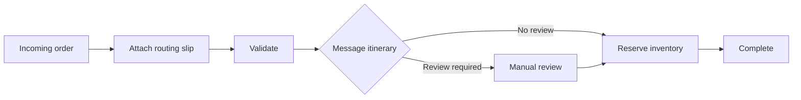
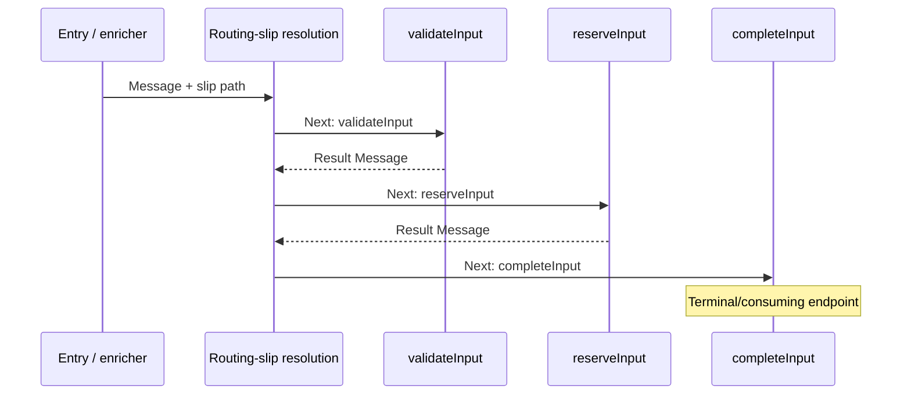
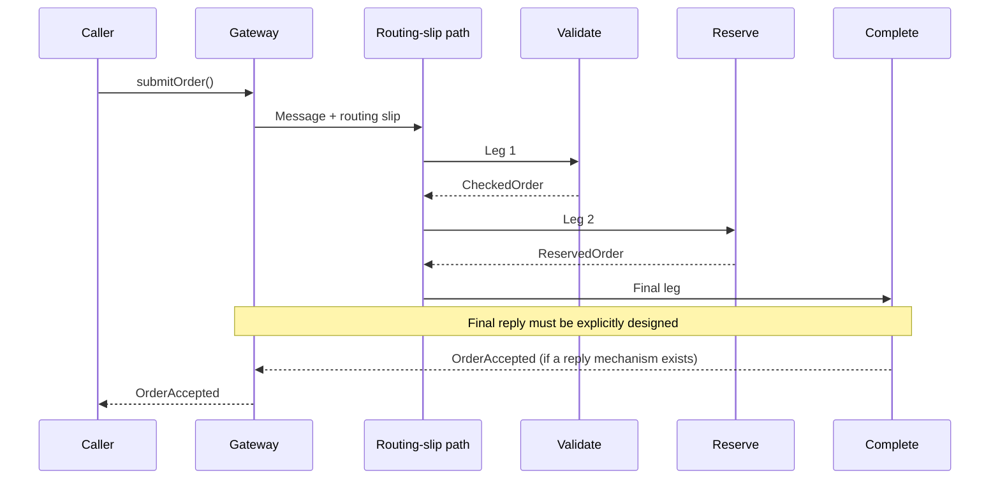
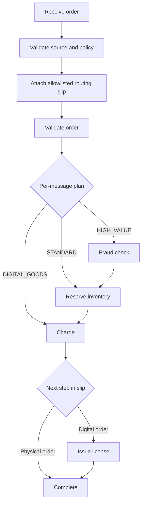

# Routing Slip stores the list of steps to traverse

In many integration flows, a message always passes through a fixed sequence of steps: validate data → reserve inventory → record the result. However, there are also cases where **each message needs to go through a different list of steps**. High-value orders must go through manual review; standard orders can skip it. For this problem, the **Routing Slip** pattern from Enterprise Integration Patterns (EIP) allows **attaching the processing itinerary to the message**, so that endpoints forward it step by step along that itinerary.

In **Spring Integration**, a routing slip is represented as **metadata on the message**, enabling compatible endpoints to find the **next destination** after completing a step. This lesson belongs to the **Routing slip** chapter of the `SPRING_INTEGRATION_PATTERN` module, aiming to combine Router, Filter, Transformer, Splitter, Aggregator, Gateway, retry, error channel, and correlation into loosely coupled, extensible, testable, and observable message flows.

After this lesson, you will be able to:

- Explain why a **destination list attached to a message** differs from a Router that only decides a branch at a single point.
- Describe the itinerary structure, current step position, and forwarding mechanism of a Routing Slip.
- Use a **Header Enricher** configuration to attach a routing slip and connect reply-producing endpoints in Spring Integration.
- Identify the conditions that cause an itinerary to stop: one-way endpoints, hardcoded output channels, errors, missing destinations, or reaching the end of the path.
- Design safety, retry/idempotency, correlation, timeout, and observability for each step transition.
- Test a complete itinerary as well as skipped steps, errors, and invalid path values.

## 1. The idea: carrying the routing plan with the message

With a fixed processing route, the flow structure itself can determine every step:

```text
ordersInput -> Validate -> ReserveInventory -> PublishResult
```

If requirements vary by order type, you could create multiple flows or branching Routers. **Routing Slip** is another option: the processing plan travels with the message as an **ordered list of destinations to visit**.

```text
Message A (standard order):
  routing slip = [validateInput, reserveInput, completeInput]

Message B (high-value order):
  routing slip = [validateInput, manualReviewInput, reserveInput, completeInput]
```



The diagram shows that two messages can pass through the **same reusable endpoints** while carrying different itineraries. A `Validate` endpoint does not need to know which customer segment an order belongs to in order to choose a branch itself; it performs its own work, produces a result, and the routing slip mechanism determines the next step.

### When should you consider it?

| Scenario | Is Routing Slip suitable? | Why |
| --- | --- | --- |
| Each message has a list of processing steps that varies by policy. | **Can be suitable.** | The itinerary is chosen per message before or during processing. |
| Every message always passes through the same three steps. | Usually **unnecessary**. | A simple sequential `IntegrationFlow` is easier to follow. |
| Only need to choose one of two channels. | Usually use a **Router**. | No need to represent an entire itinerary when there is only one decision. |
| The same message must be processed concurrently by multiple subscribers. | Use **Publish–Subscribe** or Recipient List Router. | Routing Slip represents a sequential itinerary, not fan-out by default. |
| A process spans hours, involves human approval, compensation, and state persistence. | Consider a workflow/saga engine or persistent state design. | A routing slip on a message does not by itself provide durable progress or full orchestration. |

## 2. How is a Routing Slip represented?

In Spring Integration, a routing slip is a **special message header**, often referenced via the constant `IntegrationMessageHeaderAccessor.ROUTING_SLIP` (header name `routingSlip`). This metadata stores the **path** and **progress position** so the framework can determine the next channel when an endpoint produces an output message.

Conceptually, you can picture it as:

```text
Message<OrderCommand>
├── payload: OrderCommand(orderId="ORD-201", ...)
└── headers
    ├── routingSlip
    │   ├── path  = [validateInput, reserveInput, completeInput]
    │   └── index = position of the next step
    ├── traceId = "trace-201"
    └── correlationId = "request-201"
```

This is a **logical diagram**, not a mandatory JSON schema or advice to construct arbitrary header values yourself. In a Spring Integration application, use the supported header enricher / routing slip mechanisms rather than manually inserting an arbitrary string under a special header name and expecting the framework to understand it.

**Two important parts:**

1. **Path:** an ordered list of destinations / routing strategies compatible with the Routing Slip mechanism. In simple examples, these are **message channel names** registered with Spring.
2. **Index/progress:** determines which element of the list will be used next. This state **belongs to the message's itinerary**, not a global counter shared across all orders.

When a message completes a step and is forwarded via the routing slip, the progress position is updated by the framework's mechanism. Each message can be at a different step even while passing through the same endpoint.

### Itinerary headers differ from business payload

`orderId`, amount, line items, and event timestamp remain **business data**. The routing slip is **coordination metadata**: it describes the **intended processing path**, not proof that the business action has been completed or paid. If you need auditing or exact replay of the chosen plan, persist the decision and policy version in appropriate durable storage rather than relying solely on an internal header.

## 3. How a message traverses the steps

An itinerary with three steps `validateInput`, `reserveInput`, `completeInput` can be interpreted along this progression:

| Moment | Next destination from slip | What happens |
| --- | --- | --- |
| After attaching slip | `validateInput` | Sends the message to the validation endpoint. |
| After the validate step emits a result | `reserveInput` | Sends the processed message to the inventory reservation step. |
| After the reserve step emits a result | `completeInput` | Routes the message to the completion step. |
| After the final step | No destinations left in the path. | Ends the itinerary or uses another reply/output policy if required by the flow. |



**Key point:** For the itinerary to advance automatically, the endpoint at each step must **emit an output message** through a mechanism that supports routing slips. An endpoint that receives a message, only logs it, and produces no output **does not automatically move the message to the next step**.

### Routing Slip is not a background scheduler

A routing slip does not automatically wake up a worker if the previous step has not emitted a result. Nor does it automatically send messages to a broker, initiate retries, or confirm externally that a task has finished. Steps execute according to the actual semantics of the channels and endpoints: synchronous, asynchronous, or via external adapters if the developer has designed those boundaries.

## 4. Conditions for advancing to the next step

Several characteristics must be understood when designing:

1. **Endpoint produces a reply:** The previous step must produce an output (payload or `Message<?>`) so the system has something to forward. With a Service Activator, a one-way handler returning `null` does not create a new reply.
2. **Output channel resolution:** The routing slip is used by Spring Integration endpoints/components that support this mechanism to choose the destination **when no specific output channel takes precedence by configuration**. If you specify a hardcoded output channel on an endpoint, check the precedence order: the explicit channel may be used instead of the routing slip.
3. **Destination must exist and be valid:** Names in the path must resolve to valid channels/routes. A typo or a target with no consumer can cause an error or stall progress.
4. **Do not treat a send operation as a business result:** A successful `send()` on a channel only indicates delivery status at that boundary; it does not guarantee all downstream side effects have committed.
5. **The final leg needs a clear contract:** It may be a one-way handler writing an audit record or an endpoint producing a reply for a Gateway. Do not assume reaching the end of the slip equals an `Approved` response for the caller.

| Step configuration | Expectation for the itinerary |
| --- | --- |
| Handler returns a payload/`Message<?>` and does not hardcode an output channel | Can forward according to the framework-supported routing slip. |
| One-way handler, `return null` | No reply to drive the next step. |
| Filter drops the message | The message does not proceed; a discard/rejection policy may be needed. |
| Transformer changes payload while preserving required metadata | Subsequent steps can continue if the slip is properly preserved. |
| Endpoint specifies a fixed output channel | Must verify interaction/precedence with the routing slip; do not assume the slip wins automatically. |
| Asynchronous endpoint or broker adapter | Must verify lifecycle, header mapping, and ack/retry; a routing slip does not synchronize delivery across systems on its own. |

## 5. Java DSL example: attaching a slip and reusing three endpoints

This example illustrates a simple topology with Java 17+, Spring Integration, and reply-producing Service Activators. It uses a `Header Enricher` to attach the path to the message, three independent endpoints, and a `QueueChannel` as an observation point for the result.

### 5.1. Data model

```java
record OrderCommand(String orderId, long amountCents) {}

record CheckedOrder(String orderId, long amountCents) {}

record ReservedOrder(String orderId, String reservationId) {}
```

### 5.2. Channels and IntegrationFlow

```java
import org.springframework.context.annotation.Bean;
import org.springframework.context.annotation.Configuration;
import org.springframework.integration.channel.QueueChannel;
import org.springframework.integration.dsl.IntegrationFlow;

@Configuration
class OrderRoutingSlipConfig {

    @Bean
    QueueChannel completeInput() {
        return new QueueChannel();
    }

    @Bean
    IntegrationFlow startOrderSlip() {
        return IntegrationFlow.from("ordersInput")
                .enrichHeaders(headers -> headers
                        .routingSlip(
                                "validateInput",
                                "reserveInput",
                                "completeInput"))
                .get();
    }

    @Bean
    IntegrationFlow validateOrder() {
        return IntegrationFlow.from("validateInput")
                .handle(OrderCommand.class, (order, headers) -> {
                    if (order.amountCents() <= 0) {
                        throw new IllegalArgumentException("INVALID_AMOUNT");
                    }
                    return new CheckedOrder(order.orderId(), order.amountCents());
                })
                .get();
    }

    @Bean
    IntegrationFlow reserveInventory() {
        return IntegrationFlow.from("reserveInput")
                .handle(CheckedOrder.class, (order, headers) ->
                        new ReservedOrder(order.orderId(),
                                "RES-" + order.orderId()))
                .get();
    }
}
```

**Meaning of the code:**

- `ordersInput` is the entry point for submitting requests into the flow. The `enrichHeaders` step attaches the list of three channels to the **routing-slip header**.
- `validateInput` is the first destination, receiving `OrderCommand` and producing `CheckedOrder`.
- `reserveInput` is the second destination, receiving `CheckedOrder` and producing `ReservedOrder`.
- `completeInput` is the final leg; the example uses a `QueueChannel` so tests can retrieve the `ReservedOrder` without connecting to an external system yet.
- Both processing steps do not declare a fixed output channel and **both return a result**; this is an important condition for the routing slip forwarding mechanism to work.

**API note:** This configuration uses the routing slip declaration style in Spring Integration Java DSL. Verify the overloads and support in the specific Spring Integration version your project uses when putting it into real source code; this lesson illustrates the mechanism and has not run Gradle compilation/testing. Do not append `.channel("someFixedChannel")` at the end of endpoints if the goal is to let the slip decide the next destination.

### 5.3. Submitting a request

```java
import org.springframework.messaging.MessageChannel;
import org.springframework.messaging.support.MessageBuilder;

void submit(MessageChannel ordersInput) {
    ordersInput.send(MessageBuilder
            .withPayload(new OrderCommand("ORD-201", 150_000))
            .setHeader("traceId", "trace-201")
            .build());
}
```

**Expected result in the example:** `completeInput` receives a `Message<ReservedOrder>`. This is the **end of the internal itinerary**, not proof that inventory has actually been reserved in an external service. In the illustrative code, `reservationId` is constructed inside the handler; a real product must call the inventory system and handle the possibility of failed or repeated operations.

### 5.4. Varying the path per message

A routing slip is most useful when the **path can be decided by policy**, rather than always being fixed. For example:

```text
STANDARD:
  [validateInput, reserveInput, completeInput]

HIGH_VALUE:
  [validateInput, riskReviewInput, reserveInput, completeInput]

DIGITAL_GOODS:
  [validateInput, issueLicenseInput, completeInput]
```

The application can select the appropriate path after validation using a **classification service** or a header enricher/processor mechanism that supports creating routing slips. Crucially, **do not accept arbitrary channel names directly from the client**. Map verified request categories (`STANDARD`, `HIGH_VALUE`, `DIGITAL_GOODS`) to **allowlisted routes**.

In real codebase configurations, a testable approach is to use a `RoutePlanPolicy` component that returns a bounded, validated list, followed by a step that builds the routing slip using the corresponding Spring Integration API. The pseudocode below expresses the **business policy**, not the framework API:

```java
List<String> routeFor(OrderCategory category) {
    return switch (category) {
        case STANDARD -> List.of(
                "validateInput", "reserveInput", "completeInput");
        case HIGH_VALUE -> List.of(
                "validateInput", "riskReviewInput", "reserveInput", "completeInput");
        case DIGITAL_GOODS -> List.of(
                "validateInput", "issueLicenseInput", "completeInput");
    };
}
```

If using a dynamic declaration approach, ensure the header-enrichment step produces the **exact routing slip type supported by Spring Integration**, not merely an arbitrary `setHeader("routingSlip", List.of(...))`. A routing slip may be represented/maintained as framework-specific metadata, including progress state.

## 6. Comparing Routing Slip with other routing EIPs

| Pattern | Core question | How does it differ from Routing Slip? |
| --- | --- | --- |
| **Content-Based Router** | "Which branch should this message take right now?" | One decision at a single Router, not necessarily carrying the entire future itinerary. |
| **Header Value Router** | "Which channel does this header value map to?" | Reads one key and picks a destination; does not inherently manage a multi-leg list. |
| **Recipient List Router** | "Which recipients should receive this message?" | Typically targets multiple recipients; Routing Slip emphasizes **ordered legs**. |
| **Publish–Subscribe** | "How do we broadcast a message to all subscribers?" | Fan-out, not a linear itinerary across individual hops. |
| **Filter** | "Should the message be allowed to continue?" | Accepts/rejects; a Filter dropping a message can **halt the slip itinerary**. |
| **Splitter/Aggregator** | "How do we split and recombine related messages?" | Deals with multiple items and correlation/release; a slip describes the step order for a message. |
| **Gateway** | "How do we invoke a flow and receive a reply?" | Gateway defines request–reply; a slip specifies the path and does not itself guarantee a reply. |

### Routing Slip differs from a hard-coded chain

With a fixed flow:

```text
Inbound -> Validate -> Reserve -> Notify
```

Steps are wired together using `.channel(...)`/output channel configuration. Routing Slip is better suited when you need to **reuse steps in many combinations** without creating a large number of nearly identical flows. In return, the itinerary is no longer fully visible in a single linear DSL block: **logging, tracing, and tests are required** to determine where a specific message actually went.

## 7. Routing slip, reply, and Gateway

In a request–reply system, a Gateway can send a request into a flow and wait for a result. If the routing slip contains multiple steps, the Gateway only receives an appropriate result **when the itinerary produces a reply matching the contract**. The slip itself does not guarantee a final reply.



In the code example in section 5, `completeInput` is only a **QueueChannel for testing**; it is not an endpoint with built-in capability to send a result back to a Gateway. In a real Gateway implementation, create a terminal endpoint that returns a result and define the reply path along with appropriate timeout/no-reply behavior.

A terminal handler may **return no result** if the intent is to emit a one-way event. However, if the caller expects a synchronous response, the final leg must return a result or a meaningful rejection/error state. Do not assume "end of the slip list" automatically means `OrderAccepted`.

### Be careful with `replyChannel`

`replyChannel` is used for request–reply, whereas `routingSlip` is used to coordinate legs within the flow. These two pieces of metadata serve different purposes and can interact when determining the destination of a reply. Do not replace `replyChannel` with a business routing key, do not manually tamper with the slip index to "skip steps", and **test against your exact Spring Integration version** if the flow combines explicit output channels, a Gateway, and a routing slip.

## 8. Is Routing Slip the same as a workflow engine or saga?

**No.** Routing Slip records the *intended path*, but by itself it does not provide the full capabilities of a workflow engine:

| Concern | Routing Slip on a message | Stateful workflow/saga |
| --- | --- | --- |
| Specify step sequence | Yes, via message metadata. | Yes, typically as a process model. |
| Run subsequent steps after output | Depends on endpoints/channels and forwarding mechanism. | Engine orchestrates according to process state. |
| Persist progress across crashes | Not available by default. | Possible if supported by the engine/store. |
| Wait hours/days for approval | Not provided natively. | Usually better suited to stateful workflows. |
| Automatic side-effect rollback | No. | Usually requires defining compensation even with sagas. |
| Retry, timeout, deduplication | Requires independent configuration/implementation. | May provide built-in mechanisms, though business contracts are still needed. |

For example, if an order goes `validate → reserve → charge` and `charge` fails: Routing Slip **does not automatically undo** the inventory reservation. If `releaseReservation` compensation is needed, design an explicit error/saga branch with the required state persistence and idempotency keys. Simply appending `releaseReservation` to the slip without proper conditions/lifecycle does not create an atomic transaction.

## 9. Scenarios that stop or misdirect the itinerary

### 9.1. Endpoint emits no reply

For example, an intermediate handler calls an API and returns `null`:

```java
.handle(OrderCommand.class, (order, headers) -> {
    auditService.write(order);
    return null; // No reply message to proceed.
})
```

If this leg is not the final one yet produces no output, **the routing slip has no output message to forward**. Use a handler returning a valid payload/result when it must continue, or design an explicit alternative forwarding mechanism. **Returning `null` from a handler does not create a `Message` with a null payload**.

### 9.2. Filter drops the message

If a Filter in the `validate` leg returns `false`, the message may be dropped from the main branch. Consequently, the slip list will not finish executing on its own. When the business requires a rejection response, produce a typed `Rejected`/`ValidationFailed` result or configure a discard branch with appropriate termination/monitoring; do not assume the caller will automatically receive a `Rejected`.

### 9.3. Non-existent channel or missing consumer

A typo such as `validateInpt` may fail to resolve to a channel. Always **validate the route list before attaching it**, restrict dynamic names, and test the topology. A channel bean that exists without any subscribed consumer can also cause the itinerary to fail or stall depending on the channel type.

### 9.4. Headers altered or lost across adapters

If a message crosses a Kafka/AMQP/HTTP adapter, there is no guarantee that all **Spring message headers** — especially internal metadata like a routing slip — will be preserved. A consumer in another JVM may receive a new message missing the slip/path/index and be unable to continue the itinerary properly. To run flows across processes, you need a transport contract and a durable way to store/reconstruct the routing plan, or a workflow orchestrator.

### 9.5. Loops, repeated steps, and malicious policies

If the path is built from unvalidated data, a message could be steered into sensitive endpoints, a step could repeat multiple times, or the list could be unusually long. Even when the slip advances by index rather than looping back to the start of the list, configuring the **same leg multiple times** can still cause duplicate side effects. Limit path length, allow only known channels, and validate valid step sequences according to business rules.

## 10. Retry, idempotency, and distinguishing "sent" from "completed"

An itinerary can encounter an error at any leg:

```text
Validate  ->  ReserveInventory  ->  ChargePayment  ->  Complete
   OK              OK                 FAIL
```

In this example, **ReserveInventory already produced side effects**, even though `ChargePayment` later failed. If the entire message is retried from the beginning without protection, the system could reserve inventory multiple times. Therefore:

- **Attach a durable `eventId`/`commandId`** to the payload or event envelope; do not rely solely on Spring `MessageHeaders.id` for deduplication across replays.
- **Per-leg idempotency:** `reserve` and `charge` operations may need separate keys, such as `(commandId, stepName)`, to identify retries of the same unit of work.
- **Bounded retries:** only retry transient errors (network timeouts, rate limits) with backoff/timeout; invalid data errors will not fix themselves via retries.
- **Mark progress when durable state is needed:** if crash recovery is required, persist the completed status of each leg in an appropriate database/store.
- **Intentional compensation:** when unable to proceed, decide whether to release the reservation or issue a refund; this is a business policy, not an auto-generated slip feature.

### Progress index is not an acknowledgement

The routing slip's step position indicates which destination the framework will look up next under the current mechanism. It does **not** replace a transaction record, broker acknowledgement, or confirmation from an external service that a side effect has committed. A message may have already advanced to the next leg inside the JVM while asynchronous processing is still unfinished elsewhere. If the contract requires a step to advance only after external confirmation of success, build that confirmation point into the endpoint before emitting the reply.

## 11. Error channel, correlation, and itinerary observability

### Error flows must know where the message stopped

Distinguish at least three types of errors:

| Error type | Example | How to handle |
| --- | --- | --- |
| **Slip construction error** | Policy returns a disallowed channel. | Reject/fallback before sending; log the decision and reason. |
| **Resolution/forwarding error** | Misspelled channel name, no consumer. | Error policy, configuration alert; do not treat the route as successful. |
| **Leg processing error** | Inventory service times out or reports out of stock. | Bounded retry, business result, or compensation as required. |

`errorChannel` and `ErrorMessage` belong to Spring Integration's error handling mechanism, but **whether an exception goes to the error channel or propagates back to the caller** depends on the endpoint, sync/async behavior, poller, and configuration. A routing slip does not automatically turn every exception into an ErrorMessage, nor does it automatically choose a compensation channel after a leg fails.

### Correlation vs. routing slip

| Field | Role |
| --- | --- |
| `routingSlip` | List of legs and routing progress of the message. |
| `correlationId` | Identifies a group of related messages in Splitter/Aggregator or a request lifecycle by contract. |
| `sequenceNumber` / `sequenceSize` | Position/size information for a group when a pattern generates a sequence. |
| `traceId` | Observability of the journey across steps and services. |
| `eventId` / `commandId` | Durable ID to identify an event/command and support idempotency when needed. |

If a message is split by a Splitter into multiple child messages and **each child carries its own slip**, they may still need the same `correlationId` for the Aggregator to recombine them. Conversely, two orders having identical slips do **not** belong to the same correlation group. Do not use the path string as a group key or deduplication key.

### Logs and metrics to track

A suggested log format:

```text
eventId=evt-201 orderId=ORD-201 planVersion=v2
currentStep=reserveInput nextStep=completeInput
routeOutcome=COMPLETED traceId=trace-201
```

The field names here are **application observability conventions**. Track the number of messages entering each leg, latency, error/delay counts, retry counts, early-terminated itineraries, and uninvoked steps. If auditing is required, store `routePlanId`/policy version and per-step status outside the message.

**Do not attach `orderId`, `eventId`, or the entire custom path as metric labels** due to high cardinality; use bounded labels such as `step`, `outcome`, `planType`. When switching threads across an Executor/Reactive bridge, propagate tracing context using the appropriate mechanism—do not assume MDC/`ThreadLocal` is preserved automatically.

## 12. Testing the full itinerary with Spring Test

A unit test checking only that `routeFor(category)` returns the right list is necessary but **not sufficient**. To verify that the routing slip actually forwards through the endpoints, boot an application context with a small flow and observe the message reaching the final leg.

### Testing the basic path

The example below uses `OrderRoutingSlipConfig` from section 5, JUnit 5, and Spring Test:

```java
import static org.junit.jupiter.api.Assertions.assertEquals;
import static org.junit.jupiter.api.Assertions.assertNotNull;
import static org.junit.jupiter.api.Assertions.assertTrue;

import org.junit.jupiter.api.Test;
import org.springframework.beans.factory.annotation.Autowired;
import org.springframework.beans.factory.annotation.Qualifier;
import org.springframework.integration.channel.QueueChannel;
import org.springframework.messaging.Message;
import org.springframework.messaging.MessageChannel;
import org.springframework.messaging.support.MessageBuilder;
import org.springframework.test.context.junit.jupiter.SpringJUnitConfig;

@SpringJUnitConfig(OrderRoutingSlipConfig.class)
class RoutingSlipFlowTest {

    @Autowired
    @Qualifier("ordersInput")
    MessageChannel ordersInput;

    @Autowired
    @Qualifier("completeInput")
    QueueChannel complete;

    @Test
    void visitsStepsAndReachesTheFinalChannel() {
        OrderCommand order = new OrderCommand("ORD-201", 150_000);

        assertTrue(ordersInput.send(MessageBuilder.withPayload(order)
                .setHeader("traceId", "trace-201")
                .build()));

        Message<?> finished = complete.receive(1_000);
        assertNotNull(finished);
        ReservedOrder result = (ReservedOrder) finished.getPayload();
        assertEquals("ORD-201", result.orderId());
        assertEquals("RES-ORD-201", result.reservationId());
        assertEquals("trace-201", finished.getHeaders().get("traceId"));
    }
}
```

This is an example of checking the **final itinerary result**. To prove step ordering beyond just the result type, you can add a test-only `StepRecorder` recording the `validate`, `reserve`, and `complete` milestones, and assert the exact order and invocation counts. In flows with an executor, use conditional waiting/latch tools with explicit timeouts; do not use arbitrary `Thread.sleep()`.

**Note:** If your application uses a Spring Integration version with a different wiring/routing slip API than the example, adjust the configuration according to that version's documentation and verify with integration tests. The lesson at STEP 4 has not yet undergone compilation or academic Content QA.

### Pre-production test matrix

| Case | What needs to be proven |
| --- | --- |
| Path `[validate, reserve, complete]` | Each step runs once in order; final result is correct. |
| Extended path `[validate, riskReview, reserve, complete]` | Review is executed; remaining steps still satisfy the contract. |
| Intermediate handler returns `null`/no reply | Itinerary stops or follows an explicit no-reply policy; do not assume later steps still run. |
| Filter rejects at the validate step | Rejection/discard business result or exception is handled properly. |
| Path contains a non-existent channel | Reports error/quarantines before or during routing; never silently treats it as success. |
| Hardcoded output channel on an endpoint | Precedence and impact on the slip are verified by testing on the actual version. |
| Retry after network error at the reserve step | Does not create duplicate reservations; preserves durable event/command ID. |
| Flow with a Gateway | Caller receives reply or error/timeout according to contract. |
| Across external transport | Routing plan/progress is persisted/reconstructed properly or replaced with durable orchestration. |
| Multiple concurrent messages | Each message maintains independent progress without mixing index or correlation. |

## 13. Common mistakes

**Mistake 1 — Assuming the slip executes steps on its own.** The header only guides forwarding; it does not initiate side effects by itself. Each leg needs an endpoint that receives and emits an appropriate result.

**Mistake 2 — Inserting an arbitrary `List<String>` into a header and treating it as a valid slip.** The framework's structure includes progress metadata; use the routing slip creation mechanism supported by Spring Integration.

**Mistake 3 — Every handler returns `null`.** One-way endpoints have no reply to advance further. Only use one-way at a terminal leg or design an explicit forwarding mechanism.

**Mistake 4 — Hardcoding output channels on every handler.** This can defeat the slip because the endpoint already has a higher-priority destination. Test output channel resolution and remove hardcoded configuration when you want the slip in control.

**Mistake 5 — Using a slip in place of a durable workflow.** When a process crashes, in-memory headers do not guarantee recovery. Use a store/outbox/workflow engine when the contract requires durability.

**Mistake 6 — Trusting channel names sent directly by clients.** This can lead to unauthorized endpoints, repeated legs, or overload. Build routes using an allowlist policy at the trust boundary.

**Mistake 7 — Treating an incremented index as a committed transaction.** Advancing the itinerary does not prove side effects in a broker/DB have been confirmed. Business results and idempotency are required.

**Mistake 8 — Using `routingSlip` as a correlation ID.** Two messages with the same path are still two separate requests. Use correlation ID/command ID for their proper purposes.

**Mistake 9 — Having no error handling path or timeouts.** A failing leg can leave a Gateway hanging, leave business state incomplete, or leave messages sitting in an unconsumed queue. Design retry/error/compensation and monitoring.

## 14. Case study: payment processing by order type

An e-commerce system receives `OrderCommand` requests. Depending on the order type, the step sequence differs:

| Order group | Desired Routing Slip |
| --- | --- |
| `STANDARD` | `validate → reserve → charge → complete` |
| `HIGH_VALUE` | `validate → fraudCheck → reserve → charge → complete` |
| `DIGITAL_GOODS` | `validate → charge → issueLicense → complete` |



### Implementation requirements

1. **Build a route policy** that accepts a verified order type and returns a path from an allowlist; do not read raw channel names from HTTP headers or unverified Kafka messages.
2. **Preserve each step's contract**: validate returns a typed result, fraudCheck rejects or approves, reserve returns a reservation ID, charge returns a payment ID. An endpoint must not strip metadata needed for the slip/correlation.
3. **Design the final leg**: `complete` must produce a reply/event or update confirmed state as required; do not treat exhausting the slip as business completion.
4. **Distinguish error types**: `INVALID_AMOUNT` is a business rejection; `PAYMENT_TIMEOUT` may be retried; `FRAUD_REJECTED` is a decisive outcome; persistence failures must have a recovery policy.
5. **Idempotency and compensation**: keep the same command ID when retrying charge; if reserve succeeded and charge failed, decide when to release the reservation.
6. **Observability**: log route type, policy version, current step, next step, attempt count, and outcome; do not put order IDs into metric labels.
7. **Testing**: three valid paths, unknown path, handler returning null, timeout, restart, and concurrent requests carrying different slips.

### Self-assessment questions

**Question 1:** If `validate` returns a `CheckedOrder` and then `reserve` emits no reply, will the routing slip automatically move to `charge`? **No.** An output message or an appropriate alternative coordination mechanism is required.

**Question 2:** If a message contains the path `[validate, reserve, charge]` and the `reserve` leg has successfully called the inventory service, can we conclude the payment transaction is complete? **No.** The `charge` leg has not been confirmed, and the inventory reservation side effect may need compensation.

**Question 3:** If two messages have identical slips, can the path be used to group them in an Aggregator? **No.** A path is not a business group correlation key.

**Question 4:** Should a client be allowed to directly send `routingSlip=[internalAdminChannel, refundChannel]`? **No.** This is sensitive topology-control data; only generate paths from a trusted policy, restricting channels and permissions.

## Summary

- **Routing Slip** is an EIP pattern that stores **the list of steps to traverse** on the message, allowing each message to carry its own itinerary instead of relying solely on fixed flows.
- In Spring Integration, a routing slip is **metadata containing a path and progress state**; use the Header Enricher/supported APIs to create it rather than attaching improperly structured data to the special header.
- The itinerary advances only when compatible endpoints **emit output messages** and output resolution selects the next destination; one-way handlers, Filter drops, or hardcoded channels can halt or alter the path.
- Routing Slip **differs from a single-branch Router, Publish–Subscribe fan-out, Gateway request–reply, and durable workflow/saga engines**; it does not automatically provide transactions, ACKs, replay, rollback, or business outcomes.
- Design **path allowlists, error/retry handling, idempotency, correlation, compensation, timeouts, and observability** per leg, especially when external systems or asynchronous processing are involved.
- Test **the entire itinerary order, different paths, and failure scenarios**, not just the contents of the routing-slip header.
