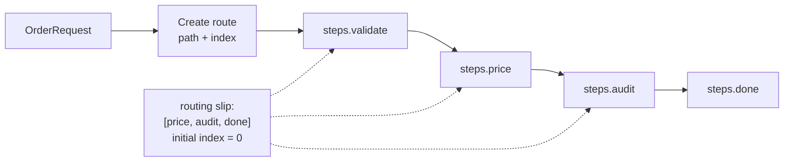
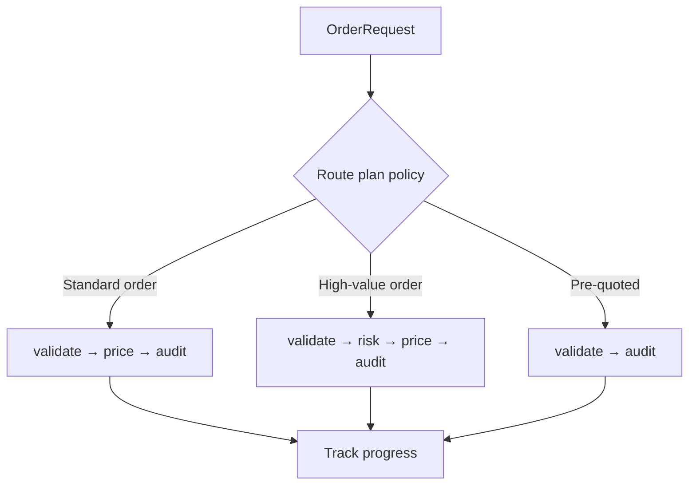

# Route sequence in header or message state

## 1. The problem: a message needs to follow an ordered route

In a sales system, after receiving a payment request, a message may need to go through an **ordered sequence of steps**: validate data → calculate fee → write audit log → finish. Another process might insert a risk-check step or skip the fee-calculation step depending on the product. If every relationship between endpoints is hardcoded in a single channel-wiring diagram, adding or changing routes quickly makes the configuration complex.

**Routing Slip** is an *Enterprise Integration Patterns* (EIP) pattern that carries a message's **intended itinerary**. Each time a leg completes, the system determines the **next leg** based on the itinerary and the **current position**. Think of it as a processing instruction sheet accompanying the message.

In the **Routing slip** chapter of the **SPRING_INTEGRATION_PATTERN** module, the goal is to implement Enterprise Integration Patterns with Spring Integration to build loosely coupled, extensible flows. Routing Slip connects Endpoints along an itinerary; these Endpoints can contain Filters, Transformers, Routers, Splitters, Aggregators, Gateways, and business behavior. Retries, error channels, correlation, testing, and branch observability must be designed according to real operational policies.



The diagram above uses `steps.validate` as the first leg via an explicitly configured connection. The Routing Slip header contains **the subsequent legs**. When Validate returns a result, the framework chooses Price; when Price returns a result, it chooses Audit; and then Done.

### 1.1. What does Routing Slip solve?

| Need | Without an accompanying route | With Routing Slip |
| --- | --- | --- |
| Multiple itineraries sharing endpoints | Requires many wires or many routers | Message carries the corresponding leg sequence |
| Inserting a processing step for a group of messages | May require topology changes | Can select a different path upfront or via a strategy |
| Tracking where a message is | Must infer from channels/logs | Track path, index, event ID, and processing history |
| Executing steps in order | Fixed flows can usually handle this | Path describes the order directly within the message context |
| Recovering a long-running process | Must persist external state | **Still must persist durable state**; a header alone is not enough |

A Routing Slip is **not** a durable queue, does not guarantee exactly-once delivery on its own, and does not turn multiple operations into a single transaction. It primarily answers the question: **"Which step will receive this message's next result?"**

## 2. Understanding the route sequence: path and cursor/index

Conceptually, a route sequence has two parts:

1. **Path**: a list of legs or rules deciding legs, e.g., `["steps.price", "steps.audit", "steps.done"]`.
2. **Cursor/index**: the position to be read next, e.g., `0` before entering `steps.price`.

After each leg completes and produces a valid reply, the cursor advances to the next position. With fixed legs, the conceptual state can be written as follows:

```text
Upon arrival at steps.validate:
  path  = [steps.price, steps.audit, steps.done]
  index = 0

Validate produces reply:
  next  = steps.price
  index = 1

Price produces reply:
  next  = steps.audit
  index = 2

Audit produces reply:
  next  = steps.done
  index = 3

Done finishes the work:
  produces no new reply
```

**Note:** the snippet above explains behavior in prose; it is **not** a valid Java value example to assign verbatim to Spring Integration's standard header. The framework has an internal format for `routingSlip`; do not replace it with an arbitrary `List<String>` and expect automatic routing.

### 2.1. Why not just store the next channel name?

If you only store `nextChannel="steps.price"`, once Price finishes, you still need another source to know the leg after Price. A route sequence containing both the itinerary and the current position allows each endpoint to be reused across multiple itineraries.

For example:

| Request type | Route sequence |
| --- | --- |
| Standard order | Validate → Price → Audit → Done |
| Pre-quoted order | Validate → Audit → Done |
| Order requiring risk check | Validate → Risk Check → Price → Audit → Done |

These paths can share the same `Audit` and `Done` endpoints, while the message carries the information determining which legs need to execute.

### 2.2. Path is coordination data, not business payload

| Component | Example | Role |
| --- | --- | --- |
| Payload | `OrderRequest("ORD-105", 350000)` | Business data |
| Routing Slip path | `["steps.price","steps.audit","steps.done"]` | Processing itinerary |
| Routing Slip index | `1` | Next leg to be selected |
| `eventId` | `"evt-105"` | Prevents duplicate processing on replay |
| `correlationId` | `"checkout-105"` | Groups/correlates messages belonging to the same request |
| `traceId` | `"trace-105"` | End-to-end flow observability |
| Workflow status | `"WAITING_FOR_PAYMENT"` | Business status for long-running workflows |

Identifiers serve different purposes. **Routing index does not replace event ID**, and you should not use `MessageHeaders.ID` as an idempotency key because an event may be replayed in a new message.

## 3. How does Spring Integration execute Routing Slip?

Spring Integration has provided the **Routing Slip** mechanism since version 4.1. It uses the system header `routingSlip` (constant `IntegrationMessageHeaderAccessor.ROUTING_SLIP`) to determine the next channel for **message-producing endpoints** when they do **not** have an explicit `outputChannel` configured.

For a path containing fixed channels, the conceptual algorithm is:

1. The endpoint processes the message and **produces a reply**.
2. If the endpoint declares an explicit output channel, that output configuration takes effect; do not treat Routing Slip as overriding all outputs.
3. When the endpoint does not specify an output channel, the framework consults the `routingSlip` header.
4. The framework retrieves the element at `routingSlipIndex`. If it is a registered `MessageChannel` bean name, it sends the reply to that channel and **increments the index in the reply**.
5. The next leg continues processing. Once the path is exhausted, the normal reply channel mechanism applies if present.

This is a mechanism based on **reply/output resolution**, not a scheduler that wakes up the next step automatically. If a Service Activator returns `void` or `null` and produces no reply, the flow does not advance to the next leg simply because the header still has elements.

### 3.1. The framework's header is not a simple list of strings

For the standard API, `RoutingSlipHeaderValueMessageProcessor` creates a value representing **path and index** (in documented APIs, a map structure with the path as key and initial index `0`). The framework creates, updates, and reads that structure itself.

**Do not do this:**

```java
// WRONG example for the framework's automatic Routing Slip mechanism:
// MessageBuilder.withPayload(order)
//     .setHeader("routingSlip", List.of("steps.price", "steps.audit"))
//     .build();
```

Assigning a list directly to the standard header may not match the format the framework expects. Instead, use **Header Enricher** and `RoutingSlipHeaderValueMessageProcessor`, or the equivalent Routing Slip API for your running version.

### 3.2. Static legs and RoutingSlipRouteStrategy

A path element can be:

- **A `MessageChannel` bean name**: goes directly to that channel and advances the index.
- **A `RoutingSlipRouteStrategy` bean name**: a strategy that determines the next destination based on the request and reply. When the strategy returns a valid channel, the framework can keep using **the same path position** to invoke the strategy next time; only when the strategy returns `null` or an empty string does the framework move to the next path element.
- **A SpEL expression** converted by the framework into a strategy to compute the destination dynamically.

A strategy lets you express conditional itineraries without building many separate Routers, but it can also easily create loops without a termination condition. If a strategy always returns a non-empty channel, the path may **never advance past the strategy** under this mechanism.

## 4. Spring Integration example: route sequence in the standard header

To clarify the mechanism, let's build the flow:

```text
slip.in
  -> HeaderEnricher (routingSlip = [steps.price, steps.audit, steps.done])
  -> steps.validate               [explicit outputChannel of HeaderEnricher]
  -> steps.price                  [routingSlip index 0]
  -> steps.audit                  [routingSlip index 1]
  -> steps.done                   [routingSlip index 2]
```

In this example, **Validate, Price, and Audit all produce replies**, without declaring separate output channels; `Done` is a one-way terminal step. We use `DirectChannel` so the simulation is easy to follow and test synchronously. The illustrative code uses Java `record`s and Spring Integration Java config.

### 4.1. Payload model and business interface

```java
record OrderRequest(String orderId, long amountVnd) {}
record PricedOrder(String orderId, long amountVnd, long feeVnd) {}

interface CheckoutActions {
    void validate(OrderRequest order);
    PricedOrder price(OrderRequest order);
    void audit(PricedOrder order);
    void complete(PricedOrder order);
}
```

The business service performs the actual business logic. Endpoints simply turn each `Message` into a method call and pass the **result** to the next leg. `CheckoutActions` requires an implementation bean in the Spring context.

### 4.2. Configuring Header Enricher and channels

```java
import java.util.Collections;
import org.springframework.context.annotation.Bean;
import org.springframework.context.annotation.Configuration;
import org.springframework.integration.IntegrationMessageHeaderAccessor;
import org.springframework.integration.annotation.Transformer;
import org.springframework.integration.channel.DirectChannel;
import org.springframework.integration.config.EnableIntegration;
import org.springframework.integration.transformer.HeaderEnricher;
import org.springframework.integration.transformer.support.RoutingSlipHeaderValueMessageProcessor;
import org.springframework.messaging.MessageChannel;

@Configuration
@EnableIntegration
class RoutingSlipConfig {

    @Bean("slip.in")
    MessageChannel inputChannel() {
        return new DirectChannel();
    }

    @Bean("steps.validate")
    MessageChannel validationChannel() {
        return new DirectChannel();
    }

    @Bean("steps.price")
    MessageChannel pricingChannel() {
        return new DirectChannel();
    }

    @Bean("steps.audit")
    MessageChannel auditChannel() {
        return new DirectChannel();
    }

    @Bean("steps.done")
    MessageChannel doneChannel() {
        return new DirectChannel();
    }

    @Bean
    @Transformer(
            inputChannel = "slip.in",
            outputChannel = "steps.validate")
    HeaderEnricher routingSlipHeaderEnricher() {
        return new HeaderEnricher(Collections.singletonMap(
                IntegrationMessageHeaderAccessor.ROUTING_SLIP,
                new RoutingSlipHeaderValueMessageProcessor(
                        "steps.price",
                        "steps.audit",
                        "steps.done")));
    }
}
```

This configuration closely matches the **documented Spring Integration Routing Slip API**: `HeaderEnricher` initializes the system header with the path list instead of assigning an arbitrary `List<String>`.

**Two decisive details:**

1. `outputChannel = "steps.validate"` on the Header Enricher sets the starting point **before** the path; the first element in `routingSlip` is `steps.price`.
2. Handlers on `steps.validate`, `steps.price`, and `steps.audit` **do not declare an output channel**. Only when they return a result does Routing Slip get the opportunity to specify the next leg.

If you accidentally put `steps.validate` in **both** the Header Enricher's output channel **and** the first element of the path, the message risks running Validate twice. Therefore, make sure you define clearly whether the first leg is sent directly by configuration or is element 0 of the path.

### 4.3. Service Activators executing each step

```java
import org.springframework.integration.annotation.ServiceActivator;
import org.springframework.stereotype.Component;

@Component
class CheckoutSteps {
    private final CheckoutActions actions;

    CheckoutSteps(CheckoutActions actions) {
        this.actions = actions;
    }

    @ServiceActivator(inputChannel = "steps.validate")
    public OrderRequest validate(OrderRequest order) {
        actions.validate(order);
        return order;  // Reply so Routing Slip moves to Price.
    }

    @ServiceActivator(inputChannel = "steps.price")
    public PricedOrder price(OrderRequest order) {
        return actions.price(order); // Returns converted payload.
    }

    @ServiceActivator(inputChannel = "steps.audit")
    public PricedOrder audit(PricedOrder order) {
        actions.audit(order);
        return order;  // Reply so Routing Slip moves to Done.
    }

    @ServiceActivator(inputChannel = "steps.done")
    public void complete(PricedOrder order) {
        actions.complete(order);
    }
}
```

Each method is recognized by Spring Integration as an Endpoint via the `@ServiceActivator` annotation. `validate` returns the same payload; `price` returns a `PricedOrder` payload; `audit` returns the payload to continue the flow. The `complete` step returns `void` because there is no need to pass the message to another leg.

If `price` is replaced by a handler returning `null`, **Routing Slip stops there** instead of skipping over the step. If a separate `outputChannel` is declared on a handler, the result is sent to that specified output rather than following the automatic path in the example.

### 4.4. Producer sends a message with stable context

```java
import org.springframework.beans.factory.annotation.Qualifier;
import org.springframework.messaging.MessageChannel;
import org.springframework.messaging.support.MessageBuilder;
import org.springframework.stereotype.Component;

@Component
class CheckoutPublisher {
    private final MessageChannel ingress;

    CheckoutPublisher(@Qualifier("slip.in") MessageChannel ingress) {
        this.ingress = ingress;
    }

    void submit() {
        var request = new OrderRequest("ORD-105", 350_000L);
        ingress.send(MessageBuilder.withPayload(request)
                .setHeader("eventId", "evt-105")
                .setHeader("traceId", "trace-105")
                .setHeader("tenantId", "shop-hcm")
                .build());
    }
}
```

The producer **does not need to construct `routingSlip` itself**; the Header Enricher at the start of the flow initializes the itinerary. With `DirectChannel`, steps typically run synchronously in sequence. If the business requires durability or asynchrony, you must change the transport/state design rather than merely changing the channel type.

## 5. Route sequence in message state: application-managed approach

Not every process fits Spring Integration's internal `routingSlip` header. A multi-hour workflow that survives restarts or spans multiple services may need **durably persisted progress**. In this case, you can build your **own message state**, without pretending it is the standard Routing Slip header.

Example of an immutable state:

```java
import java.util.List;
import java.util.Set;

record RouteProgress(List<String> path, int nextIndex, String version) {
    private static final Set<String> ALLOWED_STEPS = Set.of(
            "steps.validate", "steps.price",
            "steps.audit", "steps.done");

    RouteProgress {
        path = List.copyOf(path); // Defensive copy.
        if (nextIndex < 0 || nextIndex > path.size()) {
            throw new IllegalArgumentException("Invalid route index");
        }
        if (version == null || version.isBlank()
                || path.isEmpty()
                || !ALLOWED_STEPS.containsAll(path)) {
            throw new IllegalArgumentException("Invalid route plan");
        }
    }

    boolean isFinished() {
        return nextIndex == path.size();
    }

    String nextStep() {
        if (isFinished()) {
            throw new IllegalStateException("No remaining route step");
        }
        return path.get(nextIndex);
    }

    RouteProgress advance() {
        if (isFinished()) {
            throw new IllegalStateException("Route already finished");
        }
        return new RouteProgress(path, nextIndex + 1, version);
    }
}
```

**This is an application model**, not Spring Integration's `RoutingSlip` class. A route plan is initialized like this:

```java
RouteProgress progress = new RouteProgress(
        List.of("steps.validate", "steps.price",
                "steps.audit", "steps.done"),
        0,
        "checkout-v2");

assert "steps.validate".equals(progress.nextStep());
RouteProgress afterValidation = progress.advance();
assert "steps.price".equals(afterValidation.nextStep());
```

In a custom flow, you can attach the state to a **custom header** `appRouteProgress` or to a versioned payload envelope. When a step completes, create a new message with the incremented state:

```java
import org.springframework.messaging.Message;
import org.springframework.messaging.support.MessageBuilder;

Message<?> withAdvancedRoute(Message<?> original) {
    RouteProgress progress =
            (RouteProgress) original.getHeaders().get("appRouteProgress");
    if (progress == null) {
        throw new IllegalArgumentException("Missing route progress");
    }
    return MessageBuilder.fromMessage(original)
            .setHeader("appRouteProgress", progress.advance())
            .build();
}
```

An **application-defined Router** reads `progress.nextStep()`, maps it to an allowlisted set of channels, and sends the message to that leg. After the handler succeeds, it advances the state to the next index and routes through the Router again. This mechanism must be coded and tested explicitly; Spring Integration **does not automatically read the `appRouteProgress` header** as if it were the standard `routingSlip`.

### 5.1. How does header state differ from persistence?

| Property | In-memory message header | External durable state |
| --- | --- | --- |
| Where does it live? | Inside `MessageHeaders` of the current message | DB, state store, or workflow engine |
| Survives restarts? | Not automatically | Yes, with proper persistence/transactions |
| Crosses a broker? | Depends on serialization and header mapping | Can pass an ID and reload state |
| Guarantees no double processing? | No | Only with idempotency keys and proper transactions/concurrency control |
| Change route mid-flight? | Possible, but error-prone for state | Manageable via plan versions and migration rules |
| Step-by-step tracking/audit? | Only with dedicated logging | Can persist an explicit history |

For long-running processes, you typically store `workflowId`, `planVersion`, `currentStep`, per-step status, attempt count, updated timestamp, last error, and a **version/concurrency token**. The message only needs to carry `workflowId` and event keys so the worker can load the state and execute. If two workers update progress concurrently, use optimistic locking or synchronization to prevent *double advance*.

### 5.2. When to choose which approach?

| Scenario | Suitable approach |
| --- | --- |
| Internal, short-lived, request-reply flow with reply-producing Endpoints | Standard Routing Slip in header |
| Dynamic path with a strategy within the same integration flow | Standard Routing Slip + `RoutingSlipRouteStrategy` |
| Process spanning hours/days, waiting on external system responses | Persisted workflow state / coordinator |
| Messages crossing multiple JVMs and brokers | Stable state format; avoid non-serializable objects/SpEL in headers |
| Need public history and approver records per leg | Durable business state and audit trail |

Do not stuff every long-running orchestration problem into a header if the system needs per-leg crash recovery or human-wait steps.

## 6. Dynamic route path: when the order is not fixed

Not every order passes through the same steps. For example, a high-total order needs an extra `steps.risk`; an already-priced order can skip `steps.price`.



There are two main approaches:

1. **Choose a route plan upfront:** a trusted classification step builds the complete path from business data. Subsequent legs just execute the path, avoiding recomputing rules everywhere.
2. **Use `RoutingSlipRouteStrategy` at a dynamic slot:** the strategy computes the next channel from the request and reply; only when the strategy signals no more destinations (`null`/empty string) does the framework advance to the next path element.

Example of application routing rules independent of Spring:

```java
import java.util.List;

List<String> choosePath(boolean highRisk, boolean alreadyPriced) {
    if (highRisk) {
        return List.of("steps.validate", "steps.risk",
                "steps.price", "steps.audit", "steps.done");
    }
    if (alreadyPriced) {
        return List.of("steps.validate", "steps.audit", "steps.done");
    }
    return List.of("steps.validate", "steps.price",
            "steps.audit", "steps.done");
}
```

In practice, if the rule after `validate` depends on that endpoint's **reply**, using a `RoutingSlipRouteStrategy` or explicit state persistence is better than trying to predict the whole path before the data exists.

### 6.1. Loop limits

Dynamic paths can introduce cycles:

```text
steps.risk -> steps.review -> steps.risk -> ...
```

If this is a real requirement, you need **a hop/iteration limit**, a timeout policy, and an explicit waiting state; otherwise, the route sequence could loop forever, increasing load or repeating operations. With standard Routing Slip, a strategy that keeps returning a non-empty channel can be queried repeatedly at the same path position. Any strategy implementation must have an **exit condition** and be tested independently.

## 7. Relationship with Router, Filter, Transformer, Splitter, and Aggregator

| Pattern | Primary question | Relationship with Routing Slip |
| --- | --- | --- |
| **Content-Based Router** | Which branch to take based on current content? | Can be used to choose the initial route plan |
| **Header-Based Router** | Which branch to take by header value? | Reads a single key; does not inherently manage full path + progress |
| **Recipient List** | Which recipients should receive this? | Mainly fan-out, not a sequential chain of legs |
| **Filter** | Is the message valid to continue? | If a message is dropped without a reply, the chain can stop |
| **Transformer** | How should the payload type/shape change? | Returns a new payload; must preserve the Routing Slip header in the reply |
| **Service Activator** | Which business behavior should run? | The reply drives transition to the next leg |
| **Splitter/Aggregator** | How to split/gather messages in a group? | Must manage correlation/sequence separately; do not assume one slip across branches |
| **Gateway** | How does application code call a flow and what does it wait for? | Once the path ends, it can return to `replyChannel` if the flow produces a reply |

### 7.1. Transformer changes payload without breaking the route

For example, `OrderRequest` becomes `PricedOrder` after the pricing step. The `routingSlip` header and coordination headers must be propagated by the framework according to handler rules. If you manually build a new `Message` with `MessageBuilder.withPayload(...)` and forget to copy headers, downstream steps can lose the Routing Slip and fall back to default reply behavior.

With manual logic, `MessageBuilder.fromMessage(original)` helps inherit headers before modifying payload/state, though you must consider system headers and formats when crossing a broker. Do not assume every Java header is safe to serialize.

### 7.2. Splitter + Aggregator need more than route index

When a Splitter leg produces multiple child messages, each child may have its own lifecycle. The Aggregator needs a correlation key and release strategy to know when all parts have arrived. Do not use the routing index as a correlation ID: many unrelated orders can all be at `nextIndex=2`.

When fanning out into multiple branches and wanting to return to a route sequence, establish a **fan-in point** that emits a single result message with appropriate state/correlation before the next step runs. Otherwise, multiple branches could continue along the same Routing Slip and cause the final step to execute multiple times unexpectedly.

## 8. Retry, errors, and progress: avoiding skipped legs or duplicate runs

A Routing Slip does not determine on its own which business action has **actually succeeded**. For instance, Audit calls a remote API successfully, but its reply is lost or an exception occurs right after the call. If the message is redelivered, Audit may run again.

| Scenario | Risk | Mitigation |
| --- | --- | --- |
| Handler throws an exception before producing a reply | Slip does not advance as expected | Retry according to error type or persist for recovery |
| Handler returns `null` unexpectedly | Stops at the current leg | Test the contract requiring a reply when progression is needed |
| Explicit `outputChannel` is present | Bypasses automatic output selection from the slip | Do not configure fixed destinations on steps meant to follow the slip |
| Message is replayed from a previous leg | Re-executes already completed side effects | Idempotency key per workflow step |
| Two workers update state concurrently | Double advance or overwritten state | CAS/optimistic locking, version token |
| Route path modified without control | Skips mandatory checks | Plan versioning, authorization, and audit |
| Next channel does not exist | Dispatch/route failure | Validate routes, fail fast, alert |
| Async leg fails | Upstream is no longer on the same call stack | Error channel/handler, durable recovery |

**An important rule:** only mark a step `COMPLETED` in business state once the work has finished according to its contract; **do not** advance the cursor and then perform side effects without a recovery mechanism. For operations that cannot share a transaction, design idempotency or compensation.

### 8.1. Retries can repeat a leg

For a payment step, define an idempotency key such as:

```text
workflowId = checkout-105
stepId     = charge-payment
requestKey = checkout-105:charge-payment
```

During retry/replay, the payment step receives the same `requestKey` so it does not charge twice if the target service supports idempotency. In the state store, you can record:

```text
workflow_id | step_id         | status      | attempts
checkout-105| validate        | COMPLETED   | 1
checkout-105| charge-payment  | IN_PROGRESS | 2
checkout-105| audit           | PENDING     | 0
```

If updating state fails after calling an external service, query/reconcile the external outcome before replaying—do not assume the step never ran.

### 8.2. Synchronous vs. asynchronous errors

With `DirectChannel`, an exception in a synchronous handler can propagate back to the sending thread. When using an executor, poller, or broker, exceptions can occur on a different thread and require an appropriate `ErrorHandler`/`errorChannel`.

An `errorChannel` is simply a mechanism to convert errors into messages in properly configured contexts; it **does not automatically act as dead-letter storage** or retry. Distinguish non-retryable data errors (invalid route, invalid schema) from transient errors (timeout, 503) and define explicit recovery.

## 9. Routing Slip headers across brokers and serialization issues

The standard Routing Slip can contain channel bean names, strategies, and even expression objects. For **pure single-JVM flows**, referencing beans/strategies can make sense. When messages cross a broker, message store, or multiple JVMs, you must examine the **serializability** of every header component.

Spring Integration documentation warns that inline expressions in a path can be converted into `ExpressionEvaluatingRoutingSlipRouteStrategy`, which depends on `BeanFactory` and is **not serializable**. When a message containing such an object crosses a distributed boundary, a `NotSerializableException` can occur. If you still use a routing strategy in distributed infrastructure, register the strategy as a **Spring bean** and reference it by bean name as recommended by the framework, while also verifying how the adapter actually maps/serializes headers.

A safer approach for distributed processes:

1. Select an approved **route plan ID/version**, rather than letting clients send arbitrary bean names.
2. Persist the step list in a state store or a versioned JSON/DTO schema.
3. Send only `workflowId`, `eventId`, `traceId`, and necessary metadata over the broker.
4. The consumer reads state from a trusted store, checks permissions/version, and executes a single step.
5. Update progress with concurrency protection, then emit a command/event for the next leg.

Never use a route sequence as an **endpoint name list supplied by an untrusted caller**. Allowing arbitrary routing lets senders bypass risk checks or steer messages to unauthorized endpoints. Apply channel allowlists, authorization, and mandatory-step validation.

## 10. Testing route sequences, replies, and recovery

### 10.1. Unit testing application-managed state

Index advancement should have tests for start, end, and invalid inputs:

```java
import java.util.List;
import org.junit.jupiter.api.Test;
import static org.junit.jupiter.api.Assertions.*;

class RouteProgressTest {

    @Test
    void advancesExactlyOneStepAtATime() {
        RouteProgress initial = new RouteProgress(
                List.of("steps.validate", "steps.audit"), 0, "v1");

        assertEquals("steps.validate", initial.nextStep());
        RouteProgress afterFirst = initial.advance();

        assertEquals("steps.audit", afterFirst.nextStep());
        assertEquals(0, initial.nextIndex()); // Original object remains unchanged.
        assertTrue(afterFirst.advance().isFinished());
    }

    @Test
    void rejectsUnknownStepAndInvalidCursor() {
        assertThrows(IllegalArgumentException.class, () ->
                new RouteProgress(List.of("admin.secret"), 0, "v1"));
        assertThrows(IllegalArgumentException.class, () ->
                new RouteProgress(List.of("steps.audit"), 2, "v1"));
    }
}
```

These tests **only** verify application-managed state; they do not verify Spring's `routingSlip` mechanism.

### 10.2. Integration testing the standard Routing Slip

An integration test with a Spring context containing `RoutingSlipConfig`, `CheckoutSteps`, and a mocked `CheckoutActions` can verify that **Validate → Price → Audit → Done** are invoked in exact order. With `DirectChannel`, verification can happen right after the synchronous `send()`:

```java
import org.junit.jupiter.api.Test;
import org.springframework.beans.factory.annotation.Autowired;
import org.springframework.beans.factory.annotation.Qualifier;
import org.springframework.context.annotation.Bean;
import org.springframework.context.annotation.Configuration;
import org.springframework.messaging.MessageChannel;
import org.springframework.messaging.support.MessageBuilder;
import org.springframework.test.context.junit.jupiter.SpringJUnitConfig;
import org.mockito.InOrder;

import static org.mockito.Mockito.*;

@SpringJUnitConfig(classes = {
        RoutingSlipConfig.class,
        CheckoutSteps.class,
        RoutingSlipFlowTest.MockActions.class
})
class RoutingSlipFlowTest {

    @Autowired
    @Qualifier("slip.in")
    MessageChannel ingress;

    @Autowired
    CheckoutActions actions;

    @Test
    void followsAllConfiguredStepsInOrder() {
        var request = new OrderRequest("ORD-105", 350_000L);
        var priced = new PricedOrder("ORD-105", 350_000L, 15_000L);
        when(actions.price(request)).thenReturn(priced);

        ingress.send(MessageBuilder.withPayload(request)
                .setHeader("eventId", "evt-105")
                .build());

        InOrder steps = inOrder(actions);
        steps.verify(actions).validate(request);
        steps.verify(actions).price(request);
        steps.verify(actions).audit(priced);
        steps.verify(actions).complete(priced);
        steps.verifyNoMoreInteractions();
    }

    @Configuration
    static class MockActions {
        @Bean
        CheckoutActions checkoutActions() {
            return mock(CheckoutActions.class);
        }
    }
}
```

This test illustrates the ordering and payload contract: `price` returns `PricedOrder` for Audit/Done to consume. In multi-case test suites, reset mocks between tests or manage mock/context lifecycles properly. For async flows, do not verify immediately after `send()`; wait for a completion signal with a finite timeout before asserting.

### 10.3. Matrix of required test cases

| Case | Expected behavior |
| --- | --- |
| Normal path | Each step runs once, in order |
| Step returns a new reply payload type | Next leg receives the right type and required headers |
| Step returns `null` or `void` | Path does not advance automatically without a reply |
| Handler has a fixed output channel | Clearly observe why automatic slip routing no longer applies |
| Path contains a non-existent channel | Config/dispatch error is caught; message is not silently dropped |
| Strategy returns multiple destinations then `null` | Index advances only when the strategy finishes |
| Dynamic loop occurs | Stopped by max hops/timeout and reports an error |
| Replay with the same `workflowId` + step | Side effect is not duplicated if already processed |
| Two workers update progress concurrently | One update wins via lock/version; no double advance |
| Across broker or message store | Header/schema serializes and restores properly |
| Splitter/Aggregator between steps | Correlation, release strategy, and next route remain accurate |
| Intermediate step failure | Recovery exists and tracks how far execution progressed |

### 10.4. Metrics and tracing

Track metrics: new workflows, messages entering each step, duration and error rate per step, retry counts, **unfinished workflow age**, dead-letter/replay counts, and workflows stuck at the same index for too long. For dynamic strategies, record how many times the strategy is invoked and how many times execution returns to the same leg.

Logs/traces can include `workflowId`, `eventId`, `traceId`, `planVersion`, `stepName`, and `nextIndex`. Do not use `workflowId` or `eventId` as high-cardinality metric labels. Avoid logging sensitive payloads or routing metadata containing confidential data.

## 11. Common design mistakes

1. **Treating `routingSlip` as an arbitrary `List<String>`.** The standard header has a path/index structure managed by the framework.
2. **Setting fixed output channels on steps** and still expecting Routing Slip to drive the output.
3. **Letting a step return `void` when more legs remain.** There is no reply for the framework to forward.
4. **Including the first leg twice**: both as the Header Enricher's output and as the first element of the path.
5. **Incrementing the index before business logic succeeds** without transactions/recovery.
6. **Using route index as a business ID or correlation key.** Multiple processes share the same index.
7. **Using non-serializable dynamic expressions across brokers** and hitting serialization errors.
8. **Not validating routes from external inputs.** Callers could skip mandatory checks or pick unauthorized endpoints.
9. **Having no termination condition for a strategy.** A step could loop infinitely.
10. **Fanning out without an explicit fan-in.** Multiple branches advance the path concurrently and cause duplicate side effects.
11. **Testing only the path-selection function.** Failing to verify actual header propagation, replies, and execution order.
12. **Treating headers as durable storage.** A process crash can lose progress not persisted externally.

## 12. Hands-on exercise and self-assessment

**Exercise:** Build a flow processing `PaymentRequest` with two itineraries:

- Standard payment: `validate → charge → audit → finish`.
- High-value payment: `validate → riskReview → charge → audit → finish`.

Requirements:

1. Explain what the **route path** is, what the **index** is, and what the business payload is.
2. Create an example `HeaderEnricher` attaching `routingSlip` using the dedicated processor; steps return appropriate replies and declare no fixed output channels.
3. Run the standard path; record the order of handlers and when the index advances.
4. Make `riskReview` throw an error; explain why it must not automatically jump to Charge.
5. Let Charge succeed and then simulate a lost reply; propose an idempotency key to avoid double charging on replay.
6. Implement `RouteProgress` or a custom state model storing `workflowId`, `planVersion`, `nextIndex`, and per-step status.
7. Test optimistic locking when two workers attempt to increment the index simultaneously.
8. Compare the two approaches: in-JVM header vs. durable state across brokers/restarts.
9. If one step must fan out to three systems, propose fan-in/correlation and the condition allowing the route to continue.
10. Add metrics to detect stuck workflows, increasing retries, or exceeding maximum hops.

Answer for yourself: **When does Routing Slip decide the next leg? How does the `routingSlip` header differ from `appRouteProgress`? What happens when an Endpoint returns no reply? Why is storing the index in a header insufficient to recover a process after a crash?**

**Route sequence in header or message state** decouples the processing schedule from individual Endpoint logic. Spring Integration supports standard Routing Slip via the `routingSlip` header and reply-based output channel resolution, whereas long-running distributed processes typically require durable, application-managed state. Choosing the right representation, controlling path modification permissions, advancing only after step completion, and testing ordering, errors, correlation, and replay will make EIP flows observable and recoverable.

### Technical references

- Spring Integration Reference — **Routing Slip**: https://docs.spring.io/spring-integration/reference/router/routing-slip.html
- Spring Integration Javadoc — `RoutingSlipHeaderValueMessageProcessor`: https://docs.spring.io/spring-integration/docs/6.5.5/api/org/springframework/integration/transformer/support/RoutingSlipHeaderValueMessageProcessor.html
