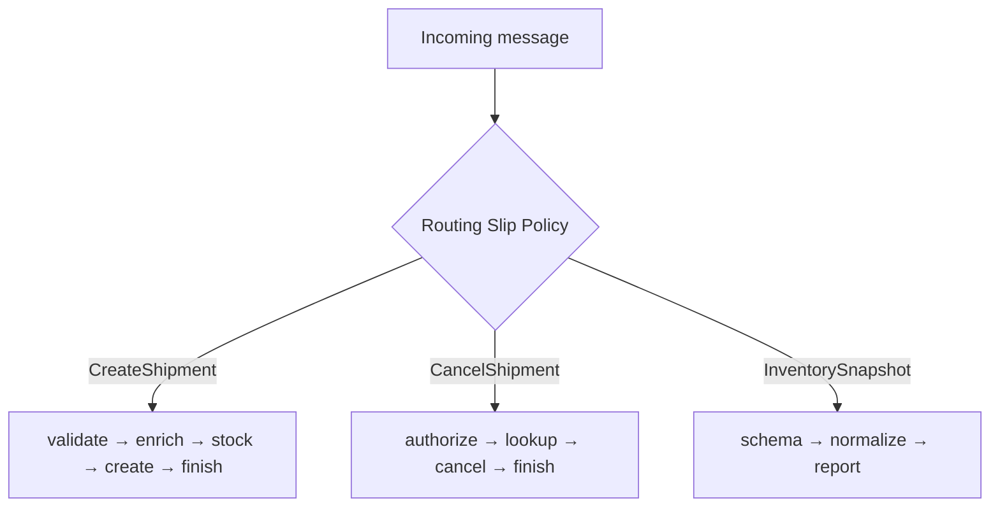
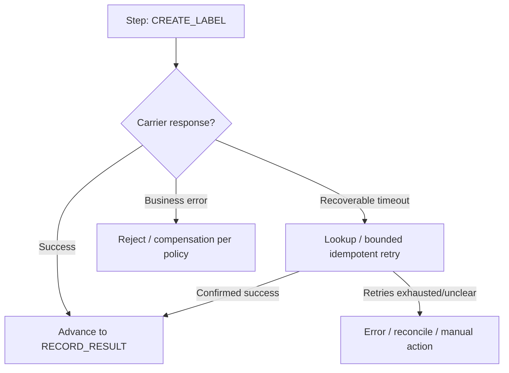

# Dynamic routing slip by message type

> **Chapter:** Routing slip  
> **Module:** `SPRING_INTEGRATION_PATTERN` — implementing Enterprise Integration Patterns (EIP) with Spring Integration to build loosely coupled, extensible message flows; practicing Router, Filter, Transformer, Splitter, Aggregator, Gateway, retry, error channel, correlation, testing, and per-branch observability. This lesson focuses on **sequential processing itineraries dynamically chosen based on message type**.

## 1. Learning objectives

After this lesson, you will be able to:

1. Explain what **Routing Slip** is and how it differs from a Content-Based Router, Recipient List, and a flow with fixed steps.
2. Design an **itinerary** (an ordered list of processing endpoints) computed from the **business message type** instead of writing a huge `if/else` chain inside every handler.
3. Understand the role of the **routing-slip header**, progress state, output messages, and conditions for transitioning to the next point.
4. Build a **pure Java routing policy** with an allowlist, versioning, message-type validation, and permitted traversal steps.
5. Know how to integrate the plan with Spring Integration without confusing **attaching a header** with **automatically executing the entire itinerary**.
6. Analyze errors, timeouts, retries, idempotency, correlation, itinerary changes, and testing the exact step order.

## 2. Why does a message need to carry its itinerary?

Suppose a fulfillment system receives three message types:

- **`CreateShipment` (command):** validate data → enrich address → check inventory → create shipment → record outcome.
- **`CancelShipment` (command):** authorize cancellation → query shipment status → cancel with carrier → update outcome.
- **`InventorySnapshot` (document):** validate schema → normalize data → update reporting system.

All of them enter through a single intake point, yet **the order and number of processing steps differ**. A Router can select the initial branch, whereas a Routing Slip can carry **the entire intended itinerary** so subsequent steps know where to forward the message next.



The diagram shows **three different itineraries computed by message type**. This is not three recipients receiving the same message simultaneously: each itinerary is an **ordered sequence of legs**.

**Routing Slip** is an EIP pattern that allows a message to carry information about **its next destinations in an ordered list**. After each step produces an appropriate result, the routing mechanism forwards the message to the next point in the slip. When no steps remain, the flow terminates or transitions to a designated result sink.

> **Key distinction:** Deciding "the message has itinerary A → B → C" is different from "A, B, and C all receive the message". Routing Slip expresses **sequential progression**, whereas Recipient List expresses **distribution to a set of recipients**.

## 3. Core concepts: itinerary, step, cursor, and continuation

We can visualize a logical routing slip as follows:

```text
Message envelope
  payload: CreateShipment(shipmentId="SHP-301", ...)
  business headers:
    correlationId: SHP-301
    messageType: CREATE_SHIPMENT
    policyVersion: fulfillment-v2
  routing slip (conceptual representation):
    steps:
      [validateShipment,
       enrichAddress,
       reserveStock,
       createCarrierShipment,
       recordOutcome]
    nextIndex: 0
```

`steps` and `nextIndex` in the example are a **learning model**, **not a claim that Spring Integration stores the header in this exact structure**. How Spring Integration represents and advances a routing slip is a detail of the framework mechanism and version in use. In real implementations, use the framework-supported Routing Slip mechanism—do not invent a header and assume it will be executed automatically.

### 3.1. Components of a routing slip

| Component | Meaning | Example |
| --- | --- | --- |
| **Message type** | Identifies the business contract being processed | `CREATE_SHIPMENT` |
| **Step list** | Processing points to traverse, in order | `validate → enrich → reserve → create` |
| **Current/remaining pointer** | How the mechanism knows the next step | `nextIndex` in the logical model |
| **Policy version** | Enables reproducing why the itinerary was built this way | `fulfillment-v2` |
| **Correlation ID** | Links messages and outcomes belonging to the same process | `SHP-301` |
| **Outcome/error state** | Records step success/failure | `step=reserveStock`, `outcome=FAILED` |

A system does not have to place all of the above data inside headers. For example, durable progress history may live in a **workflow state store**, especially when the process is long-running, has retries, or crosses multiple brokers. Do not use `MessageHeaders.id` in place of business correlation and idempotency keys.

### 3.2. A message must emit output to proceed

When a handler in the itinerary merely receives a message, performs a side effect, and **emits no result**, the flow does not necessarily have a message to continue to the next step. Therefore, each leg's design must clearly define:

- What payload type does the handler receive, and what **reply/output message** does it produce?
- Which metadata does the output preserve: routing slip, correlation, trace context, policy version?
- Does the next step expect a **success** result, or may it continue with a "rejected" outcome?
- Does the handler execute **synchronously or asynchronously**, and who is responsible for triggering the next leg?

Do not assume a `void` Service Activator will automatically create a reply for Routing Slip after finishing. If the itinerary needs to continue, use a processor/adapter style that returns an appropriate output or an intentional continuation mechanism.

## 4. How Routing Slip differs from related EIPs

| Pattern | Intent | Destination shape | Illustration |
| --- | --- | --- | --- |
| **Content-Based Router** | Pick the next leg from current content | One or more outputs per router | CREATE kind → `createFlow`, CANCEL → `cancelFlow` |
| **Routing Slip** | Carry a sequential itinerary across legs | An **ordered** list | `validate → enrich → reserve → create` |
| **Recipient List** | Select a set of receiving destinations | Multiple recipients, not inherently sequential business steps | Send event to audit + analytics |
| **Publish-Subscribe Channel** | Broadcast messages to registered subscribers | Fan-out at a channel | `ShipmentCreated` to multiple consumers |
| **Pipes and Filters** | Build a pipeline of independent processing steps | Typically statically declared topology | `Filter → Transformer → Handler` |
| **Splitter / Aggregator** | Split and recombine related messages | Multiple parts and one grouped result | Split per parcel, then aggregate results |

**Dynamic by message type** does not mean you always need a Routing Slip. If there are only two types and each has a short fixed pipeline, a **Content-Based Router** routing to two explicit flows may be simpler. Routing Slip shines when itineraries have many variations, when the list of legs must travel with the message, or when routes need to change via a centralized policy.

### 4.1. Routing Slip is not an arbitrary loop

An ordered list should generally **progress toward termination**. If every handler appends itself to the slip or routes backward without bounds, infinite loops, endless retries, and repeated side effects can happen. For processes with complex conditional branching, a state machine/process manager or workflow engine may express control flow more safely.

## 5. Designing itineraries by message type

We use three message types in the fulfillment example. Steps are named using **logical keys**, never taking raw channel names directly from external senders.

### 5.1. Policy table

| Message type | Logical itinerary | Primary semantics |
| --- | --- | --- |
| `CREATE_SHIPMENT` | `VALIDATE_CREATE → ENRICH_ADDRESS → RESERVE_STOCK → CREATE_LABEL → RECORD_RESULT` | Create a new shipment |
| `CANCEL_SHIPMENT` | `AUTHORIZE_CANCEL → LOOKUP_SHIPMENT → CANCEL_LABEL → RECORD_RESULT` | Cancel an existing shipment |
| `INVENTORY_SNAPSHOT` | `VALIDATE_SNAPSHOT → NORMALIZE_SNAPSHOT → UPDATE_REPORTING` | Update reporting data |

These names represent **application-owned legs**, not built-in Spring Integration endpoints. In a real system, `CREATE_LABEL` and `CANCEL_LABEL` may call carrier APIs, while `RESERVE_STOCK` has side effects requiring idempotency.

### 5.2. Select by type first, then inspect business attributes

Policies can be extended in a controlled way. For instance, an international `CREATE_SHIPMENT` request needs a customs review step:

```text
CREATE_SHIPMENT + country=VN:
    VALIDATE_CREATE → ENRICH_ADDRESS → RESERVE_STOCK
    → CREATE_LABEL → RECORD_RESULT

CREATE_SHIPMENT + country=SG:
    VALIDATE_CREATE → ENRICH_ADDRESS → CUSTOMS_REVIEW
    → RESERVE_STOCK → CREATE_LABEL → RECORD_RESULT
```

The key point is that **message type selects the main itinerary skeleton**, while validated business attributes determine optional legs. Do not confuse `country=SG` with a separate message type, and never let unvalidated data inject arbitrary step names.

### 5.3. Version the routing decision

Today the itinerary includes `ENRICH_ADDRESS`; tomorrow `VERIFY_FRAUD` is added. Which policy should a command already sitting in a queue from the previous version follow?

Two common approaches:

1. **Pin the itinerary at intake:** store the chosen list and `policyVersion`, making results reproducible on replay/retry. Ensure older steps remain available while in-flight messages exist.
2. **Recalculate at a controlled checkpoint:** use the current policy when a new leg begins, if the business contract allows it. Must handle cases where some side effects already completed before the policy changed.

Do not **blindly recompute from scratch** on every retry if that could skip or repeat already completed steps.

## 6. Java example: safely creating a routing-slip plan

The following example uses Java 17+ and a **pure Java policy** model. Its goal is to compute a **valid itinerary** without performing I/O or executing steps. These classes can be used in a Spring Integration application regardless of which Router API version you choose.

```java
import java.util.List;
import java.util.Set;

enum MessageKind {
    CREATE_SHIPMENT,
    CANCEL_SHIPMENT,
    INVENTORY_SNAPSHOT
}

enum Stage {
    VALIDATE_CREATE,
    ENRICH_ADDRESS,
    CUSTOMS_REVIEW,
    RESERVE_STOCK,
    CREATE_LABEL,
    AUTHORIZE_CANCEL,
    LOOKUP_SHIPMENT,
    CANCEL_LABEL,
    RECORD_RESULT,
    VALIDATE_SNAPSHOT,
    NORMALIZE_SNAPSHOT,
    UPDATE_REPORTING
}

record WorkMessage(
    String businessId,
    MessageKind kind,
    String country
) {}

record SlipPlan(String policyVersion, List<Stage> stages) {
    SlipPlan {
        if (policyVersion == null || policyVersion.isBlank()) {
            throw new IllegalArgumentException("policyVersion is required");
        }
        stages = List.copyOf(stages);
        if (stages.isEmpty()) {
            throw new IllegalArgumentException("Routing slip cannot be empty");
        }
    }
}

final class SlipPolicy {
    private static final String VERSION = "fulfillment-v2";
    private static final Set<String> SUPPORTED_COUNTRIES =
        Set.of("VN", "SG", "TH");

    private SlipPolicy() {}

    static SlipPlan plan(WorkMessage message) {
        if (message == null || message.businessId() == null
                || message.businessId().isBlank()
                || message.kind() == null) {
            throw new IllegalArgumentException("Invalid message identity/type");
        }

        return switch (message.kind()) {
            case CREATE_SHIPMENT -> createPlan(message);
            case CANCEL_SHIPMENT -> new SlipPlan(VERSION, List.of(
                Stage.AUTHORIZE_CANCEL,
                Stage.LOOKUP_SHIPMENT,
                Stage.CANCEL_LABEL,
                Stage.RECORD_RESULT));
            case INVENTORY_SNAPSHOT -> new SlipPlan(VERSION, List.of(
                Stage.VALIDATE_SNAPSHOT,
                Stage.NORMALIZE_SNAPSHOT,
                Stage.UPDATE_REPORTING));
        };
    }

    private static SlipPlan createPlan(WorkMessage message) {
        if (message.country() == null) {
            throw new IllegalArgumentException("Destination country is required");
        }

        String country = message.country().trim()
            .toUpperCase(java.util.Locale.ROOT);

        if (!SUPPORTED_COUNTRIES.contains(country)) {
            throw new IllegalArgumentException("Unsupported destination country");
        }

        if ("VN".equals(country)) {
            return new SlipPlan(VERSION, List.of(
                Stage.VALIDATE_CREATE,
                Stage.ENRICH_ADDRESS,
                Stage.RESERVE_STOCK,
                Stage.CREATE_LABEL,
                Stage.RECORD_RESULT));
        }

        return new SlipPlan(VERSION, List.of(
            Stage.VALIDATE_CREATE,
            Stage.ENRICH_ADDRESS,
            Stage.CUSTOMS_REVIEW,
            Stage.RESERVE_STOCK,
            Stage.CREATE_LABEL,
            Stage.RECORD_RESULT));
    }
}
```

### 6.1. Strengths of this plan-creation approach

- **Separates business logic from topology:** `Stage.RESERVE_STOCK` is a logical key; mapping to channels/handlers is configured by the application.
- **Input data cannot choose channel names:** prevents routing to internal beans or sensitive endpoints via client-supplied strings.
- **Immutable output:** `List.copyOf(...)` protects the step list structure and `Stage` is an enum, containing no mutable objects.
- **Versioned policy:** supports auditing, replay, and testing when rules evolve.
- **Every message type has an explicit path:** switching over the enum enforces handling all current cases.
- **Conditional international step:** `CUSTOMS_REVIEW` is added only when policy requires it.

This is an example of **building the itinerary**, not a claim that a Java `List<Stage>` becomes a routing-slip header automatically understood by Spring Integration. You must map **Stage → allowed channel/endpoint** and configure **continuation after each step**.

### 6.2. Using the plan

```java
WorkMessage createDomestic = new WorkMessage(
    "SHP-301", MessageKind.CREATE_SHIPMENT, "VN");

WorkMessage createInternational = new WorkMessage(
    "SHP-302", MessageKind.CREATE_SHIPMENT, "SG");

WorkMessage cancel = new WorkMessage(
    "SHP-303", MessageKind.CANCEL_SHIPMENT, null);

System.out.println(SlipPolicy.plan(createDomestic).stages());
System.out.println(SlipPolicy.plan(createInternational).stages());
System.out.println(SlipPolicy.plan(cancel).stages());
```

This example produces three different ordered lists. `country=null` is valid for cancellation in the **illustrative contract**, yet invalid for shipment creation. Validation must depend on **message type**, rather than forcing rules on fields that a given type does not use.

## 7. Bringing the policy into Spring Integration: planning vs. execution

In Spring Integration, **Routing Slip** is an EIP with a dedicated mechanism involving a **header enricher** and **forwarding output messages after each endpoint**. Exact configuration APIs (Java DSL, XML, or annotations/support classes) can vary across library versions. The key is understanding two separate responsibilities:

1. **Build the itinerary** from `MessageKind`, policy, and trusted metadata.
2. **Execute endpoints according to the itinerary**: determine the next step, dispatch through channels, and continue when valid output is produced.

Simply setting a header named `plannedSlip` does not make Spring Integration automatically run each stage in turn. A custom header only holds **plan data**; to operate as the Routing Slip EIP, you must configure the framework's routing-slip mechanism or an explicitly designed orchestrator.

### 7.1. Java DSL example: enriching plan metadata

The snippet below illustrates **plan preparation** via header enrichment and a next channel. It does **not** execute the entire routing slip on its own.

```java
import org.springframework.context.annotation.Bean;
import org.springframework.context.annotation.Configuration;
import org.springframework.integration.config.EnableIntegration;
import org.springframework.integration.dsl.IntegrationFlow;

@Configuration
@EnableIntegration
class RoutingPlanConfiguration {

    @Bean
    IntegrationFlow prepareRoutingPlan() {
        return IntegrationFlow.from("workflow.input")
            .enrichHeaders(h -> h
                .headerFunction("plannedSlip", m ->
                    SlipPolicy.plan((WorkMessage) m.getPayload()).stages())
                .headerFunction("routingPolicyVersion", m ->
                    SlipPolicy.plan((WorkMessage) m.getPayload())
                        .policyVersion()))
            .channel("workflow.planReady")
            .get();
    }
}
```

**Intentional limitation:** `plannedSlip` and `routingPolicyVersion` are **application-defined headers**, not a replacement for the Routing Slip header structure required by the framework. The code calls `SlipPolicy.plan(...)` twice for brevity; production code should **compute it once**, validate it, and save a snapshot to avoid duplicate computation or drift if policy depends on dynamic data.

To work with real Routing Slip execution, subsequent configuration must use the routing-slip/header enricher mechanism supported by Spring Integration and ensure endpoints emit messages to continue. Alternatively, when pipelines are short and fixed, using a Router to select **an explicit flow** per type can be simpler than Routing Slip and should not be mislabeled as Routing Slip.

### 7.2. Step-by-step execution model (pseudocode)

```text
plan = policy.plan(incomingMessage)
state = { message: incomingMessage, nextStep: 0, planVersion: plan.version }

while state.nextStep < plan.steps.size:
    step = allowedResolver.resolve(plan.steps[state.nextStep])
    output = executeAndAwaitRequiredOutcome(step, state.message)

    if output == failure:
        handleFailureForThisStep()  // retry/error/compensation per policy
        stopOrSuspend()

    state.message = preserveRequiredHeadersAndPayloadContract(output)
    state.nextStep = state.nextStep + 1

emitFinalOutcome(state.message)
```

This is **pseudocode to explain ordering**, **not Java/Spring Integration code to copy into production**. Asynchronous flows cannot simply run a `while` loop and wait indefinitely. In a real system, progression must use Spring Integration's routing-slip mechanism or a stateful orchestrator with proper persistence and timeouts.

### 7.3. How Routing Slip works with output handlers

Suppose the itinerary is at `ENRICH_ADDRESS`. The handler receives the request payload and returns an enriched payload:

```java
record ShipmentDraft(String shipmentId, String address,
                     String country) {}

record EnrichedShipment(String shipmentId, String normalizedAddress,
                        String country) {}

EnrichedShipment enrich(ShipmentDraft input) {
    String normalized = input.address().trim();
    return new EnrichedShipment(
        input.shipmentId(), normalized, input.country());
}
```

When step contracts change payload types, the next step must accept the new output type. An itinerary may transform `WorkMessage → ValidatedDraft → EnrichedShipment → ReservedShipment`; **you cannot require every step to accept the same DTO type if the contract specifies otherwise**. The forwarding mechanism must also retain the required progress headers.

## 8. Rules for mid-itinerary route changes

Two styles of dynamic Routing Slip are commonly discussed:

1. **Computed once at ingress by message type:** the plan is known before processing starts. Reproducible, simple, and fits many scenarios.
2. **Adjusted at a checkpoint:** after a step produces new metadata (for example, determining an international shipment needs approval), an authorized component adjusts the remaining itinerary according to policy.

Mid-flight adjustments must never be arbitrary. Define clearly:

| Control point | Principle |
| --- | --- |
| **Who can modify** | Only trusted policy/orchestrator components, never client-edited message headers |
| **What can change** | Generally only **unprocessed legs**; never pretend already executed side effects disappear |
| **Versioning** | Record policy version/decision reason whenever a change occurs |
| **Length limits** | Prevent overly long itineraries or infinite loops |
| **Idempotency** | Already completed steps must be recognized if a message is replayed |
| **Fallback** | If no valid destination exists, fail explicitly rather than falling back to a dangerous default route |

For example, after `ENRICH_ADDRESS` detects data requiring customs inspection, the orchestrator may insert `CUSTOMS_REVIEW` before `CREATE_LABEL` if policy allows. **Never** let a carrier API return an arbitrary bean name string and attach it directly to the slip.

## 9. Ordering, synchronous, and asynchronous execution

**Routing Slip defines logical order**, but does not by itself guarantee all endpoints run on one thread, in one transaction, or with exactly-once delivery. Actual behavior depends on channel/adapter types and how continuation is configured.

| Mechanism | Meaning during leg execution | Risks to consider |
| --- | --- | --- |
| `DirectChannel` | Usually dispatches synchronously to the handler | Slow handlers block the sending thread; exceptions may propagate back |
| `ExecutorChannel` | Hands work off to an executor | A successful send does not prove the handler has emitted output for the next step |
| `QueueChannel` + poller | Message waits to be polled | Queue wait times, timeouts, durability/restart, and metadata preservation |
| Outbound Gateway | Calls another system, may wait for a reply | Timeout does not mean the external side did not execute the operation |
| Broker adapter | Crosses a network boundary | Ack, redelivery, headers, replay, and ordering must be designed explicitly |

### 9.1. One step must finish before dependent steps run

If `CREATE_LABEL` depends on stock reservation results, a confirmed **`RESERVE_STOCK` outcome** must exist before proceeding to `CREATE_LABEL`. Never equate "enqueued the reserve command" with "stock reserved successfully". Side-effecting steps must distinguish clearly:

- **Command accepted:** an intake point received the request.
- **Step succeeded:** the business work at that step actually completed.
- **Slip advanced:** the mechanism transitioned the itinerary to the next leg.

These three milestones do not necessarily happen together, especially across queues or brokers.

### 9.2. Which steps can run in parallel?

If two independent tasks need to run concurrently—such as risk check and inventory lookup—a plain linear sequence does not express concurrency efficiently. You can use **Recipient List**, **Splitter**, parallel branches, and an **Aggregator** to await results, then return to the next leg of the workflow. **Routing Slip is not an automatic replacement for fan-out/fan-in**.

## 10. State, correlation, and recovery after failures

In multi-step workflows, decide whether progress state lives purely in the message or must be stored in durable persistence. If a message fails at step four and the application restarts, you need to know **whether the first three steps have already completed**.

| Field/Concept | Role | Example |
| --- | --- | --- |
| `businessId` | Identifies the domain entity being processed | `SHP-301` |
| `commandId`/`operationId` | Prevents duplicate execution of a request | `cmd-301` |
| `correlationId` | Links messages belonging to the same workflow | `SHP-301` |
| `messageId` | Framework message/envelope identifier | UUID, may change across steps |
| `policyVersion` | Reproduces itinerary-building rules | `fulfillment-v2` |
| `stepKey` | Leg currently executing | `RESERVE_STOCK` |
| `stepAttempt` | Current attempt number | `2` |
| `stepOutcome` | Recorded outcome | `SUCCEEDED` |

**Correlation does not replace idempotency.** A label-creation leg needs a stable key such as `(commandId, stepKey)` or a business key per carrier contract; `correlationId=SHP-301` alone may not distinguish multiple valid operations on the same shipment.

If recovery after restarts or waiting hours for callbacks is required, use an appropriate state store/orchestrator to record per-leg status. Message headers are great for transporting context, but **they do not replace persistent workflow history**.

## 11. Errors, retries, timeouts, and compensation

Suppose the itinerary `VALIDATE_CREATE → RESERVE_STOCK → CREATE_LABEL → RECORD_RESULT` reaches `CREATE_LABEL`, and the carrier API times out. It is hard to know whether the carrier already created the label. If you retry from the **start of the slip**, the system could reserve stock a second time or create duplicate labels.



### 11.1. Retry policies belong at each leg

- **Transient network errors:** bounded retries at the corresponding endpoint, with timeouts and backoff.
- **Invalid data:** reject or route to a business error path; never retry indefinitely.
- **Side-effecting steps:** use idempotency keys and/or state lookups before retrying.
- **Ambiguous outcome errors:** do not declare final failure if the target system may have completed the work.
- **Retries exhausted:** route to error flow, dead-letter/reconciliation, or appropriate manual review.

Do not simply send a message back to the **first step of the Routing Slip** to "retry", as already completed legs could re-execute. Maintain **leg state**, committed status, and enough coordination metadata to resume safely.

### 11.2. Error channel is not a default next step

On synchronous channels, exceptions may propagate back to the caller; across async/poller boundaries, errors may be wrapped as an `ErrorMessage` and sent to a configured error channel. **Routing-slip continuation** and **error handling** are separate responsibilities. Having an `errorChannel` does not automatically mean the message skips the failed leg and continues to subsequent legs.

A leg rejected by policy (for example, customer is not eligible to cancel) is a **business outcome**, distinct from a carrier API network error. Define clear reason codes and termination/manual-review paths.

### 11.3. Compensation is not a simple transaction rollback

If `RESERVE_STOCK` already reserved inventory but `CREATE_LABEL` cannot succeed, you may need to issue a **release stock** command as compensation. That is **a new business action**, which can itself fail and requires its own retry/idempotency. A plain Routing Slip does not turn a chain of distributed side effects into an atomic rollback transaction.

## 12. Security: an itinerary must never become an arbitrary command

If a consumer can submit:

```json
{
  "type": "CREATE_SHIPMENT",
  "routingSlip": ["internalAdminChannel", "deleteAllRecords"]
}
```

and the application uses those channel names directly, the message could bypass access boundaries. Therefore:

1. **Never trust externally supplied routing-slip headers.** Strip/validate and rebuild the plan from a controlled policy source at ingress.
2. **Map enums/logical keys to channels via an allowlist**; never let arbitrary input pick beans/endpoints.
3. Enforce **authorization by tenant/message type**, especially on side-effecting legs.
4. Limit leg count, header size, and cycle formation.
5. Never embed tokens, PII, or secrets into an itinerary just for handler convenience.
6. Across network boundaries, specify which headers are mapped/serialized and which sources are allowed to modify them.

A `messageType=CREATE_SHIPMENT` header must also be verified against the **payload and sender permissions**. Self-declared headers can be spoofed; the routing policy should operate on a safely authenticated/deserialized message type.

## 13. Testing the policy: which message type traverses which steps?

First, test the **pure Java policy**. These tests catch ordering bugs, missing steps, and wrong international conditions without booting a Spring context.

```java
import static org.junit.jupiter.api.Assertions.*;

import java.util.List;
import org.junit.jupiter.api.Test;

class SlipPolicyTest {

    @Test
    void createDomesticUsesExpectedSequence() {
        SlipPlan plan = SlipPolicy.plan(new WorkMessage(
            "SHP-301", MessageKind.CREATE_SHIPMENT, "VN"));

        assertEquals("fulfillment-v2", plan.policyVersion());
        assertEquals(List.of(
            Stage.VALIDATE_CREATE,
            Stage.ENRICH_ADDRESS,
            Stage.RESERVE_STOCK,
            Stage.CREATE_LABEL,
            Stage.RECORD_RESULT), plan.stages());
    }

    @Test
    void internationalCreateAddsCustomsReviewBeforeReserve() {
        SlipPlan plan = SlipPolicy.plan(new WorkMessage(
            "SHP-302", MessageKind.CREATE_SHIPMENT, "SG"));

        assertTrue(plan.stages().contains(Stage.CUSTOMS_REVIEW));
        assertTrue(plan.stages().indexOf(Stage.CUSTOMS_REVIEW)
            < plan.stages().indexOf(Stage.RESERVE_STOCK));
    }

    @Test
    void cancelNeverRunsCreateLabel() {
        SlipPlan plan = SlipPolicy.plan(new WorkMessage(
            "SHP-303", MessageKind.CANCEL_SHIPMENT, null));

        assertEquals(List.of(
            Stage.AUTHORIZE_CANCEL,
            Stage.LOOKUP_SHIPMENT,
            Stage.CANCEL_LABEL,
            Stage.RECORD_RESULT), plan.stages());
        assertFalse(plan.stages().contains(Stage.CREATE_LABEL));
    }

    @Test
    void inventorySnapshotDoesNotTriggerCarrierSideEffects() {
        SlipPlan plan = SlipPolicy.plan(new WorkMessage(
            "SNAP-1", MessageKind.INVENTORY_SNAPSHOT, null));

        assertEquals(List.of(
            Stage.VALIDATE_SNAPSHOT,
            Stage.NORMALIZE_SNAPSHOT,
            Stage.UPDATE_REPORTING), plan.stages());
        assertFalse(plan.stages().contains(Stage.RESERVE_STOCK));
        assertFalse(plan.stages().contains(Stage.CREATE_LABEL));
    }

    @Test
    void unsupportedCountryIsRejectedForCreate() {
        assertThrows(IllegalArgumentException.class, () ->
            SlipPolicy.plan(new WorkMessage(
                "SHP-304", MessageKind.CREATE_SHIPMENT, "FR")));
    }

    @Test
    void planCannotBeMutatedByConsumer() {
        SlipPlan plan = SlipPolicy.plan(new WorkMessage(
            "SHP-305", MessageKind.CREATE_SHIPMENT, "VN"));

        assertThrows(UnsupportedOperationException.class, () ->
            plan.stages().add(Stage.CANCEL_LABEL));
    }
}
```

**Note:** these tests verify **that the itinerary is generated accurately**. They do not verify that messages actually follow the itinerary inside a Spring Integration system.

## 14. Integration testing: per-leg order and continuation

For an executing Routing Slip, use fake endpoints/handlers that accept the expected payload type and emit output so it can be forwarded to the next step. An integration test must observe the **actual traversal sequence**, not just the generated list.

### 14.1. Test matrix

| Scenario | Expected itinerary | What to verify |
| --- | --- | --- |
| Domestic CREATE | Validate → Enrich → Reserve → Create → Record | Exact order; each step invoked the right number of times |
| International CREATE | Validate → Enrich → Customs → Reserve → Create → Record | Customs runs **before** stock reservation |
| CANCEL | Authorize → Lookup → Cancel → Record | Never runs `CREATE_LABEL` or `RESERVE_STOCK` |
| INVENTORY_SNAPSHOT | Schema → Normalize → Reporting | Never calls carrier API |
| Null/unknown type | No plan created | Rejected with reason; dispatches zero business steps |
| Unsupported country | No CREATE plan created | Does not fall back to a dangerous default itinerary |
| Step produces no reply | Slip stops/waits per contract | Does not silently jump to the next step |
| Step throws synchronous exception | Error/exception per config | Does not advance to next step as if succeeded |
| Async handler timeout | Retry/error/reconcile per SLA | Does not treat `send=true` as step succeeded |
| Redelivery of same command | Idempotency at side-effecting step | No uncontrolled duplicate label/stock reservation |
| Policy changes mid-flight | Pin/recalculate per contract | Does not drop steps or re-run committed steps |
| Header/correlation lost across broker | Test detects and handles per contract | Never mixes workflows of two shipments |

### 14.2. Testing with recording step handlers

Replace real handlers with **recording handlers** in the test context: each handler records its `Stage` into a list and returns a valid message/output so progression continues. In synchronous tests with deterministic order, the observed sequence should match exactly:

```text
expectedStages = [VALIDATE_CREATE, ENRICH_ADDRESS,
                  RESERVE_STOCK, CREATE_LABEL, RECORD_RESULT]

observedStages = recorded by fake handlers in actual dispatch order

assert observedStages == expectedStages
assert createLabelCalls == 1
assert cancelLabelCalls == 0
assert businessCorrelationId is retained at each step
```

This is **assertion pseudocode**, not an executed test. If the system uses executors/queues/brokers, use waiting mechanisms with timeouts (such as `CountDownLatch` or `BlockingQueue.poll(timeout)`) and thread-safe order recording. Never use arbitrary `Thread.sleep()` calls and assume ordering is valid.

### 14.3. Separate three test layers

1. **Policy unit tests:** message type A produces itinerary A, with exact ordering and allowlist enforcement.
2. **Routing Slip integration tests:** the framework advances from one step to the next when output is emitted, preserves headers/correlation, and terminates properly.
3. **End-to-end/contract tests:** outbound APIs/brokers are compatible, retries and side effects are protected, and real business outcomes are verified.

A passing unit test for `SlipPolicy.plan(...)` **does not prove** Spring Integration's Routing Slip mechanism is wired properly. Specifically, **an application header holding `List<Stage>` does not execute endpoints on its own**.

## 15. Per-leg observability to explain itineraries

When a shipment gets stuck, investigation needs to know **which itinerary was planned**, **which step it is at**, **why it has not progressed**, and **which side effects have already occurred**.

| Observation point | Useful information | Question to answer |
| --- | --- | --- |
| Ingress/Gateway | Message kind, business ID, correlation ID | What type of request is being processed? |
| Plan creation | `policyVersion`, stage keys, reason code | Why does the itinerary have these steps? |
| Before step | Step key, attempt, trace context | Did the message reach the right leg? |
| After step | Outcome, processing duration, output type | Did the step actually succeed? |
| Async boundary | Queue wait, enqueue/dequeue, timeout | Is the message waiting or did a handler fail? |
| Error/retry | Error type, retry count, target step | Why is it stuck or repeating? |
| Final outcome | Succeeded/rejected/compensated/incomplete | Is the workflow finished in business terms? |

Spring Integration can combine **ChannelInterceptor**, Wire Tap, metrics, and distributed tracing on appropriate channels. However, `postSend(sent=true)` on a channel only describes **the send boundary at that channel**—it does not prove all Routing Slip steps completed.

Do not use `businessId`, `messageId`, or `correlationId` as very high-cardinality metric tags; use stable tags such as `stepKey`, `messageKind`, `outcome`, and `errorClass`, while placing IDs in access-controlled logs/traces. Do not dump full payloads containing customer data into logs at every step.

## 16. Anti-patterns and how to avoid them

| Anti-pattern | Consequence | Improvement |
| --- | --- | --- |
| Attaching `plannedSlip` header and assuming the system runs it automatically | No actual dispatch/continuation mechanism | Configure framework-supported Routing Slip or an explicit orchestrator |
| Taking routes from arbitrary client data | Unauthorized access to internal endpoints | Map logical keys via an allowlist; validate at ingress |
| Letting every handler decide the entire next path | Scattered logic, hard to trace | Centralized policy; allow plan changes only at controlled checkpoints |
| Emitting no output from a step while expecting progression | Workflow stalls or hangs | Define reply/continuation contracts for every step |
| Treating `send=true` as remote step completion | Runs subsequent steps before the previous one succeeded | Separate delivery, processing, and business outcome |
| Retrying from the start of the slip after leg four times out | Repeats side effects of committed legs | Per-leg retries, idempotency, and persisted progress |
| Not pinning/recording policy version | Replays yield unexplainable differing results | Persist snapshot/version and applied rules |
| Allowing unbounded step insertion | Loops, resource exhaustion | Allowlists, step-count caps, cycle checks |
| Using Routing Slip for parallel fan-out | Unnecessary sequential waiting and wrong semantics | Use Recipient List, Splitter/Aggregator, or pub/sub when appropriate |
| Using `messageId` as a workflow key | ID can change across steps or redeliveries | Stable business correlation and operation IDs |

## 17. Implementation checklist

- [ ] Determine **message type** from validated payload/schema, never trusting a self-declared header.
- [ ] Have a decision table/contract for each message type's itinerary, including data-driven branches.
- [ ] Use **allowlisted stage keys** mapped to trusted channels/endpoints.
- [ ] Define **where the routing-slip header is generated** and the **execution/continuation mechanism** matching your Spring Integration version.
- [ ] Every step has an explicit input/output contract; required output is emitted to continue.
- [ ] Check ordering, terminal conditions, non-existent routes, and length/loop limits.
- [ ] Carry policy version, correlation ID, and trace context across boundaries.
- [ ] Side-effecting steps have idempotency keys, timeouts, bounded retries, and error paths.
- [ ] Use durable state if the workflow must survive restarts or wait for long callbacks.
- [ ] Have rules for when policy changes while a message is in flight.
- [ ] Have unit tests for plans, integration tests for progression, and contract tests for outbound boundaries.
- [ ] Monitor time spent per step, queue wait, retries, and final business outcome.

## 18. Practice exercise

An order-processing platform receives four message types: `CreateOrder`, `CancelOrder`, `ReturnOrder`, and `CatalogSnapshot`. Illustrative rules:

- `CreateOrder`: validate → check inventory → reserve stock → create order → record outcome.
- `CancelOrder`: authorize cancellation → look up order status → cancel → restore inventory if needed → record outcome.
- `ReturnOrder`: verify order → check return eligibility → receive returned goods → refund → record outcome.
- `CatalogSnapshot`: validate schema → normalize → update index.

**Requirements:**

1. Build `enum MessageKind`, `Stage`, and an itinerary table per type.
2. Add a policy rule where high-value `ReturnOrder` requests require `MANUAL_REVIEW` before the refund step.
3. Write unit tests proving `CatalogSnapshot` never traverses steps with order creation/cancellation side effects.
4. Design how to compute the plan once and preserve `policyVersion`/`correlationId` across queues.
5. For a `REFUND` step timeout, define retry/idempotency and how to check whether the refund already occurred; avoid re-running the entire slip.
6. Sketch the error flow and compensation if returned goods were received but the refund cannot complete.
7. Write an integration test plan recording leg order, asserting no mandatory step is skipped and no subsequent step runs after a previous step fails.

**Hint:** build test handlers that return outputs, record invocation order, and check progress against the itinerary; use a state store if long asynchronous waits are needed. Separate a Router picking an initial flow, Routing Slip coordinating **sequential** legs, and Recipient List only when broadcasting events to multiple subscribers.

## 19. Summary

**Dynamic Routing Slip by message type** allows a message to carry a **sequential itinerary tailored to its business domain**: creation, cancellation, and data sync can traverse different steps without forcing producers to know downstream endpoint details. What matters is that the itinerary has **ordering, a trusted origin, versioning, a continuation mechanism, and a termination condition**—not merely an array of strings attached to a header.

In Spring Integration, separate **itinerary-building policy**, **step-executing endpoints**, **Routing Slip/continuation mechanics**, and **per-leg error handling**. Combine Filter/Transformer/Enricher to normalize inputs, Router for branching, Gateway for request–reply interactions, and Splitter/Aggregator for sub-tasks, alongside retries, error channels, correlation, idempotency, and observability. Test both **that the right plan is generated** and **that messages actually traverse it in order without duplicating side effects**.

**References:** Gregor Hohpe & Bobby Woolf, *Enterprise Integration Patterns* (Routing Slip, Pipes and Filters, Content-Based Router, Recipient List); official Spring Integration documentation on Routing Slip, Header Enricher, Java DSL, Message Channels, Gateways, and Error Handling.
